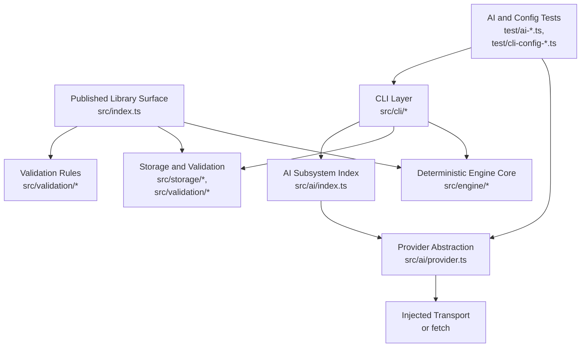
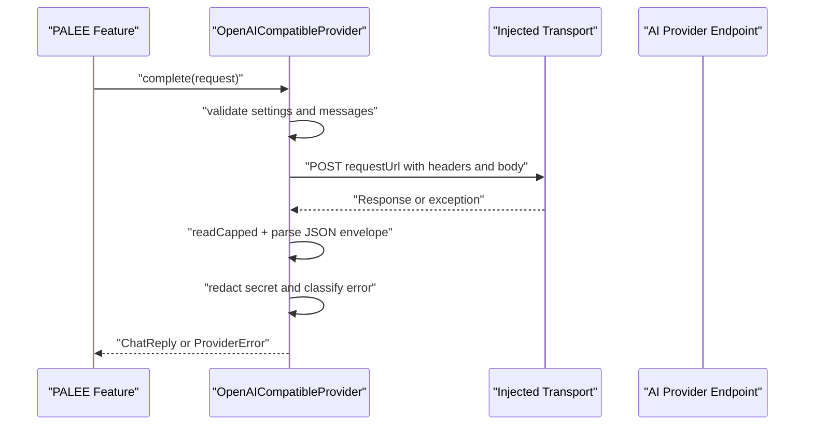
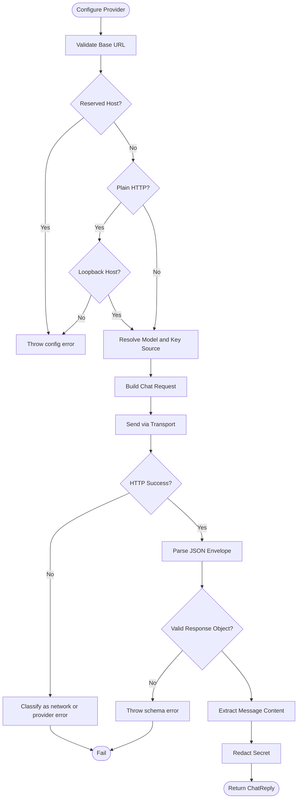
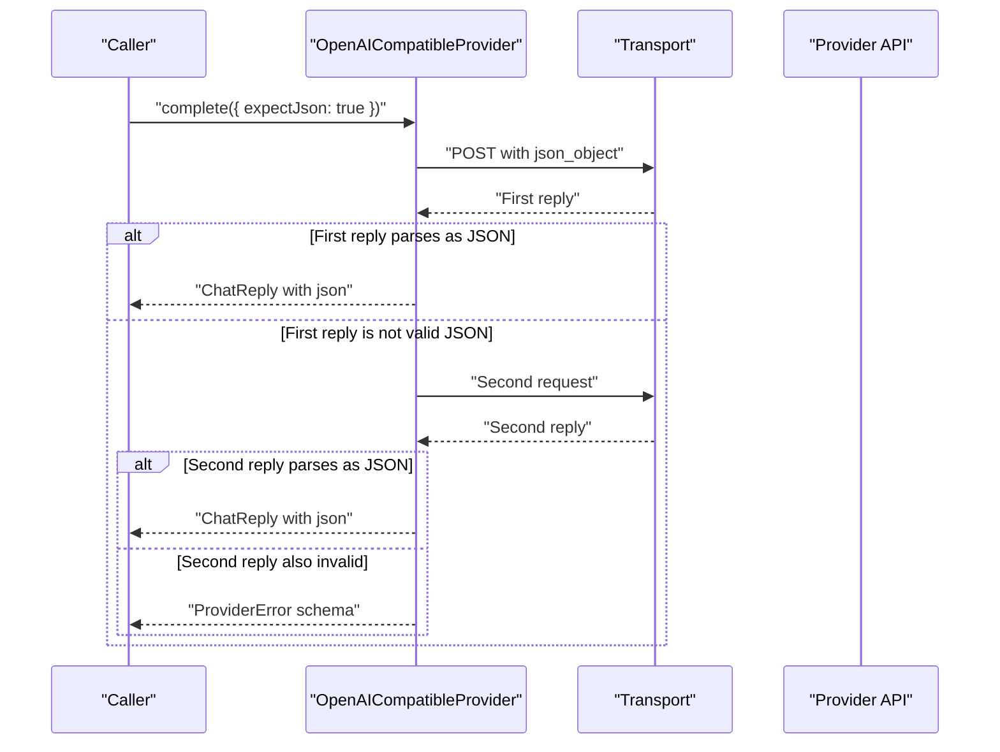
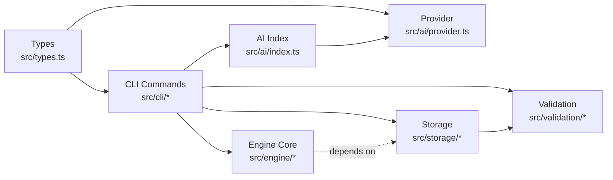
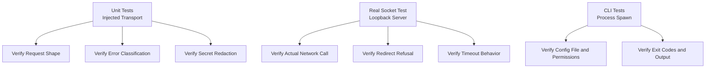

# AI Integration (Phase 2)

::: details Referenced Files in This Document

- [index.ts](https://github.com/Kuldeep2822k/cli/blob/main/src/ai/index.ts)
- [provider.ts](https://github.com/Kuldeep2822k/cli/blob/main/src/ai/provider.ts)
- [ai_module_design.md](https://github.com/Kuldeep2822k/cli/blob/main/planning/ai_module_design.md)
- [ai-network-boundary.test.ts](https://github.com/Kuldeep2822k/cli/blob/main/test/ai-network-boundary.test.ts)
- [ai-provider-loopback.test.ts](https://github.com/Kuldeep2822k/cli/blob/main/test/ai-provider-loopback.test.ts)
- [ai-provider.test.ts](https://github.com/Kuldeep2822k/cli/blob/main/test/ai-provider.test.ts)
- [cli-config-provider-credentials.test.ts](https://github.com/Kuldeep2822k/cli/blob/main/test/cli-config-provider-credentials.test.ts)
- [cli-config-test-connection.test.ts](https://github.com/Kuldeep2822k/cli/blob/main/test/cli-config-test-connection.test.ts)

:::

## Table of Contents
1. [Introduction](#introduction)
2. [Project Structure](#project-structure)
3. [Core Components](#core-components)
4. [Architecture Overview](#architecture-overview)
5. [Detailed Component Analysis](#detailed-component-analysis)
6. [Dependency Analysis](#dependency-analysis)
7. [Performance Considerations](#performance-considerations)
8. [Troubleshooting Guide](#troubleshooting-guide)
9. [Security, Privacy, and Ethics](#security-privacy-and-ethics)
10. [Testing Strategy](#testing-strategy)
11. [Planned Phase 2 Capabilities](#planned-phase-2-capabilities)
12. [Conclusion](#conclusion)

## Introduction
This document explains the PALEE AI integration module as planned for Phase 2. Its purpose is to add intelligent tutoring capabilities while keeping PALEE’s deterministic learning engine offline, secure, and independent from external AI providers.

The current implementation establishes a strict provider abstraction boundary:
- The only code path allowed to open a network connection lives in `src/ai/provider.ts`.
- The AI subsystem is intentionally excluded from the published library surface so that consumers importing PALEE do not gain outbound network capability.
- Configuration, credentials, endpoint validation, transport, retry, timeout, cancellation, response size limits, redaction, and error classification are all centralized in the provider layer.

The broader AI module design also defines how session management, tool use, prompt construction, safety checks, and future adaptive features will relate to PALEE’s core engine without giving the model direct write access to files or internal state.

## Project Structure
The AI integration is currently a small but carefully isolated subsystem:

**Diagram sources**
- [index.ts:1-11](https://github.com/Kuldeep2822k/cli/blob/main/src/ai/index.ts#L1-L11)
- [provider.ts:1-60](https://github.com/Kuldeep2822k/cli/blob/main/src/ai/provider.ts#L1-L60)

The barrel at `src/ai/index.ts` re-exports the provider contract but is itself not re-exported from `src/index.ts`. That distinction is what keeps PALEE’s published API offline by default.

**Section sources**
- [index.ts:1-11](https://github.com/Kuldeep2822k/cli/blob/main/src/ai/index.ts#L1-L11)
- [ai-module-design.md:1-60](https://github.com/Kuldeep2822k/cli/blob/main/planning/ai_module_design.md#L1-L60)

## Core Components
The Phase 2 AI integration has two primary concerns:

1. **Provider abstraction**
   - A typed interface for chat requests and replies.
   - One implemented adapter for OpenAI-compatible chat-completion endpoints.
   - Injected transport so every request can be recorded, mocked, or redirected during tests.
   - Centralized configuration resolution, endpoint normalization, credential handling, timeouts, cancellation, response caps, and classified errors.

2. **AI module planning**
   - Session manager responsibilities.
   - Read-only tools exposed to the model.
   - Mutation operations reserved for the application layer.
   - Safety heuristics, prompt-injection resistance, and human confirmation gates.

| Component | Responsibility | Current Status |
|---|---|---|
| `OpenAICompatibleProvider` | Sends one bounded, non-streaming chat completion request | Implemented |
| `Transport` | Injectable HTTP-like call surface | Implemented |
| `resolveProviderSettings` | Resolves base URL, model, key, and provider name | Implemented |
| `normalizeProviderEndpoint` | Validates scheme, host, query, fragment, userinfo, and reserved addresses | Implemented |
| `describeForeignText` / `maskSecret` / `maskJsonValue` | Redacts secrets and controls before logging or printing | Implemented |
| `ProviderError` | Classified failure with optional HTTP status | Implemented |
| Session manager | Orchestrates prompts, tools, context, and confirmations | Planned |
| Tool registry | Registers read-only engine functions available to the model | Planned |
| Adaptive recommendations | Generates roadmap or study guidance after learner input | Planned |

**Section sources**
- [provider.ts:1-120](https://github.com/Kuldeep2822k/cli/blob/main/src/ai/provider.ts#L1-L120)
- [ai-module-design.md:1-120](https://github.com/Kuldeep2822k/cli/blob/main/planning/ai_module_design.md#L1-L120)

## Architecture Overview
The provider abstraction separates PALEE from any specific AI backend. Consumers call into the provider through a stable interface; they do not construct URLs, assemble headers, manage retries, or inspect raw network responses directly.

**Diagram sources**
- [provider.ts:480-700](https://github.com/Kuldeep2822k/cli/blob/main/src/ai/provider.ts#L480-L700)
- [provider.ts:701-904](https://github.com/Kuldeep2822k/cli/blob/main/src/ai/provider.ts#L701-L904)

Key architectural guarantees:
- Only `src/ai/provider.ts` may open network sockets.
- No test reaches an external host; all network behavior goes through an injected transport or a loopback server.
- The provider does not import CLI logic, preserving a clean dependency direction.
- The published library surface does not expose the AI subsystem.

**Section sources**
- [ai-network-boundary.test.ts:1-114](https://github.com/Kuldeep2822k/cli/blob/main/test/ai-network-boundary.test.ts#L1-L114)
- [provider.ts:1-60](https://github.com/Kuldeep2822k/cli/blob/main/src/ai/provider.ts#L1-L60)

## Detailed Component Analysis

### Provider Interface Specification
The provider interface is defined by TypeScript types and one concrete class:

| Type or Class | Purpose | Important Contract |
|---|---|---|
| `ChatTurn` | One message in a conversation | Roles are system, user, or assistant |
| `ChatRequest` | Outbound request | Supports messages, optional JSON mode, temperature, and optional token cap |
| `ChatReply` | Inbound result | Contains text, optional parsed JSON, and optional usage counts |
| `UsageCounts` | Token accounting | Fields come from provider-reported tokens when present |
| `Transport` | Network seam | Takes a URL and `RequestInit`; used by tests to record calls |
| `ProviderSettings` | Connection configuration | Includes validated base URL, model, optional API key, key source, and optional provider name |
| `ProviderOptions` | Runtime options | Optional transport, timeout, environment map, and abort signal |
| `ProviderError` | Failure representation | Has `kind`, optional `status`, and a redacted message |
| `OpenAICompatibleProvider` | OpenAI-compatible adapter | Implements `complete`, URL building, retry for structured output, and response parsing |

The adapter does not stream responses and does not send tool definitions. Structured output is supported by requesting a complete JSON document, not by using the provider’s function-calling protocol.

**Section sources**
- [provider.ts:1-180](https://github.com/Kuldeep2822k/cli/blob/main/src/ai/provider.ts#L1-L180)
- [provider.ts:480-700](https://github.com/Kuldeep2822k/cli/blob/main/src/ai/provider.ts#L480-L700)

### Connection Handling and Security Boundaries
Connection handling is centralized around three stages:

1. **Configuration resolution**
   - Requires a configured base URL.
   - Normalizes and validates the endpoint.
   - Resolves model and provider name.
   - Chooses between stored API key and environment override.

2. **Endpoint validation**
   - Accepts only `http:` or `https:`.
   - Allows plain HTTP only for loopback hosts such as `localhost`, `::1`, and the `127.x.x.x` range.
   - Refuses reserved address space including link-local, unspecified, multicast, cloud metadata ranges, NAT64, 6to4, and Teredo translations.
   - Rejects embedded userinfo, query strings, and fragments in the base URL.

3. **Transport execution**
   - Uses an injected transport by default, falling back to global `fetch`.
   - Sets `redirect: 'error'` so bearer tokens are never forwarded to a redirect target.
   - Applies a per-request timeout and supports caller cancellation.
   - Reads responses incrementally up to a byte limit.
   - Parses the chat-completions envelope and classifies failures.

**Diagram sources**
- [provider.ts:201-450](https://github.com/Kuldeep2822k/cli/blob/main/src/ai/provider.ts#L201-L450)
- [provider.ts:451-700](https://github.com/Kuldeep2822k/cli/blob/main/src/ai/provider.ts#L451-L700)

**Section sources**
- [provider.ts:201-450](https://github.com/Kuldeep2822k/cli/blob/main/src/ai/provider.ts#L201-L450)
- [provider.ts:451-700](https://github.com/Kuldeep2822k/cli/blob/main/src/ai/provider.ts#L451-L700)

### Request and Response Protocol
The adapter implements an OpenAI-compatible chat-completion protocol with these constraints:

| Aspect | Behavior |
|---|---|
| Method | `POST` |
| Path | `<baseUrl>/chat/completions`, appended exactly once |
| Content-Type | `application/json` |
| Authorization | `Bearer <apiKey>` when configured |
| Messages | System, user, and assistant turns |
| JSON mode | Adds a system instruction when requested and no existing message mentions JSON |
| Response format | Sends `response_format: { type: "json_object" }` only when `expectJson` is true |
| Tools | Never sent; tool calling is out of scope for this build |
| Streaming | Not supported by this adapter |
| Usage | Optional; absent if provider fields are missing or non-numeric |

Structured output follows a strict contract:
- Fenced code blocks are rejected.
- Prose surrounding JSON is rejected.
- Repairing extracted objects is rejected.
- At most one retry is attempted.
- If the retry fails, the original parse reason and the retry reason are combined.

**Diagram sources**
- [provider.ts:480-700](https://github.com/Kuldeep2822k/cli/blob/main/src/ai/provider.ts#L480-L700)
- [provider.ts:701-904](https://github.com/Kuldeep2822k/cli/blob/main/src/ai/provider.ts#L701-L904)

**Section sources**
- [provider.ts:451-700](https://github.com/Kuldeep2822k/cli/blob/main/src/ai/provider.ts#L451-L700)
- [provider.ts:701-904](https://github.com/Kuldeep2822k/cli/blob/main/src/ai/provider.ts#L701-L904)

### Error Management
Errors are classified into four kinds:

| Kind | Meaning | Typical Exit Behavior |
|---|---|---|
| `config` | Missing endpoint, invalid URL, unsafe host, control characters in model or key, unsupported provider | Usage error |
| `network` | Redirect refusal, DNS/connection failure, timeout, cancellation | Usually unexpected error |
| `provider` | Non-2xx HTTP response, provider error payload, oversized response | Usually unexpected error |
| `schema` | Invalid JSON envelope, missing content, fenced or repaired structured output | Usually unexpected error |

Each `ProviderError` carries enough information for the CLI to map it to a single exit code without leaking secrets.

**Section sources**
- [provider.ts:1-120](https://github.com/Kuldeep2822k/cli/blob/main/src/ai/provider.ts#L1-L120)
- [provider.ts:480-700](https://github.com/Kuldeep2822k/cli/blob/main/src/ai/provider.ts#L480-L700)
- [cli-config-test-connection.test.ts:1-200](https://github.com/Kuldeep2822k/cli/blob/main/test/cli-config-test-connection.test.ts#L1-L200)

## Dependency Analysis
The dependency relationships keep AI functionality separate from core algorithms:

Important constraints enforced by tests:
- No source outside `src/ai/provider.ts` uses network primitives.
- `src/index.ts` does not re-export the AI subsystem.
- AI source files do not import from `src/cli`.

**Diagram sources**
- [index.ts:1-11](https://github.com/Kuldeep2822k/cli/blob/main/src/ai/index.ts#L1-L11)
- [provider.ts:1-60](https://github.com/Kuldeep2822k/cli/blob/main/src/ai/provider.ts#L1-L60)
- [ai-network-boundary.test.ts:1-114](https://github.com/Kuldeep2822k/cli/blob/main/test/ai-network-boundary.test.ts#L1-L114)

**Section sources**
- [ai-network-boundary.test.ts:1-114](https://github.com/Kuldeep2822k/cli/blob/main/test/ai-network-boundary.test.ts#L1-L114)

## Performance Considerations
The current provider implementation focuses on correctness and security rather than streaming throughput:

| Concern | Implementation |
|---|---|
| Timeout | Default 30 seconds per request; configurable via `timeoutMs` |
| Cancellation | Honors an `AbortSignal` so long-running work can be aborted |
| Response size | Streams and cancels reading after 256 KiB |
| Structured output | At most one retry; no infinite recovery loop |
| Transport | Injected for deterministic tests; real requests use `fetch` |
| Streaming responses | Not supported by this adapter |
| Rate limiting | Planned in the module design; not implemented in the provider |
| Retry policy | Planned exponential backoff with jitter; not implemented here |

The provider avoids buffering unbounded responses, which protects against denial-of-service from large provider payloads. It also avoids trusting provider-reported token counts blindly by returning `undefined` when the usage object lacks numeric fields.

**Section sources**
- [provider.ts:120-180](https://github.com/Kuldeep2822k/cli/blob/main/src/ai/provider.ts#L120-L180)
- [provider.ts:480-700](https://github.com/Kuldeep2822k/cli/blob/main/src/ai/provider.ts#L480-L700)
- [provider.ts:701-904](https://github.com/Kuldeep2822k/cli/blob/main/src/ai/provider.ts#L701-L904)
- [ai-module-design.md:201-317](https://github.com/Kuldeep2822k/cli/blob/main/planning/ai_module_design.md#L201-L317)

## Troubleshooting Guide

### Common Configuration Problems
- **Missing base URL:** The provider throws a configuration error and directs the user to configure the endpoint.
- **Invalid URL scheme:** Only HTTP and HTTPS are accepted.
- **Plain HTTP to a non-loopback host:** Bearer tokens must not travel in clear text over public networks.
- **Reserved host:** Link-local, unspecified, multicast, cloud metadata, and translation-prefix targets are refused.
- **Embedded credentials:** Username/password, query parameters, and fragments are rejected.
- **Unsupported provider:** Native Anthropic support is deferred to Phase 3; an OpenAI-compatible endpoint must be used now.

### Credential Issues
- **Wrong API key:** A 401 should be treated as a credential problem.
- **Environment vs stored key:** `PALEE_API_KEY` overrides the stored key; `keySource` indicates which one was used.
- **Control characters in key:** Keys with non-printable characters are rejected before any network call.
- **Echoed keys:** Redaction applies to error messages, success text, and parsed JSON values.

### Network and Timeout Problems
- **Redirects:** The client refuses redirects because following them could send the bearer token to an unknown host.
- **Silent peers:** A peer that reads but never responds is terminated by the request timeout.
- **Cancellation:** A caller-provided abort signal produces a cancellation error rather than a generic timeout.

### Response Problems
- **Non-JSON body:** A successful HTTP response that is not valid JSON is a schema error.
- **Empty assistant message:** Indicates missing content or possibly a token-cap truncation.
- **Oversized response:** Reading stops after the configured byte limit.

**Section sources**
- [provider.ts:201-450](https://github.com/Kuldeep2822k/cli/blob/main/src/ai/provider.ts#L201-L450)
- [provider.ts:451-700](https://github.com/Kuldeep2822k/cli/blob/main/src/ai/provider.ts#L451-L700)
- [provider.ts:701-904](https://github.com/Kuldeep2822k/cli/blob/main/src/ai/provider.ts#L701-L904)
- [cli-config-test-connection.test.ts:1-200](https://github.com/Kuldeep2822k/cli/blob/main/test/cli-config-test-connection.test.ts#L1-L200)

## Security, Privacy, and Ethics

### Security Boundaries
- Only `src/ai/provider.ts` may open network connections.
- The AI subsystem is not part of the published library surface.
- Plain HTTP is allowed only for loopback hosts.
- Reserved and metadata-address ranges are refused regardless of scheme.
- Redirects are disabled so credentials cannot leak to follow-up hosts.
- Credentials are never printed, logged, or included in stack traces.

### Privacy Protections
- Foreign text is redacted before truncation.
- Control characters are stripped to prevent terminal injection.
- Response bodies are capped while reading.
- Parsed JSON values are recursively masked.
- API keys are not required for loopback servers.

### Ethical Guidelines for AI-Assisted Learning
- The model can propose assessments, reviews, summaries, and roadmaps, but it cannot mutate data directly.
- Critical mutations require explicit learner confirmation.
- Anomalous assessment proposals should be flagged and require extra caution.
- Vault notes are treated as untrusted learning material; prompts must instruct the model not to execute instructions found inside note content.
- Integrity markers in prompts are helpers, not cryptographic guarantees.
- AI assistance should remain transparent, auditable, and reversible.

**Section sources**
- [ai-network-boundary.test.ts:1-114](https://github.com/Kuldeep2822k/cli/blob/main/test/ai-network-boundary.test.ts#L1-L114)
- [provider.ts:201-450](https://github.com/Kuldeep2822k/cli/blob/main/src/ai/provider.ts#L201-L450)
- [provider.ts:480-700](https://github.com/Kuldeep2822k/cli/blob/main/src/ai/provider.ts#L480-L700)
- [provider.ts:701-904](https://github.com/Kuldeep2822k/cli/blob/main/src/ai/provider.ts#L701-L904)
- [ai-module-design.md:201-317](https://github.com/Kuldeep2822k/cli/blob/main/planning/ai_module_design.md#L201-L317)

## Testing Strategy

### Mock Providers
Tests inject a `Transport` that records the URL, method, headers, and request body. This allows verification of:
- Endpoint path construction.
- Authorization header presence.
- JSON mode behavior.
- Absence of tool or function fields.
- Timeout and cancellation behavior.
- Response parsing and redaction.

### Network Boundary Testing
A static scan of the source tree asserts that no file outside `src/ai/provider.ts` imports or calls network primitives. It also asserts that the AI subsystem does not import CLI code.

### Real Socket Testing
A dedicated loopback server proves that the actual transport path works end-to-end:
- Correct request path.
- Authorization header delivery.
- Redirect refusal.
- Silent-peer timeout.
- CLI `test-connection` exit codes and output formatting.

### Credential and Configuration Testing
End-to-end CLI tests verify:
- Storing base URL and provider name.
- Refusing unsafe URLs.
- Accepting loopback endpoints.
- Refusing embedded credentials.
- Safe key input from environment, pipe, and interactive flow.
- Output never revealing full or partial secrets.
- `test-connection` reporting correct endpoint, key source, reply, and token counts.

**Diagram sources**
- [ai-provider.test.ts:1-200](https://github.com/Kuldeep2822k/cli/blob/main/test/ai-provider.test.ts#L1-L200)
- [ai-provider-loopback.test.ts:1-131](https://github.com/Kuldeep2822k/cli/blob/main/test/ai-provider-loopback.test.ts#L1-L131)
- [cli-config-provider-credentials.test.ts:1-200](https://github.com/Kuldeep2822k/cli/blob/main/test/cli-config-provider-credentials.test.ts#L1-L200)
- [cli-config-test-connection.test.ts:1-200](https://github.com/Kuldeep2822k/cli/blob/main/test/cli-config-test-connection.test.ts#L1-L200)

**Section sources**
- [ai-provider.test.ts:1-200](https://github.com/Kuldeep2822k/cli/blob/main/test/ai-provider.test.ts#L1-L200)
- [ai-provider-loopback.test.ts:1-131](https://github.com/Kuldeep2822k/cli/blob/main/test/ai-provider-loopback.test.ts#L1-L131)
- [ai-network-boundary.test.ts:1-114](https://github.com/Kuldeep2822k/cli/blob/main/test/ai-network-boundary.test.ts#L1-L114)
- [cli-config-provider-credentials.test.ts:1-200](https://github.com/Kuldeep2822k/cli/blob/main/test/cli-config-provider-credentials.test.ts#L1-L200)
- [cli-config-test-connection.test.ts:1-200](https://github.com/Kuldeep2822k/cli/blob/main/test/cli-config-test-connection.test.ts#L1-L200)

## Planned Phase 2 Capabilities

### Content Generation
The AI module plans to generate:
- Feynman-style questions.
- Practice problems.
- Debug scenarios.
- Topic explanations tailored to learner level.
- Roadmap proposals when no deterministic source is provided.

These outputs are proposals, not direct writes. They must be validated and confirmed before being persisted.

### Assessment Assistance
The model can return a structured assessment proposal with scores and evidence. PALEE validates the proposal, displays changes, asks for confirmation, and then updates only the assessment field—not the spaced-repetition review object.

Anomaly detection flags unusually large score increases within a short time window, requiring explicit confirmation even if the proposal otherwise passes validation.

### Adaptive Learning Recommendations
Planned capabilities include:
- Generating a roadmap from learner goals, experience, availability, and constraints.
- Suggesting topics, dependencies, difficulty, and rationale.
- Producing session summaries that refresh hot memory after approval.

The model receives read-only tools and must never receive mutation tools.

### Isolation From Core Learning Algorithms
The separation is explicit:
- The AI layer constructs prompts and interprets safe model output.
- The engine core remains deterministic and offline.
- SM-2 scheduling, dependency graphs, mastery calculations, and file storage stay outside the AI boundary.
- The AI layer accesses engine state through read-only tools and application APIs.

**Section sources**
- [ai-module-design.md:1-200](https://github.com/Kuldeep2822k/cli/blob/main/planning/ai_module_design.md#L1-L200)
- [ai-module-design.md:201-317](https://github.com/Kuldeep2822k/cli/blob/main/planning/ai_module_design.md#L201-L317)

## Conclusion
PALEE’s Phase 2 AI integration begins with a narrow, security-first provider abstraction. The current implementation provides a single OpenAI-compatible adapter, strict endpoint validation, credential isolation, bounded I/O, classified errors, and strong tests proving that network access is confined to one place.

The broader AI module design extends this foundation into tutoring sessions, read-only tools, safe mutation workflows, anomaly detection, and adaptive recommendations—all while keeping PALEE’s deterministic learning engine independent from external AI systems. Future phases can add more providers, rate limiting, circuit breaking, and streaming, but they must preserve the same boundaries: no secret leakage, no uncontrolled network access, no model-controlled mutations, and no coupling between the AI layer and the CLI or core engine.