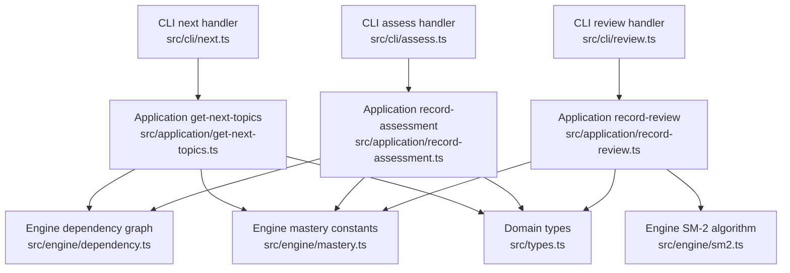
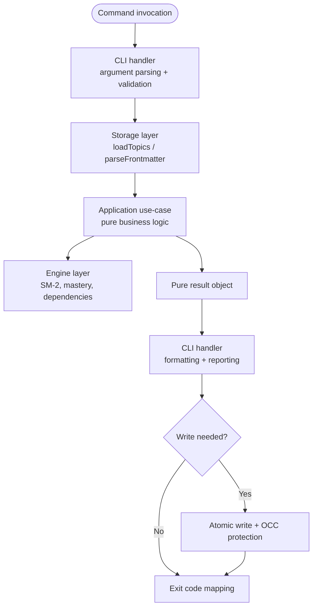
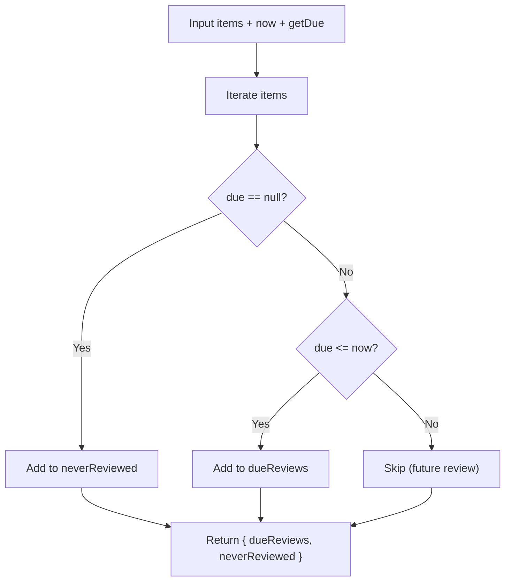
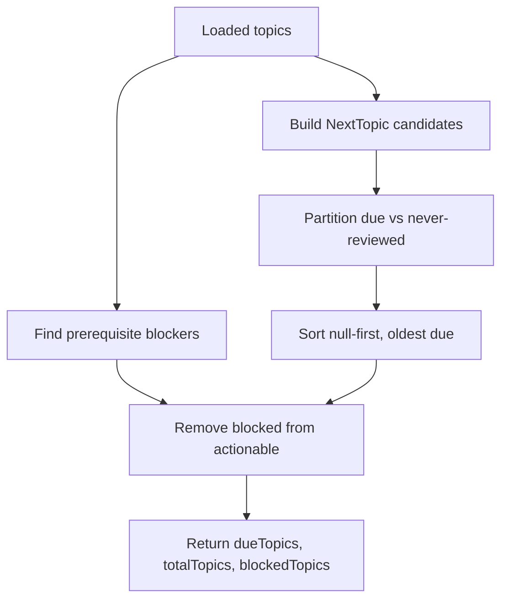
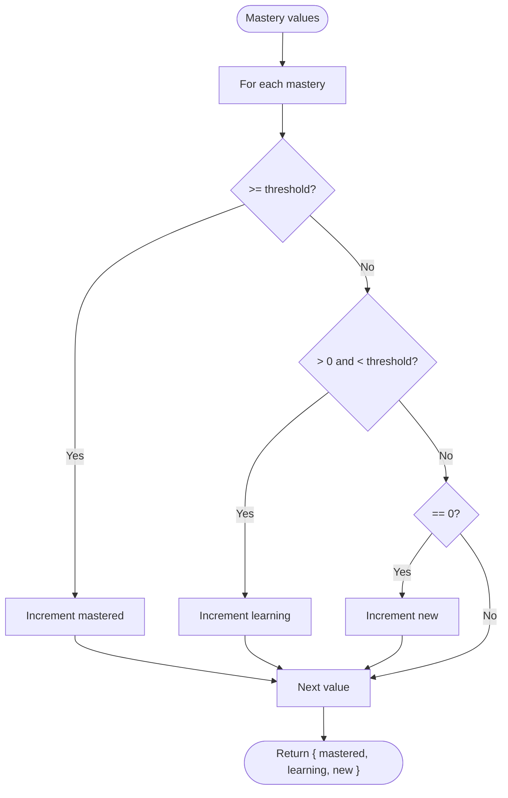
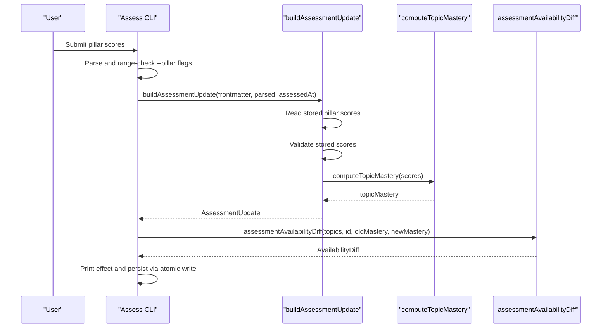
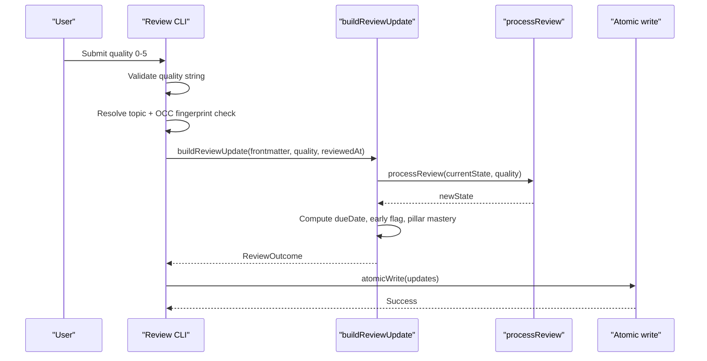
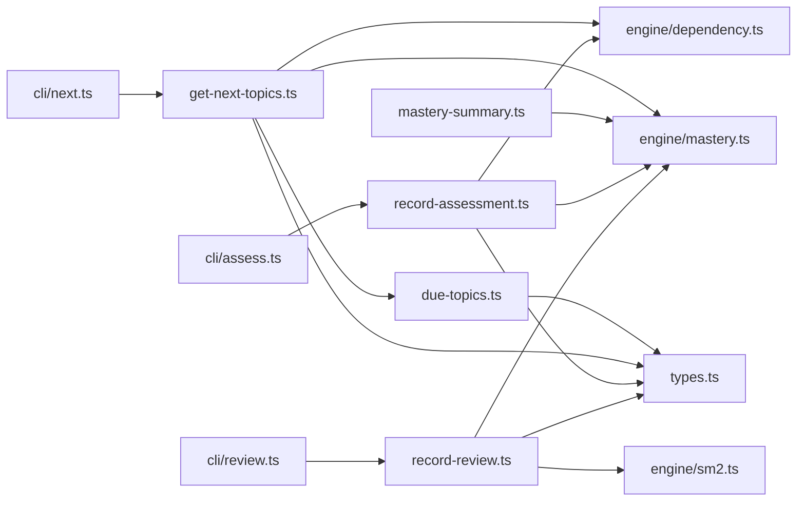

# Application Layer

::: details Referenced Files in This Document

- [0025-application-layer.md](https://github.com/Kuldeep2822k/cli/blob/main/docs/adr/0025-application-layer.md)
- [due-topics.ts](https://github.com/Kuldeep2822k/cli/blob/main/src/application/due-topics.ts)
- [get-next-topics.ts](https://github.com/Kuldeep2822k/cli/blob/main/src/application/get-next-topics.ts)
- [mastery-summary.ts](https://github.com/Kuldeep2822k/cli/blob/main/src/application/mastery-summary.ts)
- [record-assessment.ts](https://github.com/Kuldeep2822k/cli/blob/main/src/application/record-assessment.ts)
- [record-review.ts](https://github.com/Kuldeep2822k/cli/blob/main/src/application/record-review.ts)
- [next.ts](https://github.com/Kuldeep2822k/cli/blob/main/src/cli/next.ts)
- [assess.ts](https://github.com/Kuldeep2822k/cli/blob/main/src/cli/assess.ts)
- [review.ts](https://github.com/Kuldeep2822k/cli/blob/main/src/cli/review.ts)
- [dependency.ts](https://github.com/Kuldeep2822k/cli/blob/main/src/engine/dependency.ts)
- [mastery.ts](https://github.com/Kuldeep2822k/cli/blob/main/src/engine/mastery.ts)
- [sm2.ts](https://github.com/Kuldeep2822k/cli/blob/main/src/engine/sm2.ts)
- [types.ts](https://github.com/Kuldeep2822k/cli/blob/main/src/types.ts)

:::

## Table of Contents
1. [Introduction](#introduction)
2. [Project Structure](#project-structure)
3. [Core Components](#core-components)
4. [Architecture Overview](#architecture-overview)
5. [Detailed Component Analysis](#detailed-component-analysis)
6. [Dependency Analysis](#dependency-analysis)
7. [Performance Considerations](#performance-considerations)
8. [Troubleshooting Guide](#troubleshooting-guide)
9. [Conclusion](#conclusion)

## Introduction
The PALEE application layer is the business logic boundary between command handlers and the engine/storage layers. Its purpose is to define reusable, testable use cases for scheduling and progression without touching files, processes, or CLI infrastructure. The design decision is documented in ADR-0025: extract genuinely reusable logic into `src/application/`, keep CLI handlers responsible for argument parsing, vault access, atomic writes, output formatting, and exit codes, and keep each use-case pure so it can be unit-tested and reused by other interfaces such as a TUI, web UI, or AI tool-calling.

The application layer covers five responsibilities:
- Scheduling state normalization and due-topic partitioning.
- Next-topic recommendation with prerequisite gating.
- Mastery summary aggregation across the four pedagogical pillars.
- Assessment recording workflows that merge pillar scores, recompute mastery, and compute downstream availability changes.
- Review recording workflows that transition SM-2 spaced repetition state, compute due dates, and update progress metrics.

## Project Structure
The application layer sits under `src/application/` and is consumed by CLI commands under `src/cli/`. It depends on domain algorithms in `src/engine/` and shared types in `src/types.ts`. Storage, locking, file I/O, and process handling remain outside this layer.

## Core Components
| Application module | Responsibility | Pure contract | Main consumers |
|---|---|---|---|
| `due-topics.ts` | Normalize due dates, compare null-first ordering, partition topics into elapsed reviews vs never-reviewed | No Commander, no process, no I/O | `next`, `plan`, `dashboard` read models |
| `get-next-topics.ts` | Build actionable topic list, apply prerequisite gate, report blocked candidates | No I/O; consumes loaded topics and time | `palee next` CLI |
| `mastery-summary.ts` | Bucket mastery values into new, learning, mastered | No I/O | `plan`, `dashboard`, `progress` |
| `record-assessment.ts` | Merge pillar scores, validate stored values, compute mastery delta, compute availability diff | No OCC, fs, Commander, process | `palee assess` CLI |
| `record-review.ts` | Transition SM-2 state, compute due date, resolve pillar-based mastery, detect early review | No I/O, OCC, or process | `palee review` CLI |

Key design properties:
- Each function is deterministic given its inputs.
- CLI code owns side effects: loading topics, parsing frontmatter, locking, atomic writes, JSON output, and exit codes.
- Domain thresholds are imported from the engine rather than duplicated.
- Read models share one source of truth for due selection and prerequisite gating.

## Architecture Overview
The application layer is intentionally thin around business rules. It does not own storage paths, lock acquisition, filesystem mutation, or process termination. Instead, it transforms loaded data into validated results and updates.

This flow preserves three separation boundaries:
1. CLI handles user-facing policy, input shape, and process behavior.
2. Application layer encapsulates scheduling, prerequisites, mastery aggregation, and state transitions.
3. Engine layer provides pure algorithms and graph analysis.

## Detailed Component Analysis

### Due Topics Discovery Algorithm
The due-topic discovery algorithm separates two concepts:
- **Due by date**: a topic has never been scheduled or its scheduled due date has passed.
- **Ready by graph**: a topic’s prerequisites are satisfied.

`normalizeDueDate` coerces raw due values into `Date | null`, treating empty, absent, and unparseable values as never scheduled. `compareDue` orders null first, then oldest due date, with stable equality. `partitionDue` splits items into elapsed scheduled reviews and never-scheduled topics, leaving future-dated topics in neither bucket. Consumers compose these buckets according to their meaning of “due”: `next` and `plan` treat never-reviewed and elapsed reviews as actionable, while `dashboard` counts only elapsed reviews for its backlog metric.

Complexity:
- Time: `O(n)` over the input items.
- Space: `O(k)` where `k` is the number of items placed into the two partitions.

### Next Topics Recommendation Engine
The next-topic recommendation engine answers what a learner should study now. It composes due-topic partitioning with prerequisite gating:

1. Build a prerequisite-block map using `findPrerequisiteBlocked`.
2. Map loaded topics to `NextTopic` objects carrying id, title, path, normalized due date, mastery, repetition, and status.
3. Partition candidates into never-reviewed and elapsed reviews.
4. Sort actionable candidates by null-first, oldest-due ordering.
5. Separate blocked candidates from actionable ones.
6. Return `NextTopicsResult` with actionable due topics, total topic count, and blocked details.

Prerequisite blocking rules:
- Archived topics are skipped.
- Already-mastered topics are not gated.
- Dependency satisfaction uses the engine’s `areDependenciesSatisfied`.
- Missing references are reported as missing.
- Unmastered prerequisites are reported with their current mastery versus the threshold.
- Topics on or downstream of dependency cycles are quarantined and not reported as blocked, keeping `next` consistent with `plan`.

Complexity:
- Graph construction and cycle quarantine run over the topic set.
- Prerequisite checks traverse dependency edges per candidate.
- Sorting actionable candidates is `O(a log a)` where `a` is the number of actionable candidates.

### Mastery Summary Computation
The mastery summary aggregates mastery scores across all topics into three buckets:
- **Mastered**: at or above the mastery threshold.
- **Learning**: greater than zero but below the threshold.
- **New**: exactly zero mastery.

The implementation uses independent predicates so every value falls into exactly one bucket. It is used by `plan`, `dashboard`, and `progress` read models, replacing duplicated inline filters.

Complexity:
- Time: `O(m)` over the masteries array.
- Space: constant accumulator state.

### Assessment Recording Workflow
The assessment workflow records pillar scores, recomputes topic mastery, and reports how readiness changes.

Processing order:
1. Validate explicitly supplied pillar arguments in the CLI.
2. For pillars not supplied, read stored values from frontmatter.
3. Refuse stored values outside `[0, 1]` instead of silently clamping them.
4. Merge supplied pillars over stored values.
5. Compute previous and new mastery using the canonical weighted formula.
6. Produce frontmatter updates: updated mastery, assessment timestamp, and only the pillars that were supplied.
7. Compute an availability diff showing topics newly offered or newly blocked by `palee plan`.

State transitions:
- The assessed topic’s mastery may increase, decrease, or stay the same.
- Unlocking means dependent topics become ready.
- Newly blocked means dependent topics stop being offered because the assessed topic dropped below the readiness threshold.

Error handling:
- Invalid stored pillar scores surface as errors rather than guesses.
- The CLI maps usage errors, OCC conflicts, and unexpected exceptions to explicit exit codes.
- A dry-run preview prints the same effect as a recording, avoiding drift between prediction and outcome.

### Review Recording Workflow
The review workflow advances spaced repetition state based on recall quality.

Processing order, with the owning layer named for each step. This matters because the steps are split across the boundary the Core Components table states: `record-review.ts` performs no I/O, OCC, or process handling itself, so the resolution, fingerprint, and write steps around the pure computation belong to its caller, the CLI.

1. **CLI** (`reviewCommand` in `src/cli/review.ts`): validate the quality rating as an integer from 0 to 5.
2. **CLI**: load the vault’s topics and resolve the target topic with `resolveTopicQuery` (`src/cli/topic-query.ts`), refusing missing or ambiguous matches. Topic resolution is a CLI policy, not something `record-review.ts` does.
3. **CLI**: fingerprint the loaded note content with `computeFingerprint`, then re-read the note from disk and compare fingerprints — the OCC read-reread check. A mismatch aborts the review with an `ECONFLICT` error before any update is computed or written.
4. **CLI**: parse the frontmatter from the freshly re-read content.
5. **Application** (`buildReviewUpdate` in `src/application/record-review.ts`): coerce stored SM-2 fields, preserving literal zeros and refusing garbage.
6. **Application → Engine**: run `processReview` to transition ease factor, interval, repetition, and lapse counters.
7. **Application**: compute the next due date from review time and interval.
8. **Application**: detect whether the review happened before the stored calendar-day due date.
9. **Application → Engine**: resolve pillar-based mastery using `pillars-first` precedence.
10. **Application**: carry forward only pillars already present in the note.
11. **Application**: build the frontmatter updates — SM-2 state, mastery, last reviewed and due dates as local date strings — and return them. Nothing has been written yet.
12. **CLI**: apply the updates to the re-read content and persist with `atomicWrite`, passing the fresh fingerprint so the write itself stays guarded.

Downstream effects:
- Spaced repetition intervals change according to SM-2.
- Topic mastery may change when pillar scores are present.
- Early reviews are still recorded but warn unless forced.
- Corrupted SM-2 state is surfaced with a repair hint pointing to validation.

### Use Case Orchestration Patterns
Common orchestration patterns across the application layer:

| Pattern | Example | Purpose |
|---|---|---|
| Pure computation separated from I/O | `buildAssessmentUpdate`, `buildReviewUpdate` | Unit-testable business logic without disk access |
| Shared predicate with local policy | Due partitioning vs prerequisite gating | Avoid copy-paste while preserving command-specific behavior |
| Availability diffing | `assessmentAvailabilityDiff` | Report downstream impact of mastery changes |
| Early-warning composition | Early review detection combined with persistence | Record the action but inform the user about schedule implications |
| Threshold reuse | `MASTERY_THRESHOLD` from engine | Keep grading, gating, and reporting aligned |

These patterns make complex workflows composable:
- `getNextTopics` combines due partitioning, prerequisite gating, and sorting.
- `buildAssessmentUpdate` combines stored score reading, validation, mastery computation, and update generation.
- `assessmentAvailabilityDiff` simulates readiness before and after a mastery change.
- `buildReviewUpdate` combines SM-2 transition, due-date calculation, early-review detection, and pillar-aware mastery resolution.

## Dependency Analysis
The application layer has clear inward dependencies and outward callers.

Coupling characteristics:
- Low coupling to CLI: only imports are use-case functions and types.
- Clear separation from engine: application code calls algorithms, not filesystem APIs.
- Shared thresholds and constants come from the engine to avoid divergence.
- Circular dependencies are avoided by placing shared types in `src/types.ts`.

Potential risks:
- Adding I/O inside application functions would break the purity contract.
- Duplicating threshold logic could create inconsistent grading, gating, and reporting.
- Over-sharpening policies into predicates could flatten deliberate command differences.

## Performance Considerations
- Due partitioning and mastery bucketing are linear scans and scale directly with input size.
- Next-topic recommendation adds graph traversal proportional to dependency edges; expensive operations like cycle quarantine are bounded by the engine’s decomposition and enumeration logic.
- Review and assessment computations are constant-time relative to topic count; they operate on a single note’s frontmatter.
- Keeping heavy work in the engine and application layers avoids repeated filesystem access from presentation logic.
- The CLI layer — the layer above the application layer — owns the surrounding I/O concerns: loading topics, session state, and concurrency protection (the fingerprint check and the atomic write). Application and engine functions receive already-loaded data and stay free of caching, locking, and process concerns.

## Troubleshooting Guide
Common issues and their application-layer behavior:

| Issue | Symptom | Application-layer handling | CLI response |
|---|---|---|---|
| Invalid stored pillar score | Stored value outside `[0, 1]` | `readScoreRange` returns an error | Usage or validation error message |
| Corrupted SM-2 state | Invalid ease factor, interval, repetition, or lapses | `processReview` throws with field name and value | Error plus hint to run validation repair |
| Early review | Review occurs before stored `due_at` | `early` flag computed from local calendar day comparison | Warning printed unless forced |
| Blocked prerequisites | Topic not actionable despite being due | `describeUnmetDependencies` names missing or unmastered prerequisites | Blocked topic list with waiting-on phrases |
| Dependency cycles | Topics on cycles have undefined readiness | Cycles quarantined; not reported as blocked | Consistent with plan/dashboard behavior |
| Lowered assessment mastery | Mastery drops below threshold | Availability diff reports newly blocked dependents | Warning about notes no longer offered |

Recommended recovery steps:
- Run validation to detect malformed frontmatter or invalid SM-2 state.
- Repair corrupt review state before retrying reviews.
- Score the Feynman pillar if mastery cannot reach the threshold with ordinary pillars alone.
- Use dry-run previews for assessments to see unlocking/blocking effects before committing changes.

## Conclusion
The PALEE application layer cleanly separates business logic from I/O and CLI concerns. It exposes pure use cases for due-topic discovery, next-topic recommendation, mastery summarization, assessment recording, and review recording. By composing due partitioning, prerequisite gating, SM-2 transitions, and pillar-based mastery, it supports complex workflows while remaining testable and reusable. The CLI retains responsibility for configuration, vault access, atomic writes, output formatting, and exit codes, preserving the architectural boundary defined in ADR-0025.

[No sources needed since this section summarizes without analyzing specific files]

## References

- [0025-application-layer.md:1-63](https://github.com/Kuldeep2822k/cli/blob/main/docs/adr/0025-application-layer.md#L1-L63)
- [next.ts:1-200](https://github.com/Kuldeep2822k/cli/blob/main/src/cli/next.ts#L1-L200)
- [assess.ts:1-200](https://github.com/Kuldeep2822k/cli/blob/main/src/cli/assess.ts#L1-L200)
- [review.ts:1-141](https://github.com/Kuldeep2822k/cli/blob/main/src/cli/review.ts#L1-L141)
- [get-next-topics.ts:1-199](https://github.com/Kuldeep2822k/cli/blob/main/src/application/get-next-topics.ts#L1-L199)
- [record-assessment.ts:1-134](https://github.com/Kuldeep2822k/cli/blob/main/src/application/record-assessment.ts#L1-L134)
- [record-review.ts:1-116](https://github.com/Kuldeep2822k/cli/blob/main/src/application/record-review.ts#L1-L116)
- [dependency.ts:1-200](https://github.com/Kuldeep2822k/cli/blob/main/src/engine/dependency.ts#L1-L200)
- [mastery.ts:1-200](https://github.com/Kuldeep2822k/cli/blob/main/src/engine/mastery.ts#L1-L200)
- [sm2.ts:1-200](https://github.com/Kuldeep2822k/cli/blob/main/src/engine/sm2.ts#L1-L200)
- [types.ts:1-200](https://github.com/Kuldeep2822k/cli/blob/main/src/types.ts#L1-L200)
- [0025-application-layer.md:15-63](https://github.com/Kuldeep2822k/cli/blob/main/docs/adr/0025-application-layer.md#L15-L63)
- [due-topics.ts:1-58](https://github.com/Kuldeep2822k/cli/blob/main/src/application/due-topics.ts#L1-L58)
- [mastery-summary.ts:1-36](https://github.com/Kuldeep2822k/cli/blob/main/src/application/mastery-summary.ts#L1-L36)
