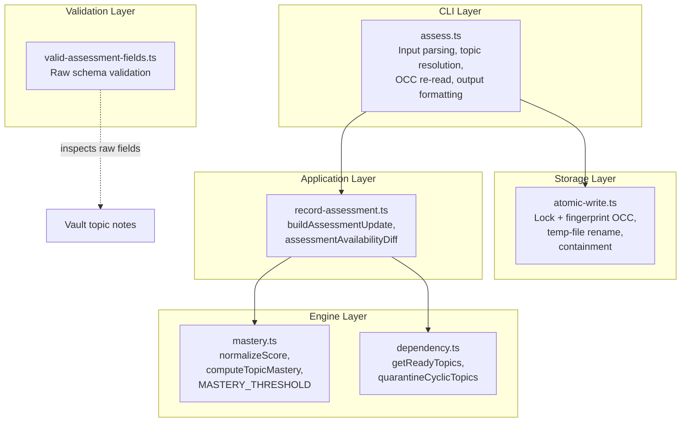
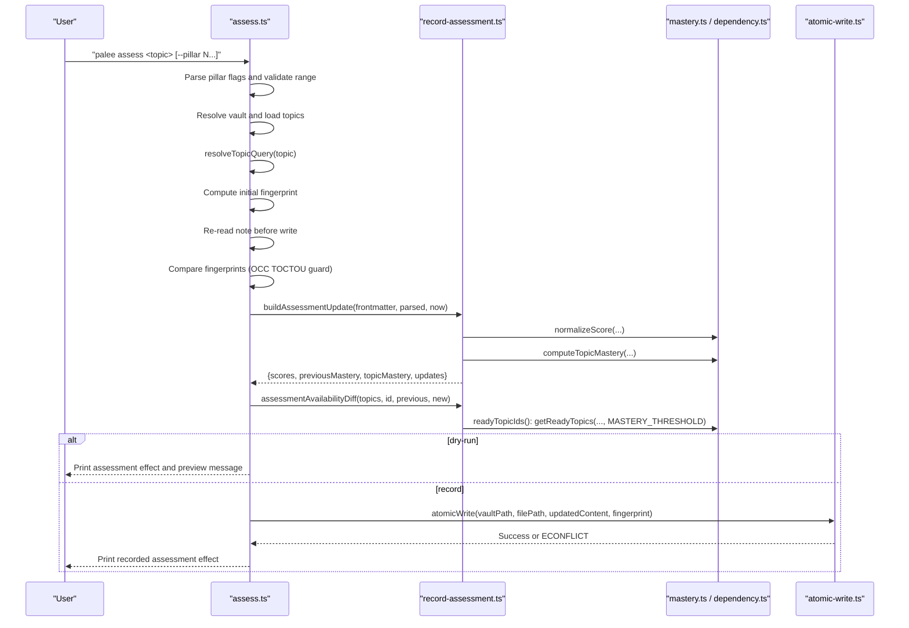
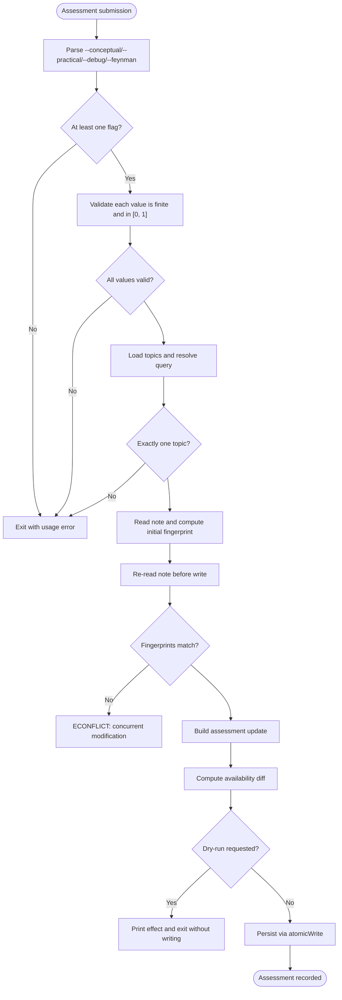
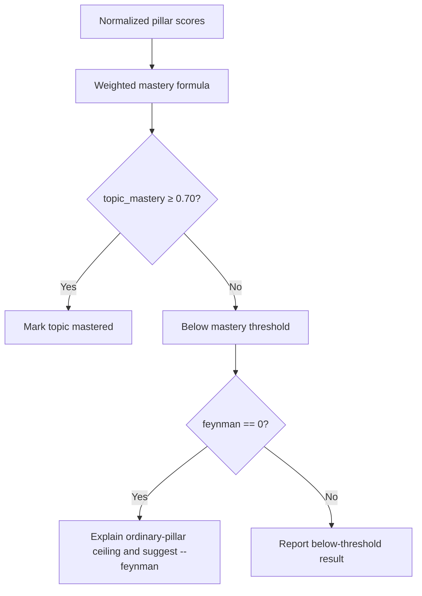
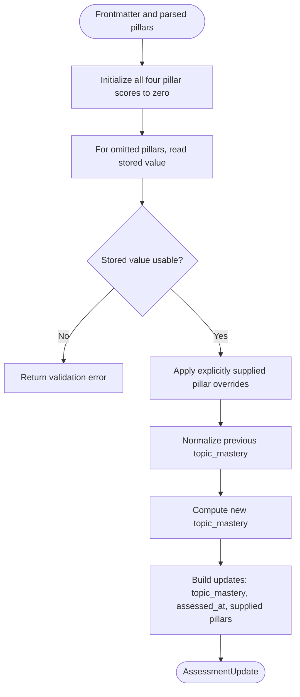
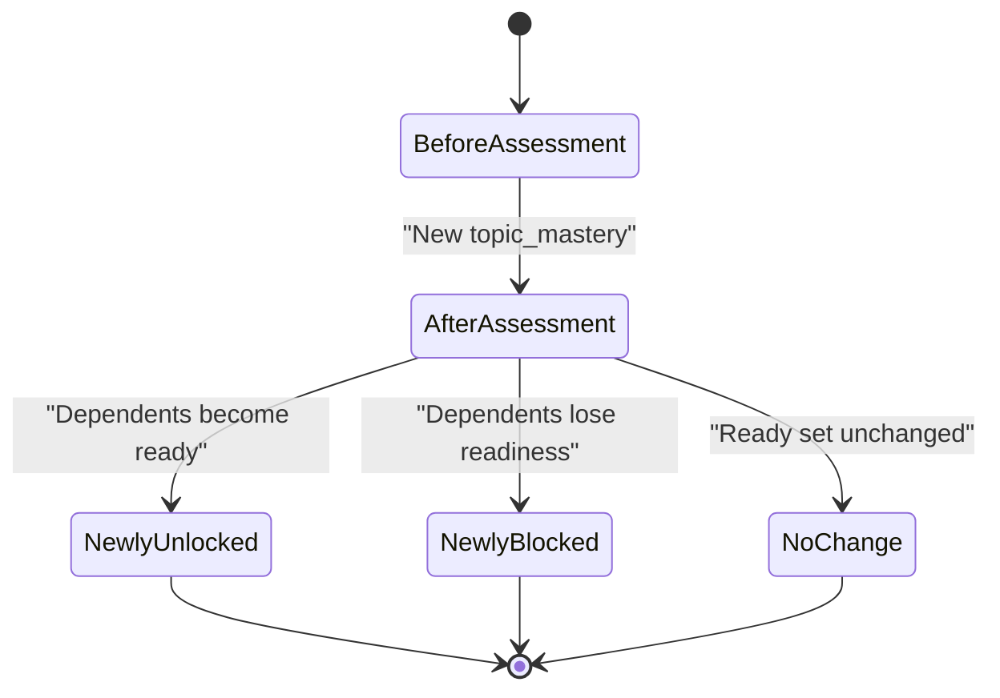
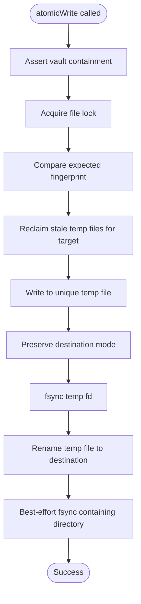
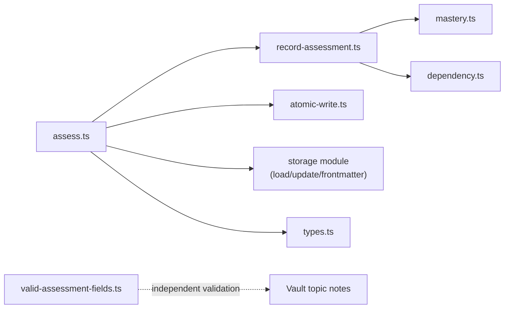

# Assessment Recording Workflow

::: details Referenced Files in This Document

- [record-assessment.ts](https://github.com/Kuldeep2822k/cli/blob/main/src/application/record-assessment.ts)
- [assess.ts](https://github.com/Kuldeep2822k/cli/blob/main/src/cli/assess.ts)
- [mastery.ts](https://github.com/Kuldeep2822k/cli/blob/main/src/engine/mastery.ts)
- [index.ts](https://github.com/Kuldeep2822k/cli/blob/main/src/engine/index.ts)
- [atomic-write.ts](https://github.com/Kuldeep2822k/cli/blob/main/src/storage/atomic-write.ts)
- [valid-assessment-fields.ts](https://github.com/Kuldeep2822k/cli/blob/main/src/validation/rules/valid-assessment-fields.ts)
- [0021-assessment-surface.md](https://github.com/Kuldeep2822k/cli/blob/main/docs/adr/0021-assessment-surface.md)
- [0004-four-pillar-pedagogical-mastery.md](https://github.com/Kuldeep2822k/cli/blob/main/docs/adr/0004-four-pillar-pedagogical-mastery.md)
- [0005-concurrency-storage-and-schema-migration.md](https://github.com/Kuldeep2822k/cli/blob/main/docs/adr/0005-concurrency-storage-and-schema-migration.md)
- [0014-atomic-write-durability-and-containment.md](https://github.com/Kuldeep2822k/cli/blob/main/docs/adr/0014-atomic-write-durability-and-containment.md)

:::

## Table of Contents
1. [Introduction](#introduction)
2. [Project Structure](#project-structure)
3. [Core Components](#core-components)
4. [Architecture Overview](#architecture-overview)
5. [Detailed Component Analysis](#detailed-component-analysis)
6. [Dependency Analysis](#dependency-analysis)
7. [Performance Considerations](#performance-considerations)
8. [Troubleshooting Guide](#troubleshooting-guide)
9. [Conclusion](#conclusion)

## Introduction
This document explains the assessment recording workflow used by the application’s `palee assess` command. It covers how incoming pillar scores are validated, how stored assessment fields are inspected without silently repairing corruption, how business rules compute and persist mastery, and how readiness changes are reported to downstream scheduling and dependency tools.

The workflow is intentionally layered:
- The CLI parses user input and resolves the target topic.
- The application layer computes a pure assessment update from frontmatter and pillar inputs.
- The engine layer provides mastery computation, normalization, readiness checks, and the 0.70 mastery threshold.
- The storage layer persists changes atomically with optimistic concurrency control and vault containment guarantees.
- Validation rules inspect raw on-disk assessment data independently of runtime normalization.

## Project Structure
The assessment recording path crosses four layers:

## Core Components
The assessment recording workflow is driven by three responsibilities:

| Component | Responsibility | Key Behavior |
|---|---|---|
| CLI handler (`assess.ts`) | Accepts user input, resolves a single topic, validates CLI scores, reads fresh file state, builds an assessment update, previews or records it, and maps errors to exit codes. | Rejects missing pillars, non-scalar numeric strings, out-of-range values, missing topics, ambiguous matches, concurrent modifications, and storage conflicts. |
| Application use case (`record-assessment.ts`) | Computes normalized pillar scores, previous and new mastery, frontmatter updates, and readiness delta for plan output. | Only writes pillars explicitly supplied by the user; refuses corrupt stored pillar values instead of clamping them into mastery. |
| Engine primitives (`mastery.ts`, `dependency.ts`) | Defines the four-pillar model, normalization, weighted mastery formula, readiness threshold, and readiness checks. | Uses a 0.70 threshold; double-weights Feynman so ordinary pillars alone cannot reach mastery. |
| Storage primitive (`atomic-write.ts`) | Persists updated content atomically under vault containment and lock-based concurrency control. | Reclaims stale temp files, preserves destination mode, retries Windows contention, and reports conflict errors. |
| Validation rule (`valid-assessment-fields.ts`) | Inspects raw on-disk assessment fields without applying runtime coercion. | Reports invalid pillar ranges and invalid `assessed_at` values as manual-fix issues. |

## Architecture Overview
The complete assessment lifecycle has two execution paths: preview and recording.

## Detailed Component Analysis

### Input Validation Pipeline
The CLI enforces strict validation at multiple points:

1. **Pillar flag presence**: At least one pillar must be provided.
2. **Pillar value parsing**: Each value must parse to a finite number in `[0, 1]`. Values are not silently clamped because they represent explicit learner intent.
3. **Topic resolution**: Exact `palee_id` matches win before fuzzy matching. Missing or ambiguous queries produce usage-level errors.
4. **Vault target**: A valid vault path is required.
5. **File freshness**: The note is re-read immediately before writing and compared against its initial fingerprint.
6. **Stored field inspection**: Omitted pillars are read from the note and strictly validated.
7. **Atomic persistence**: Writing goes through `atomicWrite`, which applies locking, containment checks, and OCC.

### Schema Validation Against Raw Frontmatter
The validation rule inspects the raw on-disk assessment shape rather than trusting normalized runtime values. This is important because normalization can coerce or clamp values, while schema validation exposes genuine vault corruption.

| Field | Allowed Values | Behavior When Invalid |
|---|---|---|
| `conceptual` | Missing, `null`, or finite number in `[0, 1]` | Reported as an error with diagnostic value and file location |
| `practical` | Missing, `null`, or finite number in `[0, 1]` | Reported as an error |
| `debug` | Missing, `null`, or finite number in `[0, 1]` | Reported as an error |
| `feynman` | Missing, `null`, or finite number in `[0, 1]` | Reported as an error |
| `assessed_at` | `null`, absent, or a real calendar date | Valid when missing or `null`; reported as an error only when present but not a real calendar date |

Missing pillar fields are documented as defaulting to zero during adoption, so their absence is not treated as corruption. However, when present, both the type and range must be valid.

### Score Normalization and Business Rules
The assessment recording workflow distinguishes between:
- **Explicit user input**, which is strictly validated and never silently clamped.
- **Stored values**, which are read without clamping and rejected if outside `[0, 1]`.
- **Computed mastery**, which uses the canonical weighted formula and rounding.

#### Four-Pillar Model
The engine defines:
- Conceptual understanding.
- Practical application.
- Debugging proficiency.
- Feynman articulation, double-weighted.

The overall mastery formula rounds to four decimal places. Mastery reaches the gating threshold only when the weighted score is at least 0.70. Because Feynman carries double weight, the other three pillars alone cap mastery below the gate.

#### Normalization Contract
- `normalizeScore` accepts numbers and finite numeric strings.
- Non-finite, negative, or greater-than-one values are clamped to `[0, 1]` and rounded.
- Invalid inputs normalize to zero.
- Stored values read by the application layer are explicitly refused if not in `[0, 1]`, avoiding silent upgrades that could open prerequisite gates.

#### Lowering Policy
A recorded lowering of mastery is allowed but warned about. The warning names newly blocked dependents. `--force` suppresses the warning but does not change what is recorded. `--dry-run` runs every check and prints the same effect report without taking a lock or writing a byte.

### Assessment Update Construction
The application layer constructs an assessment update from existing frontmatter and explicitly supplied pillars.

Key behaviors:
- All four pillar slots are initialized to zero internally for scoring.
- Pillars not supplied by the user are read from the note.
- Unusable stored values return a structured error rather than being guessed or clamped.
- Only explicitly supplied pillars are written back.
- `topic_mastery` is recomputed from the full normalized pillar set.
- `assessed_at` is set to the current time in ISO format.
- Previous mastery is derived from the stored `topic_mastery` through normalization.

### Readiness State Transitions
The assessment does not directly mutate a topic’s readiness state. Instead, it recomputes what `palee plan` would offer after the new mastery.

State transitions are computed by:
1. Creating a temporary topic map where the assessed topic carries the new mastery.
2. Quarantining cyclic topics.
3. Computing ready topics using the acyclic graph and the 0.70 threshold.
4. Comparing the ready sets before and after.
5. Excluding the assessed topic itself from both unlocked and newly blocked lists.

### Persistence and Atomicity
Persistence is delegated to `atomicWrite`, which is the single write primitive for vault mutations. Its contract includes:

1. Assert destination containment inside the vault.
2. Acquire a file lock.
3. Compare expected fingerprint against disk state.
4. Reclaim abandoned temporary files belonging to this target.
5. Write to a unique temporary file with process ID and entropy.
6. Preserve destination file mode.
7. Flush the temporary file descriptor.
8. Rename the temporary file over the destination.
9. Best-effort flush of the containing directory.
10. Retry Windows-specific contention with exponential backoff and jitter.

## Dependency Analysis
The assessment recording workflow depends on several subsystems:

- `assess.ts` owns CLI concerns: argument parsing, topic resolution, file I/O coordination, and output formatting.
- `record-assessment.ts` owns pure assessment logic: merging stored and supplied pillars, computing mastery, and computing readiness deltas.
- `mastery.ts` owns the four-pillar normalization and weighting contract.
- `dependency.ts` is imported directly by `record-assessment.ts`; readiness is computed via its private `readyTopicIds()` helper inside `assessmentAvailabilityDiff`, which quarantines cyclic topics and calls `getReadyTopics` with `MASTERY_THRESHOLD`. `assess.ts` never imports `engine/index` or calls `getReadyTopics` directly.
- `atomic-write.ts` owns durability, containment, locking, and concurrency behavior.
- `valid-assessment-fields.ts` is independent of runtime normalization and inspects raw on-disk fields.

## Performance Considerations
- **Single-topic focus**: The CLI resolves exactly one topic and writes one note. Bulk assessment processing is not implemented by this command; callers should invoke it repeatedly per topic.
- **Snapshot-based readiness calculation**: Readiness is computed from a loaded snapshot rather than live filesystem traversal, reducing repeated IO during availability diffs.
- **Normalization cost**: Normalization and mastery computation are constant-time operations per pillar.
- **I/O-bound phase**: The dominant cost is loading topics, reading the target note twice, updating frontmatter, and performing an atomic write.
- **Avoid unnecessary writes**: `--dry-run` performs all validation and effect computation without acquiring locks or writing bytes.
- **Concurrency backoff**: Windows contention uses bounded exponential backoff with jitter to reduce thundering-herd effects.

## Troubleshooting Guide

### Common Errors and Resolutions

| Symptom | Likely Cause | Resolution |
|---|---|---|
| “Assess needs at least one pillar score” | No `--conceptual`, `--practical`, `--debug`, or `--feynman` was provided. | Supply at least one pillar flag. |
| “--conceptual expects a number between 0 and 1” | CLI value is not a finite number or is outside `[0, 1]`. | Pass a scalar number in `[0, 1]`. |
| “No topic found matching …” | Query did not match any topic. | Use a more specific query. |
| “Multiple topics match …” | Query matched more than one topic. | Disambiguate using exact `palee_id` or a more specific substring. |
| “Stored conceptual/practical/debug/feynman score … is not a number between 0 and 1” | Existing frontmatter contains an invalid pillar value. | Repair the note manually or supply the pillar explicitly to override it. |
| “OCC conflict: Topic note … was modified concurrently” | Another writer changed the note between fingerprint computation and write. | Retry after resolving the conflict. |
| “ECONFLICT” from storage layer | Optimistic concurrency or lock conflict detected. | Reload the topic, recompute the update, and retry. |
| Below-threshold message mentioning Feynman | Ordinary pillars alone cannot reach 0.70 without Feynman. | Provide a Feynman score. |

### Concurrency and Rollback Behavior
- The CLI performs an additional TOCTOU fingerprint comparison before calling `atomicWrite`.
- `atomicWrite` also performs OCC fingerprint comparison under lock.
- If either step detects a conflict, the operation fails with an `ECONFLICT` error.
- There is no automatic retry loop in the CLI command itself; callers implementing bulk workflows should wrap invocations with retry logic keyed on conflict detection.
- Stale temporary files left by crashed writers are reclaimed by `atomicWrite` under a bounded policy.

### Audit Trail and Data Integrity
- `assessed_at` records when an assessment was recorded by `palee assess`.
- It does not record which command wrote `topic_mastery`; other commands such as review, adopt, roadmap, and validation repair may also write mastery.
- Raw validation is separate from runtime normalization, allowing detection of corrupted on-disk assessment fields.
- Atomic writes provide durability and containment guarantees, but the final TOCTOU window between re-check and open is documented as unclosable from JavaScript.

## Conclusion
The assessment recording workflow is a carefully bounded pipeline:
- User input is strictly validated before touching storage.
- Stored assessment fields are inspected without silent repair, preventing corruption from opening prerequisite gates.
- Mastery is computed using the canonical four-pillar weighted formula and persisted alongside `assessed_at`.
- Readiness changes are computed from the same snapshot used for planning, ensuring consistency with downstream scheduling.
- Persistence is atomic, contained, locked, and concurrency-aware.
- Validation remains independent of runtime normalization, preserving a clear separation between schema correctness and business-rule evaluation.

For bulk assessment processing, callers should iterate over topics, handle `ECONFLICT` responses with retry logic, and rely on the shared effect printer to maintain consistent human-readable output for both dry-run previews and recorded assessments.
