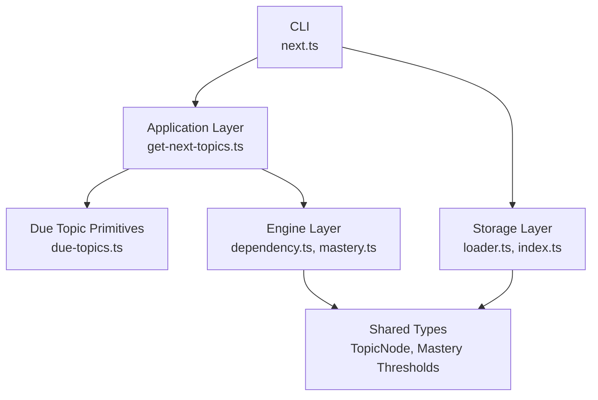
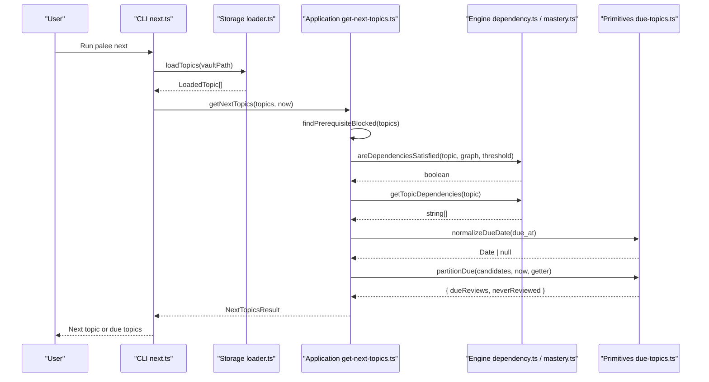
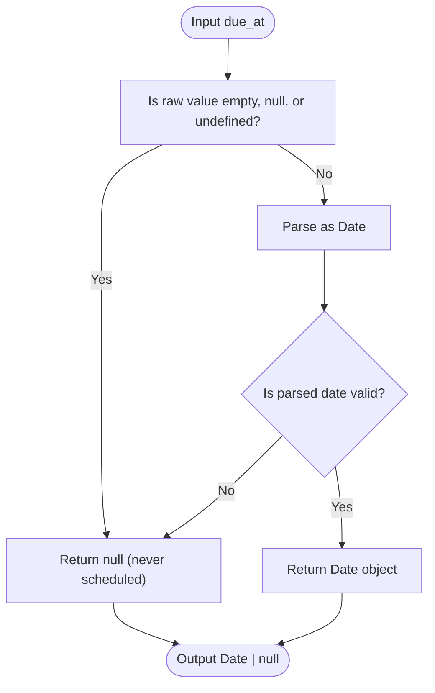
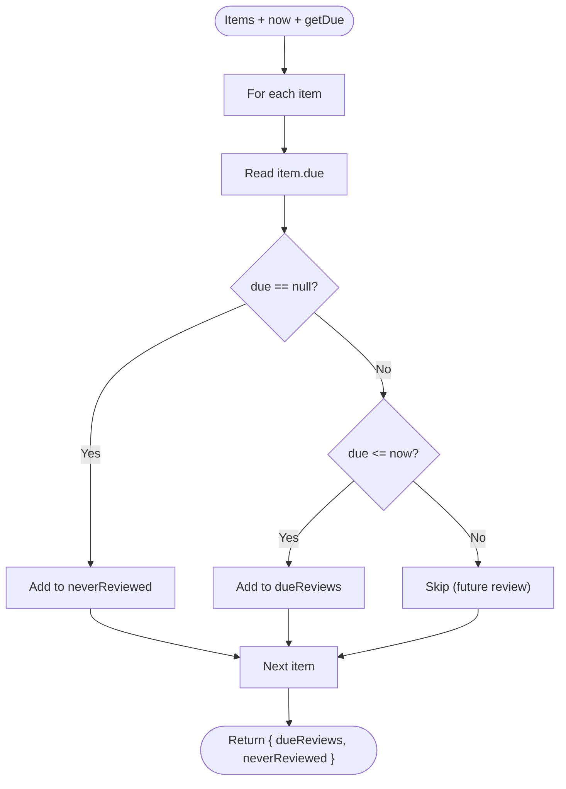
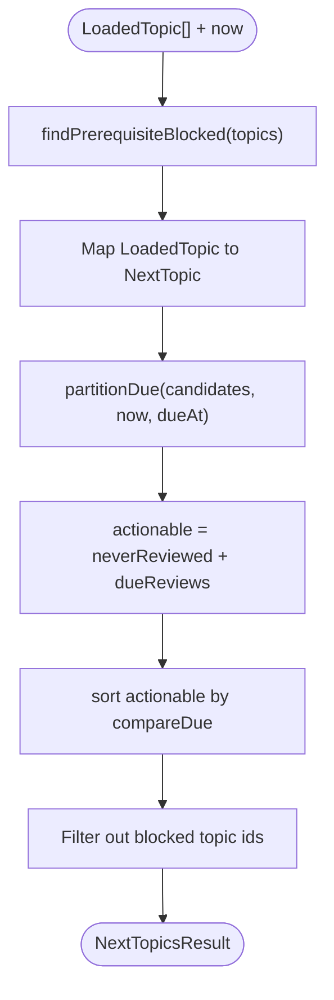
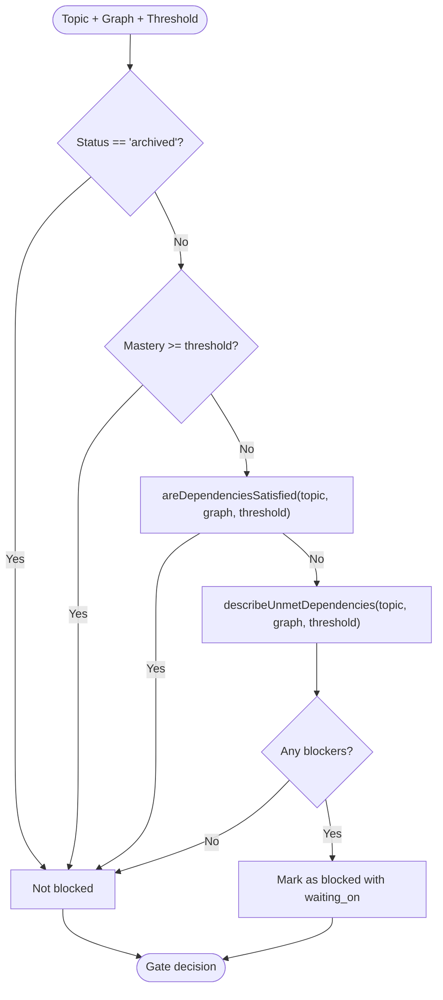
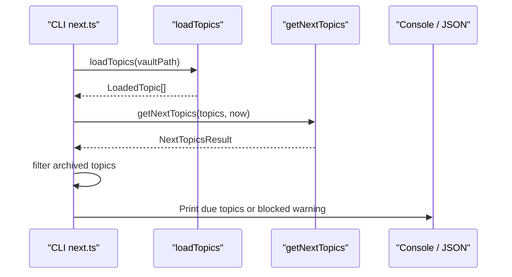
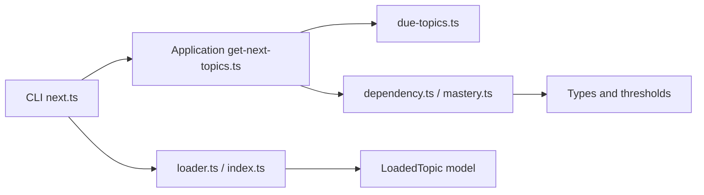

# Due Topics Discovery

::: details Referenced Files in This Document

- [due-topics.ts](https://github.com/Kuldeep2822k/cli/blob/main/src/application/due-topics.ts)
- [get-next-topics.ts](https://github.com/Kuldeep2822k/cli/blob/main/src/application/get-next-topics.ts)
- [next.ts](https://github.com/Kuldeep2822k/cli/blob/main/src/cli/next.ts)
- [application-due-topics.test.ts](https://github.com/Kuldeep2822k/cli/blob/main/test/application-due-topics.test.ts)
- [engine/index.ts](https://github.com/Kuldeep2822k/cli/blob/main/src/engine/index.ts)
- [dependency.ts](https://github.com/Kuldeep2822k/cli/blob/main/src/engine/dependency.ts)
- [mastery.ts](https://github.com/Kuldeep2822k/cli/blob/main/src/engine/mastery.ts)
- [storage/index.ts](https://github.com/Kuldeep2822k/cli/blob/main/src/storage/index.ts)
- [loader.ts](https://github.com/Kuldeep2822k/cli/blob/main/src/storage/loader.ts)

:::

## Table of Contents
1. [Introduction](#introduction)
2. [Project Structure](#project-structure)
3. [Core Components](#core-components)
4. [Architecture Overview](#architecture-overview)
5. [Detailed Component Analysis](#detailed-component-analysis)
6. [Dependency Analysis](#dependency-analysis)
7. [Performance Considerations](#performance-considerations)
8. [Troubleshooting Guide](#troubleshooting-guide)
9. [Conclusion](#conclusion)

## Introduction
This document explains the due topics discovery function that powers PALEE’s review workflow. It identifies which topics are ready for study by combining three concerns:

- **Spaced repetition scheduling state:** whether a topic has never been scheduled, is currently due, or is still scheduled for the future.
- **Availability constraints:** prerequisite mastery and dependency satisfaction computed by the engine layer.
- **Vault organization:** canonical topic identity, title, path, status, mastery, repetition, difficulty, and frontmatter-derived fields loaded from the storage layer.

The core logic is intentionally pure: it does not read files, print output, or depend on command-line arguments. Instead, it takes already loaded topics and a current timestamp, filters them through scheduling and prerequisite gates, and returns actionable topics together with any topics withheld because prerequisites are unmet. The CLI `palee next` command composes this function with vault loading and presentation logic to build a complete user-facing review experience.

## Project Structure
Due topics discovery spans three layers:

| Layer | Responsibility | Key File(s) |
|---|---|---|
| CLI | Loads configuration, validates the vault, loads topics, calls the application layer, and formats output. | [next.ts](https://github.com/Kuldeep2822k/cli/blob/main/src/cli/next.ts) |
| Application | Pure discovery algorithm: normalize due dates, partition reviews, apply prerequisite gating, order candidates. | [due-topics.ts](https://github.com/Kuldeep2822k/cli/blob/main/src/application/due-topics.ts), [get-next-topics.ts](https://github.com/Kuldeep2822k/cli/blob/main/src/application/get-next-topics.ts) |
| Engine | Spaced repetition, mastery thresholds, dependency graph analysis, cycle quarantine, and readiness checks. | [engine/index.ts](https://github.com/Kuldeep2822k/cli/blob/main/src/engine/index.ts), [dependency.ts](https://github.com/Kuldeep2822k/cli/blob/main/src/engine/dependency.ts), [mastery.ts](https://github.com/Kuldeep2822k/cli/blob/main/src/engine/mastery.ts) |
| Storage | Vault traversal, frontmatter parsing, topic normalization, and in-memory topic model used by higher layers. | [storage/index.ts](https://github.com/Kuldeep2822k/cli/blob/main/src/storage/index.ts), [loader.ts](https://github.com/Kuldeep2822k/cli/blob/main/src/storage/loader.ts) |

**Diagram sources**
- [next.ts:10-40](https://github.com/Kuldeep2822k/cli/blob/main/src/cli/next.ts#L10-L40)
- [get-next-topics.ts:1-40](https://github.com/Kuldeep2822k/cli/blob/main/src/application/get-next-topics.ts#L1-L40)
- [due-topics.ts:1-20](https://github.com/Kuldeep2822k/cli/blob/main/src/application/due-topics.ts#L1-L20)
- [engine/index.ts:1-25](https://github.com/Kuldeep2822k/cli/blob/main/src/engine/index.ts#L1-L25)
- [dependency.ts:1-20](https://github.com/Kuldeep2822k/cli/blob/main/src/engine/dependency.ts#L1-L20)
- [mastery.ts:1-25](https://github.com/Kuldeep2822k/cli/blob/main/src/engine/mastery.ts#L1-L25)
- [storage/index.ts:1-25](https://github.com/Kuldeep2822k/cli/blob/main/src/storage/index.ts#L1-L25)
- [loader.ts:1-20](https://github.com/Kuldeep2822k/cli/blob/main/src/storage/loader.ts#L1-L20)

**Section sources**
- [next.ts:10-40](https://github.com/Kuldeep2822k/cli/blob/main/src/cli/next.ts#L10-L40)
- [get-next-topics.ts:1-40](https://github.com/Kuldeep2822k/cli/blob/main/src/application/get-next-topics.ts#L1-L40)
- [due-topics.ts:1-20](https://github.com/Kuldeep2822k/cli/blob/main/src/application/due-topics.ts#L1-L20)
- [engine/index.ts:1-25](https://github.com/Kuldeep2822k/cli/blob/main/src/engine/index.ts#L1-L25)
- [storage/index.ts:1-25](https://github.com/Kuldeep2822k/cli/blob/main/src/storage/index.ts#L1-L25)

## Core Components
The due topics discovery pipeline consists of two main components:

### Due Topic Primitives
These functions operate only on raw date values and item lists. They do not know about topics, dependencies, mastery, or vault structure.

| Function | Purpose | Input Contract | Output Behavior |
|---|---|---|---|
| `normalizeDueDate` | Converts a raw `due_at` value into a usable date or `null`. | String, `Date`, `null`, or `undefined`. | Returns a valid `Date` when parseable; otherwise `null`. |
| `compareDue` | Sorts dates so never-scheduled items come first, then oldest due date first. | Two `Date | null` values. | Negative, zero, or positive comparison result. |
| `partitionDue` | Splits items into elapsed reviews and never-reviewed items. | Item array, current time, and a getter for each item’s due date. | `{ dueReviews, neverReviewed }`. Future-due items fall into neither bucket. |

**Section sources**
- [due-topics.ts:1-58](https://github.com/Kuldeep2822k/cli/blob/main/src/application/due-topics.ts#L1-L58)

### Next Topics Use Case
The use case combines primitives, storage model, and engine rules into one reusable discovery result.

| Concept | Description |
|---|---|
| Candidate transformation | Loaded topics are mapped into `NextTopic` objects carrying id, title, path, normalized due date, mastery, repetition, optional difficulty, and optional status. |
| Actionable set | Never-reviewed topics plus elapsed reviews form the actionable pool. Future-due topics are excluded. |
| Ordering | Actionable topics are sorted by `compareDue`: never-reviewed first, then ascending due date. |
| Prerequisite gate | Topics are removed from the actionable list if they are not archived, below mastery threshold, and have unmet prerequisites. |
| Blocked reporting | Withheld topics include human-readable blocker phrases describing missing or insufficiently mastered dependencies. |
| Result contract | Returns actionable topics, total topic count, and blocked topics. |

**Section sources**
- [get-next-topics.ts:1-199](https://github.com/Kuldeep2822k/cli/blob/main/src/application/get-next-topics.ts#L1-L199)

## Architecture Overview
The due topics discovery flow starts at the CLI and moves through well-defined subsystem boundaries.

**Diagram sources**
- [next.ts:20-80](https://github.com/Kuldeep2822k/cli/blob/main/src/cli/next.ts#L20-L80)
- [get-next-topics.ts:100-199](https://github.com/Kuldeep2822k/cli/blob/main/src/application/get-next-topics.ts#L100-L199)
- [dependency.ts:1-40](https://github.com/Kuldeep2822k/cli/blob/main/src/engine/dependency.ts#L1-L40)
- [mastery.ts:1-25](https://github.com/Kuldeep2822k/cli/blob/main/src/engine/mastery.ts#L1-L25)
- [due-topics.ts:1-58](https://github.com/Kuldeep2822k/cli/blob/main/src/application/due-topics.ts#L1-L58)

## Detailed Component Analysis

### Due Date Normalization and Partitioning
The due date system treats missing or invalid scheduling data as “never reviewed.” This is important because spaced repetition can produce an initial state where no future review exists yet.

**Diagram sources**
- [due-topics.ts:12-24](https://github.com/Kuldeep2822k/cli/blob/main/src/application/due-topics.ts#L12-L24)

Partitioning separates candidates into two buckets while preserving input order within each bucket:

- `dueReviews`: topics whose due date is less than or equal to the current time.
- `neverReviewed`: topics whose due date is `null`.
- Future-due topics are silently ignored by this step.

**Diagram sources**
- [due-topics.ts:32-58](https://github.com/Kuldeep2822k/cli/blob/main/src/application/due-topics.ts#L32-L58)

**Section sources**
- [due-topics.ts:1-58](https://github.com/Kuldeep2822k/cli/blob/main/src/application/due-topics.ts#L1-L58)
- [application-due-topics.test.ts:1-91](https://github.com/Kuldeep2822k/cli/blob/main/test/application-due-topics.test.ts#L1-L91)

### Next Topics Filtering Algorithm
The filtering algorithm follows this sequence:

1. Build a blocked-topic map using prerequisite analysis.
2. Transform every loaded topic into a candidate with normalized scheduling fields.
3. Partition candidates into never-reviewed and elapsed-review buckets.
4. Concatenate never-reviewed first, then elapsed reviews.
5. Sort actionable candidates by due date.
6. Remove topics present in the blocked map.
7. Return actionable topics, total topic count, and blocked topics.

**Diagram sources**
- [get-next-topics.ts:140-199](https://github.com/Kuldeep2822k/cli/blob/main/src/application/get-next-topics.ts#L140-L199)

**Section sources**
- [get-next-topics.ts:100-199](https://github.com/Kuldeep2822k/cli/blob/main/src/application/get-next-topics.ts#L100-L199)

### Prerequisite Gate
The prerequisite gate decides whether a topic may be studied now. It excludes topics that satisfy any of these conditions:

- Status is `archived`.
- Mastery meets or exceeds the mastery threshold.
- All declared prerequisites are satisfied according to the engine.

When a topic is blocked, the gate reports each unmet prerequisite as a human-readable phrase. Missing dependencies are reported as absent from the vault, while insufficient mastery includes both the current mastery and required threshold.

**Diagram sources**
- [get-next-topics.ts:41-139](https://github.com/Kuldeep2822k/cli/blob/main/src/application/get-next-topics.ts#L41-L139)

Key implementation details:

- Dependency extraction reads the canonical `depends_on` field.
- The full topic graph is built before evaluation so archived prerequisites are still visible as graph nodes.
- Cyclic topics are quarantined before blocking decisions, preventing undefined behavior around cycles.
- Missing references and low-mastery prerequisites produce distinct blocker messages.

**Section sources**
- [get-next-topics.ts:41-139](https://github.com/Kuldeep2822k/cli/blob/main/src/application/get-next-topics.ts#L41-L139)
- [dependency.ts:1-40](https://github.com/Kuldeep2822k/cli/blob/main/src/engine/dependency.ts#L1-L40)

### Mastery Threshold Integration
The mastery threshold is a shared constant defining when a prerequisite is considered sufficiently learned. In the current codebase, the threshold is `0.7`.

| Scenario | Behavior |
|---|---|
| Topic mastery below threshold | Topic may be gated if prerequisites are unmet. |
| Topic mastery at or above threshold | Topic is not gated by mastery. |
| Prerequisite mastery below threshold | Prerequisite is reported as insufficiently mastered. |
| Prerequisite missing from vault | Prerequisite is reported as absent. |

The mastery engine also provides score normalization and pillar-based mastery calculation, but due topics discovery uses the already-computed `topic_mastery` value from the storage model.

**Section sources**
- [mastery.ts:1-25](https://github.com/Kuldeep2822k/cli/blob/main/src/engine/mastery.ts#L1-L25)
- [get-next-topics.ts:41-139](https://github.com/Kuldeep2822k/cli/blob/main/src/application/get-next-topics.ts#L41-L139)

### Storage Layer Integration
The storage layer supplies the topic model consumed by due topics discovery.

| Responsibility | Details |
|---|---|
| Vault traversal | Walks the vault and scans notes. |
| Frontmatter parsing | Parses YAML frontmatter and Markdown content. |
| Topic normalization | Produces uniform fallback values, clamps scores, coerces types, and parses dependencies. |
| Topic cache | Caches parsed topics to avoid repeated disk reads. |
| Public API | Exposes `loadTopics`, `LoadedTopic`, and related options. |

The `getNextTopics` function expects `LoadedTopic[]`, which includes fields such as `palee_id`, `title`, `path`, `due_at`, `topic_mastery`, `repetition`, `difficulty`, and `status`.

**Section sources**
- [storage/index.ts:1-142](https://github.com/Kuldeep2822k/cli/blob/main/src/storage/index.ts#L1-L142)
- [loader.ts:1-200](https://github.com/Kuldeep2822k/cli/blob/main/src/storage/loader.ts#L1-L200)
- [get-next-topics.ts:140-170](https://github.com/Kuldeep2822k/cli/blob/main/src/application/get-next-topics.ts#L140-L170)

### Engine Layer Integration
The engine layer exposes the dependency and readiness logic used by the prerequisite gate.

| Export | Role in Due Topics Discovery |
|---|---|
| `getTopicDependencies` | Reads a topic’s canonical prerequisite IDs. |
| `areDependenciesSatisfied` | Evaluates whether all prerequisites meet the readiness criteria. |
| `quarantineCyclicTopics` | Removes cyclic subgraphs so acyclic topics remain analyzable. |
| `MASTERY_THRESHOLD` | Defines the mastery cutoff used by the gate. |

The engine barrel aggregates these exports so higher layers import from a stable surface.

**Section sources**
- [engine/index.ts:1-126](https://github.com/Kuldeep2822k/cli/blob/main/src/engine/index.ts#L1-L126)
- [dependency.ts:1-40](https://github.com/Kuldeep2822k/cli/blob/main/src/engine/dependency.ts#L1-L40)

### CLI Composition
The CLI command composes storage loading, application discovery, and presentation.

| Step | Behavior |
|---|---|
| Load config and validate vault | Ensures the vault path is available before reading topics. |
| Load topics | Calls `loadTopics(vaultPath)`. |
| Discover due topics | Calls `getNextTopics(topics, new Date())`. |
| Filter archived topics | Removes archived topics from the final actionable set. |
| Determine status | `ready`, `blocked`, or `nothing_due`. |
| Output | Human-readable text or JSON depending on flags. |

**Diagram sources**
- [next.ts:20-120](https://github.com/Kuldeep2822k/cli/blob/main/src/cli/next.ts#L20-L120)
- [get-next-topics.ts:140-199](https://github.com/Kuldeep2822k/cli/blob/main/src/application/get-next-topics.ts#L140-L199)

**Section sources**
- [next.ts:10-120](https://github.com/Kuldeep2822k/cli/blob/main/src/cli/next.ts#L10-L120)

## Dependency Analysis
The due topics discovery component depends on lower layers but remains largely pure at the application boundary.

**Diagram sources**
- [next.ts:10-40](https://github.com/Kuldeep2822k/cli/blob/main/src/cli/next.ts#L10-L40)
- [get-next-topics.ts:1-40](https://github.com/Kuldeep2822k/cli/blob/main/src/application/get-next-topics.ts#L1-L40)
- [due-topics.ts:1-20](https://github.com/Kuldeep2822k/cli/blob/main/src/application/due-topics.ts#L1-L20)
- [dependency.ts:1-20](https://github.com/Kuldeep2822k/cli/blob/main/src/engine/dependency.ts#L1-L20)
- [mastery.ts:1-25](https://github.com/Kuldeep2822k/cli/blob/main/src/engine/mastery.ts#L1-L25)
- [loader.ts:1-20](https://github.com/Kuldeep2822k/cli/blob/main/src/storage/loader.ts#L1-L20)

Coupling characteristics:

- **Low coupling to I/O:** The application layer does not call file systems directly.
- **Single source of truth for readiness:** The engine’s `areDependenciesSatisfied` drives the gate; the application layer does not reimplement prerequisite logic.
- **Shared constants:** The mastery threshold is imported rather than duplicated.
- **Clear separation between filtering and presentation:** CLI handles output and archived-note visibility; application layer returns the core discovery result.

**Section sources**
- [get-next-topics.ts:1-40](https://github.com/Kuldeep2822k/cli/blob/main/src/application/get-next-topics.ts#L1-L40)
- [engine/index.ts:1-126](https://github.com/Kuldeep2822k/cli/blob/main/src/engine/index.ts#L1-L126)
- [storage/index.ts:1-142](https://github.com/Kuldeep2822k/cli/blob/main/src/storage/index.ts#L1-L142)

## Performance Considerations
For large vaults, due topics discovery should consider the following performance characteristics:

| Concern | Current Behavior | Implication |
|---|---|---|
| Topic loading | Uses `loadTopics`, which walks the vault and caches parsed topics. | Repeated calls benefit from the module-level topic cache. |
| Candidate mapping | Iterates over all loaded topics once. | Time complexity is linear in the number of loaded topics. |
| Partitioning | Single pass through candidates. | Linear scan with constant-time per-item checks. |
| Sorting | Sorts actionable candidates by due date. | Sorting cost is `O(k log k)` where `k` is the number of actionable topics. |
| Prerequisite graph construction | Builds a topic-to-topic map and examines edges. | Cost grows with topic count and prerequisite edge count. |
| Cycle quarantine | Quarantines cyclic components before blocking evaluation. | Prevents undefined behavior but adds graph processing cost. |
| Blocked-topic description | Iterates prerequisites for potentially blocked topics. | Worst-case work proportional to prerequisite edges. |

Optimization opportunities:

- Avoid recomputing `new Date()` repeatedly inside hot loops; the CLI passes a single `now`.
- If only a small subset of topics is needed, prefilter by status or pattern before calling discovery.
- For very large graphs, prefer bounded or incremental graph operations where supported by the engine.
- Keep topic cache warm across related commands to reduce repeated vault scanning.

[No sources needed since this section provides general guidance]

## Troubleshooting Guide

### Missing or Corrupted Due Dates
Symptoms:
- A topic appears as never reviewed even though it was previously scheduled.
- A topic is unexpectedly excluded from due results.

Likely causes:
- `due_at` is absent, empty, malformed, or represents an invalid date.
- The due date is still in the future.

Resolution:
- Normalize the raw value through `normalizeDueDate`; invalid inputs become `null`.
- Treat `null` as never reviewed.
- Verify whether the due date is actually past the current time before treating a topic as overdue.

**Section sources**
- [due-topics.ts:12-24](https://github.com/Kuldeep2822k/cli/blob/main/src/application/due-topics.ts#L12-L24)
- [application-due-topics.test.ts:1-28](https://github.com/Kuldeep2822k/cli/blob/main/test/application-due-topics.test.ts#L1-L28)

### Topics Appear Due When They Should Not
Symptoms:
- A topic scheduled for the future shows up as due.

Likely causes:
- The topic is never reviewed (`due_at` is `null`), so it enters the never-reviewed bucket.
- The due date equals the current time exactly; exact equality counts as due.

Resolution:
- Inspect whether the topic is truly scheduled or merely unscheduled.
- Understand that `partitionDue` treats `due <= now` as due.

**Section sources**
- [due-topics.ts:32-58](https://github.com/Kuldeep2822k/cli/blob/main/src/application/due-topics.ts#L32-L58)
- [application-due-topics.test.ts:30-91](https://github.com/Kuldeep2822k/cli/blob/main/test/application-due-topics.test.ts#L30-L91)

### Topics Are Blocked by Prerequisites
Symptoms:
- `palee next` reports no actionable topics but mentions blocked topics.
- A learner expects a topic to be available but cannot see it.

Likely causes:
- Topic is not archived.
- Topic mastery is below `0.7`.
- One or more prerequisites are missing or below the mastery threshold.

Resolution:
- Check the `blockedTopics` list returned by `getNextTopics`.
- Read the `waiting_on` phrases to identify missing or under-mastered prerequisites.
- Validate the vault if referenced prerequisites are absent.

**Section sources**
- [get-next-topics.ts:41-139](https://github.com/Kuldeep2822k/cli/blob/main/src/application/get-next-topics.ts#L41-L139)
- [next.ts:40-120](https://github.com/Kuldeep2822k/cli/blob/main/src/cli/next.ts#L40-L120)

### Archived Topics Do Not Appear as Next
Symptoms:
- An archived topic is excluded from the final output even if it is technically due.

Cause:
- The CLI explicitly filters out archived topics after discovery.

Resolution:
- This is intentional to keep `next`, `plan`, and `dashboard` consistent.
- Use broader exploration commands if reviewing archived material is required.

**Section sources**
- [next.ts:60-80](https://github.com/Kuldeep2822k/cli/blob/main/src/cli/next.ts#L60-L80)

### Unexpected Topic Ordering
Symptoms:
- Never-reviewed topics appear after some due topics.
- Order seems inconsistent across runs.

Explanation:
- Actionable topics are ordered with never-reviewed first, then oldest due date first.
- Stable ordering is preserved within each bucket during partitioning.
- The CLI applies an additional archived-topic filter after ordering.

**Section sources**
- [get-next-topics.ts:160-199](https://github.com/Kuldeep2822k/cli/blob/main/src/application/get-next-topics.ts#L160-L199)
- [due-topics.ts:24-58](https://github.com/Kuldeep2822k/cli/blob/main/src/application/due-topics.ts#L24-L58)

## Conclusion
The due topics discovery function is a focused, testable core that bridges storage-loaded topics and engine-driven readiness rules. Its responsibilities are cleanly separated:

- **Primitives** handle date normalization and review partitioning.
- **Application logic** transforms, filters, orders, and gates topics.
- **Engine layer** provides mastery thresholds, dependency analysis, and cycle safety.
- **Storage layer** provides normalized topic data and vault access.
- **CLI** composes these layers into a user-facing review workflow.

For large vaults, the design favors predictable linear passes over topics and delegates complex graph work to the engine. For error handling, it converts malformed scheduling data into safe defaults and surfaces prerequisite failures as explicit blocker information. This composition allows the same discovery logic to support multiple read models, including `next`, `plan`, and `dashboard`, while keeping review recommendations consistent across the application.