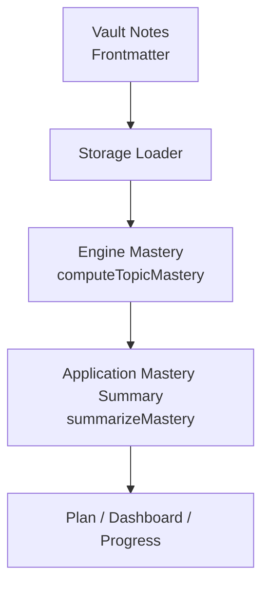
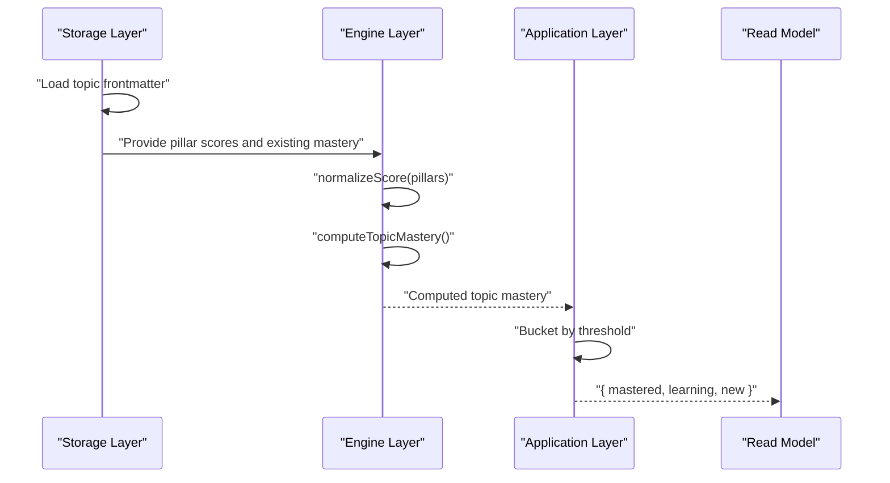
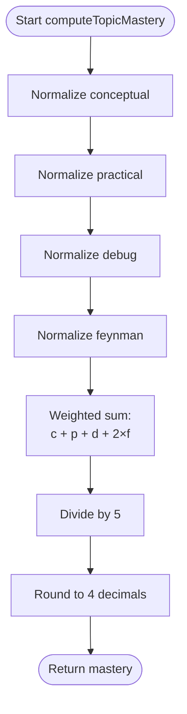
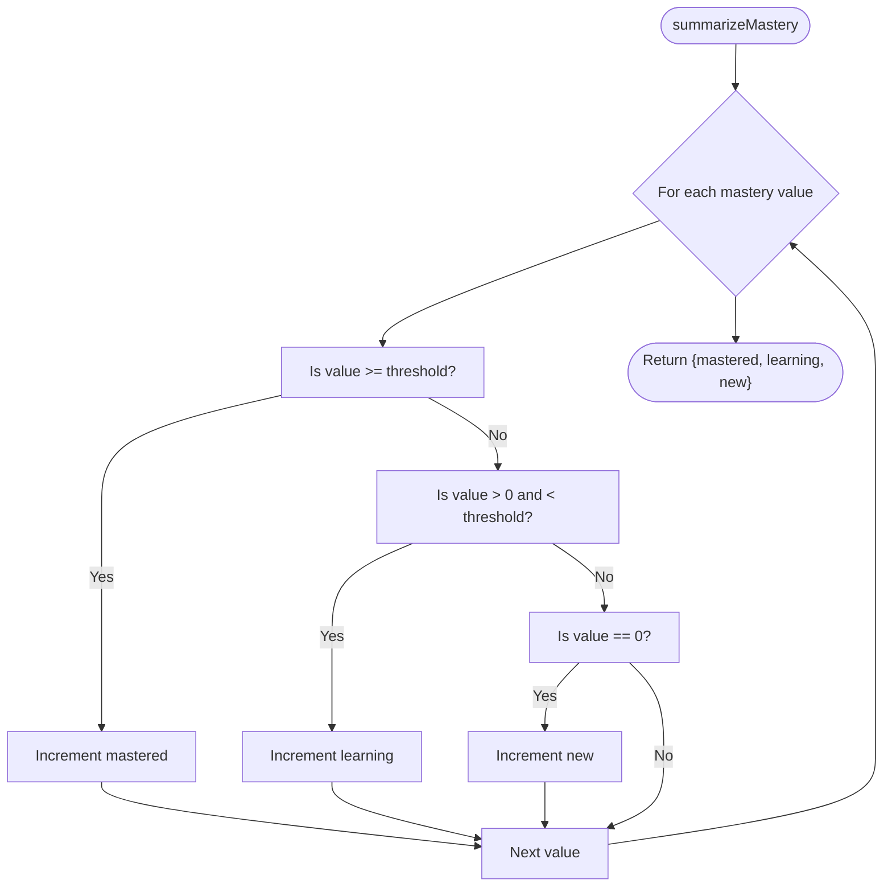
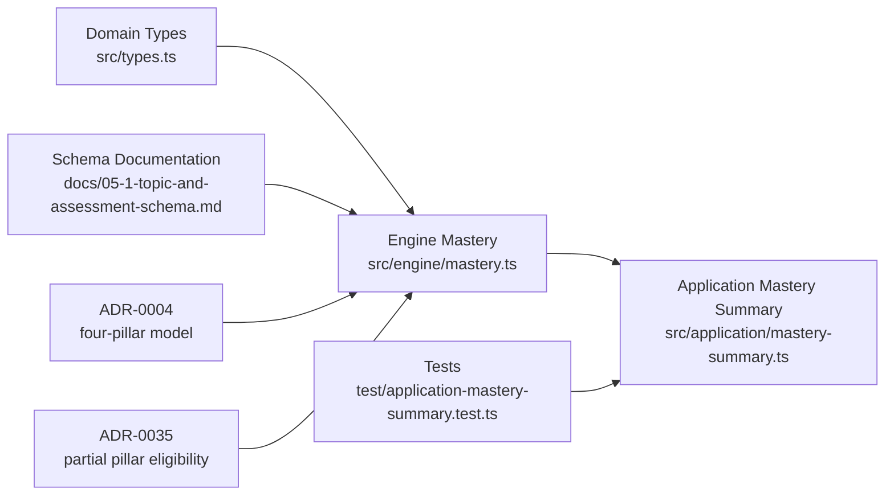

# Mastery Summary Computation

::: details Referenced Files in This Document

- [mastery-summary.ts](https://github.com/Kuldeep2822k/cli/blob/main/src/application/mastery-summary.ts)
- [mastery.ts](https://github.com/Kuldeep2822k/cli/blob/main/src/engine/mastery.ts)
- [types.ts](https://github.com/Kuldeep2822k/cli/blob/main/src/types.ts)
- [application-mastery-summary.test.ts](https://github.com/Kuldeep2822k/cli/blob/main/test/application-mastery-summary.test.ts)
- [05-1-topic-and-assessment-schema.md](https://github.com/Kuldeep2822k/cli/blob/main/docs/05-1-topic-and-assessment-schema.md)
- [0004-four-pillar-pedagogical-mastery.md](https://github.com/Kuldeep2822k/cli/blob/main/docs/adr/0004-four-pillar-pedagogical-mastery.md)
- [0035-validate-fix-partial-pillar-eligibility.md](https://github.com/Kuldeep2822k/cli/blob/main/docs/adr/0035-validate-fix-partial-pillar-eligibility.md)

:::

## Table of Contents
1. [Introduction](#introduction)
2. [Project Structure](#project-structure)
3. [Core Components](#core-components)
4. [Architecture Overview](#architecture-overview)
5. [Detailed Component Analysis](#detailed-component-analysis)
6. [Dependency Analysis](#dependency-analysis)
7. [Performance Considerations](#performance-considerations)
8. [Troubleshooting Guide](#troubleshooting-guide)
9. [Conclusion](#conclusion)

## Introduction
This document explains how the mastery summary computation application function aggregates assessment scores across the four pedagogical pillars—conceptual, practical, debug, and Feynman—to produce overall mastery metrics. It covers:

- The weighted formula that combines individual pillar scores into a topic mastery score.
- How missing or partial assessments are treated as no data rather than zero scores.
- The bucketing algorithm that converts per-topic mastery values into `mastered`, `learning`, and `new` progress indicators.
- Integration between the storage layer (topic and assessment retrieval), engine layer (mastery calculation), and application layer (summary reporting).
- Edge cases such as topics with no assessments, inconsistent scoring scales, and large topic collections.

The goal is to make the computation transparent, predictable, and safe for downstream read models like planning, dashboards, and progress reports.

## Project Structure
Mastery summary computation spans three layers:

| Layer | Responsibility | Key Files |
|---|---|---|
| Storage layer | Reads topic frontmatter, including optional assessment pillars and existing mastery values | [05-1-topic-and-assessment-schema.md](https://github.com/Kuldeep2822k/cli/blob/main/docs/05-1-topic-and-assessment-schema.md) |
| Engine layer | Normalizes scores, computes weighted topic mastery, carries pillar scores, and resolves precedence rules | [mastery.ts](https://github.com/Kuldeep2822k/cli/blob/main/src/engine/mastery.ts) |
| Application layer | Converts per-topic mastery scores into high-level buckets used by read models | [mastery-summary.ts](https://github.com/Kuldeep2822k/cli/blob/main/src/application/mastery-summary.ts) |

## Core Components
The mastery summary system has two main responsibilities:

1. **Compute topic mastery from four pillars.**  
   The engine normalizes each pillar, applies the canonical weighted formula, and returns a value between `0.0` and `1.0`.

2. **Summarize topic mastery into buckets.**  
   The application layer groups computed mastery values into `mastered`, `learning`, and `new` categories using a configurable threshold.

### Four-Pillar Assessment Model
The four pillars represent complementary learning dimensions:

| Pillar | Weight | Meaning |
|---|---:|---|
| Conceptual | 20% | Understanding of theoretical principles |
| Practical | 20% | Ability to apply knowledge hands-on |
| Debug | 20% | Ability to identify and fix errors |
| Feynman | 40% | Ability to explain concepts simply |

The canonical formula is:

`topic_mastery = round((conceptual + practical + debug + 2 × feynman) / 5, 4)`

Because Feynman is double-weighted, the ordinary pillars alone can reach at most `0.60`; reaching the `0.70` mastery gate requires non-zero Feynman input.

### Bucketing Contract
The application layer exposes `summarizeMastery`, which takes an array of topic mastery values and produces:

| Field | Meaning |
|---|---|
| `mastered` | Topics at or above the mastery threshold |
| `learning` | Topics with some mastery but below the threshold |
| `new` | Topics with zero mastery |

The default threshold is `0.7`, matching the engine’s mastery gate.

## Architecture Overview
The mastery computation pipeline moves from raw frontmatter through normalization, weighted aggregation, and finally into summary buckets.

## Detailed Component Analysis

### Engine Layer: Score Normalization and Topic Mastery
The engine centralizes all numeric safety around assessment scores.

#### Score Normalization
`normalizeScore` handles:

- Numbers that are finite.
- Numeric strings after trimming.
- Clamping into `[0.0, 1.0]`.
- Rounding to four decimal places.
- Returning `0.0` for invalid, null, undefined, non-finite, or non-numeric string inputs.

This prevents malformed or inconsistent user input from producing undefined behavior later in the pipeline.

#### Carried Pillar Scores
`carriedPillarScores` reads only the pillar keys present in frontmatter and normalizes them. Absent pillars remain absent instead of being written as zero. This distinction matters because:

- A stored `0` means the learner scored zero.
- An absent pillar means no assessment was provided for that dimension.

#### Topic Mastery Calculation
`computeTopicMastery`:

1. Normalizes all four pillar inputs.
2. Computes the weighted sum: `conceptual + practical + debug + 2 × feynman`.
3. Divides by five.
4. Rounds to four decimal places.
5. Returns `0.0` when all inputs are effectively missing or zero.

#### Precedence Resolution
`resolveTopicMastery` supports two modes:

| Mode | Behavior |
|---|---|
| `pillars-first` | Recompute if any pillar is greater than zero; otherwise preserve normalized existing value or return zero. |
| `existing-first` | Preserve normalized existing value when present; otherwise recompute from pillars. |

This separates concerns between review-like recomputation and adopt-like preservation.

### Application Layer: Mastery Summary Bucketing
The application layer does not perform weighted pillar math. Its job is to convert already computed topic mastery scores into readable progress buckets.

#### Algorithm
For each mastery value:

1. If the value is at or above the threshold, increment `mastered`.
2. If the value is greater than zero and strictly below the threshold, increment `learning`.
3. If the value is exactly zero, increment `new`.

These predicates are independent, so a single value can satisfy more than one condition. In practice, the implementation counts:

- `mastered` when `m >= threshold`.
- `learning` when `0 < m < threshold`.
- `new` when `m === 0`.

#### Threshold Handling
The default threshold is imported from the engine as `MASTERY_THRESHOLD`, which is `0.7`. Callers may pass a custom threshold, which is useful for testing or alternate reporting views.

#### Bucket Semantics
| Value Range | Bucket | Interpretation |
|---|---|---|
| Exactly `0` | `new` | No mastery detected |
| Between `0` and `0.7` | `learning` | Some mastery, not yet mastered |
| At or above `0.7` | `mastered` | Meets the mastery gate |
| Outside `[0, 1]` | Depends on predicate | Normalized earlier; unexpected values are handled upstream |

### Data Model Integration
The schema documentation and core types describe how assessment data lives in topic frontmatter and how it maps into runtime objects.

Key points:

- The `Assessment` type defines the four pillars plus `assessed_at`.
- The `Topic` type includes `assessment` and other metadata consumed by higher layers.
- Frontmatter fields are flat, while the runtime model may normalize or wrap them.
- `Progress` describes aggregate progress output, including global mastery and mastery status.

This contract ensures that mastery summary computation operates on well-defined inputs even when storage formats evolve.

### Handling Missing Assessments and Partial Pillars
A key design rule is that absent pillars mean “no data,” not “zero.”

ADR-0035 states that validation and repair should skip topics with any absent pillar rather than zero-fill them. This avoids locking learners out of prerequisites based on dimensions they never assessed.

Implications for mastery computation:

- When reading pillars from storage, omit missing fields.
- When computing mastery, rely on `carriedPillarScores` to avoid minting zero pillars.
- When repairing or validating, do not treat absent pillars as zero unless explicitly required by another command’s semantics.

This rule protects partial assessments from being misinterpreted as deliberately low scores.

### Examples of Score Aggregation

#### Full Assessment Example
If a topic has:

- Conceptual: `0.8`
- Practical: `0.7`
- Debug: `0.9`
- Feynman: `0.85`

Then:

- Weighted sum: `0.8 + 0.7 + 0.9 + 2 × 0.85 = 4.2`
- Mastery: `round(4.2 / 5, 4) = 0.84`
- Bucket: `mastered` (because `0.84 ≥ 0.7`)

#### Partial Assessment Example
If Feynman is absent:

- The note carries fewer than four pillars.
- Under the current ADR-0035 direction, validation and repair skip it.
- For pure computation, absence should be preserved rather than zero-filled, unless a specific workflow requires fallback behavior.

#### Empty Assessment Example
If all pillars are absent or zero:

- `computeTopicMastery` returns `0.0`.
- `summarizeMastery` classifies it as `new`.

#### Mixed Bucket Example
Given mastery values `[0, 0.3, 0.69, 0.7, 0.95]` with threshold `0.7`:

- `0` → `new`
- `0.3` → `learning`
- `0.69` → `learning`
- `0.7` → `mastered`
- `0.95` → `mastered`

Result: `{ mastered: 2, learning: 2, new: 1 }`.

## Dependency Analysis
The following diagram shows how the mastery summary components depend on each other and on shared domain types.

### Coupling and Cohesion
- **Engine cohesion**: All numeric normalization, pillar handling, and weighted mastery logic live in the engine layer.
- **Application cohesion**: The application layer focuses purely on summarizing precomputed mastery values.
- **Low coupling between layers**: The application layer imports only the threshold constant from the engine; it does not reimplement mastery math.
- **Shared domain contract**: Types and schema documentation define the expected shape of assessments and topics.

### External Integration Points
- Storage layer provides frontmatter-backed pillar values and existing mastery.
- CLI and read models consume `summarizeMastery` for planning, dashboard, and progress outputs.
- Validation and repair workflows must respect the “absent pillar means no data” policy.

## Performance Considerations
The mastery summary computation is designed for efficiency:

| Operation | Complexity | Notes |
|---|---:|---|
| Score normalization | O(1) per pillar | Constant number of pillars |
| Topic mastery computation | O(1) per topic | Fixed four-pillar formula |
| Mastery bucketing | O(n) | Single pass over n topic mastery values |
| Memory usage | O(1) auxiliary | Only counters and local variables |

For large topic collections:

- Avoid recomputing mastery unnecessarily.
- Cache per-topic mastery where appropriate.
- Use streaming or batch processing when generating reports over many topics.
- Keep the bucketing step linear and simple; it is already optimized for a single loop.

The separation between engine computation and application bucketing makes it easy to cache engine results independently of bucket thresholds.

## Troubleshooting Guide

### Symptom: A topic with missing pillars is unexpectedly classified as zero mastery
**Likely cause:** Treating absent pillars as zero instead of no data.

**Resolution:**
- Read only present pillar keys.
- Use `carriedPillarScores` to preserve absence.
- Respect ADR-0035: skip validation/repair for topics with any absent pillar.

### Symptom: A topic cannot reach the mastered bucket despite strong conceptual, practical, and debug scores
**Likely cause:** Feynman is missing or too low.

**Explanation:**
- Ordinary pillars cap at `0.60`.
- Reaching `0.70` requires a positive Feynman score.

**Resolution:**
- Encourage Feynman assessment.
- Verify that Feynman is recorded as a valid number in `[0.0, 1.0]`.

### Symptom: Boundary values fall into unexpected buckets
**Likely cause:** Confusion about threshold comparisons.

**Rules:**
- Exactly equal to threshold → `mastered`.
- Greater than zero and less than threshold → `learning`.
- Exactly zero → `new`.

**Verification:**
Use the test cases for `summarizeMastery` to confirm boundary behavior.

### Symptom: Global progress shows inconsistent mastery status
**Likely cause:** Mixing computed topic mastery with raw pillar averages or inconsistent thresholds.

**Resolution:**
- Always compute topic mastery with `computeTopicMastery`.
- Summarize with `summarizeMastery` using the same threshold as downstream gating.
- Ensure storage inputs are normalized before computation.

### Symptom: Large vaults report slowly
**Likely cause:** Repeated recomputation or unnecessary I/O.

**Recommendations:**
- Compute topic mastery once per topic and reuse the result.
- Apply bucketing in a single pass.
- Avoid loading full files when only frontmatter is needed.
- Batch report generation instead of calling summary functions repeatedly for every UI render.

## Conclusion
The mastery summary computation cleanly separates concerns:

- The **engine layer** normalizes inputs, preserves meaningful absence, and computes weighted topic mastery.
- The **application layer** converts those mastery values into stable, readable buckets.
- The **schema and types** define the contract for assessments and topics.
- **Architectural decisions** ensure that missing pillars are not mistaken for zero scores, and that the Feynman dimension receives its intended emphasis.

Together, these pieces provide reliable mastery metrics, meaningful progress indicators, and predictable behavior for edge cases such as partial assessments, empty assessments, and large topic collections.

## References

- [05-1-topic-and-assessment-schema.md](https://github.com/Kuldeep2822k/cli/blob/main/docs/05-1-topic-and-assessment-schema.md)
- [mastery.ts](https://github.com/Kuldeep2822k/cli/blob/main/src/engine/mastery.ts)
- [mastery-summary.ts](https://github.com/Kuldeep2822k/cli/blob/main/src/application/mastery-summary.ts)
- [0004-four-pillar-pedagogical-mastery.md](https://github.com/Kuldeep2822k/cli/blob/main/docs/adr/0004-four-pillar-pedagogical-mastery.md)
- [application-mastery-summary.test.ts](https://github.com/Kuldeep2822k/cli/blob/main/test/application-mastery-summary.test.ts)
- [types.ts](https://github.com/Kuldeep2822k/cli/blob/main/src/types.ts)
- [0035-validate-fix-partial-pillar-eligibility.md](https://github.com/Kuldeep2822k/cli/blob/main/docs/adr/0035-validate-fix-partial-pillar-eligibility.md)
