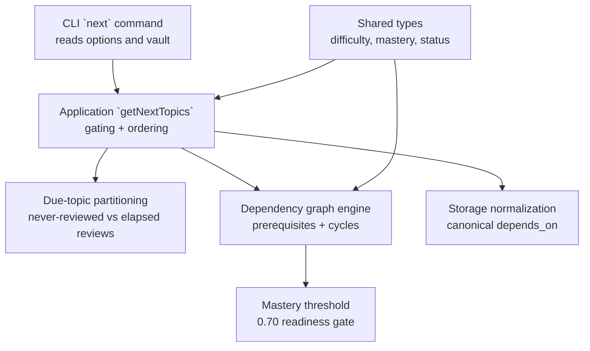
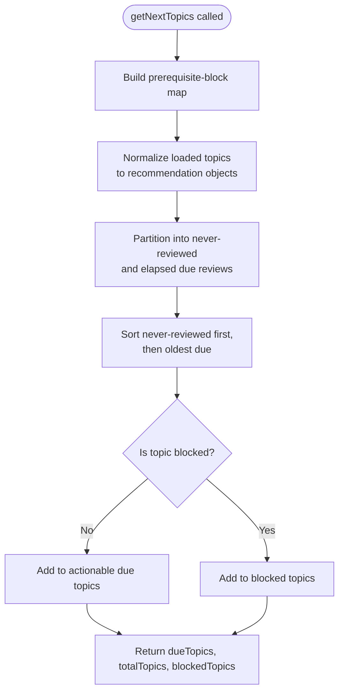
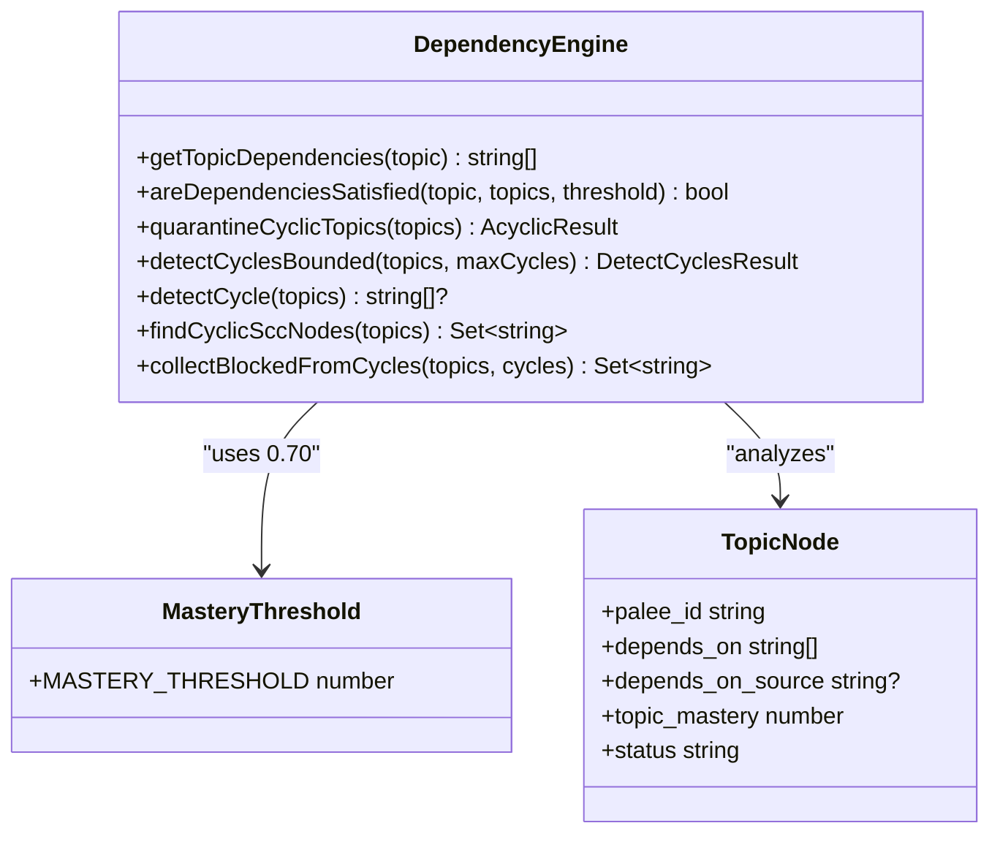
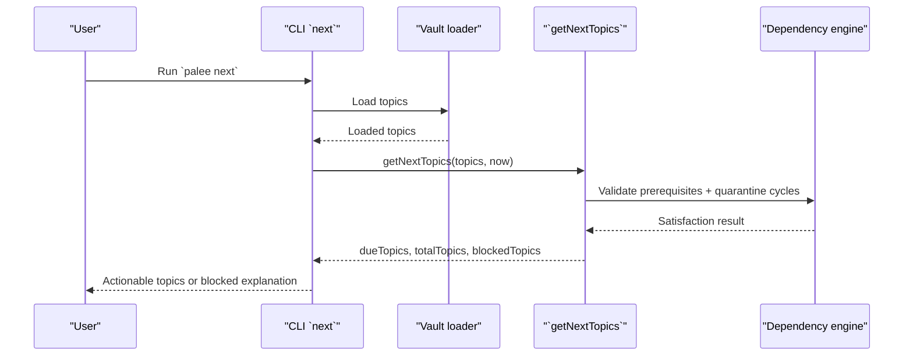
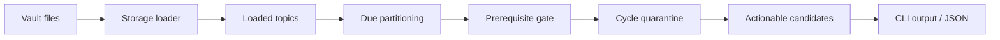
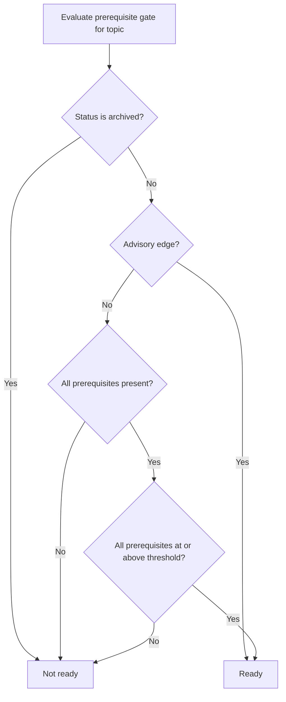
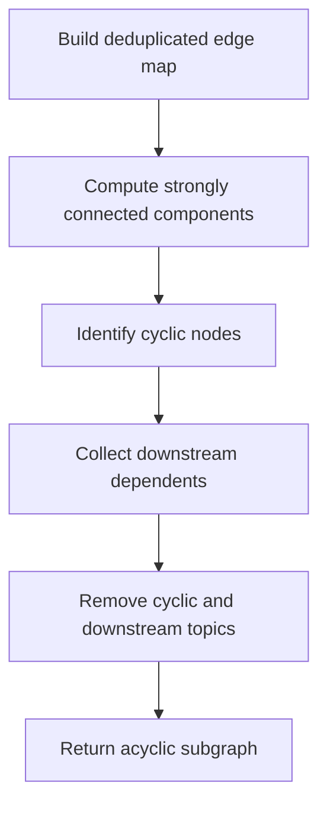
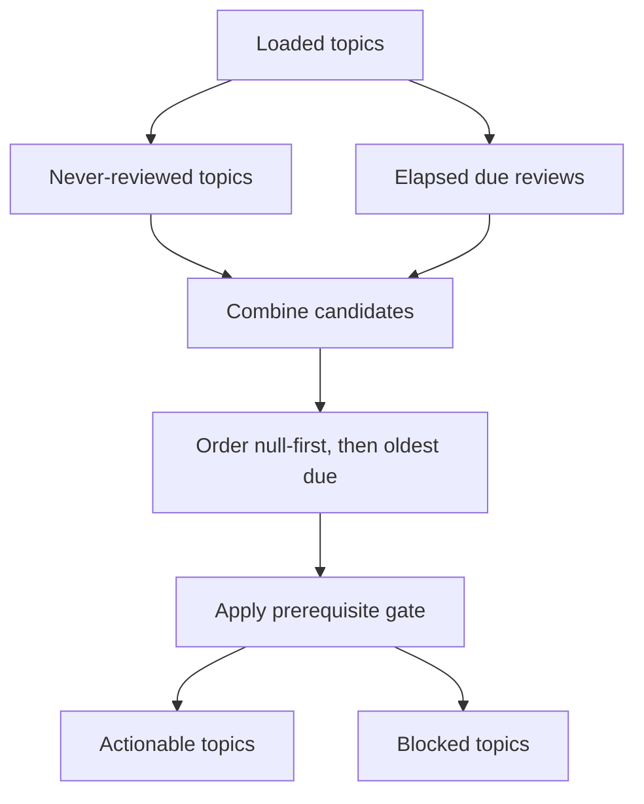
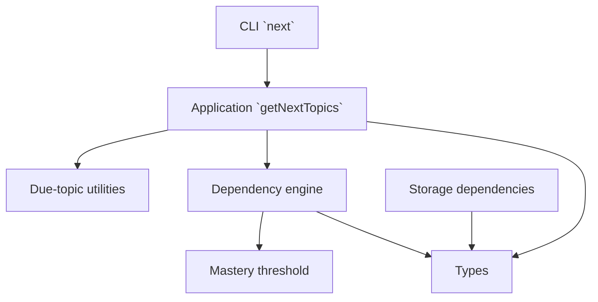

# Next Topics Recommendation

::: details Referenced Files in This Document

- [get-next-topics.ts](https://github.com/Kuldeep2822k/cli/blob/main/src/application/get-next-topics.ts)
- [due-topics.ts](https://github.com/Kuldeep2822k/cli/blob/main/src/application/due-topics.ts)
- [dependency.ts](https://github.com/Kuldeep2822k/cli/blob/main/src/engine/dependency.ts)
- [mastery.ts](https://github.com/Kuldeep2822k/cli/blob/main/src/engine/mastery.ts)
- [next.ts](https://github.com/Kuldeep2822k/cli/blob/main/src/cli/next.ts)
- [dependencies.ts](https://github.com/Kuldeep2822k/cli/blob/main/src/storage/dependencies.ts)
- [types.ts](https://github.com/Kuldeep2822k/cli/blob/main/src/types.ts)
- [application-get-next-topics.test.ts](https://github.com/Kuldeep2822k/cli/blob/main/test/application-get-next-topics.test.ts)
- [application-next-prerequisite-gate.test.ts](https://github.com/Kuldeep2822k/cli/blob/main/test/application-next-prerequisite-gate.test.ts)

:::

## Table of Contents
1. [Introduction](#introduction)
2. [Project Structure](#project-structure)
3. [Core Components](#core-components)
4. [Architecture Overview](#architecture-overview)
5. [Detailed Component Analysis](#detailed-component-analysis)
6. [Dependency Analysis](#dependency-analysis)
7. [Performance Considerations](#performance-considerations)
8. [Troubleshooting Guide](#troubleshooting-guide)
9. [Conclusion](#conclusion)

## Introduction
This document explains the next topics recommendation function: how PALEE discovers recommended learning topics, validates prerequisites through its dependency graph engine, and exposes actionable recommendations through the CLI. The implementation does not perform a full AI-driven curriculum planner; instead, it computes personalized next actions by combining:

- Spaced repetition state (whether a topic has been reviewed and when it is due).
- Prerequisite validation against mastery thresholds.
- Dependency graph analysis, including cycle quarantine.
- User-facing filtering of archived topics.
- Clear reporting of blocked topics and fallback behavior when no topics are ready.

The recommendation algorithm is intentionally conservative: a topic becomes actionable only if it is either never reviewed or already due for review, and only after prerequisite validation allows it to pass the gate.

## Project Structure
The next topics recommendation spans four layers:

| Layer | Responsibility | Key Files |
|---|---|---|
| CLI | Parses user options, loads the vault, serializes results, and prints human-readable output | [next.ts](https://github.com/Kuldeep2822k/cli/blob/main/src/cli/next.ts) |
| Application use case | Computes actionable topics, applies prerequisite gating, and separates due from blocked results | [get-next-topics.ts](https://github.com/Kuldeep2822k/cli/blob/main/src/application/get-next-topics.ts), [due-topics.ts](https://github.com/Kuldeep2822k/cli/blob/main/src/application/due-topics.ts) |
| Engine | Implements dependency graph algorithms, cycle detection, cycle quarantine, and prerequisite satisfaction checks | [dependency.ts](https://github.com/Kuldeep2822k/cli/blob/main/src/engine/dependency.ts), [mastery.ts](https://github.com/Kuldeep2822k/cli/blob/main/src/engine/mastery.ts) |
| Storage and types | Normalizes raw dependencies and defines shared domain models such as difficulty and mastery | [dependencies.ts](https://github.com/Kuldeep2822k/cli/blob/main/src/storage/dependencies.ts), [types.ts](https://github.com/Kuldeep2822k/cli/blob/main/src/types.ts) |

**Diagram sources**
- [next.ts:1-227](https://github.com/Kuldeep2822k/cli/blob/main/src/cli/next.ts#L1-L227)
- [get-next-topics.ts:1-199](https://github.com/Kuldeep2822k/cli/blob/main/src/application/get-next-topics.ts#L1-L199)
- [due-topics.ts:1-58](https://github.com/Kuldeep2822k/cli/blob/main/src/application/due-topics.ts#L1-L58)
- [dependency.ts:1-1015](https://github.com/Kuldeep2822k/cli/blob/main/src/engine/dependency.ts#L1-L1015)
- [mastery.ts:1-229](https://github.com/Kuldeep2822k/cli/blob/main/src/engine/mastery.ts#L1-L229)
- [dependencies.ts:1-28](https://github.com/Kuldeep2822k/cli/blob/main/src/storage/dependencies.ts#L1-L28)
- [types.ts:1-200](https://github.com/Kuldeep2822k/cli/blob/main/src/types.ts#L1-L200)

**Section sources**
- [next.ts:1-227](https://github.com/Kuldeep2822k/cli/blob/main/src/cli/next.ts#L1-L227)
- [get-next-topics.ts:1-199](https://github.com/Kuldeep2822k/cli/blob/main/src/application/get-next-topics.ts#L1-L199)
- [due-topics.ts:1-58](https://github.com/Kuldeep2822k/cli/blob/main/src/application/due-topics.ts#L1-L58)
- [dependency.ts:1-1015](https://github.com/Kuldeep2822k/cli/blob/main/src/engine/dependency.ts#L1-L1015)
- [mastery.ts:1-229](https://github.com/Kuldeep2822k/cli/blob/main/src/engine/mastery.ts#L1-L229)
- [dependencies.ts:1-28](https://github.com/Kuldeep2822k/cli/blob/main/src/storage/dependencies.ts#L1-L28)
- [types.ts:1-200](https://github.com/Kuldeep2822k/cli/blob/main/src/types.ts#L1-L200)

## Core Components

### Application Use Case: `getNextTopics`
The application use case is the central decision point for next-topic recommendations. It:

1. Builds a prerequisite-block map using `findPrerequisiteBlocked`.
2. Converts loaded topics into normalized recommendation objects.
3. Partitions them into never-reviewed and elapsed-review candidates.
4. Sorts candidates with never-reviewed first, then oldest due date.
5. Splits each candidate into due topics or blocked topics based on prerequisite status.
6. Returns actionable topics, total topic count, and blocked topic details.

Key behaviors:

- Archived topics are excluded from CLI output but still participate in prerequisite evaluation so that an archived prerequisite does not appear missing.
- Already mastered topics are never gated because their purpose is review, not prerequisite acquisition.
- Advisory edges (`toc`, `tie`) do not block learning.
- Missing prerequisites are reported as dangling references.
- Topics on or downstream of dependency cycles are not reported as prerequisite-blocked; they remain actionable where applicable and are surfaced elsewhere as quarantined.

**Diagram sources**
- [get-next-topics.ts:1-199](https://github.com/Kuldeep2822k/cli/blob/main/src/application/get-next-topics.ts#L1-L199)
- [due-topics.ts:1-58](https://github.com/Kuldeep2822k/cli/blob/main/src/application/due-topics.ts#L1-L58)

**Section sources**
- [get-next-topics.ts:1-199](https://github.com/Kuldeep2822k/cli/blob/main/src/application/get-next-topics.ts#L1-L199)
- [due-topics.ts:1-58](https://github.com/Kuldeep2822k/cli/blob/main/src/application/due-topics.ts#L1-L58)

### Due-Topic Partitioning
The due-topic utilities provide pure primitives used by both the next recommendation and other read models such as plan and dashboard.

Important operations:

- `normalizeDueDate`: coerces raw due dates into `Date` or `null`; invalid dates become `null`.
- `compareDue`: orders `null` before real dates, then sorts by ascending due time.
- `partitionDue`: splits items into never-scheduled and elapsed scheduled reviews; future-due items belong to neither bucket.

This separation keeps recommendation logic independent from scheduling policy.

**Section sources**
- [due-topics.ts:1-58](https://github.com/Kuldeep2822k/cli/blob/main/src/application/due-topics.ts#L1-L58)

### Dependency Graph Engine
The dependency graph engine provides the mathematical and graph-theoretic foundation for prerequisite validation and cycle handling.

Core responsibilities:

- Extract canonical prerequisite IDs from topic nodes.
- Build deduplicated, deterministic adjacency maps.
- Detect strongly connected components using Tarjan’s algorithm.
- Enumerate elementary cycles using Johnson-style traversal with explicit stacks.
- Quarantine topics on or downstream of cycles.
- Check whether all prerequisites of a topic exist and meet the mastery threshold.
- Identify ready topics under the same readiness contract.

**Diagram sources**
- [dependency.ts:1-1015](https://github.com/Kuldeep2822k/cli/blob/main/src/engine/dependency.ts#L1-L1015)
- [mastery.ts:1-229](https://github.com/Kuldeep2822k/cli/blob/main/src/engine/mastery.ts#L1-L229)

**Section sources**
- [dependency.ts:1-1015](https://github.com/Kuldeep2822k/cli/blob/main/src/engine/dependency.ts#L1-L1015)
- [mastery.ts:1-229](https://github.com/Kuldeep2822k/cli/blob/main/src/engine/mastery.ts#L1-L229)

### CLI Integration: `next` Command
The CLI command bridges user input, storage loading, application logic, and output formatting.

Workflow:

1. Load configuration and validate the vault path.
2. Load topics from the vault.
3. Call `getNextTopics` with current time.
4. Filter out archived topics from the actionable set.
5. Determine machine-readable status: `ready`, `blocked`, or `nothing_due`.
6. Print either human-readable text or JSON depending on options.
7. Report blocked topics when they explain why no topic is ready.

**Diagram sources**
- [next.ts:1-227](https://github.com/Kuldeep2822k/cli/blob/main/src/cli/next.ts#L1-L227)
- [get-next-topics.ts:1-199](https://github.com/Kuldeep2822k/cli/blob/main/src/application/get-next-topics.ts#L1-L199)
- [dependency.ts:1-1015](https://github.com/Kuldeep2822k/cli/blob/main/src/engine/dependency.ts#L1-L1015)

**Section sources**
- [next.ts:1-227](https://github.com/Kuldeep2822k/cli/blob/main/src/cli/next.ts#L1-L227)

### Storage and Type Contracts
The storage layer normalizes raw dependency fields into the canonical `depends_on` representation, deduplicating values and tolerating legacy aliases. The type system defines difficulty levels, assessment pillars, spaced repetition state, and mastery computation.

Relevant points:

- Raw dependencies can be arrays or comma-separated strings.
- Invalid entries are filtered.
- Difficulty is normalized to `beginner`, `intermediate`, or `advanced`.
- Mastery uses a weighted four-pillar model with a default readiness threshold of 0.70.

**Section sources**
- [dependencies.ts:1-28](https://github.com/Kuldeep2822k/cli/blob/main/src/storage/dependencies.ts#L1-L28)
- [types.ts:1-200](https://github.com/Kuldeep2822k/cli/blob/main/src/types.ts#L1-L200)
- [mastery.ts:1-229](https://github.com/Kuldeep2822k/cli/blob/main/src/engine/mastery.ts#L1-L229)

## Architecture Overview
The next topics recommendation architecture follows a layered pipeline:

- **Vault and loader**: Provide topic metadata, mastery, repetition, due dates, status, and dependencies.
- **Partitioner**: Separates never-reviewed topics from elapsed reviews.
- **Gater**: Enforces prerequisite mastery and existence.
- **Quarantine**: Removes undefined learning order caused by cycles.
- **Output**: Exposes actionable recommendations and blocked explanations.

**Diagram sources**
- [get-next-topics.ts:1-199](https://github.com/Kuldeep2822k/cli/blob/main/src/application/get-next-topics.ts#L1-L199)
- [dependency.ts:1-1015](https://github.com/Kuldeep2822k/cli/blob/main/src/engine/dependency.ts#L1-L1015)
- [next.ts:1-227](https://github.com/Kuldeep2822k/cli/blob/main/src/cli/next.ts#L1-L227)

## Detailed Component Analysis

### Prerequisite Validation Algorithm
A topic is considered ready for study only when:

1. Its status is not `archived`.
2. Its mastery is below the readiness threshold.
3. All prerequisites exist in the vault.
4. All prerequisites meet the mastery threshold.
5. The dependency edge is not advisory (`toc` or `tie`).

Advisory edges are excluded from the gate because they represent listing order or filename collation relationships rather than pedagogical prerequisites.

**Diagram sources**
- [dependency.ts:1-1015](https://github.com/Kuldeep2822k/cli/blob/main/src/engine/dependency.ts#L1-L1015)
- [mastery.ts:1-229](https://github.com/Kuldeep2822k/cli/blob/main/src/engine/mastery.ts#L1-L229)

**Section sources**
- [dependency.ts:1-1015](https://github.com/Kuldeep2822k/cli/blob/main/src/engine/dependency.ts#L1-L1015)
- [mastery.ts:1-229](https://github.com/Kuldeep2822k/cli/blob/main/src/engine/mastery.ts#L1-L229)

### Cycle Detection and Quarantine
The engine handles circular dependencies through two complementary mechanisms:

1. **SCC-based membership**: Identifies nodes on cycles in O(V + E).
2. **Bounded enumeration**: Reports distinct elementary cycles up to a configurable cap, with a truncation flag for pathological graphs.

After identifying cyclic nodes, the engine collects every topic reachable downstream from cycle members and removes them from the acyclic working graph. This preserves learning progression for unrelated parts of the vault while isolating undefined regions.

**Diagram sources**
- [dependency.ts:1-1015](https://github.com/Kuldeep2822k/cli/blob/main/src/engine/dependency.ts#L1-L1015)

**Section sources**
- [dependency.ts:1-1015](https://github.com/Kuldeep2822k/cli/blob/main/src/engine/dependency.ts#L1-L1015)

### Personalized Learning Path Generation
The current recommendation strategy is a readiness-and-scheduling filter rather than a forward-planning optimizer. It generates personalized paths by:

- Prioritizing topics the learner has never reviewed.
- Then prioritizing overdue reviews.
- Removing topics whose prerequisites are unmet.
- Preserving archived topics in prerequisite evaluation but excluding them from actionable output.
- Reporting blocked topics with human-readable blocker phrases.

Difficulty is carried through the recommendation object, but the current algorithm does not reorder candidates by difficulty. It relies on spaced repetition state and prerequisite readiness.

**Diagram sources**
- [get-next-topics.ts:1-199](https://github.com/Kuldeep2822k/cli/blob/main/src/application/get-next-topics.ts#L1-L199)
- [due-topics.ts:1-58](https://github.com/Kuldeep2822k/cli/blob/main/src/application/due-topics.ts#L1-L58)

**Section sources**
- [get-next-topics.ts:1-199](https://github.com/Kuldeep2822k/cli/blob/main/src/application/get-next-topics.ts#L1-L199)
- [due-topics.ts:1-58](https://github.com/Kuldeep2822k/cli/blob/main/src/application/due-topics.ts#L1-L58)

### Fallback Mechanisms
When no suitable topics are found, the system distinguishes three states:

| State | Meaning | Behavior |
|---|---|---|
| `ready` | At least one non-archived topic is actionable | Return first actionable topic and list due topics |
| `blocked` | Every candidate is waiting on prerequisites | Explain blockers and direct user to planning |
| `nothing_due` | No actionable topics and no blockers | Report nothing due or print empty-vault onboarding |

The CLI also prints blocked topics with truncated detail when there are many, and warns about withheld topics even when some are still shown.

**Section sources**
- [next.ts:1-227](https://github.com/Kuldeep2822k/cli/blob/main/src/cli/next.ts#L1-L227)

## Dependency Analysis
The next topics recommendation depends on multiple modules with clear boundaries:

| Module | Depends On | Purpose |
|---|---|---|
| CLI `next` | Application use case, storage loader, types | User interface and output |
| Application `getNextTopics` | Due-topic utilities, dependency engine, mastery threshold | Recommendation and gating |
| Dependency engine | Mastery threshold, types | Graph algorithms and prerequisite validation |
| Storage dependencies | Types | Canonical dependency normalization |
| Types | None | Shared domain contracts |

**Diagram sources**
- [next.ts:1-227](https://github.com/Kuldeep2822k/cli/blob/main/src/cli/next.ts#L1-L227)
- [get-next-topics.ts:1-199](https://github.com/Kuldeep2822k/cli/blob/main/src/application/get-next-topics.ts#L1-L199)
- [due-topics.ts:1-58](https://github.com/Kuldeep2822k/cli/blob/main/src/application/due-topics.ts#L1-L58)
- [dependency.ts:1-1015](https://github.com/Kuldeep2822k/cli/blob/main/src/engine/dependency.ts#L1-L1015)
- [mastery.ts:1-229](https://github.com/Kuldeep2822k/cli/blob/main/src/engine/mastery.ts#L1-L229)
- [dependencies.ts:1-28](https://github.com/Kuldeep2822k/cli/blob/main/src/storage/dependencies.ts#L1-L28)
- [types.ts:1-200](https://github.com/Kuldeep2822k/cli/blob/main/src/types.ts#L1-L200)

**Section sources**
- [next.ts:1-227](https://github.com/Kuldeep2822k/cli/blob/main/src/cli/next.ts#L1-L227)
- [get-next-topics.ts:1-199](https://github.com/Kuldeep2822k/cli/blob/main/src/application/get-next-topics.ts#L1-L199)
- [dependency.ts:1-1015](https://github.com/Kuldeep2822k/cli/blob/main/src/engine/dependency.ts#L1-L1015)

## Performance Considerations
The codebase includes several performance-oriented design choices relevant to complex dependency graphs:

| Optimization | Where Applied | Benefit |
|---|---|---|
| Deduplicated edge maps | Dependency engine | Avoids redundant traversal caused by duplicate `depends_on` entries |
| Deterministic neighbor sorting | Dependency engine | Makes cycle enumeration stable and independent of insertion order |
| Iterative Tarjan SCC detection | Dependency engine | Avoids stack overflow on deep chains |
| Explicit-stack Johnson-style cycle enumeration | Dependency engine | Keeps cycle enumeration stack-safe |
| Bounded cycle enumeration | Dependency engine | Prevents exponential cycle explosion from stalling interactive commands |
| Truncation flag | Dependency engine | Distinguishes sample output from complete enumeration |
| One-time graph decomposition | Dependency engine | Reuses adjacency and SCC data for both quarantine and enumeration |
| Reverse-dependency traversal | Dependency engine | Computes downstream-of-cycle impact in O(V + E) |
| Early return when no edges exist | Application prerequisite gate | Skips expensive cycle analysis for flat vaults |
| Null-first due-date comparison | Due-topic utilities | Stable, constant-time sort key |

Recommendations for further optimization:

- Cache the acyclic subgraph produced by `quarantineCyclicTopics` when the underlying topic set has not changed.
- Cache prerequisite satisfaction results per topic ID when repeated across commands.
- Defer heavy graph work until the first query in a session.
- Use topic-version timestamps or content hashes to invalidate caches safely.
- Bound memory usage for very large vaults by processing topics in batches when constructing adjacency maps.

## Troubleshooting Guide

### Common Recommendation Issues

| Symptom | Likely Cause | Resolution |
|---|---|---|
| A topic never appears as next | Prerequisite mastery below threshold | Study or assess the prerequisite |
| A topic is marked missing | Dependent topic ID is not in the vault | Run validation and fix missing references |
| A topic is not gated despite prerequisites | Edge is advisory (`toc` or `tie`) | Remove advisory labeling if the relationship should be a real prerequisite |
| A topic remains due but cannot be studied | Circular dependency | Fix the cycle or quarantine-dependent workflow |
| No topics are due | Future-due reviews or all prerequisites blocked | Adjust spaced repetition state or satisfy prerequisites |
| Archived topic is not recommended | CLI filters archived topics from output | Treat archived topics as completed or retired |

### Blocked Topic Diagnostics
The prerequisite gate produces detailed blocker messages:

- Missing prerequisites report the expected topic ID and suggest validation.
- Unmastered prerequisites report current mastery and required threshold.
- Advisory edges are explicitly excluded from blocking.
- Archived prerequisites remain visible in the graph so they do not appear missing.

**Section sources**
- [get-next-topics.ts:1-199](https://github.com/Kuldeep2822k/cli/blob/main/src/application/get-next-topics.ts#L1-L199)
- [dependency.ts:1-1015](https://github.com/Kuldeep2822k/cli/blob/main/src/engine/dependency.ts#L1-L1015)
- [application-next-prerequisite-gate.test.ts:1-157](https://github.com/Kuldeep2822k/cli/blob/main/test/application-next-prerequisite-gate.test.ts#L1-L157)

### Test Coverage Summary
Tests verify the following aspects of the recommendation function:

- Empty vault returns zero total topics and no due topics.
- Total topics counts all loaded topics, including future-due ones.
- Never-reviewed topics are actionable and sorted before dated ones.
- Dated due topics are ordered oldest first.
- Invalid due dates are treated as never-reviewed.
- Future-due topics are excluded from the due list.
- Prerequisite gating excludes blocked topics from actionable results.
- Missing prerequisites produce diagnostic blocker messages.
- Advisory edges do not block learning.
- Archived prerequisites stay part of the graph.
- Cyclic topics are not reported as prerequisite-blocked.
- Future-due dependent topics are not withheld.

**Section sources**
- [application-get-next-topics.test.ts:1-77](https://github.com/Kuldeep2822k/cli/blob/main/test/application-get-next-topics.test.ts#L1-L77)
- [application-next-prerequisite-gate.test.ts:1-157](https://github.com/Kuldeep2822k/cli/blob/main/test/application-next-prerequisite-gate.test.ts#L1-L157)

## Conclusion
The next topics recommendation function implements a disciplined, graph-aware learning progression model. It combines spaced repetition state with strict prerequisite validation and robust cycle quarantine. Its strengths include:

- Clear separation between scheduling, prerequisite gating, and graph analysis.
- Defensive handling of advisory edges, missing dependencies, and circular dependencies.
- Machine-readable status reporting for automation and diagnostics.
- Human-readable feedback that explains why a topic is blocked.

For future personalization, the system is well positioned to extend scoring strategies without changing the prerequisite contract. Potential enhancements include difficulty-weighted ordering, multi-step path expansion, adaptive pacing, and cached graph queries — provided they preserve the existing readiness and blocking invariants.
