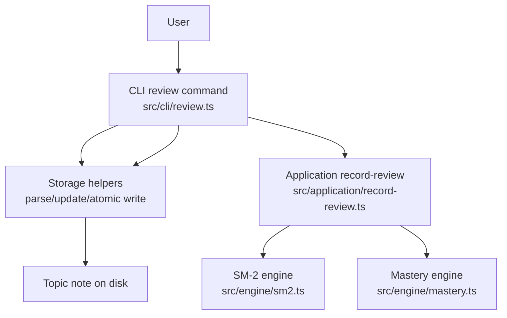
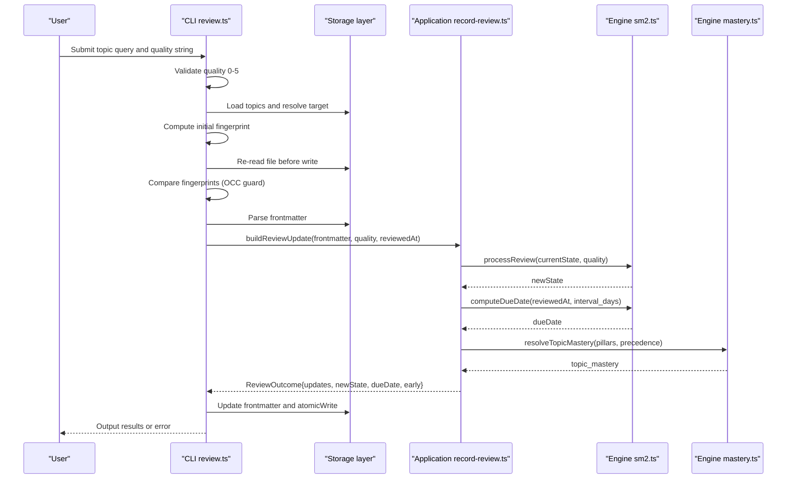
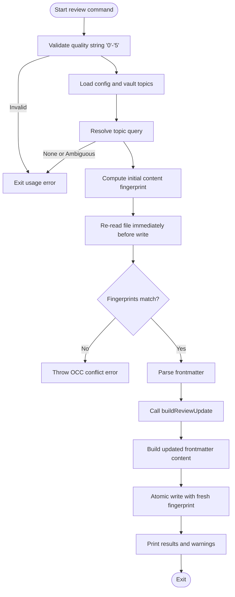
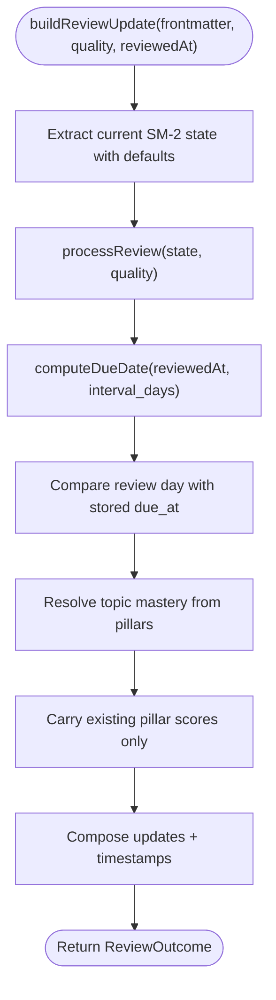
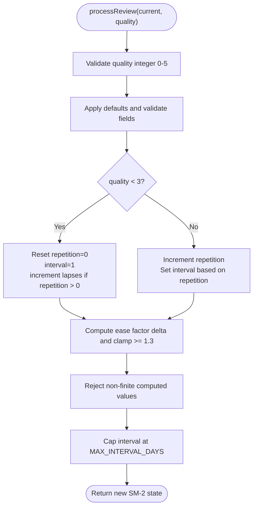
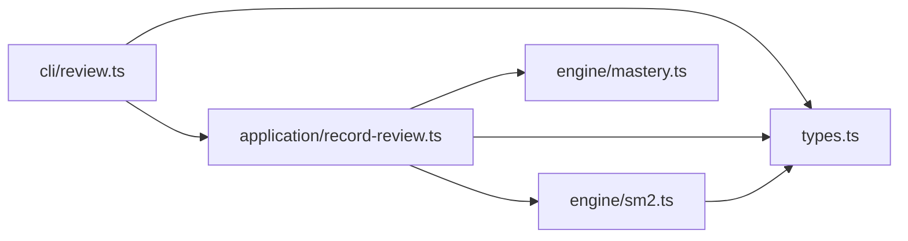

# Review Recording Workflow

<cite>
**Referenced Files in This Document**
- [record-review.ts](https://github.com/Kuldeep2822k/cli/blob/main/src/application/record-review.ts)
- [sm2.ts](https://github.com/Kuldeep2822k/cli/blob/main/src/engine/sm2.ts)
- [mastery.ts](https://github.com/Kuldeep2822k/cli/blob/main/src/engine/mastery.ts)
- [review.ts](https://github.com/Kuldeep2822k/cli/blob/main/src/cli/review.ts)
- [types.ts](https://github.com/Kuldeep2822k/cli/blob/main/src/types.ts)
- [application-record-review.test.ts](https://github.com/Kuldeep2822k/cli/blob/main/test/application-record-review.test.ts)
- [engine-sm2.test.ts](https://github.com/Kuldeep2822k/cli/blob/main/test/engine-sm2.test.ts)
</cite>

## Table of Contents
1. [Introduction](#introduction)
2. [Project Structure](#project-structure)
3. [Core Components](#core-components)
4. [Architecture Overview](#architecture-overview)
5. [Detailed Component Analysis](#detailed-component-analysis)
6. [Dependency Analysis](#dependency-analysis)
7. [Performance Considerations](#performance-considerations)
8. [Troubleshooting Guide](#troubleshooting-guide)
9. [Conclusion](#conclusion)

## Introduction
This document explains the review recording workflow used by the application when a user submits a spaced repetition recall rating for a topic. The workflow spans three layers:

- **CLI layer**: parses and validates the user’s input, locates the target topic, protects against concurrent modifications, and persists durable state.
- **Application layer**: performs pure SM-2 scheduling calculations, computes updated mastery, and produces a frontmatter update payload without performing I/O.
- **Engine layer**: implements the SuperMemo-2 algorithm, calendar-based due date computation, and robust numeric validation.

The design deliberately separates stateless calculation from file system operations so that the core scheduling logic can be tested deterministically while the CLI handles concurrency, durability, user feedback, and error recovery.

## Project Structure
The review recording path crosses four primary modules plus shared types:

| Layer | Module | Responsibility |
|---|---|---|
| CLI | `src/cli/review.ts` | Input parsing, topic resolution, fingerprint-based concurrency protection, atomic write, exit codes, user output |
| Application | `src/application/record-review.ts` | Pure review update computation, early-review detection, mastery integration |
| Engine | `src/engine/sm2.ts` | SM-2 state transition, interval/ease factor math, due date computation |
| Engine | `src/engine/mastery.ts` | Four-pillar mastery aggregation and pillar score carry-forward |
| Types | `src/types.ts` | Shared domain models including `Review`, assessment pillars, and topic metadata |

**Diagram sources**
- [review.ts:1-141](https://github.com/Kuldeep2822k/cli/blob/main/src/cli/review.ts#L1-L141)
- [record-review.ts:1-116](https://github.com/Kuldeep2822k/cli/blob/main/src/application/record-review.ts#L1-L116)
- [sm2.ts:1-306](https://github.com/Kuldeep2822k/cli/blob/main/src/engine/sm2.ts#L1-L306)
- [mastery.ts:1-229](https://github.com/Kuldeep2822k/cli/blob/main/src/engine/mastery.ts#L1-L229)

**Section sources**
- [review.ts:1-141](https://github.com/Kuldeep2822k/cli/blob/main/src/cli/review.ts#L1-L141)
- [record-review.ts:1-116](https://github.com/Kuldeep2822k/cli/blob/main/src/application/record-review.ts#L1-L116)
- [sm2.ts:1-306](https://github.com/Kuldeep2822k/cli/blob/main/src/engine/sm2.ts#L1-L306)
- [mastery.ts:1-229](https://github.com/Kuldeep2822k/cli/blob/main/src/engine/mastery.ts#L1-L229)
- [types.ts:1-200](https://github.com/Kuldeep2822k/cli/blob/main/src/types.ts#L1-L200)

## Core Components
The workflow is centered around one application function and one engine function:

| Function | Location | Purpose |
|---|---|---|
| `buildReviewUpdate` | `src/application/record-review.ts` | Reads current frontmatter, applies SM-2, computes mastery, and returns an immutable set of updates plus display state |
| `processReview` | `src/engine/sm2.ts` | Calculates new SM-2 state from current state and quality rating |
| `computeDueDate` | `src/engine/sm2.ts` | Advances local calendar days to produce the next due date |
| `resolveTopicMastery` / `carriedPillarScores` | `src/engine/mastery.ts` | Computes weighted mastery and preserves only present pillar scores |
| `reviewCommand` | `src/cli/review.ts` | End-to-end orchestration, validation, concurrency guard, persistence, and reporting |

Key data contracts:

| Contract | Description |
|---|---|
| `Review` | Stores SM-2 fields such as `interval_days`, `repetition`, `ease_factor`, `lapses`, `last_quality`, `last_reviewed_at`, and `due_at` |
| `ReviewOutcome` | Returned by the application layer; includes updates, new SM-2 state, computed due date, early-review flag, and stored due day |
| Frontmatter | Untrusted raw key/value map forwarded into the engine; validated defensively at each boundary |

**Section sources**
- [record-review.ts:1-116](https://github.com/Kuldeep2822k/cli/blob/main/src/application/record-review.ts#L1-L116)
- [sm2.ts:1-306](https://github.com/Kuldeep2822k/cli/blob/main/src/engine/sm2.ts#L1-L306)
- [mastery.ts:1-229](https://github.com/Kuldeep2822k/cli/blob/main/src/engine/mastery.ts#L1-L229)
- [types.ts:1-200](https://github.com/Kuldeep2822k/cli/blob/main/src/types.ts#L1-L200)

## Architecture Overview
The review recording process follows a strict read-compute-write pipeline with defensive boundaries at every layer.

**Diagram sources**
- [review.ts:1-141](https://github.com/Kuldeep2822k/cli/blob/main/src/cli/review.ts#L1-L141)
- [record-review.ts:1-116](https://github.com/Kuldeep2822k/cli/blob/main/src/application/record-review.ts#L1-L116)
- [sm2.ts:1-306](https://github.com/Kuldeep2822k/cli/blob/main/src/engine/sm2.ts#L1-L306)
- [mastery.ts:1-229](https://github.com/Kuldeep2822k/cli/blob/main/src/engine/mastery.ts#L1-L229)

## Detailed Component Analysis

### CLI Review Command
The CLI command is the entry point for user interaction. Its responsibilities include:

1. **Input validation**
   - Rejects quality values outside the integer range `0` through `5`.
   - Uses a regular expression and explicit parsing rather than trusting arbitrary strings.

2. **Topic discovery**
   - Loads vault topics.
   - Resolves the query to exactly one topic; rejects missing or ambiguous matches.

3. **Concurrency protection**
   - Computes a fingerprint of the loaded content.
   - Immediately before writing, re-reads the file and recomputes its fingerprint.
   - Throws an OCC conflict error if the content changed during processing.

4. **State computation**
   - Parses frontmatter.
   - Calls `buildReviewUpdate` with untrusted raw frontmatter and a fresh `reviewedAt` timestamp.

5. **Durable persistence**
   - Builds updated content through the storage helper.
   - Writes atomically using the original fresh fingerprint.

6. **User feedback and recovery**
   - Prints success details, including new ease factor, interval, repetitions, and due date.
   - Warns about failed reviews (`quality < 3`).
   - Warns about early reviews unless `--force` is provided.
   - Maps invalid SM-2 state errors to a repair hint pointing at the validation fix tool.
   - Sets process exit codes consistently for usage, conflict, and unexpected failures.

**Diagram sources**
- [review.ts:1-141](https://github.com/Kuldeep2822k/cli/blob/main/src/cli/review.ts#L1-L141)

**Section sources**
- [review.ts:1-141](https://github.com/Kuldeep2822k/cli/blob/main/src/cli/review.ts#L1-L141)

### Application Review Builder
The application layer isolates business logic from I/O. `buildReviewUpdate` accepts raw frontmatter, a numeric quality rating, and a review timestamp, then returns:

- `updates`: frontmatter fields to persist.
- `newState`: post-review SM-2 state for display.
- `dueDate`: computed next due date.
- `early`: whether the review occurred before the stored due date.
- `currentDueAt`: stored due date as a local calendar day, or null.

Its behavior can be summarized as:

1. Extract current SM-2 state with safe defaults:
   - `ease_factor` defaults to `2.5`.
   - `interval_days` defaults to `1`.
   - `repetition` defaults to `0`.
   - `lapses` defaults to `0`.
2. Call `processReview` to obtain the new SM-2 state.
3. Compute the next due date using `computeDueDate`.
4. Detect early review by comparing the local calendar day of the review timestamp with the carried stored due date.
5. Compute `topic_mastery` using pillar values with `pillars-first` precedence.
6. Carry forward only pillar scores actually present in the note.
7. Stamp `last_reviewed_at` and `due_at` as local date-only strings.

**Diagram sources**
- [record-review.ts:1-116](https://github.com/Kuldeep2822k/cli/blob/main/src/application/record-review.ts#L1-L116)
- [sm2.ts:1-306](https://github.com/Kuldeep2822k/cli/blob/main/src/engine/sm2.ts#L1-L306)
- [mastery.ts:1-229](https://github.com/Kuldeep2822k/cli/blob/main/src/engine/mastery.ts#L1-L229)

**Section sources**
- [record-review.ts:1-116](https://github.com/Kuldeep2822k/cli/blob/main/src/application/record-review.ts#L1-L116)

### SM-2 Engine
The SM-2 engine implements the SuperMemo-2 scheduling rules with strong defensive checks:

#### Quality Handling
- Accepts only integers from `0` to `5`.
- Applies the canonical ease factor delta formula.

#### Interval Logic
- **Failed review** (`quality < 3`):
  - Resets `repetition` to `0`.
  - Resets `interval_days` to `1`.
  - Increments `lapses` only when the topic had prior repetitions.
- **Successful review** (`quality >= 3`):
  - Increments `repetition`.
  - Sets `interval_days` to `1` for the first repetition.
  - Sets `interval_days` to `6` for the second repetition.
  - For later repetitions, rounds `interval_days * ease_factor`.
  - Enforces a minimum interval of `1`.

#### Safety Bounds
- Clamps `ease_factor` to a minimum of `1.3`.
- Caps `interval_days` at `MAX_INTERVAL_DAYS`, which is `36500` days.
- Refuses non-finite intermediate arithmetic results.
- Refuses due dates that would fall outside the representable `Date` range.
- Protects against JavaScript safe-integer overflow for `repetition` and `lapses`.

#### Date Handling
- Formats dates as local `YYYY-MM-DD` strings.
- Computes due dates using local calendar arithmetic rather than UTC millisecond addition, avoiding DST edge cases.
- Supports both `Date` and local date-only strings as baselines.

**Diagram sources**
- [sm2.ts:1-306](https://github.com/Kuldeep2822k/cli/blob/main/src/engine/sm2.ts#L1-L306)

**Section sources**
- [sm2.ts:1-306](https://github.com/Kuldeep2822k/cli/blob/main/src/engine/sm2.ts#L1-L306)

### Mastery Integration
Mastery integration ensures that review updates do not fabricate assessment data:

- Only pillar keys actually present in the frontmatter are carried forward.
- Carried pillar values are normalized to `[0.0, 1.0]`.
- `topic_mastery` is computed using the weighted formula with conceptual, practical, debug, and twice-weighted feynman scores.
- In review mode, `pillars-first` precedence means any present pillar triggers a recompute; absent pillars remain absent.

This prevents the common defect where a review writes zero pillar scores even though the learner never supplied them, which would make the note appear assessed but zeroed and could pin mastery incorrectly.

**Section sources**
- [mastery.ts:1-229](https://github.com/Kuldeep2822k/cli/blob/main/src/engine/mastery.ts#L1-L229)
- [record-review.ts:1-116](https://github.com/Kuldeep2822k/cli/blob/main/src/application/record-review.ts#L1-L116)

### Data Model Contracts
The shared `Review` type defines the scheduled repetition state persisted alongside other topic metadata. Important fields include:

| Field | Meaning |
|---|---|
| `interval_days` | Next spacing interval in days |
| `repetition` | Consecutive successful review count |
| `ease_factor` | Adjusted easiness factor controlling future interval growth |
| `lapses` | Cumulative failures after initial mastery |
| `last_quality` | Most recent recall quality |
| `last_reviewed_at` | Local date stamp of last review |
| `due_at` | Local date string indicating next due time |

The `Assessment` type describes the four pedagogical pillars used by mastery calculations, although runtime frontmatter is flat and untyped until parsed.

**Section sources**
- [types.ts:1-200](https://github.com/Kuldeep2822k/cli/blob/main/src/types.ts#L1-L200)

## Dependency Analysis
The review recording workflow has a clear layered dependency structure:

- The CLI depends on the application builder and storage helpers.
- The application builder depends only on pure engine functions and shared types.
- The engine depends on shared types and validation utilities.
- There is no circular dependency between CLI, application, and engine layers.

**Diagram sources**
- [review.ts:1-141](https://github.com/Kuldeep2822k/cli/blob/main/src/cli/review.ts#L1-L141)
- [record-review.ts:1-116](https://github.com/Kuldeep2822k/cli/blob/main/src/application/record-review.ts#L1-L116)
- [sm2.ts:1-306](https://github.com/Kuldeep2822k/cli/blob/main/src/engine/sm2.ts#L1-L306)
- [mastery.ts:1-229](https://github.com/Kuldeep2822k/cli/blob/main/src/engine/mastery.ts#L1-L229)
- [types.ts:1-200](https://github.com/Kuldeep2822k/cli/blob/main/src/types.ts#L1-L200)

**Section sources**
- [review.ts:1-141](https://github.com/Kuldeep2822k/cli/blob/main/src/cli/review.ts#L1-L141)
- [record-review.ts:1-116](https://github.com/Kuldeep2822k/cli/blob/main/src/application/record-review.ts#L1-L116)
- [sm2.ts:1-306](https://github.com/Kuldeep2822k/cli/blob/main/src/engine/sm2.ts#L1-L306)
- [mastery.ts:1-229](https://github.com/Kuldeep2822k/cli/blob/main/src/engine/mastery.ts#L1-L229)
- [types.ts:1-200](https://github.com/Kuldeep2822k/cli/blob/main/src/types.ts#L1-L200)

## Performance Considerations
For high-frequency review scenarios, the implementation already separates cheap pure computation from potentially expensive I/O:

- **Pure computation cost**: `processReview`, `computeDueDate`, `formatLocalDateOnly`, and mastery resolution are constant-time operations per review. They perform minimal arithmetic and object construction.
- **I/O cost**: The most expensive part is loading topics, reading the target file, parsing frontmatter, and writing it back.
- **Concurrent safety**: The CLI performs an extra synchronous read and fingerprint comparison just before writing. This avoids lost updates but adds one extra disk read per review attempt.
- **Memory footprint**: Each review creates small temporary objects for state, updates, and outcomes. No large caches or batches are introduced by this path.
- **Calendar arithmetic**: Due date computation uses local `setDate` operations, which are fast and avoid timezone conversion overhead across repeated steps.

Optimization opportunities should focus on batching multiple reviews into fewer storage reads/writes at the CLI or caller level, while keeping the engine and application layers pure and single-topic focused.

[No sources needed since this section provides general guidance]

## Troubleshooting Guide

### Invalid Recall Quality
If the user passes a value outside `0`–`5`, the CLI detects it early and reports a usage error without touching the vault.

**Section sources**
- [review.ts:1-141](https://github.com/Kuldeep2822k/cli/blob/main/src/cli/review.ts#L1-L141)

### Corrupted SM-2 State
If a note contains malformed SM-2 fields such as a string in `interval_days`, a boolean in `ease_factor`, or a negative or non-integer `lapses`, the engine throws a field-specific error. The CLI recognizes these errors and prints a hint directing the user to run the validation repair command.

Recommended recovery:
1. Identify the affected topic.
2. Run the validation fix tool referenced in the CLI hint.
3. Retry the review after the schema has been repaired.

**Section sources**
- [sm2.ts:1-306](https://github.com/Kuldeep2822k/cli/blob/main/src/engine/sm2.ts#L1-L306)
- [review.ts:1-141](https://github.com/Kuldeep2822k/cli/blob/main/src/cli/review.ts#L1-L141)
- [engine-sm2.test.ts:1-200](https://github.com/Kuldeep2822k/cli/blob/main/test/engine-sm2.test.ts#L1-L200)

### Concurrent Modification During Review
If another process modifies the topic note between the initial load and the pre-write re-read, the CLI throws an OCC conflict error. The operation does not partially update the note.

Recommended recovery:
1. Retry the review after ensuring no other writer is active.
2. If reviewing many topics, serialize writes or coordinate locks at a higher level.

**Section sources**
- [review.ts:1-141](https://github.com/Kuldeep2822k/cli/blob/main/src/cli/review.ts#L1-L141)

### Early Review Before Due Date
When a review occurs before the stored `due_at`, the application marks the outcome as early. The CLI still records the review and exits successfully, but prints a warning unless `--force` is provided. This prevents schedule drift while allowing intentional early practice.

**Section sources**
- [record-review.ts:1-116](https://github.com/Kuldeep2822k/cli/blob/main/src/application/record-review.ts#L1-L116)
- [review.ts:1-141](https://github.com/Kuldeep2822k/cli/blob/main/src/cli/review.ts#L1-L141)

### Missing Pillar Scores Are Not Fabricated
If a note lacks pillar scores, the review update must not write zeros. The test suite asserts that absent pillars remain absent and that mastery remains zero when no pillars exist.

**Section sources**
- [application-record-review.test.ts:1-83](https://github.com/Kuldeep2822k/cli/blob/main/test/application-record-review.test.ts#L1-L83)
- [mastery.ts:1-229](https://github.com/Kuldeep2822k/cli/blob/main/src/engine/mastery.ts#L1-L229)

## Conclusion
The review recording workflow cleanly separates concerns:

- The CLI owns user input, topic resolution, concurrency protection, persistence, and error signaling.
- The application layer owns SM-2 state transitions, due date computation, early-review detection, and mastery integration.
- The engine layer owns numerical correctness, interval bounds, and calendar-safe date arithmetic.
- Shared types define the persistent review contract.

This separation makes it possible to verify SM-2 behavior independently of file system behavior, protect durable state from concurrent modification, recover gracefully from corrupted notes, and maintain consistent progress tracking across spaced repetition intervals and mastery calculations.

[No sources needed since this section summarizes without analyzing specific files]