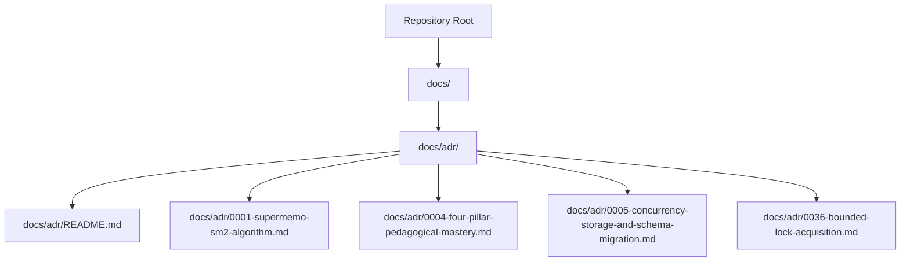
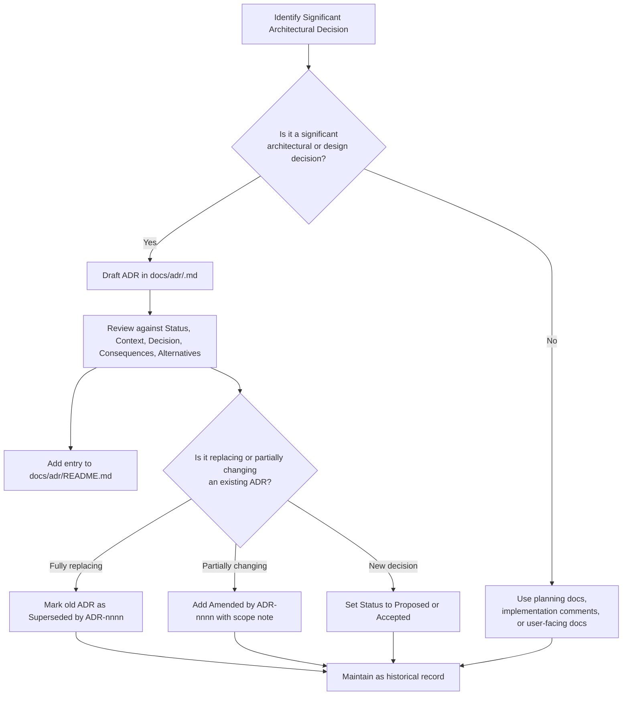
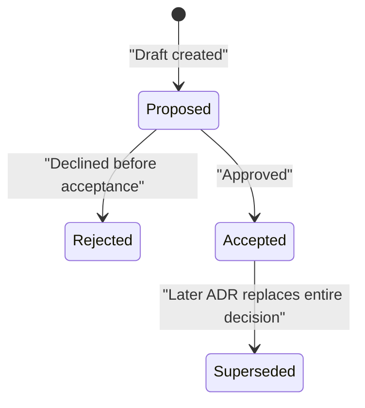
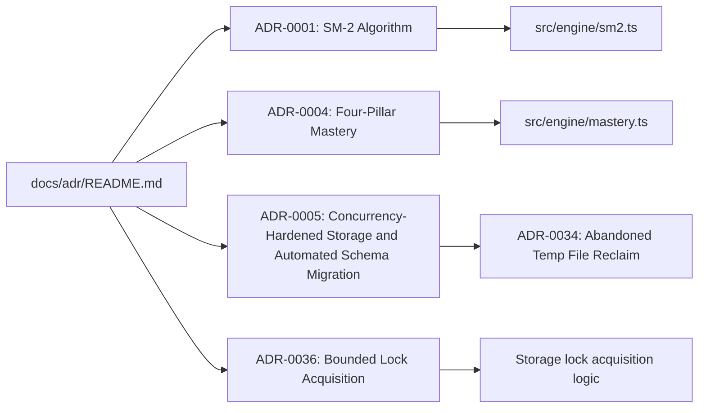

# ADR Lifecycle and Conventions

::: details Referenced Files in This Document

- [README.md](https://github.com/Kuldeep2822k/cli/blob/main/docs/adr/README.md)
- [0001-supermemo-sm2-algorithm.md](https://github.com/Kuldeep2822k/cli/blob/main/docs/adr/0001-supermemo-sm2-algorithm.md)
- [0004-four-pillar-pedagogical-mastery.md](https://github.com/Kuldeep2822k/cli/blob/main/docs/adr/0004-four-pillar-pedagogical-mastery.md)
- [0005-concurrency-storage-and-schema-migration.md](https://github.com/Kuldeep2822k/cli/blob/main/docs/adr/0005-concurrency-storage-and-schema-migration.md)
- [0036-bounded-lock-acquisition.md](https://github.com/Kuldeep2822k/cli/blob/main/docs/adr/0036-bounded-lock-acquisition.md)
- [agent.md](https://github.com/Kuldeep2822k/cli/blob/main/agent.md)

:::

## Table of Contents
1. [Introduction](#introduction)
2. [Project Structure](#project-structure)
3. [Core Components](#core-components)
4. [Architecture Overview](#architecture-overview)
5. [Detailed Component Analysis](#detailed-component-analysis)
6. [Dependency Analysis](#dependency-analysis)
7. [Performance Considerations](#performance-considerations)
8. [Troubleshooting Guide](#troubleshooting-guide)
9. [Conclusion](#conclusion)

## Introduction
This document explains PALEE’s Architectural Decision Record (ADR) lifecycle, conventions, and governance model as implemented in the repository. It is intended for contributors who create, review, or maintain ADRs and for readers who need to understand how architectural decisions are recorded, referenced, amended, and superseded over time.

PALEE uses ADRs to capture significant architectural and design decisions rather than embedding all rationale into implementation code or informal notes. The ADR index and individual records live under `docs/adr`, while the agent documentation describes how AI-assisted work interacts with the codebase and its rules.

## Project Structure
The ADR system is centered on a single directory:

- `docs/adr/` — contains the ADR index and numbered decision records.
- `docs/adr/README.md` — defines the status vocabulary, section conventions, and the current index.
- Individual ADR files — follow the naming pattern `NNNN-short-title.md`.

## Core Components
PALEE’s ADR system has three core components:

| Component | Responsibility | Repository Evidence |
|---|---|---|
| ADR index | Declares purpose, status vocabulary, and links every active ADR | [docs/adr/README.md:1-62](https://github.com/Kuldeep2822k/cli/blob/main/docs/adr/README.md#L1-L62) |
| ADR record | Records one decision with structured sections | Example: [docs/adr/0001-supermemo-sm2-algorithm.md:1-63](https://github.com/Kuldeep2822k/cli/blob/main/docs/adr/0001-supermemo-sm2-algorithm.md#L1-L63) |
| Status metadata | Tracks whether a decision is proposed, accepted, rejected, or superseded (an amendment is an annotation on a still-Accepted record, not a status) | Examples in [docs/adr/0005-concurrency-storage-and-schema-migration.md:1-51](https://github.com/Kuldeep2822k/cli/blob/main/docs/adr/0005-concurrency-storage-and-schema-migration.md#L1-L51) and [docs/adr/0036-bounded-lock-acquisition.md:1-91](https://github.com/Kuldeep2822k/cli/blob/main/docs/adr/0036-bounded-lock-acquisition.md#L1-L91) |

### Status Vocabulary
The repository defines four statuses (`Proposed`, `Accepted`, `Rejected`, `Superseded by ADR-nnnn`):

| Status | Meaning | How it appears |
|---|---|---|
| **Proposed** | A decision is under consideration but not yet adopted. | Appears as the status of ADR-0028, which is Proposed. |
| **Accepted** | The decision has been approved and should guide implementation. | Appears as the primary status line in ADRs such as ADR-0001 and ADR-0004. |
| **Rejected** | The proposal was considered and declined before acceptance; it is retained for decision history and does not guide implementation. | Appears as the terminal status of a proposal that was explicitly declined. |
| **Superseded** | A later ADR replaces the earlier decision. | Recorded as “Superseded by ADR-nnnn”. |

“Amended” is not a status: an amendment is an annotation on a record that remains Accepted. When a later ADR changes part of an earlier decision without replacing it entirely, the earlier record keeps its Accepted status and gains an “Amended by ADR-nnnn” line plus a short scope note (as ADR-0005 does for ADR-0034).

The index explicitly allows both `Superseded by ADR-nnnn` and `Amended by ADR-nnnn`, making amendment the preferred mechanism when only part of a decision changes.

### ADR Template Structure
Each ADR should use consistent Title Case page titles and headings, and should keep one convention per page rather than mixing styles. The documented template sections include:

| Section | Purpose |
|---|---|
| **Status** | States whether the decision is Proposed, Accepted, or Superseded, including the effective date where applicable (amendments appear here as an “Amended by ADR-nnnn” annotation line on a still-Accepted record). |
| **Context** | Explains the problem, constraints, environment, and motivations that led to the decision. |
| **Decision** | States what was chosen and why, ideally linking to implementation where appropriate. |
| **Consequences** | Describes positive outcomes, tradeoffs, costs, risks, and operational implications. |
| **Alternatives Considered** | Lists rejected options and explains why they were not selected. (Customary in existing ADRs, but not one of the template sections named in `docs/adr/README.md`, which names only Status, Context, Decision, and Consequences.) |

Existing ADRs demonstrate this structure:

- ADR-0001 includes Status, Context, Decision, Consequences, and Alternatives Considered.
- ADR-0004 follows the same structure and adds mathematical notation to clarify the decision.
- ADR-0005 uses the standard sections and shows how an amendment line is attached to an existing record.

### Naming Conventions and Numbering Scheme
ADR filenames follow a zero-padded numeric prefix followed by a descriptive slug:

- Format: `NNNN-short-title.md`
- Examples: `0001-supermemo-sm2-algorithm.md`, `0004-four-pillar-pedagogical-mastery.md`, `0036-bounded-lock-acquisition.md`

The index entries also use a human-readable `ADR-NNNN` form. The index is kept up to date as new ADRs are added.

Contributors should:

- Use the next available number from the index.
- Keep file names lowercase with hyphens.
- Make titles concise but specific enough to distinguish related decisions.
- Keep page titles and section headings in Title Case.

### Cross-Referencing Rules
ADRs cross-reference each other through two mechanisms:

1. **Index links**: Every ADR is listed in `docs/adr/README.md`.
2. **In-record references**: Amendments and supersessions point directly at another ADR using the `ADR-nnnn` identifier.

When a later ADR changes part of an earlier decision, the earlier record should receive an amendment line rather than being edited in place. When a later ADR fully replaces an earlier one, the earlier record should be marked as superseded.

## Architecture Overview
The ADR lifecycle is a documentation workflow rather than executable software. Its control flow is driven by contributors creating, reviewing, amending, or superseding records.

## Detailed Component Analysis

### ADR Lifecycle States
An ADR evolves through these states:

An amendment is not a lifecycle state: a later ADR that changes only part of a decision adds an “Amended by ADR-nnnn” annotation line to the earlier record, which stays in the Accepted state.

#### Proposed
A Proposed ADR is a candidate decision. It should clearly separate context from decision and avoid implying implementation has already occurred.

#### Accepted
An Accepted ADR is the authoritative record for that decision until it is amended or superseded. Implementation, testing, and documentation should reference it.

#### Amended (annotation, not a status)
An amendment is not a lifecycle state. It does not rewrite the original decision wholesale or change its Accepted status. Instead, it adds an amendment line and a short note describing the affected scope. The original record remains readable history.

Example evidence:

- ADR-0005 is marked Accepted and carries an amendment line referencing ADR-0034 about abandoned temporary files.

#### Superseded
A superseded ADR remains in the repository as history, but its decision is replaced by a newer ADR. Consumers should prefer the newer record.

### ADR Template Sections in Practice

#### Status
The Status section declares the decision’s current state and, where useful, its effective date.

Observed patterns:

- ADR-0001 and ADR-0004 use a simple accepted status.
- ADR-0005 includes an amendment line after the accepted status.
- ADR-0036 uses the accepted status without amendment or supersession.

Best practice:

- Include the date when accepting a decision.
- Place amendment or supersession lines immediately after the main status line.
- Keep amendment notes short and scoped.

#### Context
Context answers “why did we need this decision?” It should describe the problem space, constraints, stakeholders, and prior assumptions.

Examples:

- ADR-0001 frames spaced repetition around retention, determinism, offline operation, and testability.
- ADR-0004 frames mastery measurement around multi-dimensional engineering competence.
- ADR-0005 frames storage hardening around vault growth, external editors, concurrency, and schema migration.

Guidance:

- Keep context focused on the decision boundary.
- Link to supporting evidence, issues, or design documents when necessary.
- Avoid writing implementation details as if they are already settled.

#### Decision
The Decision section should state what was chosen and why. Where helpful, link to source modules or commands so reviewers can verify alignment between architecture and implementation.

Examples:

- ADR-0001 points to `src/engine/sm2.ts`.
- ADR-0004 points to `src/engine/mastery.ts`.
- ADR-0005 describes atomic writes, OCC migration, CST frontmatter serialization, and timezone-safe arithmetic.

Guidance:

- Prefer concrete decisions over vague intentions.
- Separate policy decisions from implementation details.
- Reference implementation paths sparingly; ADRs are not code reviews.

#### Consequences
Consequences should be honest about benefits and tradeoffs. Good ADRs list both positive and negative effects.

Examples:

- ADR-0001 lists deterministic scheduling as positive and user ratings as a cost.
- ADR-0004 lists holistic assessment as positive and higher evaluation overhead as a tradeoff.
- ADR-0005 lists vault repair and concurrency safety as positives and cryptographic entropy generation as a small cost.

Guidance:

- Include performance, reliability, usability, maintenance, and security consequences.
- Call out operational behaviors that tests or CI should observe.
- If a consequence is uncertain, mark it as such.

#### Alternatives Considered
This section documents rejected options and their reasons. It prevents future contributors from repeating rejected work and makes evolution traceable.

Examples:

- ADR-0001 considers FSRS, Leitner boxes, Anki-style learning steps, and half-life regression.
- ADR-0004 considers equal weighting, a 1-D recall score, Bloom’s taxonomy, and time-decayed mastery.
- ADR-0005 considers implicit read-time upgrades and a global write mutex.

Guidance:

- Name alternatives clearly.
- Explain why they were rejected, not just why they were less convenient.
- Treat rejected alternatives as evidence, not as insults to past choices.

### When to Use an ADR Versus Other Documentation Forms
Not every technical choice warrants an ADR. Use the following guidance:

| Situation | Recommended Form | Reason |
|---|---|---|
| Significant architectural or design decision with long-lived impact | ADR | Captures rationale, alternatives, and consequences for future maintainers. |
| One-off implementation detail | Code comments or PR description | Too narrow for a permanent architectural record. |
| Product feature specification | Planning or design document | May be broader than one architectural decision. |
| User-facing behavior or command contract | User documentation or CLI documentation | Readers expect stable user-facing contracts outside the ADR index. |
| Test policy or verification requirement | Testing documentation or ADR if broadly architectural | Tests pin behavior; broad policy may belong in an ADR. |

Evidence from the repository supports this distinction:

- The ADR index says it records “significant architectural and design decisions.”
- Agent documentation describes broader project structure, CLI conventions, invariants, and verification loops that are not themselves ADRs.
- Existing ADRs cover topics such as algorithms, storage layer isolation, validation framework boundaries, CLI launch policy, installed-artifact evidence, and lock acquisition—decisions with architectural reach.

### Writing Effective ADRs
Based on the repository’s existing records and index instructions, effective ADRs should:

1. Start with clear Context before stating the Decision.
2. State the Decision concretely, preferably linking to implementation or commands.
3. List consequences honestly, including tradeoffs.
4. Document Alternatives Considered so rejections are explainable.
5. Use Title Case consistently within the page.
6. Keep one convention per page.
7. Update the index when adding a new ADR.
8. Use amendments for partial changes and supersession for full replacement.

### Reviewing ADRs
A reviewer should check:

- Whether the decision is truly architectural or design-level.
- Whether Status accurately reflects the decision’s maturity.
- Whether Context provides sufficient background.
- Whether Decision is actionable and aligned with implementation.
- Whether Consequences capture meaningful tradeoffs.
- Whether Alternatives Considered explains rejection reasons.
- Whether the index entry exists and matches the filename.
- Whether any older ADR needs an amendment or supersession line.

### Maintaining ADRs as Code Evolves
As PALEE evolves:

- Do not silently edit an Accepted ADR to change its decision.
- Permitted edits to an Accepted ADR are limited to typo and link fixes, Status changes, and the amendment notes `docs/adr/README.md` requires (such as an `Amended by ADR-nnnn` line).
- Create a new ADR and amend or supersede the older one; a changed decision must also update the affected entries in `planning/invariants.md` to match.
- Keep historical ADRs readable even when they no longer reflect current behavior.
- Update the index whenever a new ADR is added.
- Ensure implementation and tests remain consistent with the current accepted ADR.
- Use the ADR as evidence during code reviews, especially for storage, scheduling, CLI boundaries, and error contracts.

## Dependency Analysis
ADRs depend on each other through amendment and supersession relationships, and on implementation through referenced modules or commands.

### Coupling and Cohesion
- ADRs are loosely coupled: each file documents one decision.
- Cohesion is high within an ADR because Context, Decision, Consequences, and Alternatives focus on the same topic.
- Amendment and supersession create directed dependencies between ADRs.
- References to source modules create loose coupling between ADRs and implementation.

### External Dependencies
- The ADR system depends on Git history and the repository index.
- Some ADRs reference implementation modules such as `src/engine/sm2.ts` and `src/engine/mastery.ts`.
- The agent documentation describes project-wide rules and verification loops that influence how ADR-backed decisions are implemented and tested.

## Performance Considerations
The ADR system itself has negligible runtime performance impact because it is documentation. However, good ADRs improve long-term maintenance performance by:

- Reducing repeated debates about established decisions.
- Making it easier to reason about legacy behavior.
- Helping reviewers locate architectural rationale quickly.
- Preventing accidental regression of important tradeoffs.

Poorly maintained ADRs can hurt performance by:

- Hiding outdated decisions behind silent edits.
- Creating confusion between amendment and supersession.
- Forgetting to update the index.
- Referencing implementation paths that become stale.

## Troubleshooting Guide

### Symptom: An ADR feels outdated
**Likely causes:**

- The decision was changed without marking the old ADR as amended or superseded.
- Implementation evolved independently of the ADR.
- The index still points to an old or missing title.

**Resolution:**

- If only part of the decision changed, add an amendment line.
- If the whole decision changed, mark the old ADR as superseded.
- Update the index entry to match the current filename and title.

### Symptom: Two ADRs seem to contradict each other
**Likely causes:**

- One ADR is newer but not marked as amending or superseding the older one.
- The older ADR was edited in place instead of being preserved as history.
- Cross-references are missing.

**Resolution:**

- Identify which ADR represents the current accepted decision.
- Add amendment or supersession linkage to the older record.
- Clarify the boundary between the two decisions in the newer ADR.

### Symptom: A new ADR cannot find an expected numbering slot
**Likely causes:**

- The index is stale.
- ADR numbers were reused or skipped informally.

**Resolution:**

- Scan the existing ADR filenames in `docs/adr/`.
- Choose the next unused zero-padded number.
- Update the index entry.

### Symptom: Reviewers disagree on whether something belongs in an ADR
**Likely causes:**

- The change is implementation-level rather than architectural.
- The decision is product or user-facing rather than architectural.
- There is no shared understanding of the decision boundary.

**Resolution:**

- Ask whether the decision will affect multiple components, long-term evolution, or non-obvious tradeoffs.
- If yes, draft an ADR.
- If no, use planning docs, implementation comments, or user documentation.

## Conclusion
PALEE’s ADR system is a lightweight but disciplined way to record architectural and design decisions. Its strength lies in the combination of a fixed status vocabulary, a consistent template, explicit amendment and supersession semantics, and a centralized index.

For contributors, the most important practices are:

- Use ADRs for significant architectural decisions.
- Write clear Context, Decision, Consequences, and Alternatives Considered.
- Keep Title Case consistent and avoid mixing conventions on one page.
- Preserve history by amending or superseding rather than rewriting Accepted ADRs.
- Keep the index accurate.
- Align implementation and tests with the current accepted ADR.

For maintainers, ADRs serve as the project’s architectural memory. They should be reviewed carefully, updated deliberately, and treated as evidence when code, tests, or user-facing behavior evolve.
