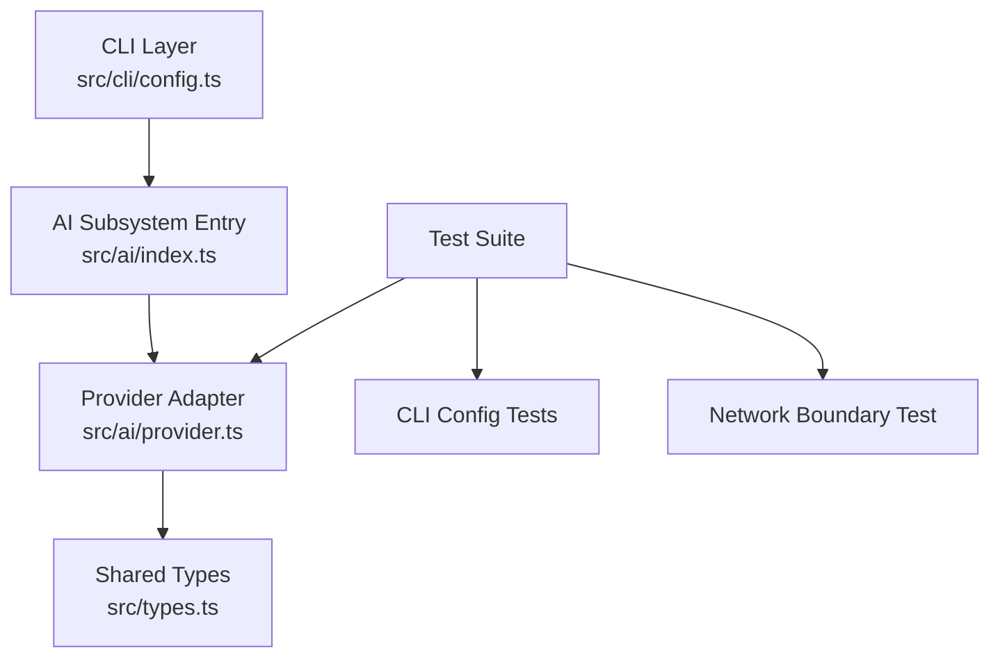
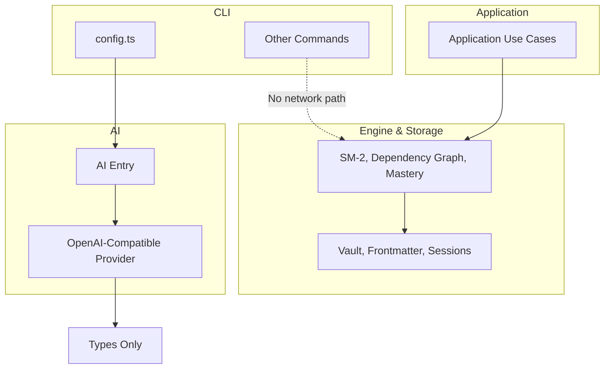
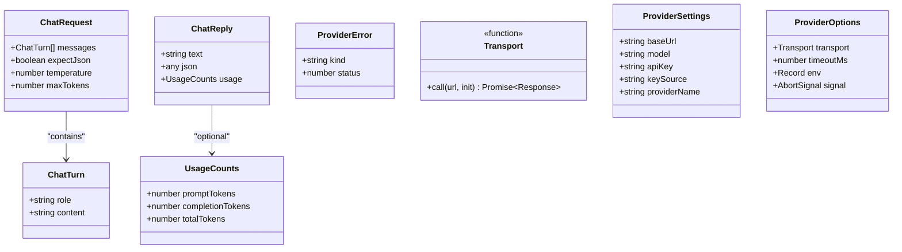
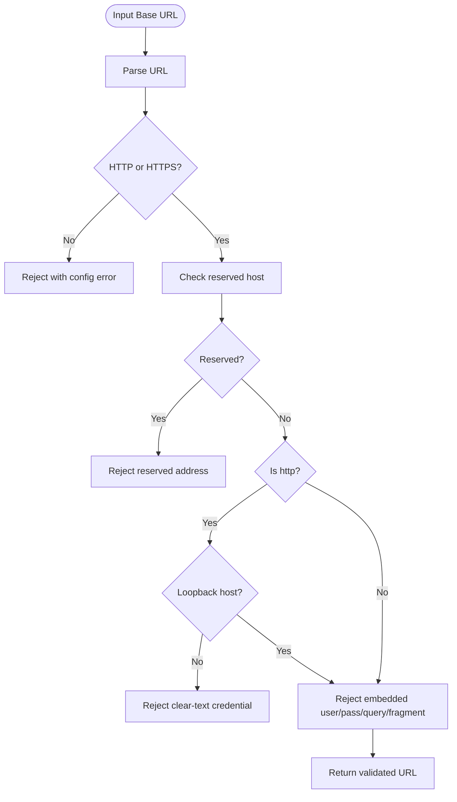
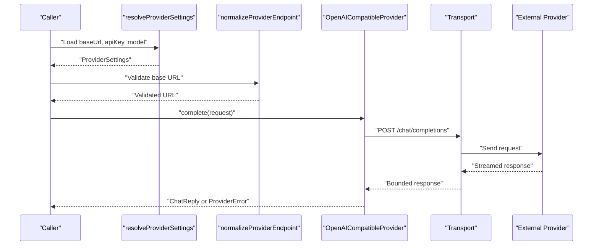
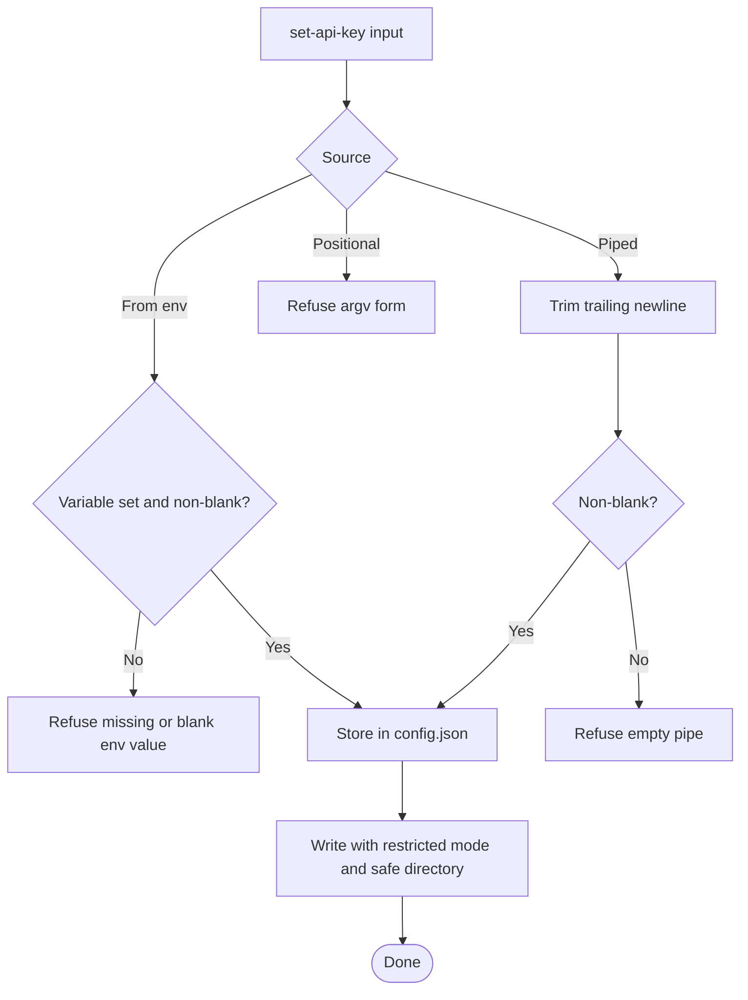
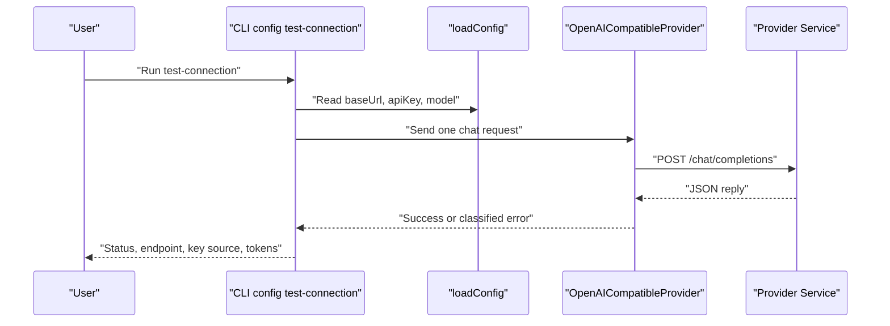
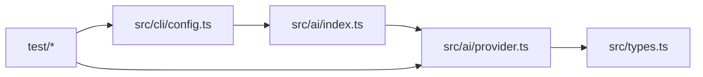
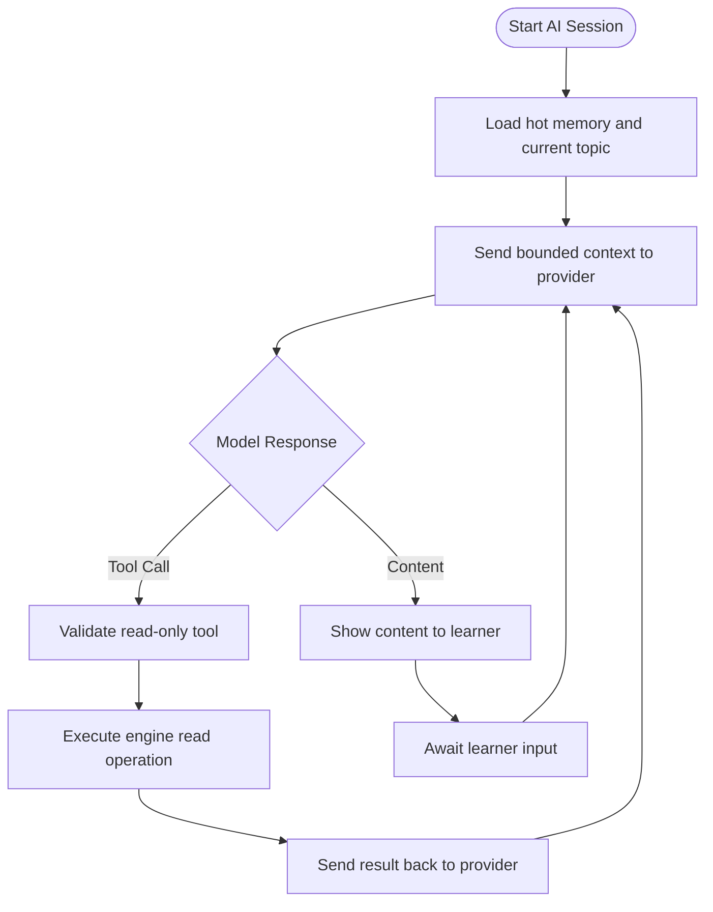

# AI Integration and Phase 2 Design

::: details Referenced Files in This Document

- [index.ts](https://github.com/Kuldeep2822k/cli/blob/main/src/ai/index.ts)
- [provider.ts](https://github.com/Kuldeep2822k/cli/blob/main/src/ai/provider.ts)
- [types.ts](https://github.com/Kuldeep2822k/cli/blob/main/src/types.ts)
- [config.ts](https://github.com/Kuldeep2822k/cli/blob/main/src/cli/config.ts)
- [0027-ai-provider-boundary.md](https://github.com/Kuldeep2822k/cli/blob/main/docs/adr/0027-ai-provider-boundary.md)
- [0028-phase-2-design-directions.md](https://github.com/Kuldeep2822k/cli/blob/main/docs/adr/0028-phase-2-design-directions.md)
- [ai_module_design.md](https://github.com/Kuldeep2822k/cli/blob/main/planning/ai_module_design.md)
- [ai-network-boundary.test.ts](https://github.com/Kuldeep2822k/cli/blob/main/test/ai-network-boundary.test.ts)
- [ai-provider.test.ts](https://github.com/Kuldeep2822k/cli/blob/main/test/ai-provider.test.ts)
- [ai-provider-loopback.test.ts](https://github.com/Kuldeep2822k/cli/blob/main/test/ai-provider-loopback.test.ts)
- [cli-config-provider-credentials.test.ts](https://github.com/Kuldeep2822k/cli/blob/main/test/cli-config-provider-credentials.test.ts)
- [cli-config-test-connection.test.ts](https://github.com/Kuldeep2822k/cli/blob/main/test/cli-config-test-connection.test.ts)

:::

## Table of Contents
1. [Introduction](#introduction)
2. [Project Structure](#project-structure)
3. [Core Components](#core-components)
4. [Architecture Overview](#architecture-overview)
5. [Detailed Component Analysis](#detailed-component-analysis)
6. [Dependency Analysis](#dependency-analysis)
7. [Performance Considerations](#performance-considerations)
8. [Security Considerations](#security-considerations)
9. [Troubleshooting Guide](#troubleshooting-guide)
10. [Phase 2 Design Directions](#phase-2-design-directions)
11. [Configuration Examples](#configuration-examples)
12. [Conclusion](#conclusion)

## Introduction
PALEE is a deterministic, offline learning engine for spaced repetition, dependency graphs, mastery tracking, and topic planning. Its Phase 1 core must not open network sockets; the only exception is a narrowly scoped AI subsystem introduced for Phase 2. That subsystem provides an OpenAI-compatible chat-completion adapter with strict transport, credential, endpoint, and output controls. The broader design goal is to integrate AI assistance without letting it widen gating decisions or compromise the vault’s integrity.

This document explains:
- How PALEE isolates AI from its core engine.
- The provider adapter contract and the current OpenAI-compatible implementation.
- Network security boundaries around API keys, base URLs, redirects, responses, and reserved address space.
- How configuration commands manage credentials safely.
- The planned evolution toward dependency-aware recommendations, chain verification, per-edge blocking policies, and integrated tutoring sessions.

## Project Structure
The AI integration lives under `src/ai`, while CLI configuration logic imports from it. Tests enforce that no other source file opens network connections.

## Core Components
The AI subsystem exposes three primary responsibilities:
- A typed request/reply contract for chat turns.
- A configurable provider settings resolver.
- An OpenAI-compatible adapter that builds requests, validates endpoints, enforces timeouts, redacts secrets, and classifies errors.

Key exported types and values include:
- `ChatTurn`, `ChatRequest`, `ChatReply`.
- `ProviderError` with classified error kinds: config, network, provider, schema.
- `Transport`, the injected network seam.
- `ProviderSettings`, `ProviderOptions`.
- `API_KEY_ENV`, `DEFAULT_MODEL`, `MAX_RESPONSE_BYTES`, `MAX_MESSAGE_CHARS`.

The subsystem is intentionally not re-exported from the main library barrel, so importing PALEE as a library does not automatically introduce network behavior.

## Architecture Overview
PALEE’s architecture separates concerns across layers:
- CLI commands parse arguments, load configuration, format output, and map exit codes.
- Application use cases implement domain workflows over storage and engine data.
- Engine components compute SM-2 scheduling, dependency chains, mastery, and prerequisite text.
- Storage handles vault files, frontmatter, locking, sessions, and scanning.
- Validation rules enforce schema and policy constraints.
- AI is isolated into `src/ai`; currently, only the CLI configuration command uses it.

## Detailed Component Analysis

### AI Provider Adapter Contract
The adapter defines a small, testable contract:
- Requests carry messages, optional JSON expectations, temperature, and token caps.
- Replies return plain text, optional parsed JSON when requested, and usage counts when reported by the provider.
- Errors are wrapped in `ProviderError` with a stable classification rather than raw HTTP or transport exceptions.
- All network calls go through the `Transport` type, allowing tests to record URL, headers, body, and retry behavior.

### Endpoint Normalization and Network Security
Endpoint validation is the central security gate:
- Only `http:` and `https:` are allowed.
- Reserved addresses are refused outright, including unspecified, link-local, multicast, cloud metadata addresses, and `.internal` names.
- Plain HTTP is permitted only for loopback hosts.
- Credentials may not be embedded in the base URL, query string, or fragment.
- Redirects are refused to prevent credential leakage to unapproved targets.
- Responses are streamed and bounded at `MAX_RESPONSE_BYTES`.
- Messages and error fragments are redacted and truncated.

### Request Flow and Error Classification
A typical provider call follows this flow:
1. Resolve settings from configuration and environment.
2. Normalize the base URL.
3. Build the completions URL.
4. Send a request using the injected transport.
5. Stream and bound the response.
6. Parse JSON when requested.
7. Classify failures as config, network, provider, or schema errors.

### Credential Management
Credential handling spans CLI configuration and runtime resolution:
- The stored API key is kept in the existing `config.json`.
- `PALEE_API_KEY` outranks the stored key at runtime.
- `keySource` records whether the key came from environment, config, or none.
- `set-api-key` refuses positional arguments, empty input, and unsafe environments where appropriate.
- `config show` masks the key and never prints partial secrets.
- On POSIX-like systems, the directory and file modes protect the stored secret; on Windows, location-based checks are used with an explicit override.

### Connection Testing
`palee config test-connection` is the only command designed to reach the configured provider:
- It validates configuration before sending any request.
- It reports the actual endpoint, key source, reply text, and token counts.
- It maps 401-like failures to usage errors and server errors to unexpected failures.
- It avoids leaking the configured secret in output.

## Dependency Analysis
The AI layer depends only on shared types, not on CLI commands. The CLI depends on the AI layer for provider configuration and testing. The rest of the system remains offline.

## Performance Considerations
- Each provider request has a default timeout to avoid hanging the CLI.
- Response bodies are read incrementally and cancelled once they exceed `MAX_RESPONSE_BYTES`.
- Long-running operations support cancellation signals so interactive sessions do not wait indefinitely.
- The current adapter does not stream model output; it returns a complete reply.
- Token accounting is optional and comes from the provider’s response when available.

## Security Considerations
PALEE treats the first network-capable component as a high-risk boundary:

- **Network isolation:** Only `src/ai/provider.ts` may perform network I/O. A source-level test scans all TypeScript files and fails if another module uses fetch, HTTP/HTTPS primitives, DNS, TLS, or raw sockets.
- **Library surface safety:** The AI subsystem is not re-exported from the main package entry point, so consumers of PALEE as a library remain offline by default.
- **Endpoint safety:** Reserved address space is refused; plain HTTP is limited to loopback; credentials cannot be embedded in URLs; redirects are rejected.
- **Credential safety:** Keys are read from environment, stdin, or prompts; positional arguments are refused; output is masked; file permissions and directory placement are enforced.
- **Output safety:** Foreign text is redacted, control characters are removed, whitespace is normalized, and messages are truncated.
- **Transport safety:** Every request is bounded by timeout, cancellation, and response size limits.

## Troubleshooting Guide

### Common Configuration Problems
- Missing base URL: the system instructs the user to configure the endpoint before testing connectivity.
- Invalid scheme: only HTTP and HTTPS are accepted.
- Embedded credentials: do not put API keys in the base URL, query string, or fragment.
- Plain HTTP to non-loopback hosts: use HTTPS or point at a loopback address.
- Reserved destination: addresses such as cloud metadata services or link-local/multicast ranges are blocked.

### Credential Problems
- Using a positional argument for the API key is refused because process arguments can be visible.
- An unset or blank environment variable is treated as absent, not as a valid empty key.
- If the environment key is set, it overrides the stored key and is reported as the active source.

### Connectivity Problems
- A 401 response indicates a credential problem and should be treated as a configuration error.
- A 500 response indicates a provider failure and is treated as an unexpected error.
- A silent peer can hang indefinitely unless a timeout is applied.
- A redirect is refused because following it could send the bearer token to an unapproved target.

## Phase 2 Design Directions
Phase 2 introduces AI capabilities carefully, guided by asymmetry: AI may narrow gates but never invent prerequisites.

### Provider Abstraction Layer
The shipped adapter is the first concrete implementation of the intended abstraction. Future work includes:
- A formal `AIProvider` interface.
- A factory driven by configuration.
- Capability detection for structured output and streaming.
- Additional adapters for providers such as Anthropic or local models via Ollama/LM Studio.

### Dependency-Aware Recommendation Scoring
The recommendation pipeline should remain deterministic:
1. Collect candidates.
2. Apply validity and dependency/readiness gates.
3. Gather scheduling signals.
4. Compute deterministic scores.
5. Produce explainable output.

AI may produce signals, but the final decision must be reproducible from vault state without a network request.

### AI Chain Verification
An opt-in verifier would inspect note content behind tool-created edges and issue narrowing verdicts:
- Supported
- Plausible
- Unsupported
- Contradicts

It would downgrade or ignore problematic edges but never add or rewrite dependencies.

### Per-Edge Blocking Policy and OR-Groups
Future designs allow per-edge policies such as block, warn, or hide, with provenance tracking. This fits mixed-source notes better than a single policy per topic.

### Tutoring Session Design
The planning document describes a session manager that:
- Loads provider configuration.
- Maintains bounded session context.
- Exposes read-only tools to the model.
- Validates AI proposals before mutation.
- Keeps mutations under explicit learner confirmation.
- Caps context windows and summarizes older turns when necessary.

## Configuration Examples

### Minimal Provider Configuration
A minimal configuration stores the provider name, base URL, model, and API key in `config.json`:
- `aiProvider`: optional provider label.
- `baseUrl`: an OpenAI-compatible endpoint.
- `model`: the model identifier.
- `apiKey`: the bearer token.

At runtime, `PALEE_API_KEY` overrides the stored key.

### Environment Override
Set `PALEE_API_KEY` in the shell or CI environment. This is preferred for automated runs because it avoids writing secrets to disk.

### Local Loopback Provider
For local models, use `http://127.0.0.1:<port>/v1`. Plain HTTP is accepted only for loopback because the bearer token must not leave the machine.

### Recommended File Permissions
On POSIX-like systems:
- Directory containing `config.json`: mode `0700`.
- `config.json`: mode `0600`.

On Windows:
- The config directory should be inside the user profile roots.
- An override exists for unusual but secured setups.

## Conclusion
PALEE’s AI integration is deliberately narrow. The current adapter provides a secure, testable bridge to OpenAI-compatible endpoints while keeping the rest of the system deterministic and offline. The contract between providers and the system is small, explicit, and observable through tests. Phase 2 plans expand capability through structured abstractions, bounded sessions, and asymmetric authority: AI helps understand and narrow learning state, but it does not own the core gating decisions. As PALEE evolves toward integrated AI assistance, these boundaries, contracts, and security guarantees will remain the foundation.

## References

- [index.ts:1-11](https://github.com/Kuldeep2822k/cli/blob/main/src/ai/index.ts#L1-L11)
- [provider.ts:1-20](https://github.com/Kuldeep2822k/cli/blob/main/src/ai/provider.ts#L1-L20)
- [config.ts:1-30](https://github.com/Kuldeep2822k/cli/blob/main/src/cli/config.ts#L1-L30)
- [ai-network-boundary.test.ts:1-30](https://github.com/Kuldeep2822k/cli/blob/main/test/ai-network-boundary.test.ts#L1-L30)
- [ai-network-boundary.test.ts:1-114](https://github.com/Kuldeep2822k/cli/blob/main/test/ai-network-boundary.test.ts#L1-L114)
- [provider.ts:1-120](https://github.com/Kuldeep2822k/cli/blob/main/src/ai/provider.ts#L1-L120)
- [0025-application-layer.md:1-63](https://github.com/Kuldeep2822k/cli/blob/main/docs/adr/0025-application-layer.md#L1-L63)
- [ai-network-boundary.test.ts:70-114](https://github.com/Kuldeep2822k/cli/blob/main/test/ai-network-boundary.test.ts#L70-L114)
- [provider.ts:201-450](https://github.com/Kuldeep2822k/cli/blob/main/src/ai/provider.ts#L201-L450)
- [0027-ai-provider-boundary.md:1-97](https://github.com/Kuldeep2822k/cli/blob/main/docs/adr/0027-ai-provider-boundary.md#L1-L97)
- [provider.ts:1-200](https://github.com/Kuldeep2822k/cli/blob/main/src/ai/provider.ts#L1-L200)
- [ai-provider-loopback.test.ts:1-131](https://github.com/Kuldeep2822k/cli/blob/main/test/ai-provider-loopback.test.ts#L1-L131)
- [config.ts:1-200](https://github.com/Kuldeep2822k/cli/blob/main/src/cli/config.ts#L1-L200)
- [cli-config-provider-credentials.test.ts:1-200](https://github.com/Kuldeep2822k/cli/blob/main/test/cli-config-provider-credentials.test.ts#L1-L200)
- [cli-config-test-connection.test.ts:1-200](https://github.com/Kuldeep2822k/cli/blob/main/test/cli-config-test-connection.test.ts#L1-L200)
- [types.ts:1-30](https://github.com/Kuldeep2822k/cli/blob/main/src/types.ts#L1-L30)
- [ai_module_design.md:1-200](https://github.com/Kuldeep2822k/cli/blob/main/planning/ai_module_design.md#L1-L200)
- [0028-phase-2-design-directions.md:1-65](https://github.com/Kuldeep2822k/cli/blob/main/docs/adr/0028-phase-2-design-directions.md#L1-L65)
