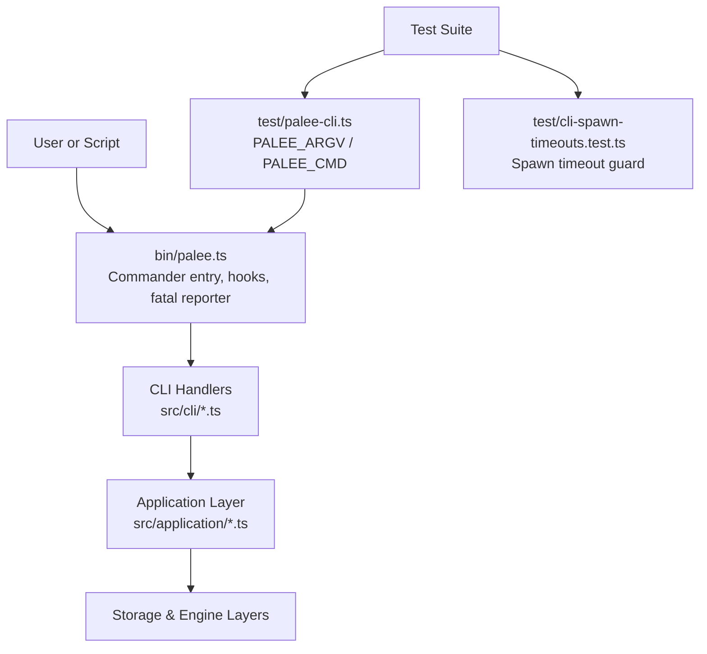
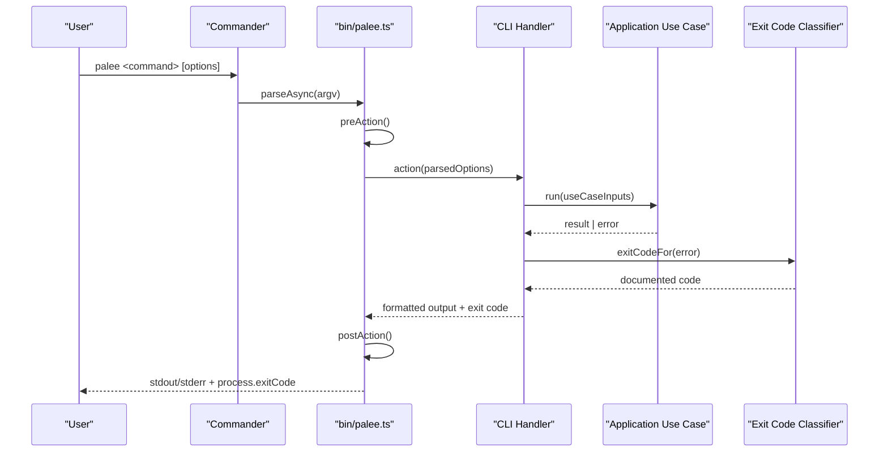
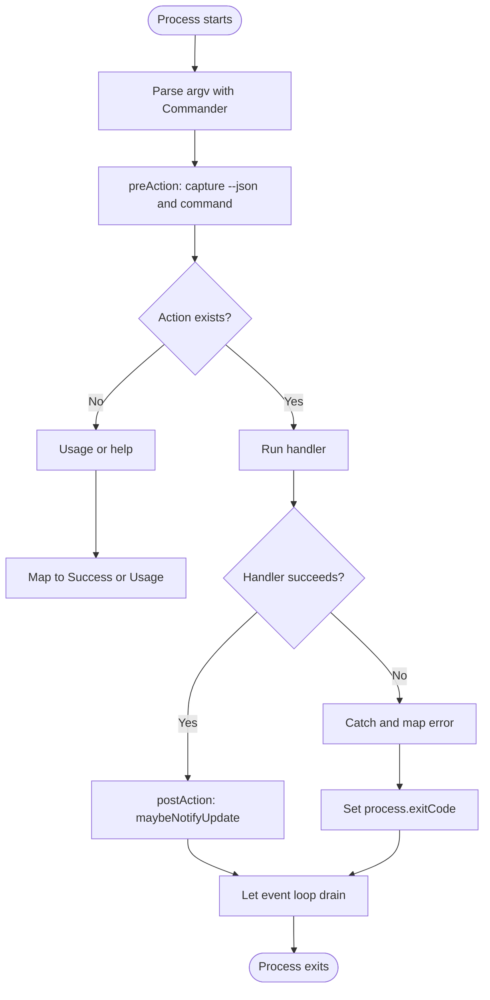
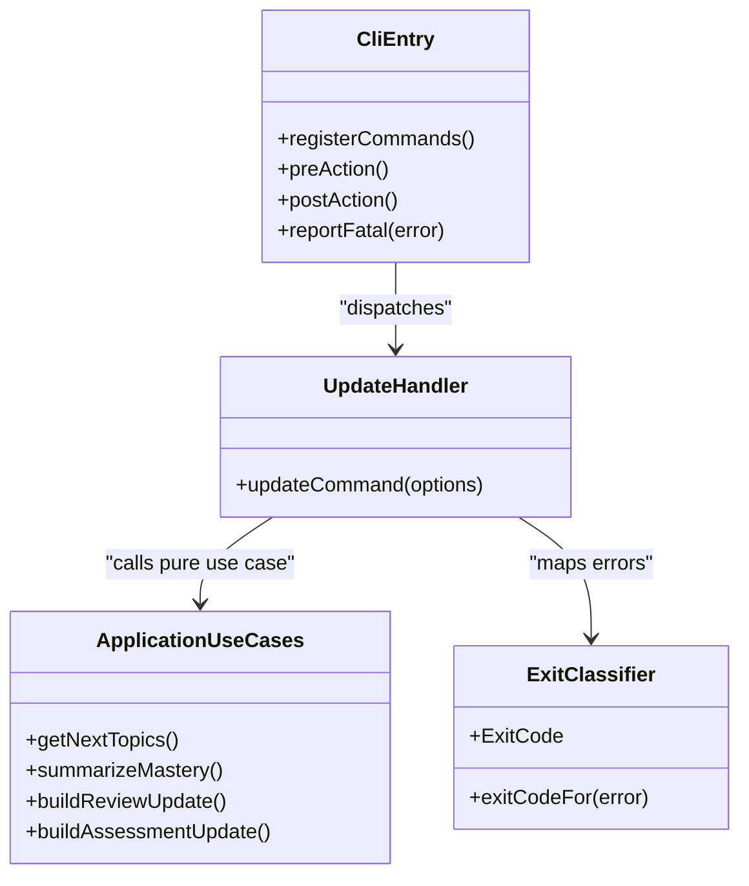
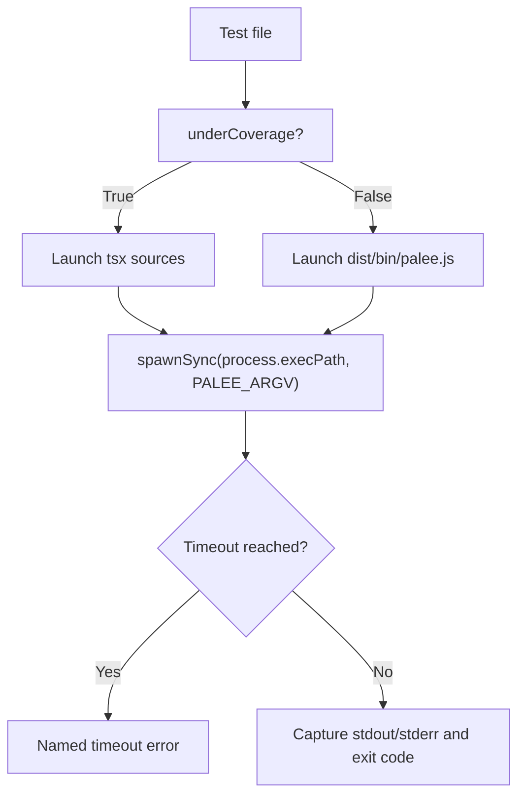
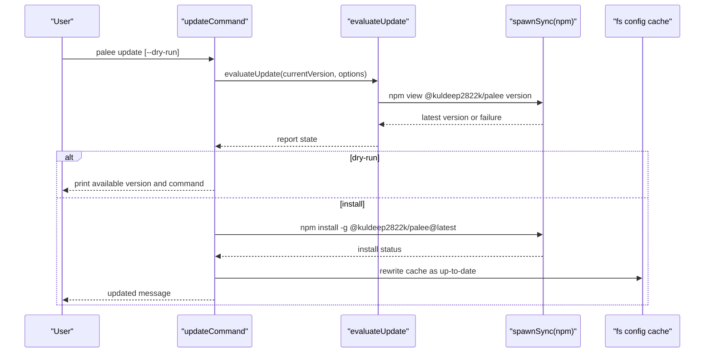
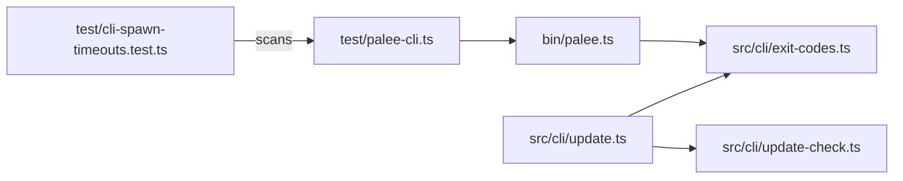

# Application Layer and CLI Decisions

::: details Referenced Files in This Document

- [bin/palee.ts](https://github.com/Kuldeep2822k/cli/blob/main/bin/palee.ts)
- [src/cli/exit-codes.ts](https://github.com/Kuldeep2822k/cli/blob/main/src/cli/exit-codes.ts)
- [src/cli/update.ts](https://github.com/Kuldeep2822k/cli/blob/main/src/cli/update.ts)
- [src/cli/update-check.ts](https://github.com/Kuldeep2822k/cli/blob/main/src/cli/update-check.ts)
- [test/palee-cli.ts](https://github.com/Kuldeep2822k/cli/blob/main/test/palee-cli.ts)
- [test/cli-spawn-timeouts.test.ts](https://github.com/Kuldeep2822k/cli/blob/main/test/cli-spawn-timeouts.test.ts)
- [docs/adr/0024-exit-codes-and-error-contract.md](https://github.com/Kuldeep2822k/cli/blob/main/docs/adr/0024-exit-codes-and-error-contract.md)
- [docs/adr/0025-application-layer.md](https://github.com/Kuldeep2822k/cli/blob/main/docs/adr/0025-application-layer.md)
- [docs/adr/0029-test-cli-launch-policy.md](https://github.com/Kuldeep2822k/cli/blob/main/docs/adr/0029-test-cli-launch-policy.md)
- [docs/adr/0032-direct-spawn-bounding.md](https://github.com/Kuldeep2822k/cli/blob/main/docs/adr/0032-direct-spawn-bounding.md)
- [docs/adr/0033-update-command-and-npm-child-process-boundary.md](https://github.com/Kuldeep2822k/cli/blob/main/docs/adr/0033-update-command-and-npm-child-process-boundary.md)

:::

## Table of Contents
1. [Introduction](#introduction)
2. [Project Structure](#project-structure)
3. [Core Components](#core-components)
4. [Architecture Overview](#architecture-overview)
5. [Detailed Component Analysis](#detailed-component-analysis)
6. [Dependency Analysis](#dependency-analysis)
7. [Performance Considerations](#performance-considerations)
8. [Troubleshooting Guide](#troubleshooting-guide)
9. [Conclusion](#conclusion)

## Introduction
This document explains how PALEE separates user interaction from core functionality, and how that boundary is enforced at the CLI entry point, through error contracts, test launch policies, direct spawn security measures, and the update command's child-process boundary. The goal is to keep the application layer reusable and unit-testable while preserving a safe, machine-readable interface for scripts, operators, and automated tests.

Key outcomes:
- Command handlers parse arguments, invoke application use cases, format output, map errors to documented exit codes, and never own vault or storage internals.
- Exit codes form a stable contract for automation; unexpected runtime failures are separated from usage, validation, and conflict classes.
- Test suites launch the real CLI through centralized helpers with coverage-aware launch paths and bounded timeouts.
- Direct `spawnSync`/`execSync` calls in tests are audited by an executable guard so unbounded children cannot silently stall CI workers.
- Network access remains confined to the AI provider except for one tightly bounded npm child process used only by the update surface.

## Project Structure
The relevant boundaries live across four layers:

- **CLI entry**: `bin/palee.ts` registers commands, captures parsed options, hooks Commander lifecycle, maps usage errors, and routes fatal exceptions through a single reporter.
- **CLI handlers**: command modules such as `src/cli/update.ts` translate CLI input into application calls and map errors to `ExitCode`.
- **Application layer**: pure use-case modules under `src/application/` (documented in ADR-0025) encapsulate domain logic without CLI, filesystem, or network concerns.
- **Test harness**: `test/palee-cli.ts` centralizes how tests launch the binary, and `test/cli-spawn-timeouts.test.ts` enforces spawn-timeout policy.

## Core Components
- **Command dispatcher and lifecycle hooks**: Commander is configured with `exitOverride()` so usage errors become `CommanderError` objects instead of hard-coded process exits. A `preAction` hook records whether the current command declares `--json`, and a `postAction` hook invokes the update notice only after successful command execution.
- **Fatal reporter**: Unhandled rejections and uncaught exceptions go through `reportFatal`, which sets `process.exitCode` rather than calling `process.exit`, writes a JSON payload when JSON mode is active, and avoids duplicate reports.
- **Exit-code classifier**: `ExitCode` and `exitCodeFor` are the single source of truth for documented exit values: success, partial import, usage, validation, conflict, and unexpected.
- **Update handler**: `updateCommand` delegates version queries and global installs to npm through `update-check.ts`; it does not own vault loading, `--json`, or provider configuration.
- **Update check module**: Encapsulates npm invocation, cache persistence, SemVer comparison, and platform-specific spawning rules.
- **Test CLI launcher**: Provides `PALEE_ARGV`, `PALEE_CMD`, and coverage-aware selection between the built dist entry and TypeScript sources.
- **Spawn timeout guard**: Scans test files for direct synchronous child launches and requires an active top-level `timeout` option outside a shrinking allow-list.

## Architecture Overview
PALEE's CLI boundary is intentionally thin:

1. Commander parses the command and options.
2. `preAction` captures parsed options so JSON mode is known even before the action runs.
3. The selected command handler validates its own inputs and calls an application use case.
4. The application layer returns structured results without touching the filesystem, network, or process model.
5. The handler formats output and maps caught errors through `exitCodeFor`.
6. `postAction` prints the update notice only on success and only when human-visible.
7. Fatal paths set `process.exitCode` and let the event loop drain before Node terminates.

## Detailed Component Analysis

### CLI Entry and Error Contract
The CLI entry point owns process-level concerns: program name derivation, help text, environment documentation, Commander configuration, command registration, lifecycle hooks, and fatal reporting. It deliberately avoids owning domain logic.

Important decisions:
- Usage errors are converted to thrown errors via `exitOverride()` so they can be mapped to `ExitCode.Usage` rather than a raw non-zero exit.
- JSON mode is derived from parsed options, not `process.argv.includes('--json')`.
- The fatal path uses `process.exitCode = ExitCode.Unexpected` instead of `process.exit()` so redirected stdout can flush complete JSON payloads.
- `PALEE_DEBUG` controls stack visibility; the default diagnostic is user-facing.
- The update notice is suppressed for failed commands, piped stdout, `--json`, unknown commands, and `PALEE_NO_UPDATE_CHECK`.

### Exit Codes and Machine-Readable Error Contract
The exit-code contract is a documented interface for scripts:

| Exit code | Meaning |
|---|---|
| 0 | Success |
| 1 | Partial import |
| 2 | Usage error |
| 3 | Validation failure |
| 4 | Conflict |
| 5 | Unexpected exception |

`exitCodeFor` centralizes classification:
- OCC or lock conflicts → 4.
- Containment refusals → 3, because escaping the vault is a vault integrity condition, not a crash.
- Provider `config` kind → 2.
- Provider `schema` kind → 3.
- Provider 401/403 → 2, treated as user-fixable credentials.
- Everything else → 5.

This prevents the same error class from exiting differently depending on which handler catches it.

### Application Layer Separation
ADR-0025 documents why command handlers were split into argument handling, application use cases, output formatting, and exit mapping. The application layer contains pure functions such as due-topic selection, next-topic computation, mastery summarization, review updates, and assessment updates. CLI concerns like Commander, `process`, OCC reads, atomic writes, and exit codes stay in the CLI layer.

### Test-Time CLI Launch Policy
Tests launch the real CLI through two centralized exports:

- `PALEE_ARGV`: `node` arguments for `spawnSync(process.execPath, [...PALEE_ARGV, ...args])`.
- `PALEE_CMD`: shell-string launch using a quoted `process.execPath`, avoiding PATH ambiguity.

Coverage changes the launch target:
- Normal runs execute `dist/bin/palee.js`.
- Coverage runs execute `bin/palee.ts` through `tsx` so the parent and child share one transform lineage and function coverage merges correctly.

Helpers add per-call timeouts, isolated environment variables, and readable failures when a child hangs.

### Direct Spawn Bounding Security Measures
ADR-0029 originally claimed every spawn was bounded, but direct spawns in many test files bypassed the helper timeout policy. ADR-0032 corrects this claim and introduces an executable guard:

- `test/cli-spawn-timeouts.test.ts` scans `.ts` files under `test/` for direct `execSync`, `spawnSync`, and `execFileSync` calls.
- Each call must have an active, positive, top-level `timeout`.
- Calls outside the `PARTIALLY_BOUNDED` list fail immediately.
- Files remaining in the allow-list are tracked debt; once fully bounded, they must be removed or the stale-entry assertion fails.
- The scanner accepts literal numbers, shorthand `{ timeout }`, and non-literal identifiers as bounding because static analysis cannot safely guess spread or computed options.

This turns an unproven prose claim into a failing test whenever new unbounded synchronous spawns appear.

### Update Command and npm Child Process Boundary
The update command is a deliberate deviation from PALEE's no-network rule. Instead of opening sockets itself, it asks the user's own `npm` through one bounded child process.

Security and isolation properties:
- Only two fixed argv shapes reach `spawnSync`: `npm view @kuldeep2822k/palee version` and `npm install -g @kuldeep2822k/palee@latest`.
- No user-controlled value enters argv or a shell string.
- Working directory is pinned to `os.homedir()` to prevent a planted `npm.cmd` in the current directory from running as the user.
- Platform resolution distinguishes win32 (`npm.cmd` with `shell: true`) from POSIX (`npm` with `shell: false`).
- The notice cache lives under the config directory, keyed by installed version, with a 24-hour TTL and strict field validation.
- The notice is printed only on stderr, only after success, only on interactive terminals, and only when not suppressed by flags or environment variables.
- `palee update --dry-run` reports versions and the exact npm command; the real install hands terminal I/O to npm and has no machine-readable output contract.

## Dependency Analysis
The CLI boundary depends on lower layers but isolates them behind clear interfaces.

Coupling observations:
- The CLI entry imports all command handlers but delegates their behavior.
- Exit-code classification is imported by handlers rather than duplicated.
- The update command imports only the update-check boundary, not vault or engine internals.
- Test infrastructure is separate from shipped code but exercises the real CLI artifact.

## Performance Considerations
- Per-spawn cold start cost matters because tests repeatedly launch the CLI. The coverage path pays a tsx/esbuild startup cost, while normal tests use the compiled dist entry.
- Coverage concurrency is capped at four to avoid overwhelming the c8 merge step and the tsx children pool.
- The automatic update check has a short timeout and caches results per installed version for 24 hours, limiting registry traffic and spawn latency.
- The explicit update command has a longer timeout because the user is waiting for the answer.
- The test suite previously measured ~561 ms cold spawn time; later improvements reduced overall cold-start impact through other means, but the per-spawn distinction remains important.

## Troubleshooting Guide

### A script receives truncated JSON on failure
Likely causes:
- A handler used `process.exit()` instead of setting `process.exitCode`.
- JSON mode was sniffed from `process.argv` rather than parsed options.
- The fatal path wrote JSON then exited synchronously.

Resolution:
- Ensure every handler routes caught errors through `exitCodeFor`.
- Derive JSON mode from parsed commander options.
- Rely on the shared fatal reporter, which sets `process.exitCode` and lets the event loop drain.

### An unexpected error exits with a misleading code
Likely cause:
- The handler hard-coded `ExitCode.Unexpected` or did not use the classifier.

Resolution:
- Replace per-handler mappings with `exitCodeFor(error)`.
- Verify that containment errors classify as validation and conflicts classify as retryable.

### A test worker stalls indefinitely during CLI testing
Likely cause:
- A direct `spawnSync` or `execSync` call lacks a timeout.
- The call is outside the helper and therefore outside the original bounded scope.

Resolution:
- Add a top-level `timeout` option to the spawn call.
- If migration is not immediate, acknowledge it as tracked debt and verify against the guard.
- Prefer the centralized helpers where possible.

### The update command behaves unexpectedly on Windows
Likely cause:
- Inherited working directory allowed a planted `npm.cmd` to run.
- Platform detection chose the wrong shell behavior.

Resolution:
- Ensure `cwd` is pinned to the home directory.
- Confirm win32 uses `npm.cmd` with `shell: true`, while POSIX uses `npm` with `shell: false`.
- Verify argv elements remain compile-time constants.

### Coverage reports lose function coverage
Likely cause:
- Parent and child processes used different compilers, causing merged v8-istanbul function maps to collide.

Resolution:
- Keep coverage children on the tsx source path.
- Keep normal test children on the dist entry.
- Do not waive the function-coverage threshold to hide the mismatch.

## Conclusion
PALEE's application layer and CLI boundary are defined by disciplined separation of concerns:

- The CLI entry point owns process lifecycle, Commander integration, and fatal diagnostics.
- Command handlers translate user input into application use cases and map errors to a documented exit-code contract.
- The application layer remains pure and reusable, enabling future interfaces without spawning the CLI.
- Test-time CLI launching is centralized, coverage-safe, and bounded by timeouts.
- Direct synchronous spawns in tests are audited by an executable guard, turning latent drift into a failing test.
- Network access is confined to the AI provider except for a narrowly bounded npm child process whose argv, working directory, platform decision, caching, and suppression rules are explicitly designed and tested.

These decisions create clean interfaces between users and core functionality while maintaining security, scriptability, and testability.

## References

- [bin/palee.ts:1-389](https://github.com/Kuldeep2822k/cli/blob/main/bin/palee.ts#L1-L389)
- [src/cli/update.ts:1-84](https://github.com/Kuldeep2822k/cli/blob/main/src/cli/update.ts#L1-L84)
- [test/palee-cli.ts:1-104](https://github.com/Kuldeep2822k/cli/blob/main/test/palee-cli.ts#L1-L104)
- [test/cli-spawn-timeouts.test.ts:1-200](https://github.com/Kuldeep2822k/cli/blob/main/test/cli-spawn-timeouts.test.ts#L1-L200)
- [docs/adr/0025-application-layer.md:1-63](https://github.com/Kuldeep2822k/cli/blob/main/docs/adr/0025-application-layer.md#L1-L63)
- [src/cli/exit-codes.ts:1-65](https://github.com/Kuldeep2822k/cli/blob/main/src/cli/exit-codes.ts#L1-L65)
- [src/cli/update-check.ts:1-200](https://github.com/Kuldeep2822k/cli/blob/main/src/cli/update-check.ts#L1-L200)
- [bin/palee.ts:201-389](https://github.com/Kuldeep2822k/cli/blob/main/bin/palee.ts#L201-L389)
- [docs/adr/0024-exit-codes-and-error-contract.md:1-75](https://github.com/Kuldeep2822k/cli/blob/main/docs/adr/0024-exit-codes-and-error-contract.md#L1-L75)
- [docs/adr/0029-test-cli-launch-policy.md:1-97](https://github.com/Kuldeep2822k/cli/blob/main/docs/adr/0029-test-cli-launch-policy.md#L1-L97)
- [docs/adr/0032-direct-spawn-bounding.md:1-79](https://github.com/Kuldeep2822k/cli/blob/main/docs/adr/0032-direct-spawn-bounding.md#L1-L79)
- [docs/adr/0033-update-command-and-npm-child-process-boundary.md:1-145](https://github.com/Kuldeep2822k/cli/blob/main/docs/adr/0033-update-command-and-npm-child-process-boundary.md#L1-L145)
