# Architecture Decision Records

::: details Referenced Files in This Document

- [agent.md](https://github.com/Kuldeep2822k/cli/blob/main/agent.md)
- [planning/invariants.md](https://github.com/Kuldeep2822k/cli/blob/main/planning/invariants.md)
- [planning/memory_design.md](https://github.com/Kuldeep2822k/cli/blob/main/planning/memory_design.md)
- [planning/storage_design.md](https://github.com/Kuldeep2822k/cli/blob/main/planning/storage_design.md)
- [src/engine/sm2.ts](https://github.com/Kuldeep2822k/cli/blob/main/src/engine/sm2.ts)
- [src/engine/dependency.ts](https://github.com/Kuldeep2822k/cli/blob/main/src/engine/dependency.ts)
- [src/engine/mastery.ts](https://github.com/Kuldeep2822k/cli/blob/main/src/engine/mastery.ts)
- [src/engine/tier0-hygiene.ts](https://github.com/Kuldeep2822k/cli/blob/main/src/engine/tier0-hygiene.ts)
- [src/application/get-next-topics.ts](https://github.com/Kuldeep2822k/cli/blob/main/src/application/get-next-topics.ts)
- [src/cli/adopt.ts](https://github.com/Kuldeep2822k/cli/blob/main/src/cli/adopt.ts)
- [src/cli/review.ts](https://github.com/Kuldeep2822k/cli/blob/main/src/cli/review.ts)
- [src/storage/atomic-write.ts](https://github.com/Kuldeep2822k/cli/blob/main/src/storage/atomic-write.ts)
- [src/storage/cache.ts](https://github.com/Kuldeep2822k/cli/blob/main/src/storage/cache.ts)
- [src/storage/lock.ts](https://github.com/Kuldeep2822k/cli/blob/main/src/storage/lock.ts)
- [src/validation/index.ts](https://github.com/Kuldeep2822k/cli/blob/main/src/validation/index.ts)
- [src/validation/run-rules.ts](https://github.com/Kuldeep2822k/cli/blob/main/src/validation/run-rules.ts)

:::

## Table of Contents
1. [Introduction](#introduction)
2. [Project Structure](#project-structure)
3. [ADR Index](#adr-index)
4. [Core Components](#core-components)
5. [Architecture Overview](#architecture-overview)
6. [Detailed Component Analysis](#detailed-component-analysis)
7. [Dependency Analysis](#dependency-analysis)
8. [Performance Considerations](#performance-considerations)
9. [Troubleshooting Guide](#troubleshooting-guide)
10. [Conclusion](#conclusion)
11. [Appendices](#appendices)

## Introduction
This document organizes PALEE’s architectural decision records and planning artifacts into a single, accessible reference. It explains how decisions about spaced repetition, storage, validation, concurrency, identity, roadmap import safety, session memory, readiness contracts, and future phases evolved from planning documents into the current implementation. It also documents the ADR lifecycle defined in the repository’s `agent.md` (with the status vocabulary in `docs/adr/README.md`), guidance for creating new ADRs, and the relationship between past decisions and present architecture.

PALEE is a study tracker CLI built on Node.js. Its engine is deterministic and runs fully offline: it schedules learning with SM-2 spaced repetition and dependency-aware recommendations over an Obsidian vault. AI features are not part of that engine — they sit behind a separate Phase 2 provider boundary, which is the only place network access is allowed, plus the update command's bounded npm child process (ADR-0033). Its codebase is deliberately layered: shared types are the contract; the engine provides pure scheduling and graph logic; the storage layer owns vault filesystem I/O; the application layer implements use cases; the validation layer inspects vault content; the AI provider boundary isolates network access; and the CLI exposes commands.

The central design philosophy is conservative durability and explicit boundaries: vault notes are canonical, derived views are rebuildable, writes are atomic and conflict-aware, locks protect concurrent writers, and network access is confined to two bounded paths: the AI provider boundary and the `palee update` npm child process. Decisions are recorded as numbered ADRs and constrained by stable invariant IDs so that tests can pin behavior rather than silently drift.

## Project Structure
The relevant documentation and design assets live in three main areas:

- `docs/adr/` — chronological ADRs documenting concrete design choices and their consequences.
- `docs/` — user-facing and engineering documentation describing CLI commands, core algorithms, storage, data model, testing, CI, and planning.
- `planning/` — forward-looking and specification documents such as invariants, memory design, storage design, roadmap, example workflows, and AI module design.

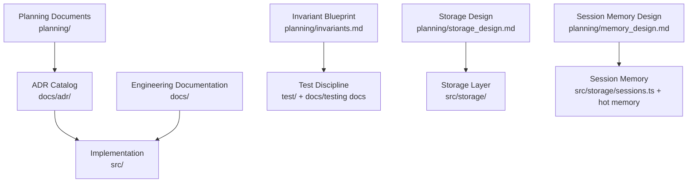

## ADR Index
The repository records 37 ADRs in `docs/adr/`, numbered ADR-0001 through ADR-0037. The titles and statuses below are taken from each record itself; statuses use the vocabulary defined in `docs/adr/README.md`. 35 records are Accepted. Two remain Proposed and unimplemented: ADR-0013 and ADR-0028.

| ADR | Title | Status |
|---|---|---|
| ADR-0001 | SuperMemo SM-2 Spaced Repetition Scheduling Algorithm | Accepted |
| ADR-0002 | Atomic File Locking and Optimistic Concurrency Control | Accepted |
| ADR-0003 | Non-Destructive Frontmatter Updates via YAML Document API | Accepted |
| ADR-0004 | Four-Pillar Pedagogical Assessment Model | Accepted |
| ADR-0005 | Concurrency-Hardened Storage and Automated Schema Migration | Accepted (amended by ADR-0034) |
| ADR-0006 | Phase 1 Concurrency Resilience, Storage Layer Isolation & Session Duration Tracking | Accepted |
| ADR-0007 | Hot-Memory Read-State Contract | Accepted |
| ADR-0008 | Validation Rule Framework — Architecture and Product Decisions | Accepted (2026-09-13; amended by ADR-0035) |
| ADR-0009 | The Gating Model — What May Lock a Note | Accepted |
| ADR-0010 | Tier-0 Hygiene Classification for Batch Adoption | Accepted |
| ADR-0011 | Tiered Auto-Chain — strict \| full | Accepted |
| ADR-0012 | Declared Prerequisites — Reading a Note's Own Text | Accepted |
| ADR-0013 | Per-Edge Blocking Policy and OR-Groups | Proposed (specified in #224; not implemented) |
| ADR-0014 | Atomic-Write Durability and Vault Containment | Accepted |
| ADR-0015 | Identity Preservation — An Identity on Disk Is Not a Command's to Invent | Accepted |
| ADR-0016 | Frontmatter Byte Fidelity and Unicode Fold Discipline | Accepted |
| ADR-0017 | Roadmap Import Safety | Accepted |
| ADR-0018 | Note Read Path, Caching, and Locking | Accepted |
| ADR-0019 | Session-Memory Lifecycle and Staleness Clamps | Accepted |
| ADR-0020 | Readiness and Scheduling Contracts | Accepted |
| ADR-0021 | The Assessment Surface | Accepted (extended for #269) |
| ADR-0022 | Adoption — Non-Destructive, Reversible, Honest About Filters | Accepted |
| ADR-0023 | `migrate --relabel-ties` as the Migration Surface | Accepted |
| ADR-0024 | Exit Codes and the Machine-Readable Error Contract | Accepted |
| ADR-0025 | The Application Layer and the CLI Boundary | Accepted |
| ADR-0026 | Test Discipline — Falsifiability Over Ceremony | Accepted |
| ADR-0027 | The AI Provider Adapter and Its Network Boundary | Accepted |
| ADR-0028 | Phase-2 Design Directions | Proposed (specified in open issues; not implemented) |
| ADR-0029 | Test-Time CLI Launch Policy | Accepted (amended by ADR-0032) |
| ADR-0030 | Installed-Artifact CI Evidence | Accepted |
| ADR-0031 | Documentation Truth — Current-State Docs, Labeled History | Accepted |
| ADR-0032 | Direct Spawn Bounding — What ADR-0029 Claimed, and the Check That Pins It | Accepted (amends ADR-0029) |
| ADR-0033 | The Update Command and Its npm Child Process | Accepted |
| ADR-0034 | Reclaiming a Killed Writer's Temporary File, Bounded to the Target It Belongs To | Accepted (amends ADR-0005) |
| ADR-0035 | `--fix` Mastery Repair and Partial Pillar Eligibility | Accepted (2026-10-22; amends ADR-0008) |
| ADR-0036 | Bounded Lock Acquisition — A Non-Empty Lockdir Is Not a Retry Signal | Accepted |
| ADR-0037 | Manifest Values Reach the Shell as Data, Never as Interpolation | Accepted |

## Core Components
PALEE’s architecture is defined more by its layers and boundaries than by large class hierarchies. The most important components for this documentation are:

| Component | Responsibility | Key Evidence |
|---|---|---|
| Shared types | Single source of truth for models, configuration, and error shapes | Re-exported from the package root and imported across layers |
| Engine | Pure scheduling, readiness, cycle detection, mastery, prerequisite text, and Tier-0 hygiene | No filesystem or network access |
| Storage | Vault traversal, frontmatter parsing, atomic writes, locking, caching, sessions, TOC, and dependencies | All vault mutations pass through it |
| Application | Use-case cores behind CLI commands | No Commander, no process, no I/O |
| Validation | One-pass vault collection, deterministic rule execution, formatting, and managed-note gating | Used by `palee validate` and repair flows |
| AI provider | Only place allowed to open network sockets, plus the update command's bounded npm child process (ADR-0033) | Deliberately excluded from published surface |
| CLI | Command handlers, exit codes, JSON output policy, config, and vault path validation | Thin orchestration around application and storage |

These responsibilities are enforced by imports, tests, and the ADR/invariant system rather than by runtime checks alone.

## Architecture Overview
At a high level, PALEE reads Markdown notes from an Obsidian vault, applies SM-2 scheduling and prerequisite gating, validates schema and domain rules, and writes durable records back to the same vault. Derived state such as session indexes and hot memory may be rebuilt without losing learning data.

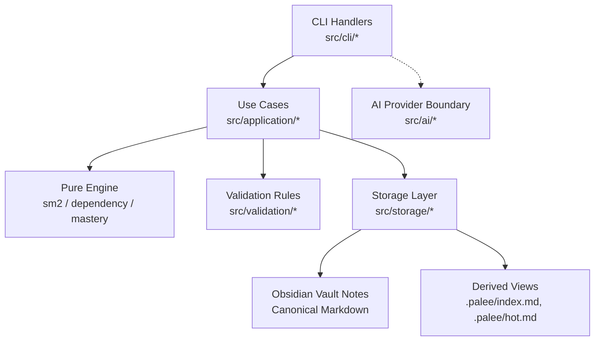

## Detailed Component Analysis

### Spaced Repetition Algorithm Selection (SM-2)
PALEE selected SuperMemo 2 as its scheduling algorithm because it is well understood, deterministic, and suitable for a CLI tool whose correctness must be test-pinned. The selection is not merely academic: it drives interval calculations, ease factor updates, repetition resets, lapse counting, and due-date computation.

Key design decisions include:

- Quality is an integer from 0 to 5.
- Low-quality responses reset repetition and set the next interval to one day.
- Successful repetitions follow small fixed intervals before multiplying by the ease factor.
- Ease factor delta uses the documented formula with a floor and half-up rounding.
- Scheduling functions are pure: they do not read clocks or mutate state. Callers own timestamps.
- Due dates are computed using local calendar arithmetic, avoiding UTC millisecond pitfalls.

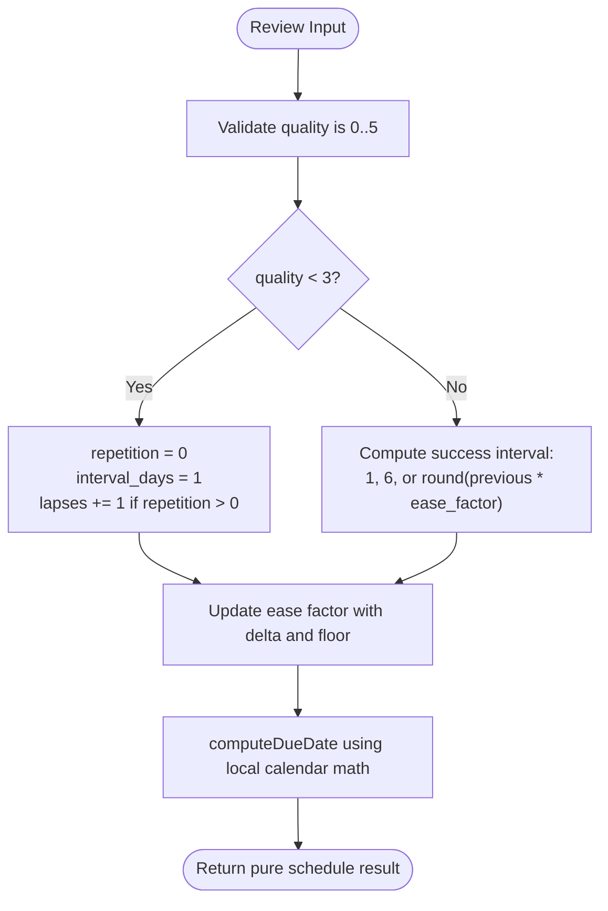

Evolution and rationale:
- Early planning chose SM-2 rather than a custom adaptive scheduler because predictability and auditability matter more than experimental tuning.
- Invariants INV-12 through INV-20 pin numerical behavior, making the algorithm verifiable even if implementation details change.
- Tests cover edge cases such as zero reviews, non-integer quality, interval clamping, and calendar-day due dates.

When evaluating alternative algorithms in the future, the team should compare them against these invariants and decide whether changing the algorithm is an ADR-level evolution or a parameterized extension.

### Storage Architecture Choices
Storage design centers on four principles: vault notes are canonical, derived views are rebuildable, writes are atomic and optimistic-concurrency-safe, and malformed input does not crash scans.

Important decisions include:

- Topic notes and confirmed sessions are canonical Markdown with YAML frontmatter.
- `.palee/index.md`, `.palee/hot.md`, and caches are derived and freely rebuildable.
- Frontmatter is updated with a concrete syntax tree to preserve comments, unknown keys, ordering, and body content.
- Every write acquires a lock, computes a fingerprint, parses and mutates only owned keys, re-checks the fingerprint, writes a temporary file, flushes, renames atomically, and releases the lock.
- Locks have heartbeats and platform-specific stale timeouts; abandoned locks are quarantined rather than blindly deleted.
- Windows replacement errors are retried briefly but never cause fallback truncation.
- Vault walking is bounded, skips dangerous paths, and treats unreadable files as warnings.

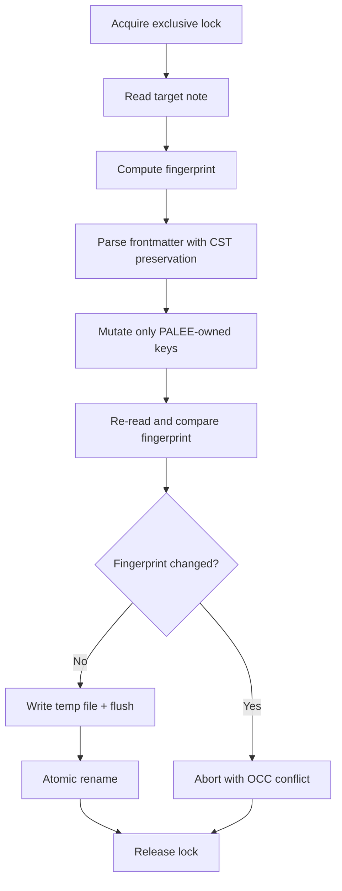

Evolution and lessons learned:
- The original storage design emphasized safe traversal and frontmatter fidelity; later ADRs hardened durability, containment, abandonment recovery, and bounded lock acquisition.
- Fingerprinting solved a class of race conditions where another writer could modify a note after the initial read but before the final rename.
- Quarantining stale locks avoids destructive recovery while preserving diagnostic evidence.
- The distinction between canonical notes and derived views prevents accidental loss when index or hot-memory writes fail.

### Validation Framework Design
The validation framework separates vault collection, rule execution, formatting, and managed-note gating from the rest of the system. Each rule is focused, deterministic, and pluggable into a catalog exposed through the validation barrel.

Key decisions include:

- One read pass collects vault content.
- Rules run deterministically and report structured diagnostics.
- Human-readable and JSON formats share diagnostic data but differ in presentation.
- Managed-note predicates gate which notes participate in validation.
- The rule catalog is maintained alongside a published barrel, and tests pin the catalog count.
- Read-only commands skip invalid notes; mutation commands refuse to modify invalid targets.

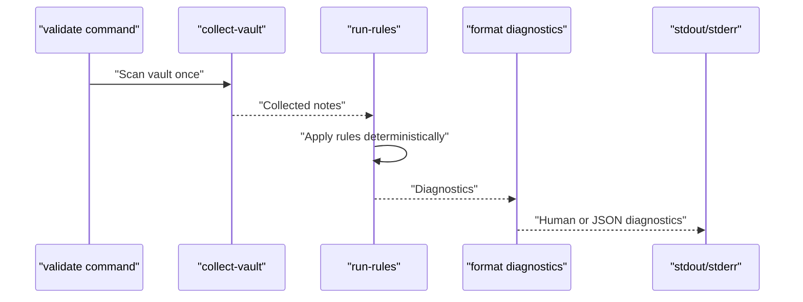

Evolution and lessons learned:
- The framework grew from simple field checks into a broader surface covering assessments, review fields, topic status, prerequisites, cycles, and session integrity.
- Barrel census tests prevent accidental divergence between internal rules and the public API surface.
- Validation failures are surfaced without crashing the scan, supporting incremental remediation.

### Concurrency Model
PALEE’s concurrency model is intentionally cautious. Long-running operations acquire locks with heartbeats; short-lived reads may use cached data; and all vault writes serialize through atomic replace semantics.

Important decisions include:

- Locks protect concurrent PALEE writers targeting the same note.
- Heartbeat intervals keep long operations alive during pauses.
- Stale-lock recovery quarantines old locks instead of deleting them.
- Read-path caching includes an unsettled horizon to guard against coarse mtime resolution.
- Bounded concurrency prevents vault walkers from exhausting file descriptors.
- Exit code 4 represents a recoverable OCC lock conflict.

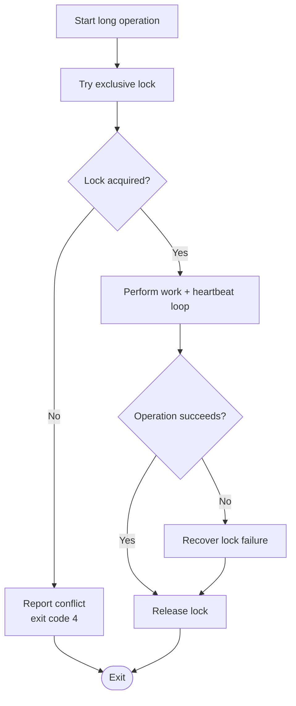

Evolution and lessons learned:
- Phase 1 decisions isolated concurrency and storage concerns and introduced resilience patterns like retries, quarantine, and staleness thresholds.
- Later ADRs tightened lock acquisition bounds and clarified when conflicts become exit-code signals versus diagnostic reports.
- The model favors fail-closed behavior: missing order signals, ambiguous matches, and unsafe configurations should not silently proceed.

### Identity Preservation and Prerequisite Gating
Identity decisions separate stable identifiers from mutable titles and filenames. Prerequisite gating controls which topics are ready for review or planning based on mastery and dependency satisfaction.

Key decisions include:

- Topic IDs use a stable prefix and are preserved across adoption and migration.
- Legacy aliases may be read but are not generated for new notes.
- Missing dependencies block topics.
- Cycles are detected and quarantined while allowing other topics to remain usable.
- Readiness gates exclude archived topics and enforce a global mastery threshold.
- Auto-chain edges may be advisory (`toc`, `tie`) or gating (`numbered`, `declared`).

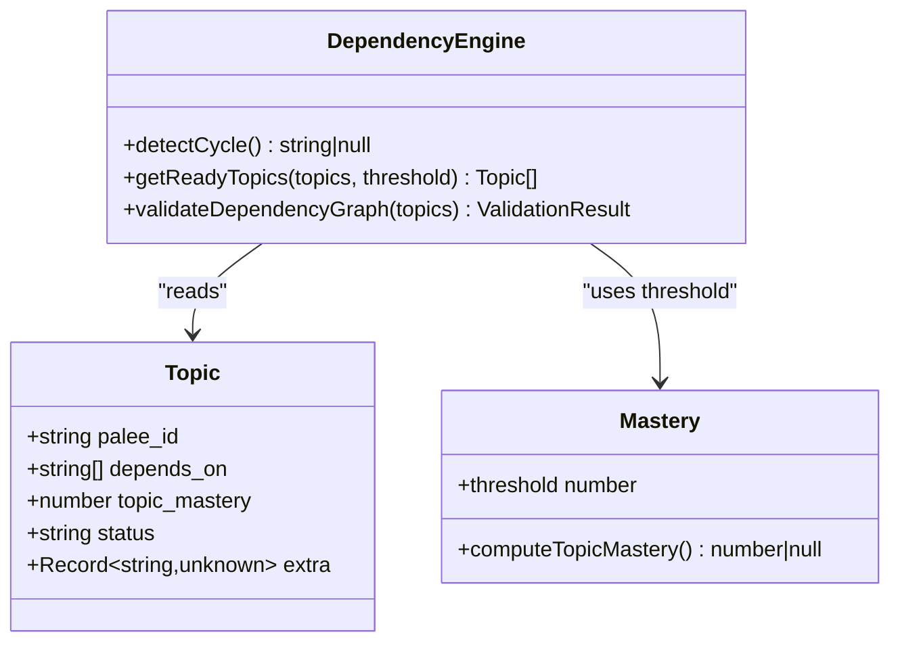

Evolution and lessons learned:
- Declared prerequisites and per-edge blocking policies were refined to distinguish human-authored dependencies from synthesized auto-chain edges.
- Tie edges and TOC-derived edges became advisory where appropriate, preventing accidental scheduling blocks.
- Cycle detection prefers lexicographically smallest canonical cycles and avoids enumerating every elementary cycle unless explicitly required.

### Roadmap Import Safety and Auto-Chain
Roadmap import and auto-chain decisions protect users from unintended prerequisite graphs. They emphasize honest refusal when structure does not justify an edge, cycle-safe synthesis, and clear attribution of edge origins.

Key decisions include:

- User-provided roadmaps are validated before mutation.
- Guided proposals collect goals, levels, time, deadlines, style, and constraints.
- Synthesized edges are skipped if they would close cycles against authored dependencies.
- Edge origin is recorded in `depends_on_source`.
- Advisory edges do not block readiness but still participate in ranking and cycle detection.
- Absent or unrecognized labels gate fail-closed.

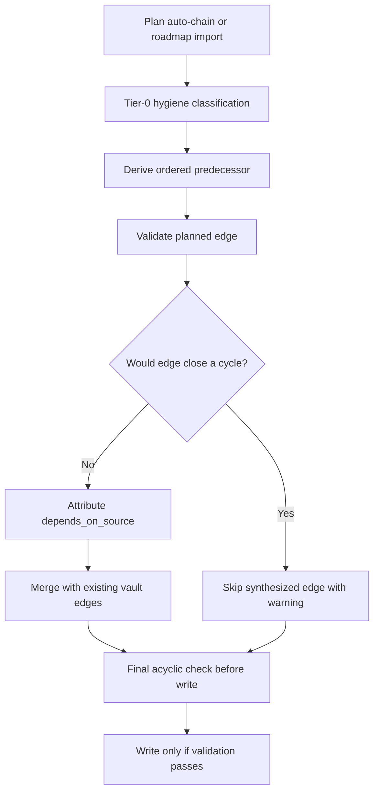

Evolution and lessons learned:
- Initial auto-chain designs were expanded into tiered hygiene, numbering dominance, cross-directory transition rules, and tie handling.
- The roadmap import flow was hardened to avoid writing unconfirmed proposals and to print accurate synthesis counts only after validation.
- Honest refusal is now treated as correct behavior rather than a failure when no structural signal exists.

### Session Memory Lifecycle
Session memory preserves continuity across CLI invocations without requiring the learner to restate prior context. Hot memory is compact; full sessions are durable; derived views are rebuildable.

Key decisions include:

- `.palee/hot.md` holds orientation and the active topic.
- `.palee/sessions/` holds confirmed session records.
- Draft checkpoints use `DRAFT-S-*` IDs and survive interruption.
- On startup, interactive mode offers Resume, Save as session, Discard, or Ignore.
- Non-interactive mode never auto-discards drafts.
- Hot memory word limits apply to the body, not the frontmatter.
- Failure to regenerate derived views does not invalidate canonical sessions.

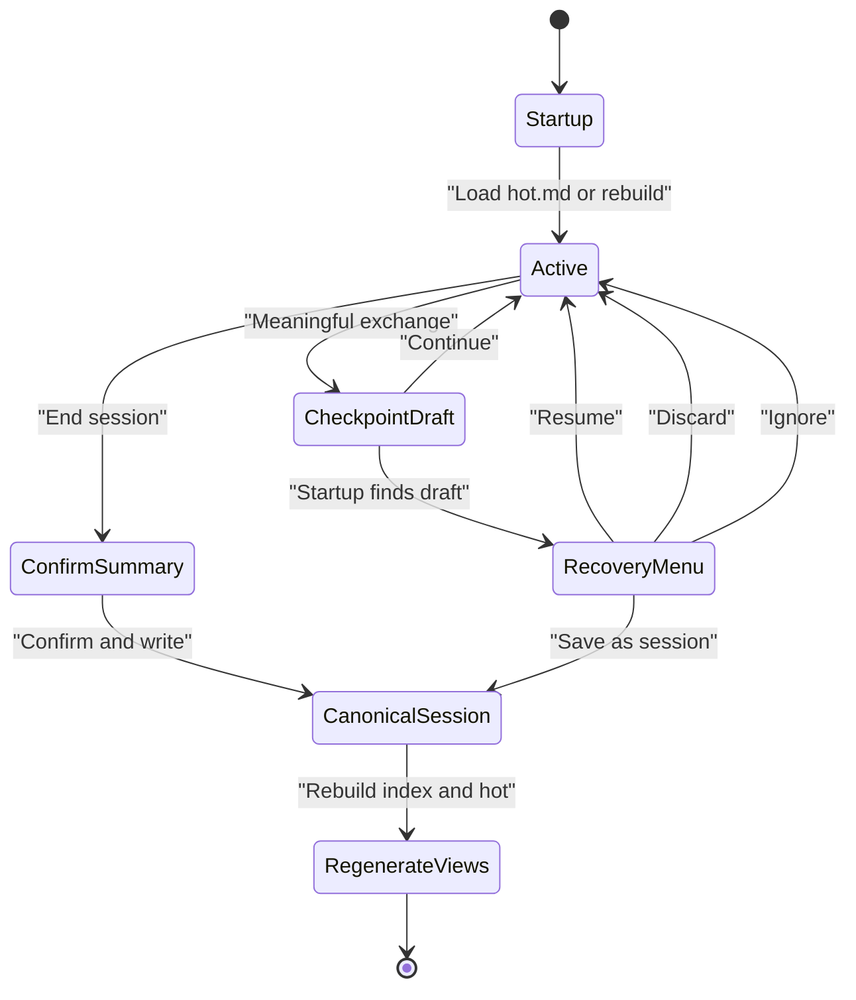

Evolution and lessons learned:
- The memory design moved from a conceptual log-like record to a bounded, addressable session model with immutable IDs.
- Recovery behavior was strengthened to guarantee that non-interactive mode never discards drafts automatically.
- The contract between hot memory and canonical sessions clarifies what is ephemeral, what is durable, and what is rebuildable.

### Readiness and Scheduling Contracts
Readiness gates ensure learners only see topics whose prerequisites are satisfied. This connects SM-2 scheduling, prerequisite graphs, and application-layer planning.

Key decisions include:

- Readiness excludes archived topics.
- A topic is ready when its own mastery is below the mastery threshold (0.70) — it still needs work — and every prerequisite topic’s mastery is at or above the threshold. A topic at or above the threshold is already mastered and drops off the ready list; a topic with any prerequisite below the threshold is blocked, however low its own mastery is. Exception: when a note's `depends_on_source` is advisory, `areDependenciesSatisfied` returns true immediately, so its prerequisites do not gate it in that case.
- Global mastery excludes archived topics but includes paused ones.
- Missing dependencies block readiness.
- The readiness threshold is defined centrally and reused by planning logic.

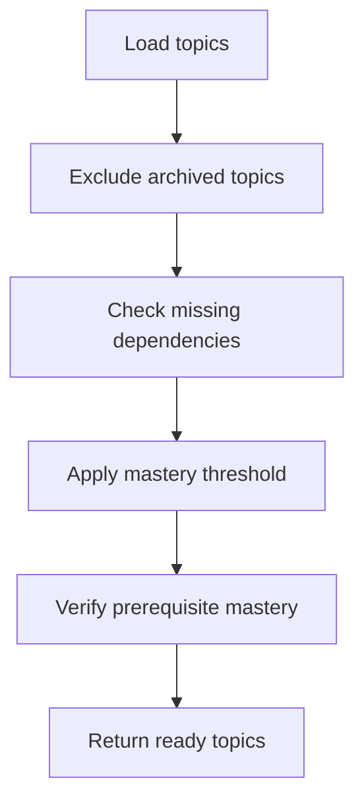

Evolution and lessons learned:
- The readiness contract has been used repeatedly to align CLI outputs with progress tracking and scheduling.
- Centralizing the mastery threshold avoids inconsistent thresholds across commands.
- Future changes to prerequisites or mastery scoring should update both the invariant and the tests that pin readiness behavior.

### Relationship Between Decisions and Implementation
Past decisions inform current architecture through three mechanisms:

1. **Layers and boundaries:** Agent-defined layers constrain imports and external dependencies. The AI provider boundary ensures non-AI commands cannot open network sockets.
2. **Invariants:** Stable `INV-` IDs turn architectural promises into executable acceptance criteria.
3. **ADR-to-code traceability:** Storage, validation, identity, roadmap safety, and concurrency decisions map directly to `src/storage`, `src/validation`, `src/engine`, and CLI behavior.

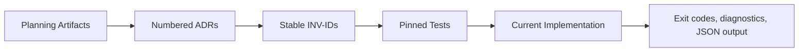

## Dependency Analysis
PALEE’s dependencies are intentionally minimal. The runtime dependency list is restricted to `commander` and `yaml`, and the source tree contains no direct HTTP, HTTPS, net, or DNS imports. This keeps the library surface offline and reduces integration risk.

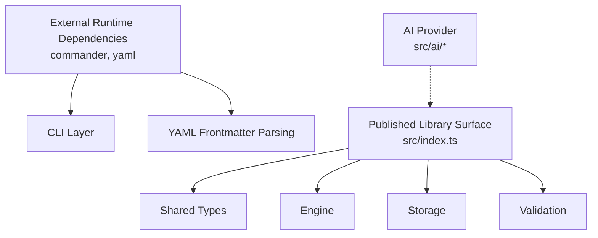

Coupling and cohesion observations:

- The engine is highly cohesive and intentionally fs-free, making it easy to test and reuse.
- Storage encapsulates filesystem coupling, including locking, atomicity, scanning, and caching.
- Validation is modular: each rule addresses one concern and plugs into a runner.
- The CLI is a thin orchestrator; heavy logic lives in application and engine layers.
- The AI boundary is deliberately narrow to satisfy the no-network invariant for non-AI commands.

Potential risks:

- If new commands add filesystem calls outside the storage layer, the isolation contract weakens.
- If validation rules grow stateful or nondeterministic, reproducibility suffers.
- If AI provider integration expands beyond the current adapter boundary, network exposure increases.

## Performance Considerations
Performance decisions in PALEE favor correctness and bounded resource use over raw throughput:

- Vault walking uses bounded concurrency and skips irrelevant directories and symlinks.
- Caching avoids redundant parsing but includes an unsettled horizon to guard against rapid edits.
- Atomic writes and locking add overhead but prevent corruption and races.
- SM-2 scheduling is pure and fast; the main cost is graph traversal and readiness computation.
- Test concurrency is capped at four workers in the full and coverage suites (`test` and `test:coverage` in `package.json`) to avoid memory pressure on development machines; the other suites do not carry that cap.
- Coverage thresholds require substantial test coverage, reducing regression risk.

Recommendations:

- Keep scheduled computations pure and cache-friendly.
- Avoid expanding vault scanning concurrency without measuring descriptor usage.
- Preserve the unsettled horizon when changing cache assumptions.
- Do not bypass locks or fingerprint checks for performance shortcuts.

## Troubleshooting Guide
Common issues and their decision-backed resolutions:

| Symptom | Likely Cause | Resolution Based on Decisions |
|---|---|---|
| Concurrent writers collide | Another PALEE process holds the lock | Report conflict; retry bounded attempts; exit code 4 for persistent conflicts |
| Note body changes unexpectedly | Frontmatter not updated with CST-preserving parser | Use concrete-syntax-tree updates and mutate only owned keys |
| Index or hot memory becomes stale | Derived view write failed | Rebuild from canonical sessions; do not overwrite sessions |
| Validation fails | Malformed or invalid note | Fix the issue; read-only commands continue with warnings |
| Topic is not ready | Missing or unsatisfied prerequisite | Resolve dependencies or master prerequisite topics |
| Cycle reported | Author or synthesized edge closes a cycle | Remove or demote the problematic edge; verify `depends_on_source` |
| Draft checkpoint remains after crash | Interruption during session | Offer recovery options; never auto-discard in non-interactive mode |
| Machine output is mixed or corrupted | Handler exited via `process.exit` too early | Set `process.exitCode` and return so streams flush cleanly |

## Conclusion
PALEE’s architecture is shaped by a series of deliberate, test-pinned decisions. Spaced repetition, storage durability, validation modularity, concurrency safety, identity preservation, roadmap import caution, and session memory continuity all reinforce the same goal: make learning data durable, observable, and reversible while keeping the CLI predictable.

The strongest pattern is conservatism: prefer canonical notes, derived views, atomic replaces, quarantined state, bounded concurrency, explicit ownership, and fail-closed defaults. New features should follow the same pattern rather than introduce hidden state, silent failures, or undocumented side effects.

Future considerations include:

- Evaluating whether SM-2 parameters or a parameterized scheduler warrant an ADR-level change.
- Clarifying whether engine and validation barrels deserve the same isolation documentation as the storage barrel.
- Extending validation rules carefully and updating barrel census tests consistently.
- Expanding AI capabilities within the existing provider boundary and assessment-surface contracts.
- Continuing to treat planning documents, ADRs, invariants, and tests as a single verification loop.

## Appendices

### ADR Lifecycle Guidance
The ADR lifecycle is defined in the repository’s `agent.md`, with the status vocabulary (`Proposed`, `Accepted`, `Superseded by ADR-nnnn`) defined in `docs/adr/README.md`. It is part of the normal development workflow:

- Accepted ADRs are never rewritten: the original reasoning stands as written. A changed decision is recorded as a new ADR that supersedes or amends the old one, and the affected entries in `planning/invariants.md` are updated to match. Edits to an accepted ADR are limited to typo and link fixes, status changes, and the amendment notes `docs/adr/README.md` requires (such as an `Amended by ADR-nnnn` line).
- Create an ADR when a decision materially affects architecture, durability, concurrency, security, data format, CLI contract, or test expectations.
- Record alternatives considered, rationale, consequences, and links to implementation and tests.
- Use stable identifiers (`ADR-NNNN`, `INV-NNNN`) so decisions and invariants can be referenced precisely.
- Treat ADRs as living context for reviewers, not just historical records.
- Verify changes through type checking, linting, tests, building, packaging, and artifact verification.

Guidance for new ADRs:

- Ask whether the decision crosses a layer boundary, changes a data format, alters scheduling or graph semantics, introduces concurrency behavior, expands network access, or changes CLI contracts.
- If yes, create an ADR before implementation.
- If no, record the choice in code comments or a smaller planning note, but still ensure tests pin behavior.
- Link ADRs to relevant invariants, implementation files, and tests.
- When revisiting an ADR, create a successor ADR rather than editing history, especially when behavior changes.

## References

- [planning/invariants.md:1-76](https://github.com/Kuldeep2822k/cli/blob/main/planning/invariants.md#L1-L76)
- [planning/storage_design.md:1-111](https://github.com/Kuldeep2822k/cli/blob/main/planning/storage_design.md#L1-L111)
- [planning/memory_design.md:1-118](https://github.com/Kuldeep2822k/cli/blob/main/planning/memory_design.md#L1-L118)
- [agent.md:1-92](https://github.com/Kuldeep2822k/cli/blob/main/agent.md#L1-L92)
- [src/engine/sm2.ts](https://github.com/Kuldeep2822k/cli/blob/main/src/engine/sm2.ts)
- [src/engine/dependency.ts](https://github.com/Kuldeep2822k/cli/blob/main/src/engine/dependency.ts)
- [src/engine/mastery.ts](https://github.com/Kuldeep2822k/cli/blob/main/src/engine/mastery.ts)
- [src/storage/atomic-write.ts](https://github.com/Kuldeep2822k/cli/blob/main/src/storage/atomic-write.ts)
- [src/storage/lock.ts](https://github.com/Kuldeep2822k/cli/blob/main/src/storage/lock.ts)
- [src/validation/index.ts](https://github.com/Kuldeep2822k/cli/blob/main/src/validation/index.ts)
- [planning/invariants.md:12-20](https://github.com/Kuldeep2822k/cli/blob/main/planning/invariants.md#L12-L20)
- [agent.md:34-45](https://github.com/Kuldeep2822k/cli/blob/main/agent.md#L34-L45)
- [planning/storage_design.md:15-70](https://github.com/Kuldeep2822k/cli/blob/main/planning/storage_design.md#L15-L70)
- [agent.md:47-63](https://github.com/Kuldeep2822k/cli/blob/main/agent.md#L47-L63)
- [src/validation/run-rules.ts](https://github.com/Kuldeep2822k/cli/blob/main/src/validation/run-rules.ts)
- [agent.md:21-26](https://github.com/Kuldeep2822k/cli/blob/main/agent.md#L21-L26)
- [planning/storage_design.md:55-105](https://github.com/Kuldeep2822k/cli/blob/main/planning/storage_design.md#L55-L105)
- [src/storage/cache.ts](https://github.com/Kuldeep2822k/cli/blob/main/src/storage/cache.ts)
- [planning/invariants.md:21-28](https://github.com/Kuldeep2822k/cli/blob/main/planning/invariants.md#L21-L28)
- [agent.md:46-52](https://github.com/Kuldeep2822k/cli/blob/main/agent.md#L46-L52)
- [src/engine/tier0-hygiene.ts](https://github.com/Kuldeep2822k/cli/blob/main/src/engine/tier0-hygiene.ts)
- [src/cli/adopt.ts](https://github.com/Kuldeep2822k/cli/blob/main/src/cli/adopt.ts)
- [planning/invariants.md:46-47](https://github.com/Kuldeep2822k/cli/blob/main/planning/invariants.md#L46-L47)
- [planning/invariants.md:43-45](https://github.com/Kuldeep2822k/cli/blob/main/planning/invariants.md#L43-L45)
- [agent.md:64-75](https://github.com/Kuldeep2822k/cli/blob/main/agent.md#L64-L75)
- [src/application/get-next-topics.ts](https://github.com/Kuldeep2822k/cli/blob/main/src/application/get-next-topics.ts)
- [planning/memory_design.md:85-118](https://github.com/Kuldeep2822k/cli/blob/main/planning/memory_design.md#L85-L118)
- [agent.md:27-92](https://github.com/Kuldeep2822k/cli/blob/main/agent.md#L27-L92)
- [planning/invariants.md:1-10](https://github.com/Kuldeep2822k/cli/blob/main/planning/invariants.md#L1-L10)
