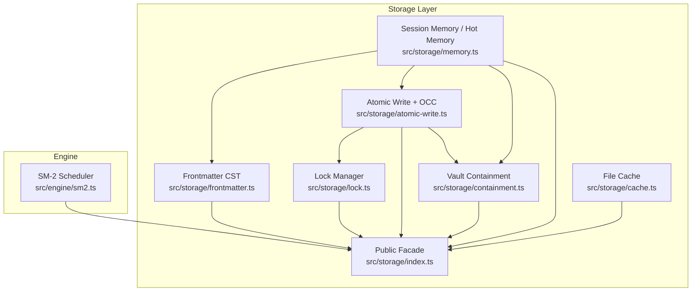
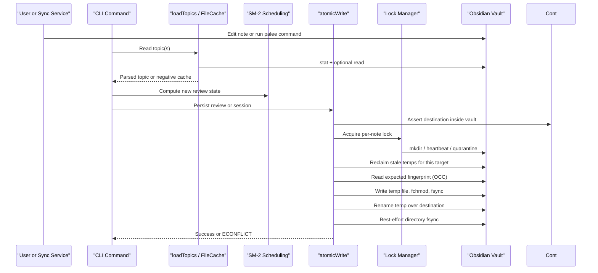
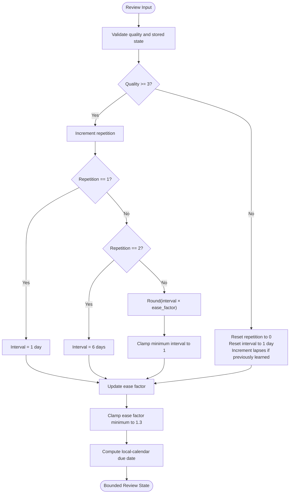
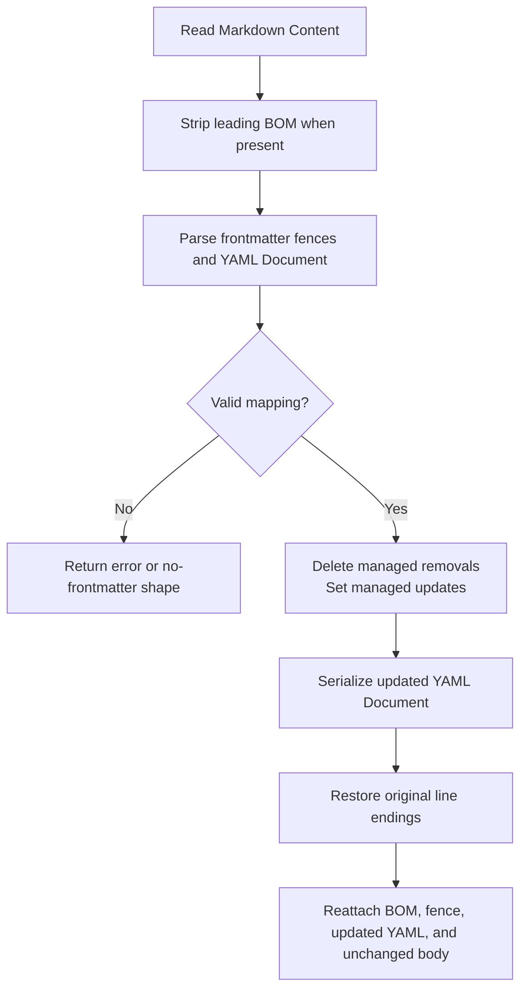
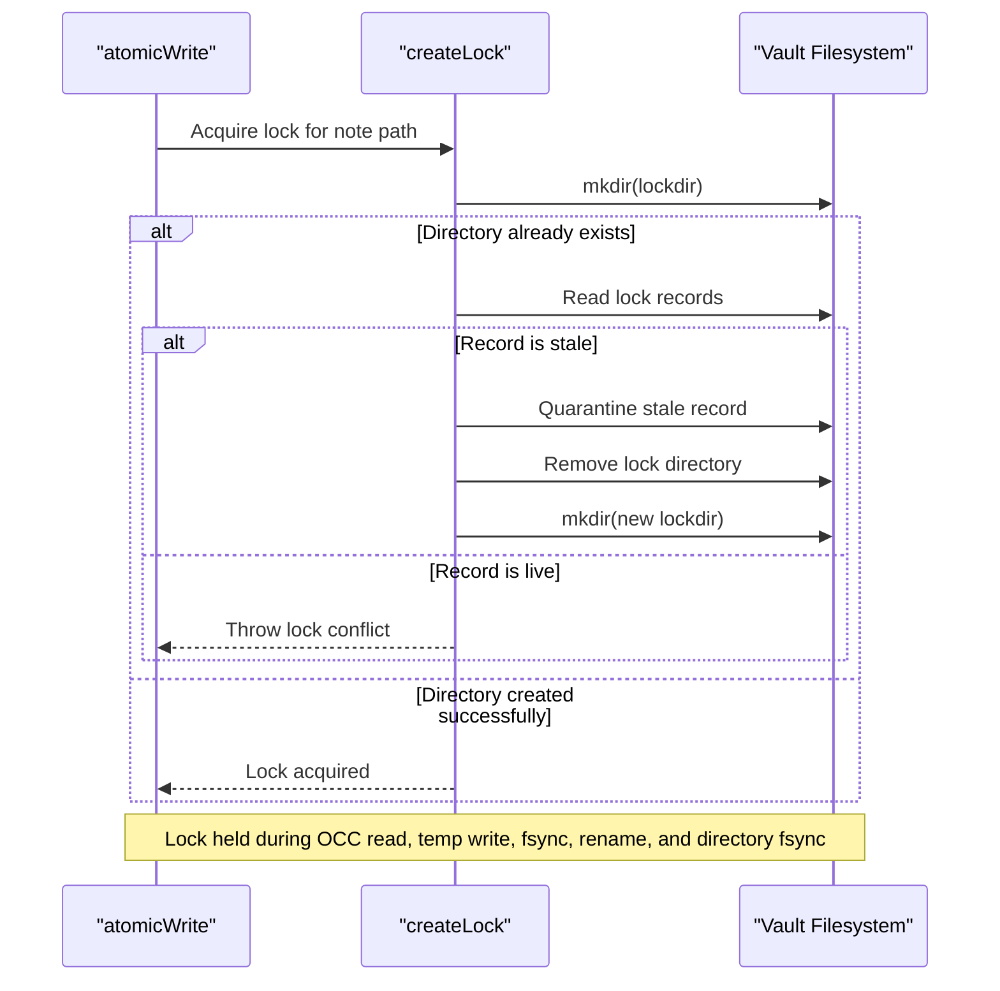
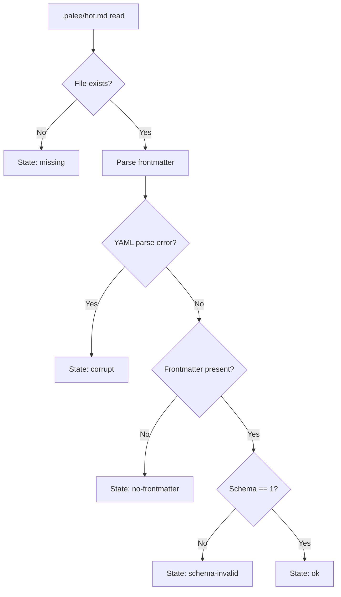
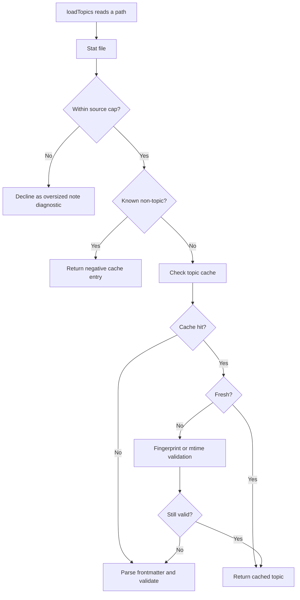
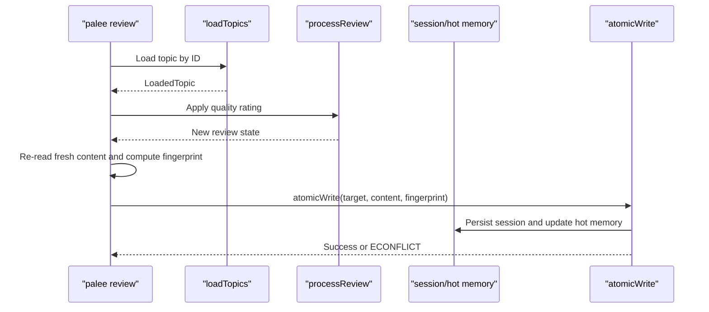
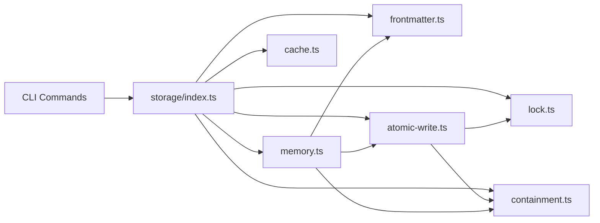

# Core Engineering Decisions

::: details Referenced Files in This Document

- [README.md](https://github.com/Kuldeep2822k/cli/blob/main/README.md)
- [0001-supermemo-sm2-algorithm.md](https://github.com/Kuldeep2822k/cli/blob/main/docs/adr/0001-supermemo-sm2-algorithm.md)
- [0002-atomic-file-locking-and-occ.md](https://github.com/Kuldeep2822k/cli/blob/main/docs/adr/0002-atomic-file-locking-and-occ.md)
- [0003-concrete-syntax-tree-yaml-frontmatter.md](https://github.com/Kuldeep2822k/cli/blob/main/docs/adr/0003-concrete-syntax-tree-yaml-frontmatter.md)
- [0005-concurrency-storage-and-schema-migration.md](https://github.com/Kuldeep2822k/cli/blob/main/docs/adr/0005-concurrency-storage-and-schema-migration.md)
- [0006-phase-1-concurrency-resilience-and-storage-isolation.md](https://github.com/Kuldeep2822k/cli/blob/main/docs/adr/0006-phase-1-concurrency-resilience-and-storage-isolation.md)
- [0007-hot-memory-read-state-contract.md](https://github.com/Kuldeep2822k/cli/blob/main/docs/adr/0007-hot-memory-read-state-contract.md)
- [0014-atomic-write-durability-and-containment.md](https://github.com/Kuldeep2822k/cli/blob/main/docs/adr/0014-atomic-write-durability-and-containment.md)
- [0018-read-path-caching-and-locking.md](https://github.com/Kuldeep2822k/cli/blob/main/docs/adr/0018-read-path-caching-and-locking.md)
- [0036-bounded-lock-acquisition.md](https://github.com/Kuldeep2822k/cli/blob/main/docs/adr/0036-bounded-lock-acquisition.md)
- [sm2.ts](https://github.com/Kuldeep2822k/cli/blob/main/src/engine/sm2.ts)
- [frontmatter.ts](https://github.com/Kuldeep2822k/cli/blob/main/src/storage/frontmatter.ts)
- [lock.ts](https://github.com/Kuldeep2822k/cli/blob/main/src/storage/lock.ts)
- [atomic-write.ts](https://github.com/Kuldeep2822k/cli/blob/main/src/storage/atomic-write.ts)
- [containment.ts](https://github.com/Kuldeep2822k/cli/blob/main/src/storage/containment.ts)
- [memory.ts](https://github.com/Kuldeep2822k/cli/blob/main/src/storage/memory.ts)
- [cache.ts](https://github.com/Kuldeep2822k/cli/blob/main/src/storage/cache.ts)
- [index.ts](https://github.com/Kuldeep2822k/cli/blob/main/src/storage/index.ts)

:::

## Table of Contents
1. [Introduction](#introduction)
2. [Project Structure](#project-structure)
3. [Core Components](#core-components)
4. [Architecture Overview](#architecture-overview)
5. [Detailed Component Analysis](#detailed-component-analysis)
6. [Dependency Analysis](#dependency-analysis)
7. [Performance Considerations](#performance-considerations)
8. [Troubleshooting Guide](#troubleshooting-guide)
9. [Conclusion](#conclusion)

## Introduction
PALEE is a deterministic, Spaced-Repetition (SM-2) and directed acyclic graph study engine for Obsidian vaults. Its core engineering challenge is to let multiple CLI processes, Obsidian, sync services, and external editors share one Markdown-first vault without losing data, corrupting frontmatter, or blocking indefinitely. The repository documents these decisions as architectural decision records (ADRs) and implements them in a small set of storage primitives: SM-2 scheduling, concrete syntax tree frontmatter editing, atomic writes with optimistic concurrency control, cross-process locking, vault containment, bounded lock acquisition, hot-memory read contracts, and filesystem caching.

This document explains how those pieces fit together, what trade-offs were chosen between consistency and performance, how the design evolved from Phase 1 into its current form, and how concurrent access to an Obsidian vault remains safe and predictable.

## Project Structure
The relevant code lives in two layers:

- `src/engine/` contains domain logic, including the SM-2 scheduler.
- `src/storage/` contains persistence primitives: frontmatter parsing, locking, atomic writing, containment, session memory, scanning, and caching.
- `src/storage/index.ts` is the public facade that exposes storage capabilities to CLI and application layers while hiding raw filesystem calls.
- `docs/adr/` records the reasoning behind each major decision.

## Core Components
PALEE’s storage architecture is built around five cooperating components:

| Component | Responsibility | Consistency Role | Performance Role |
|---|---|---:|---:|
| SM-2 scheduler | Computes review intervals, ease factor, lapses, and due dates | Keeps scheduling state valid and bounded | Deterministic; no network dependency |
| Frontmatter CST layer | Parses and mutates YAML frontmatter without destroying user edits | Preserves comments, ordering, custom keys, and body bytes | CST parsing plus SHA-256 fingerprinting; offset by cache |
| Lock manager | Provides cross-process mutex over `.palee/locks` | Prevents overlapping writers on the same note | Heartbeat-based stale recovery; liveness probe |
| Atomic write primitive | Writes via temp file, fsync, rename, and OCC fingerprint check | Ensures durability, containment, mode preservation, and conflict detection | Exponential backoff retry on Windows handle conflicts |
| Session memory and hot memory | Persists sessions, index, active topic, and derived working memory | Derived state is rebuilt from durable sessions; schema contract enforced | Hot memory is capped at 250 words |

These components are exposed through the storage facade so CLI commands never call raw filesystem operations directly.

## Architecture Overview
At runtime, PALEE reads topics from an Obsidian vault, computes next topics using SM-2 and prerequisites, then persists reviews, assessments, sessions, and derived views under `.palee`. All mutations go through `atomicWrite`, which enforces containment, locks the target, validates the file content via SHA-256, writes atomically, and retries transient Windows conflicts. Reads go through loaders and caches that distinguish unsettled files, oversized notes, non-topic files, and stale entries.

## Detailed Component Analysis

### SM-2 Algorithm Selection and Implementation
PALEE chose SuperMemo SM-2 because it is deterministic, parameterizable, locally executable, and well understood. It avoids cloud dependencies, fits a CLI tool, and can be fully unit-tested. The implementation caps intervals at 36,500 days to keep calendar arithmetic representable and refuses invalid stored fields rather than silently producing NaN due dates. Lapses reset repetition and interval, while successful reviews expand the interval based on ease factor.

Trade-offs:
- **Consistency:** Strict bounds, type validation, and timezone-safe date arithmetic prevent corrupted schedules.
- **Performance:** Pure math with no I/O or network calls.
- **Extensibility:** ADR-0001 explicitly positions SM-2 as a baseline that could later be replaced by FSRS or SM-18 if future phases require it.

### Non-Destructive YAML Frontmatter via Concrete Syntax Tree
PALEE stores metadata in Markdown frontmatter so Obsidian plugins and Dataview continue to work. Instead of string replacement or full object serialization, the implementation parses the YAML frontmatter into a `Document` and modifies only managed keys. This preserves comments, indentation, unknown properties, block scalars, and exact body text.

Trade-offs:
- **Consistency:** Users retain their own formatting and custom keys; malformed frontmatter is reported rather than silently rewritten.
- **Performance:** CST parsing is slightly more expensive than naive substring matching, but is amortized by caching and used only for mutable paths.
- **Durability:** Fingerprinting supports OCC across the same file.

### Atomic File Locking with Optimistic Concurrency Control
Concurrency control has two layers:

1. **Cross-process locking:** Each note maps to a hashed directory under `.palee/locks`. Acquisition uses `mkdirSync` on the lock directory to avoid TOCTOU races. The holder records PID, hostname, and timestamp, refreshes the lock’s modification time every 15 seconds, and recovers abandoned locks after platform-specific timeouts.
2. **Optimistic concurrency control:** Before writing, PALEE computes a SHA-256 fingerprint of the target file. If another process changed it since the read, the write fails as an `ECONFLICT`.

Trade-offs:
- **Consistency:** No partial writes, no lost updates, and robust recovery across POSIX and Windows.
- **Performance:** Lock acquisition may wait briefly; OCC adds one extra read before write.
- **Risk:** An external editor not cooperating through PALEE can still replace a file after the fingerprint check unless the writer holds the lock.

### Storage Layer Isolation and Public Facade
Phase 1 closed leaks where CLI handlers called `fs.unlinkSync` and `fs.mkdirSync` directly. All persistence now goes through `src/storage/index.ts`, which re-exports vault walking, frontmatter mutation, locking, atomic writing, caching, and session memory helpers. This isolates raw filesystem behavior from command logic and centralizes safety checks such as vault containment and session cleanup.

Trade-offs:
- **Consistency:** Path traversal and symlink escapes are rejected consistently.
- **Performance:** Small indirection cost versus direct filesystem calls.
- **Maintainability:** One boundary owns vault policy instead of duplicating it across CLI commands.

### Hot Memory Read-State Contract
`.palee/hot.md` is a derived working-memory view. Its read accessor classifies the file into exactly five states:

| State | Meaning | Policy |
|---|---|---|
| `ok` | Frontmatter parsed and carries `palee_schema: 1` | Use active topic and context |
| `missing` | File does not exist | Caller decides whether to rebuild or treat as absent |
| `no-frontmatter` | Absent or empty fences | Tolerated by some flows |
| `corrupt` | Delimiters present but YAML failed | Rebuilt by session start |
| `schema-invalid` | Present but not supported version | Rebuilt; tolerant fields remain available for inspection |

Only `palee_schema: 1` is accepted as supported. Unknown versions are treated as invalid, not silently consumed.

Trade-offs:
- **Consistency:** Derived state cannot be trusted beyond its schema contract.
- **Performance:** Rebuild is avoided when the file is valid; rebuilds are lossless because hot memory is derived from confirmed sessions.
- **Boundary clarity:** Classification lives in the storage layer; session policy stays in the CLI.

### Atomic Write Durability and Vault Containment
`atomicWrite` is the single write primitive for all vault mutations. It asserts containment first, acquires a lock, performs OCC, reclaims stale temporary files belonging to the target, writes to a unique temp file, preserves permission mode, flushes, renames, and best-effort flushes the containing directory.

Key guarantees:
- Destination is canonicalized and refused if outside the vault.
- Final-component links inside the vault are written through, not replaced.
- First creation vs overwrite expectations are explicit, preventing silent lost updates.
- Permission mode is preserved, not tightened.
- Directory fsync makes the rename durable on POSIX; Windows is weaker by necessity.

Trade-offs:
- **Consistency:** Crash resilience, containment, and OCC are stronger than earlier claims in the module docstring.
- **Performance:** Extra syscalls for containment checks, fingerprinting, and directory fsync.
- **Residual gap:** One syscall between re-check and open is documented but not closable from JavaScript.

### Caching Strategies and Read Path Hardening
The read path separates concerns:

- `FileCache` stores parsed payloads with `mtime`, size, SHA-256 fingerprint, and last-verified time.
- Within a 2-second unsettled horizon, the cache recomputes fingerprints to detect in-flight edits.
- Outside the horizon, mtime is fast; when mtime lacks sub-second precision, fingerprint fallback detects same-second edits.
- Non-topic verdicts are negatively cached in a separate cache so ordinary vault notes do not evict real topics.
- Oversized notes are declined stat-first to bound scan memory.
- Lock liveness probes use `kill(pid, 0)` on the same host to reclaim dead-process locks faster than timeout alone.

Trade-offs:
- **Consistency:** Same-second edits and stale locks are detected rather than ignored.
- **Performance:** Scan cost scales with topic count, not total vault size, for large vaults.
- **Visibility:** Oversized notes are silently dropped from the graph; diagnostics appear in scanner-level reporting rather than loader output.

### Bounded Lock Acquisition
A previous bug made an `ENOTEMPTY` response spin at 100% CPU because an unremovable entry caused unconditional loop continuation. The fix introduces:

- A bounded `ENOTEMPTY` retry budget with exponential backoff and jitter.
- A hard cap on acquisition iterations.
- Fast refusal for directory entries that cannot be cleared.
- Escaped residue names in error messages.
- One builder for lock conflict errors so callers recognize them consistently.

Trade-offs:
- **Consistency:** Termination is structural; a stuck lock becomes a diagnosable conflict rather than a hang.
- **Performance:** Up to ~300 ms of parked waiting before the precise conflict is thrown.
- **Compatibility:** Some existing `EPERM`/`EBUSY` behavior is intentionally pinned by tests and recorded as a follow-up.

### Evolution from Phase 1 to Current Design
Phase 1 focused on closing storage-boundary leaks, eliminating review TOCTOU windows, making roadmap ingestion fault-tolerant, recording true session durations, and removing nondeterministic test bypasses. Later rounds hardened atomic writes, containment, hot-memory reading, read caching, lock liveness, lock acquisition bounds, and temporary-file reclamation.

| Era | Problem | Decision |
|---|---|---|
| Pre-Phase 1 | Raw filesystem calls in CLI handlers | Centralize persistence behind `src/storage/index.ts` |
| Phase 1 | Review race window | Re-read topic immediately before atomic write and compare fingerprint |
| Phase 1 | Batch failures | Per-topic try/catch in roadmap import |
| Post-Phase 1 | Atomic write prose did not match code | Strengthen containment, mode preservation, directory fsync, and first-creation semantics |
| Post-Phase 1 | Hot memory read contract was implicit | Define five-state classification and accessor boundary |
| Post-Phase 1 | Stale lock spins and slow recovery | Add liveness probe, bounded retries, and structured conflict errors |
| Post-Phase 1 | Scan cost and same-second staleness | Separate negative cache, fingerprint fallback, and source cap |

### How These Patterns Work Together in Practice
A typical concurrent review illustrates the full chain:

1. The user runs `palee review <topic> <quality>`.
2. The loader reads the topic through the cache, applying unsettled-horizon fingerprint validation and negative caching for non-topic files.
3. SM-2 computes the new review state, subject to field validation and interval/ease-factor bounds.
4. The CLI re-reads the fresh file content just before writing to close the recall-window race.
5. `atomicWrite` asserts containment, acquires the lock, reclaims stale temporary files, verifies the SHA-256 fingerprint, writes to a unique temp file, preserves mode, flushes, renames, and best-effort flushes the directory.
6. If another process modified the file, the operation returns an `ECONFLICT`; the CLI can surface exit code 4 or retry according to caller policy.
7. Sessions and hot memory are persisted under `.palee`, with hot memory reconstructed from confirmed sessions when its schema is unsupported or corrupt.

## Dependency Analysis
The storage subsystem follows a layered dependency pattern:

Cohesion is high within each storage module; coupling is primarily one-directional from higher-level storage modules to lower-level primitives. The public facade reduces coupling between CLI/application layers and filesystem internals.

Potential risks:
- Circular imports would weaken the facade contract; the current structure keeps dependencies directional.
- External tools modifying the vault concurrently must cooperate through PALEE locks or filesystem compare-and-replace semantics, otherwise OCC will reject the write.

## Performance Considerations
PALEE balances consistency against practical performance in several places:

| Area | Consistency Choice | Performance Trade-off |
|---|---|---|
| SM-2 | Strict interval caps and field validation | Minimal CPU cost; no network calls |
| Frontmatter | CST parsing and SHA-256 fingerprinting | Higher per-write cost than regex replacement |
| Locking | Cross-process mutex with heartbeat and quarantine | Brief waits and background maintenance |
| Atomic write | Temp file, fsync, rename, directory fsync, mode preservation | Extra syscalls but crash-safe |
| Caching | Unsettled horizon, fingerprint fallback, separate negative cache | More bookkeeping; faster scans on large vaults |
| Source cap | Decline oversized files stat-first | Cannot warn about oversized intended topic notes |
| Lock acquisition | Bounded retries and iteration cap | Up to ~300 ms delay before structured conflict |

Recommended practices:
- Avoid rapid edit-save loops on the same note without allowing OCC retries.
- Keep generated or exported files out of the vault or accept that they are scanned.
- Treat `ECONFLICT` as retryable; treat containment errors as terminal configuration issues.
- Do not assume hot memory is authoritative when its schema is invalid.

[No sources needed since this section provides general guidance]

## Troubleshooting Guide
Common failure modes and their meanings:

| Symptom | Likely Cause | Recommended Action |
|---|---|---|
| Exit code 4 on review | Concurrent modification detected by OCC or lock conflict | Refresh the topic and retry once; avoid editing the same note simultaneously |
| Process hangs acquiring a lock | Previously unbounded `ENOTEMPTY` branch or stuck directory handle | Check for lingering handles; the bounded implementation should throw a conflict after retries |
| Write succeeds but file appears outside vault | Containment guard or planted link issue | Inspect vault root, junctions, and symlinks; containment errors are not retried |
| Partial or reordered frontmatter | Legacy serializer or manual rewrite outside PALEE | Use PALEE’s `updateFrontmatter` or migrate/repair paths |
| Scan ignores a very large file | File exceeded `MAX_NOTE_SOURCE_BYTES` | Move generated artifacts out of the vault; inspect validation diagnostics |
| Hot memory is ignored by session start | Unsupported or corrupt schema | Allow session start to rebuild from confirmed sessions |
| Temporary `.tmp.<pid>.<hex>` files remain | Process killed before rename or cleanup | `atomicWrite` reclaims stale temps owned by dead processes after the age floor |

## Conclusion
PALEE’s storage architecture chooses strong local consistency over maximum throughput. SM-2 provides deterministic scheduling without external dependencies. Concrete syntax tree frontmatter editing preserves user-authored Markdown. Atomic writes with optimistic concurrency control and cross-process locking protect against partial writes, lost updates, and crashes. Vault containment prevents accidental or malicious escape. Hot memory is a clearly bounded derived view. Caching accelerates scans while preserving correctness on platforms with coarse timestamps. Bounded lock acquisition replaces a busy-spin hazard with a measurable, diagnosable conflict.

Together, these decisions enable concurrent access to Obsidian vaults while keeping the vault itself the single source of truth. The main ongoing trade-off is latency under contention: users editing or syncing the same notes concurrently may see retryable conflicts, but the system avoids silent corruption and indefinite hangs.

[No sources needed since this section summarizes without analyzing specific files]

## References

- [README.md:1-314](https://github.com/Kuldeep2822k/cli/blob/main/README.md#L1-L314)
- [index.ts:1-142](https://github.com/Kuldeep2822k/cli/blob/main/src/storage/index.ts#L1-L142)
- [sm2.ts:1-200](https://github.com/Kuldeep2822k/cli/blob/main/src/engine/sm2.ts#L1-L200)
- [frontmatter.ts:1-200](https://github.com/Kuldeep2822k/cli/blob/main/src/storage/frontmatter.ts#L1-L200)
- [lock.ts:1-200](https://github.com/Kuldeep2822k/cli/blob/main/src/storage/lock.ts#L1-L200)
- [atomic-write.ts:1-200](https://github.com/Kuldeep2822k/cli/blob/main/src/storage/atomic-write.ts#L1-L200)
- [containment.ts:1-185](https://github.com/Kuldeep2822k/cli/blob/main/src/storage/containment.ts#L1-L185)
- [memory.ts:1-200](https://github.com/Kuldeep2822k/cli/blob/main/src/storage/memory.ts#L1-L200)
- [cache.ts:1-200](https://github.com/Kuldeep2822k/cli/blob/main/src/storage/cache.ts#L1-L200)
- [0001-supermemo-sm2-algorithm.md:1-63](https://github.com/Kuldeep2822k/cli/blob/main/docs/adr/0001-supermemo-sm2-algorithm.md#L1-L63)
- [0003-concrete-syntax-tree-yaml-frontmatter.md:1-51](https://github.com/Kuldeep2822k/cli/blob/main/docs/adr/0003-concrete-syntax-tree-yaml-frontmatter.md#L1-L51)
- [0002-atomic-file-locking-and-occ.md:1-56](https://github.com/Kuldeep2822k/cli/blob/main/docs/adr/0002-atomic-file-locking-and-occ.md#L1-L56)
- [0006-phase-1-concurrency-resilience-and-storage-isolation.md:1-87](https://github.com/Kuldeep2822k/cli/blob/main/docs/adr/0006-phase-1-concurrency-resilience-and-storage-isolation.md#L1-L87)
- [0007-hot-memory-read-state-contract.md:1-54](https://github.com/Kuldeep2822k/cli/blob/main/docs/adr/0007-hot-memory-read-state-contract.md#L1-L54)
- [0014-atomic-write-durability-and-containment.md:1-79](https://github.com/Kuldeep2822k/cli/blob/main/docs/adr/0014-atomic-write-durability-and-containment.md#L1-L79)
- [0018-read-path-caching-and-locking.md:1-78](https://github.com/Kuldeep2822k/cli/blob/main/docs/adr/0018-read-path-caching-and-locking.md#L1-L78)
- [0036-bounded-lock-acquisition.md:1-91](https://github.com/Kuldeep2822k/cli/blob/main/docs/adr/0036-bounded-lock-acquisition.md#L1-L91)
