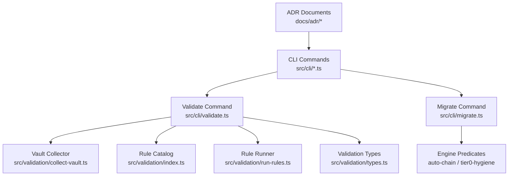
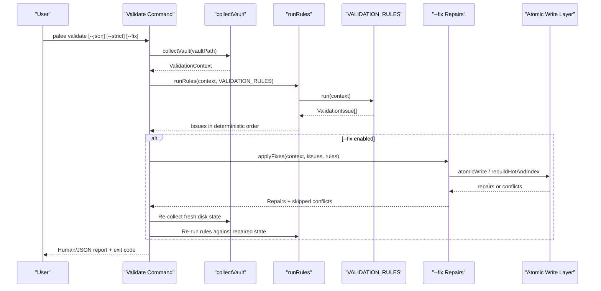
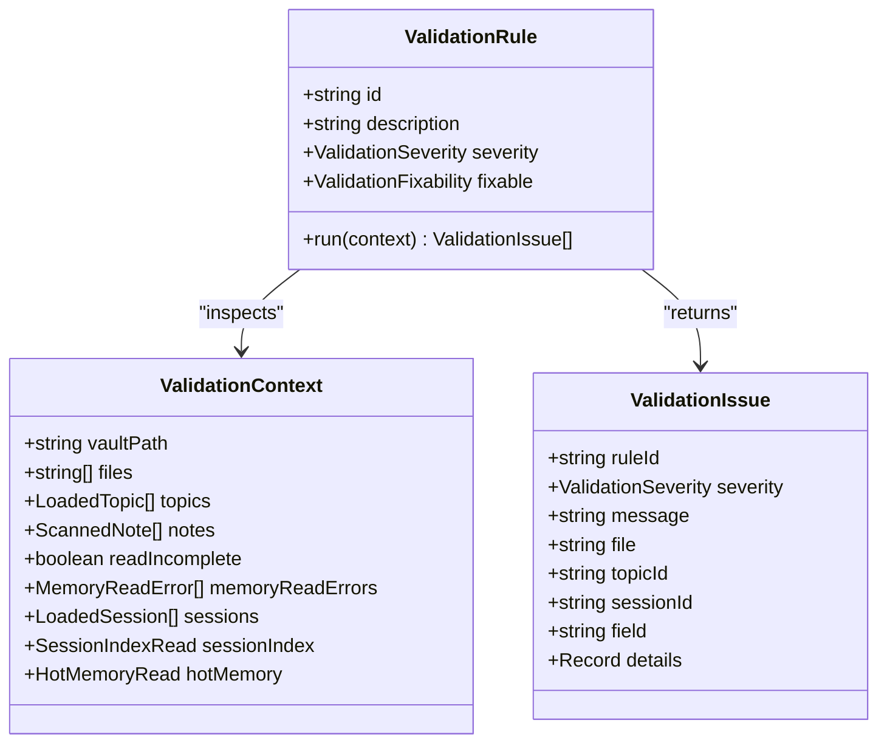
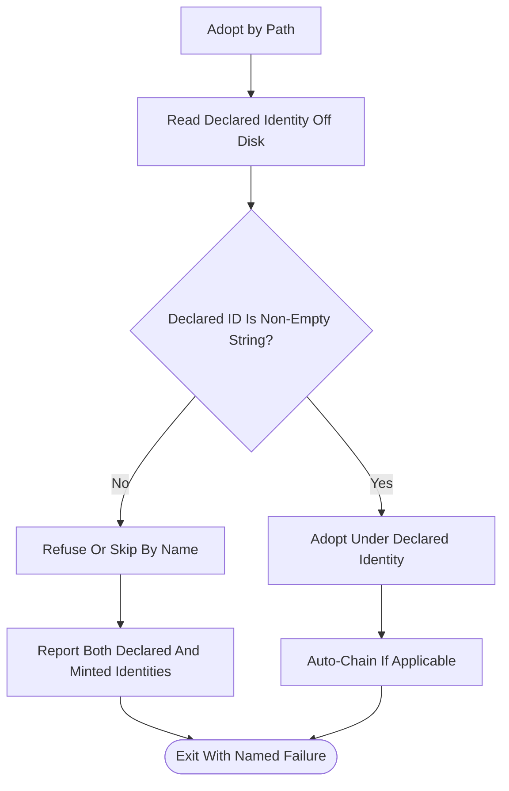
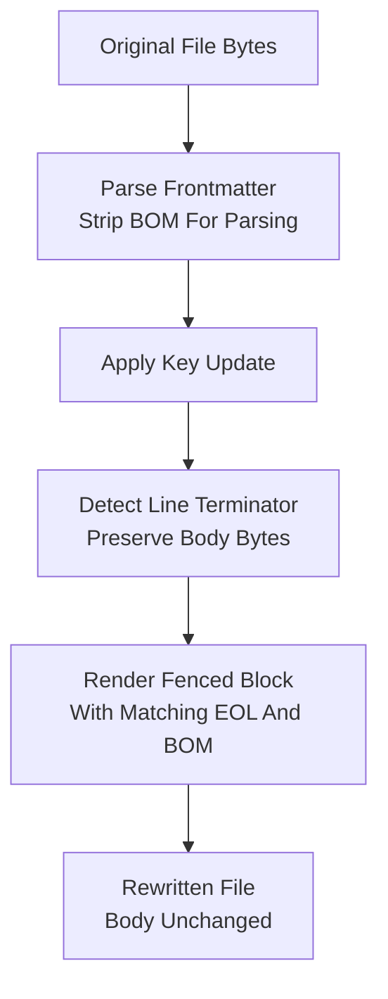
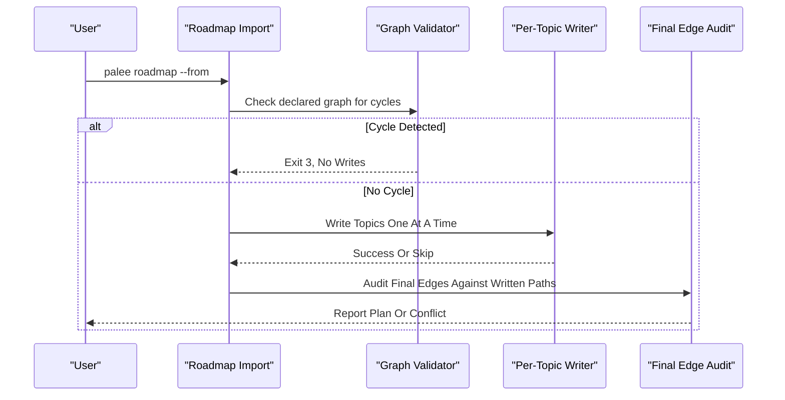
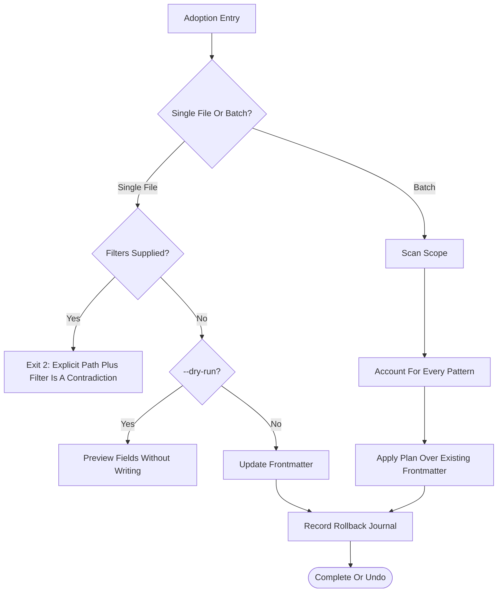
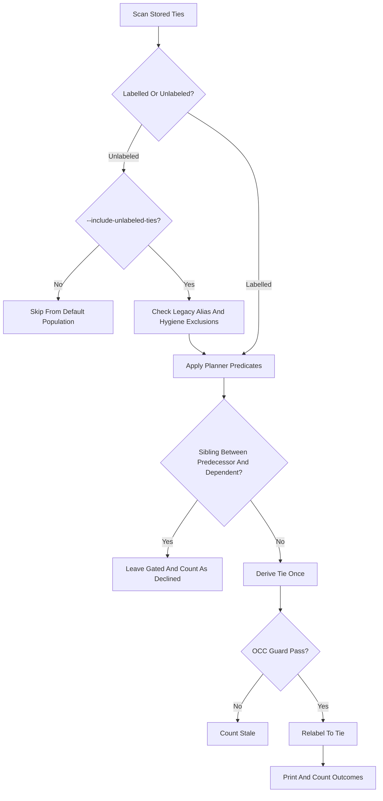
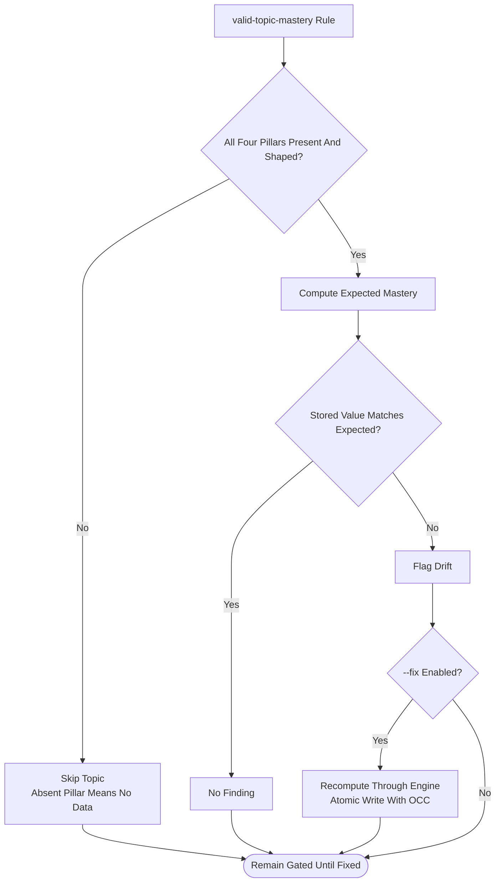
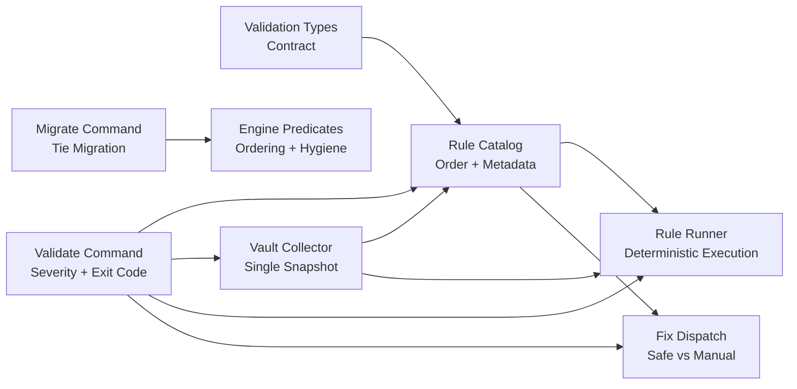

# Data Integrity and Validation Decisions

::: details Referenced Files in This Document

- [0008-validation-framework-decisions.md](https://github.com/Kuldeep2822k/cli/blob/main/docs/adr/0008-validation-framework-decisions.md)
- [0015-identity-preservation.md](https://github.com/Kuldeep2822k/cli/blob/main/docs/adr/0015-identity-preservation.md)
- [0016-frontmatter-fidelity-and-unicode-fold.md](https://github.com/Kuldeep2822k/cli/blob/main/docs/adr/0016-frontmatter-fidelity-and-unicode-fold.md)
- [0017-roadmap-import-safety.md](https://github.com/Kuldeep2822k/cli/blob/main/docs/adr/0017-roadmap-import-safety.md)
- [0022-adoption-contracts.md](https://github.com/Kuldeep2822k/cli/blob/main/docs/adr/0022-adoption-contracts.md)
- [0023-migrate-relabel-ties.md](https://github.com/Kuldeep2822k/cli/blob/main/docs/adr/0023-migrate-relabel-ties.md)
- [0035-validate-fix-partial-pillar-eligibility.md](https://github.com/Kuldeep2822k/cli/blob/main/docs/adr/0035-validate-fix-partial-pillar-eligibility.md)
- [index.ts (validation barrel)](https://github.com/Kuldeep2822k/cli/blob/main/src/validation/index.ts)
- [types.ts (validation types)](https://github.com/Kuldeep2822k/cli/blob/main/src/validation/types.ts)
- [collect-vault.ts](https://github.com/Kuldeep2822k/cli/blob/main/src/validation/collect-vault.ts)
- [run-rules.ts](https://github.com/Kuldeep2822k/cli/blob/main/src/validation/run-rules.ts)
- [validate.ts](https://github.com/Kuldeep2822k/cli/blob/main/src/cli/validate.ts)
- [migrate.ts](https://github.com/Kuldeep2822k/cli/blob/main/src/cli/migrate.ts)

:::

## Table of Contents
1. [Introduction](#introduction)
2. [Project Structure](#project-structure)
3. [Core Components](#core-components)
4. [Architecture Overview](#architecture-overview)
5. [Detailed Component Analysis](#detailed-component-analysis)
6. [Dependency Analysis](#dependency-analysis)
7. [Performance Considerations](#performance-considerations)
8. [Troubleshooting Guide](#troubleshooting-guide)
9. [Conclusion](#conclusion)

## Introduction
This document explains how PALEE’s validation and migration architecture preserves vault integrity while allowing flexible content management. It focuses on seven interlocking decisions:

- A pure, deterministic validation rule framework with a single-read snapshot.
- Identity preservation so commands never invent or overwrite a note’s declared identity.
- Frontmatter byte fidelity and disciplined Unicode folding to prevent silent divergence.
- Roadmap import safety that refuses the validated plan if it cannot be written exactly.
- Adoption contracts that keep edits non-destructive, reversible, and honest about filters.
- Migration surfaces for relabeling ties without rewriting arbitrary user-authored edges.
- Partial pillar eligibility rules for mastery repair so absent assessment data is not treated as zero.

Together these decisions define when PALEE rejects work, when it repairs safely, and when it leaves human judgment to the learner.

## Project Structure
The integrity surface spans documentation, command handlers, and validation infrastructure:

## Core Components
PALEE’s integrity model rests on five implementation components:

| Component | Responsibility | Integrity Role |
|---|---|---|
| Rule catalog | Ordered registration of validation rules | Defines what is checked and in what order |
| Vault collector | Single read pass over topics, sessions, index, and hot memory | Prevents concurrent reads from observing inconsistent snapshots |
| Rule runner | Executes rules deterministically and catches unexpected failures | Keeps malformed rules from masking real findings |
| Validate command | Applies severity policy, exit codes, and optional `--fix` repairs | Separates discovery from mutation |
| Migrate command | Audits and optionally relabels stored tie edges | Provides a controlled backward compatibility surface |

Key architectural choices:

- Rules are pure functions over `ValidationContext`; they do not touch the filesystem, configuration, network, or console.
- One bad topic produces one finding; malformed frontmatter does not abort the scan.
- Warnings are non-blocking by default; `--strict` escalates them.
- Fixability is metadata on each rule, not an implicit assumption.
- Derived views (`hot.md`, `index.md`) are warnings because they are rebuildable projections.

## Architecture Overview
The validation pipeline separates collection, inspection, presentation, and repair.

## Detailed Component Analysis

### Validation Rule Framework
The framework is intentionally small and explicit:

- Each rule exposes `id`, `description`, `severity`, optional `fixable`, and `run(context)`.
- The canonical rule array is the single source of truth for execution order and output stability.
- Malformed rules themselves are caught and reported as rule-execution errors rather than crashing the scan.
- Severity policy lives outside the rules: the CLI maps errors and warnings to exit codes and JSON fields.

Example rule families represented in the catalog:

| Area | Example Rule Id | Purpose |
|---|---|---|
| Read resilience | `parse-frontmatter` | Reports malformed YAML per file without aborting |
| Read resilience | `read-failure` | Reports unreadable files and provisional scans |
| Managed entities | `valid-managed-note-kind` | Ensures managed notes have expected kinds |
| Schema | `valid-palee-schema` | Validates PALEE-specific schema shape |
| Identity | `valid-topic-id-format` | Enforces the tool’s topic ID format |
| Schema | `valid-topic-status` | Topic status must be one of the four lifecycle values (`not_started`, `learning`, `paused`, `archived`) |
| Graph structure | `no-duplicate-topic-id` | Detects duplicate identities |
| Dependencies | `valid-dependency-list` | Validates dependency list shape |
| Dependencies | `no-missing-dependency` | Warns by default; missing prerequisites become quarantined |
| Cycles | `no-dependency-cycle` | Rejects cyclic prerequisite graphs |
| Assessment | `valid-assessment-fields` | Checks assessment field shapes |
| Mastery | `valid-topic-mastery` | Flags drift when all four pillars are present |
| Review state | `valid-review-fields` | Detects invalid SM-2 review fields |
| Review state | `valid-review-dates` | Validates review date consistency |
| Sessions | `valid-session-schema` | Enforces stricter contract for session notes |
| Sessions | `no-session-unknown-topic` | Reports session records whose `topic_id` references a nonexistent topic |
| Derived views | `valid-session-index` | Warns about stale `.palee/index.md` |
| Derived views | `valid-hot-memory` | Warns about stale `.palee/hot.md` |
| Safety | `safe-vault-paths` | Audits managed entity paths |

### Identity Preservation Principles
Identity preservation prevents imports from silently renaming user notes:

- A note must declare a non-empty string `palee_id` to participate as an identity.
- Numeric, array, boolean, or otherwise unusable IDs are refused by the loader and by adoption preflight.
- When a path already declares an identity, adoption either adopts that identity or refuses; it does not mint a new one.
- An unterminated frontmatter opener is rejected by exact delimiter comparison, preventing accidental prepending of a minted block over an existing identity.

Recovery guidance derived from this decision:

- If a note has a numeric or array `palee_id`, edit the note to declare a valid string identity before re-running adoption.
- If an importer reports both a declared and minted identity, point the entry at the note’s actual identity or move the note to a path where no identity conflict exists.
- Do not try to guess an identity; the system treats guessing as the failure mode to avoid.

### Frontmatter Byte Fidelity and Unicode Handling
Two related defects were resolved by separating reader normalization from writer preservation:

- **Byte fidelity:** Rewriting one key must preserve line terminators and BOM in the rest of the file. The writer detects the input convention and renders the fenced block consistently.
- **Unicode folding:** Every identity comparison applies case folding and NFC normalization through shared helpers. Case-sensitive filesystems are acknowledged as a theoretical collision tradeoff because partial folding was the defect.

Recovery guidance:

- If a vault shows mixed line endings after a rewrite, inspect whether the command touched only one note; the untouched control proves the writer was responsible.
- If an accented filename resolves inconsistently across systems, ensure link targets and stored names agree under NFC normalization.
- Mixed-line-terminator files are considered corrupted and should be normalized outside PALEE.

### Roadmap Import Safety
Roadmap import is the only operation whose blast radius covers the whole graph. Its safety contract is “cycle detected means exit 3 and write nothing.”

Key mechanisms:

- The declared graph is cycle-checked before any write.
- Unreadable topics are rebuilt into the declared graph using the edges their notes currently hold, then rechecked.
- Topic ID format is enforced before the first write.
- Dry-run prints the full per-note write plan, including resolved dependencies.
- Path boundaries use canonicalization, `lstat`, inode/device binding, and read-bound opening.
- Effective field values are derived from one function, called separately by validation and writeback.

Recovery guidance:

- If a cycle appears after import, treat it as a violation of INV-46 and investigate whether a skipped or renamed topic changed the written plan.
- Use dry-run to compare the previewed write plan with the committed vault state.
- If a path boundary race is suspected, inspect symlinks and dangling links before retrying.

### Adoption Contracts: Non-Destructive, Reversible, Honest
Adoption writes PALEE state into user-owned notes, so its guarantees are stronger than ordinary reads:

- Hand-written `depends_on` survives first adoption unless explicitly overridden by `--depends-on`.
- Batch flags (`--include`, `--exclude`, `--tag`) are refused in single-file mode because they contradict the semantics of selecting one named note.
- Every supplied pattern is measured against the scanned scope and reported if it matched nothing.
- Single-file `--dry-run` previews instead of writing.
- `--undo` strips only keys adopted by PALEE, backed by a rollback journal verified by fingerprint.
- Tier-0 hygiene runs in batch mode but not single-file mode, preserving the escape hatch documented by the hygiene report.

Recovery guidance:

- If hand-authored prerequisites disappeared, check whether the invocation used `--depends-on`; passing it overrides the note.
- If undo fails, inspect the rollback journal and fingerprint expectations — another process may have rewritten the note between adoption and undo.
- Treat single-file adoption as intentional even if hygiene would normally exclude the note.

### Migration Surface for Relabeling Ties
Migration is the designated surface for repairing stored state that forward-only fixes cannot reach. The relabel-ties pass demotes specific stored tie edges back to advisory status without rewriting arbitrary user-authored dependencies.

Decision highlights:

- The pass audits for stored tie edges and reports them; `--relabel-ties` rewrites the label to `tie`.
- Unlabeled ties can be reached opt-in via `--include-unlabeled-ties`.
- Demotion requires all planner predicates: same directory, rank equality, correct ordering, and no same-rank sibling strictly between the predecessor and dependent.
- Three refusal patterns are counted rather than guessed: multiple prerequisites, forward-pointing edges, and edges stepping over a present sibling.
- Rename detection uses path existence and recorded topic ID, not just identity comparison.
- Conflicts and vanished notes are classified explicitly.

Recovery scenarios:

- A vault adopted before the `tie` label existed can be unlocked by running the migrate pass with the appropriate opt-in flag.
- If a note remains gated after migration, inspect whether its stored edge steps over a surviving sibling or points at a different successor than the planner computed.
- If the pass reports conflicts, rerun after confirming no other process holds locks or modifies the affected notes.

### Partial Pillar Eligibility for Mastery Repair
Mastery repair is conservative about incomplete assessment data:

- Absent pillars mean “no data,” not zero.
- Only topics with all four valid pillar scores are eligible for mastery drift detection and repair.
- Topics with partial pillars are skipped, not zero-filled and reweighted.
- The `--fix` repair recomputes mastery through the engine’s single derivation path, so repaired notes match what adopt/review writes produce.

Recovery guidance:

- If a topic with three scored pillars remains locked, score the missing pillar rather than relying on automatic reweighting.
- If `--fix` reports mastery repair drift, confirm the assessment pillars are complete and shaped before rerunning.
- Remember that `assessed_at` is not updated by validation repair; it attests to an assessment recording, not a recomputation.

## Dependency Analysis
The integrity surface depends on layered contracts rather than monolithic checks:

Coupling observations:

- Rules depend only on `ValidationContext`, keeping them testable and side-effect free.
- The validator owns severity policy and exit codes, not individual rules.
- Fixability is dual-gated by rule metadata and the repair registry; adding an implementation alone cannot start mutating vault data.
- Migration delegates ordering and hygiene logic to engine predicates rather than restating them, reducing drift risk.
- Roadmap import derives effective values once and calls that function from both validation and writeback passes.

## Performance Considerations
The integrity design favors predictable correctness over speculative optimization:

- One vault scan feeds parse outcomes and topic loading, reducing repeated I/O.
- Session index is read before sessions to close the concurrent `session end` interleaving window.
- Rules run unconditionally; one finding does not short-circuit later checks.
- Validation output is deterministic by registration order and sorted file traversal.
- `--fix` re-collects from fresh disk state after repairs so the final report reflects actual remaining issues.

Tradeoffs include duplicated shape checks between loader normalization and raw validation, which is accepted so pre-normalization corruption is visible rather than silently blessed.

## Troubleshooting Guide

### Validation exits with warnings but succeeds locally
- Default behavior: warnings exit `0`.
- CI behavior: use `--strict` to escalate warnings to exit `3`.
- JSON payload keeps `valid` errors-only and adds `strict` plus `gated_by_warnings` for warnings-only strict failures.

### A malformed note stops part of a batch
- Per-topic parse failures are retained as warnings; the scan continues.
- Session notes have a stricter schema contract because rebuild paths depend on their shape.

### Derived view warnings block validation
- They do not block validation by default because `.palee/hot.md` and `.palee/index.md` are rebuildable projections.
- Use `--fix` to rebuild them from canonical session notes.
- In `--strict` mode, all warnings, including derived-view warnings, contribute to exit `3`.

### Adoption seems destructive
- Confirm whether `--depends-on` was passed; it overrides frontmatter.
- Confirm whether single-file mode was used; hygiene is intentionally not applied there.
- Use `--undo` to reverse only PALEE-owned keys.

### Roadmap import claims success but leaves a cycle
- This violates the “exit 3, write nothing” contract and should be investigated as a validated-plan-vs-written-plan divergence.
- Inspect unreadable topics, renamed paths, and symlink races.

### Mastery repair flags a topic with partial assessments
- Absent pillars are skipped. Score the missing pillar or leave the topic gated until all four pillars are present and shaped.

### Migration reports conflicts or stale entries
- Conflicts usually mean another process modified the note between derivation and write.
- Rerun after stabilizing the vault; the pass counts conflicts and leaves conflicted notes unchanged.

## Conclusion
PALEE’s data integrity model is built around conservative defaults and explicit mutation surfaces. Validation discovers problems without changing vault state; adoption and roadmap import refuse dangerous assumptions; migration provides a narrow route for backward compatibility; and `--fix` repairs only what is clearly safe or explicitly allowed. The result is a system that protects the vault from silent corruption while still supporting flexible content workflows, manual correction, and recovery procedures grounded in observable, deterministic behavior.
