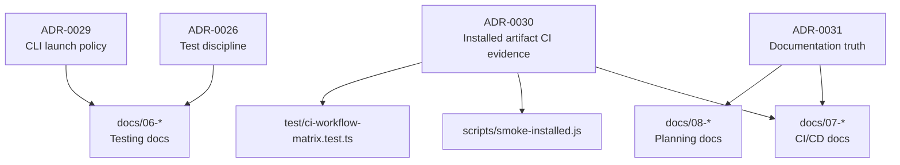
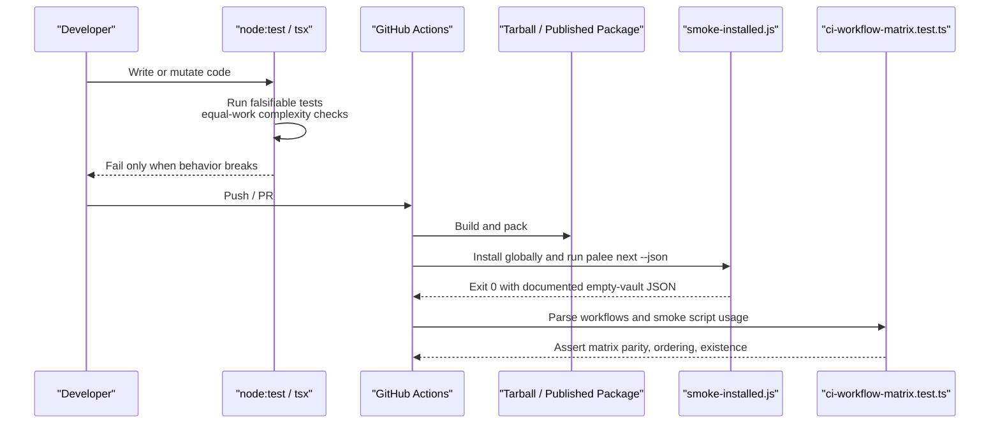
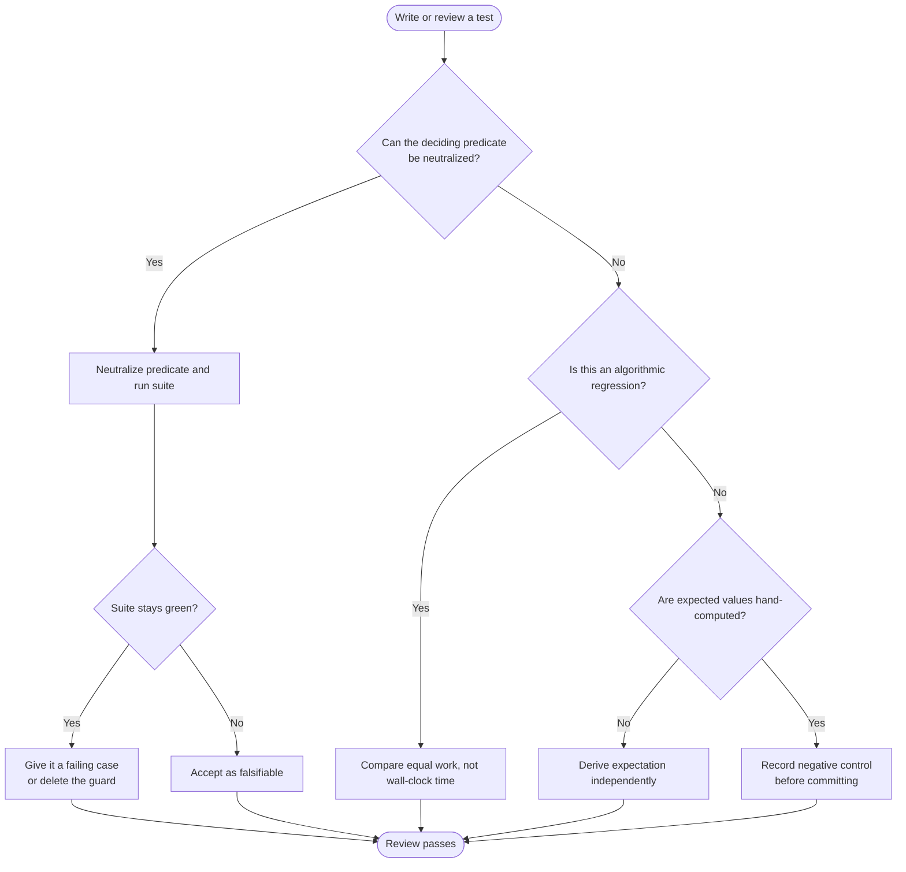
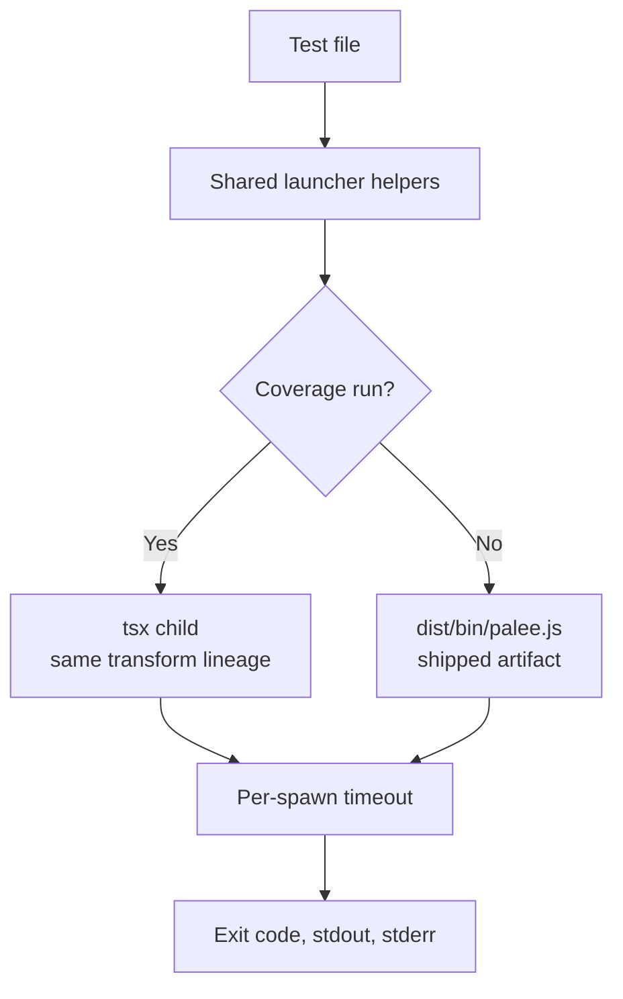
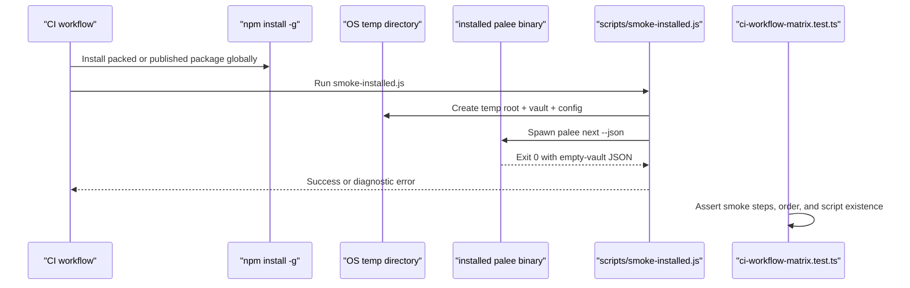
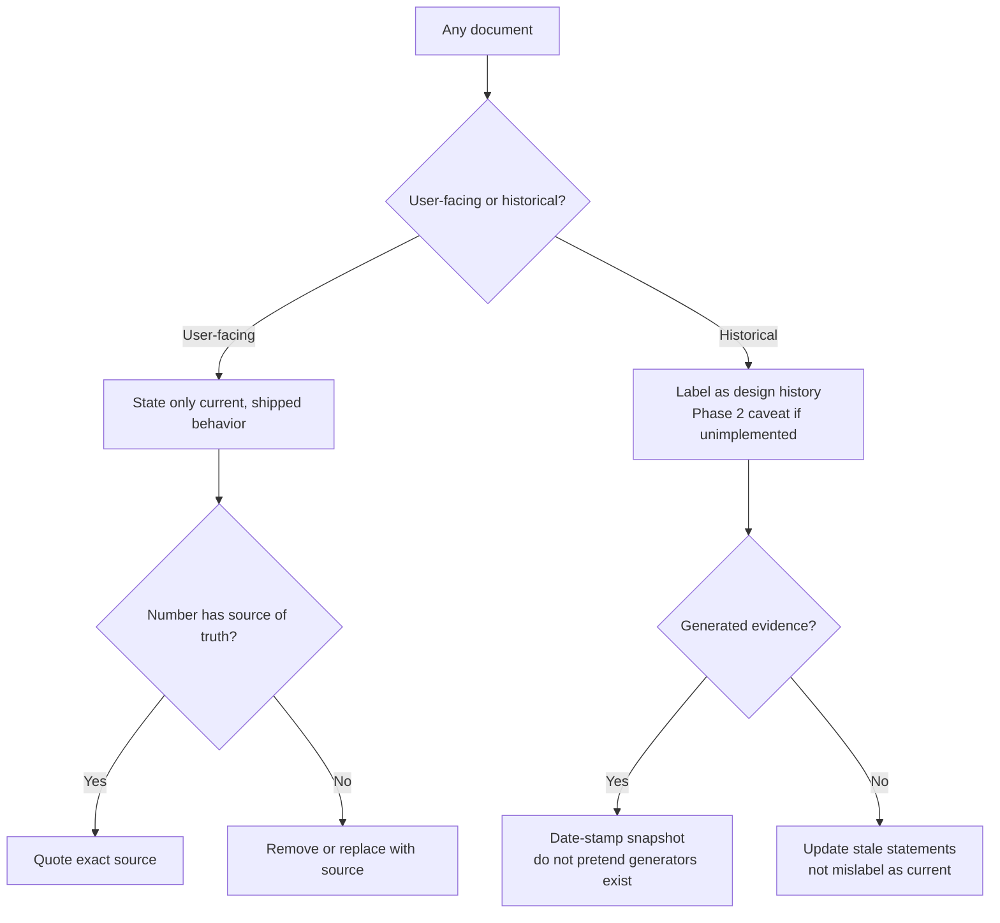
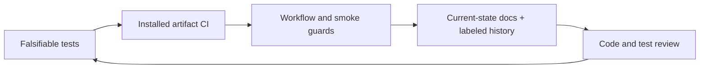
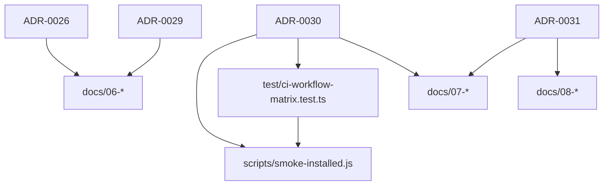

# Development and Testing Decisions

::: details Referenced Files in This Document

- [ADR-0026: Test Discipline — Falsifiability Over Ceremony](https://github.com/Kuldeep2822k/cli/blob/main/docs/adr/0026-test-discipline.md)
- [ADR-0029: Test-Time CLI Launch Policy](https://github.com/Kuldeep2822k/cli/blob/main/docs/adr/0029-test-cli-launch-policy.md)
- [ADR-0030: Installed-Artifact CI Evidence](https://github.com/Kuldeep2822k/cli/blob/main/docs/adr/0030-installed-artifact-ci-evidence.md)
- [ADR-0031: Documentation Truth — Current-State Docs, Labeled History](https://github.com/Kuldeep2822k/cli/blob/main/docs/adr/0031-documentation-truth.md)
- [Testing Overview](https://github.com/Kuldeep2822k/cli/blob/main/docs/06-0-testing.md)
- [Unit Tests](https://github.com/Kuldeep2822k/cli/blob/main/docs/06-1-unit-tests.md)
- [Integration and Smoke Tests](https://github.com/Kuldeep2822k/cli/blob/main/docs/06-2-integration-and-smoke-tests.md)
- [CI/CD and Release Pipeline](https://github.com/Kuldeep2822k/cli/blob/main/docs/07-0-cicd-and-release-pipeline.md)
- [Planning and Design Documents](https://github.com/Kuldeep2822k/cli/blob/main/docs/08-0-planning-and-design-documents.md)
- [Smoke Script for Installed Artifacts](https://github.com/Kuldeep2822k/cli/blob/main/scripts/smoke-installed.js)
- [CI Workflow Matrix Parity Test](https://github.com/Kuldeep2822k/cli/blob/main/test/ci-workflow-matrix.test.ts)

:::

## Table of Contents
1. [Introduction](#introduction)
2. [Project Structure](#project-structure)
3. [Core Components](#core-components)
4. [Architecture Overview](#architecture-overview)
5. [Detailed Component Analysis](#detailed-component-analysis)
6. [Dependency Analysis](#dependency-analysis)
7. [Performance Considerations](#performance-considerations)
8. [Troubleshooting Guide](#troubleshooting-guide)
9. [Conclusion](#conclusion)

## Introduction
PALEE’s development practices are driven by three explicit architectural decision records that shape how tests are written, how CI evidence is collected, and how documentation is maintained:

- **Test discipline prioritizes falsifiability over ceremony.** A test must be able to fail when the relevant code changes; dead guards, tautological checks, timing-bound band-aids, hand-computed expectations called through the implementation, and silent policy rewrites are rejected.
- **Installed artifact CI evidence proves the shipped package, not just the repository build.** The pre-merge and post-publish smoke paths install a real tarball or published package and run one command that exercises dispatch, configuration resolution, vault access, JSON emission, and exit codes.
- **Documentation truth requires current-state prose and labeled history.** User-facing documents describe shipped behavior with source-backed numbers; planning and architecture artifacts are preserved as dated design records rather than being rewritten into false present-tense claims.

These decisions affect daily development (how reviewers evaluate tests), quality assurance (what CI actually proves), and maintenance (how drift is handled instead of silently “fixed”).

## Project Structure
The testing and documentation guidance lives across decision records, user-facing documentation, scripts, and workflow-guarding tests:

## Core Components
PALEE’s development process can be understood as four interacting components:

| Component | Responsibility | Guiding Rule | Key Evidence |
|---|---|---|---|
| Test discipline | Decide which tests are acceptable | A guard that cannot fail is proven dead, fixed, or deleted | Neutralize predicate → run suite → require failure if still green |
| CLI launch policy | Ensure tests exercise the same runtime and lifecycle they would under normal or coverage execution | No unbounded child process; no PATH-resolved `node` divergence | Shared helpers, per-spawn timeout, tsx vs dist lineage choice |
| Installed artifact evidence | Prove the installed package works end-to-end | One real command after global install on every platform | `palee next --json` against an empty isolated vault |
| Documentation truth | Keep prose readable and correct without losing design history | Current-state docs + labeled history | Source-backed numbers, Phase 2 caveats, dated architecture snapshots |

## Architecture Overview
The development pipeline ties test philosophy to CI and documentation maintenance through concrete files:

## Detailed Component Analysis

### Test Discipline: Falsifiability Over Ceremony
This decision record establishes the review standard for tests. It emerged from auditing the tests themselves, not only the code, and identifying guards that could not fail, vacuous assertions, timing-bound band-aids, and tests whose expected values were computed by the implementation under test.

Key principles:

- **Dead guards are neutralized, then fixed or deleted.** If removing or neutralizing a guard does not break the suite, it is not a useful assertion.
- **Tautologies are removed, not kept as documentation.** A check over data derived in the same expression is not a contract boundary.
- **Complexity tests compare equal work, not wall-clock deadlines.** A constant-factor bound flaked on CI while missing the algorithmic regression; the replacement compares node traversal counts across synthetic inputs.
- **Policy changes move the test explicitly.** Rewriting a contradicting test silently hides a behavioral change.
- **Fixture properties are distinguished from assertions.** When a mutation is not caught because the fixture lacks the right property, the reviewer explains why rather than claiming coverage.
- **Expected values are hand-computed.** Asking the implementation for its own expected output cannot fail.
- **Negative controls are measured before committing.** Every fix includes before/after evidence showing what still fails and what no longer regresses.

### Test-Time CLI Launch Policy
PALEE’s tests launch CLI children through shared helpers so that subprocesses use the same runtime, environment layering, and bounded timeouts as intended. During coverage runs, children use the TypeScript sources through `tsx`; normal runs use the prebuilt distribution entry. This distinction exists because merging coverage reports from two different transform lineages caused function attribution loss that lowered reported function coverage below the threshold.

Important rules:

- All spawn-style and shell-string launches go through `PALEE_ARGV` or `PALEE_CMD`.
- Coverage children keep launching `tsx` sources to preserve identical v8-istanbul function maps.
- Normal children launch the built `dist/bin/palee.js`, exercising the shipped artifact.
- Every helper-launched child has a per-call timeout; a hung child throws a named error instead of blocking the worker until CI cancels it.
- Shell launches pin `process.execPath` and quote it, avoiding PATH divergence.
- `test:coverage` builds outside the instrumented tree and caps concurrency at four workers.

### Installed-Artifact CI Evidence
Two CI jobs install the real package and check it: the pre-merge `smoke-install` job packs the tarball and installs it globally, and the release job repeats similar checks against the published package. The earlier flag probes (`--version`, `--help`) proved only that the shim resolved; they did not reach config loading, vault reading, JSON emission, or dependency interoperation.

The installed-artifact smoke step therefore:

- Creates an isolated temporary root with an empty `vault/` and a `config/config.json` pointing at it.
- Runs with that temporary root as the working directory, outside the checkout.
- Spawns the PATH-resolved `palee next --json`.
- Clears inherited loader/resolution overrides such as `NODE_OPTIONS` and `NODE_PATH`.
- Asserts exit 0 and the documented empty-vault contract fields.
- Bounds execution to 60 seconds and cleans up the temporary directory in `finally`.
- Reports captured stdout and stderr on failure.

A workflow-level test keeps the two smoke jobs from drifting: both must invoke `scripts/smoke-installed.js` after an `actions/checkout` step, and the script must exist.

### Documentation Truth: Current-State Docs, Labeled History
After auditing command invocations and documentation, PALEE adopted a split between current-user documentation and historical design records.

User-facing documents:

- State only current, shipped behavior.
- Quote numbers directly from their source of truth, such as `.c8rc.json` or `package.json` engines.
- Remove or replace counts with no source of truth.
- Complete the README option surface where possible.

Planning and architecture documents:

- Are design history and labeled as such.
- Use Phase 2 caveats for unimplemented commands.
- Replace stale present-tense limitations with accurate current behavior where applicable.
- Treat architecture evidence as dated snapshots produced by scripts that may not be in the repository.

Drift claims disproved by exploration are recorded rather than silently corrected, so future audits do not re-litigate them.

### Conceptual Overview
At a higher level, these decisions form a feedback loop:

1. Tests are reviewed for falsifiability.
2. CI verifies more than lint and unit tests by installing and running the real package.
3. Workflows and smoke contracts are guarded by tests.
4. Documentation is separated into current claims and labeled history.
5. Drift is treated as evidence to audit and label, not as noise to quietly rewrite.

## Dependency Analysis
The guiding decisions depend on several concrete files:

## Performance Considerations
PALEE’s testing performance choices are intentional tradeoffs:

- **Native tooling reduces overhead.** The project uses `node:test` and `node:assert` instead of external frameworks, and executes TypeScript directly through `tsx` during tests.
- **Concurrency is bounded.** Both plain test and coverage launch paths cap worker concurrency at four to avoid spawning one test worker per core, which failed to commit memory on high-core machines.
- **Equal-work complexity tests cost more but host-independently detect regressions.** They trade milliseconds for robustness against runner variability.
- **Coverage children pay a per-spawn cold-start cost through `tsx`.** This was measured and retained because switching to the compiled distribution collapsed function coverage due to merged transform lineages.
- **Installed artifact smoke adds a small global-install and command-execution cost**, but it proves a materially stronger claim than flag-only probes.

## Troubleshooting Guide

### A test looks like a guard but never fails
Use the neutralization method: remove or neutralize the deciding predicate and run the suite. If the suite remains green, the guard is dead. Either add a fixture that makes it fail or delete it. Do not widen bounds or silence the issue.

### A complexity test flakes on CI
Replace wall-clock thresholds with an equal-work comparison in the same process. Compare traversal counts or operation counts over synthetic inputs so the result depends on algorithmic behavior, not runner load.

### Expected-value tests pass even after changing the formula
Do not derive expected values through the implementation under test. Compute them independently using the documented formula or specification.

### A CLI child hangs in CI
Ensure it goes through the shared launcher helpers, which provide per-call timeouts and capture stdout/stderr. Unbounded direct spawns should be migrated to the bounded path; new direct spawns are checked by a shrinking allow-list guard.

### Installed smoke passes locally but fails on CI
Check whether the smoke step installs the artifact, clears loader overrides, runs after checkout, and invokes `scripts/smoke-installed.js` after `palee --help`. The workflow matrix test asserts these ordering and existence requirements.

### Documentation disagrees with configuration or commands
If a number has a source of truth, quote it exactly. If there is no source of truth, remove or replace it. If a command is unimplemented, label it as Phase 2 or future design. If generated evidence cannot be reproduced, date-stamp it and state that the generator is not in the repository.

## Conclusion
PALEE’s development and testing decisions are unified by a single concern: evidence must prove something that can fail. Tests must be falsifiable, CI must prove the installed package, and documentation must distinguish current claims from labeled history. These standards make the repository easier to review, maintain, and extend because they turn ambiguity into explicit, auditable contracts rather than relying on ceremony, green suites, or unstated assumptions.

## References

- [ADR-0026: Test Discipline — Falsifiability Over Ceremony:1-79](https://github.com/Kuldeep2822k/cli/blob/main/docs/adr/0026-test-discipline.md#L1-L79)
- [ADR-0029: Test-Time CLI Launch Policy:1-97](https://github.com/Kuldeep2822k/cli/blob/main/docs/adr/0029-test-cli-launch-policy.md#L1-L97)
- [ADR-0030: Installed-Artifact CI Evidence:1-66](https://github.com/Kuldeep2822k/cli/blob/main/docs/adr/0030-installed-artifact-ci-evidence.md#L1-L66)
- [ADR-0031: Documentation Truth — Current-State Docs, Labeled History:1-67](https://github.com/Kuldeep2822k/cli/blob/main/docs/adr/0031-documentation-truth.md#L1-L67)
- [Smoke Script for Installed Artifacts:1-87](https://github.com/Kuldeep2822k/cli/blob/main/scripts/smoke-installed.js#L1-L87)
- [CI Workflow Matrix Parity Test:1-187](https://github.com/Kuldeep2822k/cli/blob/main/test/ci-workflow-matrix.test.ts#L1-L187)
- [ADR-0026: Test Discipline — Falsifiability Over Ceremony:10-79](https://github.com/Kuldeep2822k/cli/blob/main/docs/adr/0026-test-discipline.md#L10-L79)
- [ADR-0026: Test Discipline — Falsifiability Over Ceremony:10-40](https://github.com/Kuldeep2822k/cli/blob/main/docs/adr/0026-test-discipline.md#L10-L40)
- [ADR-0026: Test Discipline — Falsifiability Over Ceremony:25-40](https://github.com/Kuldeep2822k/cli/blob/main/docs/adr/0026-test-discipline.md#L25-L40)
- [ADR-0026: Test Discipline — Falsifiability Over Ceremony:40-50](https://github.com/Kuldeep2822k/cli/blob/main/docs/adr/0026-test-discipline.md#L40-L50)
