# Learning and Pedagogy Decisions

::: details Referenced Files in This Document

- [ADR-0004: Four-Pillar Pedagogical Assessment Model](https://github.com/Kuldeep2822k/cli/blob/main/docs/adr/0004-four-pillar-pedagogical-mastery.md)
- [ADR-0009: The Gating Model — What May Lock a Note](https://github.com/Kuldeep2822k/cli/blob/main/docs/adr/0009-gating-model-depends-on-source.md)
- [ADR-0010: Tier-0 Hygiene Classification for Batch Adoption](https://github.com/Kuldeep2822k/cli/blob/main/docs/adr/0010-tier0-hygiene-classification.md)
- [ADR-0011: Tiered Auto-Chain — strict | full](https://github.com/Kuldeep2822k/cli/blob/main/docs/adr/0011-tiered-auto-chain.md)
- [ADR-0012: Declared Prerequisites — Reading a Note's Own Text](https://github.com/Kuldeep2822k/cli/blob/main/docs/adr/0012-declared-prerequisites.md)
- [ADR-0013: Per-Edge Blocking Policy and OR-Groups](https://github.com/Kuldeep2822k/cli/blob/main/docs/adr/0013-per-edge-blocking-policy.md)
- [ADR-0020: Readiness and Scheduling Contracts](https://github.com/Kuldeep2822k/cli/blob/main/docs/adr/0020-readiness-and-scheduling-contracts.md)
- [ADR-0021: The Assessment Surface](https://github.com/Kuldeep2822k/cli/blob/main/docs/adr/0021-assessment-surface.md)
- [Mastery Engine](https://github.com/Kuldeep2822k/cli/blob/main/src/engine/mastery.ts)
- [Tier-0 Hygiene Predicates](https://github.com/Kuldeep2822k/cli/blob/main/src/engine/tier0-hygiene.ts)
- [Auto-Chain Engine](https://github.com/Kuldeep2822k/cli/blob/main/src/engine/auto-chain.ts)
- [Declared Prerequisites Scanner](https://github.com/Kuldeep2822k/cli/blob/main/src/engine/prereq-text.ts)
- [Next Topics Use Case](https://github.com/Kuldeep2822k/cli/blob/main/src/application/get-next-topics.ts)
- [Record Assessment Use Case](https://github.com/Kuldeep2822k/cli/blob/main/src/application/record-assessment.ts)

:::

## Table of Contents
1. [Introduction](#introduction)
2. [Project Structure](#project-structure)
3. [Core Components](#core-components)
4. [Architecture Overview](#architecture-overview)
5. [Detailed Component Analysis](#detailed-component-analysis)
6. [Dependency Analysis](#dependency-analysis)
7. [Performance Considerations](#performance-considerations)
8. [Troubleshooting Guide](#troubleshooting-guide)
9. [Conclusion](#conclusion)

## Introduction
PAL EE is a learning-focused tool that turns Markdown-based lessons into a prerequisite-aware, spaced-repetition study system. Its pedagogical design is built around four decisions:

- **Four-pillar assessment**: mastery is not one score; it combines conceptual understanding, practical application, debugging ability, and Feynman articulation.
- **Evidence-based gating**: only explicit or structurally justified prerequisite claims may lock a topic behind another.
- **Batch hygiene**: automatic adoption starts by classifying repository files as backbone, leaf, or excluded before any planning runs.
- **Readiness contracts**: the same readiness gate powers `palee next` and `palee plan`, so what a learner can do now is never contradicted by what they plan.

These decisions support spaced repetition by keeping SM-2 scheduling separate from prerequisite gating while ensuring prerequisites remain evidence-based rather than inferred from filesystem order.

## Project Structure
The learning architecture lives across three layers:

| Layer | Responsibility | Key files |
|---|---|---|
| Decision records | Why PAL EE treats mastery, prerequisites, chaining, and readiness the way it does | ADRs 0004, 0009, 0010, 0011, 0012, 0013, 0020, 0021 |
| Engine layer | Pure computation of mastery, prerequisite text, auto-chaining, and hygiene classification | `src/engine/{mastery,tier0-hygiene,auto-chain,prereq-text}.ts` |
| Application layer | User-facing contracts for scheduling and assessment | `src/application/{get-next-topics,record-assessment}.ts` |

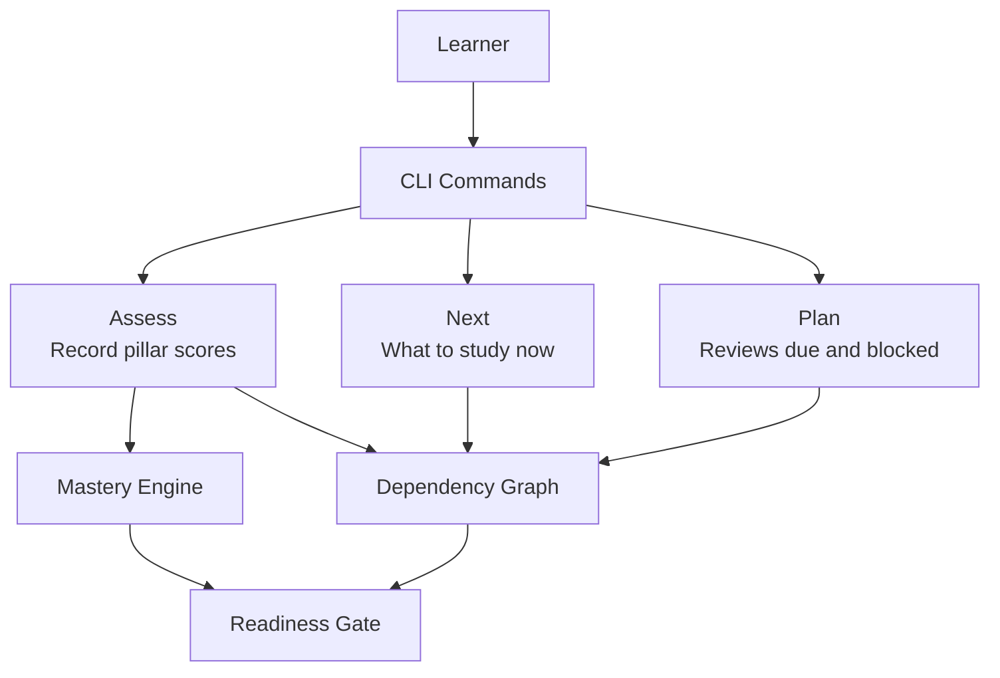

## Core Components
PAL EE’s learning model has five interconnected pillars:

1. **Four-pillar mastery**: Conceptual, Practical, Debug, and Feynman combine into a weighted `topic_mastery`.
2. **Gating model**: Only learner-authored, numbered-tree-justified, or declared-prerequisite edges may block study.
3. **Tier-0 hygiene**: Batch adoption first classifies vault paths as backbone, leaf, or excluded.
4. **Tiered auto-chaining**: Strict numbering plus optional TOC enumeration produce advisory or gated edges.
5. **Readiness contract**: One shared prerequisite gate decides what `next` and `plan` offer.

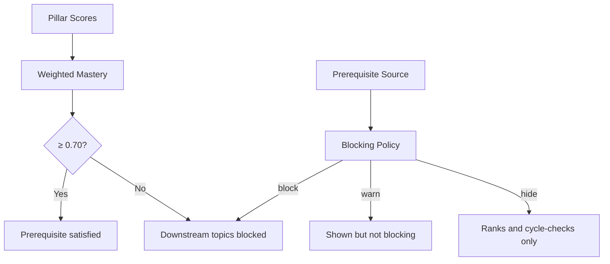

## Architecture Overview
At a high level, PAL EE separates three concerns that must not drift:

- **Learning measurement**: pillar scores and their weighted combination.
- **Dependency policy**: which edges are gates versus advice.
- **Scheduling**: SM-2 spacing combined with prerequisite readiness.

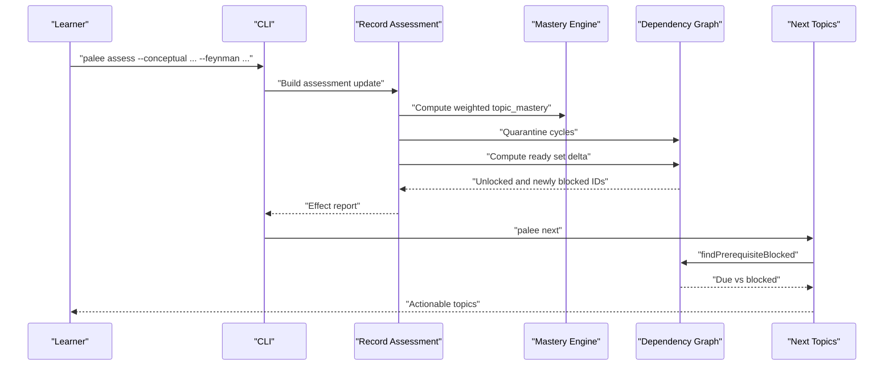

## Detailed Component Analysis

### Four-Pillar Pedagogical Mastery
PAL EE rejects a single recall score because engineering mastery includes theoretical comprehension, practical execution, troubleshooting, and clear explanation. The implementation computes:

`topic_mastery = round((conceptual + practical + debug + 2 × feynman) / 5, 4)`

This means:

| Pillar | Weight | Purpose |
|---|---:|---|
| Conceptual | 20% | Understanding core principles |
| Practical | 20% | Applying concepts in code or execution |
| Debug | 20% | Troubleshooting, root cause analysis, fixing failures |
| Feynman | 40% | Articulating concepts simply without jargon |

The 0.70 mastery threshold is intentionally reachable only when Feynman contributes. Without a non-zero Feynman score, the other three pillars cap at `(1 + 1 + 1) / 5 = 0.60`, so a topic cannot pass downstream dependencies through rote memorization alone.

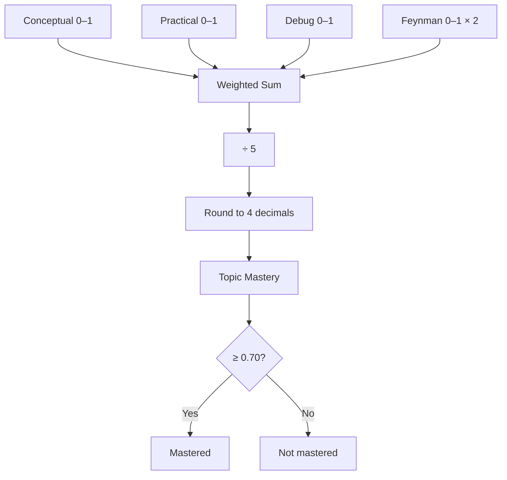

### Assessment Surface and Readiness Contract
Until `palee assess` was added, no command could raise `topic_mastery` from user-entered pillar scores. Review drove SM-2 spacing but did not collect the four pillars, so mapping review quality onto mastery would have redefined the assessment model. `assess` closed this surface with strict contracts:

- Only explicitly supplied pillars are written.
- Corrupt stored values are refused rather than clamped into an unlock.
- Non-scalars are rejected.
- Exact topic ID resolution wins before fuzzy matching.
- The availability delta is computed the same way `plan` does: quarantine cycles first, then compute the ready set.
- A lowering is named, not blocked, because the learner is the reliable source of reduced knowledge.

The readiness contract ensures `next` and `plan` answer the same question. `findPrerequisiteBlocked` centralizes the gate using the engine’s dependency predicate, and `getNextTopics` dedupes actionable topics against it. Archived topics are out of every study surface but remain in the graph so missing prerequisites are not misread as unknown references.

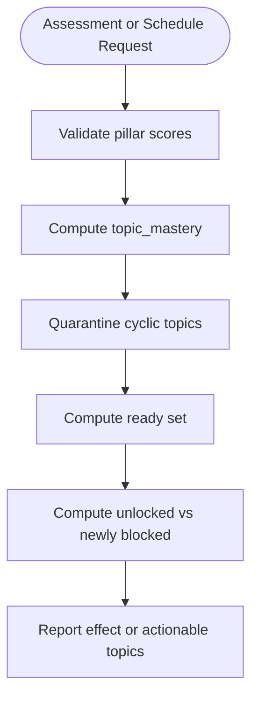

### Tier-0 Hygiene Classification for Batch Adoption
Automatic adoption originally treated every Markdown file as a potential lesson, producing false edges such as translation copies, repo meta files, and README variants becoming first-class topics. Tier-0 hygiene runs before planning on batch adoption and answers one pure question per vault-relative path: is this note a backbone, leaf, or excluded?

| Classification | Meaning | Chain role |
|---|---|---|
| Backbone | May gate the chain | Joins the spine and can be a predecessor |
| Leaf | Attached to the chain | Never gates successors |
| Excluded | Never adopted or chained | Skipped with counted reason |

Key rules include:

- Repo-meta basenames such as license, contributing, changelog, FAQ, help, funding, agents, index, home, toc, and contents are excluded.
- Locale-suffixed generic doc names are translations and excluded; locale suffixes on other names demote to leaf.
- Template tokens are matched as whole words, not substrings.
- Phase subtrees collapse to leaves.
- Content-doc prefixes like deep-dive, lab, exam, assignment, quiz, and solution are backbone-eligible.
- Invalid `palee_id` values are demoted to leaf rather than silently gating everything after them.

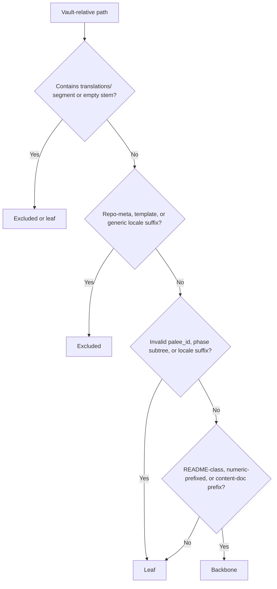

### Tiered Auto-Chaining: Strict vs Full
Only three things may gate: the learner’s own list, the numbered tree, and the note’s own declaration. Auto-chaining combines the numbered tree with optional repository enumeration through two tiers:

| Tier | Sources consumed | Edge label semantics |
|---|---|---|
| `strict` (default) | Numbered tree only | `numbered` for justified order; `tie` for same-rank filename collation |
| `full` | Numbered tree plus README/SUMMARY enumeration | Adds `toc` where the author’s document order speaks |

Important composition rules:

- Numbering dominates TOC enumeration.
- TOC edges replace, not join, the numbered predecessor for covered notes.
- A chain head keeps its justified numbered edge unless keeping it closes a cycle.
- Ordering inside the TOC chain follows deduplication, directory grouping, and a pedagogical phase order: deep-dive, lab, exam, with assignment, quiz, and solution last so homework never gates subsequent documentation.
- A vault with no real order signal produces zero edges and an honest refusal rather than alphabetical prerequisites.

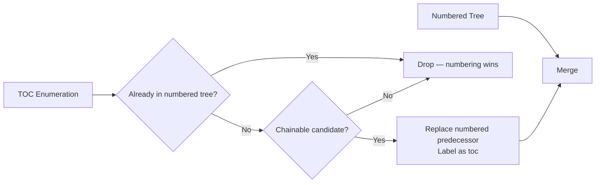

### Declared Prerequisites
A note may state its own prerequisites under headings such as “Prerequisites,” “Requirements,” “Requires,” “Required knowledge,” or “Depends on.” Unlike enumeration order, these links are the author’s chosen name for the thing they need, so they gate.

The scanner is deliberately narrow:

- The heading must match the trigger phrase exactly.
- Only links count; prose alone is not followed.
- Fenced code, HTML comments, and inline code spans are blanked before scanning.
- Task-list items are dropped entirely because an unchecked box is an intention, not a committed prerequisite.
- Three cues disqualify an item: negation, reversal, and disjunction.
- Unresolved references cost only their own edge; the lookup is fail-closed and scoped to notes the batch may adopt.

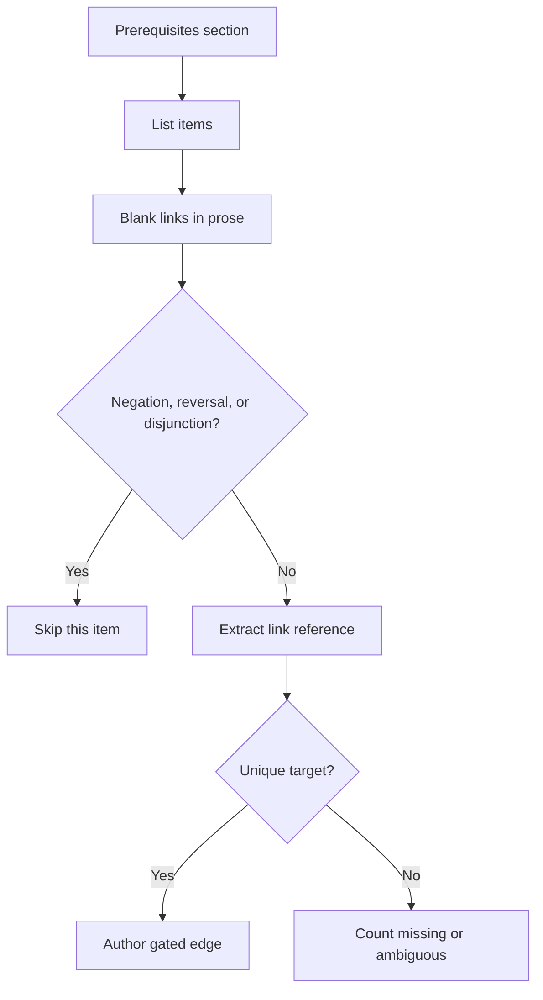

### Per-Edge Blocking Policy and OR-Groups
The current v0.6.x model stamps one `depends_on_source` label per note. That works for a homogeneous list but breaks when sources mix: a hand-edited prerequisite on an advisory-labelled note becomes silently advisory, and enumerated and declared text can land on the same note with conflicting policies.

ADR-0013 specifies per-edge policy:

| Policy | Behaviour |
|---|---|
| `block` | Standard gating — the note is not ready until the prerequisite reaches 0.70 |
| `warn` | Shown in blocked reporting but does not hold the note off the ready list |
| `hide` | Ranks and cycle-checks without being reported as blocking |

Each edge carries provenance (`via`) and policy, allowing future OR-groups where a note requires one of several prerequisites. Existing plain string lists remain backward compatible as `policy: block`.

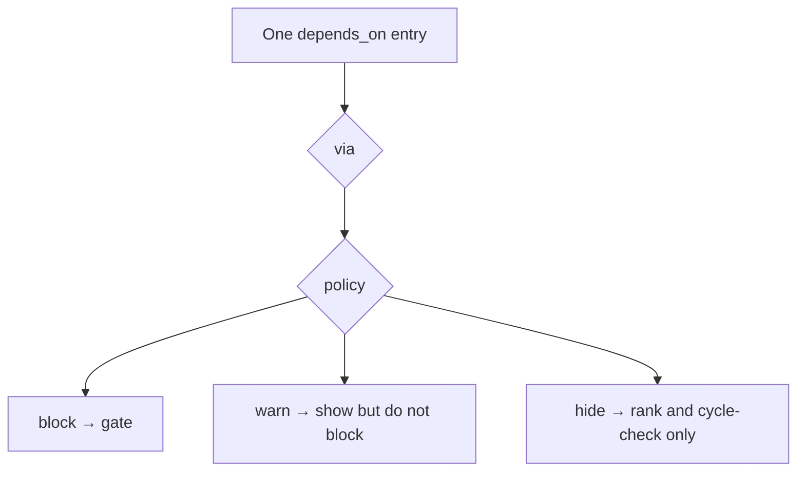

### How Spaced Repetition and Prerequisites Coexist
SM-2 handles temporal scheduling: when a topic is due, how often it should recur, and how its ease factor evolves. Prerequisites handle conceptual ordering: whether a topic is allowed to appear as actionable study material.

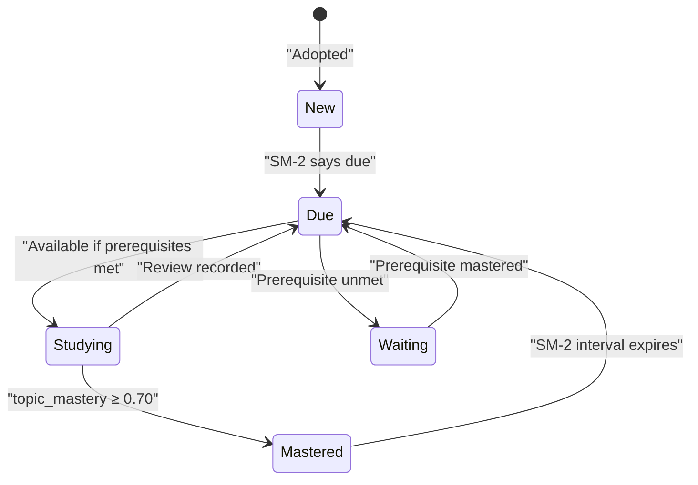

[No sources needed since this diagram shows conceptual workflow, not actual code structure]

## Dependency Analysis
The learning pipeline has clear boundaries between measurement, policy, and scheduling:

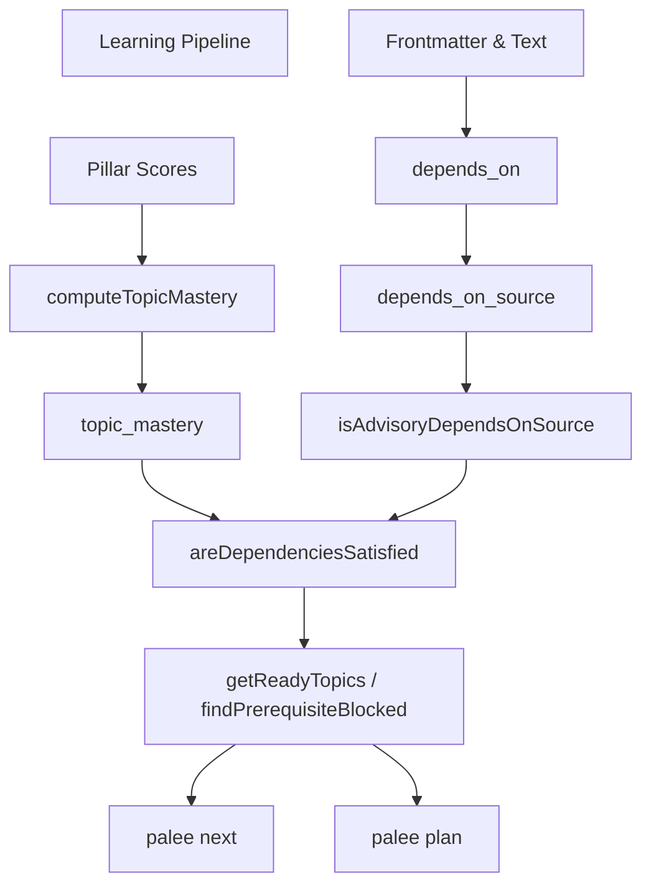

## Performance Considerations
PAL EE’s learning decisions trade computational work for correctness:

- **Hygiene classification is pure and fs-free**: it operates on vault-relative paths and constants, avoiding filesystem coupling during batch filtering.
- **Auto-chaining uses linear scans and precomputed bracket-balance tables** to avoid pathological README rescans.
- **Readiness is shared**: `next` and `plan` use the same prerequisite gate instead of duplicating logic.
- **Cycle quarantine happens once per readiness computation**, skipping both passes when the vault has no edges.
- **Per-edge blocking is proposed for future mixed-source notes**, but the current per-note label avoids premature complexity while documenting the exact failure mode it prevents.

[No sources needed since this section provides general guidance]

## Troubleshooting Guide

| Symptom | Likely Cause | Resolution |
|---|---|---|
| Everything is blocked but nothing appears ready | All actionable topics are held by prerequisites | Run `palee plan` to see the blocked list and master prerequisites first |
| A topic is recommended by `next` but blocked by `plan` | Inconsistent readiness contracts | This defect was fixed by sharing `findPrerequisiteBlocked`; verify the installed version respects the accepted contract |
| A prerequisite id disappears from validation warnings | Missing dependency resolved to a warning, not an error | Fix the dangling reference so the prerequisite exists |
| A topic cannot reach mastery despite perfect Conceptual, Practical, and Debug scores | Feynman pillar is missing or zero | Provide a Feynman score; the three ordinary pillars cap at 0.60 |
| Batch adoption silently skipped translation or README files | Tier-0 hygiene classified them as excluded or leaf | Check the dry-run and commit screen skip counts; use single-file adoption to override |
| `palee assess` refuses a stored score | Stored pillar value is not a number in `[0,1]` | Repair the field with `palee validate` or pass the flag explicitly |
| A prerequisites section declares nothing | Heading mismatch, fenced markup, task list, negation, reversal, or disjunction | Ensure the heading matches exactly and the item is an unambiguous link |

## Conclusion
PAL EE’s pedagogical architecture is designed to keep learning evidence-based:

- Mastery measures four cognitive competencies, with Feynman articulation double-weighted to discourage superficial memorization.
- Only learner-authored, numbered-tree-justified, or declared-prerequisite edges may lock a topic behind another.
- Batch adoption begins with hygiene classification so repository furniture does not become prerequisite law.
- Tiered auto-chaining distinguishes strong structural order from weaker enumeration order.
- Readiness and scheduling share one gate so what a learner can do now is consistent with what they plan.
- SM-2 schedules timing; prerequisite gates decide permission.

Together, these decisions make spaced repetition useful for long-term retention while preserving prerequisite relationships that reflect real learning dependencies rather than filesystem artifacts.

## References

- [ADR-0004: Four-Pillar Pedagogical Assessment Model:1-59](https://github.com/Kuldeep2822k/cli/blob/main/docs/adr/0004-four-pillar-pedagogical-mastery.md#L1-L59)
- [ADR-0009: The Gating Model — What May Lock a Note:1-85](https://github.com/Kuldeep2822k/cli/blob/main/docs/adr/0009-gating-model-depends-on-source.md#L1-L85)
- [ADR-0020: Readiness and Scheduling Contracts:1-68](https://github.com/Kuldeep2822k/cli/blob/main/docs/adr/0020-readiness-and-scheduling-contracts.md#L1-L68)
- [Mastery Engine:1-200](https://github.com/Kuldeep2822k/cli/blob/main/src/engine/mastery.ts#L1-L200)
- [Next Topics Use Case:1-199](https://github.com/Kuldeep2822k/cli/blob/main/src/application/get-next-topics.ts#L1-L199)
- [Record Assessment Use Case:1-134](https://github.com/Kuldeep2822k/cli/blob/main/src/application/record-assessment.ts#L1-L134)
- [ADR-0013: Per-Edge Blocking Policy and OR-Groups:1-75](https://github.com/Kuldeep2822k/cli/blob/main/docs/adr/0013-per-edge-blocking-policy.md#L1-L75)
- [ADR-0021: The Assessment Surface:1-86](https://github.com/Kuldeep2822k/cli/blob/main/docs/adr/0021-assessment-surface.md#L1-L86)
- [ADR-0010: Tier-0 Hygiene Classification for Batch Adoption:1-72](https://github.com/Kuldeep2822k/cli/blob/main/docs/adr/0010-tier0-hygiene-classification.md#L1-L72)
- [Tier-0 Hygiene Predicates:1-200](https://github.com/Kuldeep2822k/cli/blob/main/src/engine/tier0-hygiene.ts#L1-L200)
- [ADR-0011: Tiered Auto-Chain — strict | full:1-99](https://github.com/Kuldeep2822k/cli/blob/main/docs/adr/0011-tiered-auto-chain.md#L1-L99)
- [Auto-Chain Engine:1-200](https://github.com/Kuldeep2822k/cli/blob/main/src/engine/auto-chain.ts#L1-L200)
- [ADR-0012: Declared Prerequisites — Reading a Note's Own Text:1-82](https://github.com/Kuldeep2822k/cli/blob/main/docs/adr/0012-declared-prerequisites.md#L1-L82)
- [Declared Prerequisites Scanner:1-200](https://github.com/Kuldeep2822k/cli/blob/main/src/engine/prereq-text.ts#L1-L200)
