# Planning and Design Documents

<cite>
**Referenced Files in This Document**   
- [invariants.md](https://github.com/Kuldeep2822k/cli/blob/main/planning/invariants.md)
- [memory_design.md](https://github.com/Kuldeep2822k/cli/blob/main/planning/memory_design.md)
- [storage_design.md](https://github.com/Kuldeep2822k/cli/blob/main/planning/storage_design.md)
- [palee_cli_spec.md](https://github.com/Kuldeep2822k/cli/blob/main/planning/palee_cli_spec.md)
- [roadmap_design.md](https://github.com/Kuldeep2822k/cli/blob/main/planning/roadmap_design.md)
- [example_workflows.md](https://github.com/Kuldeep2822k/cli/blob/main/planning/example_workflows.md)
- [ai_module_design.md](https://github.com/Kuldeep2822k/cli/blob/main/planning/ai_module_design.md)
- [PHASE_2_GAPS.md](https://github.com/Kuldeep2822k/cli/blob/main/planning/PHASE_2_GAPS.md)
- [01-0-overview.md](https://github.com/Kuldeep2822k/cli/blob/main/docs/01-0-overview.md)
- [08-0-planning-and-design-documents.md](https://github.com/Kuldeep2822k/cli/blob/main/docs/08-0-planning-and-design-documents.md)
- [08-1-phase-1-specification-and-invariants.md](https://github.com/Kuldeep2822k/cli/blob/main/docs/08-1-phase-1-specification-and-invariants.md)
- [08-2-future-ai-module-and-phase-2-design.md](https://github.com/Kuldeep2822k/cli/blob/main/docs/08-2-future-ai-module-and-phase-2-design.md)
- [02-0-cli-commands.md](https://github.com/Kuldeep2822k/cli/blob/main/docs/02-0-cli-commands.md)
- [04-0-storage-layer.md](https://github.com/Kuldeep2822k/cli/blob/main/docs/04-0-storage-layer.md)
- [05-0-data-model-and-types.md](https://github.com/Kuldeep2822k/cli/blob/main/docs/05-0-data-model-and-types.md)
- [03-0-engine-core.md](https://github.com/Kuldeep2822k/cli/blob/main/docs/03-0-engine-core.md)
- [README.md](https://github.com/Kuldeep2822k/cli/blob/main/README.md)
- [bin/palee.ts](https://github.com/Kuldeep2822k/cli/blob/main/bin/palee.ts)
- [src/index.ts](https://github.com/Kuldeep2822k/cli/blob/main/src/index.ts)
- [src/cli/config.ts](https://github.com/Kuldeep2822k/cli/blob/main/src/cli/config.ts)
- [src/cli/adopt.ts](https://github.com/Kuldeep2822k/cli/blob/main/src/cli/adopt.ts)
- [src/cli/next.ts](https://github.com/Kuldeep2822k/cli/blob/main/src/cli/next.ts)
- [src/cli/plan.ts](https://github.com/Kuldeep2822k/cli/blob/main/src/cli/plan.ts)
- [src/cli/review.ts](https://github.com/Kuldeep2822k/cli/blob/main/src/cli/review.ts)
- [src/cli/session.ts](https://github.com/Kuldeep2822k/cli/blob/main/src/cli/session.ts)
- [src/cli/roadmap.ts](https://github.com/Kuldeep2822k/cli/blob/main/src/cli/roadmap.ts)
- [src/cli/update.ts](https://github.com/Kuldeep2822k/cli/blob/main/src/cli/update.ts)
- [src/cli/update-check.ts](https://github.com/Kuldeep2822k/cli/blob/main/src/cli/update-check.ts)
- [src/cli/assess.ts](https://github.com/Kuldeep2822k/cli/blob/main/src/cli/assess.ts)
- [src/cli/validate.ts](https://github.com/Kuldeep2822k/cli/blob/main/src/cli/validate.ts)
- [src/cli/dashboard.ts](https://github.com/Kuldeep2822k/cli/blob/main/src/cli/dashboard.ts)
- [src/cli/migrate.ts](https://github.com/Kuldeep2822k/cli/blob/main/src/cli/migrate.ts)
- [src/cli/onboarding.ts](https://github.com/Kuldeep2822k/cli/blob/main/src/cli/onboarding.ts)
- [src/cli/topic-query.ts](https://github.com/Kuldeep2822k/cli/blob/main/src/cli/topic-query.ts)
- [src/cli/vault-echo.ts](https://github.com/Kuldeep2822k/cli/blob/main/src/cli/vault-echo.ts)
- [src/cli/exit-codes.ts](https://github.com/Kuldeep2822k/cli/blob/main/src/cli/exit-codes.ts)
- [src/application/record-assessment.ts](https://github.com/Kuldeep2822k/cli/blob/main/src/application/record-assessment.ts)
- [src/application/record-review.ts](https://github.com/Kuldeep2822k/cli/blob/main/src/application/record-review.ts)
- [src/application/get-next-topics.ts](https://github.com/Kuldeep2822k/cli/blob/main/src/application/get-next-topics.ts)
- [src/engine/sm2.ts](https://github.com/Kuldeep2822k/cli/blob/main/src/engine/sm2.ts)
- [src/engine/tier0-hygiene.ts](https://github.com/Kuldeep2822k/cli/blob/main/src/engine/tier0-hygiene.ts)
- [src/storage/frontmatter.ts](https://github.com/Kuldeep2822k/cli/blob/main/src/storage/frontmatter.ts)
- [src/storage/atomic-write.ts](https://github.com/Kuldeep2822k/cli/blob/main/src/storage/atomic-write.ts)
- [src/storage/lock.ts](https://github.com/Kuldeep2822k/cli/blob/main/src/storage/lock.ts)
- [src/storage/sessions.ts](https://github.com/Kuldeep2822k/cli/blob/main/src/storage/sessions.ts)
- [src/storage/roadmap-parser.ts](https://github.com/Kuldeep2822k/cli/blob/main/src/storage/roadmap-parser.ts)
- [src/ai/provider.ts](https://github.com/Kuldeep2822k/cli/blob/main/src/ai/provider.ts)
- [test/planning-invariant-ids.test.ts](https://github.com/Kuldeep2822k/cli/blob/main/test/planning-invariant-ids.test.ts)
</cite>

## Table of Contents
1. [Introduction](#introduction)
2. [Project Structure](#project-structure)
3. [Core Planning Artifacts](#core-planning-artifacts)
4. [Architecture Overview](#architecture-overview)
5. [Detailed Component Analysis](#detailed-component-analysis)
6. [Dependency Analysis](#dependency-analysis)
7. [Performance Considerations](#performance-considerations)
8. [Troubleshooting Guide](#troubleshooting-guide)
9. [Conclusion](#conclusion)

## Introduction
This document explains how PALEE’s planning and design artifacts guide the system’s evolution from a vault-based spaced-repetition engine into an AI-augmented learning tool. It focuses on:

- Invariants that define valid states for storage, scheduling, mastery, resolution, roadmaps, sessions, and auto-chaining.
- Memory design for session continuity without overloading prompts or replacing Obsidian as the source of truth.
- Storage architecture plans covering frontmatter preservation, optimistic concurrency control, locking, vault traversal, caching, and checkpoints.
- CLI specifications that separate deterministic commands from optional AI features.
- Roadmap design for both importing user-provided plans and guiding future personalized roadmap generation.
- Example workflows that show intended adoption, daily study, and session continuity.
- AI module design explorations with strict tool boundaries and human confirmation gates.
- Phase 2 gap analysis identifying implemented behavior versus planned capabilities.

The planning documents are not implementation details themselves; they are contracts that determine which tests pass, which bugs count as regressions, and which new features preserve data safety.

**Section sources**
- [README.md](https://github.com/Kuldeep2822k/cli/blob/main/README.md)
- [docs/01-0-overview.md](https://github.com/Kuldeep2822k/cli/blob/main/docs/01-0-overview.md)
- [docs/08-0-planning-and-design-documents.md](https://github.com/Kuldeep2822k/cli/blob/main/docs/08-0-planning-and-design-documents.md)

## Project Structure
PALEE organizes planning artifacts separately from runtime code. The repository contains:

| Area | Purpose |
|---|---|
| `planning/` | Authoritative design intent, invariants, memory layout, storage rules, CLI contract, roadmap design, example workflows, AI design exploration, and Phase 2 gaps. |
| `src/` | Implemented TypeScript modules: CLI, application layer, engine core, storage, validation, and optional AI provider. |
| `docs/` | User-facing documentation, ADRs, and documentation about the planning documents themselves. |
| `test/` | Tests that validate CLI behavior, engine invariants, storage contracts, AI boundaries, and cross-cutting concerns such as platform guards and package publishing. |
| `examples/` | Sample vault content used by integration and smoke tests. |

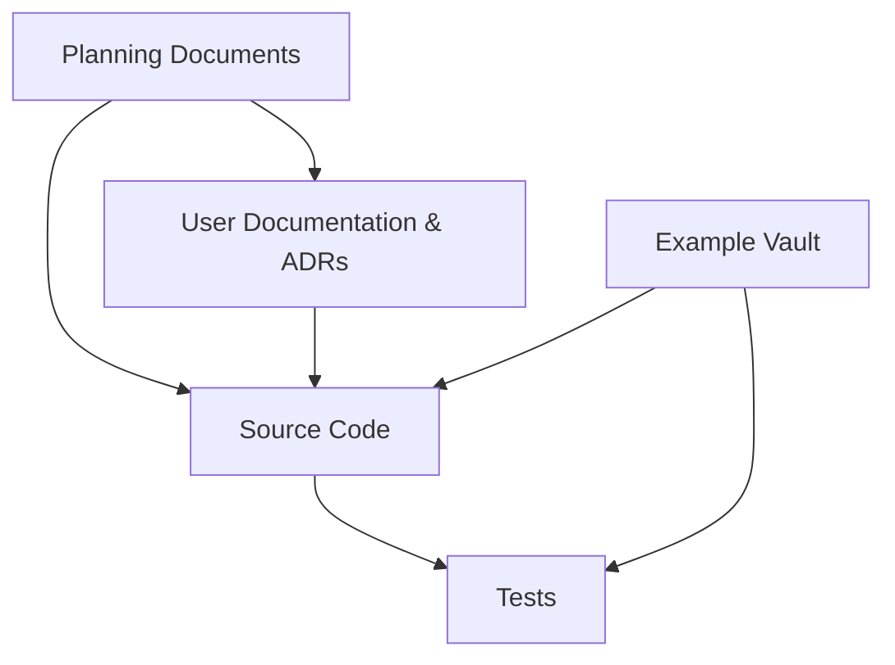

**Diagram sources**
- [planning/invariants.md:1-76](https://github.com/Kuldeep2822k/cli/blob/main/planning/invariants.md#L1-L76)
- [docs/08-0-planning-and-design-documents.md](https://github.com/Kuldeep2822k/cli/blob/main/docs/08-0-planning-and-design-documents.md)
- [src/index.ts](https://github.com/Kuldeep2822k/cli/blob/main/src/index.ts)
- [test/planning-invariant-ids.test.ts](https://github.com/Kuldeep2822k/cli/blob/main/test/planning-invariant-ids.test.ts)

**Section sources**
- [docs/08-0-planning-and-design-documents.md](https://github.com/Kuldeep2822k/cli/blob/main/docs/08-0-planning-and-design-documents.md)
- [docs/08-1-phase-1-specification-and-invariants.md](https://github.com/Kuldeep2822k/cli/blob/main/docs/08-1-phase-1-specification-and-invariants.md)
- [docs/08-2-future-ai-module-and-phase-2-design.md](https://github.com/Kuldeep2822k/cli/blob/main/docs/08-2-future-ai-module-and-phase-2-design.md)

## Core Planning Artifacts
The planning directory is the primary design surface. Each artifact has a distinct responsibility.

### Invariants
The invariant blueprint converts architectural intent into executable test targets. Every invariant uses a stable identifier rather than a line number. Categories include:

| Category | Responsibility |
|---|---|
| Storage | Frontmatter preservation, atomic writes, conflict detection, lock lifecycle, stale recovery, walker behavior, malformed-note tolerance. |
| SM-2 | Quality domain, ease-factor formula, minimum ease factor, rounding rules, repetition reset, interval progression, lapse semantics, calendar-day due dates. |
| Mastery and Graphs | Weighted mastery formula, archived exclusion, global mastery null state, missing-dependency blocking, cycle quarantine, unlock scoring bounds. |
| Resolution and CLI | Topic ID precedence, ambiguity handling, non-AI network isolation, JSON output purity. |
| Roadmaps | Deterministic import validation, guided interview inputs, proposal contents, pre-write confirmation, schema conformance. |
| AI and Sessions | LLM tool boundaries, assessment rejection, retry limits, no-execution policy for repaired JSON, anomaly-flagging rules, checkpoint recovery paths, hot-memory rebuild. |
| Auto-Chain and Wikilinks | Tier-0 hygiene, tier composition, ownership labeling, honest refusal, synthesized edge safety, cycle-safe synthesis, summary reporting. |

The invariant IDs are not decorative: tests assert their existence so future edits cannot silently drop or rename constraints.

**Section sources**
- [planning/invariants.md:1-76](https://github.com/Kuldeep2822k/cli/blob/main/planning/invariants.md#L1-L76)
- [test/planning-invariant-ids.test.ts](https://github.com/Kuldeep2822k/cli/blob/main/test/planning-invariant-ids.test.ts)

### Memory Design
Session memory is designed around three guarantees:

1. Obsidian remains the canonical store.
2. `.palee/hot.md` is a compact working-memory view, not complete history.
3. Confirmed sessions are durable individual notes under `.palee/sessions/`.

Key design elements:

| Element | Rule |
|---|---|
| Stable IDs | Topic IDs use `T-`, sessions use `S-`, and hot memory uses `H-active`. |
| Hot memory body | Human-readable body must stay at or below 250 words; YAML frontmatter is excluded from the word count. |
| Derived views | `hot.md` and `index.md` may be rebuilt from confirmed sessions. |
| Draft checkpoints | Draft sessions use `DRAFT-S-...` IDs and survive interruption. |
| Recovery options | Interactive mode offers Resume, Save as session, Discard, or Ignore; non-interactive mode never auto-discard. |
| Retrieval budget | AI receives hot memory by default and requests full sessions only by ID. |

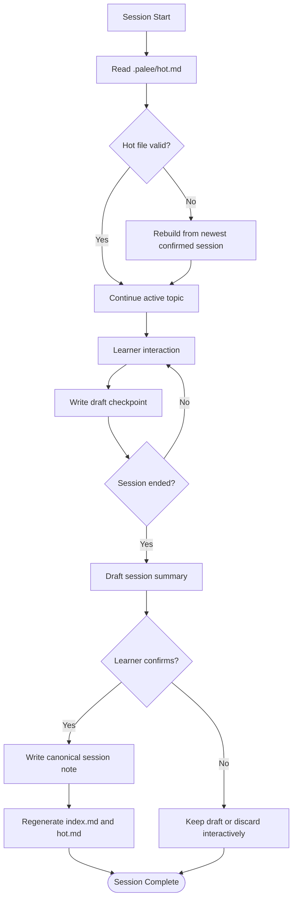

**Diagram sources**
- [planning/memory_design.md:1-118](https://github.com/Kuldeep2822k/cli/blob/main/planning/memory_design.md#L1-L118)

**Section sources**
- [planning/memory_design.md:1-118](https://github.com/Kuldeep2822k/cli/blob/main/planning/memory_design.md#L1-L118)

### Storage Architecture Plan
The storage plan treats the connected Obsidian vault as the source of truth and all internal caches as disposable. Its main contracts are:

| Contract | Intent |
|---|---|
| Concrete-syntax preservation | Only mutate PALEE-owned frontmatter keys; keep Markdown body, comments, unknown keys, ordering, and scalar styles intact. |
| Optimistic concurrency | Fingerprint target before and after modification; abort on conflict. |
| Locking | Exclusive PALEE locks protect concurrent writers; heartbeats cover long operations; stale locks are quarantined, not deleted. |
| Safe traversal | Default walker includes Markdown, skips dot-directories and symlinks, caps open handles, and reports unreadable files as warnings. |
| Caching | Cache entries combine path, size, mtime, and content fingerprint; recent mtime triggers a freshness check. |
| Validation | Validation errors stop mutations but allow read-only commands to continue where possible. |
| Checkpoints | Active sessions write recoverable drafts using the same atomic-write contract. |

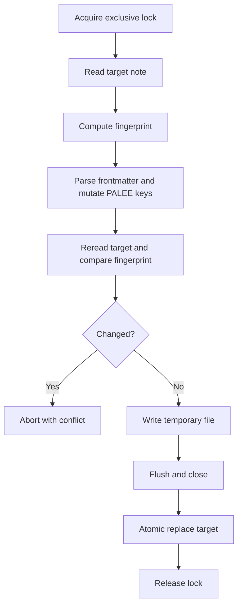

**Diagram sources**
- [planning/storage_design.md:1-111](https://github.com/Kuldeep2822k/cli/blob/main/planning/storage_design.md#L1-L111)

**Section sources**
- [planning/storage_design.md:1-111](https://github.com/Kuldeep2822k/cli/blob/main/planning/storage_design.md#L1-L111)

### CLI Specification
The CLI specification defines a layered system:

| Layer | Responsibility |
|---|---|
| Storage | Vault-native, deterministic, conflict-aware persistence. |
| Engine core | Pure functions for SM-2, dependency graphs, validation, mastery, and topic CRUD. |
| Mutation contract | Validated application APIs for assessments, reviews, sessions, and progress. |
| CLI layer | Deterministic commands that work without AI, network, or configuration. |
| AI module | Optional tutoring, Feynman testing, and guided roadmaps behind strict boundaries. |
| External-agent escape hatch | Optional MCP-style boundary around validated functions. |

Important behavioral constraints include:

- Non-AI commands must not open network sockets.
- `--json` or environment-controlled JSON output must exclude ANSI sequences.
- Exit codes distinguish usage, validation, conflict, and provider/network errors.
- Assessment and review remain independent domains.
- Global mastery is `null` when there are no active topics, never numeric zero.

**Section sources**
- [planning/palee_cli_spec.md:1-200](https://github.com/Kuldeep2822k/cli/blob/main/planning/palee_cli_spec.md#L1-L200)

### Roadmap Design
Roadmap support has two modes:

| Mode | Status | Behavior |
|---|---|---|
| Import from file | Implemented | Validates source, reports duplicates, missing dependencies, cycles, invalid difficulty, and unsafe destinations, then asks for confirmation before writing. |
| Guided personalization | Planned | Multi-turn interview collects goal, current level, weekly hours, target date, practice style, and constraints before generating a schema-constrained proposal. |

The guided proposal contract includes profile, ordered topics, dependencies, estimated effort, rationale, assumptions, and warnings. All changes flow through normal storage contracts; the AI never writes files directly.

**Section sources**
- [planning/roadmap_design.md:1-99](https://github.com/Kuldeep2822k/cli/blob/main/planning/roadmap_design.md#L1-L99)

### Example Workflows
The example workflow document describes end-to-end scenarios:

1. Configure provider and vault.
2. Adopt existing notes.
3. Use or generate a roadmap.
4. Run daily study with `next`, `plan`, and `progress`.
5. Maintain session continuity through hot memory and confirmed sessions.
6. Conduct Feynman testing and interactive tutoring (Phase 2).

These examples are intentionally aspirational where Phase 2 is not yet implemented, and they help reviewers judge whether a new command matches the intended UX.

**Section sources**
- [planning/example_workflows.md:1-200](https://github.com/Kuldeep2822k/cli/blob/main/planning/example_workflows.md#L1-L200)

### AI Module Design Exploration
The AI module is intentionally constrained:

- The LLM receives read-only tools and bounded context.
- Structured assessment proposals are model output, not LLM tools.
- All consequential mutations go through session-manager-only APIs.
- Learner confirmation is required before scores are persisted.
- Provider configuration lives in the shared config file with credential protection.
- Base URLs are normalized to HTTPS except loopback HTTP, with no query strings, fragments, or embedded userinfo.
- Prompt budgets are configurable and measured against the selected provider.

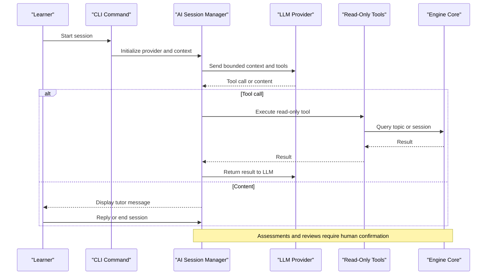

**Diagram sources**
- [planning/ai_module_design.md:1-200](https://github.com/Kuldeep2822k/cli/blob/main/planning/ai_module_design.md#L1-L200)
- [src/ai/provider.ts](https://github.com/Kuldeep2822k/cli/blob/main/src/ai/provider.ts)

**Section sources**
- [planning/ai_module_design.md:1-200](https://github.com/Kuldeep2822k/cli/blob/main/planning/ai_module_design.md#L1-L200)

### Phase 2 Gap Analysis
The Phase 2 gaps document captures what was planned versus what was shipped at a specific review point. It also records decisions already made during implementation, showing how planning evolves with code.

Key observations include:

- Some design gaps have been closed in code even though the gap document still references earlier behavior.
- Batch adopt, guided roadmap, and AI-driven commands were identified as missing or incomplete.
- Configuration behavior changed enough to warrant explicit verification against README examples.
- The gap document serves as a living bridge between design intent and implementation reality.

**Section sources**
- [planning/PHASE_2_GAPS.md:1-200](https://github.com/Kuldeep2822k/cli/blob/main/planning/PHASE_2_GAPS.md#L1-L200)

## Architecture Overview
At a high level, PALEE separates deterministic engine logic from optional AI behavior while keeping the Obsidian vault as the authoritative store.

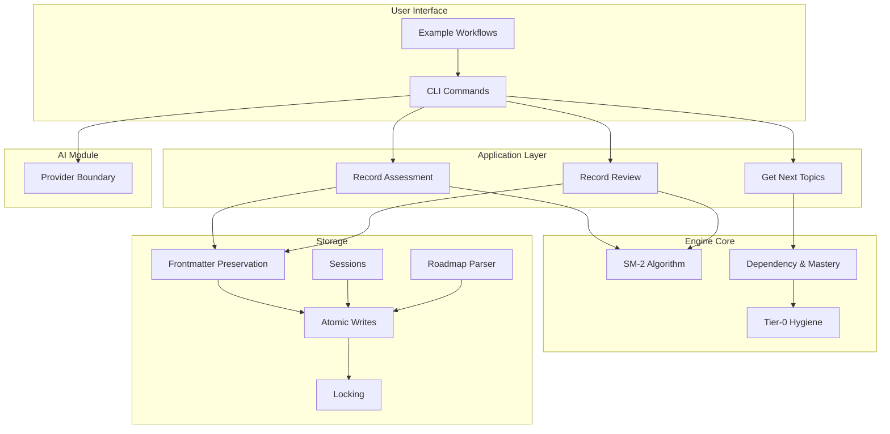

**Diagram sources**
- [planning/palee_cli_spec.md:1-200](https://github.com/Kuldeep2822k/cli/blob/main/planning/palee_cli_spec.md#L1-L200)
- [planning/storage_design.md:1-111](https://github.com/Kuldeep2822k/cli/blob/main/planning/storage_design.md#L1-L111)
- [planning/memory_design.md:1-118](https://github.com/Kuldeep2822k/cli/blob/main/planning/memory_design.md#L1-L118)
- [src/application/record-assessment.ts](https://github.com/Kuldeep2822k/cli/blob/main/src/application/record-assessment.ts)
- [src/application/record-review.ts](https://github.com/Kuldeep2822k/cli/blob/main/src/application/record-review.ts)
- [src/application/get-next-topics.ts](https://github.com/Kuldeep2822k/cli/blob/main/src/application/get-next-topics.ts)
- [src/engine/sm2.ts](https://github.com/Kuldeep2822k/cli/blob/main/src/engine/sm2.ts)
- [src/engine/tier0-hygiene.ts](https://github.com/Kuldeep2822k/cli/blob/main/src/engine/tier0-hygiene.ts)
- [src/storage/frontmatter.ts](https://github.com/Kuldeep2822k/cli/blob/main/src/storage/frontmatter.ts)
- [src/storage/atomic-write.ts](https://github.com/Kuldeep2822k/cli/blob/main/src/storage/atomic-write.ts)
- [src/storage/lock.ts](https://github.com/Kuldeep2822k/cli/blob/main/src/storage/lock.ts)
- [src/storage/sessions.ts](https://github.com/Kuldeep2822k/cli/blob/main/src/storage/sessions.ts)
- [src/storage/roadmap-parser.ts](https://github.com/Kuldeep2822k/cli/blob/main/src/storage/roadmap-parser.ts)
- [src/ai/provider.ts](https://github.com/Kuldeep2822k/cli/blob/main/src/ai/provider.ts)

## Detailed Component Analysis

### Invariants as Development Contracts
Invariants are the most important planning artifact for development priorities because they define failure conditions rather than just desired outcomes. They tell maintainers:

- Which behaviors are bugs even if no test currently exists.
- Which changes require regression coverage.
- Where implementation shortcuts are unacceptable.
- How to interpret ambiguous cases such as stale locks, missing prerequisites, or malformed notes.

For example, storage invariants prevent PALEE from becoming a fragile YAML serializer; SM-2 invariants prevent poor AI grading from silently corrupting schedules; auto-chain invariants prevent accidental prerequisite claims based on alphabetical filename order.

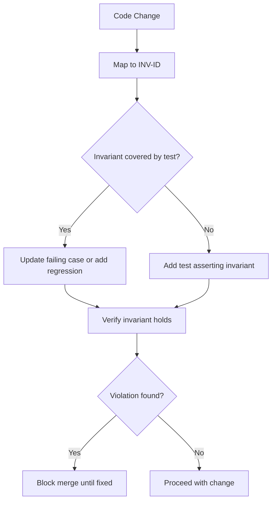

**Diagram sources**
- [planning/invariants.md:1-76](https://github.com/Kuldeep2822k/cli/blob/main/planning/invariants.md#L1-L76)
- [test/planning-invariant-ids.test.ts](https://github.com/Kuldeep2822k/cli/blob/main/test/planning-invariant-ids.test.ts)

**Section sources**
- [planning/invariants.md:1-76](https://github.com/Kuldeep2822k/cli/blob/main/planning/invariants.md#L1-L76)

### Storage Implementation Mapping
The storage plan maps closely to several concrete modules:

| Plan Element | Implementation Reference |
|---|---|
| Concrete-syntax frontmatter update | `src/storage/frontmatter.ts` |
| Atomic temp-file + rename write | `src/storage/atomic-write.ts` |
| Exclusive lock with heartbeat and stale recovery | `src/storage/lock.ts` |
| Session drafts and confirmed sessions | `src/storage/sessions.ts` |
| Roadmap import formats | `src/storage/roadmap-parser.ts` |
| Vault scanning and safe traversal | Storage scanner and related modules |
| Caching and fingerprint freshness | Storage cache and source-cap layers |

The strongest design-to-code relationship here is atomicity: the plan forbids truncation fallbacks, requires temporary-file replacement, and demands conflict detection; the implementation must enforce those constraints in every mutation path.

**Section sources**
- [planning/storage_design.md:1-111](https://github.com/Kuldeep2822k/cli/blob/main/planning/storage_design.md#L1-L111)
- [src/storage/frontmatter.ts](https://github.com/Kuldeep2822k/cli/blob/main/src/storage/frontmatter.ts)
- [src/storage/atomic-write.ts](https://github.com/Kuldeep2822k/cli/blob/main/src/storage/atomic-write.ts)
- [src/storage/lock.ts](https://github.com/Kuldeep2822k/cli/blob/main/src/storage/lock.ts)
- [src/storage/sessions.ts](https://github.com/Kuldeep2822k/cli/blob/main/src/storage/sessions.ts)
- [src/storage/roadmap-parser.ts](https://github.com/Kuldeep2822k/cli/blob/main/src/storage/roadmap-parser.ts)

### CLI Implementation Mapping
The CLI specification defines commands that should exist independently of AI. The actual command files in `src/cli/` show which parts are implemented and which are placeholders or later additions.

| Spec Command | Likely Implementation File | Notes |
|---|---|---|
| `palee plan` | `src/cli/plan.ts` | Generates study sessions using engine recommendations. |
| `palee next` | `src/cli/next.ts` | Recommends the next action. |
| `palee progress` | Related dashboard or analytics command | Reports mastery and status. |
| `palee roadmap --from <file>` | `src/cli/roadmap.ts` | Imports and validates a user-provided roadmap. |
| `palee adopt` | `src/cli/adopt.ts` | Adds PALEE frontmatter to notes. |
| `palee review` | `src/cli/review.ts` | Records SM-2 review results. |
| `palee session start/end` | `src/cli/session.ts` | Manages hot memory and session drafts. |
| `palee config set-provider` | `src/cli/config.ts` | Configures AI provider connection. |
| `palee validate` | `src/cli/validate.ts` | Runs validation rules. |
| `palee assess` | `src/cli/assess.ts` | Records assessment scores. |
| Other operational commands | `src/cli/update.ts`, `src/cli/update-check.ts`, etc. | Lifecycle and maintenance operations. |

The entry points connect the CLI layer to the application and engine layers. `bin/palee.ts` is the executable bootstrap, and `src/index.ts` exports the library surface.

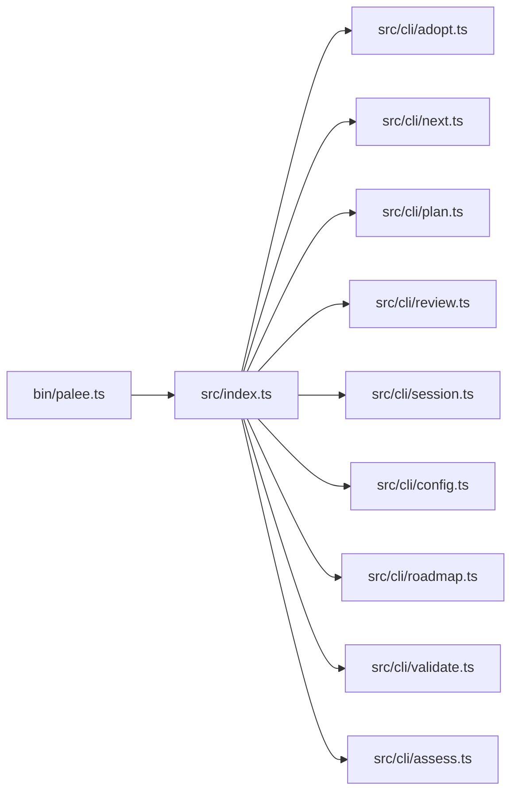

**Diagram sources**
- [bin/palee.ts](https://github.com/Kuldeep2822k/cli/blob/main/bin/palee.ts)
- [src/index.ts](https://github.com/Kuldeep2822k/cli/blob/main/src/index.ts)
- [src/cli/adopt.ts](https://github.com/Kuldeep2822k/cli/blob/main/src/cli/adopt.ts)
- [src/cli/next.ts](https://github.com/Kuldeep2822k/cli/blob/main/src/cli/next.ts)
- [src/cli/plan.ts](https://github.com/Kuldeep2822k/cli/blob/main/src/cli/plan.ts)
- [src/cli/review.ts](https://github.com/Kuldeep2822k/cli/blob/main/src/cli/review.ts)
- [src/cli/session.ts](https://github.com/Kuldeep2822k/cli/blob/main/src/cli/session.ts)
- [src/cli/config.ts](https://github.com/Kuldeep2822k/cli/blob/main/src/cli/config.ts)
- [src/cli/roadmap.ts](https://github.com/Kuldeep2822k/cli/blob/main/src/cli/roadmap.ts)
- [src/cli/validate.ts](https://github.com/Kuldeep2822k/cli/blob/main/src/cli/validate.ts)
- [src/cli/assess.ts](https://github.com/Kuldeep2822k/cli/blob/main/src/cli/assess.ts)

**Section sources**
- [planning/palee_cli_spec.md:1-200](https://github.com/Kuldeep2822k/cli/blob/main/planning/palee_cli_spec.md#L1-L200)
- [bin/palee.ts](https://github.com/Kuldeep2822k/cli/blob/main/bin/palee.ts)
- [src/index.ts](https://github.com/Kuldeep2822k/cli/blob/main/src/index.ts)

### Memory-to-Storage Flow
The memory design flows into storage through session creation, draft checkpoints, and derived view regeneration. The critical contract is that confirmed sessions are more durable than derived views.

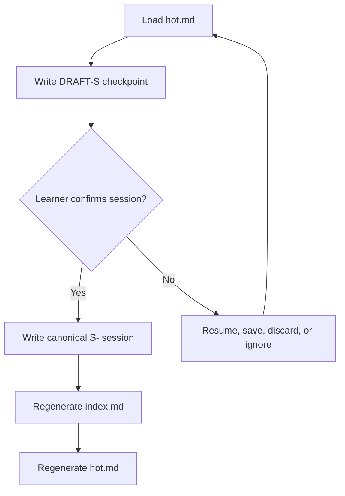

**Diagram sources**
- [planning/memory_design.md:1-118](https://github.com/Kuldeep2822k/cli/blob/main/planning/memory_design.md#L1-L118)
- [src/storage/sessions.ts](https://github.com/Kuldeep2822k/cli/blob/main/src/storage/sessions.ts)

**Section sources**
- [planning/memory_design.md:1-118](https://github.com/Kuldeep2822k/cli/blob/main/planning/memory_design.md#L1-L118)
- [src/storage/sessions.ts](https://github.com/Kuldeep2822k/cli/blob/main/src/storage/sessions.ts)

### Roadmap Import Flow
Roadmap import is one of the clearest examples of planning driving implementation: the spec says import must be deterministic, validated before mutation, and confirmed by the learner. The roadmap parser extends this by supporting multiple input formats, including Markdown frontmatter and wikilink lists.

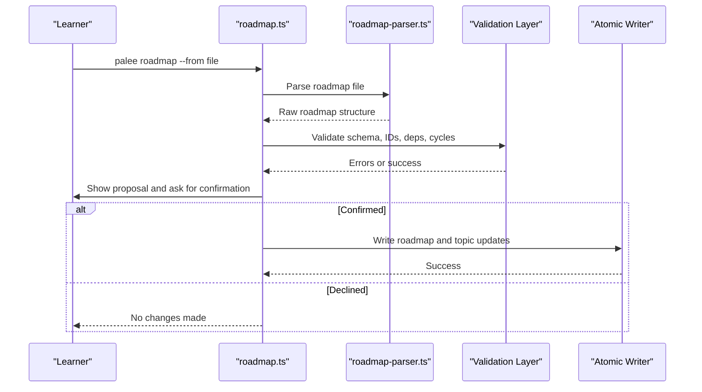

**Diagram sources**
- [planning/roadmap_design.md:1-99](https://github.com/Kuldeep2822k/cli/blob/main/planning/roadmap_design.md#L1-L99)
- [src/cli/roadmap.ts](https://github.com/Kuldeep2822k/cli/blob/main/src/cli/roadmap.ts)
- [src/storage/roadmap-parser.ts](https://github.com/Kuldeep2822k/cli/blob/main/src/storage/roadmap-parser.ts)

**Section sources**
- [planning/roadmap_design.md:1-99](https://github.com/Kuldeep2822k/cli/blob/main/planning/roadmap_design.md#L1-L99)
- [src/cli/roadmap.ts](https://github.com/Kuldeep2822k/cli/blob/main/src/cli/roadmap.ts)
- [src/storage/roadmap-parser.ts](https://github.com/Kuldeep2822k/cli/blob/main/src/storage/roadmap-parser.ts)

### AI Module Boundary
The AI module design explicitly separates read-only context access from mutation execution. This prevents the LLM from directly updating SM-2 state, assessment values, or session records.

```mermaid
classDiagram
    class CLICommand {
        +start()
        +end()
    }

    class AISessionManager {
        +initializeProvider()
        +loadContext()
        +executeToolCall(call)
        +proposeMutation(proposal)
        +confirmMutation(user)
    }

    class ProviderBoundary {
        +normalizeEndpoint()
        +sendRequest(context)
        +parseResponse()
    }

    class EngineTools {
        +getTopic(id)
        +getHotMemory()
        +getSession(id)
    }

    class MutationAPI {
        +recordAssessment(data)
        +recordReview(data)
        +saveSession(data)
    }

    CLICommand --> AISessionManager : "uses"
    AISessionManager --> ProviderBoundary : "calls"
    AISessionManager --> EngineTools : "read-only"
    AISessionManager --> MutationAPI : "confirmed mutations only"
```

**Diagram sources**
- [planning/ai_module_design.md:1-200](https://github.com/Kuldeep2822k/cli/blob/main/planning/ai_module_design.md#L1-L200)
- [src/ai/provider.ts](https://github.com/Kuldeep2822k/cli/blob/main/src/ai/provider.ts)
- [src/application/record-assessment.ts](https://github.com/Kuldeep2822k/cli/blob/main/src/application/record-assessment.ts)
- [src/application/record-review.ts](https://github.com/Kuldeep2822k/cli/blob/main/src/application/record-review.ts)

**Section sources**
- [planning/ai_module_design.md:1-200](https://github.com/Kuldeep2822k/cli/blob/main/planning/ai_module_design.md#L1-L200)
- [src/ai/provider.ts](https://github.com/Kuldeep2822k/cli/blob/main/src/ai/provider.ts)
- [src/application/record-assessment.ts](https://github.com/Kuldeep2822k/cli/blob/main/src/application/record-assessment.ts)
- [src/application/record-review.ts](https://github.com/Kuldeep2822k/cli/blob/main/src/application/record-review.ts)

## Dependency Analysis
The planning documents form a layered dependency chain:

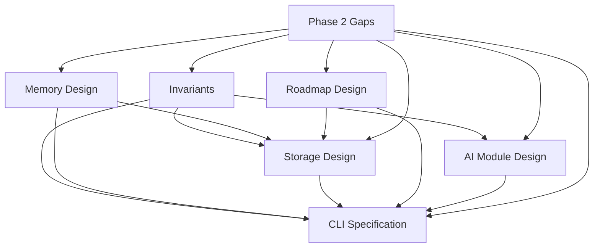

This shows that Phase 2 gaps depend on all other planning artifacts, while invariants and storage design are foundational. New features should first be checked against invariants, then mapped to storage and CLI contracts, and finally assessed for AI boundary compliance.

**Diagram sources**
- [planning/invariants.md:1-76](https://github.com/Kuldeep2822k/cli/blob/main/planning/invariants.md#L1-L76)
- [planning/memory_design.md:1-118](https://github.com/Kuldeep2822k/cli/blob/main/planning/memory_design.md#L1-L118)
- [planning/storage_design.md:1-111](https://github.com/Kuldeep2822k/cli/blob/main/planning/storage_design.md#L1-L111)
- [planning/palee_cli_spec.md:1-200](https://github.com/Kuldeep2822k/cli/blob/main/planning/palee_cli_spec.md#L1-L200)
- [planning/roadmap_design.md:1-99](https://github.com/Kuldeep2822k/cli/blob/main/planning/roadmap_design.md#L1-L99)
- [planning/ai_module_design.md:1-200](https://github.com/Kuldeep2822k/cli/blob/main/planning/ai_module_design.md#L1-L200)
- [planning/PHASE_2_GAPS.md:1-200](https://github.com/Kuldeep2822k/cli/blob/main/planning/PHASE_2_GAPS.md#L1-L200)

**Section sources**
- [planning/invariants.md:1-76](https://github.com/Kuldeep2822k/cli/blob/main/planning/invariants.md#L1-L76)
- [planning/PHASE_2_GAPS.md:1-200](https://github.com/Kuldeep2822k/cli/blob/main/planning/PHASE_2_GAPS.md#L1-L200)

## Performance Considerations
From the planning perspective, performance is not just speed; it is also bounded resource use and predictable failure behavior.

Key considerations:

- **Vault traversal**: Streaming walkers with bounded concurrency avoid exhausting file descriptors.
- **Caching**: Content fingerprints guard against filesystem timestamp races.
- **Prompt budget**: AI context windows must be bounded, summarized, and measured per provider.
- **Lock heartbeats**: Long-running operations should keep locks alive without holding excessive memory.
- **Derived views**: Hot memory is intentionally small to keep prompts manageable.
- **Retry policies**: Transient Windows lock failures are retried, but retries must not bypass conflict detection.

These are not optimization goals alone; many are safety requirements. For example, unbounded AI context could cause prompt overflow, failed retries could overwrite vault files, and large vault scans could hang CI jobs.

[No sources needed since this section provides general guidance]

## Troubleshooting Guide
When diagnosing issues, start by matching symptoms to planning artifacts.

| Symptom | Primary Planning Artifact | Investigation Path |
|---|---|---|
| Frontmatter loses comments or reorders keys | Storage design, invariants INV-01/INV-02 | Inspect frontmatter preservation and AST-level mutation. |
| Concurrent writers fail with conflict | Storage design, invariants INV-03–INV-09 | Check fingerprint comparison, lock acquisition, and retry behavior. |
| Stale lock blocks operation | Storage design, invariants INV-05/INV-06 | Verify quarantine, staleness timeout, and heartbeat interval. |
| AI proposes invalid scores | AI module design, invariants INV-37–INV-41 | Validate structured output, score ranges, and anomaly flagging. |
| Session restart loses context | Memory design, invariants INV-43/INV-45 | Check draft recovery, hot-memory rebuild, and session references. |
| Roadmap import fails unexpectedly | Roadmap design, invariants INV-31–INV-36 | Inspect parser support, schema validation, and cycle detection. |
| Auto-chain creates wrong edges | Invariants INV-46/INV-47, Tier-0 hygiene | Check hygiene classification, tier precedence, and `depends_on_source`. |

Practical troubleshooting steps:

1. Identify the affected invariant or contract.
2. Determine whether the issue is deterministic engine behavior, storage mutation, CLI interface, or AI boundary violation.
3. Check whether the failure path preserves vault integrity.
4. Prefer adding a failing test before changing implementation.
5. If the gap document differs from current behavior, treat the gap document as a design snapshot, not the sole source of truth.

**Section sources**
- [planning/storage_design.md:1-111](https://github.com/Kuldeep2822k/cli/blob/main/planning/storage_design.md#L1-L111)
- [planning/memory_design.md:1-118](https://github.com/Kuldeep2822k/cli/blob/main/planning/memory_design.md#L1-L118)
- [planning/invariants.md:1-76](https://github.com/Kuldeep2822k/cli/blob/main/planning/invariants.md#L1-L76)
- [planning/ai_module_design.md:1-200](https://github.com/Kuldeep2822k/cli/blob/main/planning/ai_module_design.md#L1-L200)
- [planning/roadmap_design.md:1-99](https://github.com/Kuldeep2822k/cli/blob/main/planning/roadmap_design.md#L1-L99)
- [planning/PHASE_2_GAPS.md:1-200](https://github.com/Kuldeep2822k/cli/blob/main/planning/PHASE_2_GAPS.md#L1-L200)

## Conclusion
PALEE’s planning documents form a coherent contract surface:

- **Invariants** define correctness boundaries that must hold regardless of feature growth.
- **Memory design** ensures session continuity without making the AI responsible for vault integrity.
- **Storage design** protects the Obsidian vault from partial writes, silent conflicts, and fragile YAML round-trips.
- **CLI specification** keeps deterministic learning workflows usable without AI.
- **Roadmap design** supports both manual planning and guided personalization.
- **AI module design** constrains models to read-only context and validated proposals.
- **Phase 2 gaps** track where design intent has not yet reached production.

The strongest signal for development priority is not feature visibility, but invariant coverage and data safety. When a new design touches storage, scheduling, AI, or session continuity, it should be traced back to its invariant, mapped to the relevant planning artifact, and verified against both tests and the Phase 2 gap list.

[No sources needed since this section summarizes without analyzing specific files]