# Architecture Overview

::: details Referenced Files in This Document

- [README.md](https://github.com/Kuldeep2822k/cli/blob/main/README.md)
- [package.json](https://github.com/Kuldeep2822k/cli/blob/main/package.json)
- [bin/palee.ts](https://github.com/Kuldeep2822k/cli/blob/main/bin/palee.ts)
- [src/index.ts](https://github.com/Kuldeep2822k/cli/blob/main/src/index.ts)
- [src/types.ts](https://github.com/Kuldeep2822k/cli/blob/main/src/types.ts)
- [src/cli/config.ts](https://github.com/Kuldeep2822k/cli/blob/main/src/cli/config.ts)
- [src/cli/exit-codes.ts](https://github.com/Kuldeep2822k/cli/blob/main/src/cli/exit-codes.ts)
- [src/cli/next.ts](https://github.com/Kuldeep2822k/cli/blob/main/src/cli/next.ts)
- [src/application/get-next-topics.ts](https://github.com/Kuldeep2822k/cli/blob/main/src/application/get-next-topics.ts)
- [src/engine/index.ts](https://github.com/Kuldeep2822k/cli/blob/main/src/engine/index.ts)
- [src/storage/index.ts](https://github.com/Kuldeep2822k/cli/blob/main/src/storage/index.ts)
- [src/storage/atomic-write.ts](https://github.com/Kuldeep2822k/cli/blob/main/src/storage/atomic-write.ts)
- [src/storage/containment.ts](https://github.com/Kuldeep2822k/cli/blob/main/src/storage/containment.ts)
- [src/validation/index.ts](https://github.com/Kuldeep2822k/cli/blob/main/src/validation/index.ts)
- [docs/01-2-architecture-overview.md](https://github.com/Kuldeep2822k/cli/blob/main/docs/01-2-architecture-overview.md)
- [docs/03-0-engine-core.md](https://github.com/Kuldeep2822k/cli/blob/main/docs/03-0-engine-core.md)
- [docs/04-0-storage-layer.md](https://github.com/Kuldeep2822k/cli/blob/main/docs/04-0-storage-layer.md)
- [docs/05-0-data-model-and-types.md](https://github.com/Kuldeep2822k/cli/blob/main/docs/05-0-data-model-and-types.md)
- [docs/adr/0002-atomic-file-locking-and-occ.md](https://github.com/Kuldeep2822k/cli/blob/main/docs/adr/0002-atomic-file-locking-and-occ.md)

:::

## Table of Contents
1. [Introduction](#introduction)
2. [Project Structure](#project-structure)
3. [Core Components](#core-components)
4. [Architecture Overview](#architecture-overview)
5. [Detailed Component Analysis](#detailed-component-analysis)
6. [Dependency Analysis](#dependency-analysis)
7. [Performance Considerations](#performance-considerations)
8. [Security Model and System Boundaries](#security-model-and-system-boundaries)
9. [Concurrency, Atomicity, and Containment](#concurrency-atomicity-and-containment)
10. [Validation Framework](#validation-framework)
11. [Data Flow from User Input to Storage](#data-flow-from-user-input-to-storage)
12. [Technology Stack](#technology-stack)
13. [Deployment Topology and Infrastructure Requirements](#deployment-topology-and-infrastructure-requirements)
14. [Extension Points and Future Capabilities](#extension-points-and-future-capabilities)
15. [Troubleshooting Guide](#troubleshooting-guide)
16. [Conclusion](#conclusion)
17. [References](#references)

## Introduction
PALEE is a Personal Active Learning & Evaluation Engine that turns an Obsidian vault into a deterministic study workspace. It reads Markdown notes with YAML frontmatter, computes spaced-repetition schedules using SuperMemo SM-2, evaluates four-pillar mastery, and enforces prerequisite dependencies through a directed acyclic graph. The CLI is the user-facing boundary; the engine is pure computation; the storage layer owns filesystem operations safely; and the validation layer audits vault integrity.

The high-level design principles are:
- Layered architecture with strict downward dependency direction (the rule is stated in full under [Dependency Analysis](#dependency-analysis)).
- Domain-driven design: domain concepts such as `Topic`, `Assessment`, `Review`, sessions, and mastery are modeled explicitly in shared types.
- Separation of concerns: command parsing and terminal output belong in CLI; scheduling and readiness logic belong in application and engine; persistence, locking, caching, and vault traversal belong in storage.
- Vault-first data model: the Obsidian vault is the source of truth; PALEE does not introduce a separate database for topic state.
- Deterministic core: engine algorithms produce identical outputs for identical inputs and avoid I/O.

## Project Structure
The repository root separates the executable entry point, runtime source, documentation, planning artifacts, architecture models, tests, examples, and release scripts. The runtime package is published as `@kuldeep2822k/palee`, ships compiled JavaScript under `dist`, and exposes a `palee` binary.

```text
cli/
├── bin/
│   └── palee.ts          Entry point: Commander registration, exit-code tail, update notice
├── src/
│   ├── index.ts          Library barrel re-exporting the public contract
│   ├── types.ts          Shared domain models, CLI option types, config and session schemas
│   ├── cli/              Command handlers, config management, exit codes, update check
│   ├── application/      Use-case orchestration (next topics, review and assessment recording)
│   ├── engine/           Pure computation: SM-2, mastery, dependency graph, TOC chains, topic IDs
│   ├── storage/          Filesystem boundary: vault walking, frontmatter, locking, atomic writes, cache, sessions
│   ├── validation/       Vault audit framework: collector, ordered rule catalog, formatters
│   └── ai/               Optional AI provider boundary; the only module that opens network sockets
├── docs/                 Numbered documentation set (01-09) plus adr/ with the decision records
├── architecture/         Architecture model (Structurizr DSL), dependency graphs, audit evidence
├── planning/             Phase specifications and the invariant catalog (INV-01 and onward)
├── test/                 Node test runner suites: unit, integration, e2e, and fuzz coverage
├── examples/             Sample vault notes used by documentation and tests
├── scripts/              Release tooling: package packing, tarball verification, installed smoke test
├── assets/               Project images and logos
├── package.json          Package manifest for @kuldeep2822k/palee; declares the palee binary
└── dist/                 Compiled JavaScript build output shipped by npm
```

Each `src/` subdirectory corresponds to one layer in the Core Components table below; `docs/` and `planning/` hold the written contracts (architecture documents, ADRs, and invariants) that the code is checked against.

## Core Components
PALEE is organized around five import-reachable layers plus shared types and optional AI integration:

| Layer | Responsibility | Primary Source |
|---|---|---|
| CLI | Command registration, argument parsing, terminal or JSON output, error mapping | [bin/palee.ts](https://github.com/Kuldeep2822k/cli/blob/main/bin/palee.ts), [src/cli/*.ts](https://github.com/Kuldeep2822k/cli/blob/main/src/cli/next.ts) |
| Application | Pure use-case orchestration such as next-topic selection, review updates, assessment summaries | [src/application/get-next-topics.ts](https://github.com/Kuldeep2822k/cli/blob/main/src/application/get-next-topics.ts) |
| Engine | Spaced repetition, mastery calculation, dependency graph analysis | [src/engine/index.ts](https://github.com/Kuldeep2822k/cli/blob/main/src/engine/index.ts) |
| Storage | Vault walking, frontmatter parsing, locking, atomic writes, session memory, caching | [src/storage/index.ts](https://github.com/Kuldeep2822k/cli/blob/main/src/storage/index.ts) |
| Validation | Vault collection, rule execution, issue formatting, fixability classification | [src/validation/index.ts](https://github.com/Kuldeep2822k/cli/blob/main/src/validation/index.ts) |
| Shared Types | Domain models, CLI options, configuration, errors, session schemas | [src/types.ts](https://github.com/Kuldeep2822k/cli/blob/main/src/types.ts) |

The library barrel at [src/index.ts](https://github.com/Kuldeep2822k/cli/blob/main/src/index.ts) re-exports domain types, engine, storage, and validation subsystems so consumers can import the public contract without coupling to internal module layout.

## Architecture Overview
The diagram below shows the system boundaries; the dependency rules behind it are stated once, under [Dependency Analysis](#dependency-analysis):

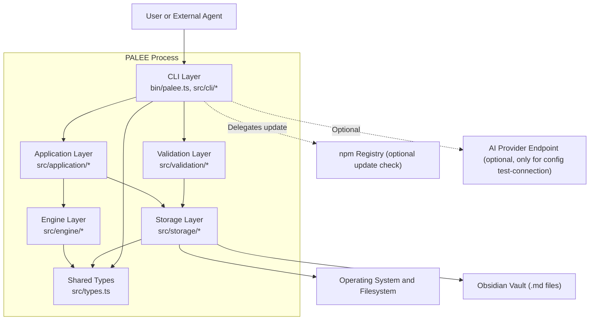

The architecture emphasizes:
- **Vault as source of truth**: Notes are Markdown with YAML frontmatter. No secondary database holds topic state.
- **Deterministic computation**: Engine functions are side-effect free and testable in isolation.
- **Safe persistence**: All mutations go through storage abstractions that enforce containment, locking, and atomic replacement.
- **Auditable integrity**: Validation rules run in a fixed order and produce structured findings rather than ad hoc console warnings.

## Detailed Component Analysis

### CLI Layer
The CLI is the process boundary. Its responsibilities include:
- Registering commands through Commander.
- Deriving the invoked program name so help text matches the actual binary.
- Loading per-user or environment-scoped configuration.
- Validating vault paths and options.
- Calling application or validation services.
- Formatting human-readable or JSON output.
- Mapping exceptions to documented exit codes.

Key implementation details:
- Entry point: [bin/palee.ts](https://github.com/Kuldeep2822k/cli/blob/main/bin/palee.ts).
- Program-name resolution: [src/cli/program-name.ts](https://github.com/Kuldeep2822k/cli/blob/main/src/cli/program-name.ts).
- Configuration management: [src/cli/config.ts](https://github.com/Kuldeep2822k/cli/blob/main/src/cli/config.ts).
- Exit-code contract: [src/cli/exit-codes.ts](https://github.com/Kuldeep2822k/cli/blob/main/src/cli/exit-codes.ts).
- Read-only example command: [src/cli/next.ts](https://github.com/Kuldeep2822k/cli/blob/main/src/cli/next.ts).

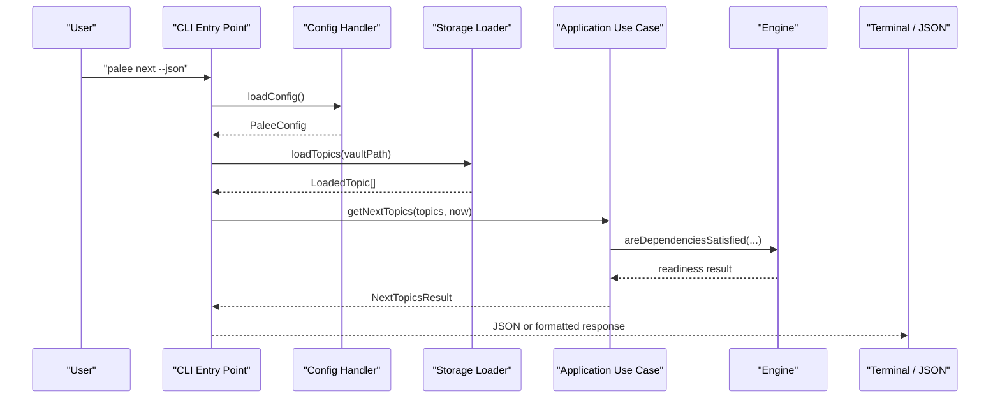

### Application Layer
The application layer encapsulates business workflows that combine storage reads and engine computations without touching Commander or process globals. The primary example is next-topic selection:

- Receives topics already loaded by the CLI via storage; it performs no I/O itself.
- It partitions due and never-reviewed candidates.
- It applies the prerequisite gate using the engine.
- It returns actionable topics and explains blocked topics.

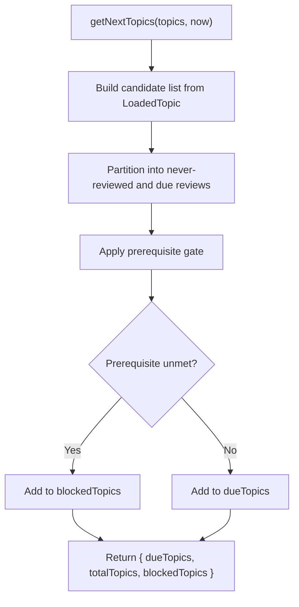

### Engine Layer
The engine is the deterministic core. It provides:
- SM-2 spaced repetition scheduling.
- Four-pillar mastery computation.
- Dependency graph operations including cycle detection, readiness evaluation, and canonical dependency extraction.

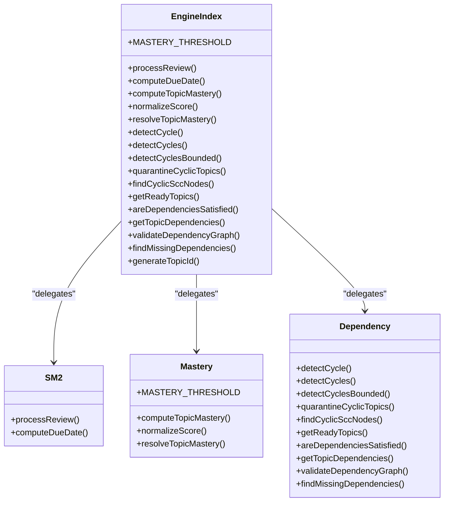

### Storage Layer
The storage layer is the single boundary over the filesystem. Its public API bundles vault traversal, frontmatter manipulation, locking, atomic writes, caching, roadmap parsing, pattern matching, TOC discovery, session memory, and topic loading.

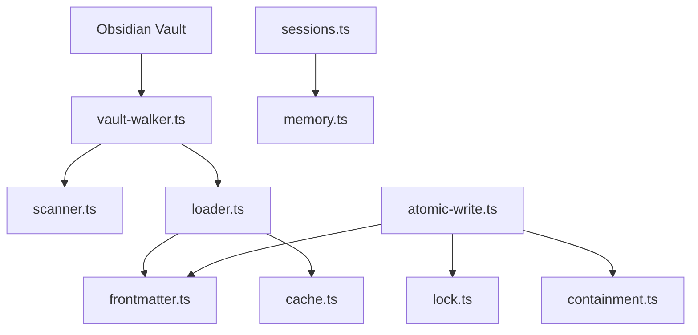

### Validation Layer
The validation layer runs a fixed catalog of rules over collected vault entities. Its role is to audit data integrity, classify severity and fixability, and produce deterministic output suitable for humans and machines.

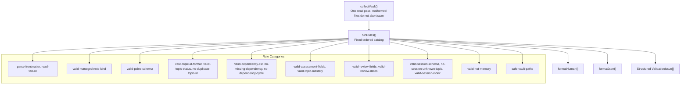

## Dependency Analysis
The dependency direction is intentionally restrictive:

- CLI depends on application, validation, shared types, and configuration helpers, plus the storage error guards and the AI ProviderError type, used only by the exit-code mapper.
- Application depends on engine and storage.
- Validation depends on storage reads and shared types.
- Engine depends primarily on shared types and pure algorithm modules, with one named boundary exception: `src/engine/sm2.ts` imports `formatDiagnosticValue` from `../validation/rules/diagnostic-value` (engine -> validation).
- Storage depends on Node.js filesystem APIs and shared types.
- No layer imports its caller.

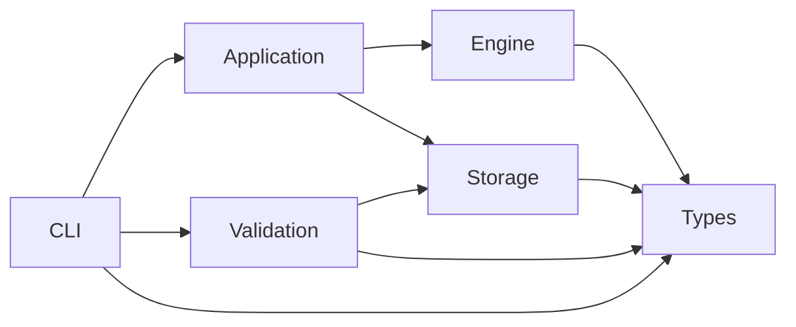

## Performance Considerations
Performance is primarily addressed by the storage layer's read path and cache:

- `walkVault` discovers markdown files while ignoring internal directories.
- `FileCache` tracks metadata and uses an unsettled horizon to force fingerprint verification shortly after changes.
- SHA-256 fallback preserves cache entries when file modification times shift without content changes.
- Engine computations operate on plain objects and are CPU-bound but small enough for interactive CLI workloads.
- Concurrency control avoids long-held locks; lock acquisition is bounded, and OCC retries short-lived conflicts.

Optimization opportunities should preserve the existing contracts:
- Keep engine functions pure and side-effect free.
- Avoid adding network calls to hot read paths.
- Treat `FileCache` as performance-only; it must be deletable without changing behavior.
- Do not replace the vault-first model with an in-process database.

## Security Model and System Boundaries
The security model centers on three boundaries:

1. **Vault containment**: Write destinations must resolve inside the configured vault root. Escape attempts raise a dedicated containment error (`ECONTAINMENT`) rather than a retryable conflict. Containment is its own error category, but not its own exit code: the exit-code mapper (`exitCodeFor` in `src/cli/exit-codes.ts`) classifies a containment refusal as a validation failure, so it exits with code `3`.
2. **Credential handling**: API keys are stored securely on POSIX (`0600`) and refused outside safe profile roots on Windows unless explicitly overridden. Keys are never printed.
3. **Network boundary**: Only `config test-connection` reaches a provider endpoint directly. Only the update path (`update.ts` and `update-check.ts`, which spawn npm) delegates update checks to npm; other commands do not open network sockets themselves.

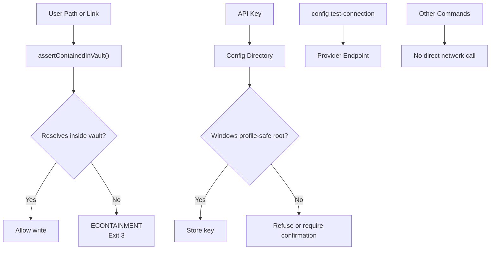

## Concurrency, Atomicity, and Containment
PALEE implements a two-tier synchronization mechanism for vault writes, as decided in ADR-0002:

1. **Tier 1 — Cross-process mutex**: Directory-based locking under `.palee/locks/` (one target-hashed lock directory per file) prevents concurrent PALEE writers from stepping on each other. Heartbeats allow stale-lock recovery.
2. **Tier 2 — Optimistic concurrency control and atomic overwrite**: Before writing, the expected SHA-256 content fingerprint is validated; a mismatch raises a conflict error mapped to exit code `4`. The write itself goes to a unique temporary file, is flushed with `fsync`, and is then atomically renamed over the destination.

Two supporting behaviors sit around the tiers; they are not synchronization tiers themselves:

- **Stale temp reclaim**: Crashed writers may leave temporary files; the current writer reclaims only its own abandoned temps after staleness and owner liveness checks.
- **Containment refusal**: A precondition of every write rather than a synchronization mechanism — any resolved destination outside the vault is rejected with the dedicated containment error (`ECONTAINMENT`), which the exit-code mapper classifies as a validation failure (exit code `3`; see Security Model and System Boundaries).

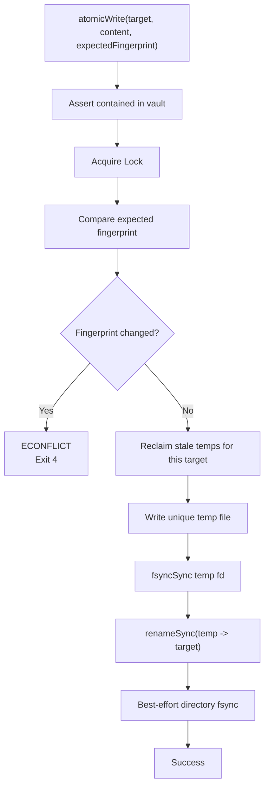

## Validation Framework
The validation framework is an auditable pipeline:

1. **Collection**: One pass over the vault collects managed notes and records malformed files without aborting the entire scan.
2. **Execution**: Rules run in a fixed, documented order so output is deterministic.
3. **Classification**: Each finding has severity and fixability information.
4. **Formatting**: Human and JSON formatters support both interactive users and automation.

The canonical rule catalog includes parse/read failures, managed-note kind, schema version, identity, topic status, dependency shape, missing dependencies, cycles, assessment fields, mastery consistency, review fields, review dates, session schema, unknown session references, session index, hot memory, and safe vault paths.

## Data Flow from User Input to Storage
A typical write flow, such as recording a review, moves through the following stages:

1. CLI parses arguments and validates vault configuration.
2. Storage loader reads topics from the vault, optionally using cache.
3. Application transforms user input into an update payload.
4. Engine computes new SM-2 state and mastery.
5. Storage performs containment check, locking, fingerprint verification, atomic write, and cleanup.

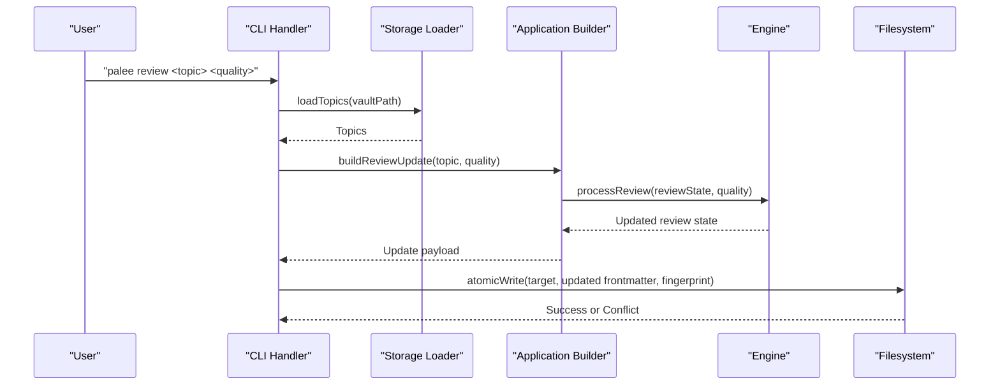

## Technology Stack
PALEE is a Node.js application written in TypeScript:

| Concern | Choice | Reason |
|---|---|---|
| Runtime | Node.js >= 22.12.0 | Modern ECMAScript features, stable CLI tooling, broad platform support |
| Language | TypeScript | Strong typing for domain models, safer refactoring, shared type contracts |
| CLI Framework | Commander | Declarative command registration and option parsing |
| YAML Parsing | YAML | Reads and writes YAML frontmatter used by Obsidian notes |
| Persistence | Markdown + YAML frontmatter | Vault-first design keeps data human-readable and portable |
| Test Runner | Node test runner with TSX | Fast unit, integration, and e2e testing with no test-framework dependency beyond the tsx loader (devDependency) |

## Deployment Topology and Infrastructure Requirements
PALEE is deployed as a local CLI tool installed through npm. The topology is simple because it does not run a server.

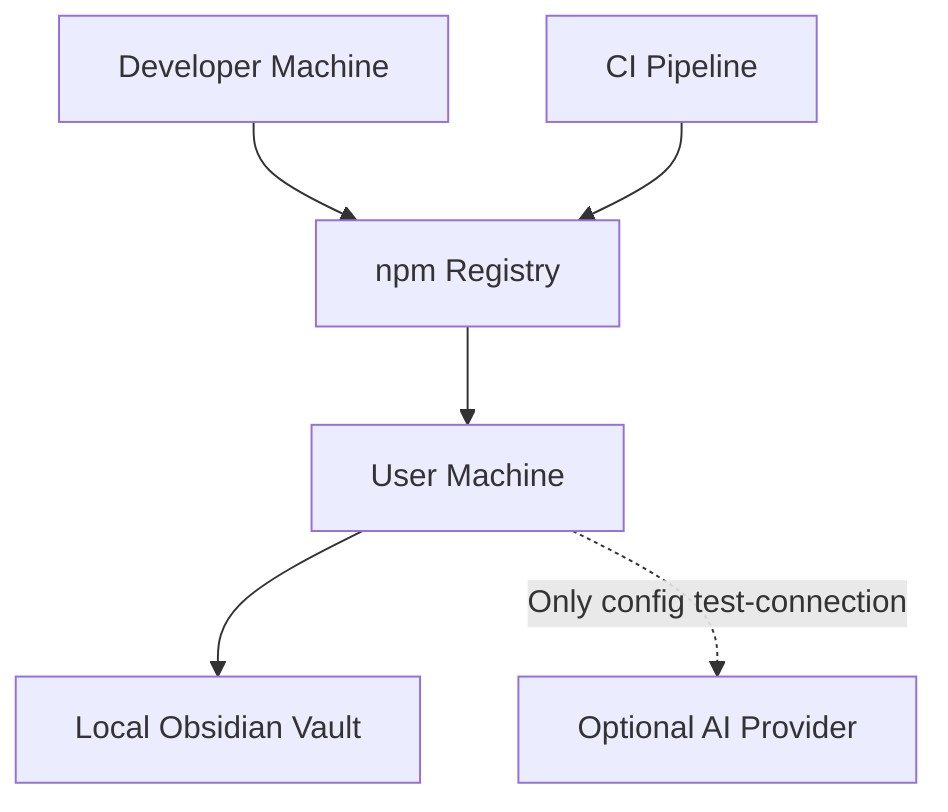

Infrastructure requirements:
- Node.js >= 22.12.0.
- A writable local filesystem containing an Obsidian vault.
- Optional network access only for `palee update` (delegated to npm) and `palee config test-connection`.
- Platform-specific file permissions respected on POSIX; Windows relies on profile-root safety checks for credential-bearing config.

## Extension Points and Future Capabilities
The architecture leaves deliberate extension points:

- **AI provider boundary**: The optional AI module is separated behind a provider abstraction. Phase 2 plans add Feynman testing and tutoring while keeping user confirmation for state-changing actions.
- **Validation rule registry**: New rules can be added to the ordered catalog without changing the runner contract.
- **Application use cases**: New CLI commands can compose storage and engine capabilities without touching filesystem internals.
- **Engine extensions**: New pedagogical or scheduling algorithms can be added alongside SM-2 and mastery logic as long as they remain pure and typed.
- **Storage adapters**: The storage barrel centralizes filesystem operations, making future enhancements like additional caches or transport layers easier to isolate.

Future capabilities should respect existing constraints:
- Do not bypass vault containment.
- Do not store secrets in command-line arguments.
- Do not open network sockets outside the AI provider boundary. Per INV-29, non-AI commands open no network sockets; the only network-adjacent surface outside the AI module is the update path (`palee update` and the new-version notice), which delegates registry access to the user's own npm child process instead of opening a socket itself.
- Keep engine calculations deterministic and side-effect free.
- Preserve backward compatibility of frontmatter fields and session schemas through migration and validation rules.

## Troubleshooting Guide
Common operational signals and their architectural meaning:

| Symptom | Likely Cause | Correct Handling |
|---|---|---|
| Exit code `2` | Invalid usage, missing vault, or provider configuration problem | Fix CLI arguments or configuration; do not retry automatically |
| Exit code `3` | Validation failure: bad schema, vault integrity error, or a write destination escaping vault containment (`ECONTAINMENT`) | Repair vault data or correct path/link; retrying will not fix containment |
| Exit code `4` | Optimistic concurrency conflict or active lock | Reload vault state and retry the write once or with backoff |
| Exit code `5` | Unexpected runtime exception or provider I/O failure | Inspect logs; treat as a crash-class error rather than user-config error |
| Note not updated | Concurrent edit or lock held by another process | Wait, close conflicting editors, or investigate stale locks |
| Temporary file remains | Crash during atomic write before rename | The next compatible writer may reclaim it if ownership and age checks pass |
| Provider connection fails | Bad URL, reserved address, unsupported protocol, or authentication failure | Use `config test-connection`; confirm base URL, origin, and credentials |

The exit-code mapper centralizes conflict, containment, and provider error classification so handlers do not hard-code numeric values.

## Conclusion
PALEE’s architecture is a disciplined separation between user interface, business workflow, pure computation, and safe persistence. The Obsidian vault is the authoritative data store, the engine is deterministic, and the storage layer enforces containment, locking, atomicity, and optimistic concurrency. The validation framework provides a stable audit surface for vault integrity, while the optional AI boundary allows future capability growth without compromising the security and determinism guarantees of the core system. For maintainers, the most important rule is to keep dependencies downward, keep engine logic pure, and route every filesystem mutation through the storage layer.

## References

- [README.md:1-120](https://github.com/Kuldeep2822k/cli/blob/main/README.md#L1-L120)
- [docs/01-2-architecture-overview.md:1-135](https://github.com/Kuldeep2822k/cli/blob/main/docs/01-2-architecture-overview.md#L1-L135)
- [package.json:1-85](https://github.com/Kuldeep2822k/cli/blob/main/package.json#L1-L85)
- [bin/palee.ts:1-60](https://github.com/Kuldeep2822k/cli/blob/main/bin/palee.ts#L1-L60)
- [src/index.ts:1-27](https://github.com/Kuldeep2822k/cli/blob/main/src/index.ts#L1-L27)
- [src/types.ts:1-120](https://github.com/Kuldeep2822k/cli/blob/main/src/types.ts#L1-L120)
- [docs/01-2-architecture-overview.md:25-85](https://github.com/Kuldeep2822k/cli/blob/main/docs/01-2-architecture-overview.md#L25-L85)
- [src/application/get-next-topics.ts:1-60](https://github.com/Kuldeep2822k/cli/blob/main/src/application/get-next-topics.ts#L1-L60)
- [src/engine/index.ts:1-40](https://github.com/Kuldeep2822k/cli/blob/main/src/engine/index.ts#L1-L40)
- [src/storage/index.ts:1-40](https://github.com/Kuldeep2822k/cli/blob/main/src/storage/index.ts#L1-L40)
- [src/validation/index.ts:1-40](https://github.com/Kuldeep2822k/cli/blob/main/src/validation/index.ts#L1-L40)
- [src/types.ts:1-60](https://github.com/Kuldeep2822k/cli/blob/main/src/types.ts#L1-L60)
- [docs/03-0-engine-core.md:1-60](https://github.com/Kuldeep2822k/cli/blob/main/docs/03-0-engine-core.md#L1-L60)
- [docs/04-0-storage-layer.md:1-60](https://github.com/Kuldeep2822k/cli/blob/main/docs/04-0-storage-layer.md#L1-L60)
- [bin/palee.ts:1-120](https://github.com/Kuldeep2822k/cli/blob/main/bin/palee.ts#L1-L120)
- [src/cli/next.ts:1-60](https://github.com/Kuldeep2822k/cli/blob/main/src/cli/next.ts#L1-L60)
- [src/cli/config.ts:1-60](https://github.com/Kuldeep2822k/cli/blob/main/src/cli/config.ts#L1-L60)
- [src/cli/program-name.ts:1-91](https://github.com/Kuldeep2822k/cli/blob/main/src/cli/program-name.ts#L1-L91)
- [src/cli/config.ts:1-80](https://github.com/Kuldeep2822k/cli/blob/main/src/cli/config.ts#L1-L80)
- [src/cli/exit-codes.ts:1-65](https://github.com/Kuldeep2822k/cli/blob/main/src/cli/exit-codes.ts#L1-L65)
- [src/application/get-next-topics.ts:1-199](https://github.com/Kuldeep2822k/cli/blob/main/src/application/get-next-topics.ts#L1-L199)
- [src/engine/index.ts:40-126](https://github.com/Kuldeep2822k/cli/blob/main/src/engine/index.ts#L40-L126)
- [src/engine/index.ts:1-126](https://github.com/Kuldeep2822k/cli/blob/main/src/engine/index.ts#L1-L126)
- [docs/03-0-engine-core.md:1-120](https://github.com/Kuldeep2822k/cli/blob/main/docs/03-0-engine-core.md#L1-L120)
- [src/storage/index.ts:1-142](https://github.com/Kuldeep2822k/cli/blob/main/src/storage/index.ts#L1-L142)
- [src/storage/atomic-write.ts:1-60](https://github.com/Kuldeep2822k/cli/blob/main/src/storage/atomic-write.ts#L1-L60)
- [src/storage/containment.ts:1-60](https://github.com/Kuldeep2822k/cli/blob/main/src/storage/containment.ts#L1-L60)
- [docs/04-0-storage-layer.md:1-145](https://github.com/Kuldeep2822k/cli/blob/main/docs/04-0-storage-layer.md#L1-L145)
- [src/validation/index.ts:1-130](https://github.com/Kuldeep2822k/cli/blob/main/src/validation/index.ts#L1-L130)
- [src/application/get-next-topics.ts:1-40](https://github.com/Kuldeep2822k/cli/blob/main/src/application/get-next-topics.ts#L1-L40)
- [src/types.ts:1-40](https://github.com/Kuldeep2822k/cli/blob/main/src/types.ts#L1-L40)
- [docs/01-2-architecture-overview.md:15-40](https://github.com/Kuldeep2822k/cli/blob/main/docs/01-2-architecture-overview.md#L15-L40)
- [src/storage/containment.ts:1-185](https://github.com/Kuldeep2822k/cli/blob/main/src/storage/containment.ts#L1-L185)
- [src/cli/config.ts:1-120](https://github.com/Kuldeep2822k/cli/blob/main/src/cli/config.ts#L1-L120)
- [README.md:60-120](https://github.com/Kuldeep2822k/cli/blob/main/README.md#L60-L120)
- [src/storage/atomic-write.ts:1-120](https://github.com/Kuldeep2822k/cli/blob/main/src/storage/atomic-write.ts#L1-L120)
- [src/storage/containment.ts:120-185](https://github.com/Kuldeep2822k/cli/blob/main/src/storage/containment.ts#L120-L185)
- [docs/adr/0002-atomic-file-locking-and-occ.md:1-56](https://github.com/Kuldeep2822k/cli/blob/main/docs/adr/0002-atomic-file-locking-and-occ.md#L1-L56)
- [docs/01-2-architecture-overview.md:85-135](https://github.com/Kuldeep2822k/cli/blob/main/docs/01-2-architecture-overview.md#L85-L135)
- [docs/04-0-storage-layer.md:120-145](https://github.com/Kuldeep2822k/cli/blob/main/docs/04-0-storage-layer.md#L120-L145)
- [README.md:30-60](https://github.com/Kuldeep2822k/cli/blob/main/README.md#L30-L60)
- [README.md:30-120](https://github.com/Kuldeep2822k/cli/blob/main/README.md#L30-L120)
- [src/validation/index.ts:80-130](https://github.com/Kuldeep2822k/cli/blob/main/src/validation/index.ts#L80-L130)
