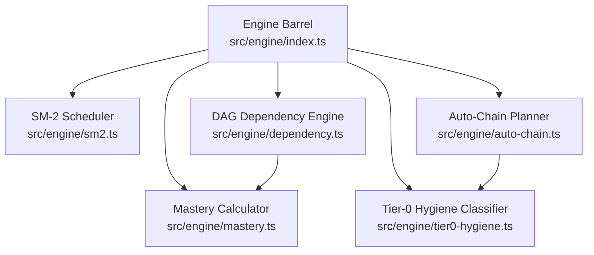
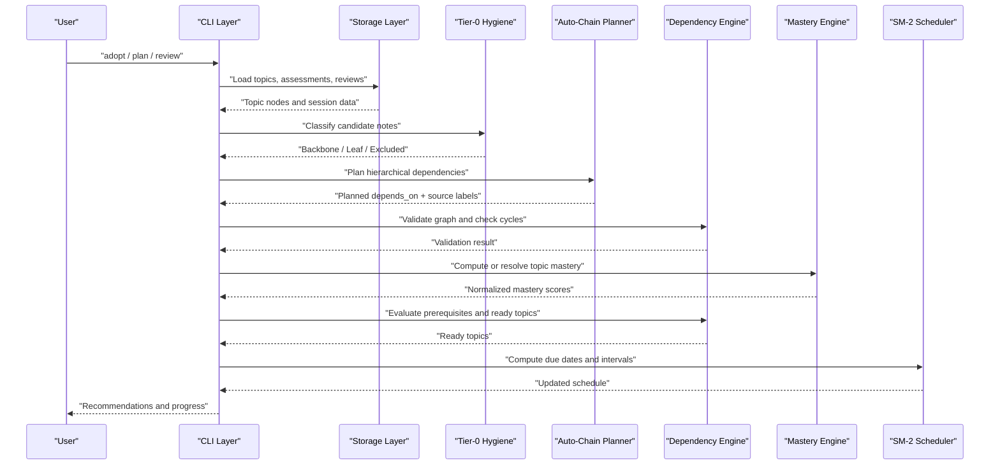
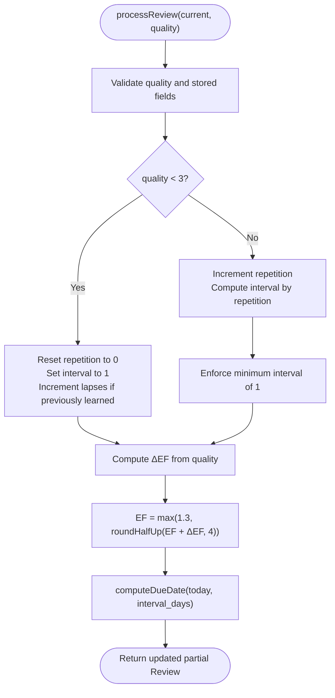
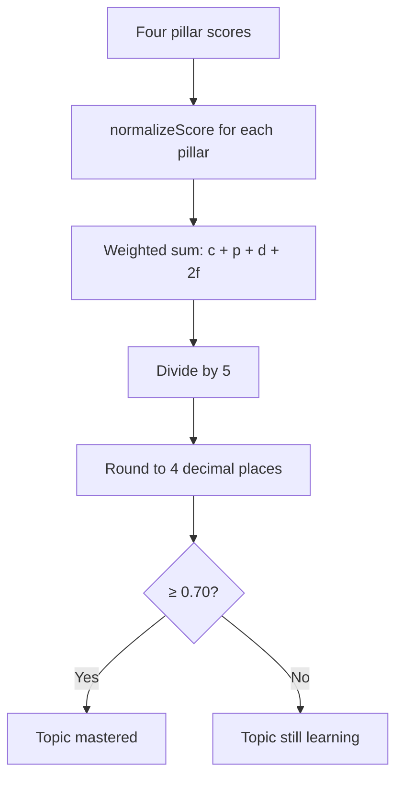
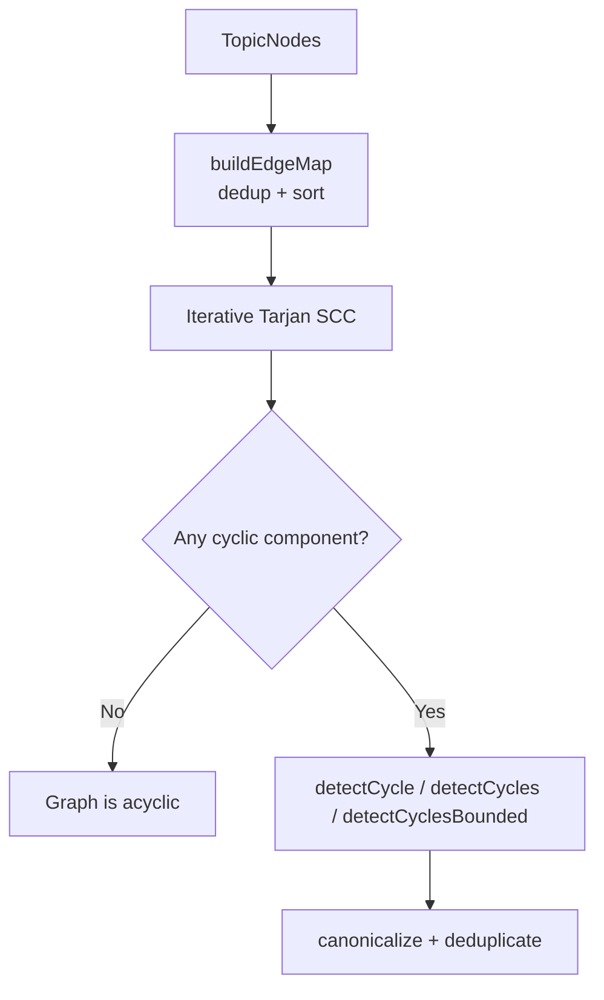
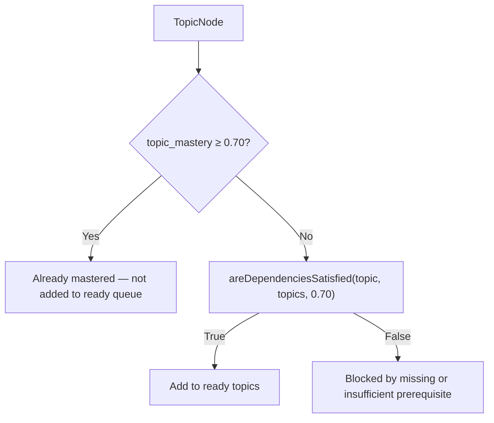
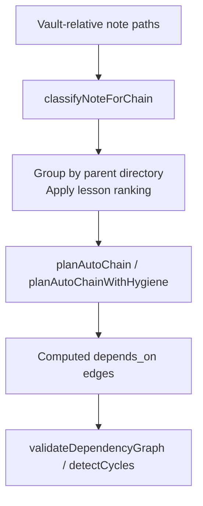
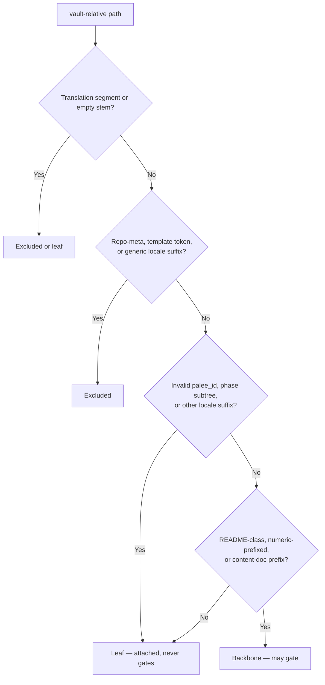
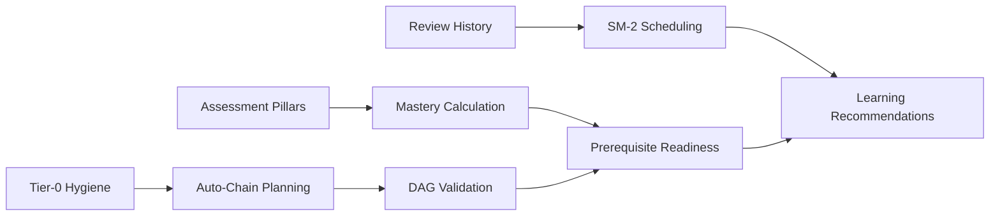
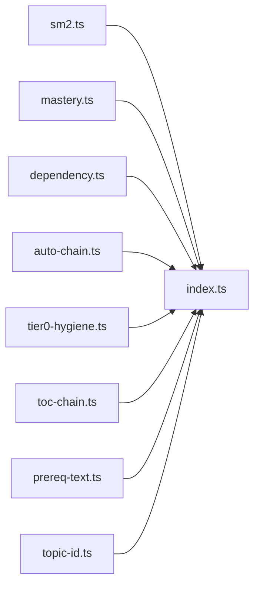

# Core Algorithms and Engine

::: details Referenced Files in This Document

- [src/engine/sm2.ts](https://github.com/Kuldeep2822k/cli/blob/main/src/engine/sm2.ts)
- [src/engine/mastery.ts](https://github.com/Kuldeep2822k/cli/blob/main/src/engine/mastery.ts)
- [src/engine/dependency.ts](https://github.com/Kuldeep2822k/cli/blob/main/src/engine/dependency.ts)
- [src/engine/auto-chain.ts](https://github.com/Kuldeep2822k/cli/blob/main/src/engine/auto-chain.ts)
- [src/engine/tier0-hygiene.ts](https://github.com/Kuldeep2822k/cli/blob/main/src/engine/tier0-hygiene.ts)
- [src/engine/index.ts](https://github.com/Kuldeep2822k/cli/blob/main/src/engine/index.ts)
- [docs/adr/0001-supermemo-sm2-algorithm.md](https://github.com/Kuldeep2822k/cli/blob/main/docs/adr/0001-supermemo-sm2-algorithm.md)
- [docs/adr/0004-four-pillar-pedagogical-mastery.md](https://github.com/Kuldeep2822k/cli/blob/main/docs/adr/0004-four-pillar-pedagogical-mastery.md)
- [docs/adr/0010-tier0-hygiene-classification.md](https://github.com/Kuldeep2822k/cli/blob/main/docs/adr/0010-tier0-hygiene-classification.md)
- [docs/adr/0011-tiered-auto-chain.md](https://github.com/Kuldeep2822k/cli/blob/main/docs/adr/0011-tiered-auto-chain.md)
- [docs/adr/0012-declared-prerequisites.md](https://github.com/Kuldeep2822k/cli/blob/main/docs/adr/0012-declared-prerequisites.md)
- [docs/03-1-sm2-spaced-repetition-algorithm.md](https://github.com/Kuldeep2822k/cli/blob/main/docs/03-1-sm2-spaced-repetition-algorithm.md)
- [docs/03-2-dependency-graph-engine.md](https://github.com/Kuldeep2822k/cli/blob/main/docs/03-2-dependency-graph-engine.md)

:::

## Table of Contents
1. [Introduction](#introduction)
2. [Project Structure](#project-structure)
3. [Core Components](#core-components)
4. [Architecture Overview](#architecture-overview)
5. [Detailed Component Analysis](#detailed-component-analysis)
6. [Dependency Analysis](#dependency-analysis)
7. [Performance Considerations](#performance-considerations)
8. [Troubleshooting Guide](#troubleshooting-guide)
9. [Conclusion](#conclusion)
10. [Appendices](#appendices)
11. [References](#references)

## Introduction
PALEE’s core algorithmic engine is a deterministic, file-system-free learning system composed of five cooperating parts:

| Algorithm | Responsibility | Primary Source |
|---|---|---|
| SuperMemo SM-2 | Spaced repetition scheduling, interval expansion, ease factor adjustment, lapse handling | `src/engine/sm2.ts` |
| Four-Pillar Mastery | Weighted mastery across conceptual, practical, debug, and Feynman pillars | `src/engine/mastery.ts` |
| Dependency Graph (DAG) | Cycle detection, prerequisite satisfaction, ready-topic selection, SCC decomposition | `src/engine/dependency.ts` |
| Auto-Chaining | Hierarchical prerequisite planning from numbered directories, phase keywords, and repository enumeration | `src/engine/auto-chain.ts` |
| Tier-0 Hygiene | Classification of vault notes as backbone, leaf, or excluded before chaining | `src/engine/tier0-hygiene.ts` |

The public subsystem surface is re-exported through `src/engine/index.ts`, which bundles SM-2, mastery, dependency, auto-chain, tier-0 hygiene, TOC chain, declared-prerequisite extraction, and topic ID generation.

## Project Structure
At the engine layer, PALEE separates concerns by algorithm rather than by CLI command:

## Core Components
This section summarizes each algorithm’s inputs, outputs, invariants, and role in the larger learning pipeline.

### SM-2 Spaced Repetition Engine
- **Purpose:** Compute next review state after a learner rates recall quality from 0 to 5.
- **Key state fields:** `ease_factor`, `interval_days`, `repetition`, `lapses`.
- **Outputs:** Updated partial review state plus due-date computation.
- **Policy constraints:**
  - Ease factor floor: 1.3.
  - Interval ceiling: 36,500 days (100 years).
  - Quality must be an integer in `[0, 5]`.
  - All stored numeric fields are validated because raw frontmatter reaches the scheduler untyped.

### Four-Pillar Mastery Engine
- **Purpose:** Convert four pedagogical assessment scores into one normalized mastery score used for prerequisite gating.
- **Pillars and weights:**
  - Conceptual: 20%
  - Practical: 20%
  - Debug: 20%
  - Feynman: 40% (double weighted)
- **Threshold:** A topic is considered mastered at `topic_mastery ≥ 0.70`.
- **Normalization:** Scores are clamped to `[0.0, 1.0]` and rounded to four decimal places; non-finite, missing, or invalid values become `0.0`.

### Dependency Graph Engine
- **Purpose:** Model prerequisites as a directed graph, detect cycles, enforce mastery thresholds, and compute ready topics.
- **Canonical input:** `TopicNode.depends_on`; legacy aliases are normalized earlier in the storage layer.
- **Advisory vs gated edges:** `toc` and `tie` sources do not block readiness even if prerequisites are unsatisfied; other sources gate.
- **Core operations:**
  - Build edge map with deduplicated, sorted adjacency.
  - Iterative Tarjan strongly connected components.
  - Johnson-style elementary cycle enumeration.
  - Ready-topic selection using mastery threshold and dependency satisfaction.

### Auto-Chaining Engine
- **Purpose:** Infer prerequisite chains from vault structure without filesystem access.
- **Inputs:** Vault-relative paths, basenames, directory hierarchy, optional repository enumeration, and hygiene classification.
- **Ordering rules (operative, shipped path):** `src/cli/adopt.ts` calls `planAutoChainWithHygiene`, whose Tier-0 comparator ranks: README-class first, then numeric prefixes (`01-foundations`), then phase keywords (`deep-dive`, `lab`, `exam`), then other names (stable case-insensitive then case-sensitive ordering), with homework (`assignment`/`quiz`/`solution`) last.
  - The bare `planAutoChain` comparator (unfiltered) ranks only three ways: numeric -> phase -> alphabetical.
- **Hygiene integration:** Uses `classifyNoteForChain` so only eligible backbone or leaf notes participate in planning.

### Tier-0 Hygiene Classifier
- **Purpose:** Decide whether a vault-relative note path may gate other notes.
- **Classes:**
  - `backbone`: may appear in `depends_on`.
  - `leaf`: may be chained but never gates successors.
  - `excluded`: never adopted or chained by batch flows.
- **Rules:**
  - B1: repo-meta basenames.
  - B2: translation detection via locale suffixes and structural segments.
  - B3: template tokens.
  - B4: phase subtrees such as `solutions/`, `your-work/`, `start/`, `sketch/`, `answers/`.
  - B5: content-doc naming signals such as README-class, numeric prefix, or phase prefixes.
  - B7: invalid `palee_id`.

## Architecture Overview
The learning recommendation pipeline connects these engines in a predictable order:

## Detailed Component Analysis

### SM-2 Spaced Repetition Algorithm
SM-2 models retention through three interacting quantities:

| Quantity | Meaning | Update Rule |
|---|---|---|
| `ease_factor` | Topic difficulty indicator | Adjusted by a quality-dependent delta; floored at 1.3 |
| `interval_days` | Next review interval in calendar days | Resets on failure; grows by 1 day, 6 days, or multiplication by EF |
| `repetition` | Number of successful repetitions | Increments on success; resets on failure |
| `lapses` | Count of failed attempts after initial learning | Increments only when failing a previously learned topic |

#### Mathematical Formulas
Ease factor delta:

$$\Delta EF = 0.1 - (5 - q) \times (0.08 + (5 - q) \times 0.02)$$

Where $q \in \{0, 1, 2, 3, 4, 5\}$ is the review quality rating.

Interval progression:

$$I(n) = \begin{cases} 1 & n = 1 \\ 6 & n = 2 \\ \text{clamp}\big(\text{round}(I(n-1) \times EF),\ 1,\ 36500\big) & n > 2 \end{cases}$$

Failure branch ($q < 3$):

- `lapses ← lapses + 1` only if `repetition > 0` (checked against the pre-reset repetition value)
- `repetition ← 0`
- `interval_days ← 1`

Success branch ($q \ge 3$):

- `repetition ← repetition + 1`
- Apply the interval rule above.
- `EF ← max(1.3, roundHalfUp(EF + ΔEF, 4))`

#### Complexity and Invariants
- Time per review: $O(1)$.
- Space per review update: $O(1)$ beyond input/output state.
- Safety invariants include bounded integers, finite floating-point values, and a maximum interval that prevents calendar overflow.

#### Example Workflow
A topic starts with default SM-2 state. After repeated successful reviews, its interval expands until it approaches the 36,500-day policy ceiling. A single low-quality review can reset the interval while preserving a bounded lapse count.

### Four-Pillar Pedagogical Mastery
Mastery combines four dimensions into one scalar decision metric. The formula is:

$$\text{topic\_mastery} = \text{round}\left(\frac{c + p + d + 2f}{5},\ 4\right)$$

where:
- $c$: normalized conceptual score
- $p$: normalized practical score
- $d$: normalized debug score
- $f$: normalized Feynman articulation score

Because the Feynman pillar has weight 2, ordinary pillars alone cap mastery at $3/5 = 0.60$. Therefore, a topic cannot reach the 0.70 mastery gate without some Feynman signal.

#### Normalization Contract
- Finite numbers are clamped to `[0.0, 1.0]` and rounded to four decimals.
- Non-finite values become `0.0`.
- Numeric strings are parsed and normalized.
- Missing, null, or invalid values contribute zero.

#### Precedence Modes
- `pillars-first`: any nonzero pillar triggers recomputation; otherwise preserve a valid existing value.
- `existing-first`: keep a normalized existing value unless it is absent.

#### Example Calculation
If conceptual is 0.8, practical is 0.7, debug is 0.9, and Feynman is 0.85:

$$\text{mastery} = \text{round}\left(\frac{0.8 + 0.7 + 0.9 + 2 \times 0.85}{5},\ 4\right) = 0.82$$

### Dependency Graph Engine Using Directed Acyclic Graphs
PALEE represents prerequisites as a directed graph where edges point from a topic to its required predecessors. The engine supports:

| Operation | Purpose | Complexity Notes |
|---|---|---|
| `buildEdgeMap` | Deduplicate and sort adjacency lists | $O(V + E)$ |
| `computeSccs` | Iterative Tarjan decomposition | Linear in graph size |
| `detectCycle` | Return lexicographically smallest canonical cycle | Bounded first-cycle search |
| `detectCycles` | Enumerate every distinct cycle | Proportional to reported cycles |
| `detectCyclesBounded` | Enumeration capped with truncation flag | Safe for interactive use |
| `areDependenciesSatisfied` | Check existence and mastery threshold | $O(d)$ per topic, where $d$ is dependency count |
| `getReadyTopics` | Select unmastered topics whose prerequisites are satisfied | $O(V + E)$ overall scan |

#### Cycle Detection Pipeline
1. Build canonical adjacency from `depends_on`.
2. Decompose into strongly connected components.
3. Identify cyclic components (multi-node components or self-loops).
4. Report either one canonical cycle or all elementary cycles.

#### Prerequisite Satisfaction and Readiness
A topic is ready when:
1. It is not already mastered.
2. Every prerequisite exists.
3. Every gated prerequisite has mastery ≥ 0.70.
4. Advisory `toc` or `tie` edges do not block readiness.

### Auto-Chaining Algorithm for Automatic Prerequisite Resolution
Auto-chaining infers ordered prerequisites from vault layout rather than guessing alphabetically. Its design goals are:

- Deterministic ordering.
- Structural justification for numbering.
- Pedagogical phase awareness.
- No filesystem access in the planner.
- Explicit separation between inferred and author-authored edges.

#### Lesson Ranking
Basenames are ranked as follows in the operative Tier-0 ordering used by `planAutoChainWithHygiene` (the shipped path via `src/cli/adopt.ts`):

1. README-class first.
2. Numeric prefix: `01-foundations`, `02-linux/01-processes`.
3. Phase keyword: `deep-dive`, `lab`, `exam`.
4. Everything else: stable alphabetical tiebreak.
5. Homework (`assignment`, `quiz`, `solution`) last.

The bare `planAutoChain` comparator (unfiltered) uses only the 3-rank version: numeric -> phase -> alphabetical.

#### Directory Ordering
Directories are compared segment by segment. Numbered segments dominate unnumbered ones, ancestors sort before descendants, and ties fall back to segment name.

#### Hygiene Integration
Before chaining, `classifyNoteForChain` removes translation copies, repo meta, templates, phase subtrees, and invalid identifiers from being treated as lessons that gate others.

### Tier-0 Hygiene Classification System
Tier-0 hygiene is a pre-planning filter that prevents repository furniture from becoming curriculum gates.

#### Decision Flow

#### Rule Summary
| Rule | Signal | Outcome |
|---|---|---|
| B1 | Repo-meta basename stems | Excluded |
| B2 | Locale-suffixed generic docs or structural translation segment | Excluded or demoted to leaf |
| B3 | Template token in stem or directory segment | Excluded |
| B4 | Phase subtree segment | Subtree becomes leaves |
| B5 | README-class, numeric prefix, or content-doc prefix | Backbone eligible |
| B7 | Invalid `palee_id` | Demoted to leaf |

### How the Algorithms Work Together
A typical learning workflow uses these algorithms together:

1. **Content ingestion:** Notes are scanned and classified by Tier-0 hygiene.
2. **Prerequisite planning:** Auto-chaining proposes `depends_on` based on numbering, phases, and optionally repository enumeration.
3. **Graph validation:** The dependency engine checks for dangling references and cycles.
4. **Mastery calculation:** Assessment pillars produce a normalized mastery score.
5. **Readiness evaluation:** Only topics below 0.70 mastery with satisfied prerequisites are recommended.
6. **Scheduling:** SM-2 computes due dates and intervals based on past review quality.

## Dependency Analysis
The engine barrel centralizes imports and exposes a stable API:

### Coupling and Cohesion
- `auto-chain.ts` depends on `tier0-hygiene.ts` for classification.
- `dependency.ts` depends on `mastery.ts` for the `MASTERY_THRESHOLD`.
- `sm2.ts` depends on validation helpers for diagnostic formatting.
- Other modules remain independent pure functions.

### External Dependencies
- The core algorithms depend on TypeScript primitives and standard library functions.
- They avoid filesystem access, network calls, and external libraries, supporting deterministic testing.

## Performance Considerations
| Component | Time Complexity | Space Complexity | Key Optimization |
|---|---:|---:|---|
| SM-2 review processing | $O(1)$ | $O(1)$ | Direct arithmetic with bounded rounding |
| Mastery calculation | $O(1)$ | $O(1)$ | Fixed four-pillar normalization |
| Edge map construction | $O(V + E)$ | $O(V + E)$ | Deduplicated adjacency and sorted traversal |
| Tarjan SCC decomposition | $O(V + E)$ | $O(V + E)$ | Iterative implementation avoids recursion limits |
| Johnson cycle enumeration | Proportional to cycles reported | Depends on cycle output | Deferred unblocking reduces redundant work |
| Auto-chain lesson ranking | $O(k \log k)$ per group | $O(k)$ | Comparison-based deterministic sort |
| Tier-0 hygiene classification | $O(P)$ per path | $O(1)$ extra | Pure predicate pipeline over path segments |

### Bottlenecks and Safeguards
- **Unbounded SM-2 interval growth:** Capped at 36,500 days to prevent calendar overflow.
- **Deep prerequisite graphs:** Iterative graph algorithms replace recursive DFS.
- **Pathological cycle counts:** Bounded enumeration with a truncation flag protects interactive commands.
- **Large repository enumerations:** TOC scanning uses bracket-balance tables to avoid quadratic rescans on malformed markdown.

## Troubleshooting Guide

### SM-2 Issues
| Symptom | Likely Cause | Resolution |
|---|---|---|
| Error about invalid quality | Rating outside 0–5 or not an integer | Record a valid integer review quality |
| Error about invalid ease factor | Stored value is not a finite number ≥ 1.3 | Repair frontmatter or reset review state |
| Error about invalid interval | Stored interval is not a finite number ≥ 1 | Repair frontmatter or reset review state |
| Error about invalid repetition or lapses | Stored counter is negative, non-integer, or unsafe | Repair stored counters |
| Future due date appears invalid | Day count exceeds representable calendar range | Investigate extremely long interval history or bypassed cap |

### Mastery Issues
| Symptom | Likely Cause | Resolution |
|---|---|---|
| Mastery stays at 0.60 despite strong conceptual/practical/debug scores | Feynman pillar is missing or zero | Record a non-zero Feynman articulation score |
| Existing mastery overrides new assessment scores | `existing-first` precedence mode was selected | Use `pillars-first` when new assessment data should win |
| Non-numeric string scores cause unexpected results | String parsing fallback produced 0.0 | Normalize pillar scores before calculation |

### Dependency Graph Issues
| Symptom | Likely Cause | Resolution |
|---|---|---|
| Topic is not in the ready list | Prerequisite missing or mastery below 0.70 | Add prerequisite or raise prerequisite mastery |
| Validation reports a cycle | Circular `depends_on` references | Remove or reorder circular prerequisites |
| Too many cycles reported | Unbounded enumeration triggered | Use bounded enumeration for interactive commands |
| Advisory edges do not block readiness | `toc` or `tie` source edges are advisory | Treat them as ranking hints, not hard gates |

### Auto-Chain Issues
| Symptom | Likely Cause | Resolution |
|---|---|---|
| Translation files become lessons | Misclassified locale suffix or missing structural signal | Rename according to convention or place under `translations/` |
| Repo metadata gates lessons | File matched a repo-meta stem | Move out of chain scope or rename |
| Phase solutions become lessons | Phase subtree rule violated or misapplied | Respect phase directory semantics |
| Alphabetical chaining occurs | No numbered layout and no chainable order signal | Add numbering or use `--chain-tier full` where appropriate |

### Tier-0 Hygiene Issues
| Symptom | Likely Cause | Resolution |
|---|---|---|
| Note is excluded from adoption | Matches repo-meta, translation, template, or invalid-palee-id rule | Rename, relocate, or adopt directly in single-file mode |
| Note is a leaf but expected to gate | Classified as leaf instead of backbone | Add a numeric prefix, README-class name, or phase prefix |
| Root README does not bridge numbered modules | Layout expectation mismatch | Ensure root README targets first numbered module per owner ruling |

## Conclusion
PALEE’s core engine is a composition of small, deterministic algorithms with clear contracts:

- SM-2 manages temporal retention with bounded, testable arithmetic.
- The four-pillar mastery model captures engineering competence beyond rote recall.
- The DAG engine enforces prerequisite integrity and readiness.
- Auto-chaining turns structured content into actionable learning order.
- Tier-0 hygiene keeps repository noise out of the curriculum graph.

Together, they transform Markdown notes, assessment scores, and review history into safe, reproducible learning recommendations.

## Appendices

### Appendix A: Public Engine Surface
The engine barrel exports:

| Category | Exported Symbols |
|---|---|
| SM-2 | `processReview`, `computeDueDate` |
| Mastery | `MASTERY_THRESHOLD`, `computeTopicMastery`, `normalizeScore`, `resolveTopicMastery` |
| Dependency | `detectCycle`, `detectCycles`, `detectCyclesBounded`, `quarantineCyclicTopics`, `findCyclicSccNodes`, `getReadyTopics`, `areDependenciesSatisfied`, `getTopicDependencies`, `validateDependencyGraph`, `findMissingDependencies` |
| Auto-chain | `planAutoChain`, `planAutoChainWithHygiene`, `parseWikilink`, `extractWikilinks` |
| Tier-0 hygiene | `classifyNoteForChain`, `isValidPaleeId`, `isPhaseSubtree`, `isContentDocName`, `stemOf`, and rule constants |
| TOC chain | TOC link extraction, planning, assertions, and tier composition |
| Declared prerequisites | Declaration extraction and resolution |
| Topic ID | Unique `T-` prefixed identifier generation |

### Appendix B: Design Decisions and Trade-offs
| Decision | Rationale | Trade-off |
|---|---|---|
| SM-2 over FSRS | Zero configuration, deterministic, local-first | Requires active recall ratings |
| Four-pillar mastery | Engineering competence is multi-dimensional | Higher cognitive overhead than one-score models |
| Advisory TOC edges | Enumeration is weaker evidence than numbering or hand-authored dependencies | Learner must understand edge provenance |
| Tier-0 hygiene by default | Repository furniture caused measured false edges | Scope is stricter than naïve `.md` scanning |
| Iterative graph algorithms | Avoid call-stack limits on deep curricula | More code than simple recursive DFS |

## References

- [src/engine/index.ts:1-126](https://github.com/Kuldeep2822k/cli/blob/main/src/engine/index.ts#L1-L126)
- [src/engine/sm2.ts:1-60](https://github.com/Kuldeep2822k/cli/blob/main/src/engine/sm2.ts#L1-L60)
- [src/engine/mastery.ts:1-30](https://github.com/Kuldeep2822k/cli/blob/main/src/engine/mastery.ts#L1-L30)
- [src/engine/dependency.ts:1-30](https://github.com/Kuldeep2822k/cli/blob/main/src/engine/dependency.ts#L1-L30)
- [src/engine/auto-chain.ts:1-30](https://github.com/Kuldeep2822k/cli/blob/main/src/engine/auto-chain.ts#L1-L30)
- [src/engine/tier0-hygiene.ts:1-30](https://github.com/Kuldeep2822k/cli/blob/main/src/engine/tier0-hygiene.ts#L1-L30)
- [src/engine/sm2.ts:1-120](https://github.com/Kuldeep2822k/cli/blob/main/src/engine/sm2.ts#L1-L120)
- [docs/adr/0001-supermemo-sm2-algorithm.md:1-63](https://github.com/Kuldeep2822k/cli/blob/main/docs/adr/0001-supermemo-sm2-algorithm.md#L1-L63)
- [docs/03-1-sm2-spaced-repetition-algorithm.md:1-200](https://github.com/Kuldeep2822k/cli/blob/main/docs/03-1-sm2-spaced-repetition-algorithm.md#L1-L200)
- [src/engine/mastery.ts:1-120](https://github.com/Kuldeep2822k/cli/blob/main/src/engine/mastery.ts#L1-L120)
- [docs/adr/0004-four-pillar-pedagogical-mastery.md:1-59](https://github.com/Kuldeep2822k/cli/blob/main/docs/adr/0004-four-pillar-pedagogical-mastery.md#L1-L59)
- [docs/03-1-sm2-spaced-repetition-algorithm.md:200-330](https://github.com/Kuldeep2822k/cli/blob/main/docs/03-1-sm2-spaced-repetition-algorithm.md#L200-L330)
- [src/engine/dependency.ts:1-120](https://github.com/Kuldeep2822k/cli/blob/main/src/engine/dependency.ts#L1-L120)
- [docs/03-2-dependency-graph-engine.md:1-215](https://github.com/Kuldeep2822k/cli/blob/main/docs/03-2-dependency-graph-engine.md#L1-L215)
- [src/engine/auto-chain.ts:1-120](https://github.com/Kuldeep2822k/cli/blob/main/src/engine/auto-chain.ts#L1-L120)
- [docs/adr/0011-tiered-auto-chain.md:1-99](https://github.com/Kuldeep2822k/cli/blob/main/docs/adr/0011-tiered-auto-chain.md#L1-L99)
- [src/engine/tier0-hygiene.ts:1-120](https://github.com/Kuldeep2822k/cli/blob/main/src/engine/tier0-hygiene.ts#L1-L120)
- [docs/adr/0010-tier0-hygiene-classification.md:1-72](https://github.com/Kuldeep2822k/cli/blob/main/docs/adr/0010-tier0-hygiene-classification.md#L1-L72)
- [src/engine/auto-chain.ts:1-40](https://github.com/Kuldeep2822k/cli/blob/main/src/engine/auto-chain.ts#L1-L40)
- [src/engine/tier0-hygiene.ts:1-40](https://github.com/Kuldeep2822k/cli/blob/main/src/engine/tier0-hygiene.ts#L1-L40)
- [src/engine/dependency.ts:1-40](https://github.com/Kuldeep2822k/cli/blob/main/src/engine/dependency.ts#L1-L40)
- [src/engine/sm2.ts:1-40](https://github.com/Kuldeep2822k/cli/blob/main/src/engine/sm2.ts#L1-L40)
- [src/engine/sm2.ts:60-200](https://github.com/Kuldeep2822k/cli/blob/main/src/engine/sm2.ts#L60-L200)
- [docs/03-1-sm2-spaced-repetition-algorithm.md:100-200](https://github.com/Kuldeep2822k/cli/blob/main/docs/03-1-sm2-spaced-repetition-algorithm.md#L100-L200)
- [src/engine/sm2.ts:1-200](https://github.com/Kuldeep2822k/cli/blob/main/src/engine/sm2.ts#L1-L200)
- [docs/03-2-dependency-graph-engine.md:120-215](https://github.com/Kuldeep2822k/cli/blob/main/docs/03-2-dependency-graph-engine.md#L120-L215)
- [src/engine/dependency.ts:1-80](https://github.com/Kuldeep2822k/cli/blob/main/src/engine/dependency.ts#L1-L80)
- [docs/03-2-dependency-graph-engine.md:60-120](https://github.com/Kuldeep2822k/cli/blob/main/docs/03-2-dependency-graph-engine.md#L60-L120)
- [src/engine/dependency.ts:1-200](https://github.com/Kuldeep2822k/cli/blob/main/src/engine/dependency.ts#L1-L200)
- [src/engine/auto-chain.ts:1-200](https://github.com/Kuldeep2822k/cli/blob/main/src/engine/auto-chain.ts#L1-L200)
- [docs/adr/0010-tier0-hygiene-classification.md:20-72](https://github.com/Kuldeep2822k/cli/blob/main/docs/adr/0010-tier0-hygiene-classification.md#L20-L72)
- [src/engine/tier0-hygiene.ts:1-200](https://github.com/Kuldeep2822k/cli/blob/main/src/engine/tier0-hygiene.ts#L1-L200)
- [src/engine/mastery.ts:1-40](https://github.com/Kuldeep2822k/cli/blob/main/src/engine/mastery.ts#L1-L40)
