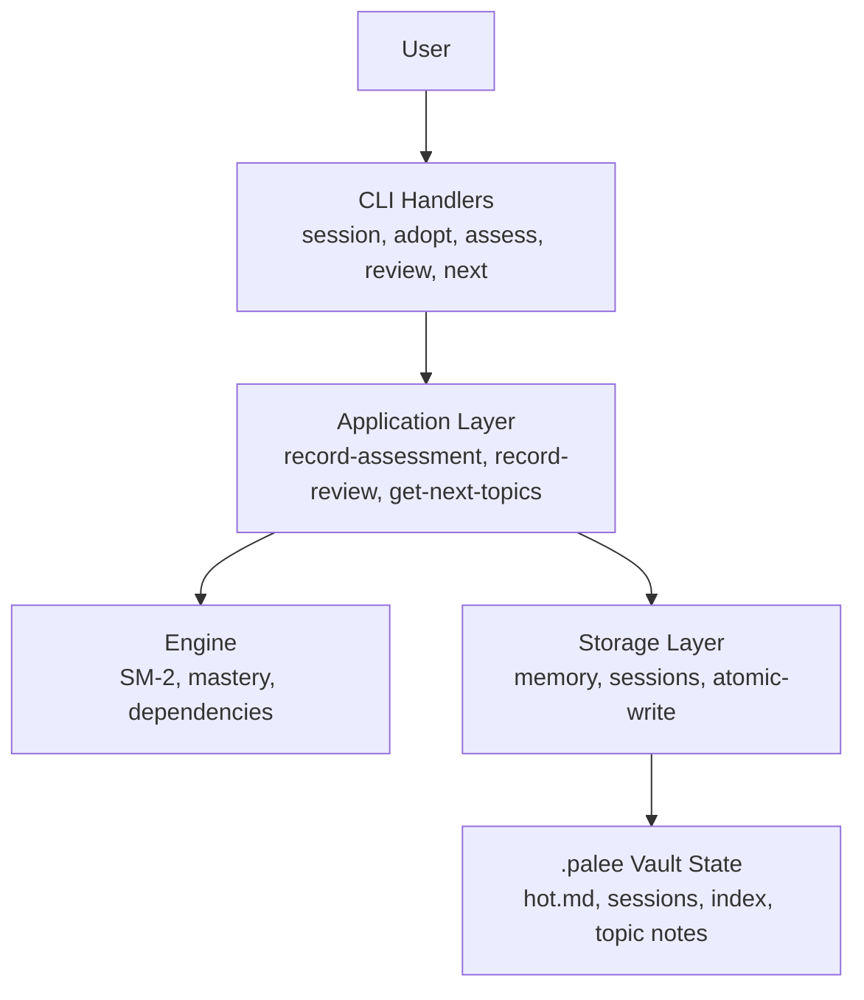
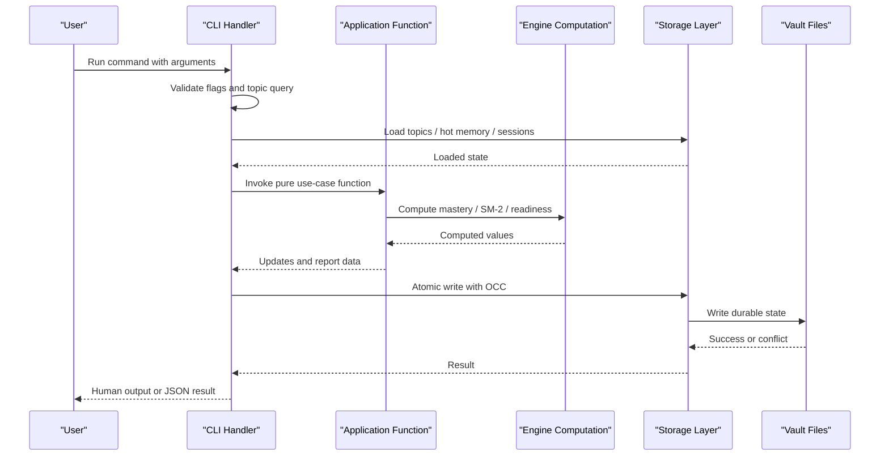
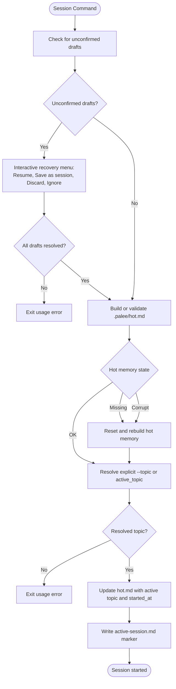
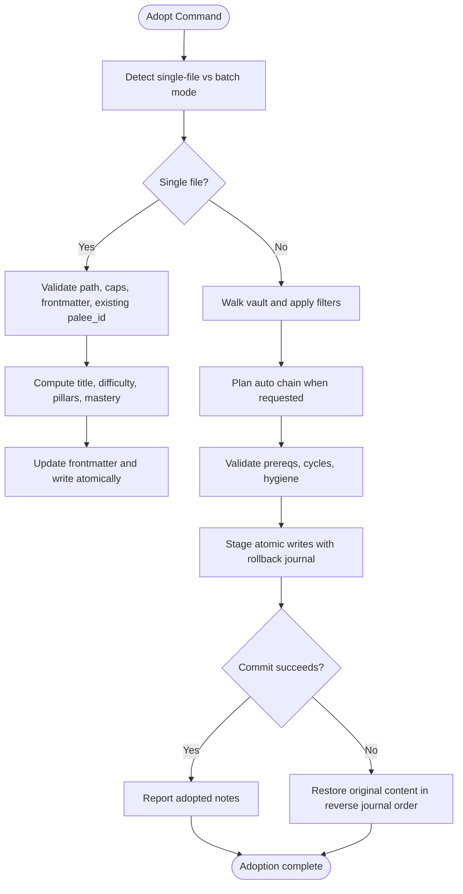
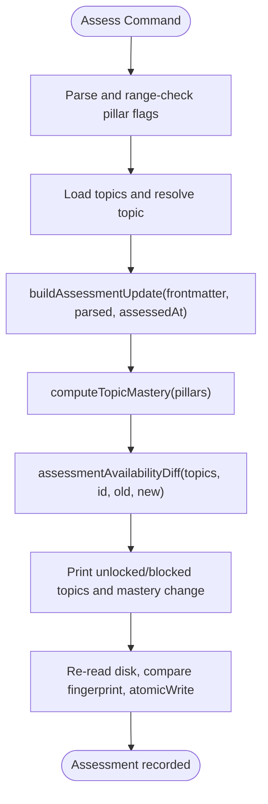
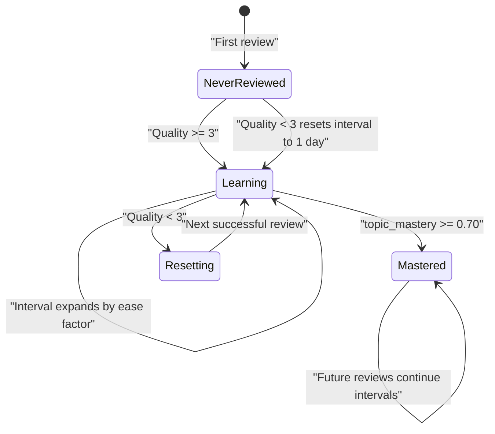
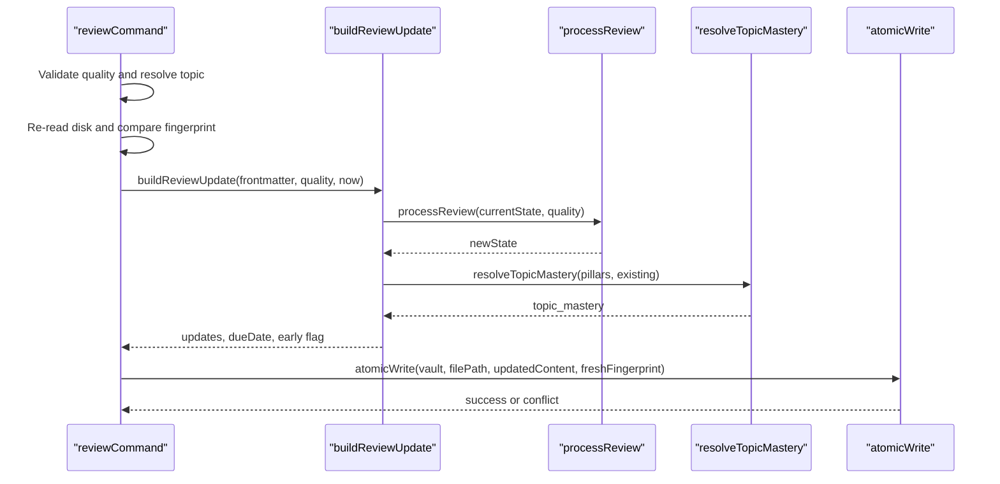
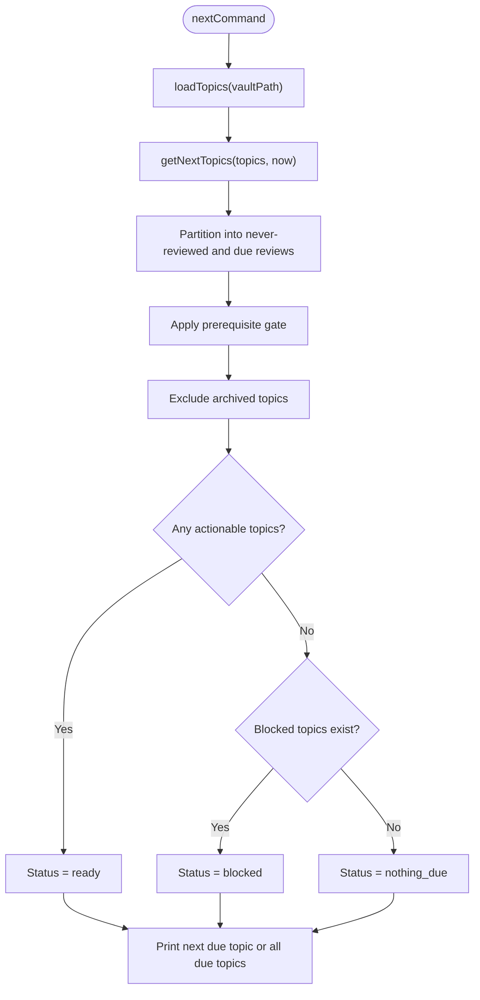
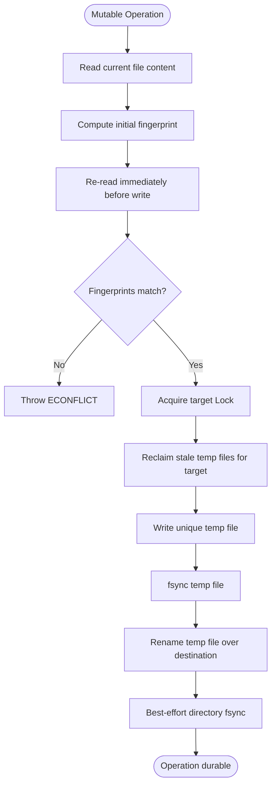
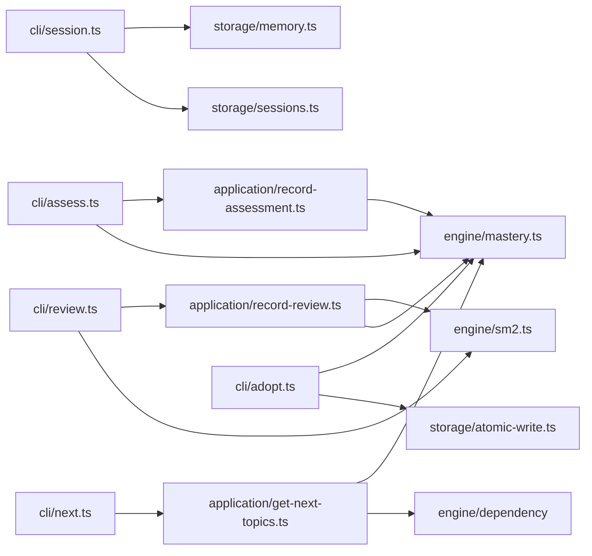

# Data Flow and State Management

::: details Referenced Files in This Document

- [src/index.ts](https://github.com/Kuldeep2822k/cli/blob/main/src/index.ts)
- [bin/palee.ts](https://github.com/Kuldeep2822k/cli/blob/main/bin/palee.ts)
- [src/cli/session.ts](https://github.com/Kuldeep2822k/cli/blob/main/src/cli/session.ts)
- [src/cli/adopt.ts](https://github.com/Kuldeep2822k/cli/blob/main/src/cli/adopt.ts)
- [src/cli/assess.ts](https://github.com/Kuldeep2822k/cli/blob/main/src/cli/assess.ts)
- [src/cli/review.ts](https://github.com/Kuldeep2822k/cli/blob/main/src/cli/review.ts)
- [src/cli/next.ts](https://github.com/Kuldeep2822k/cli/blob/main/src/cli/next.ts)
- [src/application/record-assessment.ts](https://github.com/Kuldeep2822k/cli/blob/main/src/application/record-assessment.ts)
- [src/application/record-review.ts](https://github.com/Kuldeep2822k/cli/blob/main/src/application/record-review.ts)
- [src/application/get-next-topics.ts](https://github.com/Kuldeep2822k/cli/blob/main/src/application/get-next-topics.ts)
- [src/engine/mastery.ts](https://github.com/Kuldeep2822k/cli/blob/main/src/engine/mastery.ts)
- [src/engine/sm2.ts](https://github.com/Kuldeep2822k/cli/blob/main/src/engine/sm2.ts)
- [src/storage/memory.ts](https://github.com/Kuldeep2822k/cli/blob/main/src/storage/memory.ts)
- [src/storage/sessions.ts](https://github.com/Kuldeep2822k/cli/blob/main/src/storage/sessions.ts)
- [src/storage/atomic-write.ts](https://github.com/Kuldeep2822k/cli/blob/main/src/storage/atomic-write.ts)

:::

## Table of Contents
1. [Introduction](#introduction)
2. [Project Structure](#project-structure)
3. [Core Components](#core-components)
4. [Architecture Overview](#architecture-overview)
5. [Detailed Component Analysis](#detailed-component-analysis)
6. [Dependency Analysis](#dependency-analysis)
7. [Performance Considerations](#performance-considerations)
8. [Troubleshooting Guide](#troubleshooting-guide)
9. [Conclusion](#conclusion)
10. [References](#references)

## Introduction
This document explains PALEE's data flow patterns and state management across the full lifecycle of a learning session, from CLI input through application logic, engine computations, durable storage, and recovery. It focuses on:

- The end-to-end path from user commands to vault writes.
- Session lifecycle: hot memory, active-session markers, draft checkpoints, and durable session notes.
- Topic state transitions during adoption, assessment, review, and scheduling.
- Optimistic concurrency control (OCC) for concurrent access to vault files.
- Error handling strategies, rollback mechanisms, and recovery behavior.

PALEE is organized as a layered system: the CLI parses user input, the application layer performs pure business transformations, the engine computes spaced repetition and mastery, and the storage layer persists durable state under `.palee/` with atomic writes and locking.

## Project Structure
At a high level, the repository separates concerns into four main areas:

| Layer | Responsibility | Representative Files |
|---|---|---|
| CLI | Parses commands, validates arguments, formats output, sets exit codes | `src/cli/session.ts`, `src/cli/adopt.ts`, `src/cli/assess.ts`, `src/cli/review.ts`, `src/cli/next.ts` |
| Application | Pure domain logic without filesystem or process-side effects | `src/application/record-assessment.ts`, `src/application/record-review.ts`, `src/application/get-next-topics.ts` |
| Engine | Spaced repetition, dependency gating, and mastery computation | `src/engine/sm2.ts`, `src/engine/mastery.ts` |
| Storage | Vault walking, frontmatter parsing, atomic writes, locking, sessions, hot memory | `src/storage/memory.ts`, `src/storage/sessions.ts`, `src/storage/atomic-write.ts` |

## Core Components
The core components form a pipeline:

1. **CLI handlers** validate inputs, resolve the vault target, resolve topics by ID or title substring, and translate outcomes into exit codes and human-readable or JSON messages.
2. **Application functions** compute updates purely: assessment pillars and mastery, SM-2 review state, and due-topic readiness.
3. **Engine helpers** implement SM-2 interval math, ease factor adjustments, and the weighted mastery formula.
4. **Storage primitives** read frontmatter, write atomically with OCC, lock targets, maintain `.palee/hot.md`, `.palee/sessions`, and `.palee/index.md`.

Key responsibilities:

| Component | Input | Processing | Output |
|---|---|---|---|
| `sessionCommand` | Action, options, vault path | Draft recovery, hot-memory validation, active-session marker update | Started, ended, drafted, or listed session state |
| `adoptCommand` | Note path or directory, filters, flags | Single-file or batch adoption, fingerprinting, atomic writes, rollback journal | Adopted topic metadata written into note frontmatter |
| `assessCommand` | Topic query, pillar scores | Assessment update, mastery recomputation, plan availability diff | Updated note frontmatter with assessment fields |
| `reviewCommand` | Topic query, quality rating | SM-2 transition, due-date computation, early-review warning | Updated SM-2 fields and next due date |
| `nextCommand` | Current time, loaded topics | Due partitioning, prerequisite gating, status reporting | Next due topics or blocked explanation |

## Architecture Overview
The complete data path follows a consistent pattern:

## Detailed Component Analysis

### Session Lifecycle and Hot Memory Mechanics
The session subsystem manages three related pieces of state:

| File | Purpose | Durability |
|---|---|---|
| `.palee/hot.md` | Working memory with capped 250-word summary body, active topic, last session, timestamps | Volatile working state; rebuilt when missing or corrupt |
| `.palee/active-session.md` | In-progress session marker used for crash recovery | Short-lived durable marker cleared after successful end |
| `.palee/sessions/S-*.md` | Completed study session notes | Durable canonical records |
| `.palee/sessions/DRAFT-S-*.md` | Crash checkpoints for interrupted work | Drafts recovered interactively at `session start` |
| `.palee/index.md` | Derived chronological catalog of session links | Rebuildable projection |

Hot memory is intentionally small: its body is truncated to at most 250 words so it remains fast to scan and display while retaining recent active context. The schema version field makes legacy or foreign files recoverable rather than rejected outright.

#### Hot Memory Read Contract
Hot memory reads classify their result rather than throwing for ordinary absence:

| State | Meaning |
|---|---|
| `ok` | Parsed frontmatter carries supported schema version |
| `missing` | File does not exist |
| `no-frontmatter` | No parsable frontmatter block |
| `corrupt` | Frontmatter delimiters present but YAML failed to parse |
| `schema-invalid` | Schema version missing or unsupported |

The active topic is derived only when `active_topic` is present, non-empty, and not `(none)`.

#### Draft Recovery
Draft checkpoints are created under `.palee/sessions/DRAFT-S-*.md`. When `session start` detects them:

1. Non-interactive mode refuses to proceed and instructs the user to run with `--interactive`.
2. Interactive mode offers resume, save as confirmed session, discard, or ignore.
3. Each draft is processed through `recoverDraft`; unresolved drafts leave the command in an exit-usage state.
4. Once all drafts are resolved, normal session startup proceeds.

#### Active Session Marker
The active-session marker is separate from hot memory. It records the current session ID, topic ID, and start time. On successful completion, the marker is cleared under the same target lock that protects concurrent writers, so clearing cannot race a live writer mid-rename.

### Adoption Data Flow
Adoption converts existing Markdown notes into PALEE-managed topics. It supports single-file and batch modes:

- Single-file mode preserves identity by refusing notes that already have `palee_id`, validating unclosed frontmatter openers, checking source size against the read cap, and writing managed keys only if the updated content stays within the write-cap limit.
- Batch mode walks the vault, applies include/exclude/tag filters, plans auto chains when requested, checks prerequisites, computes mastery, and writes notes through an atomic two-phase process backed by a rollback journal.

#### Rollback Mechanism
Batch adoption maintains a rollback journal of successfully written notes. If later writes fail, it restores each journaled note to its original content in reverse order. Each revert uses `atomicWrite` with an expected fingerprint and `expectExists: true`, so a concurrent external rewrite is detected rather than silently overwritten.

### Assessment and Mastery Transitions
Assessment records a four-pillar evaluation: conceptual, practical, debug, and feynman. The application layer merges explicitly supplied pillar scores over stored values, recomputes mastery, and produces frontmatter updates.

Mastery is computed as a weighted formula where Feynman articulation is double-weighted, and the threshold for satisfying prerequisites is 0.70.

#### Topic State Changes During Assessment
Assessment changes do not directly set a topic status field. Instead, it changes `topic_mastery` and pillar values. Downstream consumers such as `palee plan` use mastery and dependency graphs to decide availability. A lowering assessment can make previously ready dependents unavailable, which is reported as newly blocked topics.

### Review and Scheduling Transitions
Review records spaced repetition recall quality and updates SM-2 state: ease factor, interval days, repetition count, lapse count, last reviewed date, and next due date.

#### Review Data Flow

#### Early Reviews and Due Dates
A review is considered early if the stored `due_at` is a calendar day earlier than the local review day. Early reviews are still recorded, but a warning is printed unless `--force` is passed. The due date is computed from the review timestamp plus the resulting interval.

### Planning and Readiness Transitions
`palee next` computes which topics are actionable today. A topic is actionable if it has never been reviewed or is due for review, and its prerequisites are satisfied.

#### Prerequisite Gating
A topic is blocked when:

1. It is not archived.
2. Its mastery is below the readiness threshold.
3. The dependency engine reports unmet prerequisites.

Cyclic topics are quarantined before readiness decisions, so they are not silently withheld from `next` merely because ordering is undefined.

### Optimistic Concurrency Control
OCC is implemented at the storage boundary. Every mutable operation follows this pattern:

1. Read the current file content.
2. Compute a fingerprint of the content.
3. Re-read immediately before write to detect TOCTOU races.
4. Compare the initial fingerprint with the fresh fingerprint.
5. If different, throw a conflict error with code `ECONFLICT`.
6. Otherwise, perform an atomic write.

Atomic writes add further durability and isolation:

- Containment assertion ensures paths stay inside the vault.
- Target-level locking prevents cooperating processes from stepping on each other.
- Stale temporary files left by crashed runs are reclaimed under safe conditions.
- Temporary files are written, flushed, and renamed atomically.
- Directory fsync is attempted best-effort because POSIX rename durability depends on directory entry persistence.

#### Conflict Detection
Conflict errors are recognized by both the error code and message prefixes. Callers can distinguish between OCC conflicts and other failures using `isConflictError`.

### Error Handling and Rollback Strategies
Errors are categorized by intent and surface differently depending on whether the command is interactive, JSON-mode, or machine-driven:

| Failure Class | Typical Cause | Behavior |
|---|---|---|
| Usage error | Missing vault, invalid flag, ambiguous topic, malformed quality | Prints usage message, sets exit code 2 |
| OCC conflict | Concurrent modification or locked target | Sets exit code 4 |
| Runtime error | Unexpected exception, corrupted SM-2 state | Sets exit code 5; some cases provide repair hints |
| Containment error | Path resolves outside vault | Sets exit code 3 |
| Draft unresolved | Non-interactive draft checkpoint | Refuses to proceed with exit 2 |

For batch adoption, partial failure triggers rollback of previously written notes. For SM-2 review, corrupted stored state prints a hint directing the user to `validate --fix`.

## Dependency Analysis
The major dependency relationships are:

### Coupling and Cohesion
- CLI handlers are moderately coupled to storage loaders for reading vault state, but they delegate pure transformations to application functions.
- Application functions are deliberately decoupled from filesystem, process, and Commander state.
- Engine modules are pure and reusable by multiple application layers.
- Storage modules encapsulate vault integrity, containment, atomicity, and locking.

### Potential Circular Dependencies
There is no evidence of circular imports among the analyzed modules. The direction of dependencies flows outward from CLI to application, then to engine and storage.

## Performance Considerations
- Hot memory limits its summary body to 250 words, reducing repeated scanning cost and keeping active context manageable.
- Vault loading and session scanning are designed to tolerate malformed or unreadable files rather than aborting entire scans.
- Atomic writes use temporary files and rename operations to avoid partial vault corruption.
- SM-2 interval growth is capped at 36,500 days to prevent extremely far-future dates that could break date formatting.
- Batch adoption stages writes and maintains a rollback journal to contain partial-batch costs.

[No sources needed since this section provides general guidance]

## Troubleshooting Guide
Common issues and their signals:

| Symptom | Likely Cause | Recommended Action |
|---|---|---|
| `No topic found matching ...` | Invalid or empty topic query | Use a precise `palee_id` or a more specific title substring |
| `Multiple topics match ...` | Ambiguous query | Narrow the query to one topic |
| `no active session` | `session end` without a prior `session start` | Start a session first |
| `Unconfirmed draft checkpoint detected` | Interrupted previous session | Run `session start --interactive` |
| `OCC conflict` | Another process modified the same note | Retry after resolving the conflict |
| `Path escapes vault` | Path resolves outside the configured vault root | Use a path inside the vault |
| Invalid SM-2 state | Corrupted ease factor, interval, repetition, or lapses | Run `validate --fix` |
| `nothing was adopted` | Source too large, unclosed frontmatter, or already adopted | Fix the note or remove duplicate identity |

## Conclusion
PALEE's data flow separates concerns cleanly: CLI handles interaction, application functions encode domain rules, engines implement mathematical and graph computations, and storage guarantees durable, contained, and concurrently safe vault mutations. The session lifecycle centers on a small hot-memory working state, a short-lived active-session marker, and durable session notes, with draft checkpoints providing crash recovery. Topic state evolves through adoption, assessment, review, and planning phases, with OCC preventing concurrent overwrites and rollback journals containing partial batch failures.

[No sources needed since this section summarizes without analyzing specific files]

## References

- [src/index.ts:1-27](https://github.com/Kuldeep2822k/cli/blob/main/src/index.ts#L1-L27)
- [src/cli/session.ts:1-80](https://github.com/Kuldeep2822k/cli/blob/main/src/cli/session.ts#L1-L80)
- [src/cli/assess.ts:1-60](https://github.com/Kuldeep2822k/cli/blob/main/src/cli/assess.ts#L1-L60)
- [src/cli/review.ts:1-40](https://github.com/Kuldeep2822k/cli/blob/main/src/cli/review.ts#L1-L40)
- [src/application/record-assessment.ts:1-40](https://github.com/Kuldeep2822k/cli/blob/main/src/application/record-assessment.ts#L1-L40)
- [src/application/record-review.ts:1-30](https://github.com/Kuldeep2822k/cli/blob/main/src/application/record-review.ts#L1-L30)
- [src/engine/mastery.ts:1-40](https://github.com/Kuldeep2822k/cli/blob/main/src/engine/mastery.ts#L1-L40)
- [src/engine/sm2.ts:1-30](https://github.com/Kuldeep2822k/cli/blob/main/src/engine/sm2.ts#L1-L30)
- [src/storage/memory.ts:1-40](https://github.com/Kuldeep2822k/cli/blob/main/src/storage/memory.ts#L1-L40)
- [src/storage/sessions.ts:1-30](https://github.com/Kuldeep2822k/cli/blob/main/src/storage/sessions.ts#L1-L30)
- [src/storage/atomic-write.ts:1-30](https://github.com/Kuldeep2822k/cli/blob/main/src/storage/atomic-write.ts#L1-L30)
- [src/index.ts:12-27](https://github.com/Kuldeep2822k/cli/blob/main/src/index.ts#L12-L27)
- [src/cli/adopt.ts:1-60](https://github.com/Kuldeep2822k/cli/blob/main/src/cli/adopt.ts#L1-L60)
- [src/cli/assess.ts:1-40](https://github.com/Kuldeep2822k/cli/blob/main/src/cli/assess.ts#L1-L40)
- [src/cli/next.ts:1-40](https://github.com/Kuldeep2822k/cli/blob/main/src/cli/next.ts#L1-L40)
- [src/cli/session.ts:201-350](https://github.com/Kuldeep2822k/cli/blob/main/src/cli/session.ts#L201-L350)
- [src/cli/adopt.ts:200-360](https://github.com/Kuldeep2822k/cli/blob/main/src/cli/adopt.ts#L200-L360)
- [src/cli/assess.ts:1-120](https://github.com/Kuldeep2822k/cli/blob/main/src/cli/assess.ts#L1-L120)
- [src/cli/review.ts:1-141](https://github.com/Kuldeep2822k/cli/blob/main/src/cli/review.ts#L1-L141)
- [src/cli/next.ts:1-120](https://github.com/Kuldeep2822k/cli/blob/main/src/cli/next.ts#L1-L120)
- [src/cli/assess.ts:60-140](https://github.com/Kuldeep2822k/cli/blob/main/src/cli/assess.ts#L60-L140)
- [src/cli/review.ts:40-141](https://github.com/Kuldeep2822k/cli/blob/main/src/cli/review.ts#L40-L141)
- [src/application/record-assessment.ts:60-134](https://github.com/Kuldeep2822k/cli/blob/main/src/application/record-assessment.ts#L60-L134)
- [src/application/record-review.ts:60-116](https://github.com/Kuldeep2822k/cli/blob/main/src/application/record-review.ts#L60-L116)
- [src/storage/atomic-write.ts:1-120](https://github.com/Kuldeep2822k/cli/blob/main/src/storage/atomic-write.ts#L1-L120)
- [src/cli/session.ts:201-450](https://github.com/Kuldeep2822k/cli/blob/main/src/cli/session.ts#L201-L450)
- [src/storage/memory.ts:100-200](https://github.com/Kuldeep2822k/cli/blob/main/src/storage/memory.ts#L100-L200)
- [src/storage/memory.ts:430-550](https://github.com/Kuldeep2822k/cli/blob/main/src/storage/memory.ts#L430-L550)
- [src/storage/sessions.ts:1-120](https://github.com/Kuldeep2822k/cli/blob/main/src/storage/sessions.ts#L1-L120)
- [src/storage/memory.ts:80-160](https://github.com/Kuldeep2822k/cli/blob/main/src/storage/memory.ts#L80-L160)
- [src/storage/memory.ts:201-260](https://github.com/Kuldeep2822k/cli/blob/main/src/storage/memory.ts#L201-L260)
- [src/cli/session.ts:240-420](https://github.com/Kuldeep2822k/cli/blob/main/src/cli/session.ts#L240-L420)
- [src/storage/memory.ts:480-550](https://github.com/Kuldeep2822k/cli/blob/main/src/storage/memory.ts#L480-L550)
- [src/cli/session.ts:420-500](https://github.com/Kuldeep2822k/cli/blob/main/src/cli/session.ts#L420-L500)
- [src/cli/adopt.ts:360-531](https://github.com/Kuldeep2822k/cli/blob/main/src/cli/adopt.ts#L360-L531)
- [src/engine/mastery.ts:120-200](https://github.com/Kuldeep2822k/cli/blob/main/src/engine/mastery.ts#L120-L200)
- [src/cli/adopt.ts:120-200](https://github.com/Kuldeep2822k/cli/blob/main/src/cli/adopt.ts#L120-L200)
- [src/engine/sm2.ts:120-220](https://github.com/Kuldeep2822k/cli/blob/main/src/engine/sm2.ts#L120-L220)
- [src/application/record-review.ts:1-116](https://github.com/Kuldeep2822k/cli/blob/main/src/application/record-review.ts#L1-L116)
- [src/engine/sm2.ts:1-120](https://github.com/Kuldeep2822k/cli/blob/main/src/engine/sm2.ts#L1-L120)
- [src/application/get-next-topics.ts:60-199](https://github.com/Kuldeep2822k/cli/blob/main/src/application/get-next-topics.ts#L60-L199)
- [src/cli/review.ts:70-120](https://github.com/Kuldeep2822k/cli/blob/main/src/cli/review.ts#L70-L120)
- [src/storage/atomic-write.ts:1-200](https://github.com/Kuldeep2822k/cli/blob/main/src/storage/atomic-write.ts#L1-L200)
- [src/storage/memory.ts:320-420](https://github.com/Kuldeep2822k/cli/blob/main/src/storage/memory.ts#L320-L420)
- [src/cli/review.ts:70-141](https://github.com/Kuldeep2822k/cli/blob/main/src/cli/review.ts#L70-L141)
- [src/storage/atomic-write.ts:120-200](https://github.com/Kuldeep2822k/cli/blob/main/src/storage/atomic-write.ts#L120-L200)
- [src/cli/review.ts:100-141](https://github.com/Kuldeep2822k/cli/blob/main/src/cli/review.ts#L100-L141)
- [src/cli/session.ts:201-240](https://github.com/Kuldeep2822k/cli/blob/main/src/cli/session.ts#L201-L240)
- [src/cli/next.ts:120-200](https://github.com/Kuldeep2822k/cli/blob/main/src/cli/next.ts#L120-L200)
- [src/application/record-review.ts:1-40](https://github.com/Kuldeep2822k/cli/blob/main/src/application/record-review.ts#L1-L40)
- [src/application/get-next-topics.ts:1-40](https://github.com/Kuldeep2822k/cli/blob/main/src/application/get-next-topics.ts#L1-L40)
- [src/cli/assess.ts:100-140](https://github.com/Kuldeep2822k/cli/blob/main/src/cli/assess.ts#L100-L140)
- [src/cli/adopt.ts:300-420](https://github.com/Kuldeep2822k/cli/blob/main/src/cli/adopt.ts#L300-L420)
