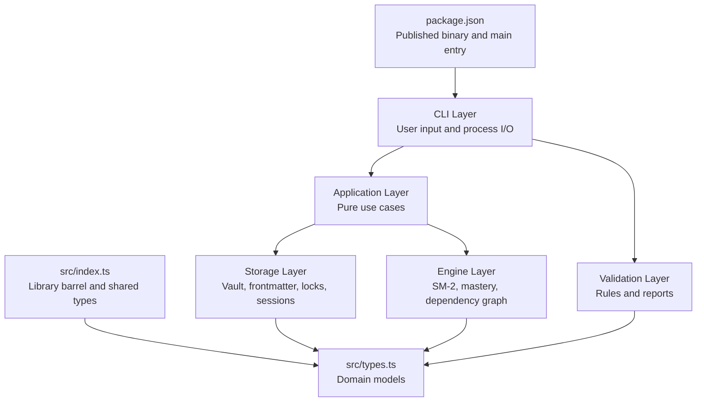
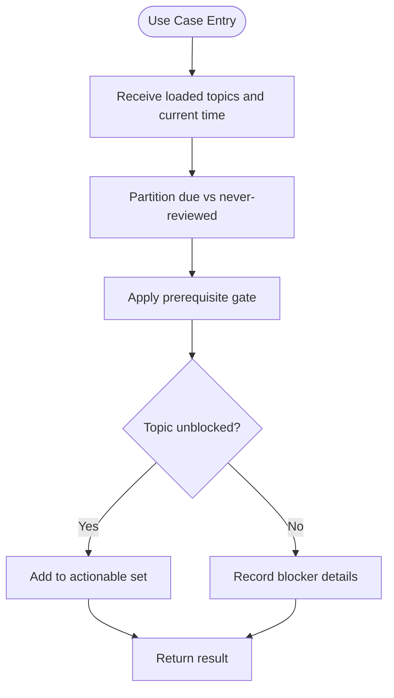
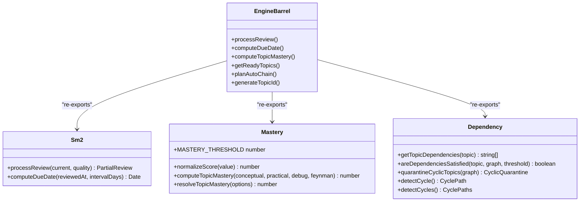
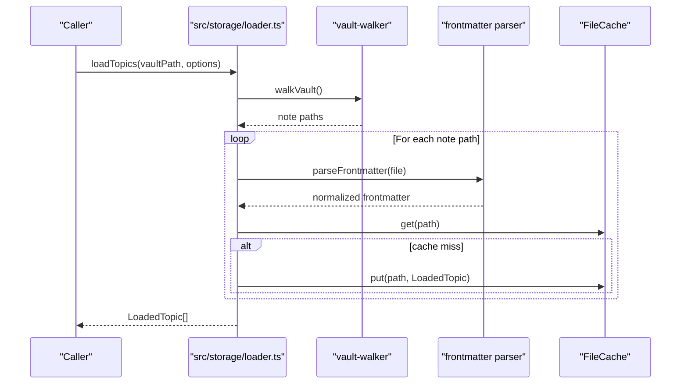
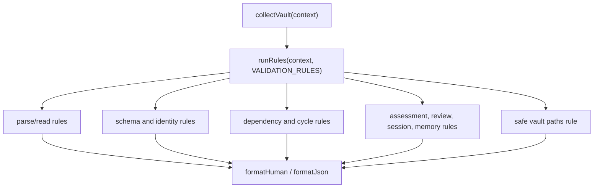
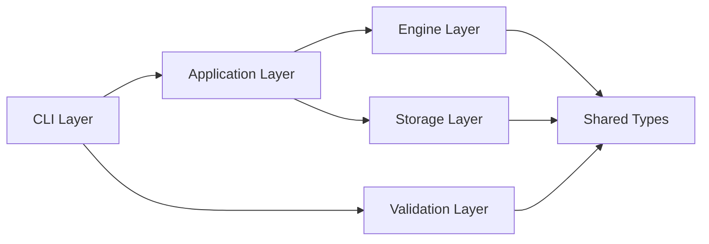
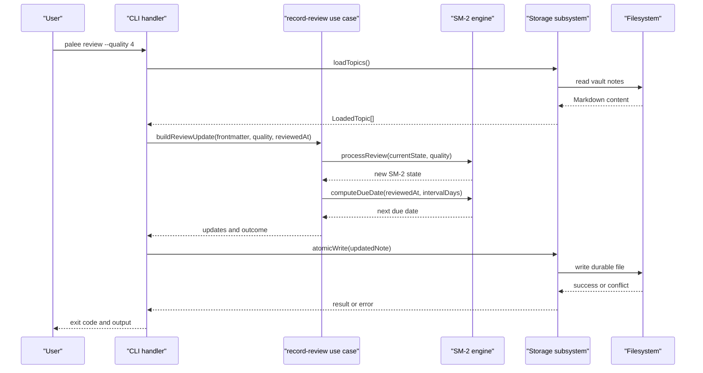
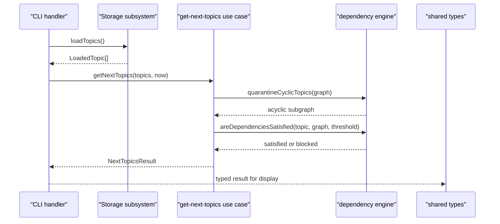
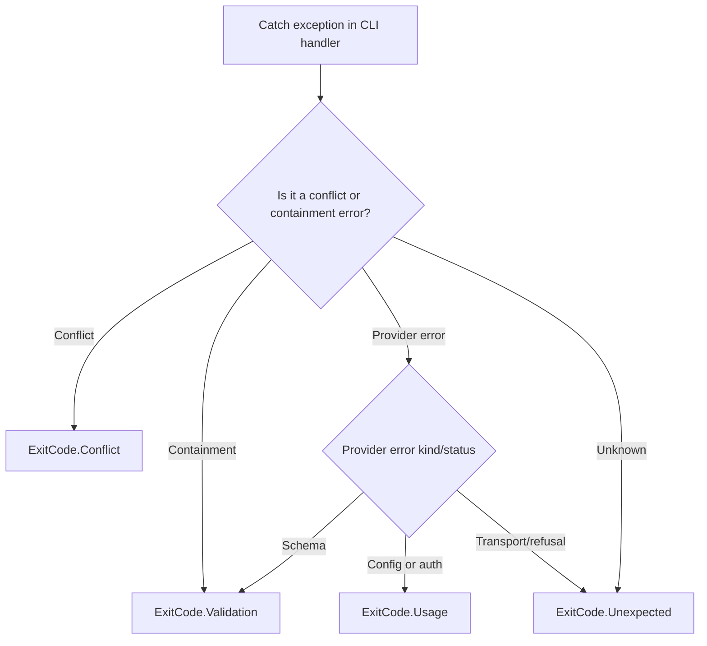
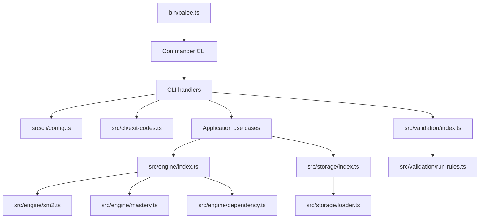

# Layered Architecture Design

::: details Referenced Files in This Document

- [package.json](https://github.com/Kuldeep2822k/cli/blob/main/package.json)
- [src/index.ts](https://github.com/Kuldeep2822k/cli/blob/main/src/index.ts)
- [src/types.ts](https://github.com/Kuldeep2822k/cli/blob/main/src/types.ts)
- [bin/palee.ts](https://github.com/Kuldeep2822k/cli/blob/main/bin/palee.ts)
- [src/cli/program-name.ts](https://github.com/Kuldeep2822k/cli/blob/main/src/cli/program-name.ts)
- [src/cli/config.ts](https://github.com/Kuldeep2822k/cli/blob/main/src/cli/config.ts)
- [src/cli/exit-codes.ts](https://github.com/Kuldeep2822k/cli/blob/main/src/cli/exit-codes.ts)
- [src/application/get-next-topics.ts](https://github.com/Kuldeep2822k/cli/blob/main/src/application/get-next-topics.ts)
- [src/application/due-topics.ts](https://github.com/Kuldeep2822k/cli/blob/main/src/application/due-topics.ts)
- [src/application/record-assessment.ts](https://github.com/Kuldeep2822k/cli/blob/main/src/application/record-assessment.ts)
- [src/application/record-review.ts](https://github.com/Kuldeep2822k/cli/blob/main/src/application/record-review.ts)
- [src/engine/index.ts](https://github.com/Kuldeep2822k/cli/blob/main/src/engine/index.ts)
- [src/engine/sm2.ts](https://github.com/Kuldeep2822k/cli/blob/main/src/engine/sm2.ts)
- [src/engine/mastery.ts](https://github.com/Kuldeep2822k/cli/blob/main/src/engine/mastery.ts)
- [src/engine/dependency.ts](https://github.com/Kuldeep2822k/cli/blob/main/src/engine/dependency.ts)
- [src/storage/index.ts](https://github.com/Kuldeep2822k/cli/blob/main/src/storage/index.ts)
- [src/storage/loader.ts](https://github.com/Kuldeep2822k/cli/blob/main/src/storage/loader.ts)
- [src/validation/index.ts](https://github.com/Kuldeep2822k/cli/blob/main/src/validation/index.ts)
- [src/validation/run-rules.ts](https://github.com/Kuldeep2822k/cli/blob/main/src/validation/run-rules.ts)

:::

## Table of Contents
1. [Introduction](#introduction)
2. [Project Structure](#project-structure)
3. [Core Components](#core-components)
4. [Architecture Overview](#architecture-overview)
5. [Detailed Component Analysis](#detailed-component-analysis)
6. [Dependency Analysis](#dependency-analysis)
7. [Performance Considerations](#performance-considerations)
8. [Troubleshooting Guide](#troubleshooting-guide)
9. [Conclusion](#conclusion)
10. [References](#references)

## Introduction
PALEE is a layered TypeScript application that turns a markdown-based knowledge base into a spaced-repetition, prerequisite-aware learning system. Its architecture is intentionally strict: the CLI layer talks to the application layer, which orchestrates pure domain logic in the engine and storage layers, while the validation layer independently audits vault state. The design goal is clear separation of concerns, stable public APIs, testability without global state, and predictable error handling.

At runtime, Node.js loads the published binary entry point from `package.json`, which registers Commander commands. Those command handlers parse user input, call application-layer use cases, delegate algorithms to the engine, persist changes through the storage subsystem, and map errors to documented exit codes. The library root re-exports shared types and the three subsystem barrels so consumers can import only what they need.

## Project Structure
The repository is organized by feature and architectural layer rather than by file type:

| Area | Responsibility | Representative files |
|---|---|---|
| Library root | Public package API and shared types | [src/index.ts](https://github.com/Kuldeep2822k/cli/blob/main/src/index.ts), [src/types.ts](https://github.com/Kuldeep2822k/cli/blob/main/src/types.ts) |
| CLI layer | User interaction, argument parsing, process I/O, exit codes | [src/cli/program-name.ts](https://github.com/Kuldeep2822k/cli/blob/main/src/cli/program-name.ts), [src/cli/config.ts](https://github.com/Kuldeep2822k/cli/blob/main/src/cli/config.ts), [src/cli/exit-codes.ts](https://github.com/Kuldeep2822k/cli/blob/main/src/cli/exit-codes.ts) |
| Application layer | Pure use-case orchestration with no I/O or process coupling | [src/application/get-next-topics.ts](https://github.com/Kuldeep2822k/cli/blob/main/src/application/get-next-topics.ts), [src/application/due-topics.ts](https://github.com/Kuldeep2822k/cli/blob/main/src/application/due-topics.ts), [src/application/record-assessment.ts](https://github.com/Kuldeep2822k/cli/blob/main/src/application/record-assessment.ts), [src/application/record-review.ts](https://github.com/Kuldeep2822k/cli/blob/main/src/application/record-review.ts) |
| Engine layer | Domain algorithms for spaced repetition, mastery, prerequisites, chains, and topic IDs | [src/engine/index.ts](https://github.com/Kuldeep2822k/cli/blob/main/src/engine/index.ts), [src/engine/sm2.ts](https://github.com/Kuldeep2822k/cli/blob/main/src/engine/sm2.ts), [src/engine/mastery.ts](https://github.com/Kuldeep2822k/cli/blob/main/src/engine/mastery.ts), [src/engine/dependency.ts](https://github.com/Kuldeep2822k/cli/blob/main/src/engine/dependency.ts) |
| Storage layer | Vault scanning, frontmatter parsing, locking, atomic writes, sessions, memory, and caching | [src/storage/index.ts](https://github.com/Kuldeep2822k/cli/blob/main/src/storage/index.ts), [src/storage/loader.ts](https://github.com/Kuldeep2822k/cli/blob/main/src/storage/loader.ts) |
| Validation layer | Deterministic rule execution, vault collection, and formatted reporting | [src/validation/index.ts](https://github.com/Kuldeep2822k/cli/blob/main/src/validation/index.ts), [src/validation/run-rules.ts](https://github.com/Kuldeep2822k/cli/blob/main/src/validation/run-rules.ts) |

## Core Components

### CLI Layer
The CLI layer owns the user-facing contract: program name resolution, configuration persistence, command handlers, and exit-code mapping. It must not contain business rules about spaced repetition, prerequisite satisfaction, or mastery calculation.

Key responsibilities:
- Derive the actual binary name so help text matches the installed command.
- Resolve platform-specific configuration paths and safely store credentials.
- Map internal errors to documented exit codes such as usage, validation, conflict, or unexpected failure.
- Parse arguments and coordinate read/write operations without implementing domain logic.

Example responsibility boundaries:
- Program name derivation lives in [src/cli/program-name.ts](https://github.com/Kuldeep2822k/cli/blob/main/src/cli/program-name.ts).
- Configuration loading, saving, and credential safety live in [src/cli/config.ts](https://github.com/Kuldeep2822k/cli/blob/main/src/cli/config.ts).
- Exit-code classification delegates error-type checks to storage and AI modules via [src/cli/exit-codes.ts](https://github.com/Kuldeep2822k/cli/blob/main/src/cli/exit-codes.ts).

### Application Layer
The application layer contains pure use cases. It takes already-loaded domain data and returns structured results without touching the filesystem, network, commander, or process globals. This makes it trivially unit-testable and reusable across non-CLI interfaces.

Representative use cases:
- `getNextTopics`: computes actionable topics, partitions due reviews, applies prerequisite gating, and reports blocked topics.
- `findPrerequisiteBlocked`: identifies why a candidate topic cannot be studied yet using the engine’s dependency predicate.
- `buildAssessmentUpdate`: computes four-pillar assessment updates and readiness diffs without performing atomic writes.
- `buildReviewUpdate`: transforms frontmatter and a quality rating into SM-2 state updates and due-date formatting.

Shared pure helpers like `normalizeDueDate`, `compareDue`, and `partitionDue` live in [src/application/due-topics.ts](https://github.com/Kuldeep2822k/cli/blob/main/src/application/due-topics.ts) and are reused by multiple read models.

### Engine Layer
The engine layer holds deterministic domain algorithms. It has no I/O, no network calls, and no process-level concerns. Its public surface is exposed through the engine barrel at [src/engine/index.ts](https://github.com/Kuldeep2822k/cli/blob/main/src/engine/index.ts).

Key subsystems:
- **Spaced repetition:** SM-2 interval computation, ease factor updates, lapse handling, and due-date scheduling in [src/engine/sm2.ts](https://github.com/Kuldeep2822k/cli/blob/main/src/engine/sm2.ts).
- **Mastery:** Four-pillar weighted scoring, normalization, clamping, and precedence rules in [src/engine/mastery.ts](https://github.com/Kuldeep2822k/cli/blob/main/src/engine/mastery.ts).
- **Dependency graph:** Cycle detection, strongly connected components, quarantine, prerequisite satisfaction, missing dependencies, and canonical topic-dependency access in [src/engine/dependency.ts](https://github.com/Kuldeep2822k/cli/blob/main/src/engine/dependency.ts).
- **Additional domain features:** Auto-chain planning, TOC chain composition, declared-prerequisite extraction, hygiene classification, and topic ID generation.

### Storage Layer
The storage layer is the boundary between PALEE’s in-memory domain model and the vault filesystem. It handles vault traversal, frontmatter parsing, locking, atomic writes, session/memory persistence, pattern matching, roadmap parsing, and caching.

Important characteristics:
- `loadTopics` centralizes scanning, parsing, normalization, fallback defaults, and caching.
- Atomic writes and containment/conflict detection are surfaced through exported guards such as `isConflictError` and `isContainmentError`.
- The barrel exposes a cohesive API surface instead of forcing callers to discover internal modules.
- Negative caches and content caps protect performance and memory when vaults grow large.

### Validation Layer
The validation layer is independent from the write path. It collects vault state, runs an ordered catalog of rules, and formats findings. Rules inspect schemas, identity fields, dependency integrity, assessment/review state, sessions, hot memory, and vault path safety.

Key contracts:
- `collectVault` performs one resilient scan where malformed files do not abort the entire run.
- `runRules` executes every rule in registration order and catches unexpected rule failures as validation issues.
- `VALIDATION_RULES` is the single source of truth for rule ordering and deterministic output.
- Formatters produce human-readable or JSON output; the CLI decides severity policy and exit behavior.

## Architecture Overview
The strict dependency direction is:

1. **CLI → Application**: Command handlers parse input and call pure use cases.
2. **Application → Engine/Storage**: Use cases compute domain results and request I/O through well-defined storage functions.
3. **Engine**: Depends only on shared types and other pure engine modules.
4. **Storage**: Depends on filesystem primitives, YAML, and shared types; does not depend on CLI or application logic.
5. **Validation**: Depends on shared types and its own rule implementations; it does not mutate vault state during normal rule execution.

This direction prevents circular dependencies because lower layers never import higher layers. For example:
- The engine does not import CLI or storage.
- The application does not import Commander or process state.
- The storage layer does not import application use cases.
- The validation layer does not perform the same mutations as the CLI.

## Detailed Component Analysis

### Data Flow: A Review Command
A typical write flow illustrates how the layers cooperate:

### Data Flow: Getting Next Topics
A read flow shows how the application layer composes engine and storage without leaking I/O into domain logic:

### Barrel Export Pattern
Each subsystem exposes a clean API surface through a barrel file:

| Barrel | Exposed purpose |
|---|---|
| Library root [`src/index.ts`](https://github.com/Kuldeep2822k/cli/blob/main/src/index.ts) | Version, shared types, engine, storage, and validation namespaces |
| Engine [`src/engine/index.ts`](https://github.com/Kuldeep2822k/cli/blob/main/src/engine/index.ts) | SM-2 scheduling, mastery, dependency analysis, auto-chain, TOC chain, hygiene, and topic ID functions |
| Storage [`src/storage/index.ts`](https://github.com/Kuldeep2822k/cli/blob/main/src/storage/index.ts) | Vault walking, frontmatter, locking, atomic writes, caching, sessions, patterns, roadmap parsing, and loaders |
| Validation [`src/validation/index.ts`](https://github.com/Kuldeep2822k/cli/blob/main/src/validation/index.ts) | Vault collection, rule runner, formatters, individual rules, and the canonical `VALIDATION_RULES` catalog |

Benefits:
- Callers import only stable symbols.
- Internal implementation files can change without breaking consumers.
- Testing and documentation can reference the public surface directly.
- Circular imports are easier to detect because each barrel has a small, explicit export list.

### Shared Type Boundary
Shared types in [src/types.ts](https://github.com/Kuldeep2822k/cli/blob/main/src/types.ts) define the cross-layer contract for assessments, reviews, topics, sessions, progress, and related utilities. Lower layers consume these types but do not mutate them arbitrarily; writers transform raw frontmatter into normalized domain values through loader and application-layer helpers before persistence.

Examples of boundary behavior:
- Assessment and review shapes are reserved for schema documentation and future phases; the runtime shape is normalized by storage loaders.
- Difficulty normalization is centralized so CLI, engine, storage, and validation remain consistent.
- Session states distinguish completed sessions from draft checkpoints.

### Error Handling and Exit Codes
The CLI maps exceptions to documented exit codes rather than printing stack traces to users:

- Conflict and containment errors become conflict or validation failures.
- Provider errors are classified by kind and status: configuration problems return usage errors, schema mismatches return validation errors, and transport or provider refusal returns unexpected failures unless explicitly mapped.
- The mapping function centralizes this decision so different commands behave consistently.

## Dependency Analysis
The dependency direction reinforces isolation:

Coupling observations:
- The CLI depends on storage guards and AI provider errors only through the exit-code mapper, keeping command handlers free of low-level error taxonomy.
- The application layer depends on engine algorithms and shared types, but not on storage mutation primitives unless it is coordinating a use case.
- The engine depends only on shared types and sibling engine modules.
- The storage layer depends on filesystem primitives and YAML, but not on application use cases.
- The validation layer is decoupled from mutation flows; it consumes collected context and produces issues.

Potential risks to monitor:
- Accidentally importing Commander or process globals into the application or engine layers.
- Adding bidirectional imports between storage and validation or application.
- Expanding barrel exports to include internal-only helpers that should stay private.

[No additional section sources needed since this section aggregates previously analyzed files]

## Performance Considerations
The architecture includes several performance-oriented patterns:

- **Topic negative cache:** Non-topic notes are cached separately from real topics so ordinary Markdown files do not displace topic entries in the cache.
- **Content cap:** The storage layer limits how much source text is read per note to avoid excessive memory usage.
- **Atomic writes with uniqueness:** File writes use unique temporary names and atomic rename to prevent partial files and collisions.
- **Deterministic graph processing:** Dependency enumeration sorts adjacency lists and uses bounded sampling where appropriate, making large vaults more predictable.
- **Separate caches:** Topic and non-topic caches have separate capacities, preserving hit rates for active topics.
- **Rule isolation:** Validation rules run independently; one failing rule does not short-circuit later diagnostics, improving diagnostic throughput.

These behaviors are implemented in storage loaders, atomic writers, dependency analyzers, and the validation runner.

## Troubleshooting Guide
Common architectural troubleshooting scenarios:

| Symptom | Likely layer | What to check |
|---|---|---|
| Help text prints `palee` instead of the installed binary name | CLI | Confirm the program name is pinned and derived correctly in [src/cli/program-name.ts](https://github.com/Kuldeep2822k/cli/blob/main/src/cli/program-name.ts). |
| A review fails with a strange interval or date value | Engine or storage | Inspect SM-2 preconditions in [src/engine/sm2.ts](https://github.com/Kuldeep2822k/cli/blob/main/src/engine/sm2.ts) and whether frontmatter was normalized by [src/storage/loader.ts](https://github.com/Kuldeep2822k/cli/blob/main/src/storage/loader.ts). |
| A command exits with an unexpected code | CLI | Check [src/cli/exit-codes.ts](https://github.com/Kuldeep2822k/cli/blob/main/src/cli/exit-codes.ts) to see whether the thrown error is classified as conflict, validation, usage, or unexpected. |
| A topic is unexpectedly gated | Application or engine | Verify prerequisite gating in [src/application/get-next-topics.ts](https://github.com/Kuldeep2822k/cli/blob/main/src/application/get-next-topics.ts) and dependency predicates in [src/engine/dependency.ts](https://github.com/Kuldeep2822k/cli/blob/main/src/engine/dependency.ts). |
| Validation output order changes | Validation | Ensure the same `VALIDATION_RULES` catalog is used by both CLI and tests in [src/validation/index.ts](https://github.com/Kuldeep2822k/cli/blob/main/src/validation/index.ts). |
| Tests are slow or nondeterministic | Storage or engine | Check whether shared caches are isolated per test and whether graph traversal order is deterministic. |

## Conclusion
PALEE’s layered architecture enforces a strict dependency direction: CLI orchestrates user interaction, the application layer owns pure use cases, the engine implements domain algorithms, the storage layer manages I/O and persistence, and the validation layer audits state deterministically. Barrel exports provide clean public surfaces, shared types stabilize cross-layer contracts, and the separation of concerns enables isolated unit tests, mockable interfaces, and predictable behavior. This structure makes PALEE maintainable as it grows: new commands add CLI handlers, new domain logic belongs in the engine, new persistence needs belong in storage, and new integrity checks belong in validation.

## References

- [package.json:1-85](https://github.com/Kuldeep2822k/cli/blob/main/package.json#L1-L85)
- [src/index.ts:1-27](https://github.com/Kuldeep2822k/cli/blob/main/src/index.ts#L1-L27)
- [src/types.ts:1-200](https://github.com/Kuldeep2822k/cli/blob/main/src/types.ts#L1-L200)
- [src/cli/program-name.ts:1-91](https://github.com/Kuldeep2822k/cli/blob/main/src/cli/program-name.ts#L1-L91)
- [src/application/get-next-topics.ts:1-199](https://github.com/Kuldeep2822k/cli/blob/main/src/application/get-next-topics.ts#L1-L199)
- [src/engine/index.ts:1-126](https://github.com/Kuldeep2822k/cli/blob/main/src/engine/index.ts#L1-L126)
- [src/storage/index.ts:1-142](https://github.com/Kuldeep2822k/cli/blob/main/src/storage/index.ts#L1-L142)
- [src/validation/index.ts:1-130](https://github.com/Kuldeep2822k/cli/blob/main/src/validation/index.ts#L1-L130)
- [src/cli/config.ts:1-200](https://github.com/Kuldeep2822k/cli/blob/main/src/cli/config.ts#L1-L200)
- [src/cli/exit-codes.ts:1-65](https://github.com/Kuldeep2822k/cli/blob/main/src/cli/exit-codes.ts#L1-L65)
- [src/application/due-topics.ts:1-58](https://github.com/Kuldeep2822k/cli/blob/main/src/application/due-topics.ts#L1-L58)
- [src/application/record-assessment.ts:1-134](https://github.com/Kuldeep2822k/cli/blob/main/src/application/record-assessment.ts#L1-L134)
- [src/application/record-review.ts:1-116](https://github.com/Kuldeep2822k/cli/blob/main/src/application/record-review.ts#L1-L116)
- [src/engine/sm2.ts:1-200](https://github.com/Kuldeep2822k/cli/blob/main/src/engine/sm2.ts#L1-L200)
- [src/engine/mastery.ts:1-200](https://github.com/Kuldeep2822k/cli/blob/main/src/engine/mastery.ts#L1-L200)
- [src/engine/dependency.ts:1-200](https://github.com/Kuldeep2822k/cli/blob/main/src/engine/dependency.ts#L1-L200)
- [src/storage/loader.ts:1-200](https://github.com/Kuldeep2822k/cli/blob/main/src/storage/loader.ts#L1-L200)
- [src/validation/run-rules.ts:1-60](https://github.com/Kuldeep2822k/cli/blob/main/src/validation/run-rules.ts#L1-L60)
- [bin/palee.ts](https://github.com/Kuldeep2822k/cli/blob/main/bin/palee.ts)
