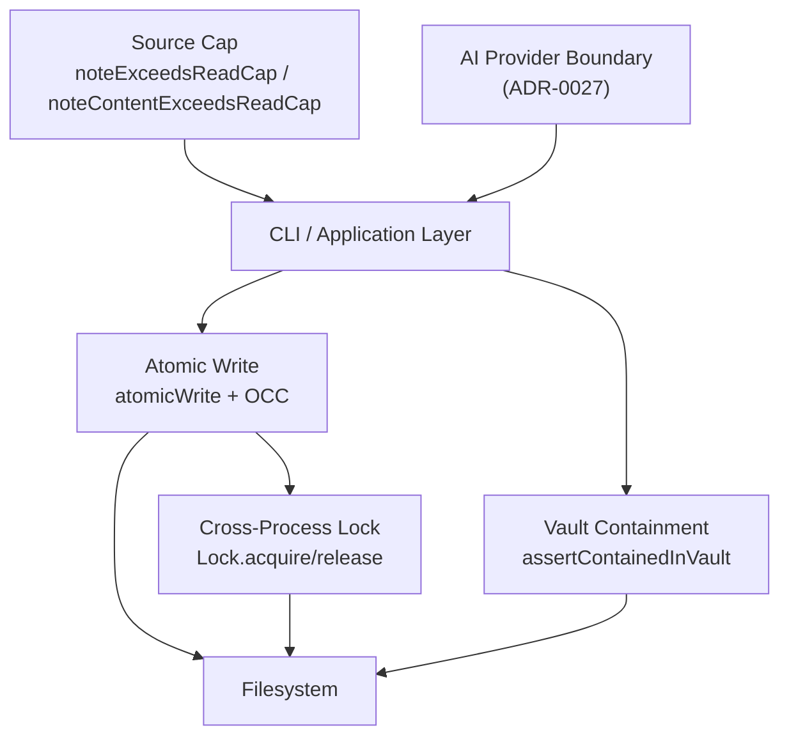
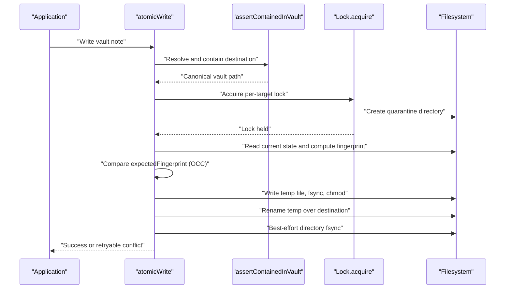
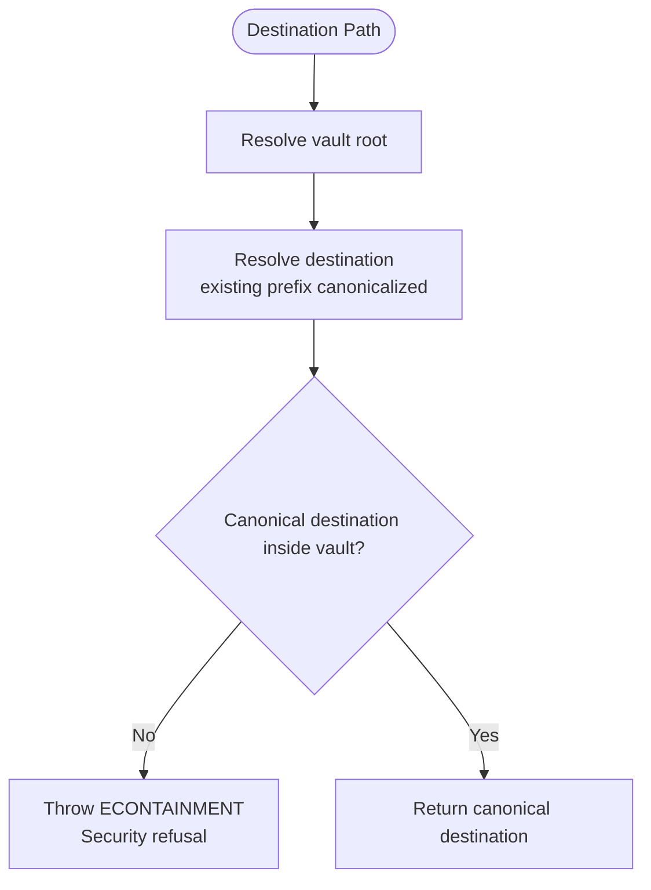
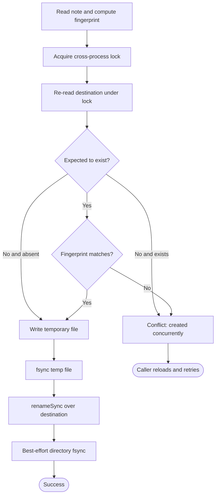
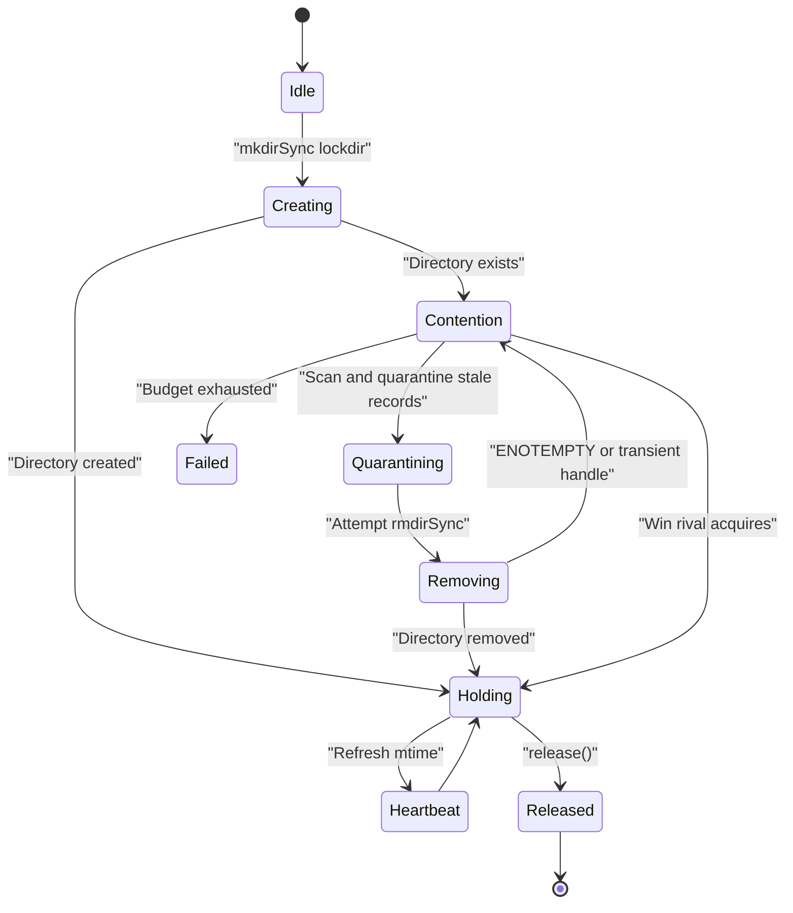
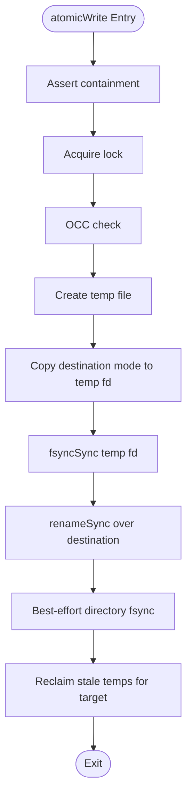
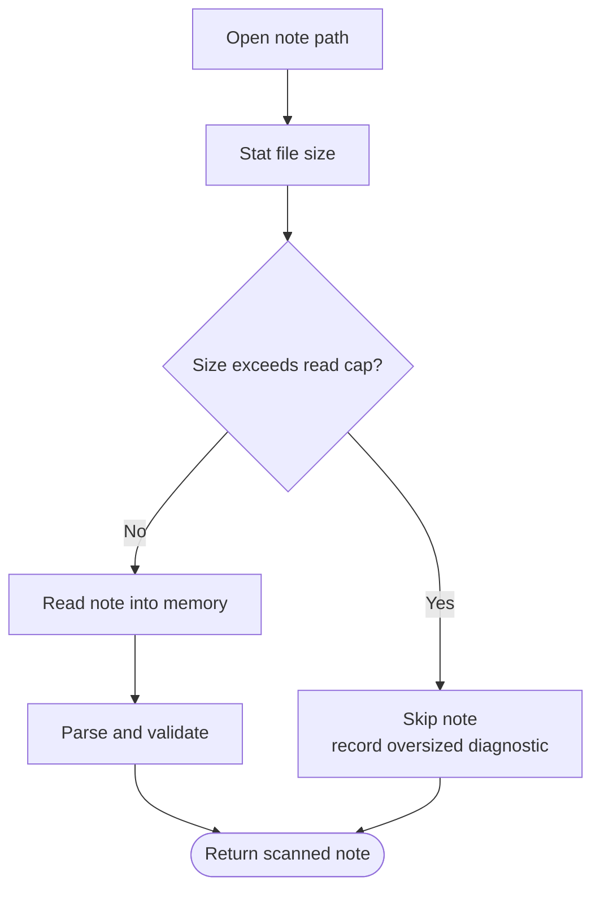
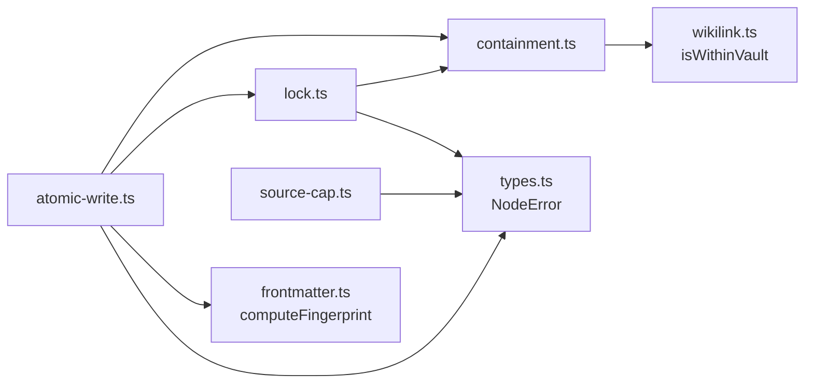

# Security and Concurrency Model

::: details Referenced Files in This Document

- [containment.ts](https://github.com/Kuldeep2822k/cli/blob/main/src/storage/containment.ts)
- [atomic-write.ts](https://github.com/Kuldeep2822k/cli/blob/main/src/storage/atomic-write.ts)
- [lock.ts](https://github.com/Kuldeep2822k/cli/blob/main/src/storage/lock.ts)
- [source-cap.ts](https://github.com/Kuldeep2822k/cli/blob/main/src/storage/source-cap.ts)
- [0002-atomic-file-locking-and-occ.md](https://github.com/Kuldeep2822k/cli/blob/main/docs/adr/0002-atomic-file-locking-and-occ.md)
- [0005-concurrency-storage-and-schema-migration.md](https://github.com/Kuldeep2822k/cli/blob/main/docs/adr/0005-concurrency-storage-and-schema-migration.md)
- [0006-phase-1-concurrency-resilience-and-storage-isolation.md](https://github.com/Kuldeep2822k/cli/blob/main/docs/adr/0006-phase-1-concurrency-resilience-and-storage-isolation.md)
- [0014-atomic-write-durability-and-containment.md](https://github.com/Kuldeep2822k/cli/blob/main/docs/adr/0014-atomic-write-durability-and-containment.md)
- [0027-ai-provider-boundary.md](https://github.com/Kuldeep2822k/cli/blob/main/docs/adr/0027-ai-provider-boundary.md)
- [0032-direct-spawn-bounding.md](https://github.com/Kuldeep2822k/cli/blob/main/docs/adr/0032-direct-spawn-bounding.md)
- [0036-bounded-lock-acquisition.md](https://github.com/Kuldeep2822k/cli/blob/main/docs/adr/0036-bounded-lock-acquisition.md)

:::

## Table of Contents
1. [Introduction](#introduction)
2. [Project Structure](#project-structure)
3. [Core Components](#core-components)
4. [Architecture Overview](#architecture-overview)
5. [Detailed Component Analysis](#detailed-component-analysis)
6. [Dependency Analysis](#dependency-analysis)
7. [Performance Considerations](#performance-considerations)
8. [Troubleshooting Guide](#troubleshooting-guide)
9. [Conclusion](#conclusion)
10. [References](#references)

## Introduction
This document explains PALEE's security model and concurrency handling for vault-based Markdown storage. It covers:

- Filesystem containment that prevents writes from escaping the designated vault directory.
- Optimistic concurrency control (OCC) and cross-process locking that detect and resolve simultaneous modifications.
- Atomic write operations that preserve durability and file permissions during crashes or interruptions.
- Source-size caps that limit memory and CPU consumption by oversized notes.
- Network boundaries and credential handling around external AI providers.
- Thread-safety, process isolation, bounded retries, and safe temporary-file cleanup.

PALEE is designed so that vault mutations are deterministic, offline where possible, and resilient to concurrent edits by Obsidian users, sync services, background tools, and multiple CLI processes.

## Project Structure
The security and concurrency concerns live primarily under `src/storage`, with architectural decisions recorded in the `docs/adr` directory. The most relevant files are:

| Area | Primary File | Responsibility |
|---|---|---|
| Vault containment | `src/storage/containment.ts` | Canonicalizes paths and refuses destinations outside the vault. |
| Atomic writes and OCC | `src/storage/atomic-write.ts` | Locks, checks fingerprints, writes atomically, and retries conflicts. |
| Cross-process locking | `src/storage/lock.ts` | Implements lock directories, heartbeats, stale recovery, and bounded acquisition. |
| Source-size limits | `src/storage/source-cap.ts` | Caps note read/write sizes to prevent denial-of-service. |
| AI provider boundary | `docs/adr/0027-ai-provider-boundary.md` | Restricts network targets, credentials, redirects, and response size. |
| Spawn bounding policy | `docs/adr/0032-direct-spawn-bounding.md` | Records bounds on child-process spawning in tests. |
| Design records | `docs/adr/0002`, `0005`, `0006`, `0014`, `0036` | Explain the accepted concurrency, durability, and containment decisions. |

## Core Components
PALEE's security model is layered:

1. **Containment**: No write path may create content outside the canonical vault root.
2. **Source cap**: Notes are refused before they can consume unbounded memory.
3. **Locking**: Cross-process mutual exclusion avoids overlapping writes to the same target.
4. **OCC**: Fingerprint comparison detects concurrent modification after a lock is acquired.
5. **Atomic write**: Temporary files, `fsync`, mode preservation, rename, and directory flush provide crash resilience.
6. **Network boundary**: Only authorized commands reach the network, and only safe endpoints receive credentials.
7. **Bounded resources**: Retries, locks, spawns, and responses have explicit budgets.

## Architecture Overview
At a high level, every vault mutation flows through a controlled sequence rather than direct filesystem calls:

## Detailed Component Analysis

### Filesystem Containment
Containment is the first line of defense against path traversal, symlinked vault roots, junctions, short names, and cross-volume escapes.

Key behaviors:

- `assertContainedInVault` resolves both the vault root and the destination through `fs.realpathSync` where components exist, then compares their canonical forms.
- Relative destinations are resolved against the vault root, not the process working directory.
- Existing ancestor components behind links or junctions are canonicalized; missing leaves are re-attached lexically because they cannot be resolved yet.
- A dangling link inside the vault is not treated as an escape.
- A final-component link inside the vault is written through, not replaced, so the verified note and the stored identity remain consistent.
- A link resolving outside the vault is refused with a containment error.
- Containment errors use code `ECONTAINMENT` and a fixed message prefix, so callers can distinguish them from retryable conflicts.
- The `.palee` tree creation sites also run containment before creating directories, preventing a planted link from materializing metadata outside the vault.

Important constraints:

- Containment is re-checked immediately before opening the temp file and renaming it, narrowing the TOCTOU window between initial certification and the filesystem call.
- The residual gap between the final re-check and the actual open is documented rather than claimed closable from JavaScript.
- Case differences and Windows 8.3 short names are handled by comparing canonical paths instead of raw strings.
- Different volumes are rejected because an absolute relative path does not stay within the vault root.

### Optimistic Concurrency Control and Conflict Resolution
OCC protects against lost updates when another process modifies a file between the time PALEE reads it and the time it writes the new version.

Implementation highlights:

- Each atomic write carries an optional `expectedFingerprint`.
- After acquiring the lock, PALEE reads the current destination and recomputes its SHA-256 frontmatter fingerprint.
- If the caller expects the file to exist but the fingerprint differs, PALEE throws a retryable conflict.
- First-creation writes use `expectExists: false`; if the destination appeared while waiting for the lock, this is also a conflict.
- Overwrite writes require a fingerprint; omitting it when existence is asserted is a caller bug and becomes a conflict.
- Conflicts carry code `ECONFLICT` and messages prefixed with `OCC conflict:` or `Lock conflict:`.
- Callers should reload and retry rather than silently overwrite.

Conflict resolution strategy:

- `isConflictError` recognizes both the error code and message prefixes used by OCC and lock contention.
- Lock contention and OCC mismatches are classified as retryable conflicts, not permanent security failures.
- The review path demonstrates re-reading the topic note immediately before writing and triggering a conflict when the fingerprint changes.
- Batch operations tolerate partial failures while still preserving atomicity per note.

### Cross-Process Locking
PALee uses an atomic directory-based lock scheme instead of native OS file locks, keeping the implementation portable and free of native addons.

Key mechanisms:

- Each target maps to a deterministic lock directory under `.palee/locks/<hash>.lockdir`.
- Acquisition uses `mkdirSync` on the lock directory, which is atomic on POSIX and serves as a mutex.
- The holder writes a JSON descriptor containing lock ID, target path, PID, hostname, and timestamp.
- A heartbeat refreshes the lock file's modification time at a fixed interval.
- Stale locks are recovered after platform-specific timeouts: shorter on Windows, longer on POSIX/macOS.
- Recovery quarantines existing records, deletes what it can, and removes the lock directory.
- Windows transient handle errors (`EPERM`/`EBUSY`) use exponential backoff with jitter.
- Lock acquisition is bounded by iteration limits and retry budgets.

Bounded acquisition guarantees:

- `MAX_ACQUISITION_ITERATIONS` caps the outer acquisition loop.
- `ENOTEMPTY_RETRY_ATTEMPTS` caps non-progress retries.
- Backoff uses doubling, jitter, and a maximum delay, avoiding busy spins.
- `Atomics.wait` parks the thread during synchronous waits without consuming CPU.
- Directory entries that cannot be removed are reported in a conflict message rather than causing an unbounded loop.
- Entry names are escaped to prevent terminal forgery or log corruption.

### Atomic Writes and Durability
Atomic writes ensure that vault notes are never partially persisted and that file permissions are preserved.

Sequence:

1. Assert containment.
2. Acquire the target lock.
3. Perform OCC checks.
4. Create a unique temporary file named `<target>.tmp.<pid>.<entropy>`.
5. Restore the destination's permission mode onto the temp file descriptor.
6. Flush the temp file with `fsyncSync`.
7. Atomically rename the temp file over the destination.
8. Best-effort flush of the containing directory.
9. Handle Windows transient locking with bounded retries.

Durability properties:

- Data is flushed before rename.
- Mode bits are preserved for existing files; new files keep the default mode.
- On POSIX, the directory entry is made durable by flushing the parent directory when supported.
- Windows directory flushes are best-effort and ignored when unsupported.
- Crash-resilient cleanup removes abandoned temporary files belonging to the same target whose owner process is gone and that exceed a staleness floor.

Temporary-file safety:

- The entropy component prevents collisions even among concurrent promises in the same process.
- Stray temp files left by killed writers are reclaimed only after the lock is held and the OCC check passes.
- Reclamation probes the host process table and requires a minimum age, protecting shared-network-fs scenarios.
- Reclamation is best-effort: it does not turn unreadable or locked residue into a failed write.

### Source Cap and Denial-of-Service Protection
The source cap limits how large a note can be loaded or written, preventing oversized documents from consuming memory or CPU during scans.

Behavior:

- The read cap is 512 KiB.
- Notes are stat-checked before reading; bytes already allocated are not measured.
- Write paths also verify whether managed frontmatter would push the resulting note past the cap.
- The cap is separate from the TOC reader's cap by design, although the values are pinned equal explicitly.
- Oversized reads and writes produce diagnostics naming the observed size and ceiling.

### External AI Providers and Network Boundaries
Phase 1 of PALEE is deterministic and offline. The first network boundary appears in Phase 2 through the AI provider adapter.

Security rules:

- Only one command reaches the network structurally; test scanning enforces this invariant.
- The transport seam allows tests to record URLs, headers, bodies, retries, and signals.
- Reserved address space is refused outright, including IPv4 metadata ranges, multicast, unspecified addresses, and certain IPv6 ranges.
- Loopback is permitted so local providers work.
- Plain HTTP is allowed only for loopback because bearer tokens must not leave the machine unencrypted.
- Redirects are refused to avoid sending credentials to unapproved hosts.
- Response size is bounded during streaming, not after buffering.
- Credentials are not passed through argv and are not printed.
- Changing the endpoint is treated as changing the credential target unless explicitly opted out.
- Windows config-directory placement checks location rather than full ACLs, with a documented override.

### Thread Safety, Process Isolation, and Credential Management
PALee's concurrency model emphasizes process isolation rather than relying on a single global in-memory mutex:

- Cross-process coordination uses filesystem locks and OCC, not Node.js process-local async queues.
- Lock descriptors include PID and hostname to support liveness detection and stale recovery.
- Temporary files include process IDs and cryptographic entropy to avoid intra-process collisions.
- Synchronous lock acquisition uses blocking waits without spinning.
- Child processes launched in tests are bounded by a guard requiring timeouts on direct spawn calls.
- AI provider credentials are read from environment variables, stdin, or interactive prompts, never positional arguments.
- Stored configuration is opened with restrictive mode semantics before payload bytes are written.
- The offline core has no socket calls; network behavior is isolated to the provider boundary.

## Dependency Analysis
The following diagram shows the main runtime dependencies between security and concurrency components.

Coupling observations:

- `atomic-write.ts` depends on both `containment.ts` and `lock.ts`, making it the central orchestration point for secure vault writes.
- `lock.ts` depends on containment to protect the `.palee/locks` directory itself.
- `containment.ts` delegates vault membership to `isWithinVault`, centralizing the containment predicate.
- `source-cap.ts` is intentionally independent of locking and containment; it guards resource consumption early in the read/write pipeline.
- All components propagate typed Node errors so callers can distinguish security refusals, conflicts, and I/O failures.

## Performance Considerations
Security controls add deliberate overhead, but they are bounded and targeted:

- Containment performs canonical path resolution once per write attempt.
- Lock acquisition is synchronous and uses `Atomics.wait` to avoid CPU spinning.
- OCC adds one extra read of the target file under the lock.
- Atomic writes create temporary files and perform `fsyncSync`, improving durability at the cost of additional I/O.
- Source caps reject oversized files before allocating buffers, reducing peak memory pressure.
- Bounded retries and iteration caps prevent indefinite stalls.
- The AI provider boundary streams responses and cancels readers once the byte limit is reached.

These costs are tradeoffs for correctness, durability, and resistance to malicious or malformed input.

[No sources needed since this section provides general guidance]

## Troubleshooting Guide

### Destination Resolves Outside the Vault
**Symptoms:**
- Error code `ECONTAINMENT`.
- Message beginning with the containment refusal prefix.
- Exit code indicating a security failure rather than a retryable conflict.

**Likely causes:**
- Symlinked or junctioned vault root pointing elsewhere.
- Final-component link redirecting outside the vault.
- Relative path resolved against the wrong working directory.
- Planted `.palee` directory pointing outside the intended vault.

**Actions:**
- Verify the vault root and target paths are correct.
- Do not retry; containment is not a transient condition.
- Inspect filesystem links and junctions near the destination.

### Concurrent Modification Detected
**Symptoms:**
- Error code `ECONFLICT`.
- Message prefixed with `OCC conflict:` or `Lock conflict:`.
- Review or adopt operation fails with exit code indicating a conflict.

**Likely causes:**
- Another PALEE process modified the file.
- An external editor or sync service changed the note between read and write.
- Two processes attempted first creation simultaneously.

**Actions:**
- Reload the file and retry the operation.
- Avoid holding stale fingerprints across long user interactions.
- Ensure clients treat `ECONFLICT` as retryable.

### Lock Acquisition Appears Hung or Slow
**Symptoms:**
- Long wait before a lock is acquired.
- Conflict mentioning a lock directory that would not empty.
- Windows antivirus or indexer holding a handle.

**Likely causes:**
- Another process holds the lock.
- A stale lock was being recovered.
- Transient handles on Windows delayed directory removal.
- Foreign residue in the lock directory.

**Actions:**
- Check for other PALEE processes or editors holding the target.
- Clear stale lock residue only after confirming the holder is dead.
- Investigate antivirus or indexers that hold vault handles.
- Treat bounded contention as retryable; do not assume permanent failure.

### Note Too Large to Read or Write
**Symptoms:**
- Diagnostic naming an oversized source or result.
- Note skipped by scanners or adoption.
- Write rejected because managed frontmatter would exceed the cap.

**Likely causes:**
- A non-note file was placed in the vault.
- A note contains generated or exported content far larger than normal study prose.
- Managed keys pushed the final byte count past the ceiling.

**Actions:**
- Remove or relocate large non-note files outside the vault.
- Reduce embedded artifacts or split content into separate files.
- Treat oversized notes as unreadable until reduced below the cap.

### AI Provider Connection Problems
**Symptoms:**
- Connection refused for reserved or loopback-only protocols.
- Request blocked because credentials appear in the base URL.
- Response too large or stream not bounded.
- Endpoint change prompts for confirmation.

**Likely causes:**
- Base URL points at reserved address space or metadata service.
- Plain HTTP used for a non-loopback endpoint.
- Credentials embedded in the URL.
- Redirect followed to an unapproved host.
- Large or endless response body.

**Actions:**
- Use HTTPS except for loopback.
- Store the API key separately via the configured credential mechanism.
- Remove query strings and fragments from the base URL.
- Keep the endpoint stable or explicitly opt in to changing the credential target.
- Ensure the provider returns bounded responses.

## Conclusion
PALee's security and concurrency model is built around strict containment, bounded resources, process-safe locking, optimistic concurrency control, and atomic durability. Vault writes cannot escape the canonical vault root, oversized inputs are refused early, simultaneous modifications are detected and retried safely, and crashes leave consistent data rather than partial files. Network access is isolated to a carefully constrained AI provider boundary, and credentials are handled outside argv and with restricted file modes. Together, these layers make PALEE resilient against accidental corruption, hostile vault layouts, denial-of-service inputs, and concurrent editing by humans and machines.

## References

- [containment.ts:1-185](https://github.com/Kuldeep2822k/cli/blob/main/src/storage/containment.ts#L1-L185)
- [atomic-write.ts:1-200](https://github.com/Kuldeep2822k/cli/blob/main/src/storage/atomic-write.ts#L1-L200)
- [lock.ts:1-200](https://github.com/Kuldeep2822k/cli/blob/main/src/storage/lock.ts#L1-L200)
- [source-cap.ts:1-109](https://github.com/Kuldeep2822k/cli/blob/main/src/storage/source-cap.ts#L1-L109)
- [0027-ai-provider-boundary.md:1-97](https://github.com/Kuldeep2822k/cli/blob/main/docs/adr/0027-ai-provider-boundary.md#L1-L97)
- [0002-atomic-file-locking-and-occ.md:1-56](https://github.com/Kuldeep2822k/cli/blob/main/docs/adr/0002-atomic-file-locking-and-occ.md#L1-L56)
- [0014-atomic-write-durability-and-containment.md:1-79](https://github.com/Kuldeep2822k/cli/blob/main/docs/adr/0014-atomic-write-durability-and-containment.md#L1-L79)
- [atomic-write.ts:201-450](https://github.com/Kuldeep2822k/cli/blob/main/src/storage/atomic-write.ts#L201-L450)
- [lock.ts:200-500](https://github.com/Kuldeep2822k/cli/blob/main/src/storage/lock.ts#L200-L500)
- [0006-phase-1-concurrency-resilience-and-storage-isolation.md:1-87](https://github.com/Kuldeep2822k/cli/blob/main/docs/adr/0006-phase-1-concurrency-resilience-and-storage-isolation.md#L1-L87)
- [0036-bounded-lock-acquisition.md:1-91](https://github.com/Kuldeep2822k/cli/blob/main/docs/adr/0036-bounded-lock-acquisition.md#L1-L91)
- [0005-concurrency-storage-and-schema-migration.md:1-51](https://github.com/Kuldeep2822k/cli/blob/main/docs/adr/0005-concurrency-storage-and-schema-migration.md#L1-L51)
- [0032-direct-spawn-bounding.md:1-79](https://github.com/Kuldeep2822k/cli/blob/main/docs/adr/0032-direct-spawn-bounding.md#L1-L79)
