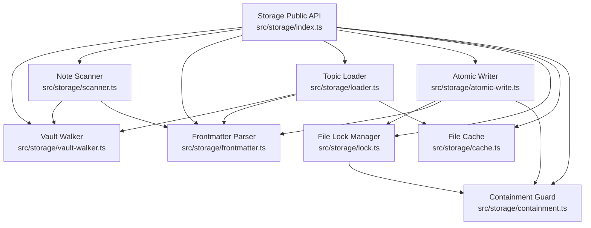
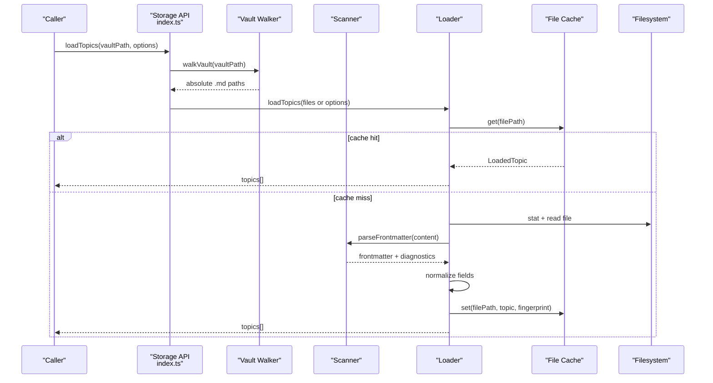
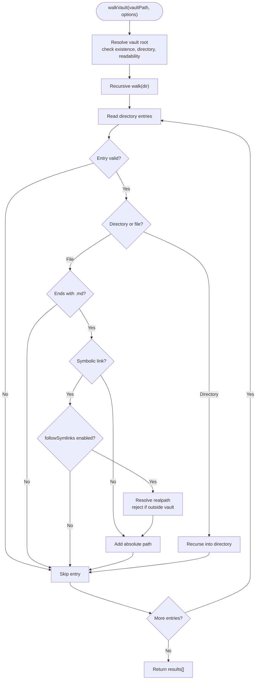
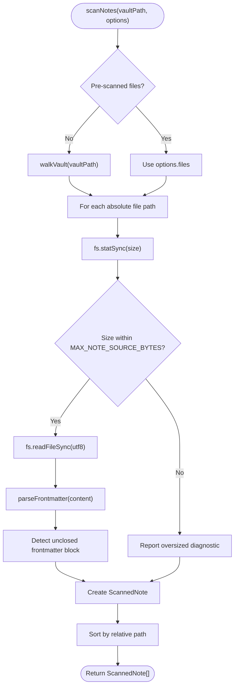
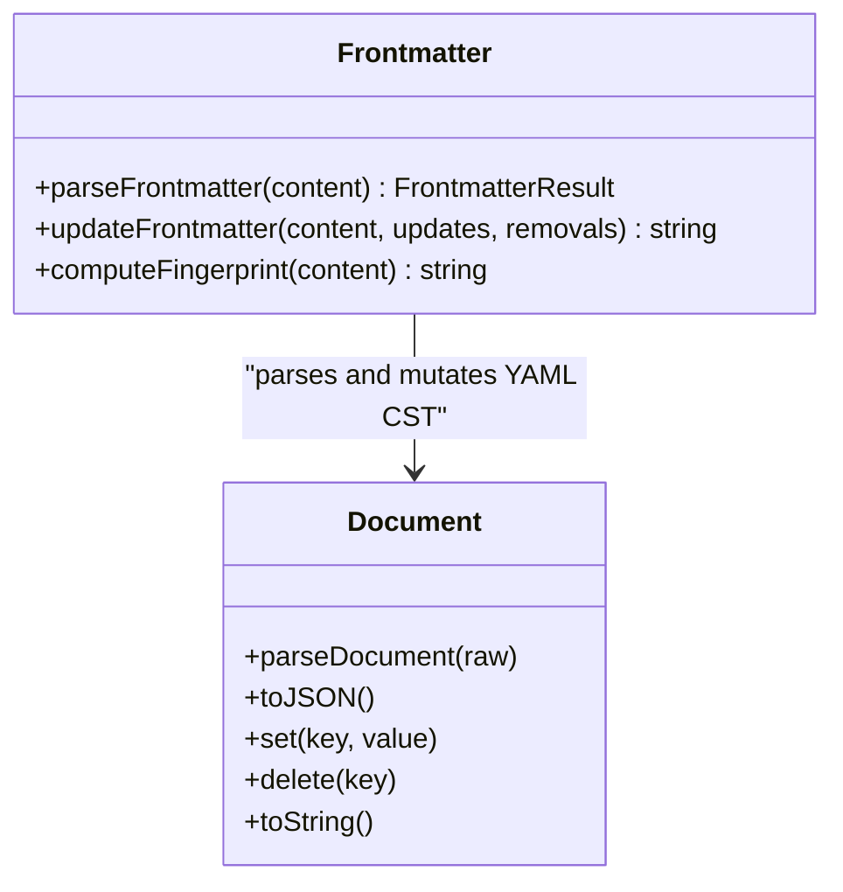
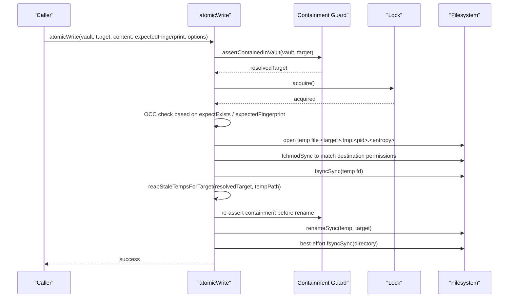
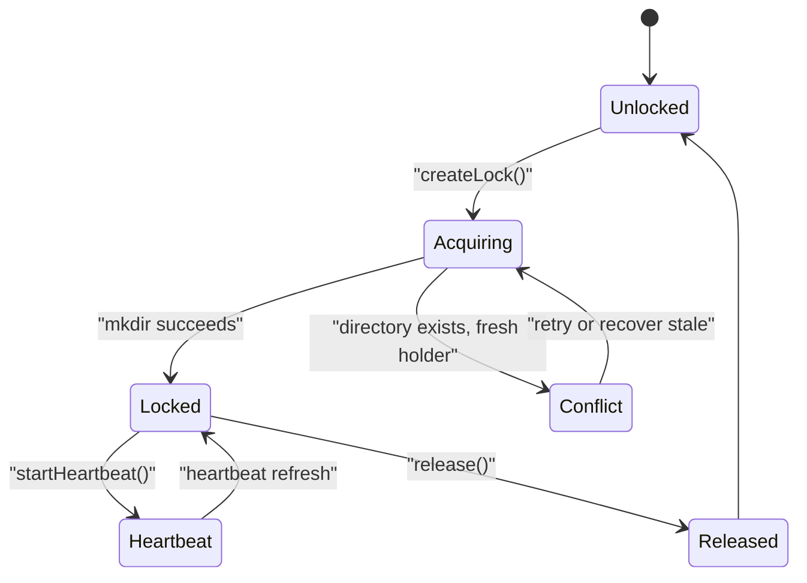
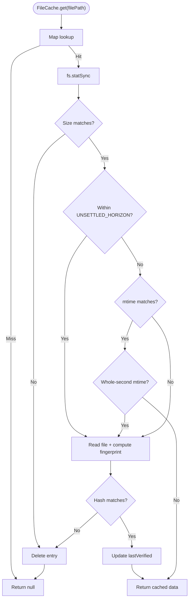
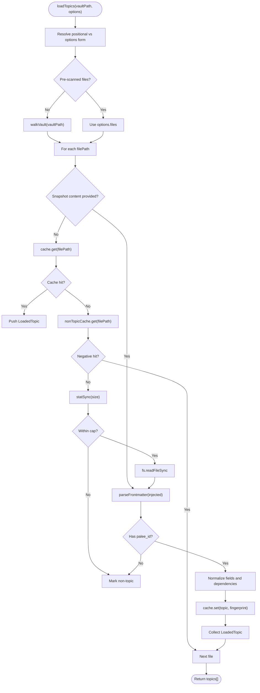
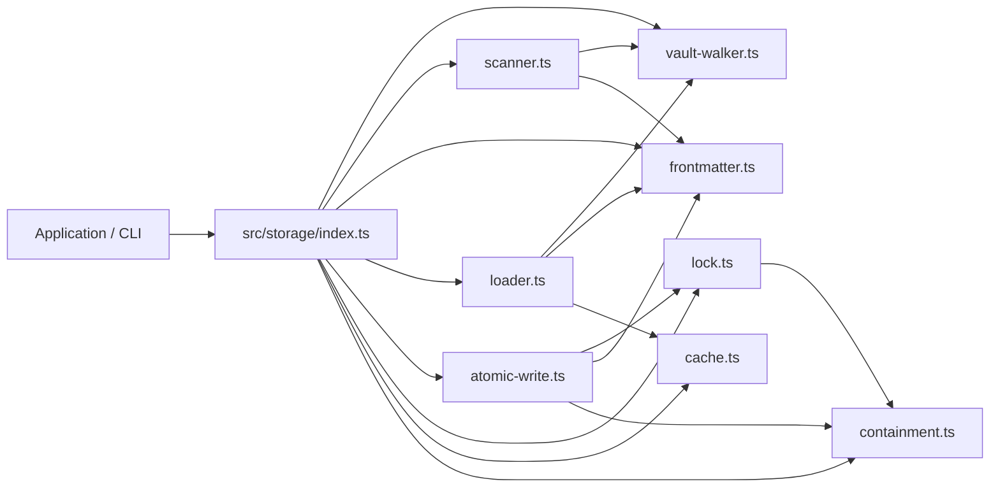

# Storage and Vault System

::: details Referenced Files in This Document

- [storage index](https://github.com/Kuldeep2822k/cli/blob/main/src/storage/index.ts)
- [vault walker](https://github.com/Kuldeep2822k/cli/blob/main/src/storage/vault-walker.ts)
- [note scanner](https://github.com/Kuldeep2822k/cli/blob/main/src/storage/scanner.ts)
- [frontmatter parser](https://github.com/Kuldeep2822k/cli/blob/main/src/storage/frontmatter.ts)
- [atomic writer](https://github.com/Kuldeep2822k/cli/blob/main/src/storage/atomic-write.ts)
- [file lock manager](https://github.com/Kuldeep2822k/cli/blob/main/src/storage/lock.ts)
- [file cache](https://github.com/Kuldeep2822k/cli/blob/main/src/storage/cache.ts)
- [topic loader](https://github.com/Kuldeep2822k/cli/blob/main/src/storage/loader.ts)
- [containment guard](https://github.com/Kuldeep2822k/cli/blob/main/src/storage/containment.ts)

:::

## Table of Contents
1. [Introduction](#introduction)
2. [Project Structure](#project-structure)
3. [Core Components](#core-components)
4. [Architecture Overview](#architecture-overview)
5. [Detailed Component Analysis](#detailed-component-analysis)
6. [Dependency Analysis](#dependency-analysis)
7. [Performance Considerations](#performance-considerations)
8. [Troubleshooting Guide](#troubleshooting-guide)
9. [Conclusion](#conclusion)

## Introduction
This document explains PALEE's storage layer and its integration with an Obsidian vault. It covers how PALEE discovers Markdown notes, parses and updates YAML frontmatter while preserving formatting, performs atomic writes with optimistic concurrency control (OCC), enforces path containment for security, coordinates concurrent access through file locks, and caches parsed data to keep repeated scans efficient.

At a high level:
- The **vault walker** enumerates visible `.md` files while ignoring hidden directories, `node_modules`, dotfiles, and symlink escapes.
- The **scanner** reads each note safely, detects malformed or unclosed frontmatter blocks, and reports per-file parse outcomes without aborting the whole scan.
- The **frontmatter module** uses a YAML concrete syntax tree to preserve comments, ordering, unknown keys, and line endings.
- The **loader** converts validated topic notes into normalized in-memory topic objects and caches them.
- The **atomic writer** persists updates safely using temporary files, OCC fingerprint checks, filesystem locks, and directory fsync where supported.
- The **file lock manager** serializes access to individual notes using platform-aware stale-lock recovery and heartbeats.
- The **file cache** avoids redundant disk reads by validating entries against mtime, size, and SHA-256 fingerprints.
- The **containment guard** refuses any write that resolves outside the vault, including escaped links and planted junctions.

## Project Structure
The storage subsystem is centered around `src/storage/index.ts`, which re-exports the public surface for vault traversal, frontmatter manipulation, locking, atomic writing, caching, scanning, loading, sessions, patterns, roadmaps, and table-of-contents discovery. Individual modules implement one responsibility each.

**Diagram sources**
- [storage index:1-142](https://github.com/Kuldeep2822k/cli/blob/main/src/storage/index.ts#L1-L142)
- [vault walker:1-368](https://github.com/Kuldeep2822k/cli/blob/main/src/storage/vault-walker.ts#L1-L368)
- [note scanner:1-327](https://github.com/Kuldeep2822k/cli/blob/main/src/storage/scanner.ts#L1-L327)
- [frontmatter parser:1-220](https://github.com/Kuldeep2822k/cli/blob/main/src/storage/frontmatter.ts#L1-L220)
- [atomic writer:1-611](https://github.com/Kuldeep2822k/cli/blob/main/src/storage/atomic-write.ts#L1-L611)
- [file lock manager:1-956](https://github.com/Kuldeep2822k/cli/blob/main/src/storage/lock.ts#L1-L956)
- [file cache:1-273](https://github.com/Kuldeep2822k/cli/blob/main/src/storage/cache.ts#L1-L273)
- [containment guard:1-185](https://github.com/Kuldeep2822k/cli/blob/main/src/storage/containment.ts#L1-L185)

**Section sources**
- [storage index:1-142](https://github.com/Kuldeep2822k/cli/blob/main/src/storage/index.ts#L1-L142)

## Core Components
| Component | Responsibility | Key Behaviors |
|---|---|---|
| Vault walker | Discover visible Markdown files | Excludes dot-directories, dotfiles, `node_modules`; validates symlink targets; normalizes vault-relative paths |
| Note scanner | Read notes and report parse outcomes | Stat-first size cap; tolerant read errors; detects unclosed frontmatter blocks |
| Frontmatter parser | Parse and update YAML frontmatter | CST-based parsing; preserves comments, ordering, unknown keys; preserves BOM and line endings |
| Topic loader | Normalize and cache topics | Coerces fields; clamps scores; extracts dependencies; separates topic and non-topic caches |
| File cache | Fast in-memory reads | Unsettled horizon fingerprint check; mtime/size validation; LRU eviction |
| File lock manager | Cross-process file mutex | Atomic directory acquisition; heartbeat; stale recovery; bounded retries |
| Atomic writer | Safe durable updates | Temporary file, OCC fingerprint check, lock, permission preservation, rename, directory fsync |
| Containment guard | Prevent writes outside vault | Canonical prefix resolution; link/junction escape detection; unified refusal error |

**Section sources**
- [vault walker:1-368](https://github.com/Kuldeep2822k/cli/blob/main/src/storage/vault-walker.ts#L1-L368)
- [note scanner:1-327](https://github.com/Kuldeep2822k/cli/blob/main/src/storage/scanner.ts#L1-L327)
- [frontmatter parser:1-220](https://github.com/Kuldeep2822k/cli/blob/main/src/storage/frontmatter.ts#L1-L220)
- [topic loader:1-417](https://github.com/Kuldeep2822k/cli/blob/main/src/storage/loader.ts#L1-L417)
- [file cache:1-273](https://github.com/Kuldeep2822k/cli/blob/main/src/storage/cache.ts#L1-L273)
- [file lock manager:1-956](https://github.com/Kuldeep2822k/cli/blob/main/src/storage/lock.ts#L1-L956)
- [atomic writer:1-611](https://github.com/Kuldeep2822k/cli/blob/main/src/storage/atomic-write.ts#L1-L611)
- [containment guard:1-185](https://github.com/Kuldeep2822k/cli/blob/main/src/storage/containment.ts#L1-L185)

## Architecture Overview
PALEE's storage layer follows a layered contract: callers use the public storage API, which delegates to specialized components. Reads flow from the vault walker through the scanner and loader into the cache. Writes flow through the atomic writer, which combines containment checking, locking, OCC verification, temporary-file persistence, and durability flushing.

**Diagram sources**
- [storage index:1-142](https://github.com/Kuldeep2822k/cli/blob/main/src/storage/index.ts#L1-L142)
- [vault walker:1-368](https://github.com/Kuldeep2822k/cli/blob/main/src/storage/vault-walker.ts#L1-L368)
- [note scanner:1-327](https://github.com/Kuldeep2822k/cli/blob/main/src/storage/scanner.ts#L1-L327)
- [topic loader:1-417](https://github.com/Kuldeep2822k/cli/blob/main/src/storage/loader.ts#L1-L417)
- [file cache:1-273](https://github.com/Kuldeep2822k/cli/blob/main/src/storage/cache.ts#L1-L273)

## Detailed Component Analysis

### Vault Traversal and Containment Security
The vault walker recursively enumerates `.md` files while applying strict visibility rules:
- Dot-directories such as `.obsidian`, `.trash`, `.git`, and `.palee` are skipped.
- Dotfiles are skipped.
- `node_modules` is permanently excluded.
- Non-`.md` files are ignored.
- Symbolic links are skipped unless explicitly followed.
- When symlinks are followed, their real target must resolve inside the vault.

The walker also provides utilities for safe relative path derivation and identity folding so case and Unicode normalization do not break cross-platform comparisons.

**Diagram sources**
- [vault walker:1-368](https://github.com/Kuldeep2822k/cli/blob/main/src/storage/vault-walker.ts#L1-L368)

Security measures include:
- Resolving the vault root before traversal.
- Rejecting symlink targets that escape the vault when following links.
- Using canonicalization helpers to derive reliable vault-relative paths.
- Enforcing containment for newly created directories through `ensureVaultDirectory`, which asserts containment both before and after creation to fail closed across the small TOCTOU window.

**Section sources**
- [vault walker:1-368](https://github.com/Kuldeep2822k/cli/blob/main/src/storage/vault-walker.ts#L1-L368)
- [containment guard:1-185](https://github.com/Kuldeep2822k/cli/blob/main/src/storage/containment.ts#L1-L185)

### Scanner: Topic Discovery and Tolerant Parsing
The scanner is the storage-boundary reader used by the validation framework. Its key design goals are:
- Never throw on one bad note during a full vault scan.
- Bound memory and IO by rejecting oversized files at stat time.
- Report every scanned file exactly once.
- Distinguish no frontmatter from malformed frontmatter.
- Detect body text accidentally treated as frontmatter due to an unclosed `---` fence.

**Diagram sources**
- [note scanner:1-327](https://github.com/Kuldeep2822k/cli/blob/main/src/storage/scanner.ts#L1-L327)

The scanner uses the vault walker and frontmatter parser but adds:
- A stat-first size guard.
- Graceful handling of deleted, locked, or unreadable files.
- A heuristic that distinguishes YAML mapping content from accidental Markdown headings, blockquotes, lists, and other body-text shapes after the mapping region ends.

**Section sources**
- [note scanner:1-327](https://github.com/Kuldeep2822k/cli/blob/main/src/storage/scanner.ts#L1-L327)
- [vault walker:1-368](https://github.com/Kuldeep2822k/cli/blob/main/src/storage/vault-walker.ts#L1-L368)
- [frontmatter parser:1-220](https://github.com/Kuldeep2822k/cli/blob/main/src/storage/frontmatter.ts#L1-L220)

### Frontmatter Parsing and Manipulation
The frontmatter module treats YAML frontmatter as a first-class structured object while treating surrounding Markdown and YAML formatting as immutable context.

Key responsibilities:
- Parse opening/closing `---` fences robustly, including Windows-style CRLF and a leading UTF-8 BOM.
- Return structured frontmatter, raw YAML, body text, and optional parse diagnostics.
- Treat empty fenced blocks, missing fences, scalar/thematic-break values, and array values differently.
- Update selected keys and remove others without rewriting comments, property order, unknown keys, or block scalars.
- Preserve the original line terminator convention so edits produce minimal diffs.
- Compute SHA-256 fingerprints for OCC and cache validation.

**Diagram sources**
- [frontmatter parser:1-220](https://github.com/Kuldeep2822k/cli/blob/main/src/storage/frontmatter.ts#L1-L220)

Important behaviors:
- `parseFrontmatter` returns no frontmatter when the fenced content is empty, whitespace-only, a scalar, or otherwise invalid YAML.
- `updateFrontmatter` throws only when existing frontmatter is unparseable; it does not treat missing frontmatter as an error.
- Fingerprint computation is deterministic over UTF-8 text and is reused by the cache and atomic writer.

**Section sources**
- [frontmatter parser:1-220](https://github.com/Kuldeep2822k/cli/blob/main/src/storage/frontmatter.ts#L1-L220)

### Atomic File Operations and Rollback Mechanisms
The atomic writer is the single durable write primitive for vault notes and managed metadata. It guarantees that either the old file or the new file survives, never a partially written destination.

High-level sequence:

**Diagram sources**
- [atomic writer:1-611](https://github.com/Kuldeep2822k/cli/blob/main/src/storage/atomic-write.ts#L1-L611)
- [containment guard:1-185](https://github.com/Kuldeep2822k/cli/blob/main/src/storage/containment.ts#L1-L185)
- [file lock manager:1-956](https://github.com/Kuldeep2822k/cli/blob/main/src/storage/lock.ts#L1-L956)

Design highlights:
- **Containment enforcement:** Every write begins by resolving and asserting that the destination lies inside the vault. The same unified error code and message prefix are used for all containment refusals.
- **Locking:** A per-target lock prevents concurrent writers from racing the OCC check and rename.
- **Optimistic concurrency control:** If an expected fingerprint is provided, the writer reads the current file and compares its SHA-256 fingerprint. If absent was expected but the file exists, or vice versa, it throws a retryable conflict.
- **Temporary file strategy:** Content is written to `<target>.tmp.<pid>.<entropy>`, then renamed atomically.
- **Permission preservation:** The destination's prior mode bits are copied to the temporary file descriptor before writing, preventing accidental widening of sensitive files.
- **Durability:** Data and metadata are flushed via `fsyncSync` on the temp file, and the containing directory is flushed where the platform allows it.
- **Windows resilience:** Transient EPERM/EBUSY conditions use exponential backoff with jitter.
- **Stale temporary cleanup:** Abandoned temp files left by crashed processes are reclaimed under the lock after passing the staleness floor and owner-probe checks.
- **Rollback behavior:** Because the destination is replaced by rename, partial writes cannot leave the destination half-updated. On failure, the old file remains intact. On successful rename, the new file is durable.

Conflict vs containment:
- `ECONFLICT` indicates a retryable condition such as a concurrent modification, lock contention, or expectation mismatch.
- `ECONTAINMENT` indicates a vault-integrity violation that should not be retried.

**Section sources**
- [atomic writer:1-611](https://github.com/Kuldeep2822k/cli/blob/main/src/storage/atomic-write.ts#L1-L611)
- [containment guard:1-185](https://github.com/Kuldeep2822k/cli/blob/main/src/storage/containment.ts#L1-L185)

### File Locking System for Concurrent Access Control
The file lock manager provides cross-process synchronization for individual notes using `.palee/locks`:

- Each note maps deterministically to a hashed lock directory under `.palee/locks`.
- Lock acquisition uses an atomic `mkdir` pattern: the first process to create the lock directory wins.
- Lock records contain lock ID, target path, PID, hostname, and timestamp.
- A background heartbeat updates lock file timestamps every 15 seconds while held.
- Stale locks are recovered after platform-specific timeouts: 60 seconds on Windows, 120 seconds elsewhere.
- Same-host dead-process recovery probes the recorded PID; timeout-based recovery is used for cross-host or unknown hosts.
- Acquisition is bounded: a maximum iteration count and a bounded retry budget prevent busy loops.
- Quarantine files support in-flight recovery so rival processes do not race to destroy state.

**Diagram sources**
- [file lock manager:1-956](https://github.com/Kuldeep2822k/cli/blob/main/src/storage/lock.ts#L1-L956)

Platform considerations:
- Case-insensitive platforms fold lock keys so different spellings of the same note share one lock directory.
- Windows transient handle errors are retried with bounded delays.
- Entry names are escaped in error messages to avoid terminal control-character injection.

**Section sources**
- [file lock manager:1-956](https://github.com/Kuldeep2822k/cli/blob/main/src/storage/lock.ts#L1-L956)

### Caching Strategy and Memory Management
The file cache is a generic, path-keyed in-memory cache used by the topic loader and related read paths.

Validation policy:
- On `get`, the cache first checks whether the file still exists and whether its size matches.
- If the file was modified within the unsettled horizon (2 seconds), it reads the file and recomputes its SHA-256 fingerprint. A mismatch evicts the entry.
- Outside the unsettled horizon, matching mtime normally returns the cached entry.
- On filesystems with whole-second mtime granularity, a fallback fingerprint check protects against same-second edits.
- Missing files, truncation, or read errors evict the entry.

Memory management:
- The default maximum is 2,000 entries.
- When exceeded, the least-recently-verified entry is evicted.
- Manual invalidation and full clearing are supported.

**Diagram sources**
- [file cache:1-273](https://github.com/Kuldeep2822k/cli/blob/main/src/storage/cache.ts#L1-L273)

The loader uses two caches:
- A topic cache for successfully parsed PALEE topics.
- A separate negative cache for non-topic notes, so ordinary Markdown files cost only a stat after they have been classified once.

**Section sources**
- [file cache:1-273](https://github.com/Kuldeep2822k/cli/blob/main/src/storage/cache.ts#L1-L273)
- [topic loader:1-417](https://github.com/Kuldeep2822k/cli/blob/main/src/storage/loader.ts#L1-L417)

### Loader: Efficient Data Retrieval and Normalization
The topic loader is the central boundary for converting vault Markdown notes into normalized topic objects.

Responsibilities:
- Accept pre-scanned file lists or walk the vault.
- Support snapshot injection so tests and scanners can observe one consistent set of bytes without touching the filesystem.
- Skip oversized files early.
- Parse frontmatter and reject notes without a valid `palee_id`.
- Normalize titles, scores, SM-2 fields, status, dependencies, and assessment metadata.
- Populate the shared topic cache and negative cache.
- Return stable `LoadedTopic` objects with canonical IDs, paths, content, and frontmatter.

**Diagram sources**
- [topic loader:1-417](https://github.com/Kuldeep2822k/cli/blob/main/src/storage/loader.ts#L1-L417)
- [vault walker:1-368](https://github.com/Kuldeep2822k/cli/blob/main/src/storage/vault-walker.ts#L1-L368)
- [frontmatter parser:1-220](https://github.com/Kuldeep2822k/cli/blob/main/src/storage/frontmatter.ts#L1-L220)
- [file cache:1-273](https://github.com/Kuldeep2822k/cli/blob/main/src/storage/cache.ts#L1-L273)

Normalization details include:
- Scores are clamped to `[0.0, 1.0]` with four decimal places.
- Integer fields are coerced and floored.
- Optional integer fields retain a `null` absence state.
- Dependency arrays accept multiple legacy field names.
- Dates are normalized to strings or null where appropriate.

**Section sources**
- [topic loader:1-417](https://github.com/Kuldeep2822k/cli/blob/main/src/storage/loader.ts#L1-L417)

### Filesystem Security Measures
PALAE's security model centers on refusing writes that could escape the vault or corrupt its managed structure.

Primary mechanisms:
- `assertContainedInVault` canonicalizes existing path prefixes and re-attaches missing components so dangling links are not trusted blindly.
- Both the vault root and the destination are canonicalized before comparison.
- Relative path escaping, cross-drive roots, junctions, and POSIX symlinks are rejected.
- `ensureVaultDirectory` asserts containment before creating `.palee` subdirectories and re-asserts afterward.
- Lock directories are created under `.palee/locks` and themselves pass containment checks.
- Containment errors carry a distinct code and message prefix so callers can distinguish integrity failures from retryable conflicts.

These guards ensure that:
- Notes cannot be written outside the vault through crafted paths.
- Managed metadata directories cannot be placed outside the vault through planted links.
- Lock metadata remains associated with the vault rather than escaping to arbitrary locations.

**Section sources**
- [containment guard:1-185](https://github.com/Kuldeep2822k/cli/blob/main/src/storage/containment.ts#L1-L185)
- [vault walker:1-368](https://github.com/Kuldeep2822k/cli/blob/main/src/storage/vault-walker.ts#L1-L368)
- [atomic writer:1-611](https://github.com/Kuldeep2822k/cli/blob/main/src/storage/atomic-write.ts#L1-L611)
- [file lock manager:1-956](https://github.com/Kuldeep2822k/cli/blob/main/src/storage/lock.ts#L1-L956)

## Dependency Analysis
The storage layer has clear inward-facing dependencies: higher-level application and CLI code depends on `src/storage/index.ts`, while internal modules depend on narrowly scoped primitives.

**Diagram sources**
- [storage index:1-142](https://github.com/Kuldeep2822k/cli/blob/main/src/storage/index.ts#L1-L142)
- [vault walker:1-368](https://github.com/Kuldeep2822k/cli/blob/main/src/storage/vault-walker.ts#L1-L368)
- [note scanner:1-327](https://github.com/Kuldeep2822k/cli/blob/main/src/storage/scanner.ts#L1-L327)
- [frontmatter parser:1-220](https://github.com/Kuldeep2822k/cli/blob/main/src/storage/frontmatter.ts#L1-L220)
- [topic loader:1-417](https://github.com/Kuldeep2822k/cli/blob/main/src/storage/loader.ts#L1-L417)
- [atomic writer:1-611](https://github.com/Kuldeep2822k/cli/blob/main/src/storage/atomic-write.ts#L1-L611)
- [file lock manager:1-956](https://github.com/Kuldeep2822k/cli/blob/main/src/storage/lock.ts#L1-L956)
- [file cache:1-273](https://github.com/Kuldeep2822k/cli/blob/main/src/storage/cache.ts#L1-L273)
- [containment guard:1-185](https://github.com/Kuldeep2822k/cli/blob/main/src/storage/containment.ts#L1-L185)

Coupling observations:
- High cohesion within each module: each file implements one concern.
- Controlled coupling through explicit imports and a public barrel.
- Containment is a shared safety primitive consumed by both the atomic writer and the lock manager.
- The loader composes walker, frontmatter, and cache logic without exposing internal implementation details.
- Circular dependencies are avoided by keeping type definitions and shared contracts in well-defined locations.

**Section sources**
- [storage index:1-142](https://github.com/Kuldeep2822k/cli/blob/main/src/storage/index.ts#L1-L142)

## Performance Considerations
- **Stat-first scanning:** Both the scanner and loader reject oversized notes before reading, bounding IO and memory usage.
- **LRU-backed cache:** The file cache caps resident entries and evicts the least recently verified item.
- **Unsettled horizon protection:** Short-lived modifications trigger fingerprint checks instead of trusting coarse mtime.
- **Negative caching:** Non-topic notes are cached separately so topic lookups remain fast even in large vaults.
- **CST frontmatter editing:** Updating only changed keys preserves comments and formatting, reducing unnecessary diff noise and downstream churn.
- **Atomic rename:** Renaming replaces the destination inode, avoiding partial writes and expensive rollback structures.
- **Bounded retries:** Lock acquisition and Windows transient errors use bounded retry budgets to prevent hangs.

[No sources needed since this section provides general guidance]

## Troubleshooting Guide

### Retryable Concurrency Conflicts
Use the provided error helpers to detect retryable conditions:
- `isConflictError` recognizes OCC conflicts and lock contention.
- Callers should re-read the affected file, recompute the fingerprint, and retry the write.

Common causes:
- Another process modified the file between the caller's read and the atomic write.
- Two processes attempted first creation simultaneously.
- A lock was held by another process.

Recommended action:
- Catch the error, classify it with `isConflictError`, reload the file, and retry up to a caller-defined limit.

**Section sources**
- [atomic writer:1-611](https://github.com/Kuldeep2822k/cli/blob/main/src/storage/atomic-write.ts#L1-L611)
- [file lock manager:1-956](https://github.com/Kuldeep2822k/cli/blob/main/src/storage/lock.ts#L1-L956)

### Vault Integrity Violations
Containment violations indicate that a destination resolves outside the vault. These are not retryable because retrying the same path will still escape.

Common causes:
- A crafted path containing `..` traversal.
- A symlink, junction, or mount pointing outside the vault.
- A planted link in an ancestor directory.

Recommended action:
- Log the refusal with the resolved canonical path.
- Reject the operation and exit with the configured vault-integrity exit code.
- Do not retry.

**Section sources**
- [containment guard:1-185](https://github.com/Kuldeep2822k/cli/blob/main/src/storage/containment.ts#L1-L185)
- [atomic writer:1-611](https://github.com/Kuldeep2822k/cli/blob/main/src/storage/atomic-write.ts#L1-L611)

### Malformed or Unclosed Frontmatter
When validation scans a vault, malformed YAML or an unclosed `---` fence produces a `ScannedNote` with `parseError` rather than aborting the scan.

Common causes:
- YAML syntax errors.
- A horizontal rule `---` mistaken for a frontmatter fence.
- Body text accidentally parsed as YAML because the closing fence is missing.

Recommended action:
- Inspect `parseError` in the scanner result.
- Repair the fence or convert the thematic break to `***`.
- Re-run validation to confirm the diagnostic disappears.

**Section sources**
- [note scanner:1-327](https://github.com/Kuldeep2822k/cli/blob/main/src/storage/scanner.ts#L1-L327)
- [frontmatter parser:1-220](https://github.com/Kuldeep2822k/cli/blob/main/src/storage/frontmatter.ts#L1-L220)

### Stale Locks and Heartbeat Loss
A stale lock means the holder appears gone or inactive. The lock manager recovers after platform-specific timeouts and, when possible, detects dead PIDs immediately.

Symptoms:
- Lock acquisition fails with a conflict about a stale holder.
- Recovery quarantines or removes stale lock records.
- New writers eventually succeed after stale recovery.

Recommended action:
- Allow automatic recovery.
- Investigate crashes or hung processes if stale locks appear frequently.
- Inspect `.palee/locks` only through PALEE's tools to avoid manual corruption.

**Section sources**
- [file lock manager:1-956](https://github.com/Kuldeep2822k/cli/blob/main/src/storage/lock.ts#L1-L956)

### Cache Staleness and Memory Pressure
If the cache serves stale data or grows too large:
- Verify that the unsettled horizon is appropriate for the workload.
- Use `cache.invalidate` for targeted invalidation.
- Use `cache.clear` to release all memory.
- Prefer injected caches in tests to avoid cross-test contamination.

**Section sources**
- [file cache:1-273](https://github.com/Kuldeep2822k/cli/blob/main/src/storage/cache.ts#L1-L273)

## Conclusion
PALAE's storage layer is built around safety, consistency, and predictable performance. Vault traversal excludes unsafe and irrelevant paths, the scanner tolerates malformed notes without failing the whole scan, and the frontmatter layer preserves user formatting while enabling precise updates. Atomic writes combine containment checks, file locks, OCC fingerprints, temporary files, and durability flushing to ensure that vault data remains consistent even under concurrent or interrupted operations. The lock manager handles stale holders and platform differences, while the file cache and negative cache keep repeated loads efficient. Together, these components provide a secure, observable, and performant foundation for managing PALEE topics inside an Obsidian vault.

[No sources needed since this section summarizes without analyzing specific files]