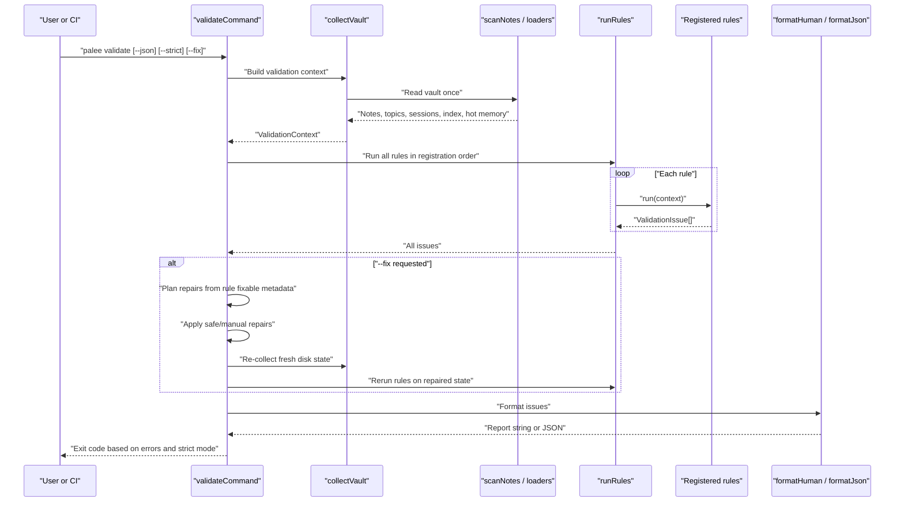
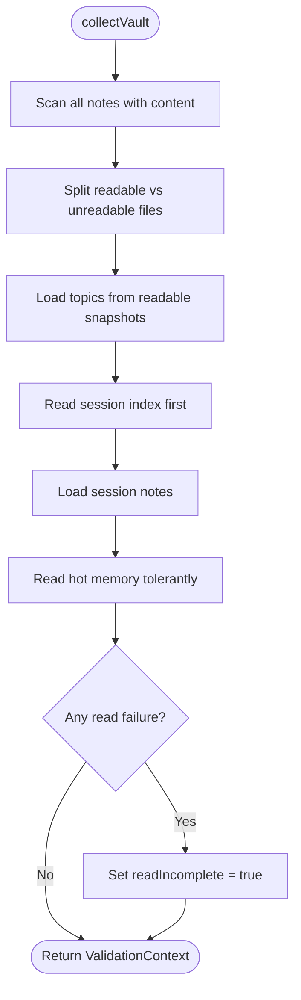
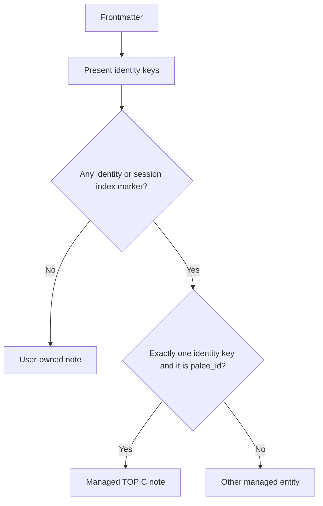
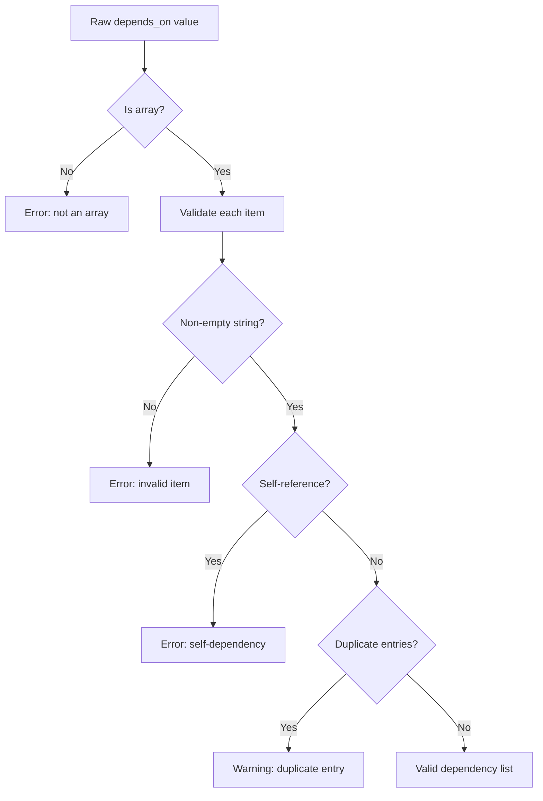
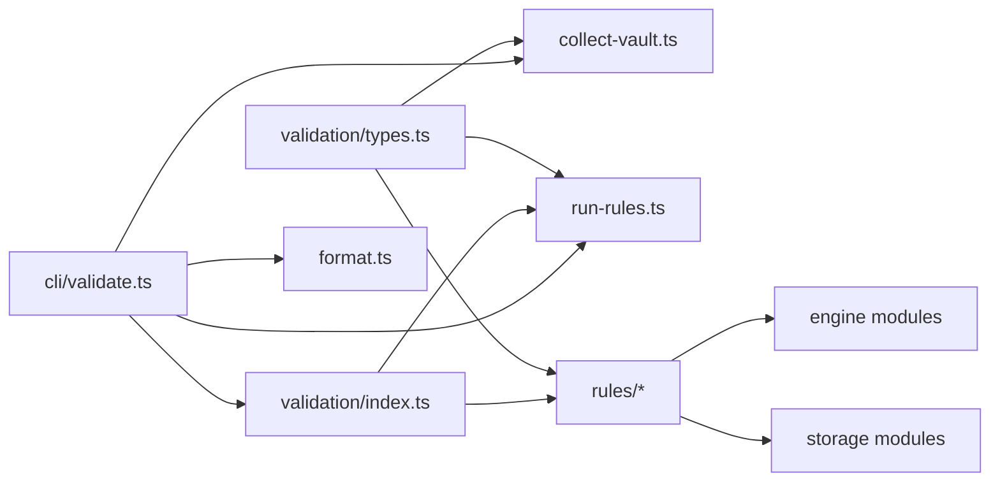

# Validation Framework and Integrity

::: details Referenced Files in This Document

- [src/validation/index.ts](https://github.com/Kuldeep2822k/cli/blob/main/src/validation/index.ts)
- [src/validation/types.ts](https://github.com/Kuldeep2822k/cli/blob/main/src/validation/types.ts)
- [src/validation/collect-vault.ts](https://github.com/Kuldeep2822k/cli/blob/main/src/validation/collect-vault.ts)
- [src/validation/run-rules.ts](https://github.com/Kuldeep2822k/cli/blob/main/src/validation/run-rules.ts)
- [src/validation/format.ts](https://github.com/Kuldeep2822k/cli/blob/main/src/validation/format.ts)
- [src/validation/managed-note.ts](https://github.com/Kuldeep2822k/cli/blob/main/src/validation/managed-note.ts)
- [src/cli/validate.ts](https://github.com/Kuldeep2822k/cli/blob/main/src/cli/validate.ts)
- [src/validation/rules/parse-frontmatter.ts](https://github.com/Kuldeep2822k/cli/blob/main/src/validation/rules/parse-frontmatter.ts)
- [src/validation/rules/valid-managed-note-kind.ts](https://github.com/Kuldeep2822k/cli/blob/main/src/validation/rules/valid-managed-note-kind.ts)
- [src/validation/rules/valid-palee-schema.ts](https://github.com/Kuldeep2822k/cli/blob/main/src/validation/rules/valid-palee-schema.ts)
- [src/validation/rules/valid-topic-id-format.ts](https://github.com/Kuldeep2822k/cli/blob/main/src/validation/rules/valid-topic-id-format.ts)
- [src/validation/rules/valid-topic-status.ts](https://github.com/Kuldeep2822k/cli/blob/main/src/validation/rules/valid-topic-status.ts)
- [src/validation/rules/no-duplicate-topic-id.ts](https://github.com/Kuldeep2822k/cli/blob/main/src/validation/rules/no-duplicate-topic-id.ts)
- [src/validation/rules/valid-dependency-list.ts](https://github.com/Kuldeep2822k/cli/blob/main/src/validation/rules/valid-dependency-list.ts)
- [src/validation/rules/no-missing-dependency.ts](https://github.com/Kuldeep2822k/cli/blob/main/src/validation/rules/no-missing-dependency.ts)
- [src/validation/rules/no-dependency-cycle.ts](https://github.com/Kuldeep2822k/cli/blob/main/src/validation/rules/no-dependency-cycle.ts)
- [src/validation/rules/valid-assessment-fields.ts](https://github.com/Kuldeep2822k/cli/blob/main/src/validation/rules/valid-assessment-fields.ts)
- [src/validation/rules/valid-topic-mastery.ts](https://github.com/Kuldeep2822k/cli/blob/main/src/validation/rules/valid-topic-mastery.ts)
- [src/validation/rules/valid-review-fields.ts](https://github.com/Kuldeep2822k/cli/blob/main/src/validation/rules/valid-review-fields.ts)
- [src/validation/rules/valid-review-dates.ts](https://github.com/Kuldeep2822k/cli/blob/main/src/validation/rules/valid-review-dates.ts)
- [src/validation/rules/valid-session-schema.ts](https://github.com/Kuldeep2822k/cli/blob/main/src/validation/rules/valid-session-schema.ts)
- [src/validation/rules/no-session-unknown-topic.ts](https://github.com/Kuldeep2822k/cli/blob/main/src/validation/rules/no-session-unknown-topic.ts)
- [src/validation/rules/valid-session-index.ts](https://github.com/Kuldeep2822k/cli/blob/main/src/validation/rules/valid-session-index.ts)
- [src/validation/rules/valid-hot-memory.ts](https://github.com/Kuldeep2822k/cli/blob/main/src/validation/rules/valid-hot-memory.ts)
- [src/validation/rules/safe-vault-paths.ts](https://github.com/Kuldeep2822k/cli/blob/main/src/validation/rules/safe-vault-paths.ts)
- [docs/adr/0008-validation-framework-decisions.md](https://github.com/Kuldeep2822k/cli/blob/main/docs/adr/0008-validation-framework-decisions.md)
- [docs/adr/0035-validate-fix-partial-pillar-eligibility.md](https://github.com/Kuldeep2822k/cli/blob/main/docs/adr/0035-validate-fix-partial-pillar-eligibility.md)

:::

## Table of Contents
1. [Introduction](#introduction)
2. [Project Structure](#project-structure)
3. [Core Components](#core-components)
4. [Architecture Overview](#architecture-overview)
5. [Detailed Component Analysis](#detailed-component-analysis)
6. [Rule Catalog and Execution Order](#rule-catalog-and-execution-order)
7. [Dependency Analysis](#dependency-analysis)
8. [Performance Considerations](#performance-considerations)
9. [Troubleshooting Guide](#troubleshooting-guide)
10. [Conclusion](#conclusion)
11. [Appendices](#appendices)

## Introduction
PALEE’s validation framework is a rule-based integrity system for an Obsidian vault that stores topics, assessments, reviews, sessions, and derived memory projections. It separates three responsibilities clearly:

- **Collection**: Build one read-only snapshot of the vault, including topic notes, session records, the session index, and hot memory.
- **Rule execution**: Run pure rules against that snapshot in deterministic order. Rules never touch the filesystem, config, or network.
- **Reporting and repair**: Format findings as human-readable output or machine-readable JSON, and optionally plan and apply conservative repairs through `palee validate --fix`.

The framework was designed to behave like an ESLint-style linter: small testable rules, stable ordering, severity classification, structured issues, and a staged repair engine. The design decisions are recorded in ADR-0008 and later extended by ADR-0035 for mastery repair behavior.

## Project Structure
Validation lives under `src/validation`, with each semantic check as its own rule file under `src/validation/rules`. The CLI command handler composes collection, rule execution, formatting, exit-code policy, and optional repair planning.

```mermaid
graph TB
  CLI["CLI Validate Command<br/>src/cli/validate.ts"] --> Collector["Vault Collector<br/>src/validation/collect-vault.ts"]
  CLI --> Runner["Rule Runner<br/>src/validation/run-rules.ts"]
  CLI --> Catalog["Rule Catalog<br/>src/validation/index.ts"]
  CLI --> Formatter["Formatters<br/>src/validation/format.ts"]
  Collector --> Types["Shared Types<br/>src/validation/types.ts"]
  Runner --> Types
  Catalog --> Types
  Formatter --> Types
  subgraph "Rules"
    Parse["parse-frontmatter / read-failure"]
    Kind["valid-managed-note-kind"]
    Schema["valid-palee-schema"]
    TopicId["valid-topic-id-format"]
    Status["valid-topic-status"]
    Duplicate["no-duplicate-topic-id"]
    DepList["valid-dependency-list"]
    MissingDep["no-missing-dependency"]
    Cycle["no-dependency-cycle"]
    Assessment["valid-assessment-fields"]
    Mastery["valid-topic-mastery"]
    ReviewFields["valid-review-fields"]
    ReviewDates["valid-review-dates"]
    SessionSchema["valid-session-schema"]
    UnknownTopic["no-session-unknown-topic"]
    SessionIndex["valid-session-index"]
    HotMemory["valid-hot-memory"]
    Paths["safe-vault-paths"]
  end
  Catalog --> Parse
  Catalog --> Kind
  Catalog --> Schema
  Catalog --> TopicId
  Catalog --> Status
  Catalog --> Duplicate
  Catalog --> DepList
  Catalog --> MissingDep
  Catalog --> Cycle
  Catalog --> Assessment
  Catalog --> Mastery
  Catalog --> ReviewFields
  Catalog --> ReviewDates
  Catalog --> SessionSchema
  Catalog --> UnknownTopic
  Catalog --> SessionIndex
  Catalog --> HotMemory
  Catalog --> Paths
```

## Core Components
The validation subsystem has five core layers:

| Layer | Responsibility | Key Contract |
|---|---|---|
| Shared types | Defines issues, contexts, rules, and severities | `ValidationIssue`, `ValidationContext`, `ValidationRule` |
| Vault collector | Reads every relevant vault component once | `collectVault(vaultPath, options)` |
| Rule runner | Executes rules deterministically and catches unexpected failures | `runRules(context, rules)` |
| Rule catalog | Orders all registered rules and re-exports them | `VALIDATION_RULES` array |
| Formatters | Produce console text or JSON without printing themselves | `formatHuman`, `formatJson` |

### Validation Issue Model
Every finding carries:

- `ruleId`: Identifies the rule.
- `severity`: Either `error` or `warning`.
- `message`: Human explanation.
- Optional locators: `file`, `topicId`, `sessionId`, `field`.
- Optional structured payload: `details`.

Errors gate the default validation exit code; warnings do not. In strict mode, warnings escalate the exit code but do not change the meaning of the `valid` JSON field.

### Validation Context
The context is a single read-only snapshot containing:

- `vaultPath`: Root path.
- `files`: Absolute paths of all scanned Markdown files.
- `topics`: Normalized PALEE topics.
- `notes`: Raw per-file parse outcomes.
- `readIncomplete`: True when any note, session, or memory subsystem component could not be read.
- `memoryReadErrors`: Component-level failures for sessions, index, or hot memory.
- `sessions`: Canonical session notes.
- `sessionIndex`: Parsed session index.
- `hotMemory`: Tolerant hot-memory projection.

## Architecture Overview
The runtime flow is intentionally linear and deterministic:

### Severity Policy
ADR-0008 establishes four key policies:

1. Missing dependencies are warnings during vault scans because the engine already quarantines missing prerequisites.
2. Warnings exit `0` by default; `--strict` escalates to exit `3`.
3. Derived-view findings (`valid-session-index`, `valid-hot-memory`) are always warnings because they are rebuildable.
4. One malformed topic note becomes one warning and never aborts the scan.

## Detailed Component Analysis

### Vault Collection
`collectVault` builds the complete `ValidationContext` in one pass:

1. Scan all notes with content included.
2. Separate readable notes from unreadable ones.
3. Load normalized topics only from readable snapshots.
4. Read the session index before loading sessions to close the concurrent `session end` interleaving window.
5. Read hot memory tolerantly; capture component-level read failures.
6. Set `readIncomplete` if any note, session, or memory subsystem component failed to read.

This guarantees that rule outputs come from one consistent snapshot rather than mixing bytes read at different times.

### Managed Note Classification
Managed-note eligibility is centralized so multiple rules cannot disagree about what PALEE owns:

- Identity keys: `palee_id`, `session_id`, `memory_id`.
- Session index marker: `type: "session_index"`.
- `isManagedNote`: Any identity key or session-index marker.
- `isTopicNote`: Exactly one identity key, it must be `palee_id`, and it must not be the session index.

A note with only `palee_schema` but no identity is not a managed note under `isManagedNote` and is not treated as a topic note; the kind rule uses a separate, broader gate that does cover `palee_schema`-only notes for kind classification. This avoids false-positive ID-format errors.

### Rule Execution and Error Isolation
The rule runner executes every rule unconditionally in registration order. If a rule throws unexpectedly, the runner converts it into an error issue for that rule instead of stopping later rules. This keeps validation resilient even when a rule implementation has a bug.

### Reporting Contracts
Human output groups errors and warnings separately and preserves runner order. JSON output preserves legacy contract keys while adding new fields:

- `valid`: Errors-only.
- `gated_by_warnings`: True when `--strict` is active and there are warnings but no errors.
- `topic_count`, `file_count`, `error_count`, `warning_count`.
- `errors[]` and `warnings[]`.
- Each entry includes `rule_id`, `severity`, `message`, legacy locator fields where applicable, and `details`.

## Rule Catalog and Execution Order

### Rule Catalog Order
The canonical rule catalog is ordered by concern:

| Stage | Rules | Purpose |
|---|---|---|
| Parse and read surface | `parse-frontmatter`, `read-failure` | Report malformed frontmatter and incomplete snapshots. |
| Managed-note classification | `valid-managed-note-kind` | Determine which note is a topic, session, hot memory, or index. |
| Schema and identity | `valid-palee-schema`, `valid-topic-id-format`, `valid-topic-status` | Enforce schema version, topic ID policy, and lifecycle status. |
| Identity integrity | `no-duplicate-topic-id` | Detect duplicate topic IDs. |
| Dependency shape | `valid-dependency-list` | Validate raw dependency arrays before graph rules. |
| Graph semantics | `no-missing-dependency`, `no-dependency-cycle` | Detect dangling references and cycles. |
| Assessment consistency | `valid-assessment-fields`, `valid-topic-mastery` | Validate pillar shapes and derived mastery drift. |
| Review state | `valid-review-fields`, `valid-review-dates` | Validate SM-2 bounds and calendar dates. |
| Memory subsystem | `valid-session-schema`, `no-session-unknown-topic`, `valid-session-index`, `valid-hot-memory` | Validate canonical sessions and derived projections. |
| Path boundary audit | `safe-vault-paths` | Ensure managed paths stay inside the configured vault. |

### Semantic Validation Rules

#### Parse and Read Surface
- `parse-frontmatter`: Reports malformed YAML frontmatter as a warning per file.
- `read-failure`: Reports unreadable notes, session notes, and memory subsystem components as warnings and marks the snapshot provisional.

#### Managed Notes and Schema
- `valid-managed-note-kind`: Classifies managed notes by identity and warns when the kind cannot be determined.
- `valid-palee-schema`: Requires supported `palee_schema` version on managed notes.
- `valid-topic-id-format`: Requires topic IDs to follow the centralized `T-` kebab-slug policy.
- `valid-topic-status`: Requires present status values to be one of the four lifecycle values.

#### Identity and Dependency Integrity
- `no-duplicate-topic-id`: Reports each duplicated topic ID with its affected files.
- `valid-dependency-list`: Validates raw `depends_on` and legacy `dependencies`, rejecting non-array values, invalid items, self-references, and reporting duplicate entries as warnings.
- `no-missing-dependency`: Maps collected topics into the engine’s node model and reports missing prerequisites as warnings.
- `no-dependency-cycle`: Enumerates dependency cycles with a bounded cap and reports truncation separately.

#### Assessments and Mastery
- `valid-assessment-fields`: Validates pillar scores as finite numbers in `[0.0, 1.0]` and `assessed_at` as null, absent, or a valid date.
- `valid-topic-mastery`: Recomputes mastery from all four pillars and compares it to stored `topic_mastery`. Topics with absent or malformed pillar data are skipped.

ADR-0035 clarifies that absent pillars mean “no data,” not zero. A topic with partial pillar data is skipped by both the rule and the repair path.

#### Reviews and SM-2 State
- `valid-review-fields`: Validates ease factor, interval, repetition, lapses, and last quality against the SM-2 engine contract.
- `valid-review-dates`: Validates review dates as real `YYYY-MM-DD` strings and checks that `due_at` does not precede `last_reviewed_at`.

#### Session and Memory Subsystem
- `valid-session-schema`: Validates canonical session notes’ required fields, filename coherence, draft/completed status, and ISO timestamps.
- `no-session-unknown-topic`: Warns when a well-shaped session references a missing topic.
- `valid-session-index`: Warns about corrupt or stale session index entries; missing index is legal.
- `valid-hot-memory`: Warns about unsupported schema, wrong identity, word-cap overflow, and broken session/topic references; missing hot memory is legal.

#### Path Safety
- `safe-vault-paths`: Audits scanned note paths, loaded topic paths, and session note paths to ensure none escape the configured vault.

## Dependency Analysis
The rule system has low coupling between individual rules and high cohesion within their semantic domain. Dependencies flow outward from shared contracts:

Key relationships:

- Rules depend on `ValidationContext`, not on the filesystem.
- Graph rules depend on the storage loader and engine dependency utilities.
- Session/memory rules depend on session parsing and hot-memory contracts.
- The CLI composes everything and owns side effects: configuration, output, exit codes, and repairs.

## Performance Considerations

### Single-Read Snapshot
The collector reads each relevant file exactly once and threads those bytes into both parse outcomes and topic normalization. This prevents concurrent edits from making different rules observe inconsistent versions of the same note.

### Rule Complexity
Most rules are linear in the number of topics, notes, or sessions. Notable cases:

- Duplicate ID detection uses a map keyed by topic ID: average time proportional to the number of topics.
- Dependency-list validation scans each array item once and tracks duplicates with sets.
- Missing dependency detection delegates to the engine’s graph analysis.
- Cycle detection uses a bounded enumeration capped at 1000 cycles to avoid dense graphs stalling validation.

### Incremental Validation Strategies
The repository exposes a `files` option on `collectVault`, allowing callers to supply pre-scanned absolute paths and avoid a full vault walk. Combined with a topic cache passed through `CollectVaultOptions.cache`, this supports incremental scenarios:

- Reuse scanner results when only a subset of files changed.
- Reuse topic caches for unchanged notes.
- Run only selected rules by filtering the catalog for diagnostics or targeted audits.
- Use `readIncomplete` to detect and warn about partially collected runs.

### Concurrency and Provisional Scans
When `readIncomplete` is true, some findings are provisional because the snapshot is incomplete. Rules that rely on cross-entity references should treat such cases carefully, and repair steps explicitly refuse to rebuild derived views from an incomplete snapshot.

## Troubleshooting Guide

### Common Exit Codes
- `0`: No errors, and either no warnings or `--strict` is disabled.
- `2`: Missing or invalid vault path.
- `3`: Validation errors remain after optional `--fix`, or warnings exist in `--strict` mode.
- `5`: Unexpected exception handled by the CLI.

### Errors That Gate Validation
Typical `error`-severity rules include:

- Unsupported or missing `palee_schema`.
- Invalid topic ID format.
- Invalid topic status.
- Duplicate topic IDs.
- Malformed dependency lists or self-references.
- Dependency cycles.
- Invalid assessment fields.
- Invalid SM-2 review fields.
- Invalid review dates.
- Malformed session schema.
- Unsafe vault paths.

### Warnings That Do Not Gate (Unless `--strict`)
- Malformed frontmatter.
- Unreadable files.
- Ambiguous managed-note kind.
- Duplicate dependency entries.
- Missing dependencies.
- Stale or corrupt derived views.
- Sessions referencing unknown topics.

### Repair Conflicts
`--fix` can skip repairs when another process modifies the vault concurrently. Conflicts are reported but do not abort other repairs. For derived views, repairs also refuse to run when the snapshot is incomplete.

## Conclusion
PALEE’s validation framework is a disciplined, rule-driven integrity layer. Its strength lies in separating concerns: collection builds one snapshot, rules express policy purely over that snapshot, and the CLI owns presentation, exit codes, and repairs. The rule catalog covers schema compliance, identity integrity, dependency graph health, assessment and review state, session memory, and path safety. Repairs are intentionally conservative and driven by each rule’s declared fixability. For large vaults, performance depends on single-pass collection, bounded graph operations, and caller-controlled incremental strategies.

## Appendices

### Complete Rule Catalog Summary

| Rule ID | Default Severity | Fixable | Scope |
|---|---:|---:|---|
| `parse-frontmatter` | Warning | Manual | Malformed YAML frontmatter |
| `read-failure` | Warning | No | Unreadable files and memory subsystem components |
| `valid-managed-note-kind` | Warning | Manual | Managed-note classification ambiguity |
| `valid-palee-schema` | Error | Manual | Supported schema version on managed notes |
| `valid-topic-id-format` | Error | No | Centralized topic ID policy |
| `valid-topic-status` | Error | Manual | Lifecycle status values |
| `no-duplicate-topic-id` | Error | No | Duplicate topic IDs |
| `valid-dependency-list` | Error | Manual | Raw dependency array shape and semantics; duplicate entries are downgraded to warnings per-finding |
| `no-missing-dependency` | Warning | No | Dangling dependency references |
| `no-dependency-cycle` | Error | No | Dependency cycles |
| `valid-assessment-fields` | Error | Manual | Pillar score ranges and assessed date |
| `valid-topic-mastery` | Warning | Safe | Derived mastery drift |
| `valid-review-fields` | Error | Manual | SM-2 review bounds |
| `valid-review-dates` | Error | Manual | Review date shape and ordering |
| `valid-session-schema` | Error | Manual | Canonical session note contract |
| `no-session-unknown-topic` | Warning | Manual | Session referencing missing topic |
| `valid-session-index` | Warning | Safe | Corrupt or stale session index |
| `valid-hot-memory` | Warning | Safe | Corrupt, drifted, or stale hot memory |
| `safe-vault-paths` | Error | Manual | Managed paths escaping the vault |

### Custom Rule Development Checklist
To add a new rule:

1. Implement a function returning `ValidationRule` with `id`, `description`, `severity`, optional `fixable`, and a `run(context)` method.
2. Keep the rule pure: use `ValidationContext`, never read config, filesystem, or network.
3. Place the rule in `src/validation/rules/`.
4. Export it from `src/validation/index.ts`.
5. Register it in the `VALIDATION_RULES` array in the correct semantic order.
6. Add tests covering edge cases, especially jurisdiction boundaries with related rules.
7. If the rule can be auto-repaired, set `fixable: 'safe'` and register a repair implementation in the CLI handler.
8. If manual repair is offered, mark `fixable: 'manual'` and add explicit permission through `EXPLICIT_MANUAL_REPAIRS` when needed.
