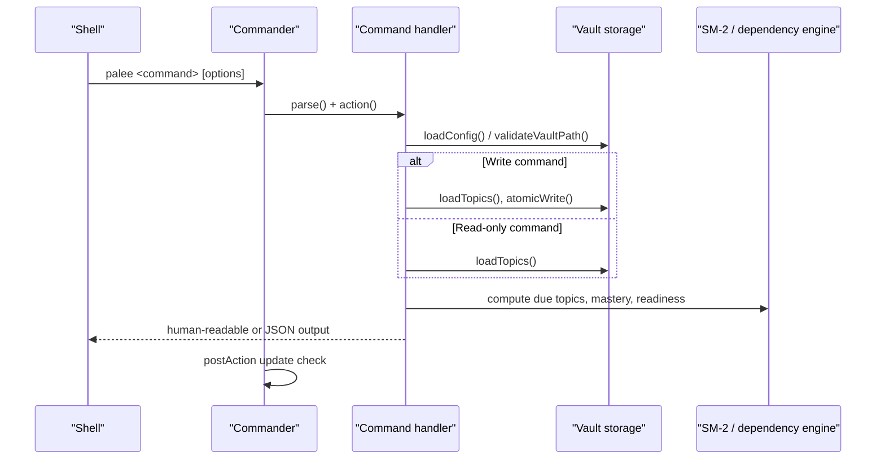
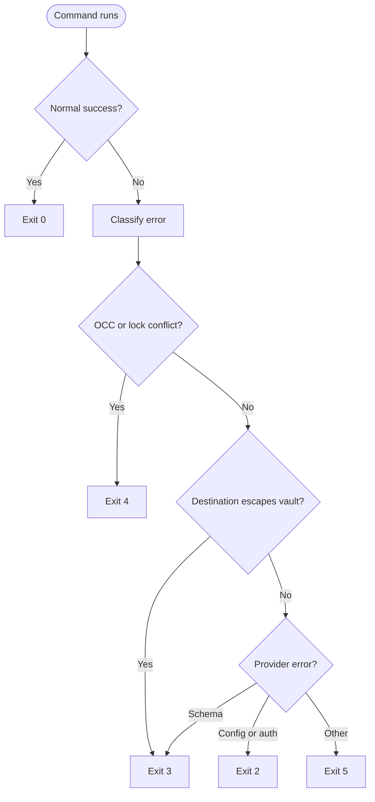
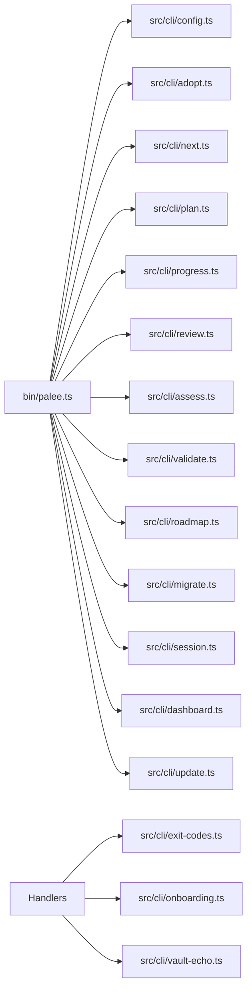
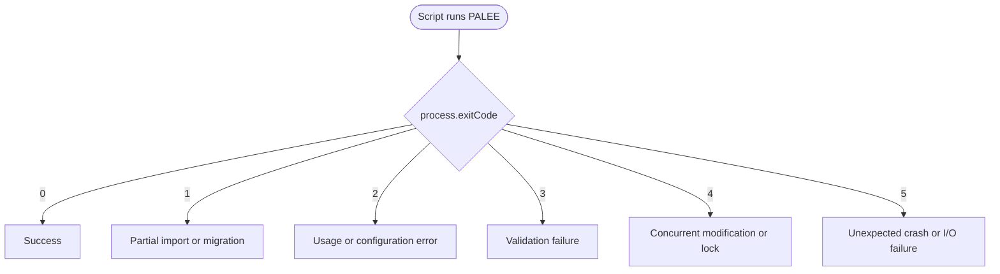

# Command Reference

::: details Referenced Files in This Document

- [bin/palee.ts](https://github.com/Kuldeep2822k/cli/blob/main/bin/palee.ts)
- [src/cli/config.ts](https://github.com/Kuldeep2822k/cli/blob/main/src/cli/config.ts)
- [src/cli/adopt.ts](https://github.com/Kuldeep2822k/cli/blob/main/src/cli/adopt.ts)
- [src/cli/next.ts](https://github.com/Kuldeep2822k/cli/blob/main/src/cli/next.ts)
- [src/cli/plan.ts](https://github.com/Kuldeep2822k/cli/blob/main/src/cli/plan.ts)
- [src/cli/progress.ts](https://github.com/Kuldeep2822k/cli/blob/main/src/cli/progress.ts)
- [src/cli/review.ts](https://github.com/Kuldeep2822k/cli/blob/main/src/cli/review.ts)
- [src/cli/assess.ts](https://github.com/Kuldeep2822k/cli/blob/main/src/cli/assess.ts)
- [src/cli/validate.ts](https://github.com/Kuldeep2822k/cli/blob/main/src/cli/validate.ts)
- [src/cli/roadmap.ts](https://github.com/Kuldeep2822k/cli/blob/main/src/cli/roadmap.ts)
- [src/cli/migrate.ts](https://github.com/Kuldeep2822k/cli/blob/main/src/cli/migrate.ts)
- [src/cli/session.ts](https://github.com/Kuldeep2822k/cli/blob/main/src/cli/session.ts)
- [src/cli/dashboard.ts](https://github.com/Kuldeep2822k/cli/blob/main/src/cli/dashboard.ts)
- [src/cli/update.ts](https://github.com/Kuldeep2822k/cli/blob/main/src/cli/update.ts)
- [src/cli/exit-codes.ts](https://github.com/Kuldeep2822k/cli/blob/main/src/cli/exit-codes.ts)
- [src/cli/onboarding.ts](https://github.com/Kuldeep2822k/cli/blob/main/src/cli/onboarding.ts)
- [src/cli/vault-echo.ts](https://github.com/Kuldeep2822k/cli/blob/main/src/cli/vault-echo.ts)
- [src/cli/program-name.ts](https://github.com/Kuldeep2822k/cli/blob/main/src/cli/program-name.ts)
- [package.json](https://github.com/Kuldeep2822k/cli/blob/main/package.json)

:::

## Table of Contents
1. [Introduction](#introduction)
2. [Project Structure](#project-structure)
3. [Core Components](#core-components)
4. [Architecture Overview](#architecture-overview)
5. [Detailed Component Analysis](#detailed-component-analysis)
6. [Dependency Analysis](#dependency-analysis)
7. [Performance Considerations](#performance-considerations)
8. [Troubleshooting Guide](#troubleshooting-guide)
9. [Conclusion](#conclusion)

## Introduction
This document is the complete command reference for the PALEE CLI, a Node.js-based personal active learning and evaluation engine. It documents every installed subcommand, its arguments, options, output formats, exit codes, error conditions, and practical automation patterns. The CLI is built with Commander, reads configuration from `config.json`, and operates against an Obsidian-style vault containing markdown notes with YAML frontmatter.

The executable is exposed as `palee` through the package’s `bin` entry.

## Project Structure
The CLI entry point registers all commands, configures global behavior (help text, update notifications, fatal error reporting), and delegates to per-command handlers under `src/cli`.

```mermaid
graph TB
  Entry["bin/palee.ts<br/>Commander entry point"] --> ConfigCmd["config handler"]
  Entry --> AdoptCmd["adopt handler"]
  Entry --> NextCmd["next handler"]
  Entry --> PlanCmd["plan handler"]
  Entry --> ProgressCmd["progress handler"]
  Entry --> ReviewCmd["review handler"]
  Entry --> AssessCmd["assess handler"]
  Entry --> ValidateCmd["validate handler"]
  Entry --> RoadmapCmd["roadmap handler"]
  Entry --> MigrateCmd["migrate handler"]
  Entry --> SessionCmd["session handler"]
  Entry --> DashboardCmd["dashboard handler"]
  Entry --> UpdateCmd["update handler"]
  Entry --> ExitCodes["ExitCode constants"]
  Entry --> Onboarding["JSON mode and vault validation helpers"]
```



## Core Components
Before reviewing individual commands, it helps to understand the shared behaviors that affect every command:

| Area | Behavior |
|---|---|
| Program name | Printed in help and error hints; resolves from the invoked binary name so parallel installs such as `palee-test` do not suggest the wrong command. |
| Configuration directory | Controlled by `PALEE_CONFIG_DIR`; otherwise defaults to `%LOCALAPPDATA%/palee` on Windows or `~/.config/palee` elsewhere. All commands share this file unless isolated explicitly. |
| Vault path | Required by most commands; set through `palee config set-vault`. Missing or unreadable vaults produce usage errors. |
| JSON output | Enabled by `--json` when a command declares that flag, or by setting `PALEE_JSON=1` / `true`. Some human-only commands deliberately ignore `PALEE_JSON` for their initial vault refusal messages. |
| Global environment variables | Global help documents only `PALEE_CONFIG_DIR` and `PALEE_NO_UPDATE_CHECK`. `PALEE_DEBUG` is not documented in global help; it only enables raw stack traces on the fatal-error path. |
| Update notification | After a successful command, the CLI may print one informational notice about a newer published version to stderr, subject to time and piping rules. |
| Fatal errors | Unhandled exceptions and uncaught rejections are caught once and emitted consistently, either as JSON (`{ status, code, error }`) or plain text. |

## Architecture Overview
The command dispatch flow is centralized:



## Detailed Component Analysis

### Global Help and Grouping
The CLI has no named subcommand groups; grouping is conceptual by purpose:

- Configuration: `config`, `update`
- Topic management: `adopt`, `roadmap`, `migrate`
- Review and scheduling: `next`, `plan`, `progress`, `review`, `assess`
- Reporting: `dashboard`, `validate`
- Session management: `session`

Global help shows the program description, version, available commands, and environment variables. Use `palee --help` for top-level help and `palee <command> --help` for command-specific help.

### Exit Codes and Error Contract
| Code | Meaning | Typical cause |
|---|---|---|
| `0` | Success | Command completed normally. |
| `1` | Partial import | A roadmap or session operation partially succeeded; some items were skipped or cleanup failed. |
| `2` | Usage error | Invalid arguments, missing required values, unconfigured vault, ambiguous topic resolution. |
| `3` | Validation failure | Corrupted schema, integrity violations, provider schema mismatch, or destination escaping the vault. |
| `4` | Conflict | Concurrent modification detected or file lock held. |
| `5` | Unexpected runtime exception | Crash, I/O failure, provider network error, or other unexpected condition. |

Conflict and containment errors are mapped automatically by `exitCodeFor`. Provider-related errors are classified by kind and HTTP status where applicable.



### JSON Output Mode
Commands that declare `--json` emit machine-readable payloads to stdout. When `--json` is requested or `PALEE_JSON=1` / `true` is set, errors are emitted to stderr as `{ error: string }`. Fatal process-level failures emit `{ status: "error", code: number, error: string }`.

Important distinction:
- Piping stdout does **not** switch to JSON.
- `PALEE_JSON` is respected only when the command itself declares `--json`.
- Human-only commands intentionally pass `json: false` into vault validation so their initial configuration refusal remains human-readable even if `PALEE_JSON` is set.

### Environment Variables
| Variable | Effect |
|---|---|
| `PALEE_CONFIG_DIR` | Overrides the default configuration directory for the current run. |
| `PALEE_NO_UPDATE_CHECK` | Silences the informational new-version notice after successful interactive commands. |
| `PALEE_JSON` | Enables JSON output for commands that support `--json`. Accepts `1` or `true`. |
| `PALEE_DEBUG` | Prints raw stack traces for fatal errors. |

### `config`
Manage configuration stored in `$PALEE_CONFIG_DIR/config.json` or the per-user default.

**Syntax**
```
palee config [action] [value]
```

**Arguments**
- `action`: One of `show`, `set-vault`, `set-provider`, `set-base-url`, `set-api-key`, `unset-api-key`, `test-connection`, `set-model`.
- `value`: Required for `set-*` actions. Never include the API key value directly.

**Options**
| Option | Description |
|---|---|
| `--from-env <var>` | Read the API key from an environment variable when using `set-api-key`. |
| `--keep-key` | Keep the stored API key when changing `set-base-url` if the endpoint origin changes. |
| `--json` | Output every config action in JSON format. |

**Behavior highlights**
- Reads and writes configuration atomically.
- On Windows, credential-bearing configuration files are guarded by profile-root checks.
- `test-connection` validates provider connectivity without exposing secrets.

**Examples**
```sh
palee config show
palee config set-vault ~/Documents/Vault
palee config set-provider openai
palee config set-base-url https://api.openai.com
palee config set-api-key --from-env OPENAI_API_KEY
palee config unset-api-key
palee config test-connection
palee config set-model gpt-4o-mini
palee config show --json
```

**Exit codes**
- `0`: Success.
- `2`: Invalid arguments or configuration problem.
- `3`: Provider schema mismatch.
- `4`: OCC or lock conflict.
- `5`: Unexpected runtime or network error.

### `adopt`
Adopt existing markdown notes as PALEE topics. Supports single-file adoption and batch scanning.

**Syntax**
```
palee adopt [path]
```

**Arguments**
- `path`: Optional path to a markdown file or directory relative to the vault root. Omitting it scans according to the selected flags.

**Options**
| Option | Description |
|---|---|
| `--all` | Adopt all markdown files across the vault. Batch scans skip Tier-0 non-lesson files; a single file path overrides that behavior. |
| `--difficulty <level>` | Set difficulty: `beginner`, `intermediate`, `advanced`. |
| `--depends-on <ids>` | Comma-separated topic IDs; single-file mode only. |
| `--include <patterns>` | Repeatable comma-separated inclusion glob patterns for batch mode. |
| `--exclude <patterns>` | Repeatable comma-separated exclusion glob patterns for batch mode. |
| `--tag <tags>` | Repeatable comma-separated frontmatter tags to filter; batch mode only. |
| `--dry-run` | Simulate adoption and print a summary without modifying files. |
| `--verbose` | Print detailed file-by-file inspection information. |
| `--auto-chain` | Auto-wire `depends_on` from declared prerequisites or numbered TOC order; batch mode only. |
| `--chain-tier <tier>` | Chain ordering signal: `strict` (default) uses numbers only; `full` adds listing order but never gates. |
| `-y, --yes` | Skip confirmation prompts. |
| `--undo` | Reverse an adoption by stripping PALEE-owned frontmatter keys from selected notes. |
| `--drop-title` | With `--undo`, also remove the `title` key. |

**Pattern syntax for `--include`, `--exclude`, and `--tag`**
- A pattern without `/` matches filenames anywhere in scope.
- A pattern with `/` is anchored at the vault root and must match the full vault-relative path segment by segment.
- `*` stops at directory boundaries; `**` crosses them.
- Matching is case-insensitive.
- Repeating the flag or separating patterns with commas ORs them.
- Patterns matching no scanned file produce warnings.
- These filters are batch-mode only; passing a single note path exits with usage error.

**Auto-chain prerequisite format**
Recognized headings include variations such as “Prerequisites”, “Prerequisite”, “Requires”, “Required knowledge”, and “Depends on” / “Dependency on”. Only list items containing wikilinks or markdown links count as references. Prose sentences are ignored. Hedged or negated items contribute no edge.

**Examples**
```sh
palee adopt "Docker Fundamentals.md"
palee adopt . --all --difficulty beginner
palee adopt MODULES/01 --include '*.md' --exclude '*template*' --tag 'lab'
palee adopt --auto-chain --chain-tier strict
palee adopt --dry-run --verbose
palee adopt --undo --dry-run
palee adopt --undo --drop-title
```

**Output formats**
- Human-readable summary of adopted, skipped, chained, and undone notes.
- No dedicated `--json` option; use `--dry-run` and `--verbose` for scripting previews.

**Exit codes**
- `0`: Success.
- `1`: Partial adoption where some notes were processed while others failed or were skipped.
- `2`: Invalid arguments, including misuse of batch-only filters with a single file path.
- `3`: Validation or containment failure.
- `4`: Concurrent modification or lock conflict.
- `5`: Unexpected runtime exception.

**Common pitfalls**
- Using `--include`, `--exclude`, or `--tag` with a single note path exits with usage error because those flags are batch-only.
- Forgetting `--all` means the scan does not adopt every note.
- Auto-chaining can synthesize dependencies; always preview with `--dry-run` before committing.

### `next`
Show the next topic due for review.

**Syntax**
```
palee next [options]
```

**Options**
| Option | Description |
|---|---|
| `--all` | Show all due topics instead of only the next one. |
| `--json` | Output in JSON format. |

**JSON payload fields**
When `--all` is omitted:
- `next`: First actionable topic object or `null`.
- `due_count`: Number of due topics.
- `total_topics`: Total loaded topics.
- `status`: `ready`, `blocked`, or `nothing_due`.
- `blocked`: Topics blocked by prerequisites.

When `--all` is included:
- `due_topics`: Array of actionable due topics.
- `total_topics`: Total loaded topics.
- `next`: First item in `due_topics` or `null`.
- `status`: `ready`, `blocked`, or `nothing_due`.
- `blocked`: Topics blocked by prerequisites.

Each topic includes fields such as `id`, `title`, `path`, `due_at`, `mastery`, and `repetition`. Archived topics are excluded from the actionable set.

**Examples**
```sh
palee next
palee next --all
palee next --json
```

**Exit codes**
- `0`: Success.
- `2`: Missing or invalid vault path.
- `5`: Unexpected runtime exception.

**Automation tip**
Use `status == "blocked"` to detect prerequisite gating and `next == null` to detect empty or fully scheduled vaults.

### `plan`
Show today’s learning plan.

**Syntax**
```
palee plan [options]
```

**Options**
| Option | Description |
|---|---|
| `--json` | Output in JSON format. |

**JSON payload fields**
- `total_topics`
- `active_topic_count`
- `archived_topic_count`
- `reviews_due`: Due reviews sorted by due date.
- `ready_to_learn`: Topics whose prerequisites are satisfied and which are not mastered.
- `quarantined_cycles`: Topics quarantined because of dependency cycles.
- `quarantined_cycles_truncated`
- `blocked`: Topics whose prerequisites are unmet.
- `counts`: Summary counts for due, ready, blocked, quarantined, mastered, learning, and new.

Archived topics are excluded from derived figures but remain in the graph for prerequisite satisfaction.

**Examples**
```sh
palee plan
palee plan --json
```

**Exit codes**
- `0`: Success.
- `2`: Missing or invalid vault path or invalid options.
- `5`: Unexpected runtime exception.

### `progress`
Show learning progress, optionally filtered to a specific topic.

**Syntax**
```
palee progress [options]
```

**Options**
| Option | Description |
|---|---|
| `--topic <id>` | Show progress for a specific topic ID or unique name fragment. |
| `--json` | Output in JSON format. |

**Topic resolution**
- Exact match or substring match is supported.
- Title substrings also resolve as queries, not only full `T-...` topic IDs.
- Missing topic produces usage error.
- Ambiguous match lists candidates and requires a more specific query.

**JSON payloads**
- Aggregate view includes active/archived counts, global mastery, mastery status, counts by difficulty, total reviews, repetitions, lapses, and averages.
- Single-topic view includes id, title, path, mastery, difficulty, repetition, lapses, assessed date, and last reviewed date.

**Examples**
```sh
palee progress
palee progress --topic T-linear-algebra
palee progress --topic "Recursion" --json
```

**Exit codes**
- `0`: Success.
- `2`: Missing or invalid vault path or unresolved topic.
- `5`: Unexpected runtime exception.

### `review`
Record a manual spaced-repetition review for a topic.

**Syntax**
```
palee review <topic> <quality>
```

**Arguments**
- `topic`: Topic ID or unique name fragment.
- `quality`: Integer rating from `0` to `5`.

**Options**
| Option | Description |
|---|---|
| `--force` | Record an early review without printing the early-review warning. |

**Behavior**
- Updates SM-2 state and recomputes interval, ease factor, repetition, and due date.
- Records the review even if the note is early, but warns unless `--force` is supplied.
- Validates the target note immediately before writing to reduce concurrent-modification risk.

**Examples**
```sh
palee review T-calculus 5
palee review "Advanced Docker" 3
palee review T-calculus 2 --force
```

**Exit codes**
- `0`: Review recorded successfully.
- `2`: Invalid quality, missing vault, or missing/ambiguous topic.
- `4`: OCC conflict or active lock.
- `5`: Unexpected runtime exception.

**Troubleshooting**
If SM-2 fields are corrupted, the handler suggests running `palee validate --fix`.

### `assess`
Record a four-pillar assessment and recompute topic mastery.

**Syntax**
```
palee assess <topic> [--conceptual N] [--practical N] [--debug N] [--feynman N] [--force] [--dry-run]
```

**Arguments**
- `topic`: Topic ID or unique name fragment.

**Options**
| Option | Description |
|---|---|
| `--conceptual <score>` | Conceptual understanding score from `0` to `1`. |
| `--practical <score>` | Practical application score from `0` to `1`. |
| `--debug <score>` | Debugging and troubleshooting score from `0` to `1`. |
| `--feynman <score>` | Feynman articulation score from `0` to `1`. |
| `--force` | Suppress the lowering-assessment warning when recording. |
| `--dry-run` | Preview mastery change and dependent availability changes without modifying files. |

**Validation**
- At least one pillar score is required.
- Each score must be finite and within `[0, 1]`.
- Values outside the range are rejected rather than silently clamped.

**Mastery effects**
- Mastery is recomputed from the provided pillars merged over the topic's stored pillar values.
- Lowering mastery below the threshold can hide previously available dependents.
- If only ordinary pillars are provided and they cannot reach the threshold, the handler explains how `--feynman` affects the gate.

**Examples**
```sh
palee assess T-docker --conceptual 0.8 --practical 0.9
palee assess "Networking Basics" --debug 0.7 --dry-run
palee assess T-mastery-lowering --conceptual 0.1 --practical 0.1 --debug 0.1 --feynman 0.1 --force
```

**Exit codes**
- `0`: Success.
- `2`: Missing vault, unusable score, missing/ambiguous topic, or no pillar provided.
- `4`: OCC conflict.
- `5`: Unexpected runtime exception.

### `validate`
Validate vault integrity and optionally repair known issues.

**Syntax**
```
palee validate [options]
```

**Options**
| Option | Description |
|---|---|
| `--fix` | Repair corrupted SM-2 review fields and rebuild derived views according to implemented repairs. |
| `--json` | Output in JSON format. |
| `--strict` | Exit non-zero on warnings as well as errors. |

**Repair behavior**
- Repairs are planned from rule metadata.
- Safe automated repairs are applied automatically.
- Manual repairs are limited to explicitly admitted cases such as resetting review fields.
- Derived-view repairs rebuild `.palee/hot.md` and `.palee/index.md` from canonical sessions.
- Conflicts during repair are reported without aborting unrelated repairs.

**Examples**
```sh
palee validate
palee validate --strict
palee validate --json
palee validate --fix
palee validate --fix --json
```

**Exit codes**
- `0`: Valid or successfully repaired.
- `2`: Missing or invalid vault path.
- `3`: Validation failure.
- `4`: OCC conflict during repair.
- `5`: Unexpected runtime exception.

### `roadmap`
Import deterministic learning roadmaps from YAML or Markdown.

**Syntax**
```
palee roadmap [options]
```

**Options**
| Option | Description |
|---|---|
| `--from <file>` | Import roadmap from YAML or Markdown (frontmatter, fenced YAML, or wikilink formats). |
| `--auto-chain` | Chain imported topics onto the previous one by ascending `order`; topics without `order` follow in file order. Explicit `depends_on` wins. |
| `--dry-run` | Print the full per-note import plan and write nothing. |
| `-y, --yes` | Skip confirmation prompt. |

**Auto-chain semantics**
- Topics with `order` sort first.
- Topics without `order` retain file order.
- Synthesized edges are dropped when they would close a cycle.
- Cycle detection still applies after merging with existing vault topics.

**Examples**
```sh
palee roadmap --from curriculum.yaml
palee roadmap --from syllabus.md --auto-chain
palee roadmap --from roadmap.yml --dry-run
palee roadmap --from roadmap.yml --auto-chain --yes
```

**Exit codes**
- `0`: Success.
- `1`: Partial import.
- `2`: Invalid arguments or vault configuration.
- `3`: Validation failure.
- `4`: OCC conflict.
- `5`: Unexpected runtime exception.

### `migrate`
Upgrade notes missing `palee_schema` to schema v1 (`--fix`) and relabel dependency-source ties (`--relabel-ties` / `--include-unlabeled-ties`); it does not rename topic IDs or migrate config files. See [Maintenance and System Commands](/Command%20Reference/Maintenance%20and%20System%20Commands) for the full coverage.

**Syntax**
```
palee migrate [options]
```

**Options**
| Option | Description |
|---|---|
| `--fix` | Upgrade notes missing `palee_schema` to schema v1. |
| `--relabel-ties` | Relabel stored `numbered` ties to `tie` where safe, so they stop gating. Does not change `depends_on`. |
| `--include-unlabeled-ties` | Also relabel notes with no `depends_on_source` key, adopted before the label existed. Opt-in because unlabeled edges could have been authored by a learner. |
| `--dry-run` | Preview notes affected by `--fix` or `--relabel-ties` without writing. |

**Tie relabeling rules**
- Applies only to edges the auto-chain planner could have produced.
- Declines edges with multiple prerequisites, forward direction, or a same-rank sibling still between predecessor and dependent.
- Notes with no `depends_on` are not reached by `--relabel-ties`.

**Examples**
```sh
palee migrate --dry-run
palee migrate --fix --dry-run
palee migrate --relabel-ties --dry-run
palee migrate --relabel-ties --include-unlabeled-ties --dry-run
palee migrate --fix --relabel-ties --include-unlabeled-ties
```

**Exit codes**
- `0`: Success.
- `1`: Partial migration.
- `2`: Invalid arguments or vault configuration.
- `3`: Validation failure.
- `4`: OCC conflict.
- `5`: Unexpected runtime exception.

### `session`
Manage learning sessions and hot memory.

**Syntax**
```
palee session <action> [options]
```

**Arguments**
- `action`: One of `start`, `draft`, `end`, `list`.

**Options**
| Option | Description |
|---|---|
| `-i, --interactive` | Run in interactive mode. |
| `--topic <id>` | Associate the session with a specific topic. |
| `--json` | Output in JSON format. |

**Behavior highlights**
- Resolves explicit `--topic` through the same topic-query mechanism used by `review` and `assess`.
- Falls back to the active topic stored in hot memory when `--topic` is omitted.
- Treats missing or ambiguous explicit topics as usage errors.
- End/draft operations tolerate the in-flight active topic even if the underlying note was deleted or renamed since the session started.

**Examples**
```sh
palee session start --topic T-docker-networking
palee session draft --interactive
palee session list
palee session end
palee session start --topic "Docker Volumes" --json
```

**Exit codes**
- `0`: Success.
- `1`: Partial session operation.
- `2`: Invalid action, missing vault, or unresolved topic.
- `4`: OCC conflict.
- `5`: Unexpected runtime exception.

### `dashboard`
Show a learning dashboard summary.

**Syntax**
```
palee dashboard [options]
```

**Options**
| Option | Description |
|---|---|
| `--json` | Output in JSON format. |

**JSON payload fields**
- `total_topics`
- `active_topic_count`
- `archived_topic_count`
- `mastered`, `learning`, `new`
- `mastered_pct`, `learning_pct`, `new_pct`
- `reviews_due`
- `by_difficulty`: Counts per difficulty level and mastered counts.
- `next_review`: Topic object representing what `palee next` would recommend now, or `null`.

**Examples**
```sh
palee dashboard
palee dashboard --json
```

**Exit codes**
- `0`: Success.
- `2`: Missing or invalid vault path.
- `5`: Unexpected runtime exception.

### `update`
Update the global PALEE installation.

**Syntax**
```
palee update [options]
```

**Options**
| Option | Description |
|---|---|
| `--dry-run` | Report current and latest versions and the exact npm command without installing. |

**Behavior**
- Delegates to the user’s own npm registry, proxy, and authentication.
- Uses `npm install -g @kuldeep2822k/palee@latest`.
- Does not read npm credentials itself.
- Rewrites the update-check record after a successful install so the current build does not report a stale update.

**Examples**
```sh
palee update
palee update --dry-run
```

**Exit codes**
- `0`: Up to date or updated successfully.
- `2`: Commander usage error.
- `5`: Version check failure, npm execution failure, timeout, or unexpected error.

## Dependency Analysis
The following diagram shows how the CLI entry point depends on command handlers and shared subsystems:



## Performance Considerations
- Batch adoption and roadmap imports scan and write many notes; use `--dry-run` and `--verbose` before large operations.
- Pattern filtering reduces vault traversal work in `adopt`.
- Validation and repair operations read and possibly rewrite vault data; prefer targeted commands (`palee validate --fix`) over repeated broad scans.
- JSON output avoids expensive human-rendered formatting and is better suited for automation.
- Update checks and provider connections introduce network latency; cache behavior and timeouts are handled internally.

## Troubleshooting Guide

### Common Command-Line Pitfalls
| Symptom | Likely cause | Solution |
|---|---|---|
| `Error: Vault path not configured` | No vault path in configuration. | Run `palee config set-vault <path>`. |
| `Vault path not found` | Path does not exist. | Verify the absolute or configured path. |
| `Vault path is not a directory` | Configuration points to a file. | Point to the vault root directory. |
| `Vault path is not readable` | Permission denied. | Fix filesystem permissions or run in a context with read access. |
| `Quality must be an integer from 0 to 5` | Invalid review quality argument. | Use an integer from `0` to `5`. |
| `Multiple topics match` | Ambiguous topic query. | Use a more specific ID or unique name fragment. |
| `assess needs at least one pillar score` | No pillar flag provided. | Provide at least one of `--conceptual`, `--practical`, `--debug`, or `--feynman`. |
| `palee update` fails silently or prints npm output | npm owns stdout during real updates. | Use `--dry-run` to inspect the command; do not parse stdout as JSON. |
| JSON output contains truncated payload | Process exited before stdout drained. | The CLI sets `process.exitCode` instead of calling `process.exit` for fatal paths; ensure your runner waits for the process to drain. |
| Help text mentions `palee` but you installed as `palee-test` | Generic fallback name. | The CLI derives the invoked binary name; make sure you invoke the correct binary. |

### CI/CD Integration Examples
```sh
#!/usr/bin/env bash
set -euo pipefail

export PALEE_CONFIG_DIR="$(pwd)/.palee-ci-config"

# Initialize vault and config
palee config set-vault "$(pwd)/vault"
palee config set-provider openai
palee config set-api-key --from-env OPENAI_API_KEY

# Adopt content
palee adopt . --all --dry-run --verbose

# Validate vault
if ! palee validate --strict --json; then
  echo "Vault validation failed" >&2
  exit 3
fi

# Generate plan for documentation snapshot
palee plan --json > plan.json

# Record daily review in automation
palee review T-docker-fundamentals 4

# Show dashboard metrics
palee dashboard --json > dashboard.json

# Check for updates
palee update --dry-run
```

### Exit Code Decision Flow


## Conclusion
The PALEE CLI provides a consistent, exit-code-aware interface for managing a markdown-backed learning vault. Commands share configuration, vault validation, JSON output conventions, and error classification. For reliable automation:

- Always configure `PALEE_CONFIG_DIR` in isolated environments.
- Validate the vault before mutating it.
- Prefer `--dry-run` for destructive or wide-scoping operations.
- Use `--json` for programmatic consumption and rely on `process.exitCode` for CI decisions.
- Treat exit code `2` as user-fixable input/configuration problems, `4` as retryable concurrency problems, and `5` as unexpected failures requiring logs.

## References

- [package.json:1-20](https://github.com/Kuldeep2822k/cli/blob/main/package.json#L1-L20)
- [bin/palee.ts:1-30](https://github.com/Kuldeep2822k/cli/blob/main/bin/palee.ts#L1-L30)
- [bin/palee.ts:31-389](https://github.com/Kuldeep2822k/cli/blob/main/bin/palee.ts#L31-L389)
- [src/cli/exit-codes.ts:1-65](https://github.com/Kuldeep2822k/cli/blob/main/src/cli/exit-codes.ts#L1-L65)
- [src/cli/onboarding.ts:1-164](https://github.com/Kuldeep2822k/cli/blob/main/src/cli/onboarding.ts#L1-L164)
- [bin/palee.ts:1-389](https://github.com/Kuldeep2822k/cli/blob/main/bin/palee.ts#L1-L389)
- [src/cli/program-name.ts:1-91](https://github.com/Kuldeep2822k/cli/blob/main/src/cli/program-name.ts#L1-L91)
- [src/cli/config.ts:1-60](https://github.com/Kuldeep2822k/cli/blob/main/src/cli/config.ts#L1-L60)
- [bin/palee.ts:31-100](https://github.com/Kuldeep2822k/cli/blob/main/bin/palee.ts#L31-L100)
- [bin/palee.ts:280-389](https://github.com/Kuldeep2822k/cli/blob/main/bin/palee.ts#L280-L389)
- [src/cli/config.ts:1-120](https://github.com/Kuldeep2822k/cli/blob/main/src/cli/config.ts#L1-L120)
- [src/cli/onboarding.ts:80-164](https://github.com/Kuldeep2822k/cli/blob/main/src/cli/onboarding.ts#L80-L164)
- [bin/palee.ts:201-330](https://github.com/Kuldeep2822k/cli/blob/main/bin/palee.ts#L201-L330)
- [bin/palee.ts:330-389](https://github.com/Kuldeep2822k/cli/blob/main/bin/palee.ts#L330-L389)
- [src/cli/onboarding.ts:1-79](https://github.com/Kuldeep2822k/cli/blob/main/src/cli/onboarding.ts#L1-L79)
- [src/cli/vault-echo.ts:1-138](https://github.com/Kuldeep2822k/cli/blob/main/src/cli/vault-echo.ts#L1-L138)
- [bin/palee.ts:40-100](https://github.com/Kuldeep2822k/cli/blob/main/bin/palee.ts#L40-L100)
- [bin/palee.ts:70-85](https://github.com/Kuldeep2822k/cli/blob/main/bin/palee.ts#L70-L85)
- [src/cli/config.ts:1-200](https://github.com/Kuldeep2822k/cli/blob/main/src/cli/config.ts#L1-L200)
- [bin/palee.ts:85-199](https://github.com/Kuldeep2822k/cli/blob/main/bin/palee.ts#L85-L199)
- [src/cli/adopt.ts:1-200](https://github.com/Kuldeep2822k/cli/blob/main/src/cli/adopt.ts#L1-L200)
- [bin/palee.ts:199-209](https://github.com/Kuldeep2822k/cli/blob/main/bin/palee.ts#L199-L209)
- [src/cli/next.ts:1-200](https://github.com/Kuldeep2822k/cli/blob/main/src/cli/next.ts#L1-L200)
- [bin/palee.ts:209-216](https://github.com/Kuldeep2822k/cli/blob/main/bin/palee.ts#L209-L216)
- [src/cli/plan.ts:1-200](https://github.com/Kuldeep2822k/cli/blob/main/src/cli/plan.ts#L1-L200)
- [bin/palee.ts:216-224](https://github.com/Kuldeep2822k/cli/blob/main/bin/palee.ts#L216-L224)
- [src/cli/progress.ts:1-200](https://github.com/Kuldeep2822k/cli/blob/main/src/cli/progress.ts#L1-L200)
- [bin/palee.ts:224-232](https://github.com/Kuldeep2822k/cli/blob/main/bin/palee.ts#L224-L232)
- [src/cli/review.ts:1-141](https://github.com/Kuldeep2822k/cli/blob/main/src/cli/review.ts#L1-L141)
- [bin/palee.ts:232-242](https://github.com/Kuldeep2822k/cli/blob/main/bin/palee.ts#L232-L242)
- [src/cli/assess.ts:1-200](https://github.com/Kuldeep2822k/cli/blob/main/src/cli/assess.ts#L1-L200)
- [bin/palee.ts:242-250](https://github.com/Kuldeep2822k/cli/blob/main/bin/palee.ts#L242-L250)
- [src/cli/validate.ts:1-200](https://github.com/Kuldeep2822k/cli/blob/main/src/cli/validate.ts#L1-L200)
- [bin/palee.ts:201-216](https://github.com/Kuldeep2822k/cli/blob/main/bin/palee.ts#L201-L216)
- [src/cli/roadmap.ts:1-200](https://github.com/Kuldeep2822k/cli/blob/main/src/cli/roadmap.ts#L1-L200)
- [bin/palee.ts:216-232](https://github.com/Kuldeep2822k/cli/blob/main/bin/palee.ts#L216-L232)
- [src/cli/migrate.ts:1-200](https://github.com/Kuldeep2822k/cli/blob/main/src/cli/migrate.ts#L1-L200)
- [src/cli/session.ts:1-200](https://github.com/Kuldeep2822k/cli/blob/main/src/cli/session.ts#L1-L200)
- [src/cli/dashboard.ts:1-200](https://github.com/Kuldeep2822k/cli/blob/main/src/cli/dashboard.ts#L1-L200)
- [bin/palee.ts:250-330](https://github.com/Kuldeep2822k/cli/blob/main/bin/palee.ts#L250-L330)
- [src/cli/update.ts:1-84](https://github.com/Kuldeep2822k/cli/blob/main/src/cli/update.ts#L1-L84)
