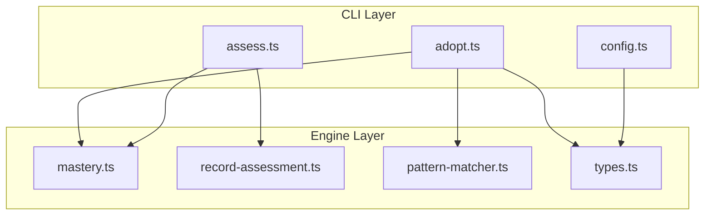
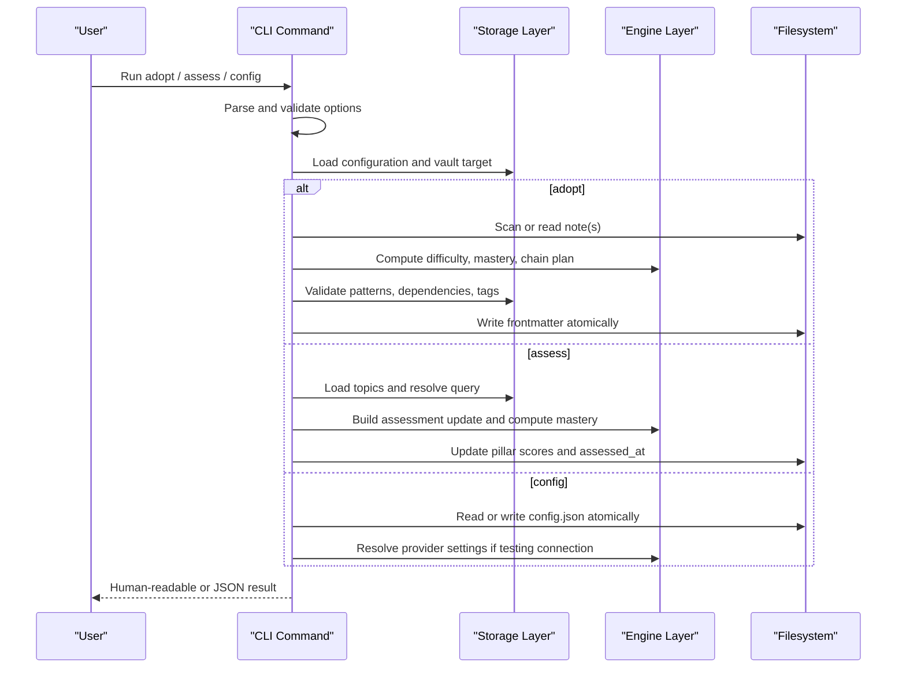
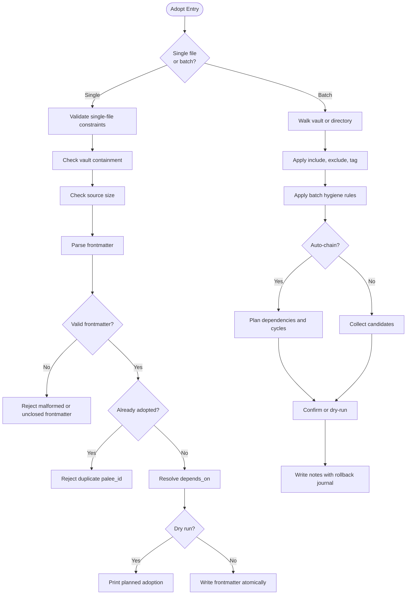
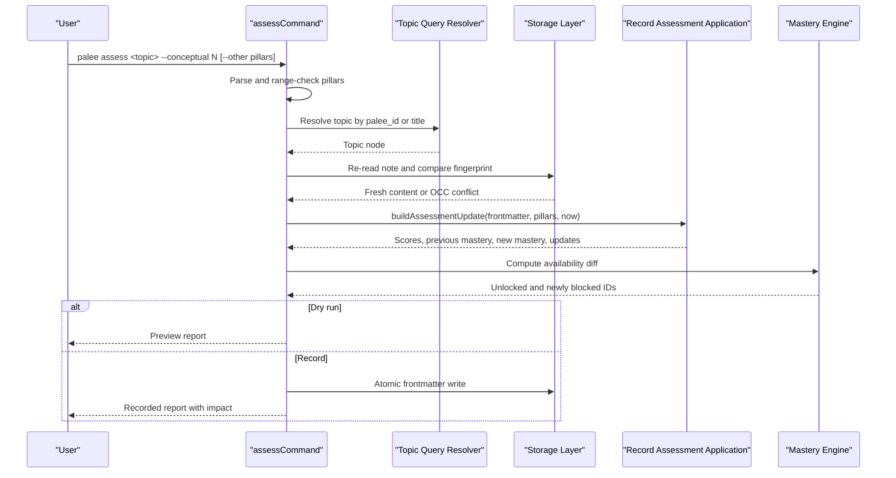
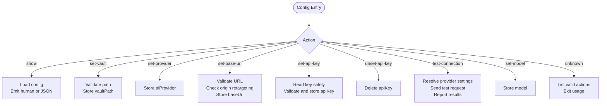
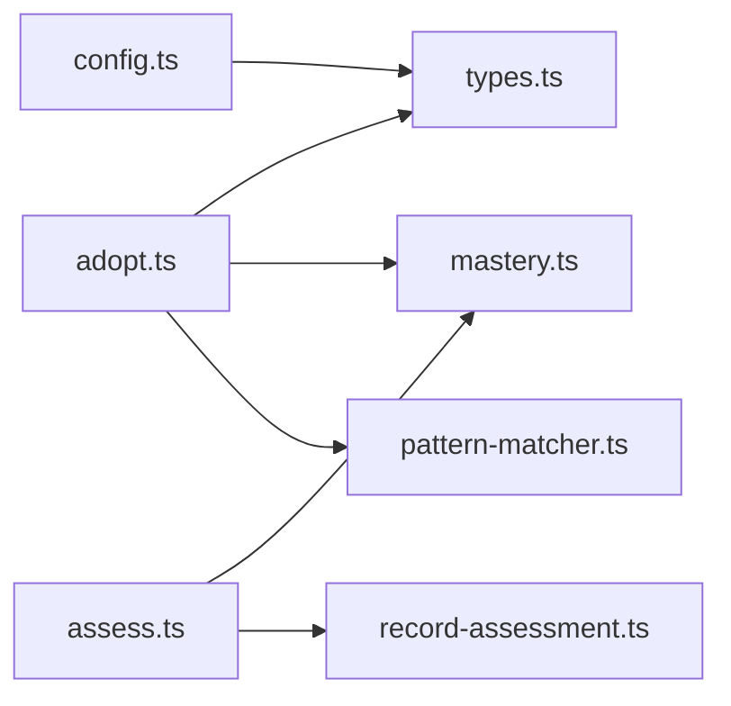

# Content Management Commands

<cite>
**Referenced Files in This Document**   
- [adopt.ts](https://github.com/Kuldeep2822k/cli/blob/main/src/cli/adopt.ts)
- [assess.ts](https://github.com/Kuldeep2822k/cli/blob/main/src/cli/assess.ts)
- [config.ts](https://github.com/Kuldeep2822k/cli/blob/main/src/cli/config.ts)
- [mastery.ts](https://github.com/Kuldeep2822k/cli/blob/main/src/engine/mastery.ts)
- [record-assessment.ts](https://github.com/Kuldeep2822k/cli/blob/main/src/application/record-assessment.ts)
- [pattern-matcher.ts](https://github.com/Kuldeep2822k/cli/blob/main/src/storage/pattern-matcher.ts)
- [types.ts](https://github.com/Kuldeep2822k/cli/blob/main/src/types.ts)
</cite>

## Table of Contents
1. [Introduction](#introduction)
2. [Project Structure](#project-structure)
3. [Core Components](#core-components)
4. [Architecture Overview](#architecture-overview)
5. [Detailed Component Analysis](#detailed-component-analysis)
6. [Dependency Analysis](#dependency-analysis)
7. [Performance Considerations](#performance-considerations)
8. [Troubleshooting Guide](#troubleshooting-guide)
9. [Conclusion](#conclusion)

## Introduction
This document explains PALEE's content management commands: **adopt**, **assess**, and **config**. It focuses on how these commands read, validate, modify, and report on notes inside a vault, including batch filtering, dependency chaining, mastery computation, configuration persistence, and dry-run behavior.

The three commands share common infrastructure:
- Vault discovery through the user's configuration.
- Atomic frontmatter writes that preserve existing topic identity.
- Exit-code-driven error reporting compatible with automation.
- JSON output support for machine-readable workflows.

## Project Structure
The implementation is organized by CLI command, with shared engine, storage, and application logic under separate directories.

**Diagram sources**
- [adopt.ts:1-20](https://github.com/Kuldeep2822k/cli/blob/main/src/cli/adopt.ts#L1-L20)
- [assess.ts:1-20](https://github.com/Kuldeep2822k/cli/blob/main/src/cli/assess.ts#L1-L20)
- [config.ts:1-20](https://github.com/Kuldeep2822k/cli/blob/main/src/cli/config.ts#L1-L20)
- [mastery.ts:1-20](https://github.com/Kuldeep2822k/cli/blob/main/src/engine/mastery.ts#L1-L20)
- [record-assessment.ts:1-20](https://github.com/Kuldeep2822k/cli/blob/main/src/application/record-assessment.ts#L1-L20)
- [pattern-matcher.ts:1-20](https://github.com/Kuldeep2822k/cli/blob/main/src/storage/pattern-matcher.ts#L1-L20)
- [types.ts:1-20](https://github.com/Kuldeep2822k/cli/blob/main/src/types.ts#L1-L20)

**Section sources**
- [adopt.ts:1-20](https://github.com/Kuldeep2822k/cli/blob/main/src/cli/adopt.ts#L1-L20)
- [assess.ts:1-20](https://github.com/Kuldeep2822k/cli/blob/main/src/cli/assess.ts#L1-L20)
- [config.ts:1-20](https://github.com/Kuldeep2822k/cli/blob/main/src/cli/config.ts#L1-L20)

## Core Components

### Adopt Command
The adopt command converts existing Markdown notes into PALEE topics. It supports:
- Single-file adoption.
- Batch directory scanning.
- Pattern filtering with `--include`, `--exclude`, and `--tag`.
- Difficulty specification.
- Dependency declaration through `--depends-on`.
- Auto-chaining from numbered curriculum structure or declared prerequisites.
- Undo via a companion undo mechanism.
- Dry-run preview without modifying files.

Key behaviors:
- Invalid difficulty values are rejected immediately.
- Glob syntax errors in include/exclude patterns are rejected before scanning.
- Single-file mode rejects `--include`, `--exclude`, and `--tag` because those flags select notes from a directory walk.
- Explicit paths outside the vault root are refused.
- Oversized notes are declined consistently with other reading commands.
- Malformed or unclosed frontmatter blocks prevent adoption to avoid stranding an existing `palee_id`.
- Already adopted notes are skipped unless explicitly selected as chain bridges.
- Batch hygiene excludes repository metadata, translation copies, templates, and short README/SUMMARY navigation pages.
- Auto-chain plans dependencies across the scanned scope, including already-adopted notes.
- Declared prerequisites from note text can replace inferred edges when present.
- The command uses optimistic concurrency control and a rollback journal during batch writes.

**Section sources**
- [adopt.ts:201-280](https://github.com/Kuldeep2822k/cli/blob/main/src/cli/adopt.ts#L201-L280)
- [adopt.ts:280-420](https://github.com/Kuldeep2822k/cli/blob/main/src/cli/adopt.ts#L280-L420)
- [adopt.ts:420-531](https://github.com/Kuldeep2822k/cli/blob/main/src/cli/adopt.ts#L420-L531)
- [adopt.ts:600-905](https://github.com/Kuldeep2822k/cli/blob/main/src/cli/adopt.ts#L600-L905)

### Assess Command
The assess command records a four-pillar pedagogical assessment for a topic. The pillars are:
- Conceptual understanding.
- Practical application.
- Debugging and troubleshooting.
- Feynman articulation.

Mastery is computed using weighted pillar scores:
- Conceptual: 20%
- Practical: 20%
- Debug: 20%
- Feynman: 40% (double-weighted)

A topic reaches mastery at or above the configured threshold. Lowering mastery below the threshold can block dependent topics, and the command reports which dependents are newly offered or blocked.

Key behaviors:
- At least one pillar must be provided.
- Pillar scores must be numbers between 0 and 1.
- Missing or ambiguous topics produce usage errors.
- Concurrent modification of the target note is detected as an OCC conflict.
- `--dry-run` previews changes without writing.
- `--force` suppresses the lowering warning but does not change what is recorded.

**Section sources**
- [assess.ts:1-120](https://github.com/Kuldeep2822k/cli/blob/main/src/cli/assess.ts#L1-L120)
- [assess.ts:120-279](https://github.com/Kuldeep2822k/cli/blob/main/src/cli/assess.ts#L120-L279)
- [mastery.ts:1-120](https://github.com/Kuldeep2822k/cli/blob/main/src/engine/mastery.ts#L1-L120)
- [record-assessment.ts:1-134](https://github.com/Kuldeep2822k/cli/blob/main/src/application/record-assessment.ts#L1-L134)

### Config Command
The config command manages PALEE's persistent configuration. Supported actions are:
- `show`: Display current configuration.
- `set-vault`: Set the vault directory path.
- `set-provider`: Set the AI provider name.
- `set-base-url`: Set the provider endpoint base URL.
- `set-api-key`: Store an API key securely.
- `unset-api-key`: Remove the stored API key.
- `test-connection`: Test provider reachability.
- `set-model`: Set the AI model name.

Configuration is stored as JSON in a platform-specific location:
- Windows defaults to `%LOCALAPPDATA%/palee/config.json`.
- POSIX defaults to `~/.config/palee/config.json`.
- `PALEE_CONFIG_DIR` overrides the parent directory.

Key behaviors:
- All mutating actions write atomically.
- API keys are never accepted as arguments.
- Keys can come from `--from-env`, piped stdin, or an interactive prompt.
- On Windows, storing a key outside the user profile is refused unless overridden.
- Changing the provider base URL while a key is configured may require explicit confirmation or `--keep-key`.
- `--json` returns structured output for every action.

**Section sources**
- [config.ts:1-120](https://github.com/Kuldeep2822k/cli/blob/main/src/cli/config.ts#L1-L120)
- [config.ts:201-612](https://github.com/Kuldeep2822k/cli/blob/main/src/cli/config.ts#L201-L612)
- [config.ts:612-766](https://github.com/Kuldeep2822k/cli/blob/main/src/cli/config.ts#L612-L766)

## Architecture Overview

**Diagram sources**
- [adopt.ts:201-531](https://github.com/Kuldeep2822k/cli/blob/main/src/cli/adopt.ts#L201-L531)
- [assess.ts:120-279](https://github.com/Kuldeep2822k/cli/blob/main/src/cli/assess.ts#L120-L279)
- [config.ts:201-766](https://github.com/Kuldeep2822k/cli/blob/main/src/cli/config.ts#L201-L766)

## Detailed Component Analysis

### Adopt Command: Syntax Variations and Modes

#### Single-File Adoption
Single-file adoption occurs when:
- A positional path points to an existing `.md` file.
- `--all` is not used.
- The resolved path remains inside the vault root.

In this mode:
- Filters (`--include`, `--exclude`, `--tag`) are rejected.
- `--auto-chain` is rejected.
- The note's title, difficulty, dependencies, pillar scores, and mastery are preserved unless explicitly overridden.
- `--depends-on` can add or override dependencies; malformed or unresolved IDs produce warnings rather than hard failures.
- Frontmatter must parse cleanly, and any unclosed frontmatter opener is refused.
- `--dry-run` prints planned fields without writing.

Typical single-file workflow:
1. Choose a Markdown note.
2. Verify it has valid frontmatter.
3. Run adoption with optional difficulty and dependency flags.
4. Review the resulting topic ID, title, and dependencies.

#### Batch Directory Scanning
Batch mode scans one or more directories, or the entire vault with `--all`. For each candidate:
- File size is checked against the read cap.
- Frontmatter is parsed.
- Include, exclude, and tag filters are applied.
- Repository metadata and navigation-only README/SUMMARY notes are excluded unless they contain substantial lesson content.
- Auto-chain planning may derive dependencies from numbered structure or declared prerequisites.

#### Pattern Filtering
Include, exclude, and tag filtering use glob-style patterns:
- `*` matches within a single path segment.
- `**` matches across directories.
- `?` matches a single non-slash character.
- Character sets like `[a-z]` and negated sets like `[!0-9]` are supported.
- Matching is case-insensitive.
- Patterns are validated before scanning; invalid syntax exits with a usage error.
- Per-pattern accounting reports whether a pattern matched anything in the scanned scope.

Important path rules:
- Relative vault paths are used for matching.
- Backslashes are normalized to forward slashes.
- Case differences do not prevent a match.
- Anchored patterns behave like full-path globs because they are compiled with start and end anchors.

#### Difficulty Levels
Accepted inputs include:
- Strings: `beginner`, `intermediate`, `advanced`.
- Numbers or numeric strings mapped to ranges.
- Default is `intermediate` when no value is supplied.

Difficulty normalization also applies to existing frontmatter values so hand-authored data is handled consistently.

#### Dependency Specification
Dependencies can come from:
- `--depends-on`, which accepts comma-separated topic IDs.
- Existing `depends_on` frontmatter, labeled as `declared` when preserved.
- Auto-chain inference, which derives dependencies from numbered curriculum structure or declared prerequisite text.

Validation rules:
- `--auto-chain` conflicts with `--depends-on`.
- Malformed IDs warn about permanent dangling edges.
- Unresolved IDs warn until the referenced topic exists.
- Cycle detection is part of the broader dependency graph handling.

#### Auto-Chaining
Auto-chain builds a dependency plan before confirming or writing:
- Notes being adopted receive pre-minted IDs for planning.
- Already-adopted notes in the scanned scope become chain bridges.
- Existing topics in the vault participate in cycle checking.
- Declared prerequisites from note text can override inferred edges.
- Two tiers are supported:
  - `strict`: chains only numbered tree structure.
  - `full`: allows enumeration-based chaining.
- `--chain-tier` requires `--auto-chain`; invalid tier values are rejected.

#### Undo Functionality
Adoption writes are tracked in a rollback journal. If a later step fails during batch processing, previously written notes can be restored to their original content. The undo operation is best-effort: failures are logged while continuing to revert remaining entries.

The undo command is implemented separately and invoked through the adopt workflow where applicable.

#### Dry-Run Mode
Dry-run modes exist for both single-file and batch adoption:
- Single-file dry-run prints planned title, difficulty, and dependencies.
- Batch dry-run participates in auto-chain planning so the reported edges reflect what would be committed.
- No files are modified.

**Diagram sources**
- [adopt.ts:201-531](https://github.com/Kuldeep2822k/cli/blob/main/src/cli/adopt.ts#L201-L531)
- [adopt.ts:600-905](https://github.com/Kuldeep2822k/cli/blob/main/src/cli/adopt.ts#L600-L905)

**Section sources**
- [adopt.ts:201-531](https://github.com/Kuldeep2822k/cli/blob/main/src/cli/adopt.ts#L201-L531)
- [adopt.ts:600-905](https://github.com/Kuldeep2822k/cli/blob/main/src/cli/adopt.ts#L600-L905)
- [pattern-matcher.ts:1-120](https://github.com/Kuldeep2822k/cli/blob/main/src/storage/pattern-matcher.ts#L1-L120)
- [types.ts:60-120](https://github.com/Kuldeep2822k/cli/blob/main/src/types.ts#L60-L120)

### Assess Command: Four-Pillar Assessment System

#### Pillars and Mastery Formula
The four pillars are conceptual, practical, debug, and feynman. Mastery is calculated as:

`(conceptual + practical + debug + 2 × feynman) / 5`

Each pillar is normalized to `[0.0, 1.0]` before calculation. Mastery is rounded to four decimal places.

#### Force and Dry-Run Options
- `--force` suppresses the lowering warning when an assessment reduces mastery below the threshold.
- `--dry-run` previews pillar scores, new mastery, and availability changes without writing.
- Both options affect reporting and UI behavior; neither adds new exit codes beyond normal validation or conflict errors.

#### Availability Impact
Assessment changes affect downstream topics:
- Topics whose mastery crosses the readiness threshold may unlock dependent topics.
- Lowered mastery may stop offering ready topics.
- The report names up to three examples and summarizes additional counts.

**Diagram sources**
- [assess.ts:120-279](https://github.com/Kuldeep2822k/cli/blob/main/src/cli/assess.ts#L120-L279)
- [record-assessment.ts:60-134](https://github.com/Kuldeep2822k/cli/blob/main/src/application/record-assessment.ts#L60-L134)
- [mastery.ts:80-200](https://github.com/Kuldeep2822k/cli/blob/main/src/engine/mastery.ts#L80-L200)

**Section sources**
- [assess.ts:1-279](https://github.com/Kuldeep2822k/cli/blob/main/src/cli/assess.ts#L1-L279)
- [record-assessment.ts:1-134](https://github.com/Kuldeep2822k/cli/blob/main/src/application/record-assessment.ts#L1-L134)
- [mastery.ts:1-200](https://github.com/Kuldeep2822k/cli/blob/main/src/engine/mastery.ts#L1-L200)

### Config Command: Actions, Environment Variables, and JSON Output

#### Configuration Actions

| Action | Required Value | Behavior |
|---|---:|---|
| `show` | None | Prints vault path, AI provider, base URL, masked API key status, and model. JSON includes `vault_path`, `ai_provider`, `base_url`, `model`, and `api_key_set`. |
| `set-vault` | Path | Validates existence and directory type, then stores the absolute vault path. |
| `set-provider` | Provider name | Stores the provider string. |
| `set-base-url` | URL | Validates endpoint format, rejects query and fragment segments, checks origin retargeting, and stores the cleaned origin plus pathname. |
| `set-api-key` | None | Reads key from environment, stdin, or interactive prompt; validates printable characters and Windows directory safety; stores it. |
| `unset-api-key` | None | Removes the stored key if present. |
| `test-connection` | None | Sends a minimal provider request and reports endpoint, model, key source, reply, latency, and token usage. |
| `set-model` | Model name | Stores the model string. |

#### Environment Variable Integration
- `PALEE_CONFIG_DIR`: Overrides the config directory.
- `LOCALAPPDATA`: Used by default Windows config resolution.
- `USERPROFILE`: Used by Windows profile-root checks.
- `API_KEY_ENV`: Identified in the AI module and referenced by connection testing to label the active key source.
- `PALEE_ALLOW_INSECURE_CONFIG_DIR`: Overrides Windows API key directory safety checks.

#### JSON Output Format
Every config action supports `--json`:
- `show` returns a structured object with nullable fields.
- Mutating actions return `{status, ...field}` on success.
- Refusals return `{error}`, sometimes with a `remedy` field.
- Secrets are never echoed in stdout; prompts move to stderr when JSON mode is active.

**Diagram sources**
- [config.ts:201-766](https://github.com/Kuldeep2822k/cli/blob/main/src/cli/config.ts#L201-L766)

**Section sources**
- [config.ts:1-200](https://github.com/Kuldeep2822k/cli/blob/main/src/cli/config.ts#L1-L200)
- [config.ts:201-612](https://github.com/Kuldeep2822k/cli/blob/main/src/cli/config.ts#L201-L612)
- [config.ts:612-766](https://github.com/Kuldeep2822k/cli/blob/main/src/cli/config.ts#L612-L766)

## Dependency Analysis

**Diagram sources**
- [adopt.ts:1-20](https://github.com/Kuldeep2822k/cli/blob/main/src/cli/adopt.ts#L1-L20)
- [assess.ts:1-20](https://github.com/Kuldeep2822k/cli/blob/main/src/cli/assess.ts#L1-L20)
- [config.ts:1-20](https://github.com/Kuldeep2822k/cli/blob/main/src/cli/config.ts#L1-L20)
- [mastery.ts:1-20](https://github.com/Kuldeep2822k/cli/blob/main/src/engine/mastery.ts#L1-L20)
- [record-assessment.ts:1-20](https://github.com/Kuldeep2822k/cli/blob/main/src/application/record-assessment.ts#L1-L20)
- [pattern-matcher.ts:1-20](https://github.com/Kuldeep2822k/cli/blob/main/src/storage/pattern-matcher.ts#L1-L20)
- [types.ts:1-20](https://github.com/Kuldeep2822k/cli/blob/main/src/types.ts#L1-L20)

### Coupling and Cohesion
- The CLI layer remains thin: it parses options, resolves vaults, and delegates domain logic.
- Mastery calculation is centralized in the engine.
- Assessment write logic is isolated in the application layer to keep CLI code focused on I/O and validation.
- Pattern matching is encapsulated in storage utilities so adopt and related scanners reuse the same glob behavior.

### External Dependencies
- Filesystem access is used for vault walking, note reads/writes, and config persistence.
- The AI provider integration is consulted by `test-connection` and referenced indirectly by config actions.
- Node.js built-in modules handle paths, OS home directories, crypto, and readline.

**Section sources**
- [adopt.ts:1-20](https://github.com/Kuldeep2822k/cli/blob/main/src/cli/adopt.ts#L1-L20)
- [assess.ts:1-20](https://github.com/Kuldeep2822k/cli/blob/main/src/cli/assess.ts#L1-L20)
- [config.ts:1-20](https://github.com/Kuldeep2822k/cli/blob/main/src/cli/config.ts#L1-L20)

## Performance Considerations
- Batch adoption reads each candidate once and avoids repeated parsing by carrying frontmatter state through the scan loop.
- Pattern validation happens early to fail fast on invalid globs.
- Auto-chain planning is performed before confirmation so cycle detection and edge reporting are accurate without unnecessary writes.
- Large notes are rejected before adoption to avoid minting identities onto files that other commands will refuse.
- Atomic writes minimize corruption risk and enable reliable rollback.
- Pattern compilation collapses redundant `**/` bands to reduce backtracking risk.

[No sources needed since this section provides general guidance]

## Troubleshooting Guide

### Common Adopt Pitfalls
- **Invalid difficulty**: Use one of the accepted values or numeric mappings.
- **Invalid glob pattern**: Fix include or exclude syntax before scanning.
- **Filters on single file**: Move to a directory or use `--all`; single-file mode does not apply filters.
- **Path escapes vault**: Ensure the target is inside the configured vault root.
- **Oversized note**: Reduce the note or split it; PALEE deliberately refuses notes too large for review commands.
- **Malformed or unclosed frontmatter**: Repair YAML delimiters before adoption.
- **Already adopted**: The note already carries a `palee_id`; do not re-adopt it.
- **Dangling dependency**: Correct malformed IDs or wait until referenced topics exist.
- **Conflicting auto-chain and depends-on**: Use one strategy for declaring dependencies.
- **Missing chain tier**: Pass `--chain-tier strict` or `--chain-tier full` with `--auto-chain`.

### Common Assess Pitfalls
- **No pillar provided**: Supply at least one of `--conceptual`, `--practical`, `--debug`, or `--feynman`.
- **Invalid pillar score**: Use a number from 0 to 1.
- **Ambiguous topic query**: Narrow the query to a unique `palee_id` or title substring.
- **Concurrent modification**: Retry after other processes finish updating the note.
- **Lowered mastery**: Use `--force` to acknowledge the drop, or `--dry-run` to preview first.

### Common Config Pitfalls
- **Unknown action**: Use one of the documented actions.
- **Missing vault path**: Provide an existing directory.
- **Invalid base URL**: Remove query strings, fragments, and credentials from the endpoint.
- **API key passed as argument**: Use `--from-env`, pipe stdin, or enter interactively.
- **Windows insecure config directory**: Move the config directory under the user profile or set the override.
- **Origin retargeting with stored key**: Confirm explicitly or unset the key before changing the base URL.
- **Test connection failure**: Check provider settings, network access, and API key source.

**Section sources**
- [adopt.ts:201-531](https://github.com/Kuldeep2822k/cli/blob/main/src/cli/adopt.ts#L201-L531)
- [assess.ts:1-279](https://github.com/Kuldeep2822k/cli/blob/main/src/cli/assess.ts#L1-L279)
- [config.ts:201-766](https://github.com/Kuldeep2822k/cli/blob/main/src/cli/config.ts#L201-L766)

## Conclusion
PALAE's content management commands provide a disciplined workflow for turning existing notes into managed learning topics, recording structured assessments, and maintaining secure configuration. The adopt command balances flexibility with safety through validation, hygiene rules, atomic writes, and rollback. The assess command ties pedagogical mastery to prerequisite gating using a clear four-pillar model. The config command centralizes provider and vault settings while protecting secrets and exposing machine-readable output for automation.

For reliable workflows:
- Prefer explicit topic IDs and narrow queries.
- Validate patterns and dependencies before running large batches.
- Use dry-run modes to inspect planned changes.
- Keep configuration inside safe directories and avoid embedding secrets in command history.
- Treat mastery as a gate: raise it with all relevant pillars, especially Feynman, when prerequisite gates remain closed.

[No sources needed since this section summarizes without analyzing specific files]