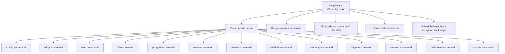
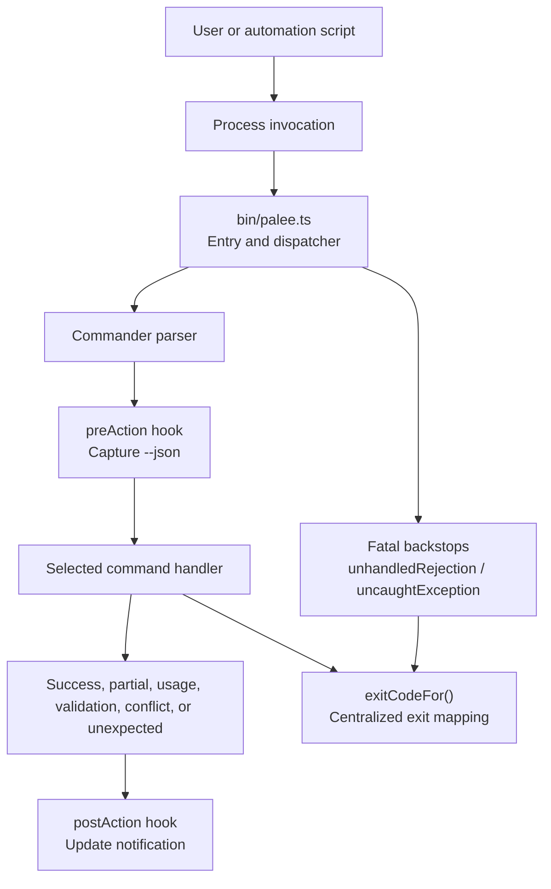
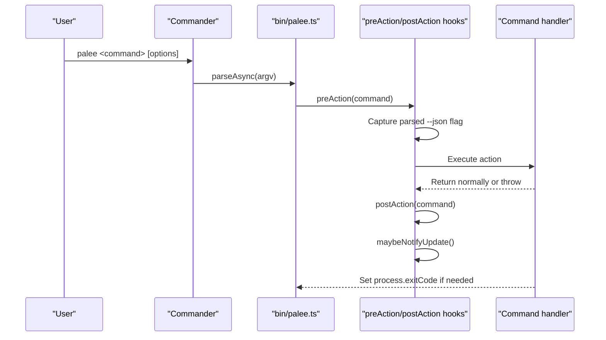
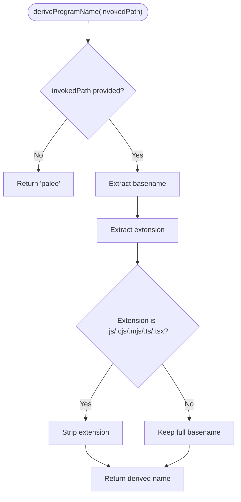
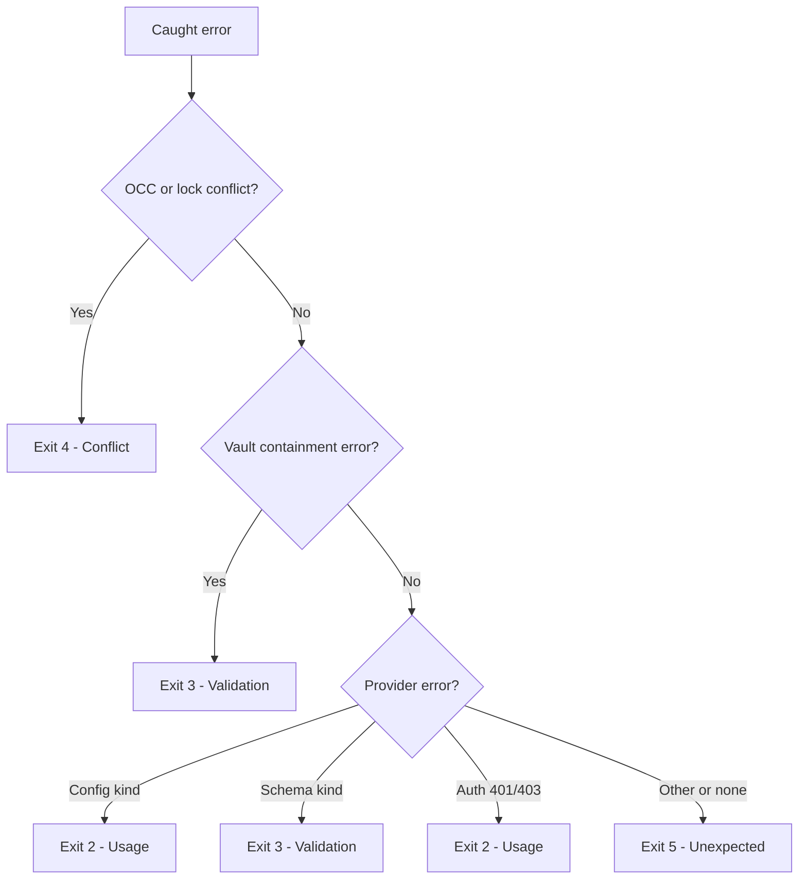
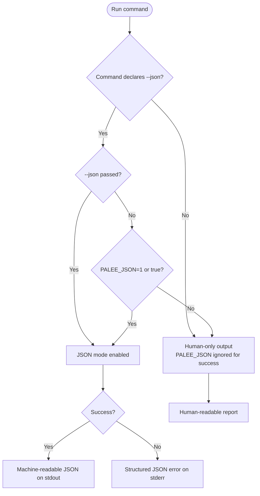
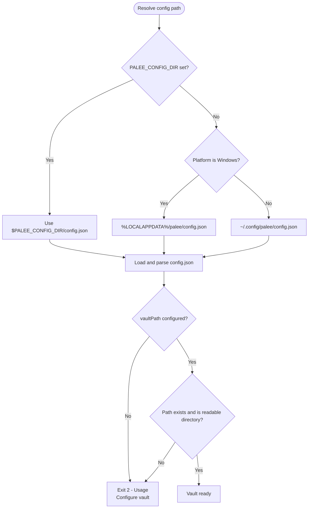
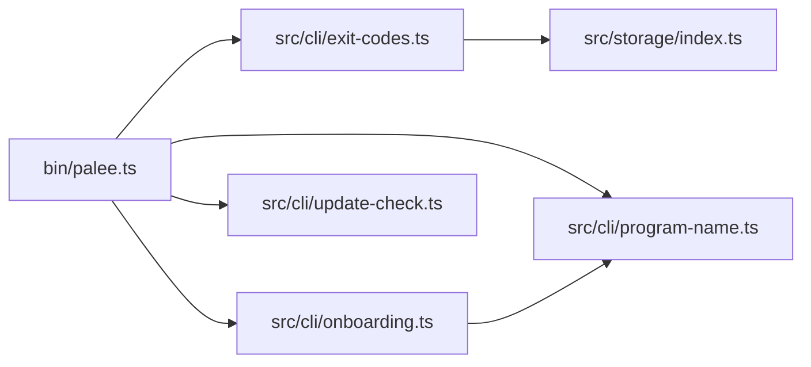

# General CLI Concepts and Conventions

<cite>
**Referenced Files in This Document**   
- [bin/palee.ts](https://github.com/Kuldeep2822k/cli/blob/main/bin/palee.ts)
- [src/cli/exit-codes.ts](https://github.com/Kuldeep2822k/cli/blob/main/src/cli/exit-codes.ts)
- [src/cli/program-name.ts](https://github.com/Kuldeep2822k/cli/blob/main/src/cli/program-name.ts)
- [src/cli/onboarding.ts](https://github.com/Kuldeep2822k/cli/blob/main/src/cli/onboarding.ts)
- [src/cli/config.ts](https://github.com/Kuldeep2822k/cli/blob/main/src/cli/config.ts)
- [src/cli/update-check.ts](https://github.com/Kuldeep2822k/cli/blob/main/src/cli/update-check.ts)
- [src/storage/index.ts](https://github.com/Kuldeep2822k/cli/blob/main/src/storage/index.ts)
- [docs/adr/0024-exit-codes-and-error-contract.md](https://github.com/Kuldeep2822k/cli/blob/main/docs/adr/0024-exit-codes-and-error-contract.md)
</cite>

## Table of Contents
1. [Introduction](#introduction)
2. [Project Structure](#project-structure)
3. [Core Components](#core-components)
4. [Architecture Overview](#architecture-overview)
5. [Detailed Component Analysis](#detailed-component-analysis)
6. [Dependency Analysis](#dependency-analysis)
7. [Performance Considerations](#performance-considerations)
8. [Troubleshooting Guide](#troubleshooting-guide)
9. [Conclusion](#conclusion)
10. [Appendices](#appendices)

## Introduction
This document explains the general concepts and conventions that apply across all PALEE CLI commands. It covers how the Commander-based command architecture is structured, how help and program names are derived, the documented exit-code contract, JSON output behavior, environment variables, vault path resolution, common troubleshooting patterns, and safe automation scripting approaches.

The PALEE CLI is a Node.js command-line tool built on Commander. Each command is registered as a separate subcommand with its own description, arguments, options, and action handler. Global configuration, environment variables, update notifications, fatal error reporting, and process-level backstops are handled at the entry point before individual command actions run.

## Project Structure
At runtime, the CLI entry point:
- Imports Commander and the package version.
- Derives the program name from the invoked script.
- Registers global help text for environment variables.
- Registers every subcommand (`config`, `adopt`, `next`, `plan`, `progress`, `review`, `assess`, `validate`, `roadmap`, `migrate`, `session`, `dashboard`, `update`).
- Installs pre-action hooks to capture parsed options and determine whether a command declares `--json`.
- Runs an update check after each successful command.
- Catches Commander usage errors and converts them into the documented exit codes.
- Provides unhandled rejection and uncaught exception backstops that emit either machine-readable JSON or a human diagnostic.



**Diagram sources**
- [bin/palee.ts:1-20](https://github.com/Kuldeep2822k/cli/blob/main/bin/palee.ts#L1-L20)
- [bin/palee.ts:60-240](https://github.com/Kuldeep2822k/cli/blob/main/bin/palee.ts#L60-L240)
- [bin/palee.ts:240-389](https://github.com/Kuldeep2822k/cli/blob/main/bin/palee.ts#L240-L389)

**Section sources**
- [bin/palee.ts:1-20](https://github.com/Kuldeep2822k/cli/blob/main/bin/palee.ts#L1-L20)
- [bin/palee.ts:40-70](https://github.com/Kuldeep2822k/cli/blob/main/bin/palee.ts#L40-L70)
- [bin/palee.ts:60-240](https://github.com/Kuldeep2822k/cli/blob/main/bin/palee.ts#L60-L240)
- [bin/palee.ts:240-389](https://github.com/Kuldeep2822k/cli/blob/main/bin/palee.ts#L240-L389)

## Core Components
- **Command registration**: Every command is declared through Commander’s `.command()` API. Commands declare their descriptions, positional arguments, options, and optional post-help text.
- **Help system**: Commander renders `palee --help` and `palee <command> --help`. The entry point adds global environment documentation after all commands, and some commands add extra help text after their own help.
- **Program name derivation**: The actual binary name used by the user is derived from `process.argv[1]`, stripping known script extensions. Handlers read it back from Commander so suggestions in error messages match the invocation.
- **Global option capture**: A `preAction` hook captures parsed options so the update notification and fatal error formatter know whether `--json` was requested.
- **Update notification**: After a command runs successfully, the CLI may print a new-version notice on stderr. This is suppressed when stdout is piped, when `--json` is requested, when the command fails, or when `PALEE_NO_UPDATE_CHECK` is set.
- **Fatal error handling**: Unhandled rejections and exceptions are reported through a shared reporter that sets `process.exitCode = Unexpected (5)` and emits either JSON, a stack trace under `PALEE_DEBUG`, or a plain message.
- **Commander usage-error mapping**: Unknown commands, unknown options, and missing arguments are converted to `Usage (2)` rather than leaving Commander’s default exit code.

**Section sources**
- [bin/palee.ts:40-70](https://github.com/Kuldeep2822k/cli/blob/main/bin/palee.ts#L40-L70)
- [bin/palee.ts:60-240](https://github.com/Kuldeep2822k/cli/blob/main/bin/palee.ts#L60-L240)
- [bin/palee.ts:240-389](https://github.com/Kuldeep2822k/cli/blob/main/bin/palee.ts#L240-L389)
- [src/cli/program-name.ts:1-91](https://github.com/Kuldeep2822k/cli/blob/main/src/cli/program-name.ts#L1-L91)

## Architecture Overview
The CLI follows a layered pattern:

| Layer | Responsibility | Key files |
|---|---|---|
| Entry and dispatcher | Commander setup, command registration, global hooks, fatal backstops | [bin/palee.ts](https://github.com/Kuldeep2822k/cli/blob/main/bin/palee.ts) |
| Command handlers | Per-command argument parsing, business logic, and result formatting | [src/cli/config.ts](https://github.com/Kuldeep2822k/cli/blob/main/src/cli/config.ts), plus other `src/cli/*.ts` files |
| Shared CLI utilities | JSON mode detection, error formatting, vault validation, program name access | [src/cli/onboarding.ts](https://github.com/Kuldeep2822k/cli/blob/main/src/cli/onboarding.ts), [src/cli/program-name.ts](https://github.com/Kuldeep2822k/cli/blob/main/src/cli/program-name.ts) |
| Exit contract | Centralized exit code constants and error classification | [src/cli/exit-codes.ts](https://github.com/Kuldeep2822k/cli/blob/main/src/cli/exit-codes.ts) |
| Storage primitives | Conflict and containment detection used by the exit classifier | [src/storage/index.ts](https://github.com/Kuldeep2822k/cli/blob/main/src/storage/index.ts) |
| Update surface | npm-based version checks delegated to the user’s npm process | [src/cli/update-check.ts](https://github.com/Kuldeep2822k/cli/blob/main/src/cli/update-check.ts) |



**Diagram sources**
- [bin/palee.ts:240-389](https://github.com/Kuldeep2822k/cli/blob/main/bin/palee.ts#L240-L389)
- [src/cli/exit-codes.ts:1-65](https://github.com/Kuldeep2822k/cli/blob/main/src/cli/exit-codes.ts#L1-L65)

## Detailed Component Analysis

### Command-Line Architecture and Help System
The CLI uses Commander for command routing. The entry point configures:
- Program name via `deriveProgramName()`.
- Description and version.
- `exitOverride()` so Commander usage errors become thrown errors instead of direct exits.
- Global help text appended after all commands.
- Individual command definitions with descriptions, arguments, options, and optional `addHelpText('after', ...)`.

Important conventions:
- Positional arguments are declared with `.argument(...)`.
- Options are declared with `.option(...)`.
- Short flags can be combined with long flags, such as `-y, --yes`.
- Some commands extend help text after the standard help output.
- The global environment section documents `PALEE_CONFIG_DIR` and `PALEE_NO_UPDATE_CHECK`.



**Diagram sources**
- [bin/palee.ts:240-389](https://github.com/Kuldeep2822k/cli/blob/main/bin/palee.ts#L240-L389)

**Section sources**
- [bin/palee.ts:40-70](https://github.com/Kuldeep2822k/cli/blob/main/bin/palee.ts#L40-L70)
- [bin/palee.ts:60-240](https://github.com/Kuldeep2822k/cli/blob/main/bin/palee.ts#L60-L240)
- [bin/palee.ts:240-389](https://github.com/Kuldeep2822k/cli/blob/main/bin/palee.ts#L240-L389)

### Program Name Derivation
The CLI derives its displayed name from the invoked script path rather than hardcoding `palee`. This matters when:
- The binary is installed under another name, such as `palee-test`.
- It is invoked through a wrapper or symlink.
- It is required directly without running the normal bin shim.

Rules:
- Known script extensions like `.js`, `.cjs`, `.mjs`, `.ts`, `.tsx` are stripped.
- Other extensions, including dot-files, are kept.
- If no usable name is available, the fallback is `palee`.
- Handlers call `programName()` to get the same value Commander prints in the `Usage:` line.



**Diagram sources**
- [src/cli/program-name.ts:1-91](https://github.com/Kuldeep2822k/cli/blob/main/src/cli/program-name.ts#L1-L91)

**Section sources**
- [src/cli/program-name.ts:1-91](https://github.com/Kuldeep2822k/cli/blob/main/src/cli/program-name.ts#L1-L91)
- [bin/palee.ts:1-20](https://github.com/Kuldeep2822k/cli/blob/main/bin/palee.ts#L1-L20)

### Exit Code Contract
The documented CLI exit code contract is centralized in `ExitCode`:

| Exit code | Meaning | Typical cause |
|---|---|---|
| `0` Success | Command completed successfully. | Normal completion. |
| `1` PartialImport | Partial failure where part of the operation succeeded but not everything did. | Examples include roadmap import skips or session cleanup issues where some work landed. |
| `2` Usage | Invalid usage or configuration. | Missing required arguments, unknown command, unknown option, unconfigured vault, bad provider configuration, invalid credentials. |
| `3` Validation | Validation failure. | Vault integrity errors, unrecognized schemas, malformed fields, security-related containment refusal. |
| `4` Conflict | Concurrent modification or lock conflict. | OCC collision or active file lock. |
| `5` Unexpected | Unexpected runtime exception. | Crashes, unhandled errors, I/O failures that do not fit another category. |

Classification rules:
- Conflict errors map to `Conflict (4)`.
- Containment errors map to `Validation (3)`.
- Provider configuration errors map to `Usage (2)`.
- Provider schema errors map to `Validation (3)`.
- Provider authentication errors (401/403) map to `Usage (2)`.
- Everything else maps to `Unexpected (5)`.

Commander usage errors are also mapped to `Usage (2)`, except informational cases like help and version, which use `Success (0)`.



**Diagram sources**
- [src/cli/exit-codes.ts:1-65](https://github.com/Kuldeep2822k/cli/blob/main/src/cli/exit-codes.ts#L1-L65)
- [src/storage/index.ts:1-142](https://github.com/Kuldeep2822k/cli/blob/main/src/storage/index.ts#L1-L142)

**Section sources**
- [src/cli/exit-codes.ts:1-65](https://github.com/Kuldeep2822k/cli/blob/main/src/cli/exit-codes.ts#L1-L65)
- [docs/adr/0024-exit-codes-and-error-contract.md:1-75](https://github.com/Kuldeep2822k/cli/blob/main/docs/adr/0024-exit-codes-and-error-contract.md#L1-L75)
- [src/storage/index.ts:1-142](https://github.com/Kuldeep2822k/cli/blob/main/src/storage/index.ts#L1-L142)

### JSON Output Mode
JSON output is machine-readable and intended for automation. It is enabled by:
- Passing `--json` to a command that declares the option.
- Setting `PALEE_JSON=1` or `PALEE_JSON=true`.

Rules:
- Piping or redirecting stdout does NOT enable JSON mode. Human-readable reports stay readable unless explicitly requested.
- Only commands that declare `--json` accept it. Reading commands such as `next`, `plan`, `progress`, `dashboard`, `validate`, and `session list` support it; mutating or interactive commands such as `review`, `adopt`, `assess`, `roadmap`, `migrate`, and `update` do not.
- On success, supported commands emit a JSON object describing their result.
- On failure, supported commands emit a structured JSON error object on stderr.
- For fatal crashes outside the normal command path, the entry point emits `{ status: "error", code: 5, error: "<message>" }` when JSON mode is active.



**Diagram sources**
- [src/cli/onboarding.ts:1-164](https://github.com/Kuldeep2822k/cli/blob/main/src/cli/onboarding.ts#L1-L164)
- [bin/palee.ts:240-389](https://github.com/Kuldeep2822k/cli/blob/main/bin/palee.ts#L240-L389)

**Section sources**
- [src/cli/onboarding.ts:1-164](https://github.com/Kuldeep2822k/cli/blob/main/src/cli/onboarding.ts#L1-L164)
- [bin/palee.ts:240-389](https://github.com/Kuldeep2822k/cli/blob/main/bin/palee.ts#L240-L389)

### Environment Variables
| Variable | Effect | Notes |
|---|---|---|
| `PALEE_CONFIG_DIR` | Overrides the directory containing `config.json`. | When unset, the CLI reads and writes the per-user default config, so every command shares one configuration and vault. Mutating commands print the resolved vault and config path. |
| `PALEE_JSON` | Enables JSON output when set to `1` or `true`. | Only affects commands that declare `--json`. Piping alone does not switch to JSON. |
| `PALEE_DEBUG` | Prints raw stack traces for fatal errors. | Any non-empty value except `"0"` enables it. It applies to the fatal error path. |
| `PALEE_NO_UPDATE_CHECK` | Silences the automatic new-version notice. | Any non-empty value other than `"0"` disables it. Nothing is printed after failed commands, when stdout is piped, when `--json` is requested, when the check fails, or when this variable is set. |

**Section sources**
- [bin/palee.ts:40-70](https://github.com/Kuldeep2822k/cli/blob/main/bin/palee.ts#L40-L70)
- [bin/palee.ts:240-389](https://github.com/Kuldeep2822k/cli/blob/main/bin/palee.ts#L240-L389)
- [src/cli/onboarding.ts:1-164](https://github.com/Kuldeep2822k/cli/blob/main/src/cli/onboarding.ts#L1-L164)

### Vault Path Resolution and Configuration File Locations
Configuration resolution:
- If `PALEE_CONFIG_DIR` is set, the CLI reads `config.json` from that directory.
- On Windows, the default is `%LOCALAPPDATA%/palee/config.json`.
- On POSIX systems, the default is `~/.config/palee/config.json`.
- The config file stores vault location, AI provider settings, model selection, base URL, and API key.

Vault validation:
- Commands that operate on a vault validate that the configured path exists, is a directory, and is readable.
- Missing vault path, nonexistent path, non-directory path, inaccessible path, or unreadable permissions produce a usage error and guidance to configure the vault.



**Diagram sources**
- [src/cli/config.ts:1-200](https://github.com/Kuldeep2822k/cli/blob/main/src/cli/config.ts#L1-L200)
- [src/cli/onboarding.ts:1-164](https://github.com/Kuldeep2822k/cli/blob/main/src/cli/onboarding.ts#L1-L164)

**Section sources**
- [src/cli/config.ts:1-200](https://github.com/Kuldeep2822k/cli/blob/main/src/cli/config.ts#L1-L200)
- [src/cli/onboarding.ts:1-164](https://github.com/Kuldeep2822k/cli/blob/main/src/cli/onboarding.ts#L1-L164)

### Update Check Behavior
The automatic update check:
- Runs after a command completes successfully.
- Delegates version checking to the user’s `npm` process.
- Uses a cache keyed by the resolved config directory.
- Has a TTL of 24 hours.
- Times out quickly for automatic checks.
- Skips when stdout is piped, when `--json` is requested, when the command fails, or when `PALEE_NO_UPDATE_CHECK` is set.
- Never opens network sockets itself; only npm is spawned.

**Section sources**
- [bin/palee.ts:240-389](https://github.com/Kuldeep2822k/cli/blob/main/bin/palee.ts#L240-L389)
- [src/cli/update-check.ts:1-200](https://github.com/Kuldeep2822k/cli/blob/main/src/cli/update-check.ts#L1-L200)

## Dependency Analysis
The CLI depends on Commander for argument parsing and command routing. Internal dependencies include:
- Exit code constants and classifier.
- Program name helper.
- Shared onboarding helpers for JSON mode, error emission, and vault validation.
- Storage subsystem exports for conflict and containment detection.
- Update checker for npm-based version operations.



**Diagram sources**
- [bin/palee.ts:1-20](https://github.com/Kuldeep2822k/cli/blob/main/bin/palee.ts#L1-L20)
- [bin/palee.ts:240-389](https://github.com/Kuldeep2822k/cli/blob/main/bin/palee.ts#L240-L389)
- [src/cli/exit-codes.ts:1-65](https://github.com/Kuldeep2822k/cli/blob/main/src/cli/exit-codes.ts#L1-L65)
- [src/cli/onboarding.ts:1-164](https://github.com/Kuldeep2822k/cli/blob/main/src/cli/onboarding.ts#L1-L164)
- [src/cli/program-name.ts:1-91](https://github.com/Kuldeep2822k/cli/blob/main/src/cli/program-name.ts#L1-L91)
- [src/storage/index.ts:1-142](https://github.com/Kuldeep2822k/cli/blob/main/src/storage/index.ts#L1-L142)
- [src/cli/update-check.ts:1-200](https://github.com/Kuldeep2822k/cli/blob/main/src/cli/update-check.ts#L1-L200)

**Section sources**
- [bin/palee.ts:1-20](https://github.com/Kuldeep2822k/cli/blob/main/bin/palee.ts#L1-L20)
- [src/cli/exit-codes.ts:1-65](https://github.com/Kuldeep2822k/cli/blob/main/src/cli/exit-codes.ts#L1-L65)
- [src/cli/onboarding.ts:1-164](https://github.com/Kuldeep2822k/cli/blob/main/src/cli/onboarding.ts#L1-L164)
- [src/cli/program-name.ts:1-91](https://github.com/Kuldeep2822k/cli/blob/main/src/cli/program-name.ts#L1-L91)
- [src/storage/index.ts:1-142](https://github.com/Kuldeep2822k/cli/blob/main/src/storage/index.ts#L1-L142)
- [src/cli/update-check.ts:1-200](https://github.com/Kuldeep2822k/cli/blob/main/src/cli/update-check.ts#L1-L200)

## Performance Considerations
- The CLI avoids unnecessary network calls. Update checks delegate to npm and cache results for 24 hours.
- Automatic update notices are suppressed in non-interactive and automated contexts.
- JSON output is opt-in, keeping human-readable output fast and predictable.
- Fatal error reporting uses `process.exitCode` instead of `process.exit` so pending async writes can drain.
- Commander usage errors are converted early, avoiding expensive command execution.

[No sources needed since this section provides general guidance]

## Troubleshooting Guide

### Common Command-Line Issues

| Symptom | Likely Cause | Resolution |
|---|---|---|
| `unknown command ...` | Misspelled command or missing subcommand. | Run `palee --help` or `palee <command> --help`. Use a valid command name. Exit code: `2`. |
| `unknown option ...` | Unsupported flag or typo. | Remove the unknown option or consult the command’s help. Exit code: `2`. |
| Missing required argument | Required positional argument omitted. | Add the required argument. Exit code: `2`. |
| Vault not configured | No vault path in config. | Run `palee config set-vault <path>` using the correct program name shown in help. Exit code: `2`. |
| Vault path not found | Path does not exist. | Correct the path or create the vault directory. Exit code: `2`. |
| Vault path is not a directory | A file was given as the vault path. | Point the vault setting to a directory. Exit code: `2`. |
| Vault path is not readable | Permission denied. | Fix filesystem permissions for the vault directory. Exit code: `2`. |
| Partial success | Some notes were imported but others skipped. | Inspect the command output. Exit code: `1`. |
| Validation warning promoted to failure | `--strict` mode or validation rule failure. | Fix vault integrity or schema problems. Exit code: `3`. |
| Concurrent modification detected | Another process modified the vault. | Retry after the other process finishes. Exit code: `4`. |
| Crash or unexpected error | Internal exception or unrecoverable failure. | Enable `PALEE_DEBUG` to collect diagnostics. Exit code: `5`. |

### Argument Parsing Errors
Commander throws usage errors for:
- Unknown commands.
- Unknown options.
- Missing required arguments.
- Invalid option values when Commander rejects them.

The entry point catches these, distinguishes informational cases like help and version, and maps usage errors to exit code `2`.

### Missing Arguments
Commands that require positional arguments will fail with a usage error if they are omitted. For example:
- `review` requires a topic ID and quality rating.
- `assess` requires a topic ID and assessment scores.
- `session` requires an action such as `start`, `draft`, `end`, or `list`.

### Unknown Options
Unknown options are rejected by Commander. Review the command’s help output for supported flags. Remember that some commands do not support `--json`; passing it to those commands is a usage error.

### JSON Mode Not Activated
If automation expects JSON but receives human-readable output:
- Confirm the command declares `--json`.
- Pass `--json` explicitly.
- Or set `PALEE_JSON=1` or `PALEE_JSON=true`.
- Do not rely on piping stdout to enable JSON mode.

### Scripting Patterns and Automation Workflows

Recommended patterns:
- Always check the exit code.
- Prefer explicit `--json` for machine-readable output.
- Use `PALEE_CONFIG_DIR` to isolate runs in CI or temporary directories.
- Suppress update notices with `PALEE_NO_UPDATE_CHECK=1`.
- Collect debug output with `PALEE_DEBUG=1` only when diagnosing failures.
- Avoid assuming that a non-zero exit code means only one thing; inspect the specific code.

Example workflows:

- Validate vault health:
  ```text
  palee validate --json
  ```
  - Success: exit `0`.
  - Validation failure: exit `3`.

- Get next review topic in JSON:
  ```text
  palee next --json
  ```
  - Success: exit `0`.
  - Missing vault or unreadable vault: exit `2`.

- Record a manual review:
  ```text
  palee review <topic-id> <quality>
  ```
  - Success: exit `0`.
  - Missing arguments or invalid input: exit `2`.

- Automate adoption with dry-run first:
  ```text
  palee adopt --dry-run
  palee adopt --all
  ```
  - Success: exit `0`.
  - Partial import: exit `1`.
  - Usage or configuration error: exit `2`.

- Handle conflicts:
  ```text
  palee roadmap --from plan.yaml
  ```
  - Conflict: exit `4`.
  - Retry after concurrent writers finish.

- Disable update checks in CI:
  ```text
  export PALEE_NO_UPDATE_CHECK=1
  palee dashboard --json
  ```

- Debug a crash:
  ```text
  export PALEE_DEBUG=1
  palee next --json
  ```

**Section sources**
- [bin/palee.ts:240-389](https://github.com/Kuldeep2822k/cli/blob/main/bin/palee.ts#L240-L389)
- [src/cli/onboarding.ts:1-164](https://github.com/Kuldeep2822k/cli/blob/main/src/cli/onboarding.ts#L1-L164)
- [src/cli/exit-codes.ts:1-65](https://github.com/Kuldeep2822k/cli/blob/main/src/cli/exit-codes.ts#L1-L65)

## Conclusion
The PALEE CLI is a consistent, scriptable interface over the PALEE engine. Its Commander-based architecture separates command registration, shared CLI utilities, centralized exit code mapping, and storage-level error classification. The documented exit codes, opt-in JSON mode, explicit environment variables, and deterministic vault path resolution make it suitable for both interactive learning and automated pipelines. For reliable automation, always specify `--json` for commands that support it, inspect exit codes, isolate configuration with `PALEE_CONFIG_DIR`, and suppress update noise with `PALEE_NO_UPDATE_CHECK`.

[No sources needed since this section summarizes without analyzing specific files]

## Appendices

### Quick Reference: Supported JSON Commands
- `next --json`
- `plan --json`
- `progress --json`
- `dashboard --json`
- `validate --json`
- `session --json`

Commands that do not declare `--json` include `review`, `adopt`, `assess`, `roadmap`, `migrate`, and `update`. Their success output remains human-readable even when `PALEE_JSON` is set.

**Section sources**
- [bin/palee.ts:60-240](https://github.com/Kuldeep2822k/cli/blob/main/bin/palee.ts#L60-L240)
- [src/cli/onboarding.ts:1-164](https://github.com/Kuldeep2822k/cli/blob/main/src/cli/onboarding.ts#L1-L164)