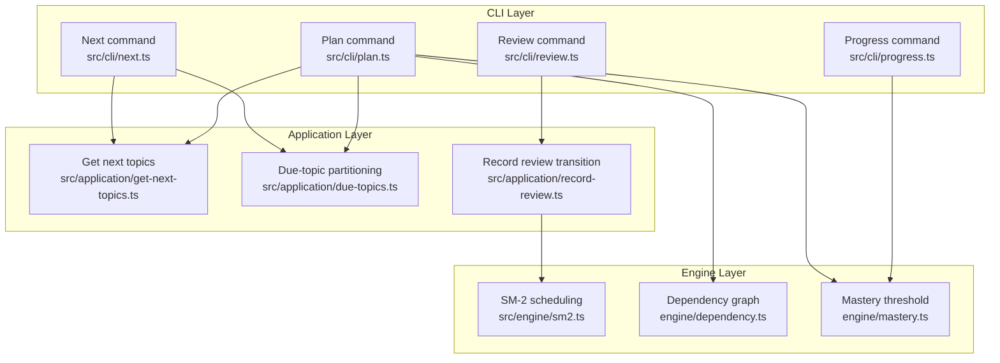
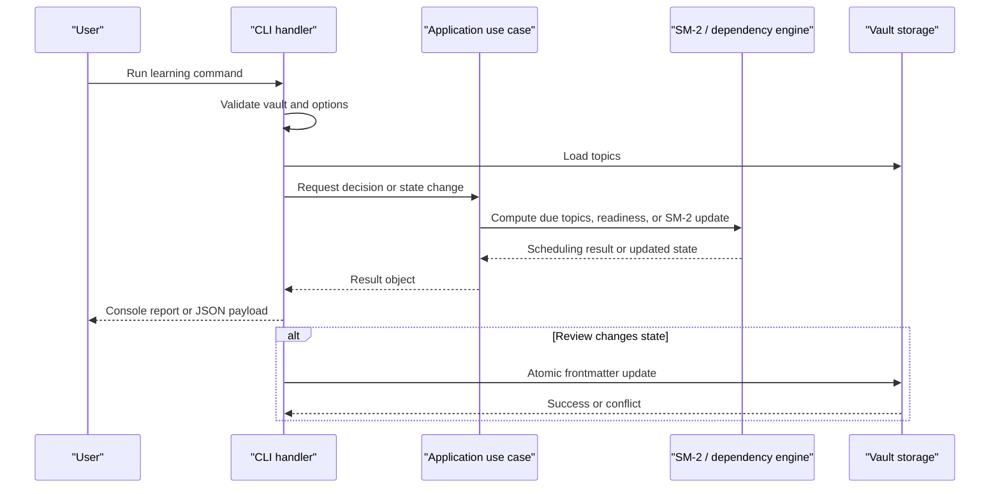
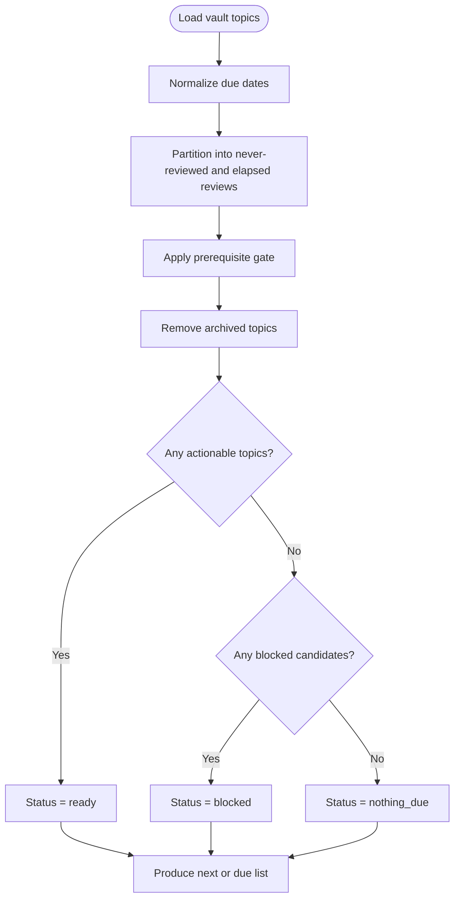
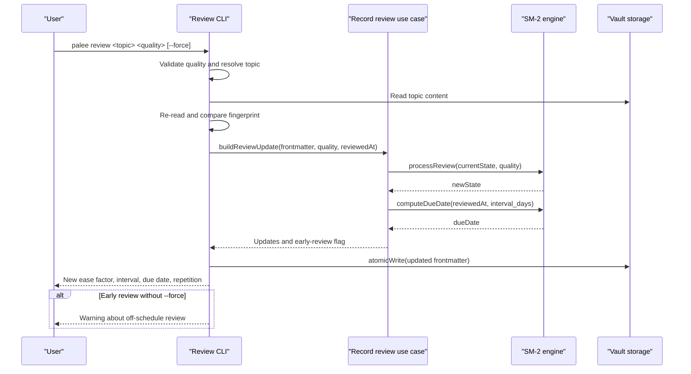
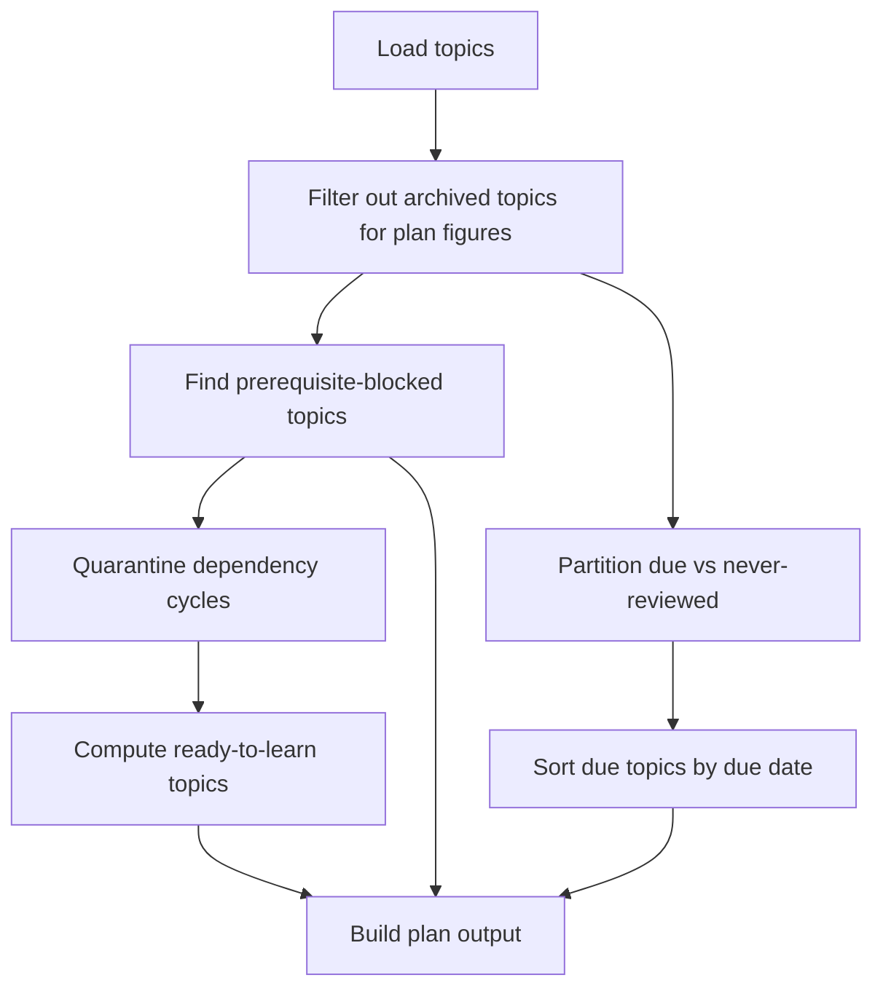
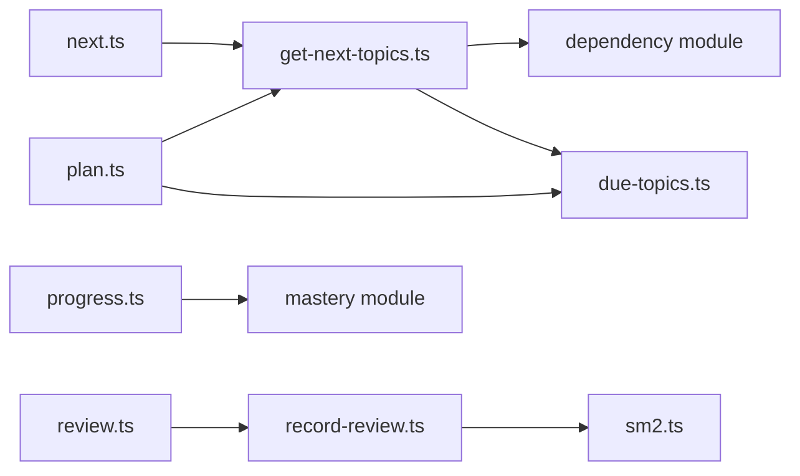

# Learning Workflow Commands

::: details Referenced Files in This Document

- [next.ts](https://github.com/Kuldeep2822k/cli/blob/main/src/cli/next.ts)
- [review.ts](https://github.com/Kuldeep2822k/cli/blob/main/src/cli/review.ts)
- [plan.ts](https://github.com/Kuldeep2822k/cli/blob/main/src/cli/plan.ts)
- [progress.ts](https://github.com/Kuldeep2822k/cli/blob/main/src/cli/progress.ts)
- [get-next-topics.ts](https://github.com/Kuldeep2822k/cli/blob/main/src/application/get-next-topics.ts)
- [due-topics.ts](https://github.com/Kuldeep2822k/cli/blob/main/src/application/due-topics.ts)
- [record-review.ts](https://github.com/Kuldeep2822k/cli/blob/main/src/application/record-review.ts)
- [sm2.ts](https://github.com/Kuldeep2822k/cli/blob/main/src/engine/sm2.ts)
- [palee_cli_spec.md](https://github.com/Kuldeep2822k/cli/blob/main/planning/palee_cli_spec.md)

:::

## Table of Contents
1. [Introduction](#introduction)
2. [Project Structure](#project-structure)
3. [Core Components](#core-components)
4. [Architecture Overview](#architecture-overview)
5. [Detailed Component Analysis](#detailed-component-analysis)
6. [Dependency Analysis](#dependency-analysis)
7. [Performance Considerations](#performance-considerations)
8. [Troubleshooting Guide](#troubleshooting-guide)
9. [Conclusion](#conclusion)
10. [Appendices](#appendices)

## Introduction
This document explains PALEE’s core learning workflow commands: `next`, `review`, `plan`, and `progress`. It focuses on how topics are discovered, scheduled, gated by prerequisites, reviewed with SM-2 spaced repetition, planned for a daily study session, and summarized through mastery metrics. It also provides practical daily routines, progress interpretation guidance, and notes on integrating these commands with calendars or reminders.

The implementation is layered:
- CLI handlers parse user options and format output.
- Application use cases implement pure scheduling, gating, and state-transition logic.
- Engine modules implement the SM-2 algorithm, dependency graph operations, and date handling.
- Storage reads and writes Obsidian-style topic notes while preserving content outside PALEE-managed fields.

## Project Structure
The four commands share common patterns:
- Load vault configuration and validate the vault path.
- Load all topics from the vault.
- Apply domain rules (SM-2 due dates, prerequisite gating, mastery thresholds).
- Produce human-readable console output or machine-readable JSON.
- Map exceptions to documented exit codes.

## Core Components
| Command | Primary purpose | Key inputs | Main outputs | Important options |
|---|---|---|---|---|
| `next` | Identify the next actionable topic(s) based on SM-2 scheduling and prerequisite gating | Vault, current time, optional flags | Next topic, due count, status, blocked reasons | `--all`, `--json` |
| `review` | Record an SM-2 recall quality rating and update scheduling state | Topic query, quality rating 0–5, optional flags | Updated ease factor, interval, due date, repetition | `--force` |
| `plan` | Show today’s learning plan: reviews due, ready-to-learn topics, and blockers | Vault, current time, optional flags | Daily plan sections, counts, JSON model | `--json` |
| `progress` | Summarize mastery, repetitions, lapses, and difficulty breakdowns | Vault, optional topic filter | Global metrics or single-topic profile | `--topic`, `--json` |

These commands are deterministic at their core: they read vault state, apply SM-2 and dependency rules, and write only when explicitly requested by `review`.

## Architecture Overview
The learning workflow moves from user input through validation, scheduling, prerequisite checks, and finally output or persistence.

## Detailed Component Analysis

### `next`: Discovering Actionable Topics
`next` answers “what should I study now?” by combining three signals:
1. **SM-2 due state**: Topics whose stored `due_at` has elapsed, plus topics that have never been scheduled.
2. **Prerequisite gating**: Topics whose dependencies are not yet mastered below the required threshold are withheld.
3. **Status filtering**: Archived topics are never presented as “next.”

#### Topic discovery pipeline

#### Prerequisite gating
A topic is blocked when it is active, not yet mastered, and its prerequisites are unsatisfied. The gate uses the same dependency predicate as the planning layer so that `next`, `plan`, and dashboard views stay consistent.

- Missing prerequisites are reported as dangling references.
- Unmastered prerequisites show the current mastery versus the required threshold.
- Cyclic topics are quarantined and are not treated as ordinary blocked topics; their scheduling state remains real even if their learning order is undefined.

#### Due date calculation
Due dates come from the note’s stored `due_at`:
- A missing or invalid value means the topic has never been scheduled.
- A past due date means the topic is eligible for review.
- A future due date means the topic is not yet actionable.

The application layer normalizes raw values into local calendar-aware dates and partitions them into “never reviewed” and “elapsed review” sets.

#### `--all` option
Without `--all`, `next` reports the single most important actionable topic. With `--all`, it lists every actionable topic, ordered with never-reviewed topics first and then by oldest due date. In JSON mode, `--all` exposes the full `due_topics` array instead of just the first `next`.

#### JSON output contract
In JSON mode, `next` can return:
- `next`: The recommended topic, or `null`.
- `due_count`: Number of actionable topics without `--all`; otherwise omitted.
- `due_topics`: Full list of actionable topics with `--all`.
- `total_topics`: Count of loaded topics.
- `status`: One of `ready`, `blocked`, or `nothing_due`.
- `blocked`: Topics that are actionable but withheld because prerequisites are unmet.

Each topic includes identifiers, title, path, due date, mastery, repetition, and sometimes difficulty or status depending on context.

### `review`: Recording Recall Quality
`review` records a spaced-repetition recall quality rating between 0 and 5 and updates the note’s SM-2 state.

#### Manual review recording
The command:
1. Validates the quality string as an integer from 0 to 5.
2. Resolves the target topic by ID or title substring.
3. Reads the note’s current frontmatter.
4. Computes updated SM-2 fields.
5. Performs optimistic concurrency control by re-reading the file and comparing fingerprints before writing.
6. Writes only its managed frontmatter fields atomically.

#### Quality ratings and SM-2 integration
| Rating | Meaning | SM-2 behavior |
|---|---|---|
| 5 | Perfect response | Ease factor increases slightly; repetition increments; interval expands after early reps. |
| 4 | Correct response after hesitation | Ease factor unchanged; repetition increments; interval expands after early reps. |
| 3 | Correct response recalled with serious difficulty | Ease factor decreases slightly; repetition increments; interval expands after early reps. |
| 2 | Incorrect response | Repetition resets to 0; interval resets to 1 day; lapse may increment if prior repetitions existed. |
| 1 | Incorrect response | Same reset behavior as 2. |
| 0 | Complete blackout | Same reset behavior as 2. |

The implementation enforces:
- Quality must be an integer from 0 to 5.
- Stored SM-2 fields must be finite and within valid ranges.
- Interval expansion uses positive decimal half-up rounding.
- Ease factor is clamped to a minimum of 1.3.
- Lapses are incremented only when the topic had prior repetitions.

#### Early review handling
If the note already has a future `due_at`, reviewing it early still updates SM-2 state and exits successfully. However, it prints a warning because advancing the schedule prematurely compounds the interval off-schedule. Use `--force` to suppress this warning while still recording the review.

### `plan`: Daily Study Planning
`plan` builds a daily view of what you should do today:
- **Reviews due**: Topics whose SM-2 schedule says they are due, plus topics that have never been scheduled.
- **Ready to learn**: Active topics whose prerequisites are satisfied and which are not yet mastered.
- **Blocked by prerequisites**: Topics absent from the above lists because prerequisites are unmet.
- **Quarantined cycles**: Dependency cycles removed from the learnable ordering.
- **Summary statistics**: Counts of mastered, learning, and new topics among active notes.

#### Topic prioritization
- Reviews due are sorted by due date.
- Ready-to-learn topics are sorted by difficulty: beginner before intermediate before advanced.
- Archived topics are excluded from derived plan figures but remain part of the dependency graph so that a mastered archived prerequisite continues satisfying dependents.

#### Learning goal setting
`plan` does not set external goals itself, but it makes goal-setting explicit by separating:
- What is overdue or newly available (`Reviews Due`).
- What is unlocked for new study (`Ready to Learn`).
- What is intentionally delayed (`Blocked by prerequisites`).
- What is structurally problematic (`Quarantined Cycles`).

This lets learners choose whether to focus on catching up on due reviews, starting new material, or resolving prerequisite gaps.

### `progress`: Mastery Tracking and Summary Statistics
`progress` reports learning progress either globally or for one specific topic.

#### Global progress
When no topic filter is used, it computes:
- Active and archived topic counts.
- Mastery categories: mastered, learning, new.
- Global average mastery and its status.
- Total repetitions and total lapses.
- Difficulty-level breakdowns with totals and average mastery.

Important distinction: `total_reviews` and `total_repetitions` both reflect the sum of `repetition` counters across active topics. A failed review resets `repetition` to zero, so this number is not a simple count of review events.

#### Topic-specific filtering with `--topic`
With `--topic`, `progress` resolves exactly one topic and reports:
- Identifier, title, and path.
- Mastery percentage.
- Difficulty.
- Repetitions and lapses.
- Last assessed and last reviewed dates, formatted in the learner’s local calendar day.

Ambiguous or missing topic queries produce a usage error rather than silently picking the first match.

#### Mastery interpretation
- Mastery is derived from assessment dimensions, including conceptual, practical, debug, and Feynman scores.
- The mastery threshold separates “mastered” from “learning.”
- Archived topics are excluded from global averages and category counts.

## Dependency Analysis
The commands share reusable components rather than duplicating logic.

Key relationships:
- `next` and `plan` both rely on the prerequisite gate and due-partitioning logic to avoid contradictory recommendations.
- `review` delegates SM-2 state transitions to `record-review`, which delegates arithmetic and date computation to `sm2`.
- `progress` summarizes mastery using the same threshold used elsewhere for gating and classification.

## Performance Considerations
- All three read-only commands load the full topic set once and apply in-memory filters and sorting.
- `next` avoids unnecessary work by computing the prerequisite gate once and sharing it between the actionable set and the blocked explanation.
- `plan` quarantines cyclic dependencies before computing readiness, preventing undefined ordering from affecting the ready-to-learn list.
- `review` performs a second disk read and fingerprint comparison before writing, protecting against concurrent edits at the cost of extra I/O.
- JSON output avoids ANSI control codes and spinners, making it suitable for automation and CI-like environments.

## Troubleshooting Guide

### Why is a topic missing from `next`?
Possible reasons:
- The topic is archived.
- Its prerequisites are unmet, so it is listed under `blocked`.
- It has a future due date and has not yet become actionable.
- It is part of a dependency cycle and therefore not included in the learnable ordering.

Use `next --json` to inspect `status`, `blocked`, and `due_topics`. Use `plan` to see why a topic is blocked and whether it appears in “Reviews Due,” “Ready to Learn,” or “Blocked by prerequisites.”

### Why did `review` warn about an early review?
A review recorded before the stored `due_at` is still saved, but the warning indicates that the interval is being compounded off-schedule. If you intentionally want to record the early review without the notice, pass `--force`. Do not use `--force` to hide data problems.

### How do I recover invalid SM-2 state?
If the note contains corrupted SM-2 fields such as invalid ease factors, intervals, repetitions, or lapses, the CLI detects the corruption and suggests running the validator repair path.

### Why does `progress --topic` refuse ambiguous matches?
Ambiguity is treated as a usage error because reporting the wrong topic’s progress is worse than refusing to guess. Provide a more specific ID or title substring.

## Conclusion
PALEE’s learning workflow commands form a coherent loop:
- `next` tells you what is actionable now.
- `review` records recall quality and advances your SM-2 schedule.
- `plan` shows today’s actionable reviews, new learnable topics, and prerequisite blockers.
- `progress` measures mastery, repetitions, lapses, and difficulty-level trends.

Together, they turn spaced repetition and prerequisite-aware learning into a repeatable daily routine. For reliable scheduling, always record honest recall quality, resolve prerequisite blocks before expecting new topics, and interpret progress metrics in terms of mastery thresholds rather than counting review events alone.

## Appendices

### Daily Learning Routine Examples

#### Morning review routine
1. Run `palee next` to see the next due topic.
2. Open the topic in your editor or vault.
3. After recalling or studying, run `palee review <topic-id> <quality>` with a rating from 0 to 5.
4. If the topic was not yet due, add `--force` only if you accept the off-schedule interval compounding.
5. Optionally run `palee plan` to confirm the day’s remaining due reviews and newly available topics.

#### Weekly progress check
1. Run `palee progress --json` to capture global metrics.
2. Run `palee progress --topic <topic-id> --json` to inspect a topic’s mastery, repetitions, and lapses.
3. Track trends over time: increasing mastery, rising repetition counts, and decreasing lapse frequency indicate effective spacing.

### Integration with Calendar or Reminder Systems

#### Using `next --json`
- Schedule a recurring task or reminder that runs `palee next --json`.
- Parse the `status` field:
  - `ready`: open the suggested topic.
  - `blocked`: investigate prerequisite gaps shown in `blocked`.
  - `nothing_due`: take a break or review older material manually.

#### Using `plan --json`
- Generate a daily digest containing `reviews_due` and `ready_to_learn`.
- Feed the digest into a task manager, noting that `reviews_due` includes both overdue reviews and never-reviewed topics.

#### Using `progress --json`
- Export global metrics periodically for dashboards or habit-tracking tools.
- Treat `global_mastery: null` with `mastery_status: no_data` as “no active topics,” not as zero mastery.

### Common Questions About Scheduling and Timing

#### How does SM-2 decide when to review again?
After a successful review (quality 3–5), the repetition counter increases and the interval grows according to previous interval and ease factor. After a failed review (quality 0–2), repetition resets and the interval resets to one day. The ease factor adjusts upward for strong performance and downward for weaker performance, with a floor of 1.3.

#### What happens if I review too soon?
The review is recorded and the schedule is updated, but the system warns that the note was reviewed early. Repeated early reviews can distort spacing because intervals compound before the intended baseline.

#### How should I interpret progress numbers?
- `mastery` reflects assessment-based understanding, not recall frequency.
- `repetition` accumulates successful recalls but resets on failures.
- `lapses` counts failed reviews after initial learning.
- Global averages exclude archived topics.
- Mastery status is based on a fixed threshold, not a vague scale.

## References

- [next.ts:1-227](https://github.com/Kuldeep2822k/cli/blob/main/src/cli/next.ts#L1-L227)
- [review.ts:1-141](https://github.com/Kuldeep2822k/cli/blob/main/src/cli/review.ts#L1-L141)
- [plan.ts:1-273](https://github.com/Kuldeep2822k/cli/blob/main/src/cli/plan.ts#L1-L273)
- [progress.ts:1-316](https://github.com/Kuldeep2822k/cli/blob/main/src/cli/progress.ts#L1-L316)
- [get-next-topics.ts:1-199](https://github.com/Kuldeep2822k/cli/blob/main/src/application/get-next-topics.ts#L1-L199)
- [due-topics.ts:1-58](https://github.com/Kuldeep2822k/cli/blob/main/src/application/due-topics.ts#L1-L58)
- [record-review.ts:1-116](https://github.com/Kuldeep2822k/cli/blob/main/src/application/record-review.ts#L1-L116)
- [sm2.ts:1-306](https://github.com/Kuldeep2822k/cli/blob/main/src/engine/sm2.ts#L1-L306)
- [palee_cli_spec.md:1-200](https://github.com/Kuldeep2822k/cli/blob/main/planning/palee_cli_spec.md#L1-L200)
