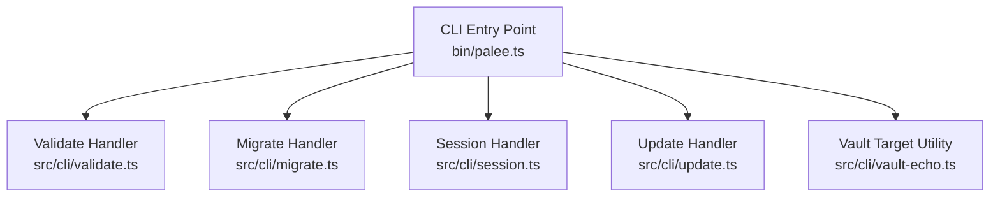
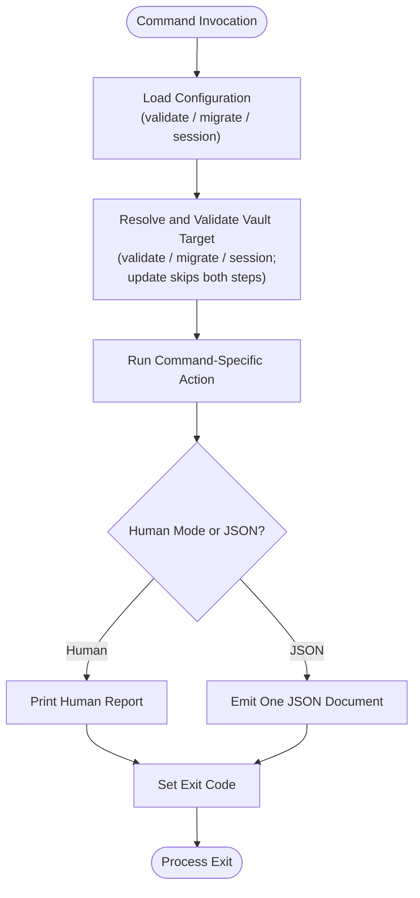
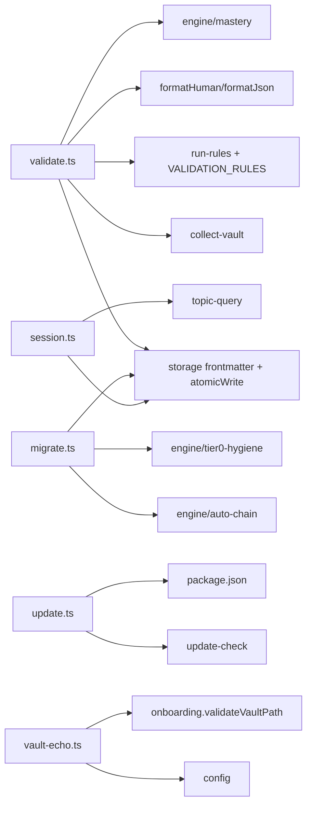

# Maintenance and System Commands

::: details Referenced Files in This Document

- [bin/palee.ts](https://github.com/Kuldeep2822k/cli/blob/main/bin/palee.ts)
- [src/cli/validate.ts](https://github.com/Kuldeep2822k/cli/blob/main/src/cli/validate.ts)
- [src/cli/migrate.ts](https://github.com/Kuldeep2822k/cli/blob/main/src/cli/migrate.ts)
- [src/cli/session.ts](https://github.com/Kuldeep2822k/cli/blob/main/src/cli/session.ts)
- [src/cli/update.ts](https://github.com/Kuldeep2822k/cli/blob/main/src/cli/update.ts)
- [src/cli/vault-echo.ts](https://github.com/Kuldeep2822k/cli/blob/main/src/cli/vault-echo.ts)

:::

## Table of Contents
1. [Introduction](#introduction)
2. [Project Structure](#project-structure)
3. [Core Components](#core-components)
4. [Architecture Overview](#architecture-overview)
5. [Detailed Component Analysis](#detailed-component-analysis)
6. [Dependency Analysis](#dependency-analysis)
7. [Performance Considerations](#performance-considerations)
8. [Troubleshooting Guide](#troubleshooting-guide)
9. [Conclusion](#conclusion)
10. [Appendices](#appendices)

## Introduction
This document describes PALEE's maintenance and system administration commands: `validate`, `migrate`, `session`, `update`, and the vault inspection utility exposed through `vault-echo`. It explains how each command validates, repairs, migrates, records, or inspects vault state; what options are available; what output formats to expect; and which exit codes indicate success, usage problems, validation failures, conflicts, or unexpected errors.

Most of these commands share a common design:
- `validate`, `migrate`, and `session` load per-run configuration from a config file, and resolve and validate the vault target before mutating data.
- `update` is the exception: it is machine-level (like `config`), loads no config, resolves no vault, and never touches the vault; it also has no `--json` surface.
- Human-mode output is human-readable prose; machine-mode output (`--json`) emits one structured JSON document on stdout with diagnostics on stderr.
- Exit codes follow a documented contract rather than Node's default behavior.

The CLI entry point registers all commands and their help text, while individual handler modules implement the business logic for each action.

## Project Structure
PALEE organizes maintenance commands as separate TypeScript handlers under the CLI module, then wires them into the Commander-based CLI entry point.

## Core Components
| Command | Purpose | Key Options | Primary Output |
|---|---|---|---|
| `palee validate` | Validates vault integrity, schema compliance, dependency health, and derived memory views. Optionally repairs fixable issues. | `--fix`, `--json`, `--strict` | Validation report (human or JSON), optional repair summary |
| `palee migrate` | Migrates notes to Schema v1 and audits prerequisite label ties. | `--fix`, `--relabel-ties`, `--include-unlabeled-ties`, `--dry-run` | Migration plan, relabel audit, counts, and tips |
| `palee session` | Manages learning sessions: start, draft checkpoint, end, and list. | `<action>`, `-i/--interactive`, `--topic`, `--json` | One structured JSON document or session banner |
| `palee update` | Checks the latest published version and optionally upgrades the global install through npm. | `--dry-run` | Version status and npm invocation preview |
| Vault inspection | Resolves and echoes the active vault and config paths used by a run. | Used internally by other commands | Two-line echo or two JSON fields |

## Architecture Overview
Each maintenance command follows a similar lifecycle:

Key responsibilities:
- `bin/palee.ts`: Registers commands, parses arguments, handles fatal exceptions, and provides environment/help documentation.
- `src/cli/vault-echo.ts`: Centralizes vault resolution and echoing so every mutating command reports its actual target.
- Individual handlers: Implement command-specific validation, mutation, reporting, and error handling.

## Detailed Component Analysis

### `palee validate`
The validate command scans the vault, runs validation rules, and reports findings. With `--fix`, it can perform safe or explicitly allowed repairs, then re-validate from fresh disk state.

#### Capabilities
- **Vault integrity checking**: Scans files, collects topics, and applies validation rules.
- **SM-2 field repair**: Resets corrupted review fields (for example, SM-2-related fields such as `ease_factor`) to adopt defaults when the corresponding rule marks the finding fixable.
- **Derived view rebuild**: Rebuilds `.palee/hot.md` and `.palee/index.md` from canonical session notes when session-index or hot-memory rules fail.
- **Topic mastery recomputation**: Restores stored `topic_mastery` to the value computed from assessment pillars when that field drifts.
- **Strict mode**: Treats warnings as validation failures for exit-code purposes.
- **Report formats**: Human-friendly console output or a JSON payload containing issues, topic/file counts, strict flag, and optional repair details.

#### Options
| Option | Meaning |
|---|---|
| `--fix` | Attempt fixable repairs: rebuild derived views, recompute mastery, reset review fields. Re-validates after repairs. |
| `--json` | Emit JSON on stdout; diagnostics go to stderr. |
| `--strict` | Fail when any warning remains, not only errors. |

#### Repair Behavior
- Repairs are selected by each rule's metadata, not just by the presence of an implementation.
- Safe repairs are attempted automatically when implemented.
- Manual repairs are limited to an explicit allowlist; `valid-review-fields` is intentionally included because resetting review scheduling history is best-effort and has existed since early versions.
- A conflict inside one repair does not abort unrelated repairs.

#### JSON Report Fields
The `validate --json` payload uses snake_case keys:
- `valid`: whether no errors were found.
- `strict`: whether strict mode was enabled.
- `gated_by_warnings`: whether a warnings-only run was gated by `--strict`.
- `topic_count`: unique topic count.
- `file_count`: scanned file count.
- `error_count`: number of errors.
- `warning_count`: number of warnings.
- `errors`: array of error entries, kept separate from `warnings`.
- `warnings`: array of warning entries, kept separate from `errors`.
- Entries in `errors` and `warnings` carry `type`, `rule_id`, `severity`, and `message`.
- `repairs`: repair entries added by the handler when `--fix` ran.
- `repair_conflicts`: conflicts encountered during repair, added by the handler when `--fix` ran.

#### Exit Codes
| Condition | Exit Code |
|---|---|
| Missing or invalid vault path | Usage |
| Validation errors remain after optional repair | Validation |
| Warnings remain in strict mode | Validation |
| Unexpected exception | Unexpected |

#### Example Workflow
1. Inspect vault health: `palee validate --json`.
2. Fix safe issues: `palee validate --fix`.
3. Treat warnings as failures in CI: `palee validate --strict`.
4. Review repaired fields and conflicts from the JSON report.

### `palee migrate`
The migrate command performs two related but distinct maintenance tasks:
1. Upgrade notes missing Schema v1 metadata.
2. Audit and optionally relabel prerequisite ties that were previously decided by alphabetical filename order.

#### Schema Migration from v0 to v1
- Notes without `palee_schema` are candidates for upgrade.
- `--fix` adds `palee_schema: 1` using frontmatter-aware atomic writes with optimistic concurrency control.
- `--dry-run` previews every note that would be upgraded without writing anything.
- Notes with an unrecognized schema value are not upgraded; Phase 1 requires Schema v1.

#### Prerequisite Label Relabeling
- Before Schema v1 existed, some auto-chain edges were recorded as `depends_on_source: numbered`, relying on filename ordering.
- The pass detects same-directory sibling ties where the stored edge matches what the numbering algorithm would produce.
- `--relabel-ties` changes those notes' labels to `tie`; it never edits `depends_on`.
- `--include-unlabeled-ties` also considers notes that have no `depends_on_source` key at all, which is the older shape left behind by early adoption.
- `--dry-run` lists every candidate tied note without writing.

#### Tie Selection Rules
A stored tie is considered relabelable only when:
- The note has exactly one stored predecessor.
- Both notes are in the same directory.
- Their basenames represent a tied rank.
- The stored predecessor comes before the dependent according to lesson ordering.
- No same-rank sibling still sits between them.
- For unlabeled notes, additional checks ensure the chain could have produced the edge.

#### Options
| Option | Meaning |
|---|---|
| `--fix` | Add Schema v1 to notes missing it. |
| `--relabel-ties` | Relabel qualifying `numbered` prerequisite ties to `tie`. |
| `--include-unlabeled-ties` | Also include notes with no `depends_on_source` key. |
| `--dry-run` | Preview changes without writing files. |

#### Output Categories
- Schema v1 count.
- Missing schema notes.
- Unrecognized schema notes.
- Locked or changed notes requiring retry.
- Write failures.
- Unreadable notes.
- Notes that no longer exist.

#### Exit Codes
| Condition | Exit Code |
|---|---|
| Missing or invalid vault path | Usage |
| Unrecognized schemas remain or cannot be migrated | Validation |
| OCC conflict or active lock | Conflict |
| Other write/read failures | Unexpected |
| Successful scan or migration | Success |

#### Example Workflow
1. Preview schema migration: `palee migrate --fix --dry-run`.
2. Preview tie relabeling: `palee migrate --relabel-ties --dry-run`.
3. Include unlabeled ties: `palee migrate --relabel-ties --include-unlabeled-ties --dry-run`.
4. Apply fixes: `palee migrate --fix --relabel-ties`.

### `palee session`
The session command manages the lifecycle of a learning session and its working memory. Supported actions are `start`, `draft`, `end`, and `list`.

#### Session Lifecycle
| Action | Behavior |
|---|---|
| `start` | Creates or continues an active session, updates working memory, and persists the active session record. |
| `draft` | Creates a draft checkpoint for a topic, optionally preserving a recent `started_at` timestamp. |
| `end` | Records a completed session, cleans up consumed drafts, regenerates derived views, and clears active-session state. |
| `list` | Lists confirmed sessions and active drafts. |

#### Interactive Mode
When unconfirmed draft checkpoints exist and `--interactive` is not supplied, `session start` refuses to proceed and instructs the user to run interactively. In interactive mode:
- Each draft offers recovery choices: resume, save as session, discard, or ignore.
- If stdin closes before a decision, the draft remains unresolved and the command exits with a usage-style error.

#### Topic Association
- `--topic <id>` resolves the topic against the vault using the same mechanism as `review` and `assess`.
- An explicit topic is validated before writing; ambiguous or missing queries return a usage error.
- Without `--topic`, the active topic from working memory is used.
- For `draft` and `end`, the active topic fallback is tolerated even if the original note has moved or disappeared, preventing accidental loss of real work.

#### State Persistence
- Working memory is stored in `.palee/hot.md`.
- Active session metadata is persisted separately and cleared on successful completion.
- Completed sessions are written to `.palee/sessions/<sessionId>.md`.
- Draft checkpoints are prefixed draft identifiers and cleaned up after successful recording.

#### JSON Output Shapes
- `start`: `{ status: "started", active_topic, last_session, updated_at, ai_provider_configured, working_memory, warnings, ...vaultTargetFields }`
- `draft`: `{ status: "drafted", draft_id, topic_id, started_at, draft_path, ...vaultTargetFields }`
- `end`: `{ status: "recorded" or "already_recorded", session_id, topic_id, started_at, ended_at, duration_minutes, session_path, consumed_drafts, draft_cleanup_failures, warnings, ...vaultTargetFields }`
- `list`: `{ confirmed, drafts, total_confirmed, total_drafts }`

#### Error Conditions
- No active session for `end`.
- Unknown action.
- Unresolvable or ambiguous `--topic`.
- Corrupt or schema-invalid hot memory triggers automatic reset and rebuild.
- Hot memory disappears during start/end is treated as a runtime error.

#### Example Workflow
1. Start a session: `palee session start --topic T-linear-algebra`.
2. Create a draft checkpoint: `palee session draft --topic T-linear-algebra`.
3. Resolve pending drafts: `palee session start --interactive`.
4. End a session: `palee session end --topic T-linear-algebra`.
5. List sessions: `palee session list --json`.

### `palee update`
The update command checks the latest published version of PALEE and optionally upgrades the global installation through npm.

#### Behavior
- Reads the current version from the package manifest.
- Queries the latest version through the shared update-check subsystem.
- Reports whether the install is up to date.
- In dry-run mode, prints the latest version and the exact npm command without installing.
- In normal mode, delegates the install to npm and writes a local check record marking the current build as up to date afterward.

#### Network Requirements
- The command relies on npm to contact the registry.
- PALEE itself does not open a direct network connection to fetch versions; it uses the update-check helper.
- Registry, proxy, and authentication come from the user's npm configuration.

#### Exit Codes
| Condition | Exit Code |
|---|---|
| Usage error | Usage |
| Could not determine latest version or timeout | Unexpected |
| npm install failed | Unexpected |
| Already up to date | Success |

#### Example Workflow
1. Check for updates: `palee update`.
2. Preview without installing: `palee update --dry-run`.

### Vault Inspection Utilities
The vault inspection utilities resolve the vault target used by a command and provide both human-readable and machine-readable forms.

#### Responsibilities
- Validate the configured vault path.
- Return the resolved absolute vault path and the config file path.
- Echo the vault and config paths in human mode.
- Provide snake_case fields for JSON payloads.

#### Internal Use
Most mutating commands call this utility instead of duplicating vault validation and echoing. Read-only commands like `session list` suppress the echo because they do not mutate the vault.

#### Example Outputs
- Human mode: two lines naming the vault and config path.
- JSON mode: `vault_path` and `config_path` fields embedded in the command's JSON document.

## Dependency Analysis
The maintenance commands depend on shared infrastructure rather than implementing vault I/O themselves.

## Performance Considerations
- `validate` may scan the entire vault twice when `--fix` is used: once before repair and again after repair to reflect fresh disk state.
- `migrate` reads the vault once and derives both tie auditing and schema classification from that snapshot, minimizing redundant scanning.
- Atomic writes use optimistic concurrency control, so concurrent mutations cause retries or conflicts rather than silent overwrites.
- Derived view rebuilds delegate to storage-layer routines that already encapsulate session selection, truncation limits, and locking policy.
- `session list` reads the sessions directory directly and should be lightweight unless the directory contains many session files.

## Troubleshooting Guide

### Schema Incompatibilities
**Symptoms:**
- `palee migrate` reports missing or unrecognized schemas.
- Notes remain gated despite expected ordering.

**Actions:**
1. Run `palee migrate --fix --dry-run` to preview schema upgrades.
2. Confirm there are no unrecognized schema values; Phase 1 supports only Schema v1.
3. Apply the migration: `palee migrate --fix`.
4. If notes still gate unexpectedly, audit ties with `palee migrate --relabel-ties --dry-run`.
5. If unlabeled notes are involved, add `--include-unlabeled-ties`.

**Exit Code Guidance:**
- Validation exit code means schema problems remain.
- Conflict exit code means locks or optimistic-concurrency collisions require a retry.
- Unexpected exit code indicates read/write failures unrelated to schema recognition.

### Session Corruption
**Symptoms:**
- `session start` warns about corrupt hot memory.
- `session end` reports no active session.
- Draft checkpoints block non-interactive starts.

**Actions:**
1. Run `palee session start --interactive` to resolve unconfirmed drafts.
2. Allow the session command to reset and rebuild hot memory when corruption is detected.
3. If hot memory disappears during operations, treat it as a runtime failure and investigate external processes removing `.palee/hot.md`.
4. Use `palee session list --json` to inspect confirmed sessions and drafts.

**Exit Code Guidance:**
- Usage-style refusal occurs when no active session exists for `end`.
- Interactive recovery failure leaves unresolved drafts and exits with a usage-style error.
- Runtime disappearance of hot memory escalates to an unexpected or partial-import error depending on the stage.

### Update Failures
**Symptoms:**
- `palee update` reports it could not determine the latest version.
- Installation fails.

**Actions:**
1. Verify npm is available and authenticated for the required registry.
2. Run `palee update --dry-run` to confirm the intended npm command.
3. Check network connectivity and npm configuration.
4. Re-run without `--dry-run` after resolving registry or permission issues.

### Validation Conflicts After Repair
**Symptoms:**
- `palee validate --fix` reports skipped repairs due to conflicts.
- Issues remain after running `--fix`.

**Actions:**
1. Inspect `repair_conflicts` in the JSON report.
2. Resolve concurrent edits or file locks.
3. Re-run `palee validate --fix`.
4. If remaining issues are warnings, add `--strict` to enforce a failure in automated environments.

## Conclusion
PALEE's maintenance commands provide a consistent interface for vault health checks, schema migration, prerequisite tie correction, session lifecycle management, and version updates. The most important operational principles are:
- Always inspect vault targets before mutating data.
- Prefer `--dry-run` before applying schema or label migrations.
- Use `--json` for automation and parse only the documented shapes.
- Respect exit codes: usage, validation, conflict, partial import, and unexpected.
- Back up the vault before running repair or migration commands, especially when dealing with SM-2 scheduling fields, prerequisite labels, or derived memory views.

Recommended baseline maintenance workflow:
1. Back up the vault.
2. Run `palee validate --json` to identify issues.
3. Run `palee validate --fix --json` to attempt safe repairs.
4. Run `palee migrate --fix --dry-run`, then apply.
5. Run `palee migrate --relabel-ties --dry-run`, then apply with `--include-unlabeled-ties` when appropriate.
6. Resolve session drafts with `palee session start --interactive`.
7. Finish sessions with `palee session end`.
8. Run `palee update --dry-run` and then `palee update` when ready.

## Appendices

### Environment Variables
| Variable | Scope | Description |
|---|---|---|
| `PALEE_CONFIG_DIR` | Per-run | Directory holding `config.json`. When unset, PALEE uses the per-user default config. |
| `PALEE_JSON` | Global | Requests JSON output where supported. |
| `PALEE_NO_UPDATE_CHECK` | Global | Silences the new-version notice for interactive runs. |
| `PALEE_DEBUG` | Global | Enables raw stack traces on fatal errors. |
