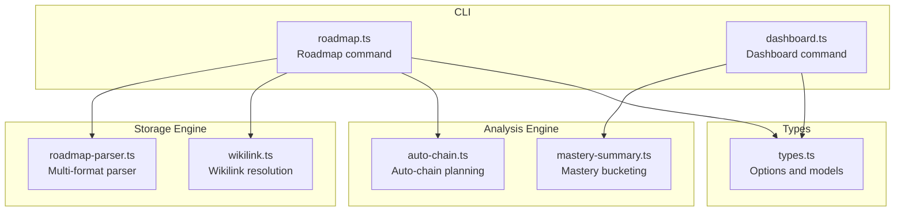
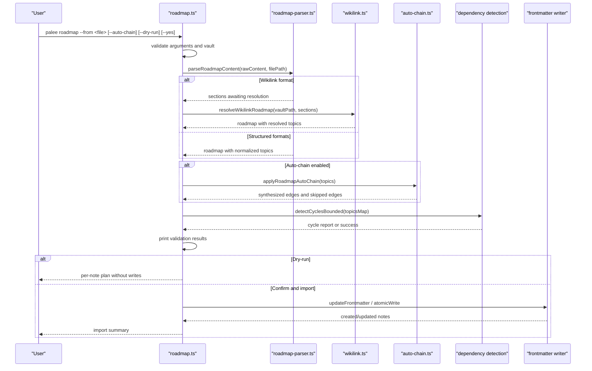
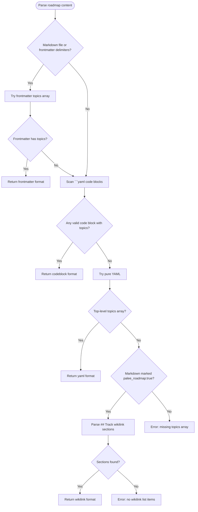
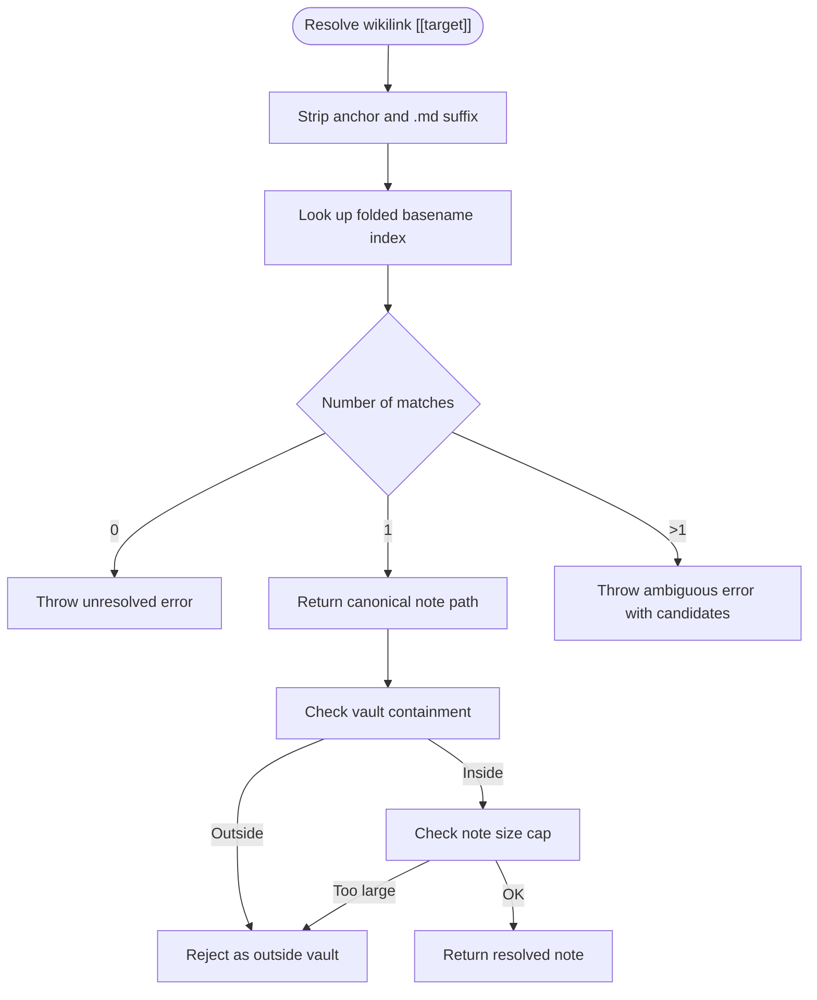
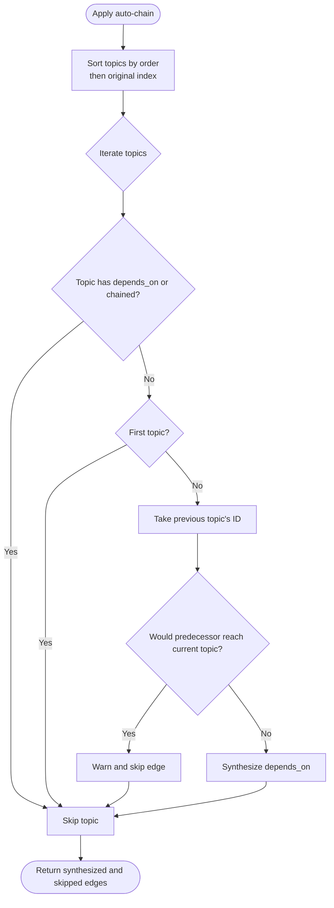
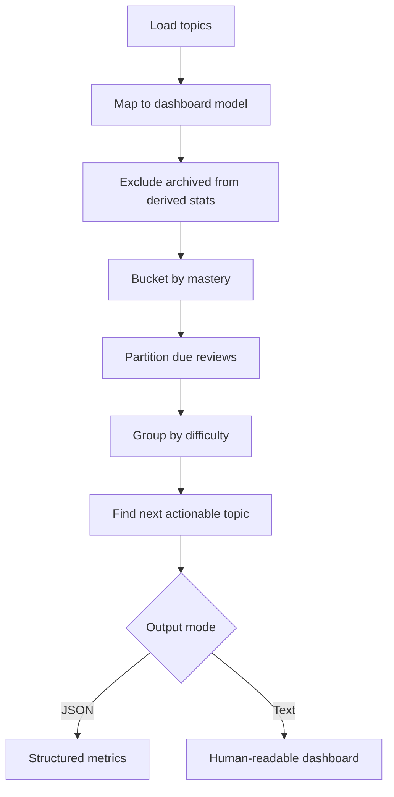
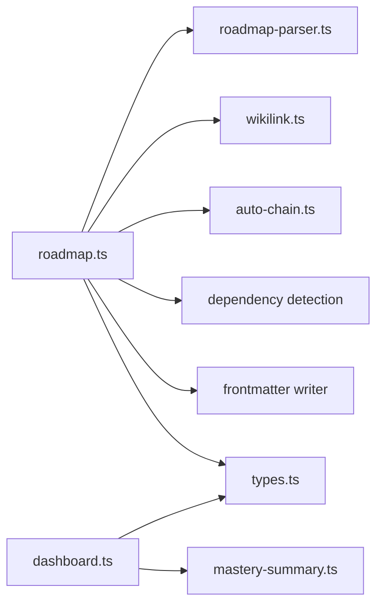

# Planning and Analysis Commands

<cite>
**Referenced Files in This Document**   
- [roadmap.ts](https://github.com/Kuldeep2822k/cli/blob/main/src/cli/roadmap.ts)
- [dashboard.ts](https://github.com/Kuldeep2822k/cli/blob/main/src/cli/dashboard.ts)
- [roadmap-parser.ts](https://github.com/Kuldeep2822k/cli/blob/main/src/storage/roadmap-parser.ts)
- [auto-chain.ts](https://github.com/Kuldeep2822k/cli/blob/main/src/engine/auto-chain.ts)
- [wikilink.ts](https://github.com/Kuldeep2822k/cli/blob/main/src/storage/wikilink.ts)
- [mastery-summary.ts](https://github.com/Kuldeep2822k/cli/blob/main/src/application/mastery-summary.ts)
- [types.ts](https://github.com/Kuldeep2822k/cli/blob/main/src/types.ts)
</cite>

## Table of Contents
1. [Introduction](#introduction)
2. [Project Structure](#project-structure)
3. [Core Components](#core-components)
4. [Architecture Overview](#architecture-overview)
5. [Detailed Component Analysis](#detailed-component-analysis)
6. [Dependency Analysis](#dependency-analysis)
7. [Performance Considerations](#performance-considerations)
8. [Troubleshooting Guide](#troubleshooting-guide)
9. [Conclusion](#conclusion)

## Introduction
This document explains PALEE’s planning and analysis commands focused on two operations:

- `palee roadmap`: imports structured learning plans into a vault, resolves dependencies, validates safety, optionally synthesizes an ordering chain, previews changes, and writes notes with preserved or updated prerequisites.
- `palee dashboard`: summarizes learning analytics from the vault, including mastery buckets, difficulty breakdowns, due-review backlog, and the next actionable topic.

The documentation covers YAML and Markdown import formats, frontmatter processing, wikilink resolution, auto-chaining behavior, dependency validation, dry-run planning, confirmation prompts, and interpretation of dashboard metrics. It also provides examples and troubleshooting guidance for common import and data interpretation issues.

## Project Structure
The roadmap command is implemented primarily in the CLI layer and storage engine:

- CLI handler: parses options, validates inputs, coordinates parsing, graph validation, dry-run output, and note writing.
- Roadmap parser: accepts multiple input formats and normalizes topics.
- Auto-chain engine: computes deterministic lesson ordering and dependency synthesis when requested.
- Wikilink resolver: converts Obsidian-style links into concrete vault notes.
- Dashboard handler: loads topics, derives analytics, and renders text or JSON summaries.
- Shared types: define option interfaces, roadmap structures, and dashboard metadata.

**Diagram sources**
- [roadmap.ts:1-200](https://github.com/Kuldeep2822k/cli/blob/main/src/cli/roadmap.ts#L1-L200)
- [dashboard.ts:1-200](https://github.com/Kuldeep2822k/cli/blob/main/src/cli/dashboard.ts#L1-L200)
- [roadmap-parser.ts:1-200](https://github.com/Kuldeep2822k/cli/blob/main/src/storage/roadmap-parser.ts#L1-L200)
- [auto-chain.ts:1-200](https://github.com/Kuldeep2822k/cli/blob/main/src/engine/auto-chain.ts#L1-L200)
- [wikilink.ts:1-200](https://github.com/Kuldeep2822k/cli/blob/main/src/storage/wikilink.ts#L1-L200)
- [mastery-summary.ts:1-36](https://github.com/Kuldeep2822k/cli/blob/main/src/application/mastery-summary.ts#L1-L36)
- [types.ts:793-931](https://github.com/Kuldeep2822k/cli/blob/main/src/types.ts#L793-L931)

**Section sources**
- [roadmap.ts:1-200](https://github.com/Kuldeep2822k/cli/blob/main/src/cli/roadmap.ts#L1-L200)
- [dashboard.ts:1-200](https://github.com/Kuldeep2822k/cli/blob/main/src/cli/dashboard.ts#L1-L200)
- [types.ts:793-931](https://github.com/Kuldeep2822k/cli/blob/main/src/types.ts#L793-L931)

## Core Components
### Roadmap Command
The roadmap command implements a safe, deterministic import pipeline:

1. **Input validation**: requires `--from`, verifies it points to a regular file, resolves the vault target, and rejects directories or missing paths.
2. **Parsing**: delegates to the multi-format parser, which supports frontmatter, embedded YAML code blocks, pure YAML, and wikilink lists.
3. **Wikilink resolution**: for the opt-in wikilink format, resolves each link against the vault; ambiguous or unresolved links fail closed.
4. **Auto-chaining**: optional `--auto-chain` synthesizes dependencies based on the `order` field and existing vault structure; it warns about skipped edges that would close cycles.
5. **Validation**: checks required fields, ID format, path containment, duplicate IDs and paths, valid difficulty values, numeric `order`, missing dependencies, and cycles.
6. **Dry-run mode**: prints the full per-note plan without writing anything, including create/update status and effective `depends_on`.
7. **Import**: writes managed frontmatter while preserving existing vault data according to explicit user intent.

Key behaviors:
- Explicit `[]` clears dependencies; omitted preserves existing dependencies; populated replaces them.
- Imported notes must be visible Markdown files under the vault boundary.
- Existing notes with a conflicting declared `palee_id` are rejected to avoid silently retiring identities.
- Oversized notes are refused consistently across read and write paths.

**Section sources**
- [roadmap.ts:201-533](https://github.com/Kuldeep2822k/cli/blob/main/src/cli/roadmap.ts#L201-L533)
- [roadmap.ts:534-842](https://github.com/Kuldeep2822k/cli/blob/main/src/cli/roadmap.ts#L534-L842)
- [types.ts:843-931](https://github.com/Kuldeep2822k/cli/blob/main/src/types.ts#L843-L931)

### Dashboard Command
The dashboard command produces a learning summary over the vault’s loaded topics:

- Loads all topics and maps them into a dashboard-friendly model.
- Excludes archived topics from derived figures but counts them separately.
- Computes mastery buckets using shared logic.
- Counts reviews due by evaluating scheduled review backlogs.
- Groups topics by beginner, intermediate, and advanced difficulty.
- Determines the next actionable topic using the same gating logic as `next`/`plan`.
- Renders either a human-readable text table or a structured JSON object.

**Section sources**
- [dashboard.ts:1-200](https://github.com/Kuldeep2822k/cli/blob/main/src/cli/dashboard.ts#L1-L200)
- [mastery-summary.ts:1-36](https://github.com/Kuldeep2822k/cli/blob/main/src/application/mastery-summary.ts#L1-L36)

## Architecture Overview
The roadmap command composes several layers to ensure safety and determinism.

**Diagram sources**
- [roadmap.ts:201-842](https://github.com/Kuldeep2822k/cli/blob/main/src/cli/roadmap.ts#L201-L842)
- [roadmap-parser.ts:1-270](https://github.com/Kuldeep2822k/cli/blob/main/src/storage/roadmap-parser.ts#L1-L270)
- [wikilink.ts:1-200](https://github.com/Kuldeep2822k/cli/blob/main/src/storage/wikilink.ts#L1-L200)
- [auto-chain.ts:1-200](https://github.com/Kuldeep2822k/cli/blob/main/src/engine/auto-chain.ts#L1-L200)

## Detailed Component Analysis

### Roadmap File Structure and Topic Model
A roadmap defines one or more topics. Each topic carries:

| Field | Type | Required | Meaning |
|---|---:|---:|---|
| `id` | string | Yes | Target `palee_id`; must match the vault identity policy and cannot be an all-zero placeholder. |
| `title` | string | Yes | Descriptive title written into the note. |
| `path` | string | Yes | Vault-relative Markdown path where the note will be created or updated. |
| `difficulty` | string | No | One of `beginner`, `intermediate`, `advanced`. Defaults to `intermediate` when not present. |
| `depends_on` | array of strings | No | Prerequisite topic IDs. Omitted preserves existing dependencies; empty list clears them; populated replaces them. |
| `chained` | boolean | No | Marks a topic’s dependencies as final so auto-chaining skips it. |
| `order` | number | No | Controls synthetic chaining order; topics with numbers sort before those without. |

The roadmap file itself contains a `topics` array.

**Section sources**
- [types.ts:908-931](https://github.com/Kuldeep2822k/cli/blob/main/src/types.ts#L908-L931)
- [roadmap.ts:843-861](https://github.com/Kuldeep2822k/cli/blob/main/src/cli/roadmap.ts#L843-L861)

### Import Formats and Parsing Rules
The parser tries four formats in this priority:

1. **Markdown frontmatter**: A `topics` array inside YAML frontmatter.
2. **Embedded YAML code block**: A fenced code block tagged `yaml` containing a `topics` array.
3. **Pure YAML file**: A top-level YAML document with a `topics` array.
4. **Wikilink list in Markdown**: Only when the document sets `palee_roadmap: true`; each `## Track` section forms one ordered dependency chain from bullet items containing `[[...]]` links.

Important rules:

- Frontmatter parsing errors return a structured error rather than silently falling through.
- Code blocks are scanned independently; invalid code-block content does not prevent later formats from being tried.
- Pure YAML parsing fails closed on `.yaml`/`.yml` files with invalid syntax.
- Wikilink format is opt-in and requires both the flag and at least one track with bullet-listed wikilinks.
- The parser normalizes `depends_on` and legacy `dependencies` keys into a single dependency list.

**Diagram sources**
- [roadmap-parser.ts:1-200](https://github.com/Kuldeep2822k/cli/blob/main/src/storage/roadmap-parser.ts#L1-L200)
- [roadmap-parser.ts:201-270](https://github.com/Kuldeep2822k/cli/blob/main/src/storage/roadmap-parser.ts#L201-L270)

**Section sources**
- [roadmap-parser.ts:1-270](https://github.com/Kuldeep2822k/cli/blob/main/src/storage/roadmap-parser.ts#L1-L270)

### Frontmatter Processing and Field Resolution
When importing, the roadmap writes only the managed fields necessary to represent the learner’s intent. The single source of truth for field resolution is a helper that derives effective frontmatter values:

- `palee_id`: taken directly from the roadmap topic.
- `title`: taken from the roadmap topic.
- `difficulty`: roadmap value, existing vault value, or `intermediate`.
- `depends_on`: explicit roadmap value wins; omitted preserves existing dependencies; empty list clears them.
- Assessment pillars (`conceptual`, `practical`, `debug`, `feynman`) and SM2-related fields are passed through from existing vault frontmatter when absent from the roadmap.
- Missing pillar scores resolve to `undefined` rather than `0.0`, so an import does not mint assessment data unless the note already carries it.

This design avoids accidental loss of review state and ensures that validation and writeback use identical rules.

**Section sources**
- [roadmap.ts:201-333](https://github.com/Kuldeep2822k/cli/blob/main/src/cli/roadmap.ts#L201-L333)
- [roadmap.ts:793-842](https://github.com/Kuldeep2822k/cli/blob/main/src/cli/roadmap.ts#L793-L842)

### Wikilink Resolution
For the wikilink roadmap format, each `[[target]]` is resolved against the vault:

- Anchors such as headings and block references are stripped.
- Case and Unicode normalization are handled consistently with the vault walker.
- Ambiguous matches throw an error listing candidates.
- Unresolvable targets throw an error indicating no matching note.
- Links escaping the vault are rejected.
- The importer refuses oversized notes consistently.

Resolution failures are fatal for the entire import batch: zero bytes are written, and the command exits with a validation error.

**Diagram sources**
- [wikilink.ts:1-200](https://github.com/Kuldeep2822k/cli/blob/main/src/storage/wikilink.ts#L1-L200)

**Section sources**
- [wikilink.ts:1-200](https://github.com/Kuldeep2822k/cli/blob/main/src/storage/wikilink.ts#L1-L200)

### Auto-Chaining with `--auto-chain`
Auto-chaining is available for non-wikilink roadmap formats. It chains topics by their `order` field:

- Topics with an `order` number sort first, ascending.
- Topics without `order` retain their original file order and are appended after ordered topics.
- A topic with no `depends_on` and no `chained` flag is chained to the previous topic’s ID.
- The head topic receives no synthesized edge, so any hand-authored dependencies already present on disk remain intact.
- An explicit non-empty `depends_on` always wins over the synthesized chain.
- If a synthesized edge would close a cycle, it is skipped with a warning, and the chain restarts at that topic.
- The synthesized edges are tracked so dry-run output can label them and cycle reports can identify which edges were auto-generated.

Note: the implementation sorts by `order` and then by original index, but the public type documents `order` as “optional sequence ordering.” Consumers should treat `order` as a ranking hint used by auto-chaining, not as a guaranteed stable sort key for unrelated purposes.

**Diagram sources**
- [roadmap.ts:1-200](https://github.com/Kuldeep2822k/cli/blob/main/src/cli/roadmap.ts#L1-L200)

**Section sources**
- [roadmap.ts:1-200](https://github.com/Kuldeep2822k/cli/blob/main/src/cli/roadmap.ts#L1-L200)

### Ordering by Number Fields
Two ordering concepts exist:

1. **Roadmap `order`**: a numeric field in the roadmap topic that determines synthetic chaining order during `--auto-chain`.
2. **Lesson numbering in vault structure**: used by the auto-chain planner when deriving chains from directory/file names. Numeric prefixes such as `01-foundations` are parsed strictly: they require 1–3 digits followed by a separator or end-of-name, rejecting year-like strings such as `2024-recap` and word-like strings such as `3d-printing`.

The lesson planner groups notes by parent directory, sorts directories segment by segment, and creates backward-pointing edges so every note depends on its predecessor. This construction is acyclic by design, but callers still run cycle detection because pre-existing vault cycles may already exist.

**Section sources**
- [auto-chain.ts:1-200](https://github.com/Kuldeep2822k/cli/blob/main/src/engine/auto-chain.ts#L1-L200)
- [auto-chain.ts:201-450](https://github.com/Kuldeep2822k/cli/blob/main/src/engine/auto-chain.ts#L201-L450)

### Dependency Resolution and Validation
The roadmap command builds a topic graph from:

- Roadmap-declared topics.
- Existing vault topics needed to evaluate cycles and preserve dependencies.

Validation includes:

- Required fields: `id`, `title`, `path`.
- Duplicate `id` and duplicate `path` within the roadmap.
- Valid `difficulty` values.
- Numeric `order` when provided.
- Valid topic ID format and rejection of all-zero placeholder IDs.
- Path containment inside the vault.
- Visible Markdown note paths.
- Conflict between roadmap `id` and an existing note’s declared `palee_id`.
- Missing prerequisite IDs.
- Dependency cycles, including identification of edges synthesized by `--auto-chain`.

If any validation rule fails, the command prints all errors and exits with a validation error code; no files are written.

**Section sources**
- [roadmap.ts:534-842](https://github.com/Kuldeep2822k/cli/blob/main/src/cli/roadmap.ts#L534-L842)

### Dry-Run Planning
Use `--dry-run` to preview changes without modifying the vault:

- Prints validation results first.
- Prints a per-note plan showing target path, create vs update status, and effective `depends_on`.
- Labels edges synthesized by `--auto-chain`.
- Reports whether an explicit empty list would clear existing dependencies.
- Returns successfully if the plan is valid; returns a validation error if the real import would fail.
- Writes zero bytes.

**Section sources**
- [roadmap.ts:534-842](https://github.com/Kuldeep2822k/cli/blob/main/src/cli/roadmap.ts#L534-L842)

### Confirmation Prompts
The roadmap command’s interface supports a `--yes` option through its typed options, but the documented handler emphasizes dry-run planning and explicit confirmation workflows. In practice:

- Without confirmation automation, users inspect the validation and dry-run output before approving changes.
- With `--yes`, automated workflows can proceed after reviewing the dry-run plan.
- For interactive approval, users should combine dry-run inspection with the intended confirmation flow defined by their environment.

**Section sources**
- [types.ts:843-861](https://github.com/Kuldeep2822k/cli/blob/main/src/types.ts#L843-L861)
- [roadmap.ts:534-842](https://github.com/Kuldeep2822k/cli/blob/main/src/cli/roadmap.ts#L534-L842)

### Dashboard Metrics and Interpretation
The dashboard summarizes:

| Metric | Meaning |
|---|---|
| `total_topics` | All loaded notes, including archived ones. |
| `active_topic_count` | Non-archived topics used for derived statistics. |
| `archived_topic_count` | Notes excluded from progress calculations. |
| `mastered` | Topics at or above the mastery threshold. |
| `learning` | Topics with nonzero mastery below the threshold. |
| `new` | Topics with zero mastery. |
| Percentages | Derived from active topics; rounded to one decimal place in text output and converted to numbers in JSON. |
| `reviews_due` | Elapsed scheduled reviews counted as a backlog metric. |
| `by_difficulty` | Breakdown of total and mastered counts by beginner, intermediate, and advanced. |
| `next_review` | The next actionable topic according to prerequisite gating, excluding archived topics. |

Text output shows these metrics as a readable dashboard. JSON output exposes them as structured fields suitable for tooling.

**Diagram sources**
- [dashboard.ts:1-200](https://github.com/Kuldeep2822k/cli/blob/main/src/cli/dashboard.ts#L1-L200)
- [mastery-summary.ts:1-36](https://github.com/Kuldeep2822k/cli/blob/main/src/application/mastery-summary.ts#L1-L36)

**Section sources**
- [dashboard.ts:1-200](https://github.com/Kuldeep2822k/cli/blob/main/src/cli/dashboard.ts#L1-L200)
- [mastery-summary.ts:1-36](https://github.com/Kuldeep2822k/cli/blob/main/src/application/mastery-summary.ts#L1-L36)

## Dependency Analysis
The following diagram shows how the roadmap command depends on supporting modules.

**Diagram sources**
- [roadmap.ts:1-200](https://github.com/Kuldeep2822k/cli/blob/main/src/cli/roadmap.ts#L1-L200)
- [dashboard.ts:1-200](https://github.com/Kuldeep2822k/cli/blob/main/src/cli/dashboard.ts#L1-L200)
- [roadmap-parser.ts:1-200](https://github.com/Kuldeep2822k/cli/blob/main/src/storage/roadmap-parser.ts#L1-L200)
- [wikilink.ts:1-200](https://github.com/Kuldeep2822k/cli/blob/main/src/storage/wikilink.ts#L1-L200)
- [auto-chain.ts:1-200](https://github.com/Kuldeep2822k/cli/blob/main/src/engine/auto-chain.ts#L1-L200)
- [mastery-summary.ts:1-36](https://github.com/Kuldeep2822k/cli/blob/main/src/application/mastery-summary.ts#L1-L36)
- [types.ts:793-931](https://github.com/Kuldeep2822k/cli/blob/main/src/types.ts#L793-L931)

**Section sources**
- [roadmap.ts:1-200](https://github.com/Kuldeep2822k/cli/blob/main/src/cli/roadmap.ts#L1-L200)
- [dashboard.ts:1-200](https://github.com/Kuldeep2822k/cli/blob/main/src/cli/dashboard.ts#L1-L200)

## Performance Considerations
- **Oversized notes**: Both reading and writing paths enforce a read-cap guard, refusing oversized notes consistently. This prevents memory exhaustion and keeps import behavior predictable.
- **Cycle enumeration limit**: Cycle detection reports truncation after a bounded number of cycles, helping avoid unbounded traversal while still surfacing enough information to diagnose loops.
- **Single-source-of-truth derivation**: Field resolution is centralized so validation and writeback do not diverge, reducing redundant computation and debugging complexity.
- **Indexing for wikilink resolution**: A folded basename index is built once per resolution pass, avoiding repeated filesystem scans.
- **Archived-topic filtering**: Dashboard metrics exclude archived topics from derived figures, keeping analytics aligned with active learning scope.

[No sources needed since this section provides general guidance]

## Troubleshooting Guide

### Common Roadmap Import Issues

| Symptom | Likely Cause | Resolution |
|---|---|---|
| `--from <file>` is required | Missing roadmap input path. | Provide a valid roadmap file path. |
| Roadmap file not found | Path does not exist. | Correct the path or run from the expected working directory. |
| Roadmap path is not a file | Input is a directory. | Point `--from` at a regular file. |
| Roadmap must have a `topics` array | None of the supported formats produced a topics list. | Use frontmatter, a `yaml` code block, a YAML document, or a wikilink-marked Markdown file with tracks. |
| Invalid topic ID format | ID does not follow the expected kebab-case pattern. | Use a valid identifier such as `T-git-rebase`. |
| Placeholder topic ID | ID consists entirely of zero segments. | Replace the placeholder with a meaningful kebab-case ID. |
| Path escapes vault boundary | `path` resolves outside the configured vault root. | Keep paths relative to the vault or inside the vault root. |
| Path is not a visible Markdown note path | Target is hidden, non-Markdown, or otherwise invisible to the vault walker. | Use a visible `.md` path accepted by the vault scanner. |
| Conflicting `palee_id` | The target note already declares a different identity. | Update the roadmap entry to match the note’s declared ID or point to a new path. |
| Missing dependency | A prerequisite ID is not present in the roadmap or vault graph. | Add the prerequisite topic or remove the dependency. |
| Dependency cycle detected | Authored or synthesized edges form a loop. | Remove or reorder the cyclic dependency; check `--auto-chain` edges in the error message. |
| Wikilink unresolved | Link matches no vault note. | Fix the link target or add the referenced note. |
| Wikilink ambiguous | Multiple notes share the same folded basename. | Disambiguate by renaming notes or linking to a unique path. |
| Dry-run says nothing was written | Dry-run intentionally never modifies files. | Inspect the printed plan and run the real import only after approval. |

**Section sources**
- [roadmap.ts:201-842](https://github.com/Kuldeep2822k/cli/blob/main/src/cli/roadmap.ts#L201-L842)
- [wikilink.ts:1-200](https://github.com/Kuldeep2822k/cli/blob/main/src/storage/wikilink.ts#L1-L200)

### Interpreting Dashboard Outputs

| Dashboard Observation | Interpretation |
|---|---|
| High `new` count | Many topics have zero mastery; consider reviewing or adopting foundational notes. |
| Low `mastered` percentage | Few topics meet the mastery threshold; focus on repetition and assessments. |
| `reviews_due` is high | There is a backlog of elapsed scheduled reviews; schedule review sessions. |
| `next_review` is null | No actionable non-archived topic is currently recommended by prerequisite gating. |
| Archived topics appear in totals but not percentages | Archived notes are counted for completeness but excluded from active progress metrics. |
| Difficulty breakdown shows many unmatured advanced topics | Advanced topics may need prerequisite work or additional review. |

**Section sources**
- [dashboard.ts:1-200](https://github.com/Kuldeep2822k/cli/blob/main/src/cli/dashboard.ts#L1-L200)
- [mastery-summary.ts:1-36](https://github.com/Kuldeep2822k/cli/blob/main/src/application/mastery-summary.ts#L1-L36)

### Creating Roadmaps from Existing Note Collections

Recommended workflow:

1. **Inspect your vault**: Identify notes you want to include and their current `palee_id`, path, difficulty, and prerequisites.
2. **Choose a format**:
   - Use YAML or Markdown frontmatter for explicit control over `id`, `path`, `depends_on`, `order`, and `difficulty`.
   - Use the wikilink format when you want curated chains expressed as Obsidian-style links.
3. **Declare prerequisites carefully**:
   - Omit `depends_on` to preserve existing dependencies.
   - Use an empty list to clear dependencies explicitly.
   - Populate the list to replace dependencies with an explicit ordering.
4. **Use `order` for sequencing**: Assign increasing integers when you want synthetic chaining; leave it out for topics that should keep file order or rely on manual dependencies.
5. **Validate before importing**: Run the roadmap command without `--yes` to see validation results.
6. **Preview with dry-run**: Use `--dry-run` to confirm create/update decisions and effective dependencies.
7. **Approve and import**: Use `--yes` in automated pipelines after confirming the dry-run output.

### Examples

#### Example 1: Import a Structured Learning Plan
Create a YAML roadmap defining three topics:

- A foundation topic with no prerequisites.
- A core topic depending on the foundation.
- An advanced topic depending on the core.

Then run the roadmap command with `--dry-run` to verify the plan, and again with `--yes` to apply it.

#### Example 2: Create a Roadmap from Existing Notes Using Wikilinks
Create a Markdown file with `palee_roadmap: true` and define one or more `## Track` sections. Under each track, list wikilinked notes in the desired chain order. Validate that every link resolves to exactly one vault note.

#### Example 3: Use `--auto-chain` with Existing Notes
Provide a roadmap where some topics omit `depends_on`. Enable `--auto-chain` so PALEE synthesizes a chain based on `order` and existing vault structure. Review warnings about skipped edges that would close cycles.

[No sources needed since this section provides general guidance]

## Conclusion
PALEE’s roadmap command provides a safe, validated pathway for importing structured learning plans. It supports multiple input formats, preserves existing vault state according to explicit user intent, detects dangerous configuration early, and offers dry-run previews before committing changes. Its wikilink support integrates naturally with Markdown-based knowledge bases, while auto-chaining helps learners establish deterministic learning sequences.

The dashboard command complements planning by turning stored mastery and scheduling data into actionable analytics. It distinguishes mastered, learning, and new topics, highlights due reviews, breaks down progress by difficulty, and surfaces the next recommended topic. Together, these commands enable learners to plan carefully, import safely, and interpret progress clearly.

[No sources needed since this section summarizes without analyzing specific files]