# Auto-Chaining and Prerequisite Discovery

::: details Referenced Files in This Document

- [auto-chain.ts](https://github.com/Kuldeep2822k/cli/blob/main/src/engine/auto-chain.ts)
- [prereq-text.ts](https://github.com/Kuldeep2822k/cli/blob/main/src/engine/prereq-text.ts)
- [wikilink.ts](https://github.com/Kuldeep2822k/cli/blob/main/src/storage/wikilink.ts)
- [pattern-matcher.ts](https://github.com/Kuldeep2822k/cli/blob/main/src/storage/pattern-matcher.ts)
- [0011-tiered-auto-chain.md](https://github.com/Kuldeep2822k/cli/blob/main/docs/adr/0011-tiered-auto-chain.md)
- [0012-declared-prerequisites.md](https://github.com/Kuldeep2822k/cli/blob/main/docs/adr/0012-declared-prerequisites.md)
- [engine-auto-chain.test.ts](https://github.com/Kuldeep2822k/cli/blob/main/test/engine-auto-chain.test.ts)
- [engine-prereq-text.test.ts](https://github.com/Kuldeep2822k/cli/blob/main/test/engine-prereq-text.test.ts)
- [cli-adopt-autochain.test.ts](https://github.com/Kuldeep2822k/cli/blob/main/test/cli-adopt-autochain.test.ts)

:::

## Table of Contents
1. [Introduction](#introduction)
2. [Project Structure](#project-structure)
3. [Core Components](#core-components)
4. [Architecture Overview](#architecture-overview)
5. [Detailed Component Analysis](#detailed-component-analysis)
6. [Dependency Analysis](#dependency-analysis)
7. [Performance Considerations](#performance-considerations)
8. [Troubleshooting Guide](#troubleshooting-guide)
9. [Conclusion](#conclusion)

## Introduction
This document explains the auto-chaining system that automatically discovers prerequisite relationships between topics and turns them into gated dependency edges. It covers three discovery sources:

| Source | What it detects | Gating behavior |
|---|---|---|
| Numbered directory tree | Lesson numbers, phase keywords, and module nesting | Gating by default; labeled `numbered` |
| Author enumeration | Links in a repository README or SUMMARY listing topics in order | Advisory when used with the full tier; labeled `toc` |
| Note’s own prerequisites section | Explicit links under recognized headings | Gating by default; labeled `declared` |

The system is deliberately conservative. Where there is no clear author signal, it prefers zero edges over alphabetical prerequisites that could permanently gate learners. Conflicts between automatic discovery and explicit declarations are resolved so that explicit author statements win. Validation rules prevent cycles, missing targets, ambiguous names, and unsafe vault escapes.

## Project Structure
Auto-chaining lives across the engine, storage, validation, documentation, and test layers:

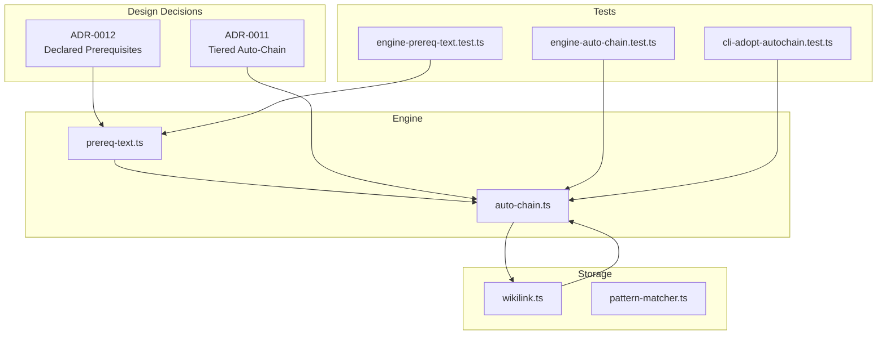

**Diagram sources**
- [auto-chain.ts:1-200](https://github.com/Kuldeep2822k/cli/blob/main/src/engine/auto-chain.ts#L1-L200)
- [prereq-text.ts:1-120](https://github.com/Kuldeep2822k/cli/blob/main/src/engine/prereq-text.ts#L1-L120)
- [wikilink.ts:1-120](https://github.com/Kuldeep2822k/cli/blob/main/src/storage/wikilink.ts#L1-L120)
- [0011-tiered-auto-chain.md:1-99](https://github.com/Kuldeep2822k/cli/blob/main/docs/adr/0011-tiered-auto-chain.md#L1-L99)
- [0012-declared-prerequisites.md:1-82](https://github.com/Kuldeep2822k/cli/blob/main/docs/adr/0012-declared-prerequisites.md#L1-L82)
- [engine-auto-chain.test.ts:1-60](https://github.com/Kuldeep2822k/cli/blob/main/test/engine-auto-chain.test.ts#L1-L60)
- [engine-prereq-text.test.ts:1-40](https://github.com/Kuldeep2822k/cli/blob/main/test/engine-prereq-text.test.ts#L1-L40)
- [cli-adopt-autochain.test.ts:1-60](https://github.com/Kuldeep2822k/cli/blob/main/test/cli-adopt-autochain.test.ts#L1-L60)

**Section sources**
- [auto-chain.ts:1-200](https://github.com/Kuldeep2822k/cli/blob/main/src/engine/auto-chain.ts#L1-L200)
- [prereq-text.ts:1-120](https://github.com/Kuldeep2822k/cli/blob/main/src/engine/prereq-text.ts#L1-L120)
- [wikilink.ts:1-120](https://github.com/Kuldeep2822k/cli/blob/main/src/storage/wikilink.ts#L1-L120)
- [0011-tiered-auto-chain.md:1-99](https://github.com/Kuldeep2822k/cli/blob/main/docs/adr/0011-tiered-auto-chain.md#L1-L99)
- [0012-declared-prerequisites.md:1-82](https://github.com/Kuldeep2822k/cli/blob/main/docs/adr/0012-declared-prerequisites.md#L1-L82)

## Core Components
The auto-chaining pipeline has four main responsibilities:

1. **Numbered-tree chain planning:** Group notes by parent directory, sort directories segment by segment, sort files by numeric prefix and phase keywords, and create predecessor edges.
2. **Wikilink parsing:** Extract Obsidian-style link targets from content without touching the filesystem.
3. **Declared-prerequisite scanning:** Read a note’s own prerequisites section, filter hedged items, extract links, and resolve them through a caller-provided lookup.
4. **Vault resolution and safety:** Resolve parsed links to real vault notes, enforce containment, handle casing and Unicode, and fail closed on ambiguity or escape attempts.

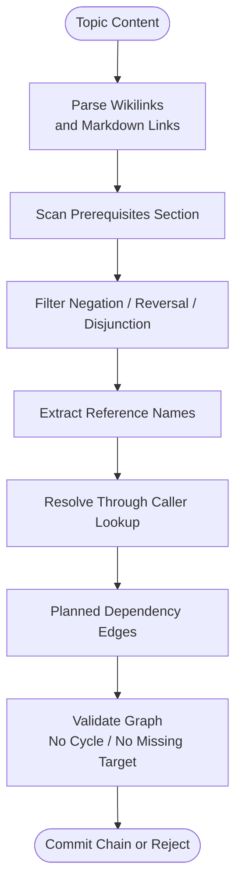

**Diagram sources**
- [auto-chain.ts:201-400](https://github.com/Kuldeep2822k/cli/blob/main/src/engine/auto-chain.ts#L201-L400)
- [prereq-text.ts:201-317](https://github.com/Kuldeep2822k/cli/blob/main/src/engine/prereq-text.ts#L201-L317)
- [wikilink.ts:201-510](https://github.com/Kuldeep2822k/cli/blob/main/src/storage/wikilink.ts#L201-L510)

**Section sources**
- [auto-chain.ts:201-575](https://github.com/Kuldeep2822k/cli/blob/main/src/engine/auto-chain.ts#L201-L575)
- [prereq-text.ts:201-317](https://github.com/Kuldeep2822k/cli/blob/main/src/engine/prereq-text.ts#L201-L317)
- [wikilink.ts:201-510](https://github.com/Kuldeep2822k/cli/blob/main/src/storage/wikilink.ts#L201-L510)

## Architecture Overview
Auto-chaining combines two design decisions:

- A strict numbered tree is the strongest natural ordering signal.
- An optional full tier adds repository-level enumeration only where numbering does not speak.

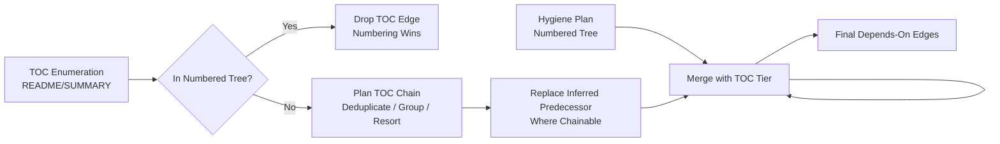

**Diagram sources**
- [0011-tiered-auto-chain.md:1-99](https://github.com/Kuldeep2822k/cli/blob/main/docs/adr/0011-tiered-auto-chain.md#L1-L99)
- [auto-chain.ts:201-400](https://github.com/Kuldeep2822k/cli/blob/main/src/engine/auto-chain.ts#L201-L400)

The architecture also separates parsing from resolution:

- The engine layer parses wikilinks and text-based references without filesystem access.
- The storage layer resolves those references against the actual vault.
- Validation rules enforce structural invariants before committing changes.

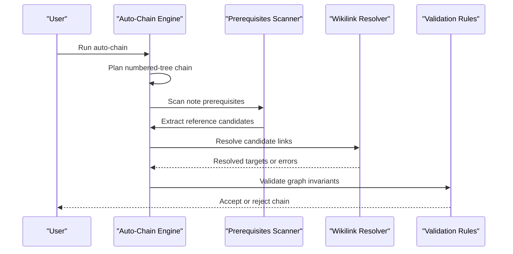

**Diagram sources**
- [auto-chain.ts:1-200](https://github.com/Kuldeep2822k/cli/blob/main/src/engine/auto-chain.ts#L1-L200)
- [prereq-text.ts:1-200](https://github.com/Kuldeep2822k/cli/blob/main/src/engine/prereq-text.ts#L1-L200)
- [wikilink.ts:201-510](https://github.com/Kuldeep2822k/cli/blob/main/src/storage/wikilink.ts#L201-L510)

## Detailed Component Analysis

### Numbered-Tree Chaining and Lesson Ordering
The core planner groups notes by immediate parent directory and orders them deterministically:

- Directories are compared segment by segment.
- Numeric prefixes come first and sort by number.
- Phase keywords follow a fixed pedagogical order.
- Remaining basenames sort alphabetically.
- Each note points to the previous note in its group.
- The first note of each non-first group bridges to the last note of the previous group.

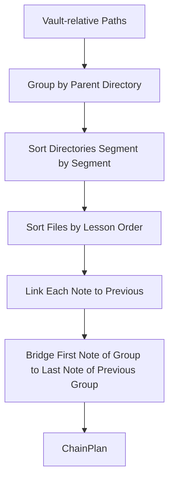

**Diagram sources**
- [auto-chain.ts:201-400](https://github.com/Kuldeep2822k/cli/blob/main/src/engine/auto-chain.ts#L201-L400)

Key implementation details:

| Feature | Behavior |
|---|---|
| Numeric prefix | Matches 1–3 digits followed by a separator or end-of-name |
| Word rejection | `3d-printing` is not lesson 3 |
| Year rejection | `2024-recap` is not lesson 2024 |
| Phase keywords | Fixed order: deep-dive, lab, exam |
| Alphabetical fallback | Flagged through `hasUnnumbered` and detailed per-note reporting |
| Homework placement | Assignment, quiz, and solution are placed last within a directory |

**Section sources**
- [auto-chain.ts:1-200](https://github.com/Kuldeep2822k/cli/blob/main/src/engine/auto-chain.ts#L1-L200)
- [auto-chain.ts:201-400](https://github.com/Kuldeep2822k/cli/blob/main/src/engine/auto-chain.ts#L201-L400)
- [engine-auto-chain.test.ts:1-120](https://github.com/Kuldeep2822k/cli/blob/main/test/engine-auto-chain.test.ts#L1-L120)

### Wikilink Parsing and Text-Based Prerequisite Detection
Wikilink parsing is fs-free and focused on extracting targets from text. It supports:

- `[[target]]`
- `[[target|alias]]`
- `[[target#heading]]`
- Anchors are stripped per the referenced issue contract.
- Escaped links, images, and reference-style links are ignored because they are written to be read, not followed.

The prerequisites scanner then reads structured sections rather than arbitrary prose:

- Recognized headings include variants such as prerequisites, requirements, requires, required knowledge, and depends on.
- Only list items are considered.
- Task-list checkboxes are dropped entirely.
- Fenced code, HTML comments, and inline code spans are blanked before scanning.
- Three cues disqualify an item: negation, reversal, and disjunction.

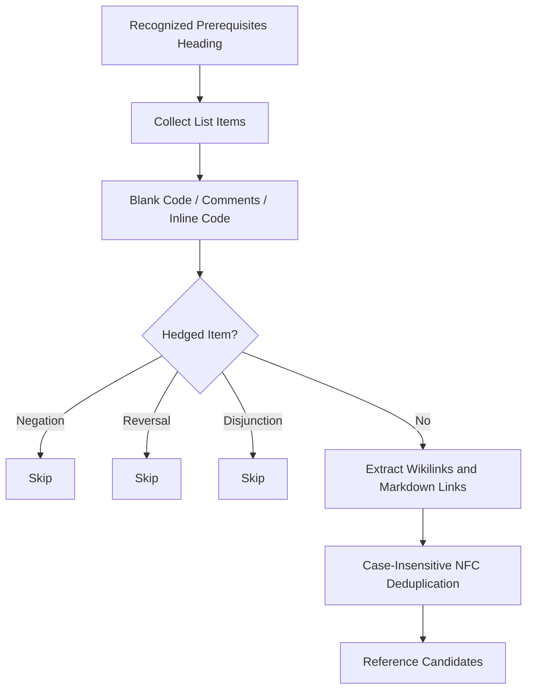

**Diagram sources**
- [prereq-text.ts:1-200](https://github.com/Kuldeep2822k/cli/blob/main/src/engine/prereq-text.ts#L1-L200)

Cue classification:

| Cue | Example meaning | Result |
|---|---|---|
| Negation | Denies the gate it names | Item skipped |
| Reversal | States the link is the dependent, not the prerequisite | Item skipped |
| Disjunction | Offers a choice the engine cannot model as AND | Item skipped |

**Section sources**
- [auto-chain.ts:1-200](https://github.com/Kuldeep2822k/cli/blob/main/src/engine/auto-chain.ts#L1-L200)
- [prereq-text.ts:1-200](https://github.com/Kuldeep2822k/cli/blob/main/src/engine/prereq-text.ts#L1-L200)
- [engine-prereq-text.test.ts:1-200](https://github.com/Kuldeep2822k/cli/blob/main/test/engine-prereq-text.test.ts#L1-L200)

### Declared-Prerequisite Processing Pipeline
The declared-prerequisite pipeline transforms raw note text into resolvable references:

1. Strip unfollowable markup.
2. Split into lines.
3. Detect prerequisites sections by heading.
4. Skip task-list items.
5. Evaluate cue classification.
6. Extract wikilinks and markdown-link destinations.
7. Deduplicate case-insensitively using NFC normalization.
8. Resolve through a caller-owned lookup.

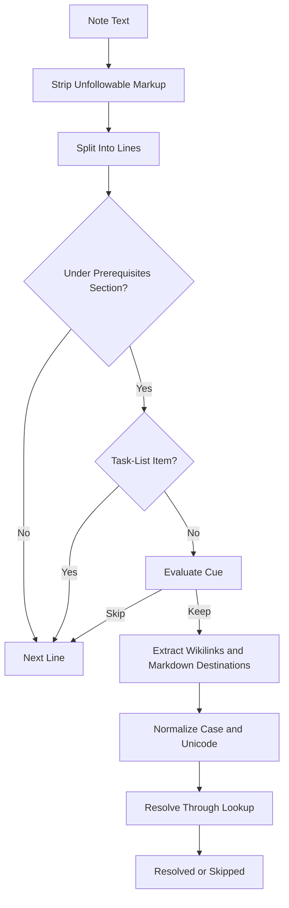

**Diagram sources**
- [prereq-text.ts:201-317](https://github.com/Kuldeep2822k/cli/blob/main/src/engine/prereq-text.ts#L201-L317)

Resolution outcomes:

| Outcome | Meaning | Effect |
|---|---|---|
| Missing | Name matches no target | Edge skipped |
| Ambiguous | Name matches multiple targets | Edge skipped |
| Resolved | Exactly one unique target | Edge added |

**Section sources**
- [prereq-text.ts:201-317](https://github.com/Kuldeep2822k/cli/blob/main/src/engine/prereq-text.ts#L201-L317)
- [0012-declared-prerequisites.md:1-82](https://github.com/Kuldeep2822k/cli/blob/main/docs/adr/0012-declared-prerequisites.md#L1-L82)

### Wikilink Resolution and Vault Safety
The storage layer resolves parsed wikilinks against the vault with a strict safety policy:

1. Reject backslashes in targets because wikilink targets are `/`-separated only.
2. Try exact vault-relative path match, adding `.md` when absent.
3. Check containment before any filesystem access.
4. Require a visible Markdown note.
5. Recheck containment after resolving symlinks.
6. Fall back to basename matching only when the exact path branch rejects safely.
7. Throw on ambiguous basenames.
8. Throw on unresolved targets.

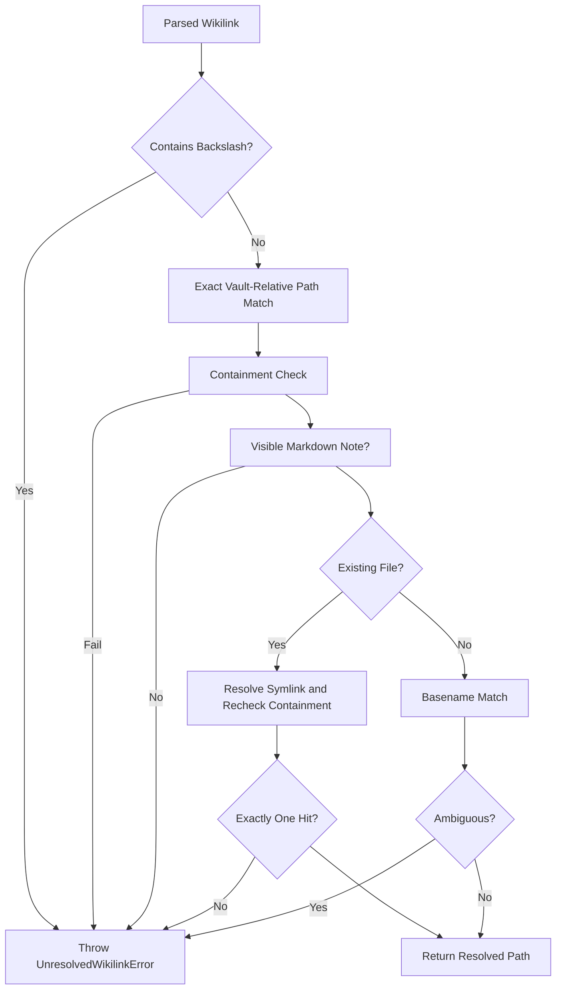

**Diagram sources**
- [wikilink.ts:201-510](https://github.com/Kuldeep2822k/cli/blob/main/src/storage/wikilink.ts#L201-L510)

Important safety guarantees:

- Unsafe paths cannot fall through to basename matching.
- Non-Markdown files cannot be rewritten by roadmap import.
- Hidden namespaces and invisible paths are rejected.
- Casing and Unicode normalization preserve topic identity.
- Ambiguity fails closed instead of guessing.

**Section sources**
- [wikilink.ts:1-200](https://github.com/Kuldeep2822k/cli/blob/main/src/storage/wikilink.ts#L1-L200)
- [wikilink.ts:201-510](https://github.com/Kuldeep2822k/cli/blob/main/src/storage/wikilink.ts#L201-L510)

### Conflict Resolution Between Automatic Discovery and Explicit Declarations
Conflict handling follows a clear precedence rule:

| Priority | Source | Reason |
|---|---|---|
| Highest | Learner’s explicit frontmatter `depends_on` | Hand-written intent |
| High | Note’s own prerequisites section | Author statement equivalent to hand-written dependencies |
| Medium | Numbered tree | Structural ordering signal |
| Lower | TOC enumeration | Advisory ordering |
| Lowest | Alphabetical ordering | Not trusted for gating |

When a declared prerequisites section is present, it replaces the inferred predecessor rather than joining it. This prevents an inferred `toc` edge from being promoted into a gate alongside a declared edge.

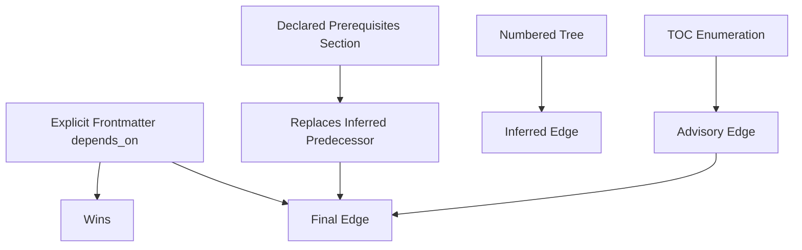

**Diagram sources**
- [0011-tiered-auto-chain.md:1-99](https://github.com/Kuldeep2822k/cli/blob/main/docs/adr/0011-tiered-auto-chain.md#L1-L99)
- [0012-declared-prerequisites.md:1-82](https://github.com/Kuldeep2822k/cli/blob/main/docs/adr/0012-declared-prerequisites.md#L1-L82)

**Section sources**
- [0011-tiered-auto-chain.md:1-99](https://github.com/Kuldeep2822k/cli/blob/main/docs/adr/0011-tiered-auto-chain.md#L1-L99)
- [0012-declared-prerequisites.md:1-82](https://github.com/Kuldeep2822k/cli/blob/main/docs/adr/0012-declared-prerequisites.md#L1-L82)

### Validation Rules Preventing Invalid Chains
The system enforces several invariants before committing chains:

| Rule | Purpose | Failure Behavior |
|---|---|---|
| No dependency cycle | Prevents circular prerequisites | Blocks commit |
| No missing dependency | Ensures every target exists | Rejects or skips depending on source |
| No duplicate topic ID | Preserves identity | Validation error |
| Valid dependency list | Keeps dependency metadata well-formed | Validation error |
| Safe vault paths | Prevents escaping or writing outside the vault | Fail-closed |
| Valid topic schema and fields | Keeps managed notes consistent | Validation error |

CLI integration tests confirm that pre-existing vault cycles block commits with a specific exit status and zero writes.

**Section sources**
- [cli-adopt-autochain.test.ts:1-200](https://github.com/Kuldeep2822k/cli/blob/main/test/cli-adopt-autochain.test.ts#L1-L200)

### Examples of Auto-Chaining Scenarios

#### Scenario 1: Numbered Modules with a Cross-Module Bridge
A curriculum with two numbered modules creates a bridge from the second module’s entry note to the first module’s last note.

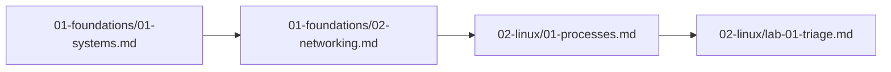

**Diagram sources**
- [engine-auto-chain.test.ts:60-140](https://github.com/Kuldeep2822k/cli/blob/main/test/engine-auto-chain.test.ts#L60-L140)

Expected outcome:

- Module 01 starts as the chain head.
- Module 02 entry depends on module 01 exit.
- Lab notes stay inside their module.

#### Scenario 2: Wikilink Roadmap Chaining
A roadmap section lists wikilinks in order. Each topic depends on the previous topic in that section.

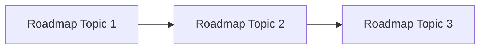

**Diagram sources**
- [wikilink.ts:201-510](https://github.com/Kuldeep2822k/cli/blob/main/src/storage/wikilink.ts#L201-L510)

#### Scenario 3: Hedged Prerequisites
A prerequisites section contains both a real requirement and a hedged statement.

Input shape:

- Real link under a recognized heading.
- Item containing negation, reversal, or disjunction.

Outcome:

- Real link becomes an edge.
- Hedged item contributes nothing.

**Section sources**
- [engine-prereq-text.test.ts:1-200](https://github.com/Kuldeep2822k/cli/blob/main/test/engine-prereq-text.test.ts#L1-L200)

### Edge Cases in Text Parsing

| Edge Case | Expected Behavior |
|---|---|
| `## Prerequisites for the lab` | Not treated as a prerequisites section |
| Fenced example containing `## Prerequisites` | Declares nothing |
| `- [ ] [[unfinished-todo]]` | Dropped because it is an unfinished intention |
| `\\[[escaped-example]]` | Ignored as escaped markup |
| `does not require [[X]]` | Skipped due to negation |
| `This note is a prerequisite for [[Y]]` | Skipped due to reversal |
| `requires [[X]] or [[Y]]` | Skipped due to disjunction |
| Plain bullet without a link | Contributes no reference |
| Sentence describing what a lesson involves | Does not declare a prerequisite |

**Section sources**
- [engine-prereq-text.test.ts:1-200](https://github.com/Kuldeep2822k/cli/blob/main/test/engine-prereq-text.test.ts#L1-L200)

### Troubleshooting Common Auto-Discovery Issues

| Symptom | Likely Cause | Resolution |
|---|---|---|
| Chain produces no edges | No numbered layout, no usable TOC link, no declared dependencies, no explicit `depends_on` | Add numbered prefixes, fix TOC links, or write explicit prerequisites |
| Unexpected alphabetical chain warning | Some directories or files lack numeric prefixes | Add lesson numbers or phase keywords |
| Wikilink throws ambiguous error | Multiple vault notes share the same basename | Use a more specific path or rename notes |
| Wikilink throws unresolved error | Target escapes the vault, names a non-Markdown file, or does not exist | Fix the target path or remove the link |
| Declared prerequisite is ignored | Item is hedged, task-list, fenced, commented, or under an unrecognized heading | Remove hedge, use a checked list item, move link out of code/comment, use a recognized heading |
| Chain conflicts with manual dependencies | Inferred edges were applied before explicit declarations | Ensure explicit declarations take precedence; declared edges replace inferred ones |
| CLI reports false alphabetical ordering | Same-rank filenames decided order inside a directory | Keep this edge if the order is intentional; report it explicitly |

**Section sources**
- [engine-auto-chain.test.ts:1-200](https://github.com/Kuldeep2822k/cli/blob/main/test/engine-auto-chain.test.ts#L1-L200)
- [engine-prereq-text.test.ts:1-200](https://github.com/Kuldeep2822k/cli/blob/main/test/engine-prereq-text.test.ts#L1-L200)
- [cli-adopt-autochain.test.ts:1-200](https://github.com/Kuldeep2822k/cli/blob/main/test/cli-adopt-autochain.test.ts#L1-L200)

## Dependency Analysis
The components have clear boundaries:

- `auto-chain.ts` owns chain planning, lesson ranking, and wikilink parsing at the engine level.
- `prereq-text.ts` owns prerequisites section scanning and reference resolution contracts.
- `wikilink.ts` owns vault-safe resolution and roadmap chaining.
- `pattern-matcher.ts` provides glob pattern compilation and matching used by CLI filters, not directly by auto-chaining but relevant to how notes are selected before chaining.

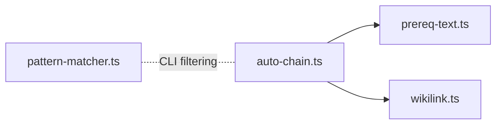

**Diagram sources**
- [auto-chain.ts:1-200](https://github.com/Kuldeep2822k/cli/blob/main/src/engine/auto-chain.ts#L1-L200)
- [prereq-text.ts:1-120](https://github.com/Kuldeep2822k/cli/blob/main/src/engine/prereq-text.ts#L1-L120)
- [wikilink.ts:1-120](https://github.com/Kuldeep2822k/cli/blob/main/src/storage/wikilink.ts#L1-L120)
- [pattern-matcher.ts:1-120](https://github.com/Kuldeep2822k/cli/blob/main/src/storage/pattern-matcher.ts#L1-L120)

Coupling observations:

- The engine layer remains filesystem-free and relies on interfaces like lookup functions.
- Storage modules provide concrete vault behavior.
- ADRs document design decisions that constrain implementation choices.
- Tests pin expected parsing, ordering, and CLI behavior.

**Section sources**
- [auto-chain.ts:1-200](https://github.com/Kuldeep2822k/cli/blob/main/src/engine/auto-chain.ts#L1-L200)
- [prereq-text.ts:1-120](https://github.com/Kuldeep2822k/cli/blob/main/src/engine/prereq-text.ts#L1-L120)
- [wikilink.ts:1-120](https://github.com/Kuldeep2822k/cli/blob/main/src/storage/wikilink.ts#L1-L120)
- [pattern-matcher.ts:1-120](https://github.com/Kuldeep2822k/cli/blob/main/src/storage/pattern-matcher.ts#L1-L120)

## Performance Considerations
The auto-chaining system emphasizes predictable, bounded performance:

- Wikilink parsing uses bracket-balance tables to avoid quadratic rescans on pathological content.
- The scan is linear in document size.
- Basename matching avoids unnecessary filesystem calls when possible.
- Canonical vault root computation can be hoisted for bulk roadmap resolution.
- Glob patterns intended for validation are separated from matching to prevent catastrophic backtracking on repeated `.test()` calls.

These properties matter especially for large READMEs, generated indexes, and curricula with many notes.

## Troubleshooting Guide
Use these checks when auto-discovery behaves unexpectedly:

1. Verify whether the vault has numbered modules. Without them, strict mode may intentionally produce zero edges.
2. If using the full tier, check whether the README or SUMMARY actually enumerates the intended notes.
3. Confirm that prerequisites are written under a recognized heading and contain links, not plain words.
4. Inspect hedged items: negation, reversal, and disjunction all suppress gating.
5. For wikilink failures, inspect the exact target, vault containment, visibility, and basename uniqueness.
6. For CLI failures, check exit codes and dry-run output before any files are modified.
7. For existing chains, remember that declared prerequisites replace inferred predecessors rather than merging with them.

**Section sources**
- [cli-adopt-autochain.test.ts:1-200](https://github.com/Kuldeep2822k/cli/blob/main/test/cli-adopt-autochain.test.ts#L1-L200)
- [engine-prereq-text.test.ts:1-200](https://github.com/Kuldeep2822k/cli/blob/main/test/engine-prereq-text.test.ts#L1-L200)
- [wikilink.ts:201-510](https://github.com/Kuldeep2822k/cli/blob/main/src/storage/wikilink.ts#L201-L510)

## Conclusion
The auto-chaining system is designed around trust signals:

- Explicit author intent is strongest.
- Structured numbering is strong.
- Repository enumeration is advisory.
- Pure alphabetical ordering is not trusted for gating.

Its parsing rules favor safety over completeness. Hedged prerequisites, ambiguous names, unsafe paths, and invalid graphs are rejected rather than guessed. This makes auto-discovery reliable for automated workflows while keeping learners from being silently locked out by weak signals.

