# Core Engine

::: details Referenced Files in This Document

- [engine index.ts](https://github.com/Kuldeep2822k/cli/blob/main/src/engine/index.ts)
- [sm2 spaced repetition engine](https://github.com/Kuldeep2822k/cli/blob/main/src/engine/sm2.ts)
- [dependency graph engine](https://github.com/Kuldeep2822k/cli/blob/main/src/engine/dependency.ts)
- [mastery calculation engine](https://github.com/Kuldeep2822k/cli/blob/main/src/engine/mastery.ts)
- [auto-chain planner](https://github.com/Kuldeep2822k/cli/blob/main/src/engine/auto-chain.ts)
- [toc-chain planner](https://github.com/Kuldeep2822k/cli/blob/main/src/engine/toc-chain.ts)
- [topic ID policy](https://github.com/Kuldeep2822k/cli/blob/main/src/engine/topic-id.ts)
- [tier-0 hygiene predicates](https://github.com/Kuldeep2822k/cli/blob/main/src/engine/tier0-hygiene.ts)
- [declared prerequisite text parser](https://github.com/Kuldeep2822k/cli/blob/main/src/engine/prereq-text.ts)

:::

## Table of Contents
1. [Introduction](#introduction)
2. [Project Structure](#project-structure)
3. [Core Components](#core-components)
4. [Architecture Overview](#architecture-overview)
5. [Detailed Component Analysis](#detailed-component-analysis)
6. [Dependency Analysis](#dependency-analysis)
7. [Performance Considerations](#performance-considerations)
8. [Troubleshooting Guide](#troubleshooting-guide)
9. [Conclusion](#conclusion)

## Introduction
The PALEE core engine is the algorithmic center of the system. It exposes a single barrel module that bundles:
- The SuperMemo SM-2 spaced repetition scheduler.
- The four-pillar pedagogical mastery calculator.
- The directed acyclic graph dependency engine, including cycle detection, quarantine, and readiness evaluation.
- Auto-chaining logic for hierarchical prerequisite discovery from numbered directory/file layout.
- The TOC tier for author-enumerated ordering through markdown table-of-contents links.
- Topic identity generation and validation.
- Tier-0 vault hygiene classification.
- Declared-prerequisite extraction from note prose.

This document explains how those pieces fit together, how scheduling decisions are made, how prerequisites gate learning paths, and how the code keeps large or adversarial inputs safe.

## Project Structure
The engine lives under `src/engine`. Its public API is re-exported from one barrel file. Each concern has its own module, keeping parsing, classification, scheduling, graph analysis, and topic identity separate.

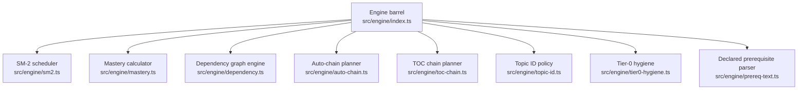

## Core Components
| Component | Responsibility | Key exports | Primary inputs | Primary outputs |
|---|---|---|---|---|
| SM-2 scheduler | Computes review state transitions and due dates | `processReview`, `computeDueDate` | Stored review state and quality rating | Updated ease factor, interval, repetition, lapses, last quality, due date |
| Mastery calculator | Aggregates four pedagogical pillars into one mastery score | `MASTERY_THRESHOLD`, `computeTopicMastery`, `normalizeScore`, `resolveTopicMastery` | Four pillar scores and optional existing mastery value | Normalized mastery score and precedence-resolved result |
| Dependency graph engine | Builds DAG edges, detects cycles, quarantines cyclic components, checks readiness | `detectCycle`, `detectCycles`, `quarantineCyclicTopics`, `getReadyTopics`, `areDependenciesSatisfied` | Map of topic IDs to topic nodes | Cycle reports, clean subgraphs, ready topics |
| Auto-chain planner | Derives ordered predecessors from numbered hierarchy and phase keywords | `planAutoChain`, `parseWikilink`, `extractWikilinks` | Vault-relative note paths | Ordered path list, predecessor map, unnumbered fallback flag |
| TOC chain planner | Extracts and orders markdown links as a secondary chain source | `extractTocLinks`, `planTocChain`, `composeTieredChain` | TOC document text and scoped paths | TOC chain plan and composition with numbered plan |
| Topic ID policy | Generates and validates canonical `palee_id` values | `generateTopicId`, `isValidTopicId` | Date/random bytes or candidate string | Unique `T-...` identifier or boolean validity |
| Tier-0 hygiene | Classifies notes as backbone, leaf, or excluded | `classifyNoteForChain`, `isContentDocName`, `stemOf` | Vault-relative path and optional `palee_id` | Classification and counted skip reason |
| Declared prerequisite parser | Reads self-referential prerequisite sections from note text | `extractDeclaredPrerequisites`, `resolveDeclaredPrerequisites` | Note body and caller-owned lookup | Resolved references and skipped candidates |

## Architecture Overview
At runtime, higher layers ask the engine for schedules, readiness, and chains. The flow typically moves from user action through application commands into engine functions, then back into storage and output.

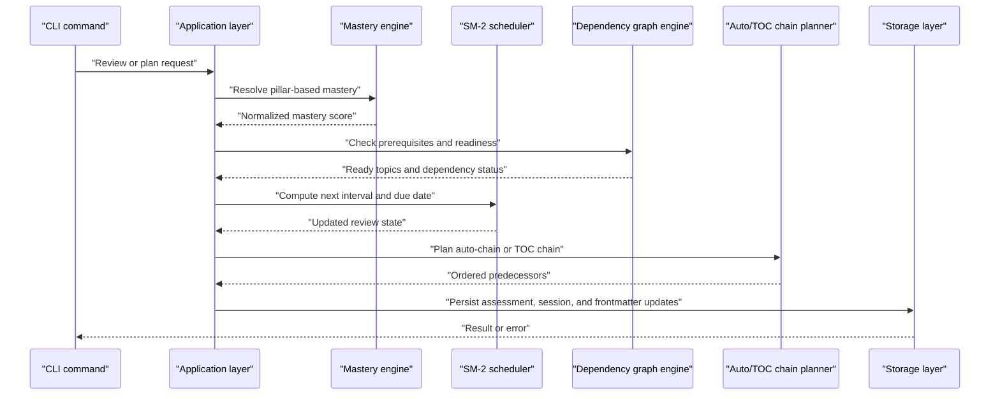

## Detailed Component Analysis

### SM-2 Spaced Repetition Algorithm
The SM-2 implementation follows the SuperMemo SM-2 specification. The formulas below are stated as implemented in `src/engine/sm2.ts`:
- The ease factor starts at 2.5 and is updated after every review — pass or fail — by the canonical delta `ΔEF = 0.1 − (5 − q) × (0.08 + (5 − q) × 0.02)`, where `q` is the quality rating from 0 to 5. That gives +0.10 for `q = 5`, 0.00 for `q = 4`, −0.14 for `q = 3`, −0.32 for `q = 2`, −0.54 for `q = 1`, and −0.80 for `q = 0`. The updated ease factor is clamped to a minimum of 1.3 and rounded to four decimal places using positive decimal half-up rounding; canonical SM-2 sets no upper bound, and neither does the implementation.
- A failed review (`q < 3`) resets repetition to 0 and the interval to 1 day, and increments lapses only when the topic had prior repetitions.
- A successful review increments repetition and sets the interval by repetition count: `I(1) = 1` day, `I(2) = 6` days, and `I(n) = round(I(n − 1) × EF)` for `n ≥ 3`, using the ease factor from before this review's update, exactly as canonical SM-2 prescribes.
- One deliberate deviation from the canonical algorithm: computed intervals are capped at 36,500 days (100 years, `MAX_INTERVAL_DAYS`). Canonical SM-2 has no ceiling; the cap exists so unbounded interval growth cannot overflow the calendar. The strict validation of stored state (refusing non-finite or out-of-range frontmatter values rather than clamping them) is likewise an implementation hardening layer around the algorithm, not part of SM-2 itself.
- Due dates are computed in local timezone arithmetic.

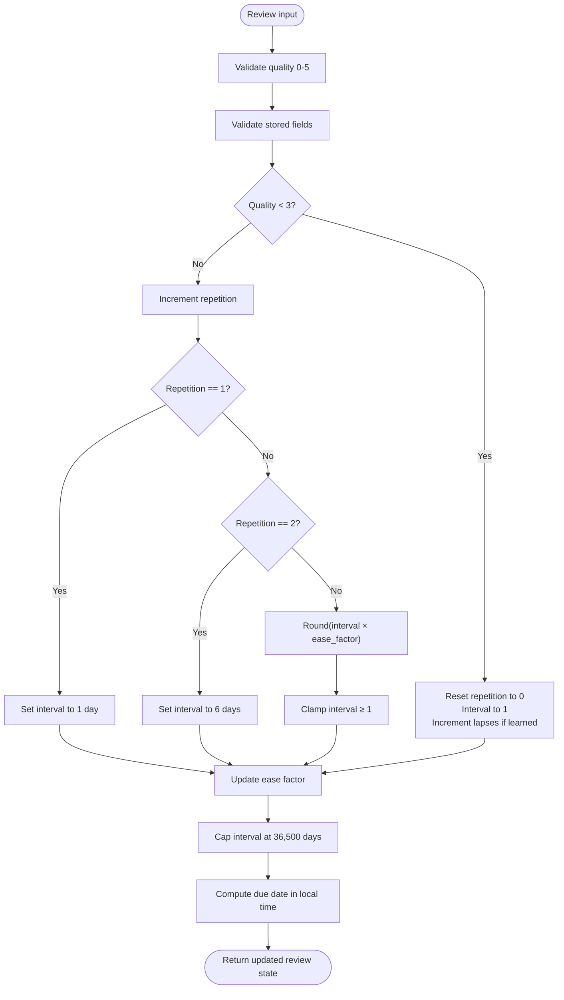

Key properties:
- Mathematical foundation: SM-2 ease-factor delta formula, exponential interval growth bounded by policy cap.
- Error handling: Invalid quality, non-finite or out-of-range stored fields, integer-safe ceilings, and non-finite arithmetic results all throw descriptive errors rather than corrupting persisted state.

### Mastery Calculation System
Mastery aggregates four pedagogical pillars:
- Conceptual understanding: 20% weight.
- Practical application: 20% weight.
- Debugging and troubleshooting: 20% weight.
- Feynman technique articulation: 40% weight.

The formula rounds `(conceptual + practical + debug + 2 × feynman) / 5` to four decimal places. Scores are normalized before weighting.

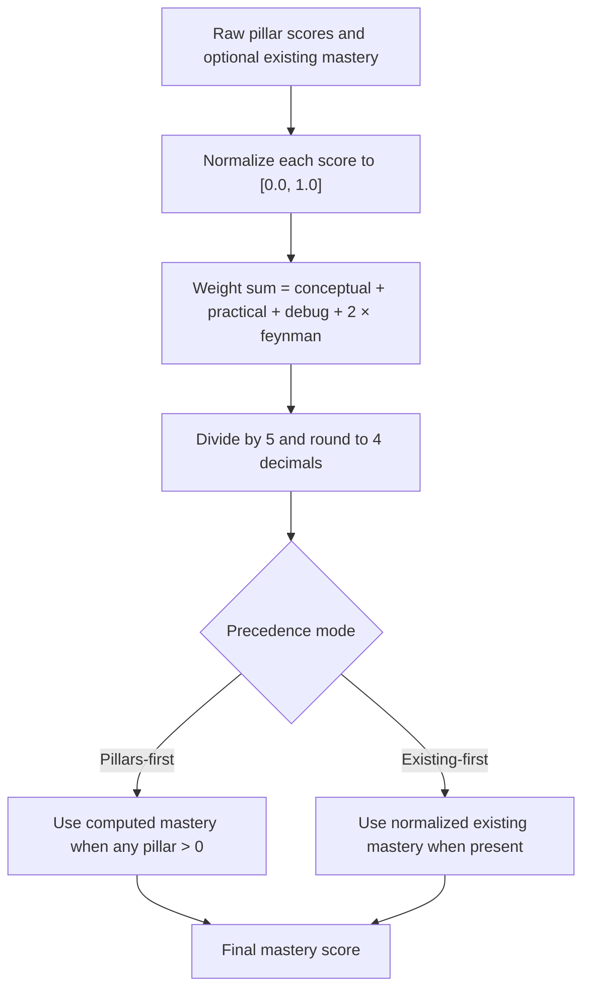

How mastery influences scheduling:
- Mastery thresholds gate prerequisite satisfaction.
- The default threshold is 0.70.
- Readiness depends on both mastery and whether prerequisite topics satisfy their own dependencies.

Normalization handles numeric strings and rejects invalid inputs safely.

### Dependency Graph Engine
The dependency engine models topics as nodes and prerequisite relationships as directed edges. Its main responsibilities are:
- Canonicalizing topic dependencies from the `depends_on` field.
- Building deduplicated adjacency maps.
- Detecting cycles using an iterative Tarjan SCC pass.
- Enumerating elementary cycles using a stack-safe Johnson-style algorithm.
- Quarantining cyclic components so non-cyclic topics remain usable.
- Evaluating readiness against mastery thresholds.

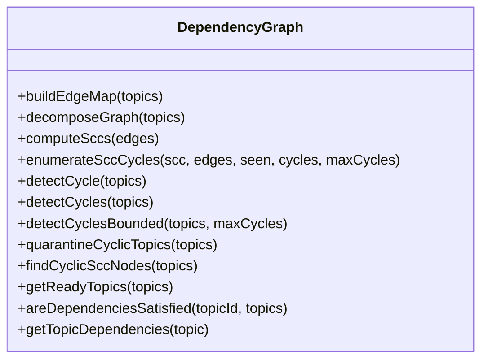

Important design points:
- Self-edges are retained because a topic depending on itself is a one-node cycle.
- Adjacency lists are sorted deterministically so cycle enumeration does not depend on map insertion order.
- Bounded cycle enumeration returns a truncation flag when dense graphs contain exponentially many elementary cycles.
- SCC membership is used for quarantine correctness even when the visible cycle sample is truncated.

### Auto-Chaining Logic
Auto-chaining derives a deterministic `depends_on` predecessor for every note based on filesystem-like hierarchy without touching the filesystem directly.

Rules:
- Notes are grouped by immediate parent directory.
- Directories sort segment-by-segment: numeric prefixes first, then unnumbered segments alphabetically, with ancestor directories deciding before nested children.
- Within a directory, lesson order prioritizes:
  - Numeric-prefixed basenames.
  - Fixed pedagogical phases: deep-dive, lab, exam.
  - Remaining basenames alphabetically.
- Each note’s predecessor is the previous note in its group.
- The first note of each later group bridges to the exit note of the previous group, creating backward edges that are acyclic by construction.

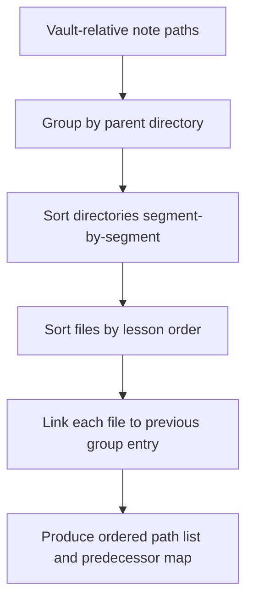

Integration with Tier-0 hygiene:
- Hygiene filters exclude repo metadata, templates, translations, and phase subtrees.
- Backbone vs leaf classification controls which notes may gate others.
- Directory transition justification prevents alphabetical siblings from becoming hard prerequisite gates unless numbering provides structural evidence.

Wikilink parsing:
- Parses Obsidian wikilinks, including targets, aliases, and anchors.
- Anchors are stripped for chaining purposes.
- Parsing is pure and fs-free; vault resolution belongs to storage.

### TOC Chain Processing
The TOC tier is a secondary, author-enumerated ordering source. Where numbered layout does not fully express intent, markdown links in a table of contents can define chain order.

Responsibilities:
- Extract inline markdown link destinations in document order.
- Normalize destinations to vault-relative POSIX candidates.
- Deduplicate links by first appearance.
- Group by directory and apply C1 same-directory phase resort.
- Merge numbered and TOC plans under C2 numbering dominance: numbered-tree paths never take TOC edges.

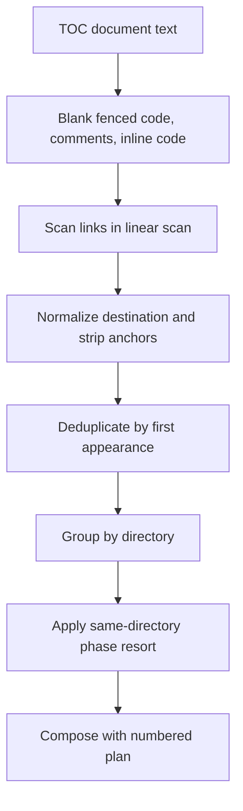

Robustness features:
- Balanced bracket tables avoid quadratic scans on malformed documents.
- Angle-bracket and paren-depth probes are memoized after the first failure.
- Percent-decoding and anchor stripping follow CommonMark-compatible behavior.
- Backslashes are literal characters, not path separators.

### Declared Prerequisite Text Parser
This component reads a note’s own `## Prerequisites` section and extracts explicit prerequisite references.

Behavior:
- Only ATX headings matching a strict prerequisites trigger start a section.
- Any heading closes the section.
- Task-list items are ignored.
- Items containing negation, reversal, or disjunction cues are dropped.
- Wikilinks and markdown link destinations are extracted.
- Resolution is caller-owned: missing or ambiguous names are reported but do not fail the operation.

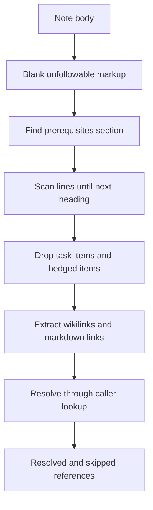

Design choice:
- Prose is deliberately not parsed for phrases like “requires X.” The cost-benefit measured zero reliable edges while introducing false positives, so only explicit links gate learners.

### Topic ID Generation, Validation, and Normalization
Topic IDs are the stable identity for PALEE-managed notes.

Policy:
- Canonical format: `T-` followed by lowercase alphanumeric kebab-case segments.
- Legacy adopt-generated ISO timestamp format remains valid for historical data.
- Generator produces UTC-based timestamps plus cryptographic random bytes.

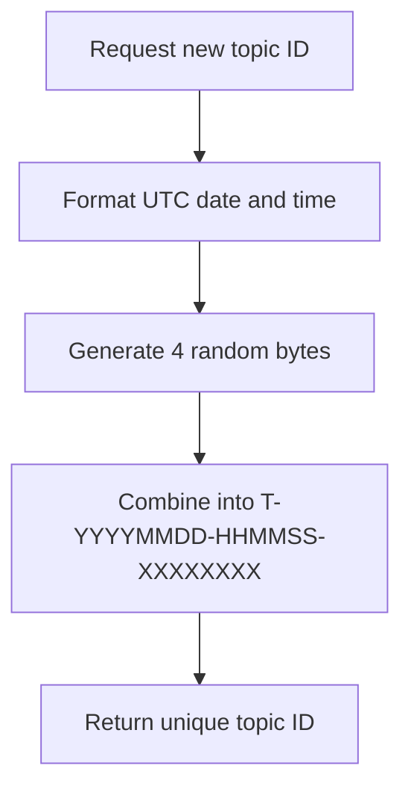

Validation:
- Rejects non-string inputs.
- Accepts canonical and legacy patterns.
- Other layers should use this validator instead of ad hoc regexes.

### Tier-0 Hygiene Rules
Tier-0 hygiene decides which notes participate in batch adoption and which may gate other notes.

Classification outcomes:
- `backbone`: joins the chained spine and may be a prerequisite.
- `leaf`: adopted but never gates the chain.
- `excluded`: removed from chaining and batch adoption.

Rules summarized:
- B1: Repository metadata basenames are excluded.
- B2: Locale-suffixed generic doc names are excluded; locale suffixes on other unnumbered names demote to leaf.
- B3: Template names are excluded when they are whole tokens and unnumbered.
- B4: Phase subtrees such as solutions or starter folders are leaves.
- B5: README-class, numeric-prefixed, and phase-prefixed content names may join the backbone.
- B6: The reporting rule — every batch adoption prints a per-rule hygiene report (skip counts by reason on the dry-run and confirmation screens; backbone and leaf counts as well under `--auto-chain`), so a note hygiene removes or demotes is always accounted for, never silently dropped. B6 is not a classification rule: B1–B5 and B7 classify, B6 reports.
- B7: An invalid `palee_id` demotes a note to leaf but does not promote it.

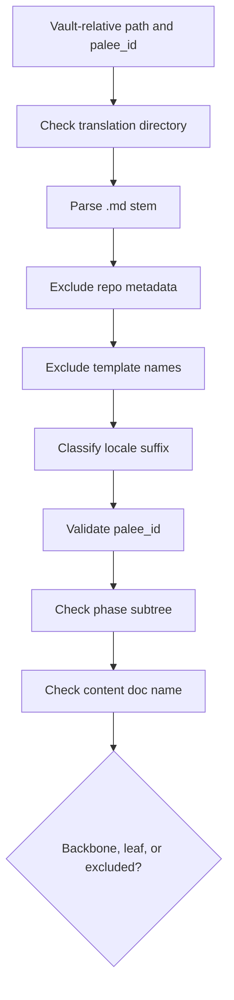

## Dependency Analysis
The engine modules have clear boundaries:
- The barrel file re-exports public APIs.
- Auto-chain and TOC planners depend on tier-0 hygiene.
- Declared prerequisite parsing depends on both auto-chain wikilink parsing and TOC link extraction.
- Dependency readiness uses the mastery threshold.
- SM-2 is independent of graph and planning logic.

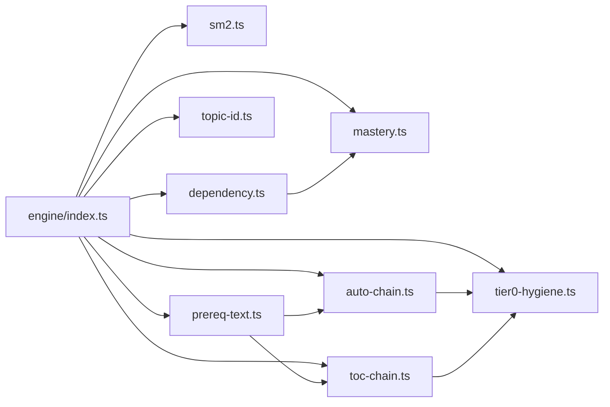

Coupling observations:
- Low coupling between scheduling and graph logic improves testability.
- Hygiene predicates are reused across planners, reducing rule divergence.
- Declared prerequisite parsing delegates resolution to callers, keeping it vault-neutral.

Potential risks:
- If hygiene rules change, both auto-chain and TOC-tier consumers must remain consistent.
- Cycle enumeration can be expensive on dense graphs, so bounded variants are important for interactive commands.

## Performance Considerations
| Area | Complexity | Consideration |
|---|---:|---|
| SM-2 review processing | O(1) | Constant-time arithmetic with defensive bounds checking. |
| Mastery aggregation | O(1) | Fixed number of pillars; normalize once, compute once. |
| Dependency edge map | O(V + E) | Deduplicates parallel edges and sorts adjacency for determinism. |
| Tarjan SCC | O(V + E) | Iterative implementation avoids call-stack exhaustion. |
| Cycle enumeration | O(cycles reported) | Johnson-style enumeration is proportional to reported cycles; dense SCCs can be exponential, so bounded variants exist. |
| Dependency readiness check | O(prerequisites) | Linear in the number of prerequisites examined per topic. |
| Auto-chain planning | O(n log n) | Sorting directories and lessons dominates; wikilink scanning is linear in link content. |
| TOC link extraction | O(document length) | Linear scan with lazy balance tables for malformed inputs. |
| Topic ID generation/validation | O(1) or O(k) | Very fast; intended for frequent use during adoption and validation. |
| Tier-0 classification | O(segments) | Small constant-time list lookups over path segments. |

Optimization recommendations:
- Prefer bounded cycle enumeration for user-facing operations.
- Cache computed mastery when multiple readiness checks reuse the same topic.
- Avoid repeated path normalization by normalizing once per planner run.
- Use the hygiene classifier consistently to prevent redundant branching logic.

[No sources needed since this section provides general guidance]

## Troubleshooting Guide
Common engine issues and their likely causes:

| Symptom | Likely cause | Recommended check |
|---|---|---|
| Review state throws invalid quality or interval errors | Corrupted or manually edited frontmatter | Validate stored fields before calling `processReview`; inspect ease factor, interval, repetition, and lapses types and ranges. |
| Due date becomes invalid or far in the future | Uncapped interval growth or bypassing the cap | Ensure `MAX_INTERVAL_DAYS` is applied and `computeDueDate` receives finite day counts. |
| Prerequisites never lift | Mastery below 0.70 or unresolved prerequisite edges | Check pillar scores, mastery threshold, and whether dependencies are satisfied. |
| Plan stalls on malformed TOC | Unbalanced brackets or angle brackets in markdown | Inspect TOC text; the scanner uses balance tables but still requires well-formed enough links. |
| Unexpected prerequisite edges from alphabetical ordering | Unnumbered siblings or weak directory signals | Review Tier-0 hygiene classification and directory transition justification. |
| Topic ID validation fails | Non-canonical format or legacy mismatch | Confirm the ID matches the canonical or legacy pattern; regenerate with `generateTopicId`. |
| Translation notes appear unexpectedly | Locale suffix misclassification or structural translation signal | Verify `classifyNoteForChain` input and the presence of translation directory segments. |

## Conclusion
The PALEE core engine cleanly separates scheduling, mastery, graph analysis, chaining, and identity concerns. Its most important guarantees are:
- SM-2 scheduling is numerically safe, capped, and timezone-aware.
- Mastery is a weighted four-pillar score with clear precedence rules.
- Dependency analysis is iterative, deterministic, and bounded where required.
- Auto-chaining and TOC chaining provide structured and author-enumerated ordering with conservative gating.
- Tier-0 hygiene protects curriculum structure from accidental promotion of repository metadata, translations, templates, and homework.
- Topic IDs are generated and validated centrally so adoption, roadmap, and validation layers cannot disagree.

Higher layers should consume the barrel API, validate raw inputs early, prefer bounded graph operations, and treat hygiene classifications as the contract for what may gate learners.

[No sources needed since this section summarizes without analyzing specific files]

## References

- [engine index.ts:1-126](https://github.com/Kuldeep2822k/cli/blob/main/src/engine/index.ts#L1-L126)
- [sm2 spaced repetition engine:1-306](https://github.com/Kuldeep2822k/cli/blob/main/src/engine/sm2.ts#L1-L306)
- [dependency graph engine:1-1015](https://github.com/Kuldeep2822k/cli/blob/main/src/engine/dependency.ts#L1-L1015)
- [mastery calculation engine:1-229](https://github.com/Kuldeep2822k/cli/blob/main/src/engine/mastery.ts#L1-L229)
- [auto-chain planner:1-1094](https://github.com/Kuldeep2822k/cli/blob/main/src/engine/auto-chain.ts#L1-L1094)
- [toc-chain planner:1-1331](https://github.com/Kuldeep2822k/cli/blob/main/src/engine/toc-chain.ts#L1-L1331)
- [topic ID policy:1-81](https://github.com/Kuldeep2822k/cli/blob/main/src/engine/topic-id.ts#L1-L81)
- [tier-0 hygiene predicates:1-405](https://github.com/Kuldeep2822k/cli/blob/main/src/engine/tier0-hygiene.ts#L1-L405)
- [declared prerequisite text parser:1-317](https://github.com/Kuldeep2822k/cli/blob/main/src/engine/prereq-text.ts#L1-L317)
