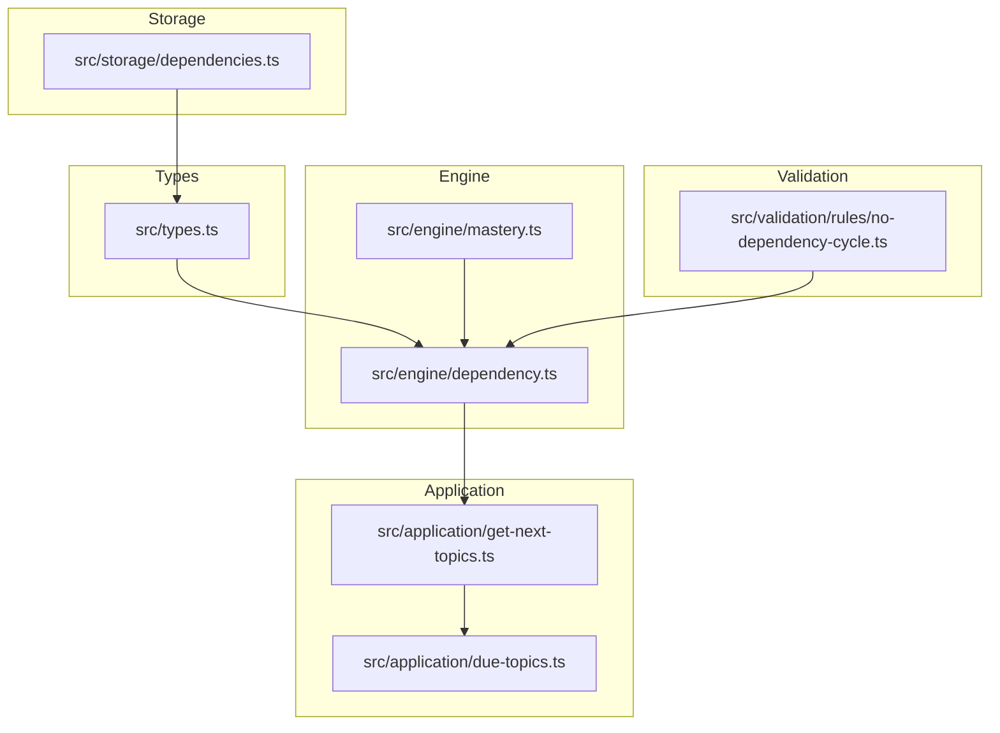
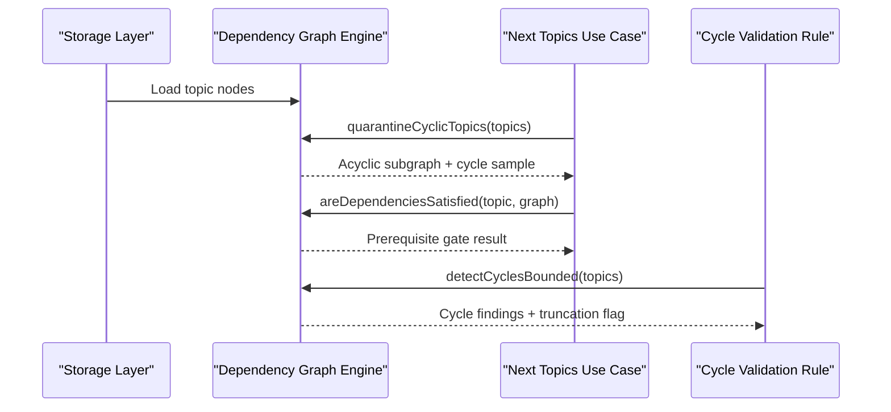
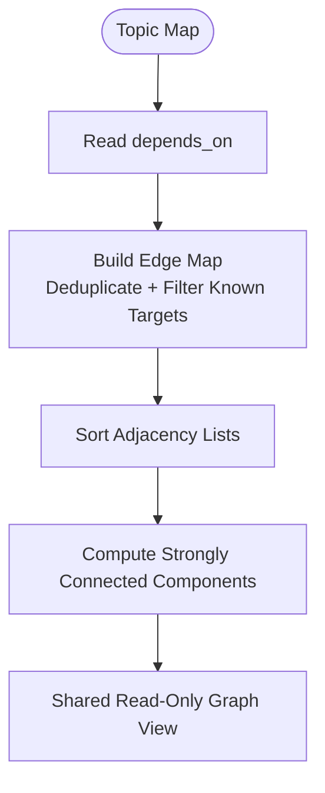
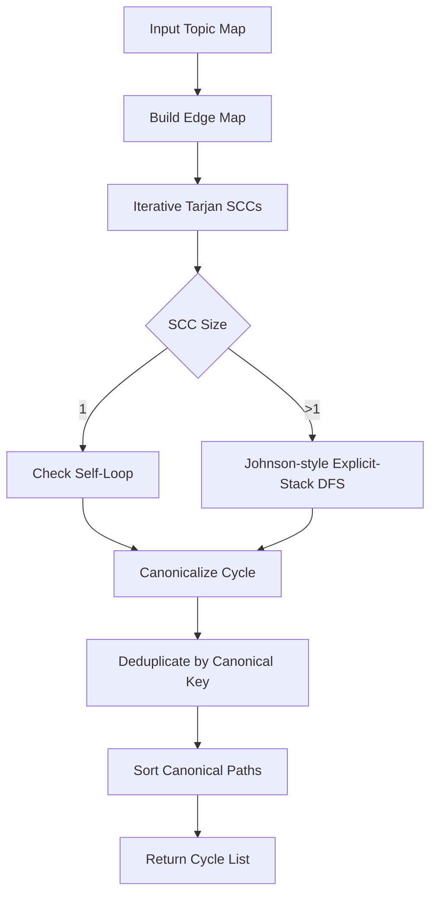
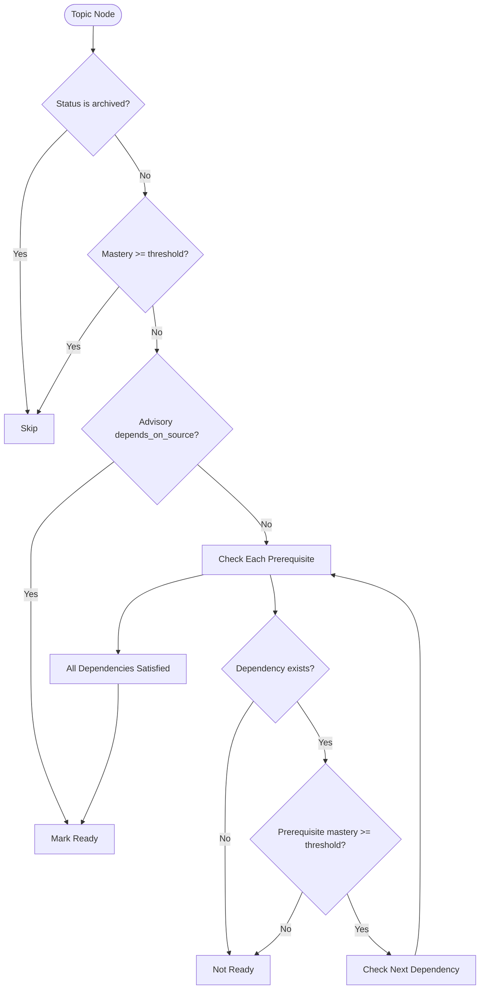
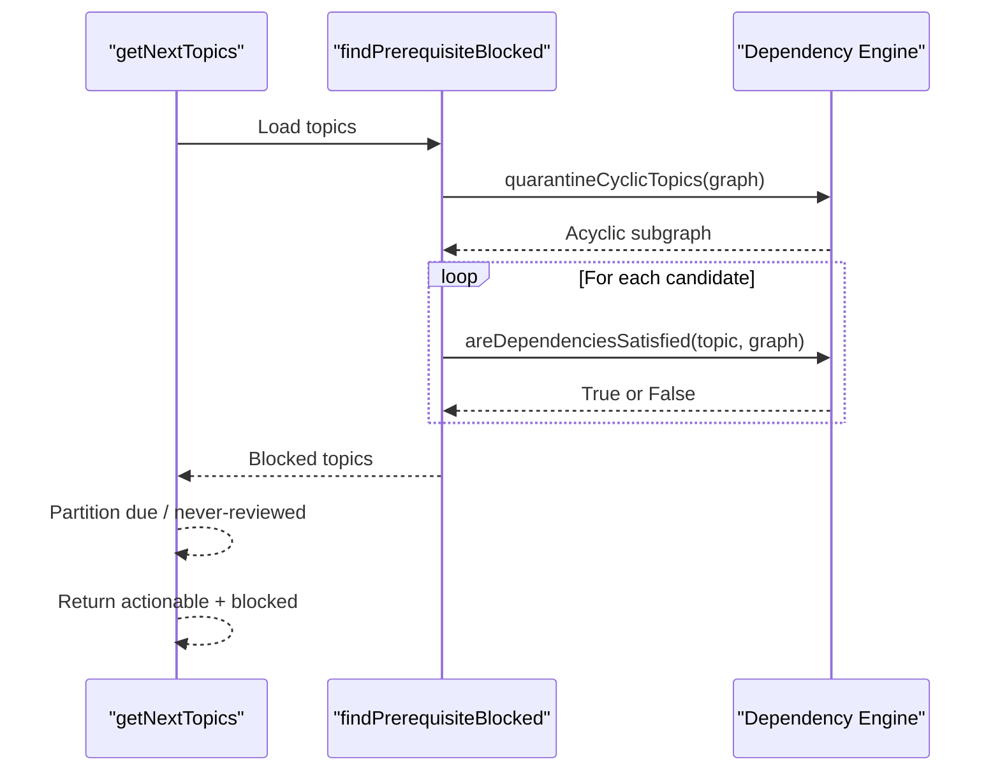
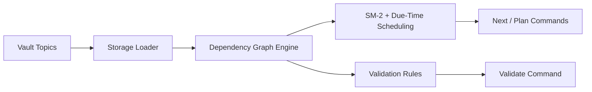
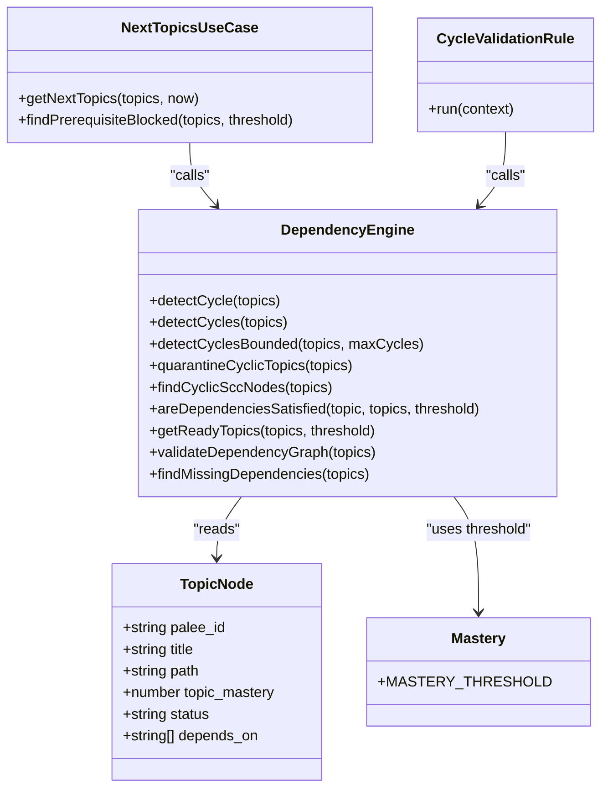

# Dependency Graph Engine

::: details Referenced Files in This Document

- [dependency.ts](https://github.com/Kuldeep2822k/cli/blob/main/src/engine/dependency.ts)
- [mastery.ts](https://github.com/Kuldeep2822k/cli/blob/main/src/engine/mastery.ts)
- [types.ts](https://github.com/Kuldeep2822k/cli/blob/main/src/types.ts)
- [dependencies.ts](https://github.com/Kuldeep2822k/cli/blob/main/src/storage/dependencies.ts)
- [get-next-topics.ts](https://github.com/Kuldeep2822k/cli/blob/main/src/application/get-next-topics.ts)
- [due-topics.ts](https://github.com/Kuldeep2822k/cli/blob/main/src/application/due-topics.ts)
- [no-dependency-cycle.ts](https://github.com/Kuldeep2822k/cli/blob/main/src/validation/rules/no-dependency-cycle.ts)
- [engine-dependency.test.ts](https://github.com/Kuldeep2822k/cli/blob/main/test/engine-dependency.test.ts)

:::

## Table of Contents
1. [Introduction](#introduction)
2. [Project Structure](#project-structure)
3. [Core Components](#core-components)
4. [Architecture Overview](#architecture-overview)
5. [Detailed Component Analysis](#detailed-component-analysis)
6. [Dependency Analysis](#dependency-analysis)
7. [Performance Considerations](#performance-considerations)
8. [Troubleshooting Guide](#troubleshooting-guide)
9. [Conclusion](#conclusion)

## Introduction
The dependency graph engine models prerequisite relationships between topics as a directed acyclic graph and detects when those relationships form cycles. It is responsible for:

- Building a deduplicated, deterministic edge map from topic metadata.
- Detecting whether the graph contains cycles.
- Enumerating every distinct elementary cycle inside strongly connected components using an explicit-stack adaptation of Johnson's algorithm.
- Quarantining nodes that are on or downstream of cycles so unrelated parts of the vault remain usable.
- Deciding which topics satisfy their prerequisites based on mastery thresholds.
- Exposing ready-topic sets and validation results used by scheduling, planning, and validation flows.

The engine deliberately separates structural graph operations (cycles, SCCs, quarantine) from scheduling decisions (mastery-based readiness).

## Project Structure
The dependency engine lives under `src/engine`, with supporting types, storage normalization, application gating, and validation rules distributed across adjacent modules.

## Core Components
The dependency engine exposes several public primitives:

| Export | Purpose | Key Behavior |
|---|---|---|
| `detectCycle` | Finds one cycle path | Returns the lexicographically smallest canonical cycle path or `null`. Uses direct search rather than full enumeration. |
| `detectCycles` | Enumerates all cycles | Returns every distinct elementary cycle path, sorted canonically. |
| `detectCyclesBounded` | Bounded cycle enumeration | Returns at most `maxCycles` paths plus a `truncated` flag; validates its cap. |
| `quarantineCyclicTopics` | Removes cyclic and dependent topics | Returns an acyclic submap, a bounded cycle sample, and truncation status. |
| `findCyclicSccNodes` | Finds nodes on cycles | O(V+E) membership check based on SCCs and self-loops. |
| `areDependenciesSatisfied` | Checks prerequisite mastery | Treats advisory edges as satisfied; requires existence and mastery threshold otherwise. |
| `getReadyTopics` | Lists learnable topics | Filters archived, mastered, and unmet-prerequisite topics. |
| `validateDependencyGraph` | Full integrity check | Reports missing dependencies and every detected cycle. |
| `findMissingDependencies` | Missing-reference check | Scans referenced IDs against known topic IDs. |
| `getTopicDependencies` | Reads canonical prerequisites | Returns the `depends_on` list, falling back to an empty array. |

These functions operate on a `Map<string, TopicNode>` where each node carries a stable identifier, mastery score, status, and prerequisite list.

## Architecture Overview
At runtime, the dependency graph engine is not called directly by users. It is consumed by higher layers:

1. **Storage layer** normalizes raw frontmatter into canonical topic nodes.
2. **Engine layer** builds graphs, detects cycles, quarantines unsafe components, and evaluates readiness.
3. **Application layer** computes due topics and prerequisite blockers for commands such as `next` and `plan`.
4. **Validation layer** reports cycles and other structural issues.

## Detailed Component Analysis

### Graph Construction from Topic Metadata
The engine does not read YAML or Markdown files directly. It consumes already-normalized topic objects.

Key construction steps:

- `getTopicDependencies` reads only the canonical `depends_on` field. Legacy aliases are handled earlier by storage normalization.
- `buildEdgeMap` creates a deduplicated adjacency map:
  - Only references whose target exists in the topic set become edges.
  - Duplicate entries in `depends_on` are deduplicated per source topic.
  - Self-edges are preserved because `T-a → T-a` is a valid one-node cycle.
  - Adjacency lists are sorted so traversal order is independent of user-authored list order.
- `decomposeGraph` builds both the adjacency map and its strongly connected components once, allowing quarantine and cycle enumeration to share immutable structures.

Complexity:
- Edge construction is O(D), where D is the total number of dependency references.
- Sorting adjacency lists adds O(D log k) per node, where k is the average out-degree.
- Memory usage is proportional to the number of unique resolvable edges plus topic metadata.

### Cycle Detection Algorithms
The engine provides two complementary approaches:

#### Direct Lexicographic Search
`detectCycle` finds the smallest canonical cycle without enumerating all cycles:

1. Compute SCCs.
2. Identify the smallest ID among multi-node SCC members and self-loop singletons.
3. If the candidate has a self-edge, return it immediately.
4. Otherwise, perform a greedy walk over ascending neighbors, checking feasibility using reverse reachability so the walk can still close back to the start without crossing the current path.

This avoids exponential blow-up in dense graphs while preserving the contract that the returned cycle matches the first entry of `detectCycles`.

#### Elementary Cycle Enumeration
`detectCycles` and `detectCyclesBounded` enumerate every distinct simple cycle:

1. Build the deduplicated edge map.
2. Compute SCCs iteratively with Tarjan’s algorithm.
3. For each SCC:
   - Single-node SCCs are checked for self-loops.
   - Multi-node SCCs use an explicit-stack adaptation of Johnson’s algorithm.
4. Canonicalize each cycle by rotating it to start at its lexicographically smallest ID.
5. Deduplicate cycles by their canonical key.
6. Sort the final output by canonical path.

Complexity:
- SCC detection is O(V + E).
- Johnson-style enumeration is linear in the size of the residual graph per reported cycle.
- Output sorting is O(C log C), where C is the number of enumerated cycles.
- Worst-case cycle count is exponential in SCC size, which is why bounded enumeration exists.

### Topological Ordering and Scheduling Decisions
The engine does not expose a generic topological sort function. Instead, it provides domain-specific ordering and readiness behavior:

- `getReadyTopics` returns topics that are:
  - Not archived.
  - Not yet mastered.
  - All prerequisite dependencies present and meeting the mastery threshold.
- The result is sorted by `palee_id` to provide a deterministic base before presentation layers add difficulty or due-date ordering.
- Prerequisite satisfaction uses `areDependenciesSatisfied`, which treats advisory edges differently from real prerequisites.

Complexity:
- Reading prerequisites is O(D).
- Filtering ready topics is O(T + D), where T is the number of topics.
- Sorting ready topics is O(T log T).

### Relationship Between Dependencies and Scheduling
The dependency graph engine integrates with the scheduling pipeline through the next-topics use case:

1. The application constructs a topic graph from loaded data.
2. It calls `quarantineCyclicTopics` to remove topics that cannot be safely ordered.
3. It filters candidates through `areDependenciesSatisfied`.
4. It partitions due vs. never-reviewed topics and applies prerequisite blocking.
5. It returns actionable topics and explicit blocker descriptions.

### Recommendation Pipeline Integration
The recommendation pipeline uses two distinct concerns:

- **Structural safety**: The dependency engine determines whether prerequisite relationships are well-formed and whether cycles exist.
- **Actionability**: The application layer decides what topics are currently due and whether prerequisites block them.

The engine is intentionally narrow: it does not implement spaced repetition scheduling itself. That belongs to the SM-2 engine and due-topic partitioning. The dependency engine supplies the prerequisite gate and cycle quarantine.

## Dependency Analysis

### Coupling and Cohesion
- High cohesion: All graph algorithms live in `dependency.ts`.
- Low coupling to storage: The engine consumes normalized topic objects rather than parsing files.
- Moderate coupling to types: The engine depends on `TopicNode`, validation error shapes, and mastery constants.
- Clean boundary with application layer: `get-next-topics.ts` composes engine primitives but does not reimplement graph logic.
- Validation rule depends only on the bounded enumeration API, keeping CLI validation safe for dense graphs.

### External Dependencies
- `mastery.ts`: Provides the default mastery threshold and scoring helpers.
- `types.ts`: Defines topic nodes, validation results, and advisory-source helpers.
- `storage/dependencies.ts`: Normalizes legacy dependency aliases before the engine sees them.

## Performance Considerations

### Time Complexity Summary

| Operation | Complexity | Notes |
|---|---|---|
| Build edge map | O(D log k) | D is total dependency references |
| Tarjan SCCs | O(V + E) | Iterative, stack-safe |
| Unbounded cycle enumeration | O(V + E + C) per SCC | C is number of elementary cycles; can be exponential |
| Bounded cycle enumeration | O(V + E + min(C, K)) | K is `maxCycles`; truncation proven via probe budget |
| Direct cycle search | O(V·(V + E)) worst case | Avoids exponential enumeration |
| Find cyclic nodes | O(V + E) | Based on SCC membership and self-loops |
| Collect blocked dependents | O(V + E) | Reverse-graph traversal seeded from cyclic nodes |
| Ready-topic filter | O(T + D) | T is topic count |
| Ready-topic sort | O(T log T) | Deterministic by `palee_id` |

### Memory Usage Patterns
- Edge map: One adjacency list per topic with unique targets.
- SCC structures: Index, lowlink, stack, and component lists.
- Cycle enumeration: Explicit stacks replace recursion; blocked sets and B-sets grow with path depth and SCC density.
- Bounded mode limits memory tied to cycle output and seen-key deduplication.
- Shared decomposition prevents repeated work during quarantine.

### Optimization Strategies for Large Vaults
- Prefer `detectCycle` when only one cycle is needed.
- Use `detectCyclesBounded` for user-facing commands; rely on `truncated` instead of waiting indefinitely.
- Rely on SCC membership for quarantine correctness even when cycle enumeration is truncated.
- Keep `depends_on` lists small and free of duplicates; the engine deduplicates, but smaller inputs reduce traversal cost.
- Avoid rebuilding the same graph repeatedly; reuse shared decompositions where possible.

## Troubleshooting Guide

### Common Issues

| Symptom | Likely Cause | Resolution |
|---|---|---|
| Topic is unavailable despite having no visible cycle | Topic is downstream of a cyclic component | Run validation and repair cycles; quarantine removes downstream nodes until resolved. |
| Validation reports many cycles | Dense dependency graph with multiple loops | Inspect canonical cycle paths; bounded enumeration may be truncated. |
| Cycle report changes between runs | Graph built from unordered sources | Ensure canonical identifiers and deterministic ordering; the engine sorts adjacency and canonicalizes cycles. |
| A topic is blocked even though prerequisites look correct | Prerequisite mastery is below threshold or reference is missing | Raise prerequisite mastery or fix missing dependency references. |
| `next` command stalls on dense graphs | Using unbounded cycle enumeration | Switch to bounded enumeration or direct cycle search where applicable. |
| Advisory edges appear to gate learning | Misunderstanding of `depends_on_source` semantics | Advisory edges (`toc`, `tie`) do not gate; only authored or non-advisory edges do. |

### Example Scenarios Covered by Tests

- Simple two-node cycle detection.
- Longer three-node cycles.
- Disjoint cycles reported separately.
- Figure-eight graphs sharing a node.
- Overlapping cycles sharing edges.
- Canonical rotation so the smallest ID leads.
- Self-referential dependencies treated as one-node cycles.
- Bounded enumeration capping pathological graphs.
- Truncation proven rather than speculated.
- Determinism independent of insertion order.
- Quarantine correctness unaffected by truncated samples.
- Large ring performance remains linear after the single cycle.

## Conclusion
The dependency graph engine is a focused, stack-safe component that turns topic metadata into a verifiable prerequisite structure. Its strengths are:

- Deterministic graph construction and output.
- Correct separation between structural cycle analysis and readiness evaluation.
- Safe handling of dense graphs through bounded enumeration and direct search.
- Quarantine that protects unrelated parts of the vault from undefined ordering.
- Clear integration with scheduling and validation layers.

For large vaults, the recommended pattern is to treat cycle enumeration as potentially expensive, use bounded APIs for user-facing operations, rely on SCC membership for quarantine, and keep readiness checks separate from traversal-heavy cycle discovery.

## References

- [dependency.ts:1-1015](https://github.com/Kuldeep2822k/cli/blob/main/src/engine/dependency.ts#L1-L1015)
- [mastery.ts:1-229](https://github.com/Kuldeep2822k/cli/blob/main/src/engine/mastery.ts#L1-L229)
- [types.ts:1-200](https://github.com/Kuldeep2822k/cli/blob/main/src/types.ts#L1-L200)
- [dependencies.ts:1-28](https://github.com/Kuldeep2822k/cli/blob/main/src/storage/dependencies.ts#L1-L28)
- [get-next-topics.ts:1-199](https://github.com/Kuldeep2822k/cli/blob/main/src/application/get-next-topics.ts#L1-L199)
- [due-topics.ts:1-58](https://github.com/Kuldeep2822k/cli/blob/main/src/application/due-topics.ts#L1-L58)
- [no-dependency-cycle.ts:1-74](https://github.com/Kuldeep2822k/cli/blob/main/src/validation/rules/no-dependency-cycle.ts#L1-L74)
- [dependency.ts:750-1015](https://github.com/Kuldeep2822k/cli/blob/main/src/engine/dependency.ts#L750-L1015)
- [dependency.ts:200-750](https://github.com/Kuldeep2822k/cli/blob/main/src/engine/dependency.ts#L200-L750)
- [dependency.ts:200-1015](https://github.com/Kuldeep2822k/cli/blob/main/src/engine/dependency.ts#L200-L1015)
- [dependency.ts:1-200](https://github.com/Kuldeep2822k/cli/blob/main/src/engine/dependency.ts#L1-L200)
- [engine-dependency.test.ts:1-200](https://github.com/Kuldeep2822k/cli/blob/main/test/engine-dependency.test.ts#L1-L200)
- [engine-dependency.test.ts:200-520](https://github.com/Kuldeep2822k/cli/blob/main/test/engine-dependency.test.ts#L200-L520)
- [engine-dependency.test.ts:1-520](https://github.com/Kuldeep2822k/cli/blob/main/test/engine-dependency.test.ts#L1-L520)
