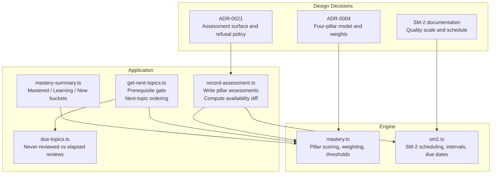
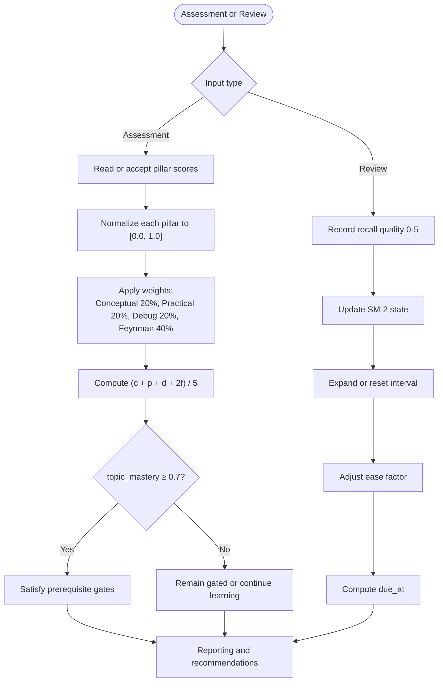
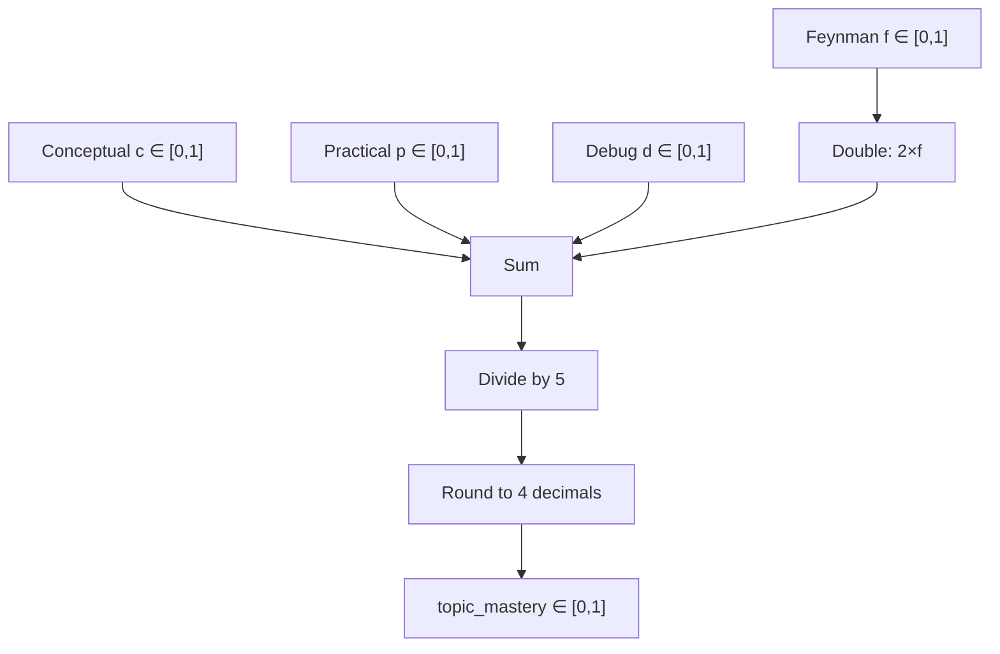
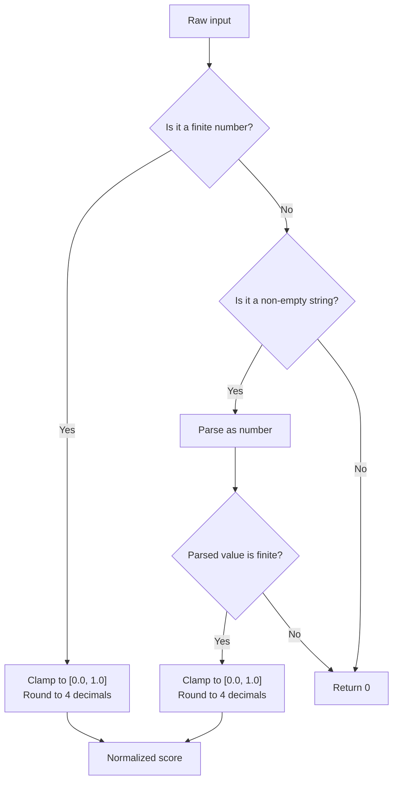
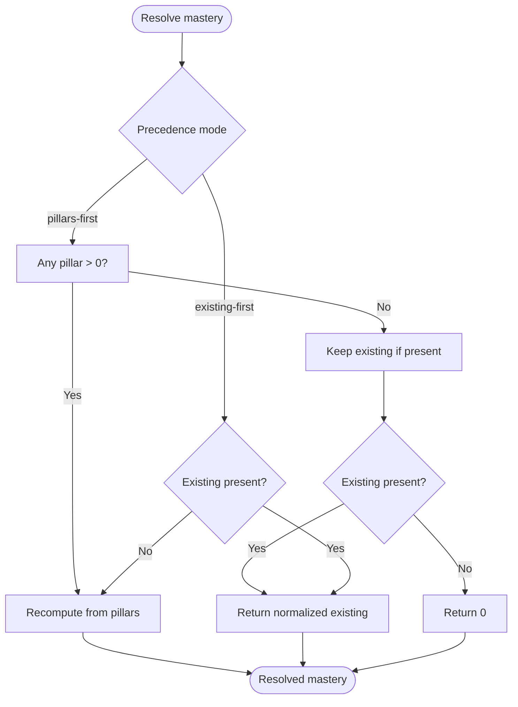
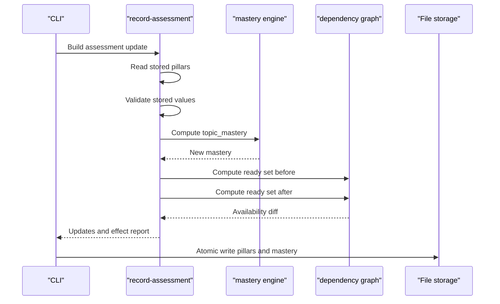
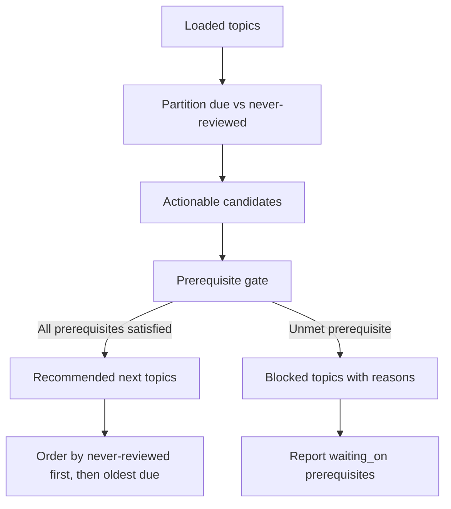
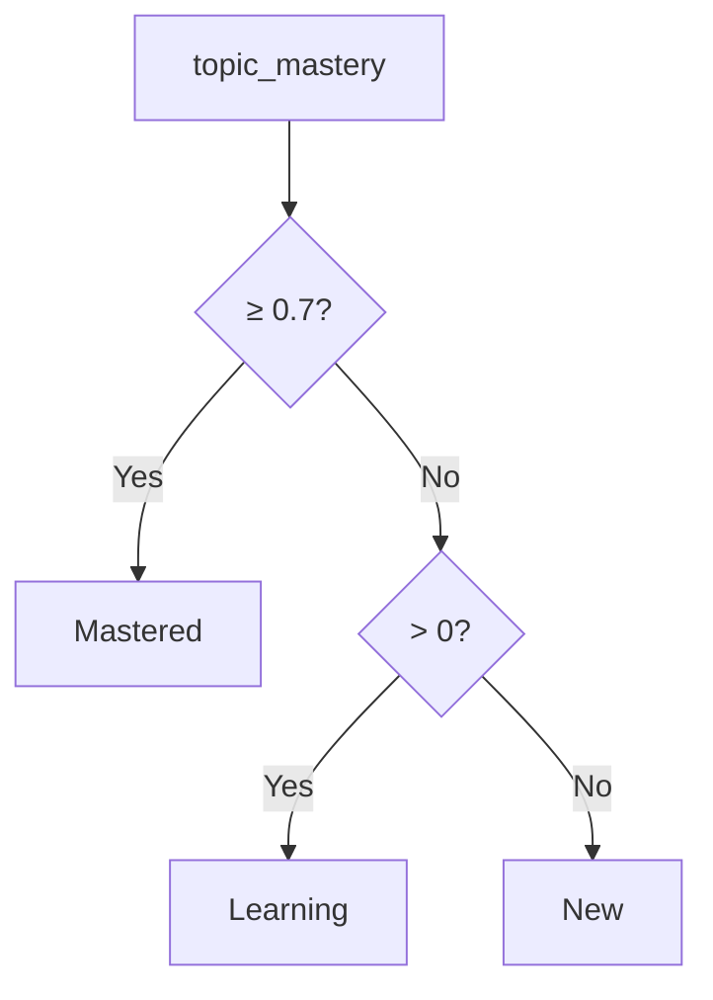
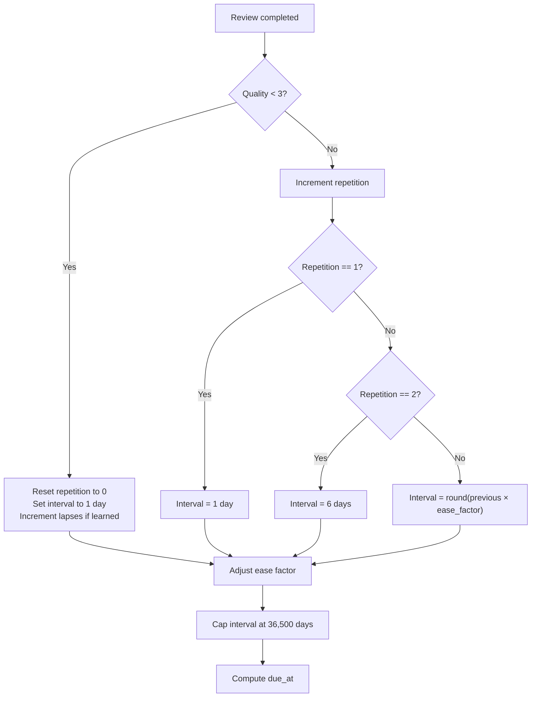
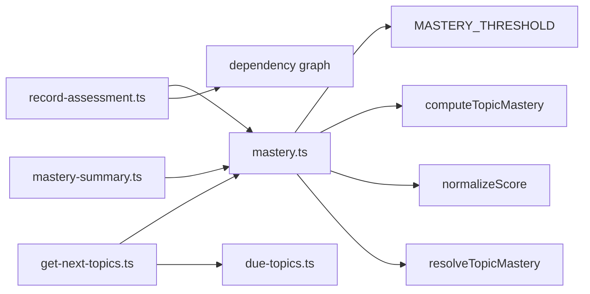

# Mastery Calculation System

<cite>
**Referenced Files in This Document**   
- [mastery.ts](https://github.com/Kuldeep2822k/cli/blob/main/src/engine/mastery.ts)
- [sm2.ts](https://github.com/Kuldeep2822k/cli/blob/main/src/engine/sm2.ts)
- [mastery-summary.ts](https://github.com/Kuldeep2822k/cli/blob/main/src/application/mastery-summary.ts)
- [record-assessment.ts](https://github.com/Kuldeep2822k/cli/blob/main/src/application/record-assessment.ts)
- [get-next-topics.ts](https://github.com/Kuldeep2822k/cli/blob/main/src/application/get-next-topics.ts)
- [due-topics.ts](https://github.com/Kuldeep2822k/cli/blob/main/src/application/due-topics.ts)
- [0004-four-pillar-pedagogical-mastery.md](https://github.com/Kuldeep2822k/cli/blob/main/docs/adr/0004-four-pillar-pedagogical-mastery.md)
- [0021-assessment-surface.md](https://github.com/Kuldeep2822k/cli/blob/main/docs/adr/0021-assessment-surface.md)
- [03-1-sm2-spaced-repetition-algorithm.md](https://github.com/Kuldeep2822k/cli/blob/main/docs/03-1-sm2-spaced-repetition-algorithm.md)
</cite>

## Table of Contents
1. [Introduction](#introduction)
2. [Project Structure](#project-structure)
3. [Core Components](#core-components)
4. [Architecture Overview](#architecture-overview)
5. [Detailed Component Analysis](#detailed-component-analysis)
6. [Dependency Analysis](#dependency-analysis)
7. [Performance Considerations](#performance-considerations)
8. [Troubleshooting Guide](#troubleshooting-guide)
9. [Conclusion](#conclusion)
10. [Appendices](#appendices)

## Introduction
This document explains the mastery calculation system that combines four pedagogical pillars into a single topic mastery score, and shows how that score controls prerequisites, review scheduling, reporting buckets, and user-facing recommendations. The system separates two concerns:

- **Pedagogical mastery**: A weighted combination of Conceptual, Practical, Debug, and Feynman pillar scores.
- **Spaced repetition scheduling**: SM-2 interval expansion, ease factor adjustment, lapse handling, and due-date computation.

Mastery is stored as `topic_mastery`, while assessment evidence may be stored as individual pillar fields. Only when pillar data exists should it drive mastery recomputation; absent pillar data must not be interpreted as zero mastery.

## Project Structure
The mastery system spans engine logic, application use cases, and design decisions:

| Layer | Responsibility | Key Files |
|---|---|---|
| Engine | Pure mastery math, threshold constants, normalization, precedence rules | `src/engine/mastery.ts` |
| Scheduling | SM-2 state transitions, intervals, ease factors, due dates | `src/engine/sm2.ts` |
| Application use cases | Assessment recording, readiness diff, next-topic gating, mastery bucketing | `src/application/record-assessment.ts`, `src/application/get-next-topics.ts`, `src/application/mastery-summary.ts`, `src/application/due-topics.ts` |
| Architecture records | Design rationale for four pillars, assessment surface, and SM-2 behavior | `docs/adr/0004-four-pillar-pedagogical-mastery.md`, `docs/adr/0021-assessment-surface.md`, `docs/03-1-sm2-spaced-repetition-algorithm.md` |



**Diagram sources**
- [mastery.ts:1-229](https://github.com/Kuldeep2822k/cli/blob/main/src/engine/mastery.ts#L1-L229)
- [sm2.ts:1-306](https://github.com/Kuldeep2822k/cli/blob/main/src/engine/sm2.ts#L1-L306)
- [record-assessment.ts:1-134](https://github.com/Kuldeep2822k/cli/blob/main/src/application/record-assessment.ts#L1-L134)
- [get-next-topics.ts:1-199](https://github.com/Kuldeep2822k/cli/blob/main/src/application/get-next-topics.ts#L1-L199)
- [due-topics.ts:1-58](https://github.com/Kuldeep2822k/cli/blob/main/src/application/due-topics.ts#L1-L58)
- [mastery-summary.ts:1-36](https://github.com/Kuldeep2822k/cli/blob/main/src/application/mastery-summary.ts#L1-L36)
- [0004-four-pillar-pedagogical-mastery.md:1-59](https://github.com/Kuldeep2822k/cli/blob/main/docs/adr/0004-four-pillar-pedagogical-mastery.md#L1-L59)
- [0021-assessment-surface.md:1-86](https://github.com/Kuldeep2822k/cli/blob/main/docs/adr/0021-assessment-surface.md#L1-L86)
- [03-1-sm2-spaced-repetition-algorithm.md:1-200](https://github.com/Kuldeep2822k/cli/blob/main/docs/03-1-sm2-spaced-repetition-algorithm.md#L1-L200)

**Section sources**
- [mastery.ts:1-229](https://github.com/Kuldeep2822k/cli/blob/main/src/engine/mastery.ts#L1-L229)
- [sm2.ts:1-306](https://github.com/Kuldeep2822k/cli/blob/main/src/engine/sm2.ts#L1-L306)
- [record-assessment.ts:1-134](https://github.com/Kuldeep2822k/cli/blob/main/src/application/record-assessment.ts#L1-L134)
- [get-next-topics.ts:1-199](https://github.com/Kuldeep2822k/cli/blob/main/src/application/get-next-topics.ts#L1-L199)
- [due-topics.ts:1-58](https://github.com/Kuldeep2822k/cli/blob/main/src/application/due-topics.ts#L1-L58)
- [mastery-summary.ts:1-36](https://github.com/Kuldeep2822k/cli/blob/main/src/application/mastery-summary.ts#L1-L36)
- [0004-four-pillar-pedagogical-mastery.md:1-59](https://github.com/Kuldeep2822k/cli/blob/main/docs/adr/0004-four-pillar-pedagogical-mastery.md#L1-L59)
- [0021-assessment-surface.md:1-86](https://github.com/Kuldeep2822k/cli/blob/main/docs/adr/0021-assessment-surface.md#L1-L86)
- [03-1-sm2-spaced-repetition-algorithm.md:1-200](https://github.com/Kuldeep2822k/cli/blob/main/docs/03-1-sm2-spaced-repetition-algorithm.md#L1-L200)

## Core Components
The mastery calculation system has five core responsibilities:

| Component | Purpose | Primary Inputs | Primary Outputs |
|---|---|---|---|
| Score normalization | Convert raw inputs to safe `[0.0, 1.0]` values with 4-decimal precision | Numbers, strings, nulls, undefined, non-finite values | Normalized number |
| Pillar extraction | Read only existing pillar fields from frontmatter without minting missing zeros | Frontmatter record | Subset of normalized pillar scores |
| Weighted mastery computation | Apply canonical formula `(c + p + d + 2f) / 5` | Four pillar scores | Single mastery value in `[0.0, 1.0]` |
| Precedence resolution | Decide whether pillar scores or an existing mastery value wins | Pillar scores, optional existing mastery, precedence mode | Resolved mastery |
| Bucket summarization | Classify topics as mastered, learning, or new | Array of mastery values | Summary counts |

Key constants:
- **Mastery threshold**: `0.7`.
- **Pillar keys**: conceptual, practical, debug, feynman.
- **Feynman weight**: doubled, giving it 40% effective influence.
- **Ordinary pillar ceiling**: Without Feynman, three ordinary pillars can reach at most `0.6`; they cannot alone satisfy the `0.7` prerequisite gate.

**Section sources**
- [mastery.ts:1-199](https://github.com/Kuldeep2822k/cli/blob/main/src/engine/mastery.ts#L1-L199)
- [0004-four-pillar-pedagogical-mastery.md:1-59](https://github.com/Kuldeep2822k/cli/blob/main/docs/adr/0004-four-pillar-pedagogical-mastery.md#L1-L59)

## Architecture Overview
Mastery and scheduling are complementary but independent systems:

- **Mastery** determines *competence*: whether a learner satisfies prerequisites and belongs in the mastered, learning, or new bucket.
- **SM-2** determines *retention timing*: when a topic should be reviewed again based on recall quality, repetition count, and ease factor.



**Diagram sources**
- [mastery.ts:1-229](https://github.com/Kuldeep2822k/cli/blob/main/src/engine/mastery.ts#L1-L229)
- [sm2.ts:1-306](https://github.com/Kuldeep2822k/cli/blob/main/src/engine/sm2.ts#L1-L306)
- [get-next-topics.ts:1-199](https://github.com/Kuldeep2822k/cli/blob/main/src/application/get-next-topics.ts#L1-L199)
- [mastery-summary.ts:1-36](https://github.com/Kuldeep2822k/cli/blob/main/src/application/mastery-summary.ts#L1-L36)

## Detailed Component Analysis

### Four-Pillar Mastery Model
The four pillars represent distinct competencies:

| Pillar | Meaning | Weight | Maximum Contribution |
|---|---|---:|---:|
| Conceptual | Understanding theory, definitions, and mental models | 20% | 0.20 |
| Practical | Implementing, executing, and applying concepts | 20% | 0.20 |
| Debug | Diagnosing failures, tracing root causes, fixing issues | 20% | 0.20 |
| Feynman | Explaining concepts clearly without jargon | 40% (double-weighted) | 0.40 |

The canonical formula is:

```text
topic_mastery = round((conceptual + practical + debug + 2 × feynman) / 5, 4)
```

Important implications:
- All inputs are normalized before weighting.
- The result is clamped to `[0.0, 1.0]` and rounded to four decimal places.
- If all inputs are omitted or normalize to zero, mastery is `0.0`.
- The three ordinary pillars cap at `0.6`; reaching `0.7` requires a positive Feynman score.



**Diagram sources**
- [mastery.ts:1-199](https://github.com/Kuldeep2822k/cli/blob/main/src/engine/mastery.ts#L1-L199)
- [0004-four-pillar-pedagogical-mastery.md:1-59](https://github.com/Kuldeep2822k/cli/blob/main/docs/adr/0004-four-pillar-pedagogical-mastery.md#L1-L59)

**Section sources**
- [mastery.ts:1-199](https://github.com/Kuldeep2822k/cli/blob/main/src/engine/mastery.ts#L1-L199)
- [0004-four-pillar-pedagogical-mastery.md:1-59](https://github.com/Kuldeep2822k/cli/blob/main/docs/adr/0004-four-pillar-pedagogical-mastery.md#L1-L59)

### Score Normalization and Data Safety
Normalization is the first safety boundary. It handles:

- Finite numbers: clamped to `[0.0, 1.0]` and rounded.
- Numeric strings: trimmed, parsed, clamped, and rounded.
- Non-finite numbers: treated as `0`.
- Null, undefined, empty strings, and non-numeric strings: treated as `0`.

This protects downstream calculations from corrupt or unexpected frontmatter values.



**Diagram sources**
- [mastery.ts:39-93](https://github.com/Kuldeep2822k/cli/blob/main/src/engine/mastery.ts#L39-L93)

**Section sources**
- [mastery.ts:39-93](https://github.com/Kuldeep2822k/cli/blob/main/src/engine/mastery.ts#L39-L93)

### Existing vs New Pillar Scores
There are two important helper functions:

1. `carriedPillarScores`: reads only pillar keys present in frontmatter and normalizes them. Missing pillars remain missing.
2. `resolveTopicMastery`: chooses between pillar-derived mastery and an existing stored mastery using one of two precedence modes:
   - `pillars-first`: any pillar greater than zero triggers recomputation; otherwise keep the existing normalized value if present.
   - `existing-first`: keep the existing normalized value if present; otherwise recompute from pillars.

This distinction prevents accidental mastery inflation when no assessment occurred, while still allowing explicit assessments to update mastery.



**Diagram sources**
- [mastery.ts:156-229](https://github.com/Kuldeep2822k/cli/blob/main/src/engine/mastery.ts#L156-L229)

**Section sources**
- [mastery.ts:95-229](https://github.com/Kuldeep2822k/cli/blob/main/src/engine/mastery.ts#L95-L229)

### Assessment Recording and Availability Changes
The assessment use case builds a write plan from either explicitly supplied pillars or stored pillar values:

- Explicitly supplied pillars replace stored values.
- Unsupplied pillars are read from frontmatter.
- Corrupt stored pillar values are refused rather than clamped.
- Only supplied pillars are written back.
- `topic_mastery` is recomputed.
- `assessed_at` is recorded.
- The command computes which topics become available or unavailable after the mastery change.



**Diagram sources**
- [record-assessment.ts:1-134](https://github.com/Kuldeep2822k/cli/blob/main/src/application/record-assessment.ts#L1-L134)
- [mastery.ts:1-229](https://github.com/Kuldeep2822k/cli/blob/main/src/engine/mastery.ts#L1-L229)

**Section sources**
- [record-assessment.ts:1-134](https://github.com/Kuldeep2822k/cli/blob/main/src/application/record-assessment.ts#L1-L134)
- [0021-assessment-surface.md:1-86](https://github.com/Kuldeep2822k/cli/blob/main/docs/adr/0021-assessment-surface.md#L1-L86)

### Prerequisite Gating and Topic Recommendations
Mastery directly controls what learners see:

- A topic is considered mastered when `topic_mastery ≥ 0.7`.
- Prerequisites are checked through the dependency engine.
- Advisory edges (`toc`, `tie`) do not block study; only gating dependencies matter.
- Topics inside dependency cycles are quarantined rather than silently hidden.
- Never-reviewed topics and elapsed reviews are actionable unless blocked.
- Blocked topics include human-readable reasons naming unmet prerequisites.



**Diagram sources**
- [get-next-topics.ts:1-199](https://github.com/Kuldeep2822k/cli/blob/main/src/application/get-next-topics.ts#L1-L199)
- [due-topics.ts:1-58](https://github.com/Kuldeep2822k/cli/blob/main/src/application/due-topics.ts#L1-L58)
- [mastery.ts:1-70](https://github.com/Kuldeep2822k/cli/blob/main/src/engine/mastery.ts#L1-L70)

**Section sources**
- [get-next-topics.ts:1-199](https://github.com/Kuldeep2822k/cli/blob/main/src/application/get-next-topics.ts#L1-L199)
- [due-topics.ts:1-58](https://github.com/Kuldeep2822k/cli/blob/main/src/application/due-topics.ts#L1-L58)

### Mastery Bucketing
Mastery summaries classify every topic into exactly one of three buckets:

| Bucket | Condition | User meaning |
|---|---|---|
| Mastered | `topic_mastery ≥ 0.7` | Meets prerequisite threshold |
| Learning | `0 < topic_mastery < 0.7` | Has some mastery but needs more |
| New | `topic_mastery === 0` | No measurable mastery yet |

This classification is pure and reusable across plan, dashboard, and progress views.



**Diagram sources**
- [mastery-summary.ts:1-36](https://github.com/Kuldeep2822k/cli/blob/main/src/application/mastery-summary.ts#L1-L36)
- [mastery.ts:1-70](https://github.com/Kuldeep2822k/cli/blob/main/src/engine/mastery.ts#L1-L70)

**Section sources**
- [mastery-summary.ts:1-36](https://github.com/Kuldeep2822k/cli/blob/main/src/application/mastery-summary.ts#L1-L36)

### Integration with SM-2 Scheduling
SM-2 and mastery are separate axes of learning:

- **Mastery** answers “Do I understand this well enough to unlock later topics?”
- **SM-2** answers “When should I review this topic again?”

SM-2 uses a 0–5 quality rating during review:

| Quality | Meaning | Schedule effect |
|---:|---|---|
| 5 | Perfect response | Maximum interval growth; ease factor increases |
| 4 | Correct with minor hesitation | Standard interval growth; ease factor unchanged |
| 3 | Correct with serious difficulty | Minimum interval growth; ease factor decreases slightly |
| 2 | Incorrect, but seemed easy | Lapse; repetition resets; interval becomes 1 day |
| 1 | Incorrect, familiar but unable to recall | Lapse; repetition resets; interval becomes 1 day |
| 0 | Complete blackout | Lapse; repetition resets; interval becomes 1 day |

SM-2 also maintains:
- Ease factor with a minimum floor of `1.3`.
- Repetition count.
- Lapse counter.
- Calendar-based `due_at`.
- A maximum interval ceiling of 36,500 days to avoid invalid dates.



**Diagram sources**
- [sm2.ts:1-306](https://github.com/Kuldeep2822k/cli/blob/main/src/engine/sm2.ts#L1-L306)
- [03-1-sm2-spaced-repetition-algorithm.md:1-200](https://github.com/Kuldeep2822k/cli/blob/main/docs/03-1-sm2-spaced-repetition-algorithm.md#L1-L200)

**Section sources**
- [sm2.ts:1-306](https://github.com/Kuldeep2822k/cli/blob/main/src/engine/sm2.ts#L1-L306)
- [03-1-sm2-spaced-repetition-algorithm.md:1-200](https://github.com/Kuldeep2822k/cli/blob/main/docs/03-1-sm2-spaced-repetition-algorithm.md#L1-L200)

## Dependency Analysis
Mastery affects downstream components through shared constants and computed values:



**Diagram sources**
- [mastery.ts:1-229](https://github.com/Kuldeep2822k/cli/blob/main/src/engine/mastery.ts#L1-L229)
- [record-assessment.ts:1-134](https://github.com/Kuldeep2822k/cli/blob/main/src/application/record-assessment.ts#L1-L134)
- [get-next-topics.ts:1-199](https://github.com/Kuldeep2822k/cli/blob/main/src/application/get-next-topics.ts#L1-L199)
- [due-topics.ts:1-58](https://github.com/Kuldeep2822k/cli/blob/main/src/application/due-topics.ts#L1-L58)
- [mastery-summary.ts:1-36](https://github.com/Kuldeep2822k/cli/blob/main/src/application/mastery-summary.ts#L1-L36)

Coupling characteristics:
- Mastery is intentionally decoupled from I/O and CLI concerns.
- Application layers import only pure functions and constants.
- The dependency graph is consulted for readiness but does not compute mastery itself.
- SM-2 is independent of mastery; scheduling does not raise `topic_mastery`.

**Section sources**
- [mastery.ts:1-229](https://github.com/Kuldeep2822k/cli/blob/main/src/engine/mastery.ts#L1-L229)
- [record-assessment.ts:1-134](https://github.com/Kuldeep2822k/cli/blob/main/src/application/record-assessment.ts#L1-L134)
- [get-next-topics.ts:1-199](https://github.com/Kuldeep2822k/cli/blob/main/src/application/get-next-topics.ts#L1-L199)
- [mastery-summary.ts:1-36](https://github.com/Kuldeep2822k/cli/blob/main/src/application/mastery-summary.ts#L1-L36)

## Performance Considerations
For large topic sets, mastery-related operations have predictable complexity:

| Operation | Complexity | Notes |
|---|---:|---|
| Normalizing one score | O(1) | Constant-time parsing, clamping, rounding |
| Computing mastery from four pillars | O(1) | Fixed number of pillars |
| Extracting carried pillar scores | O(4) | Iterates constant pillar keys |
| Summarizing mastery buckets | O(n) | One pass over mastery array |
| Building next-topic list | O(n) plus prerequisite checks | Depends on graph traversal and prerequisite evaluation |
| Computing assessment availability diff | O(n) per side | Builds a map, quarantines cycles, and compares ready sets |

Optimization opportunities:
- Avoid recomputing mastery when pillar data has not changed.
- Cache prerequisite readiness results when the same topic graph is queried multiple times.
- Prefer precomputed mastery arrays for dashboard and roadmap reports.
- Treat pillar keys as a small constant set; do not scan arbitrary frontmatter keys as pillars.
- For very large vaults, batch readiness computations instead of recalculating the full dependency graph for every topic.

Edge-case performance risks:
- Repeatedly recalculating readiness after every assessment is unnecessary if only one topic changes.
- Scanning the entire topic graph for every next-topic query can dominate runtime if not cached.
- Corrupt frontmatter values cause validation errors early; this is safer but may stop commands sooner than silent defaults.

[No sources needed since this section provides general guidance derived from analyzed code structure]

## Troubleshooting Guide

### Common Edge Cases

| Situation | Behavior | Resolution |
|---|---|---|
| Incomplete assessment | Only provided pillars are used; unsupplied pillars are read from the note. Missing pillars stay missing and do not become zero. | Supply missing pillars explicitly if you intend to assess them. |
| Mixed quality scores | Each pillar is independently normalized and weighted. | Verify each pillar’s intended value; remember Feynman contributes double. |
| Transition states between mastery levels | Mastery is a precise floating-point value rounded to four decimals. Small changes can cross `0.7`. | Treat `0.7` as the exact prerequisite gate; display exact values in diagnostics. |
| All pillars omitted | Mastery remains zero unless an existing value is preserved by precedence logic. | Do not mint absent pillars as zero. |
| Three ordinary pillars maxed | Maximum is `0.6`; the `0.7` gate cannot be reached without Feynman. | Provide a Feynman score above zero. |
| Corrupt stored pillar value | Assessment refuses the specific field instead of clamping it. | Fix the stored value or pass the pillar explicitly. |
| Already mastered topic gated by prerequisites | The topic itself may be mastered but still blocked by another topic below `0.7`. | Improve the prerequisite’s mastery. |
| High mastery reduces review urgency | High mastery usually expands SM-2 intervals; low mastery or poor recall shortens them. | Review according to `due_at`; mastery unlocks topics, SM-2 schedules them. |

### Why the Feynman Pillar Matters
The design intentionally makes articulation a strong signal of understanding. If a learner achieves high Conceptual, Practical, and Debug scores but no Feynman score, the system will report that the threshold remains unreachable because the ordinary pillars cap at `0.6`. This is not a bug in the formula; it is a pedagogical constraint.

**Section sources**
- [mastery.ts:1-229](https://github.com/Kuldeep2822k/cli/blob/main/src/engine/mastery.ts#L1-L229)
- [record-assessment.ts:1-134](https://github.com/Kuldeep2822k/cli/blob/main/src/application/record-assessment.ts#L1-L134)
- [0004-four-pillar-pedagogical-mastery.md:1-59](https://github.com/Kuldeep2822k/cli/blob/main/docs/adr/0004-four-pillar-pedagogical-mastery.md#L1-L59)
- [0021-assessment-surface.md:1-86](https://github.com/Kuldeep2822k/cli/blob/main/docs/adr/0021-assessment-surface.md#L1-L86)

## Conclusion
The mastery calculation system separates pedagogical competence from retention scheduling:

- **Mastery** is a weighted, normalized combination of four pillars, with Feynman deliberately double-weighted.
- **Thresholding** at `0.7` gates prerequisites and defines mastered topics.
- **Precedence rules** protect against inventing assessment data while still allowing explicit assessments to update mastery.
- **SM-2** controls when topics are reviewed, using recall quality, repetition, and ease factor.
- **Application layers** use mastery for recommendation gating, availability diffs, and summary buckets.
- **Error handling** favors refusal over silent correction when corrupt data could open prerequisite gates.

For users, this means:
- High mastery opens downstream topics.
- High SM-2 performance delays future reviews.
- Low mastery or poor recall brings topics back sooner.
- Missing assessment data does not pretend to be zero mastery.
- Achieving the `0.7` gate requires demonstrating comprehension beyond the three ordinary pillars.

[No sources needed since this section summarizes without analyzing specific files]

## Appendices

### Example Calculations

| Scenario | Conceptual | Practical | Debug | Feynman | Calculation | Result |
|---|---:|---:|---:|---:|---|---:|
| Balanced strong understanding | 0.8 | 0.7 | 0.9 | 0.85 | `(0.8 + 0.7 + 0.9 + 2 × 0.85) / 5` | `0.82` |
| Strong skills but no Feynman | 1.0 | 1.0 | 1.0 | 0.0 | `(1 + 1 + 1 + 0) / 5` | `0.60` |
| Partial assessment | 0.5 | null | 0.4 | 0.3 | Ordinary missing pillars treated as absent; only provided pillars contribute | Computed from provided pillars |
| All omitted | null | null | null | null | No assessment data | `0.0` |
| Just below threshold | 0.6 | 0.5 | 0.7 | 0.4 | `(0.6 + 0.5 + 0.7 + 2 × 0.4) / 5` | `0.64` |
| Exactly at threshold | 0.7 | 0.6 | 0.5 | 0.5 | `(0.7 + 0.6 + 0.5 + 2 × 0.5) / 5` | `0.70` |

**Section sources**
- [mastery.ts:1-199](https://github.com/Kuldeep2822k/cli/blob/main/src/engine/mastery.ts#L1-L199)
- [0004-four-pillar-pedagogical-mastery.md:1-59](https://github.com/Kuldeep2822k/cli/blob/main/docs/adr/0004-four-pillar-pedagogical-mastery.md#L1-L59)