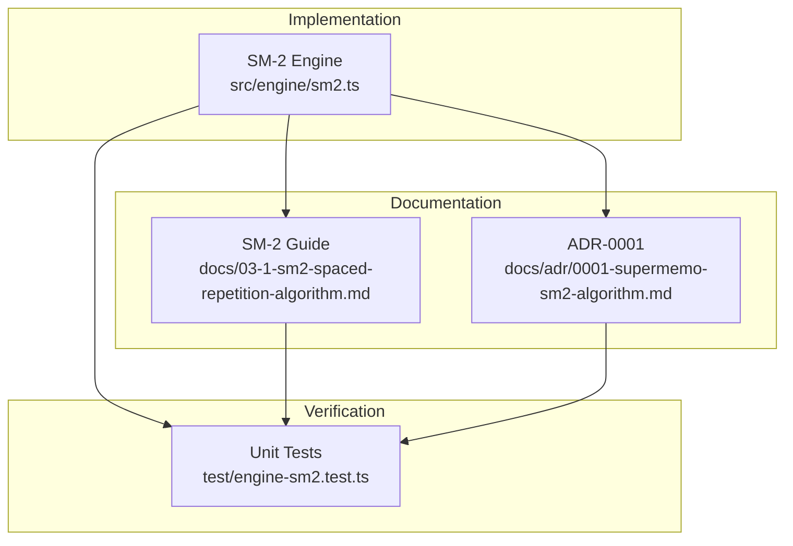
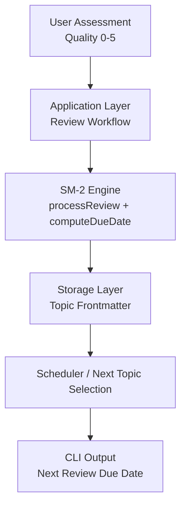
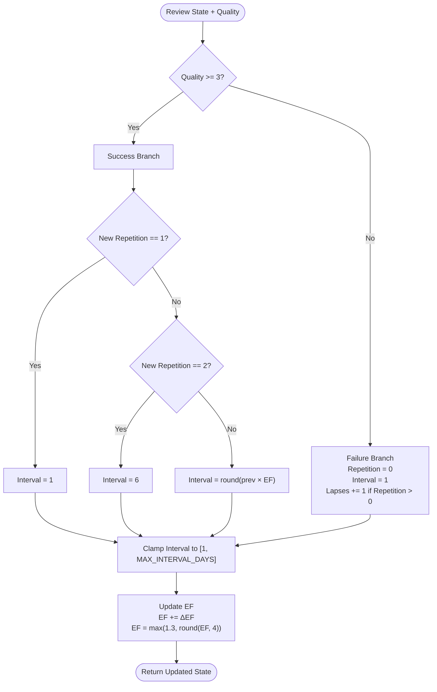
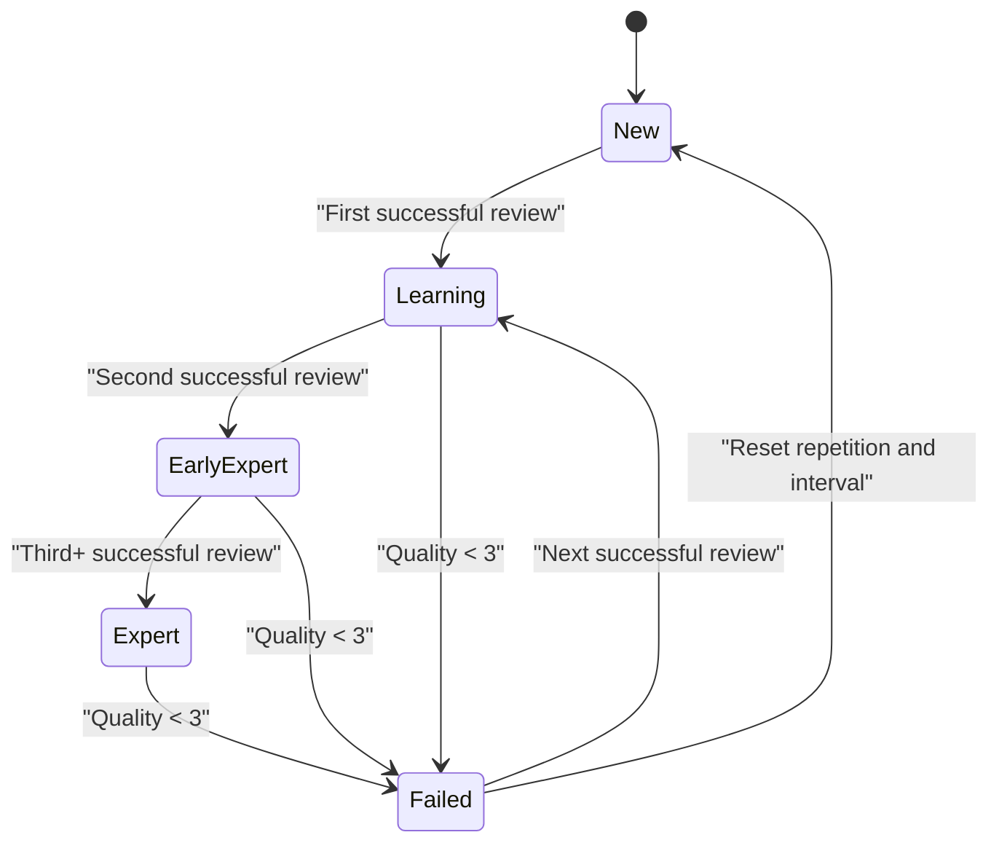
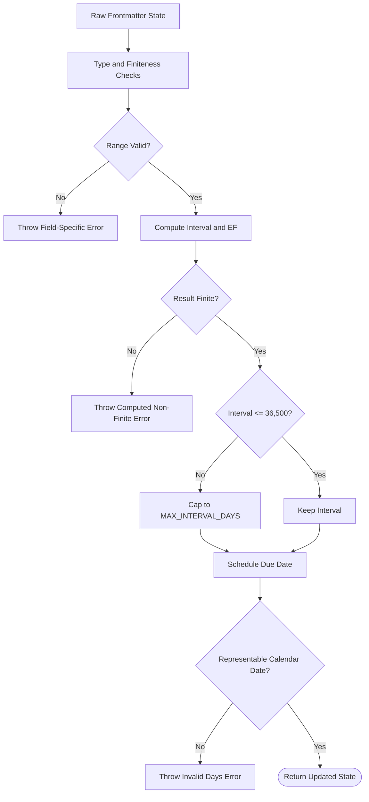
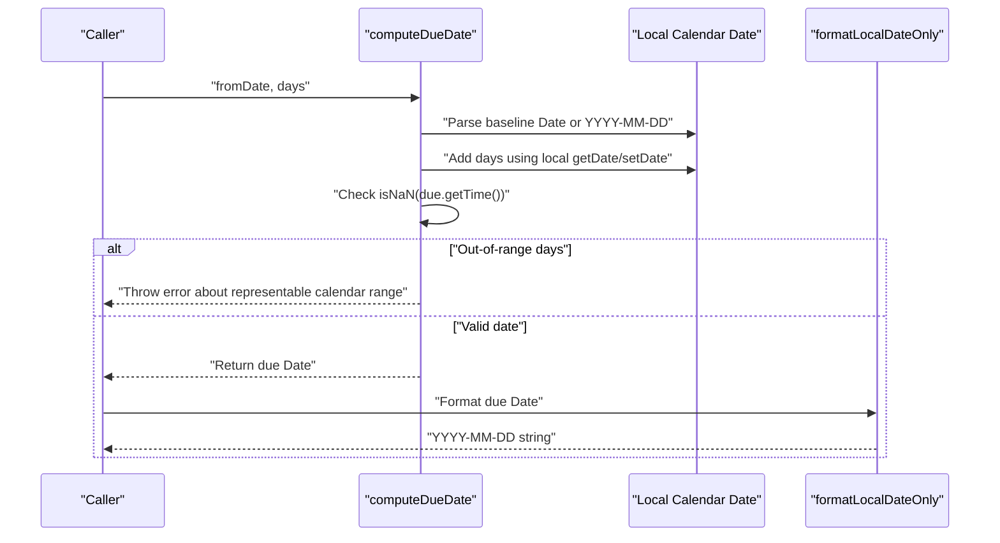
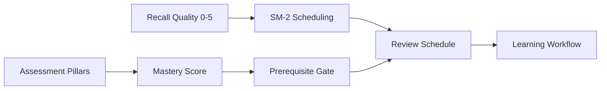
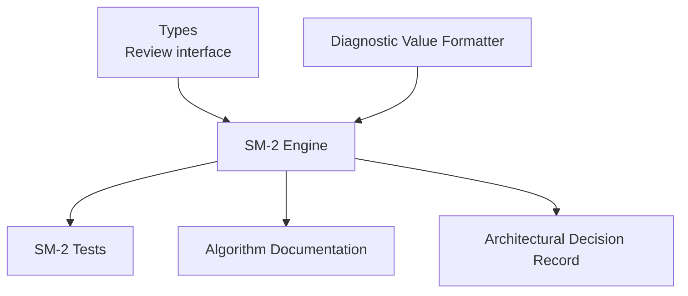

# SM-2 Spaced Repetition Algorithm

::: details Referenced Files in This Document

- [sm2.ts](https://github.com/Kuldeep2822k/cli/blob/main/src/engine/sm2.ts)
- [03-1-sm2-spaced-repetition-algorithm.md](https://github.com/Kuldeep2822k/cli/blob/main/docs/03-1-sm2-spaced-repetition-algorithm.md)
- [0001-supermemo-sm2-algorithm.md](https://github.com/Kuldeep2822k/cli/blob/main/docs/adr/0001-supermemo-sm2-algorithm.md)
- [engine-sm2.test.ts](https://github.com/Kuldeep2822k/cli/blob/main/test/engine-sm2.test.ts)

:::

## Table of Contents
1. [Introduction](#introduction)
2. [Project Structure](#project-structure)
3. [Core Components](#core-components)
4. [Architecture Overview](#architecture-overview)
5. [Detailed Component Analysis](#detailed-component-analysis)
6. [Dependency Analysis](#dependency-analysis)
7. [Performance Considerations](#performance-considerations)
8. [Troubleshooting Guide](#troubleshooting-guide)
9. [Conclusion](#conclusion)
10. [Appendices](#appendices)

## Introduction
This document explains the SuperMemo SM-2 spaced repetition implementation used by the project. It covers the mathematical formulas for interval expansion and ease factor adjustment, the review lifecycle from new topics through expert-level intervals, scheduling state transitions, boundary conditions, date handling, and how the algorithm integrates with the broader mastery system. The goal is to make the implementation understandable for both developers extending the scheduler and non-technical readers who want to understand why reviews are scheduled when they are.

The SM-2 engine is a deterministic, pure-function scheduling module. It does not perform file I/O directly; it transforms stored review state into updated state and due dates. This design makes the algorithm easy to test, reproduce, and reason about.

## Project Structure
The SM-2 implementation lives under the engine layer and is supported by documentation and tests:

- Implementation: `src/engine/sm2.ts`
- Conceptual documentation: `docs/03-1-sm2-spaced-repetition-algorithm.md`
- Architectural decision record: `docs/adr/0001-supermemo-sm2-algorithm.md`
- Unit tests: `test/engine-sm2.test.ts`

**Diagram sources**
- [sm2.ts:1-306](https://github.com/Kuldeep2822k/cli/blob/main/src/engine/sm2.ts#L1-L306)
- [03-1-sm2-spaced-repetition-algorithm.md:1-330](https://github.com/Kuldeep2822k/cli/blob/main/docs/03-1-sm2-spaced-repetition-algorithm.md#L1-L330)
- [0001-supermemo-sm2-algorithm.md:1-63](https://github.com/Kuldeep2822k/cli/blob/main/docs/adr/0001-supermemo-sm2-algorithm.md#L1-L63)
- [engine-sm2.test.ts:1-442](https://github.com/Kuldeep2822k/cli/blob/main/test/engine-sm2.test.ts#L1-L442)

**Section sources**
- [sm2.ts:1-306](https://github.com/Kuldeep2822k/cli/blob/main/src/engine/sm2.ts#L1-L306)
- [03-1-sm2-spaced-repetition-algorithm.md:1-330](https://github.com/Kuldeep2822k/cli/blob/main/docs/03-1-sm2-spaced-repetition-algorithm.md#L1-L330)
- [0001-supermemo-sm2-algorithm.md:1-63](https://github.com/Kuldeep2822k/cli/blob/main/docs/adr/0001-supermemo-sm2-algorithm.md#L1-L63)
- [engine-sm2.test.ts:1-442](https://github.com/Kuldeep2822k/cli/blob/main/test/engine-sm2.test.ts#L1-L442)

## Core Components
The SM-2 module exposes several focused pieces:

| Component | Purpose | Key Behavior |
|---|---|---|
| `calculateEaseFactorDelta(quality)` | Computes the SM-2 delta adjustment based on recall quality | Returns a fixed delta for integer qualities 0–5; throws for invalid inputs |
| `roundHalfUp(value, decimals)` | Rounds floating-point values using positive decimal half-up rounding | Used to stabilize EF precision at four decimal places |
| `processReview(current, quality)` | Main state transition function | Validates inputs, updates repetition, interval, lapses, ease factor, and last quality |
| `formatLocalDateOnly(date)` | Formats a JavaScript `Date` as a local `YYYY-MM-DD` string | Zero-pads month and day |
| `computeDueDate(fromDate, days)` | Advances a local calendar day baseline by an interval | Accepts a `Date` or a strict `YYYY-MM-DD` string; refuses out-of-range day counts |
| `MAX_INTERVAL_DAYS` | Scheduling policy cap | Fixed at 36,500 days (100 years) |

The public API surface exported by the module includes all of these functions plus the interval ceiling constant.

**Section sources**
- [sm2.ts:1-306](https://github.com/Kuldeep2822k/cli/blob/main/src/engine/sm2.ts#L1-L306)

## Architecture Overview
At a high level, the SM-2 engine sits between the application layer and persistent storage:

This separation keeps SM-2 free of I/O concerns. The engine receives raw review state and produces updated state plus due-date helpers. Validation and persistence are handled outside the pure algorithm.

**Diagram sources**
- [sm2.ts:1-306](https://github.com/Kuldeep2822k/cli/blob/main/src/engine/sm2.ts#L1-L306)
- [03-1-sm2-spaced-repetition-algorithm.md:1-330](https://github.com/Kuldeep2822k/cli/blob/main/docs/03-1-sm2-spaced-repetition-algorithm.md#L1-L330)

## Detailed Component Analysis

### Mathematical Foundations

#### Ease Factor Adjustment
The SM-2 algorithm adjusts the topic’s Ease Factor after every review. The implementation uses the canonical formula:

ΔEF = 0.1 − (5 − q) × (0.08 + (5 − q) × 0.02)

where `q` is the review quality rating from 0 to 5.

| Quality `q` | Qualitative Meaning | ΔEF | Effect |
|---|---|---:|---|
| 5 | Perfect response | +0.10 | EF increases |
| 4 | Correct after hesitation | 0.00 | EF unchanged before clamping |
| 3 | Correct but difficult | −0.14 | EF decreases slightly |
| 2 | Incorrect; answer seemed easy | −0.32 | EF decreases |
| 1 | Incorrect; familiar but unable to recall | −0.54 | EF decreases more |
| 0 | Complete blackout | −0.80 | EF decreases strongly |

The resulting EF is clamped to a minimum of 1.3 and rounded to four decimal places using positive decimal half-up rounding.

**Section sources**
- [sm2.ts:19-70](https://github.com/Kuldeep2822k/cli/blob/main/src/engine/sm2.ts#L19-L70)
- [sm2.ts:160-177](https://github.com/Kuldeep2822k/cli/blob/main/src/engine/sm2.ts#L160-L177)
- [03-1-sm2-spaced-repetition-algorithm.md:44-65](https://github.com/Kuldeep2822k/cli/blob/main/docs/03-1-sm2-spaced-repetition-algorithm.md#L44-L65)
- [0001-supermemo-sm2-algorithm.md:14-29](https://github.com/Kuldeep2822k/cli/blob/main/docs/adr/0001-supermemo-sm2-algorithm.md#L14-L29)

#### Interval Calculation Formula
For successful reviews (`q >= 3`), the next interval depends on the repetition count:

- Repetition 1: 1 day
- Repetition 2: 6 days
- Repetition 3 and later: `Math.round(previous_interval × ease_factor)`

For failed reviews (`q < 3`):

- Repetition resets to 0
- Interval resets to 1 day
- Lapses increment only if the topic had prior repetitions

Every computed interval is enforced to be at least 1 day and at most `MAX_INTERVAL_DAYS`.

**Diagram sources**
- [sm2.ts:71-177](https://github.com/Kuldeep2822k/cli/blob/main/src/engine/sm2.ts#L71-L177)
- [sm2.ts:179-210](https://github.com/Kuldeep2822k/cli/blob/main/src/engine/sm2.ts#L179-L210)

**Section sources**
- [sm2.ts:71-210](https://github.com/Kuldeep2822k/cli/blob/main/src/engine/sm2.ts#L71-L210)
- [03-1-sm2-spaced-repetition-algorithm.md:67-123](https://github.com/Kuldeep2822k/cli/blob/main/docs/03-1-sm2-spaced-repetition-algorithm.md#L67-L123)

### Review Lifecycle

The SM-2 lifecycle moves a topic through states defined by its stored fields:

| State Transition | Trigger | Result |
|---|---|---|
| New topic | No prior meaningful repetition | First successful review sets repetition to 1 and interval to 1 day |
| Early learning | Second successful review | Sets interval to 6 days |
| Graduated review | Third or later successful review | Multiplies previous interval by EF |
| Lapse | Quality below 3 | Resets repetition to 0 and interval to 1 day; increments lapse counter if previously learned |
| Expert interval | Repeated successful reviews | Interval grows according to EF until capped at 100 years |

The assessment score-to-multiplier relationship is therefore indirect: scores control EF through ΔEF, and EF controls interval growth. High-quality scores increase EF and thus accelerate interval growth; low-quality scores decrease EF and reset progress toward longer intervals.

**Diagram sources**
- [sm2.ts:71-177](https://github.com/Kuldeep2822k/cli/blob/main/src/engine/sm2.ts#L71-L177)
- [engine-sm2.test.ts:247-289](https://github.com/Kuldeep2822k/cli/blob/main/test/engine-sm2.test.ts#L247-L289)

**Section sources**
- [sm2.ts:71-210](https://github.com/Kuldeep2822k/cli/blob/main/src/engine/sm2.ts#L71-L210)
- [engine-sm2.test.ts:247-289](https://github.com/Kuldeep2822k/cli/blob/main/test/engine-sm2.test.ts#L247-L289)

### Edge Cases and Boundary Conditions

#### Minimum and Maximum Interval Bounds
- Minimum interval: 1 day.
- Maximum interval: 36,500 days, which is a scheduling policy cap rather than the JavaScript `Date` representable range.
- If a caller bypasses the cap, `computeDueDate` refuses day counts that would produce an invalid calendar date.

#### Zero-Score Handling
A zero-score review is treated as a failure:
- Repetition resets to 0.
- Interval resets to 1 day.
- Lapses increment if the topic had prior repetitions.
- EF is reduced by −0.80 before clamping to 1.3.

#### Non-Numeric and Corrupt Stored Values
Because frontmatter values can arrive untyped, the engine validates types explicitly:
- Strings, booleans, `NaN`, and `Infinity` are rejected.
- Integer-only counters such as repetition and lapses reject fractional values.
- Safe-integer overflow is checked before incrementing repetition or lapses.
- Errors include the field name and diagnostic value so callers can suggest repair commands.

#### Overflow and Infinity Defense
Even though inputs are finite, arithmetic can become non-finite:
- A very large interval multiplied by EF can overflow to `Infinity`.
- Rounding an extremely large EF by scaling up by 10⁴ can also overflow.
- In those cases, the engine throws rather than persisting corrupted numeric state.

**Diagram sources**
- [sm2.ts:71-210](https://github.com/Kuldeep2822k/cli/blob/main/src/engine/sm2.ts#L71-L210)
- [sm2.ts:212-306](https://github.com/Kuldeep2822k/cli/blob/main/src/engine/sm2.ts#L212-L306)
- [engine-sm2.test.ts:1-120](https://github.com/Kuldeep2822k/cli/blob/main/test/engine-sm2.test.ts#L1-L120)

**Section sources**
- [sm2.ts:71-210](https://github.com/Kuldeep2822k/cli/blob/main/src/engine/sm2.ts#L71-L210)
- [sm2.ts:212-306](https://github.com/Kuldeep2822k/cli/blob/main/src/engine/sm2.ts#L212-L306)
- [engine-sm2.test.ts:1-120](https://github.com/Kuldeep2822k/cli/blob/main/test/engine-sm2.test.ts#L1-L120)
- [engine-sm2.test.ts:201-246](https://github.com/Kuldeep2822k/cli/blob/main/test/engine-sm2.test.ts#L201-L246)
- [engine-sm2.test.ts:401-442](https://github.com/Kuldeep2822k/cli/blob/main/test/engine-sm2.test.ts#L401-L442)

### Date Scheduling and DST Safety
Due dates are calculated by advancing calendar days locally:

- Accepts a `Date` object or a strict `YYYY-MM-DD` string.
- Uses local timezone arithmetic via `setDate`, avoiding UTC millisecond drift across Daylight Saving Time boundaries.
- Serializes dates as `YYYY-MM-DD` strings.
- Refuses day counts that would exceed the representable calendar range.

**Diagram sources**
- [sm2.ts:212-306](https://github.com/Kuldeep2822k/cli/blob/main/src/engine/sm2.ts#L212-L306)
- [engine-sm2.test.ts:291-399](https://github.com/Kuldeep2822k/cli/blob/main/test/engine-sm2.test.ts#L291-L399)

**Section sources**
- [sm2.ts:212-306](https://github.com/Kuldeep2822k/cli/blob/main/src/engine/sm2.ts#L212-L306)
- [engine-sm2.test.ts:291-399](https://github.com/Kuldeep2822k/cli/blob/main/test/engine-sm2.test.ts#L291-L399)

### Integration with the Mastery System
SM-2 measures retention over time, while the mastery system evaluates multi-dimensional competence. The conceptual guide documents two complementary engines:

- SM-2 handles interval scheduling, EF adjustments, and lapse tracking.
- Mastery evaluates conceptual, practical, debugging, and Feynman articulation dimensions.

Mastery outcomes influence curriculum progression and prerequisite gating, while SM-2 determines when a topic should be reviewed. Together, they form a retention-and-comprehension pipeline: mastery gates whether a topic is ready for advancement, and SM-2 schedules how often it should be revisited.

**Diagram sources**
- [03-1-sm2-spaced-repetition-algorithm.md:1-330](https://github.com/Kuldeep2822k/cli/blob/main/docs/03-1-sm2-spaced-repetition-algorithm.md#L1-L330)

**Section sources**
- [03-1-sm2-spaced-repetition-algorithm.md:1-330](https://github.com/Kuldeep2822k/cli/blob/main/docs/03-1-sm2-spaced-repetition-algorithm.md#L1-L330)

## Dependency Analysis
The SM-2 module has minimal external dependencies:

- Imports the `Review` type shape.
- Uses a diagnostic formatter to safely describe corrupt values in error messages.
- Exposes constants and functions consumed by higher layers.

**Diagram sources**
- [sm2.ts:1-306](https://github.com/Kuldeep2822k/cli/blob/main/src/engine/sm2.ts#L1-L306)
- [03-1-sm2-spaced-repetition-algorithm.md:1-330](https://github.com/Kuldeep2822k/cli/blob/main/docs/03-1-sm2-spaced-repetition-algorithm.md#L1-L330)
- [0001-supermemo-sm2-algorithm.md:1-63](https://github.com/Kuldeep2822k/cli/blob/main/docs/adr/0001-supermemo-sm2-algorithm.md#L1-L63)
- [engine-sm2.test.ts:1-442](https://github.com/Kuldeep2822k/cli/blob/main/test/engine-sm2.test.ts#L1-L442)

**Section sources**
- [sm2.ts:1-306](https://github.com/Kuldeep2822k/cli/blob/main/src/engine/sm2.ts#L1-L306)

## Performance Considerations
The SM-2 algorithm is intentionally lightweight:

- Each review is processed in constant time.
- There are no loops over topics inside the core calculation.
- The interval cap prevents exponential growth from producing astronomically large numbers.
- Date arithmetic is local and scalar.

For large-scale scheduling operations across many topics:

- Batch calls to `processReview` remain O(n) with a small constant factor.
- Avoid repeatedly reprocessing the same note without changing quality; cache results where appropriate.
- Be cautious with precomputed intervals near `Number.MAX_VALUE`; the engine rejects non-finite results rather than silently corrupting them.
- Use the exported `MAX_INTERVAL_DAYS` constant in tests and integration logic to keep behavior consistent with the implementation.

## Troubleshooting Guide

### Common Error Messages and Causes

| Error Pattern | Likely Cause | Recommended Fix |
|---|---|---|
| `Invalid quality: must be an integer 0-5` | User input or automation passed a non-integer or out-of-range score | Validate assessment input before calling `processReview` |
| `Invalid ease_factor: must be a finite number >= 1.3` | Stored EF is too low, non-numeric, `NaN`, or `Infinity` | Repair frontmatter or run validation repair |
| `Invalid interval_days: must be a finite number >= 1` | Stored interval is non-numeric, negative, zero, `NaN`, or `Infinity` | Repair frontmatter or run validation repair |
| `Invalid repetition: must be a non-negative integer` | Stored repetition is fractional, negative, or non-numeric | Repair frontmatter or run validation repair |
| `Invalid lapses: must be a non-negative integer` | Stored lapses is fractional, negative, or non-numeric | Repair frontmatter or run validation repair |
| `Invalid lapses: must be an integer >= 0 and <= ...` | Lapses is at or above the safe-integer limit and would overflow on increment | Reset or repair lapses in the affected topic |
| `Invalid interval_days: computed non-finite value` | Interval multiplied by EF overflowed | Repair corrupt interval history |
| `Invalid ease_factor: computed non-finite value` | EF rounding scaled an extremely large value to infinity | Repair corrupt EF history |
| `Invalid days: advancing the due date... leaves the representable calendar range` | Caller passed an excessively large day count to `computeDueDate` | Use normal SM-2 output instead of arbitrary day counts |

### Debugging Strategy

1. Inspect the failing topic’s stored review fields.
2. Confirm that quality is an integer 0–5.
3. Confirm that EF is a finite number ≥ 1.3.
4. Confirm that interval, repetition, and lapses are finite integers with expected lower bounds.
5. If corruption exists, use the application’s validation repair flow rather than manually editing values.
6. For schedule anomalies, simulate the review sequence using `processReview` and compare intermediate states.

**Section sources**
- [sm2.ts:71-210](https://github.com/Kuldeep2822k/cli/blob/main/src/engine/sm2.ts#L71-L210)
- [sm2.ts:212-306](https://github.com/Kuldeep2822k/cli/blob/main/src/engine/sm2.ts#L212-L306)
- [engine-sm2.test.ts:1-120](https://github.com/Kuldeep2822k/cli/blob/main/test/engine-sm2.test.ts#L1-L120)
- [engine-sm2.test.ts:201-246](https://github.com/Kuldeep2822k/cli/blob/main/test/engine-sm2.test.ts#L201-L246)
- [engine-sm2.test.ts:401-442](https://github.com/Kuldeep2822k/cli/blob/main/test/engine-sm2.test.ts#L401-L442)

## Conclusion
The SM-2 implementation follows the canonical SuperMemo algorithm with clear safety boundaries. It separates pure scheduling math from I/O, validates untrusted stored state aggressively, caps intervals at a 100-year policy limit, and handles calendar dates safely across local timezones. Its tests cover normal transitions, edge cases, numeric safety, interval saturation, and date range protection. Together with the mastery system, SM-2 provides a robust foundation for adaptive, long-term retention in a Markdown-based learning workflow.

## Appendices

### API Reference Summary

| Export | Parameters | Returns | Notes |
|---|---|---|---|
| `calculateEaseFactorDelta` | `quality: number` | `number` | Throws for non-integer 0–5 quality |
| `roundHalfUp` | `value: number`, `decimals: number` | `number` | Positive decimal half-up rounding |
| `processReview` | `current`, `quality: number` | `Partial<Review>` | Validates inputs, computes next state |
| `formatLocalDateOnly` | `date: Date` | `string` | Local `YYYY-MM-DD` format |
| `computeDueDate` | `fromDate`, `days: number` | `Date` | Local calendar arithmetic with range checks |
| `MAX_INTERVAL_DAYS` | Constant | `number` | 36,500 days |

**Section sources**
- [sm2.ts:1-306](https://github.com/Kuldeep2822k/cli/blob/main/src/engine/sm2.ts#L1-L306)

### Example Test Approaches

Recommended test categories for algorithmic correctness:

1. **Quality validation**: Negative, fractional, and out-of-range qualities.
2. **State validation**: Non-numeric, NaN, Infinity, fractional, negative, and unsafe-integer values for EF, interval, repetition, and lapses.
3. **Success transitions**: Repetition 0→1, 1→2, and n≥3.
4. **Failure transitions**: Lapse counting only when prior repetitions exist.
5. **EF precision**: Four-decimal rounding and 1.3 floor.
6. **Interval cap**: Long histories do not exceed 36,500 days.
7. **Date safety**: Local date addition, YYYY-MM-DD parsing, and out-of-range rejection.
8. **End-to-end simulation**: Repeatedly applying `processReview` and verifying that `due_at` remains a valid calendar string.

These patterns are already covered extensively in the SM-2 unit tests.

**Section sources**
- [engine-sm2.test.ts:1-442](https://github.com/Kuldeep2822k/cli/blob/main/test/engine-sm2.test.ts#L1-L442)
