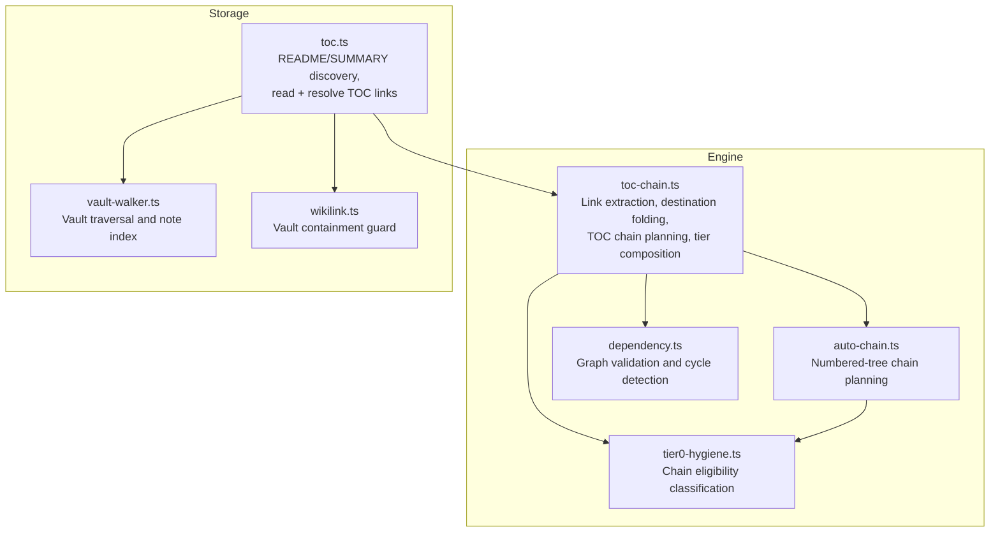
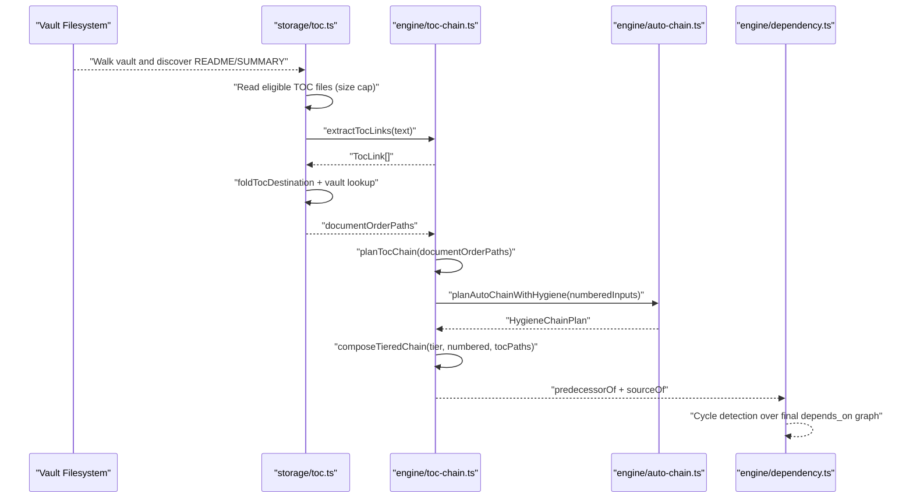
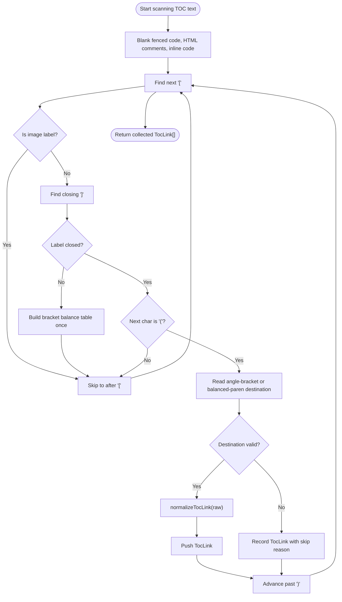
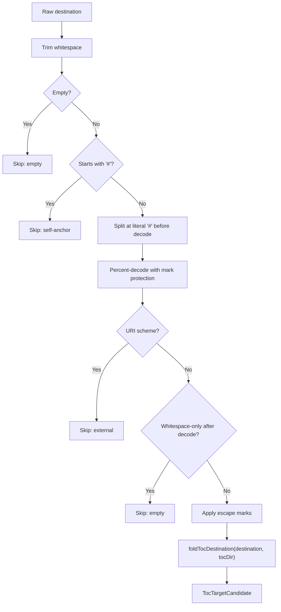
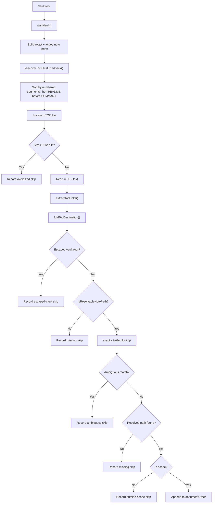
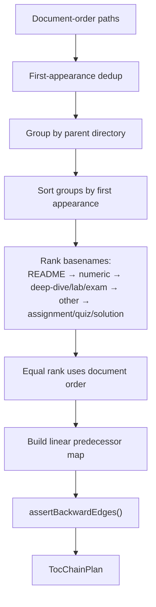
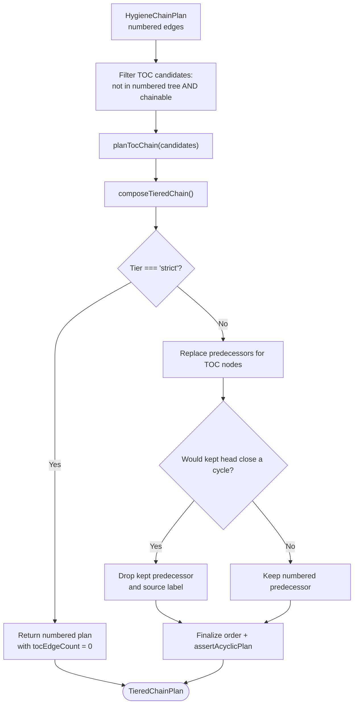
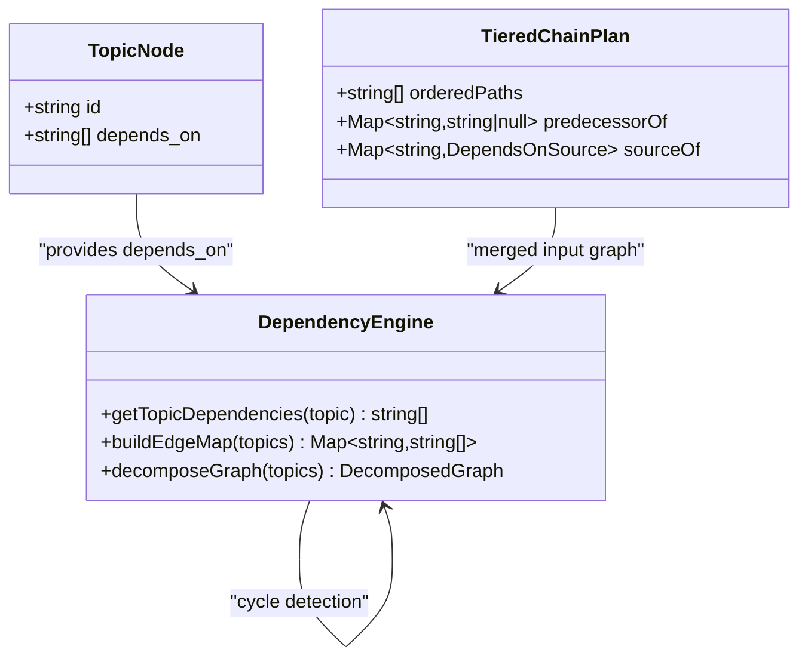
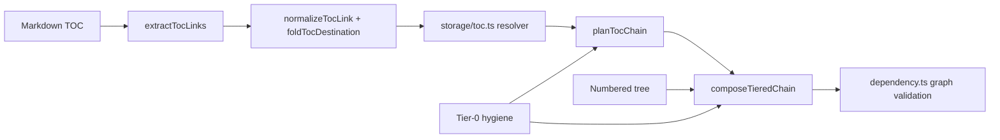

# Table of Contents Chain Processing

::: details Referenced Files in This Document

- [toc-chain.ts](https://github.com/Kuldeep2822k/cli/blob/main/src/engine/toc-chain.ts)
- [auto-chain.ts](https://github.com/Kuldeep2822k/cli/blob/main/src/engine/auto-chain.ts)
- [tier0-hygiene.ts](https://github.com/Kuldeep2822k/cli/blob/main/src/engine/tier0-hygiene.ts)
- [dependency.ts](https://github.com/Kuldeep2822k/cli/blob/main/src/engine/dependency.ts)
- [toc.ts](https://github.com/Kuldeep2822k/cli/blob/main/src/storage/toc.ts)
- [vault-walker.ts](https://github.com/Kuldeep2822k/cli/blob/main/src/storage/vault-walker.ts)
- [wikilink.ts](https://github.com/Kuldeep2822k/cli/blob/main/src/storage/wikilink.ts)
- [engine-toc-chain.test.ts](https://github.com/Kuldeep2822k/cli/blob/main/test/engine-toc-chain.test.ts)

:::

## Table of Contents
1. [Introduction](#introduction)
2. [Project Structure](#project-structure)
3. [Core Components](#core-components)
4. [Architecture Overview](#architecture-overview)
5. [Detailed Component Analysis](#detailed-component-analysis)
6. [Dependency Analysis](#dependency-analysis)
7. [Performance Considerations](#performance-considerations)
8. [Troubleshooting Guide](#troubleshooting-guide)
9. [Conclusion](#conclusion)

## Introduction
This document explains the TOC chain processing system that turns table-of-contents links into hierarchical topic dependencies. The system has two layers:

- **Engine layer**: Pure, filesystem-free logic for parsing markdown links, normalizing destinations, planning a linear chain from author-provided order, and merging that chain with the numbered directory layout.
- **Storage layer**: Filesystem-aware discovery of README/SUMMARY files, reading their content, resolving link targets against the vault, and collecting skipped-link diagnostics.

The pipeline transforms raw markdown TOCs into dependency edges while preserving intentional lesson ordering, respecting manual prerequisite declarations through later validation, and handling malformed inputs, circular references, and conflicts between TOC-derived and explicit dependencies.

## Project Structure
The relevant code is split across engine and storage modules:

## Core Components
| Component | Responsibility | Key Outputs |
|---|---|---|
| `extractTocLinks` | Scans one TOC document and extracts inline markdown link destinations in document order | Array of `TocLink` objects |
| `foldTocDestination` | Converts a parsed destination into a vault-relative path candidate | `TocTargetCandidate` |
| `planTocChain` | Deduplicates, groups by directory, applies same-directory ranking, and produces a linear predecessor map | `TocChainPlan` |
| `composeTieredChain` | Merges numbered-tree edges and TOC edges under strict/full tiers | `TieredChainPlan` |
| `discoverTocFiles` | Finds README/SUMMARY files eligible as enumeration sources | Ordered list of vault-relative paths |
| `deriveTocEnumeration` | Reads eligible TOC documents and resolves links to real notes | `TocEnumeration` |
| `assertBackwardEdges` / `assertAcyclicPlan` | Invariants checking for constructed TOC chains and merged plans | Throws on violations |

## Architecture Overview
The full TOC-to-dependency transformation proceeds through these stages:

## Detailed Component Analysis

### Markdown Link Extraction
`extractTocLinks` converts raw markdown text into an ordered list of `TocLink` records. It supports:

- `[label](path)`
- `[label](<angle bracket path>)`
- Paths with titles, trailing slashes, `%XX` escapes, and `#anchor` fragments
- Fenced code blocks, HTML comments, and inline code spans are ignored so documentation examples do not become unintended prerequisites
- Images, reference-style tails, self-anchors, external schemes, malformed percent escapes, and unescaped spaces in bare destinations are skipped rather than aborting the scan

Important design points:

- The scanner counts operations through `TocScanStats`, enabling deterministic complexity assertions.
- Bracket balance tables avoid quadratic rescans when labels or destinations cannot close.
- Angle-bracket destinations have a separate closer table because their closing rule differs from plain paren depth.
- Malformed or skip reasons are preserved as structured metadata instead of throwing.

### Destination Normalization
After extracting a raw destination, the engine normalizes it before filesystem lookup:

1. Trim whitespace.
2. Reject empty destinations and self-anchors.
3. Split fragment at literal `#` before percent-decoding, so `%23` stays a path character.
4. Percent-decode protected runs; reject malformed percent escapes.
5. Reject URI schemes and whitespace-only results.
6. Apply escape marks (`\#`, `\%`, `\\`) back to data.
7. Fold relative to the TOC file’s directory, handle absolute vault-root paths, lexical `..` folding, folder links, missing `.md` extensions, and backslash literals.

### TOC Discovery and Resolution
The storage module finds and reads repository-level enumerations:

- Eligible TOC files are README/SUMMARY at the vault root and inside visible non-phase directories.
- Phase subtrees and Tier-0 excluded notes are skipped.
- Each TOC document is stat-checked against a 512 KiB size limit before reading.
- Links are resolved against the vault index using exact-case and case-folded lookup.
- Folder links without trailing slashes can fall back to `<dir>/README.md`.
- Ambiguous matches, missing notes, escaped-vault paths, invisible namespaces, and out-of-scope targets are recorded as skipped links rather than failing the whole run.

### TOC Ranking Algorithm
The TOC ranking algorithm determines precedence within a single directory’s author-enumerated list:

1. First-appearance deduplication preserves the author’s initial mention.
2. Grouping keeps all entries from the same directory together, in first-appearance directory order.
3. Same-directory ranking follows this intent hierarchy:
   - Rank 0: README-class files (`README`, `SUMMARY`).
   - Rank 1: Numeric prefixes, sorted by number.
   - Rank 2: Pedagogical phases `deep-dive`, `lab`, `exam`, in that order.
   - Rank 3: Other documents, keeping original document order.
   - Rank 4: Assignment-like files (`assignment`, `quiz`, `solution`) placed last so they never gate preceding lessons.
4. Within equal rank and phase, document order is preserved.
5. A linear predecessor map is built where every node points to its predecessor, except the chain head.
6. `assertBackwardEdges` enforces that every predecessor appears strictly earlier in the ordered list.

### Numbered Tree Integration and Composition
The TOC chain does not replace the numbered directory layout. Instead, the two systems compose under a tier strategy:

| Tier | Behavior |
|---|---|
| `strict` | Uses only numbered-tree edges. TOC enumeration is analyzed but contributes no edges. |
| `full` | Adds TOC-derived edges for notes outside the numbered tree, while preserving numbering dominance for numbered-tree nodes. |

Key composition rules:

- **C2 numbering dominance**: Notes whose path or basename carries a numeric prefix are never assigned a TOC edge.
- **Replacement semantics**: For non-head TOC candidates, the TOC predecessor replaces the numbered predecessor.
- **Head safety**: If making a TOC chain head would keep a numbered edge that closes a cycle through unlisted numbered notes, the head opens the chain by dropping that kept edge.
- **Provenance labeling**: Edges are labeled `numbered`, `tie`, or `toc` so downstream tools can distinguish structural ordering from author enumeration.
- **Alphabetical claims**: The hygiene plan’s alphabetical fallback warnings are recomposed after composition so notes placed by the TOC are no longer reported as alphabetically chained.

### Manual Prerequisite Declarations
Manual prerequisites live outside the TOC pipeline but interact with it through the broader dependency graph:

- The dependency engine reads canonical `depends_on` identifiers from topic nodes.
- Explicit dependencies are converted into directed edges.
- Cycle detection validates the final graph.
- TOC-derived edges are subject to the same graph-level cycle checks after composition.
- Provenance labels (`numbered`, `tie`, `toc`) allow downstream gating rules to treat advisory or inferred edges differently from hard, explicitly declared dependencies.

## Dependency Analysis
The TOC chain participates in a layered dependency model:

Coupling observations:

- The engine layer remains filesystem-free and consumes normalized path lists.
- The storage layer owns vault traversal, file I/O, and existence checks.
- Tier-0 hygiene controls which notes participate in chain construction.
- The dependency engine validates the final graph rather than trusting any single planner.

## Performance Considerations
The implementation is explicitly optimized for large repositories and pathological markdown:

| Area | Complexity Strategy |
|---|---|
| Link scanning | Linear operation counting via `TocScanStats`; quadratic rescans guarded by bracket-balance and angle-closer tables |
| Large TOC files | 512 KiB read cap; oversized files are declined and counted rather than parsed |
| Directory planning | Single pass grouping and sorting by parent directory first appearance |
| Chain verification | `assertBackwardEdges` is O(n); `assertAcyclicPlan` is O(n) per predecessor walk with memoization |
| Graph validation | Johnson-style SCC decomposition and bounded cycle enumeration |
| Vault indexing | One pass builds exact and folded note maps for O(1)/O(k) lookups |

Practical implications:

- A malformed TOC should cost approximately its own size plus constant overhead, not stall the entire adoption run.
- Large README files are rejected early to bound both I/O and parsing time.
- The linear growth tests assert that quadratically regressed scanners are caught deterministically by operation counts rather than wall-clock timing.
- Graph algorithms are designed around strongly connected components and bounded sampling to avoid exponential explosion on large cyclic graphs.

## Troubleshooting Guide

### Malformed TOC Entries
Symptoms include links that disappear from the chain or appear as skipped diagnostics.

Common causes:

| Symptom | Likely Cause | Resolution |
|---|---|---|
| Link becomes `malformed` | Invalid `%XX` percent escape | Fix percent encoding in the TOC |
| Link becomes `unescaped-space` | Bare destination contains an unescaped space | Use `<angle brackets>` or `%20` |
| Link becomes `external` | Destination starts with a URI scheme | Use a vault-relative path |
| Link becomes `self-anchor` | Destination is only a `#fragment` | Remove or point to a note |
| Link becomes `empty` | Destination trims to nothing | Add a valid target |
| Link becomes `missing` | Target does not exist or is invisible | Create the note or fix the path |
| Link becomes `ambiguous` | Case-insensitive match resolves to multiple notes | Disambiguate by exact path |
| Link becomes `outside-scope` | Target is outside the adopted scope | Adjust scope or move the note |

### Circular References
There are two important failure modes:

1. **TOC chain invariant violation**: Occurs if a constructed TOC chain has a predecessor that is not strictly earlier. This should not happen in normal flow because the chain is built as a linear forward walk.
2. **Merged plan cycle**: Occurs after composing numbered and TOC edges. The composition logic drops unsafe kept heads, but graph-level validation still reports remaining cycles.

Resolution steps:

- Inspect `assertBackwardEdges` errors to find broken TOC construction assumptions.
- Inspect `assertAcyclicPlan` errors to find merged-cycle cases.
- Check whether a partial TOC enumeration re-parented a numbered head and closed a loop through unlisted numbered notes.
- Prefer fixing manual `depends_on` declarations when the conflict involves explicit prerequisites.

### Conflicts Between TOC-Derived and Explicit Dependencies
TOC-derived edges represent inferred lesson order, while explicit `depends_on` declarations represent author-mandated prerequisites.

Guidance:

- TOC edges are useful for ordering curriculum structure but may be weaker than explicit prerequisites.
- Provenance labels (`toc`, `numbered`, `tie`) help downstream gates decide whether to block learning progression.
- When a TOC edge contradicts an explicit dependency, validate the graph at the dependency-engine level rather than assuming TOC parsing is authoritative.
- Use `strict` mode when you want only numbered-tree structure and rely more heavily on explicit declarations.

### Examples of TOC-to-Dependency Transformation

#### Example 1: Simple Module README
Input concept:

- README lists `intro`, then `setup`.

Transformation:

- `extractTocLinks` parses two links.
- `foldTocDestination` normalizes them to vault-relative paths.
- `planTocChain` deduplicates and orders them.
- `setup` receives `intro` as its predecessor.
- Edge provenance is `toc`.

#### Example 2: Folder Link
Input concept:

- README links to a folder path without a trailing slash.

Transformation:

- Storage folds folder path to `<folder>/README.md`.
- If only the directory exists, the resolver tries the README fallback.
- If ambiguous or missing, the link is skipped with a diagnostic.

#### Example 3: Numbered Tree vs README Conflict
Input concept:

- Numbered layout says lesson 01 precedes lesson 02.
- README lists lesson 02 before lesson 01.

Transformation:

- Lesson 01 and 02 are inside the numbered tree.
- C2 filtering prevents TOC from overriding their predecessor.
- Numbered provenance wins.

## Conclusion
The TOC chain processing system is a carefully bounded pipeline:

- The engine layer extracts and normalizes markdown links without touching the filesystem.
- The storage layer discovers README/SUMMARY files, reads them safely, and resolves targets against the vault.
- The ranking algorithm respects author intent through README-first, numeric-first, pedagogical-phase ordering, and assignment-last placement.
- The numbered tree retains authority over numbered-tree nodes, while TOC ordering improves the structure of unnumbered material.
- Malformed inputs are fail-closed and diagnosed rather than fatal.
- Circular references are detected both during construction and during graph validation.
- Performance is constrained through operation-counting guards, size caps, linear scans, and efficient graph algorithms.

For maintainers, the most important invariants are:

- TOC link extraction must remain linear in document size.
- TOC chains must be backward-edge acyclic by construction.
- Merged plans must be globally acyclic.
- Numbering dominance must preserve numbered-tree ordering.
- Skipped links must be recorded so authors can repair broken TOCs without breaking adoption.
