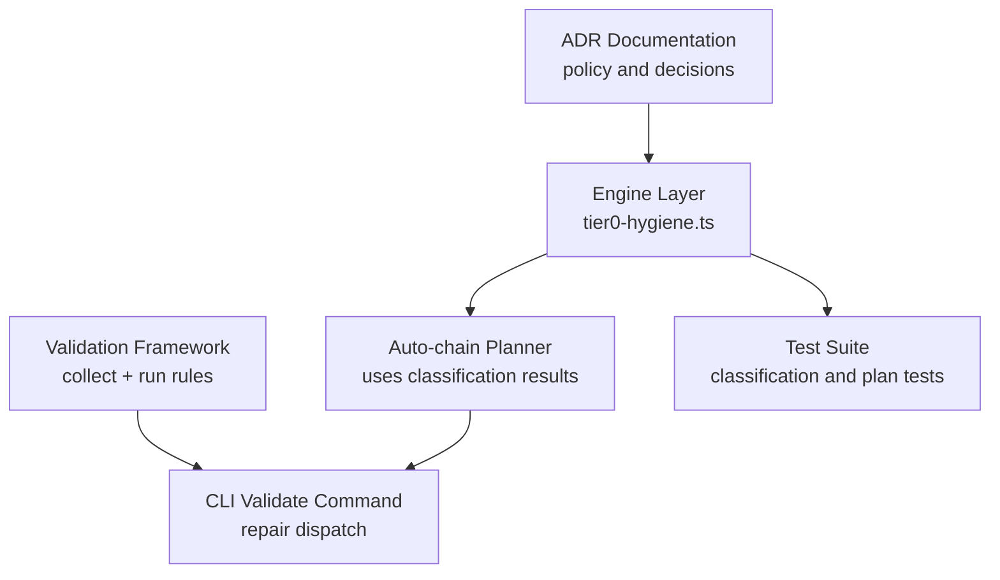
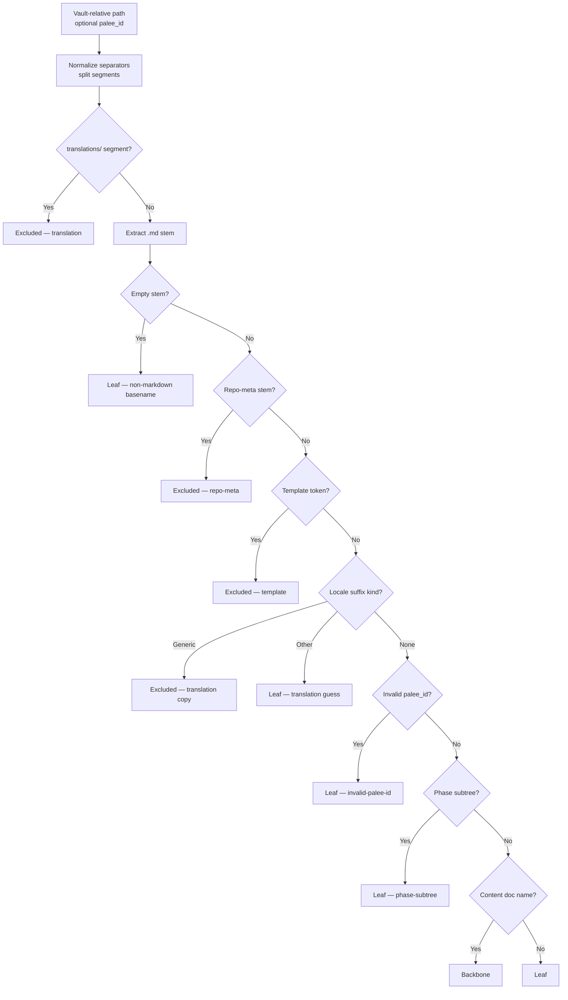
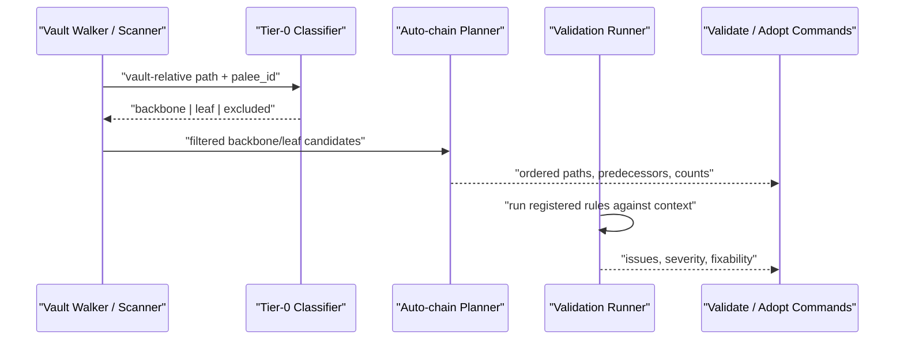
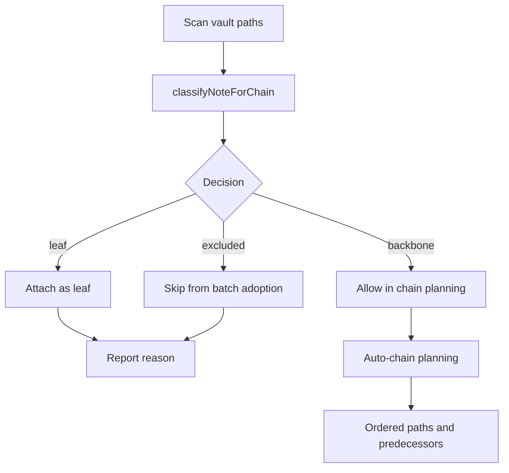
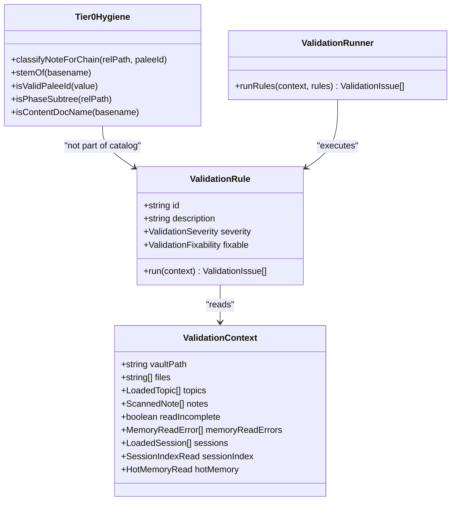
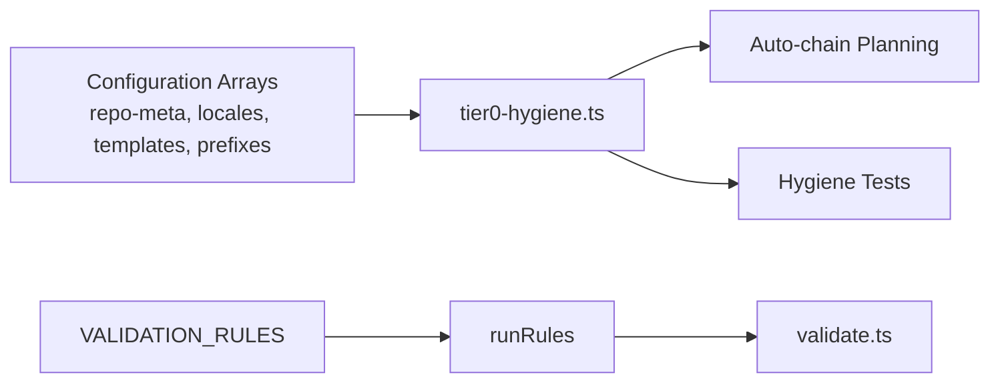

# Tier 0 Hygiene Rules

::: details Referenced Files in This Document

- [tier0-hygiene.ts](https://github.com/Kuldeep2822k/cli/blob/main/src/engine/tier0-hygiene.ts)
- [0010-tier0-hygiene-classification.md](https://github.com/Kuldeep2822k/cli/blob/main/docs/adr/0010-tier0-hygiene-classification.md)
- [0011-tiered-auto-chain.md](https://github.com/Kuldeep2822k/cli/blob/main/docs/adr/0011-tiered-auto-chain.md)
- [engine-tier0-hygiene.test.ts](https://github.com/Kuldeep2822k/cli/blob/main/test/engine-tier0-hygiene.test.ts)
- [engine-tier0-empty-stem.test.ts](https://github.com/Kuldeep2822k/cli/blob/main/test/engine-tier0-empty-stem.test.ts)
- [index.ts (validation barrel)](https://github.com/Kuldeep2822k/cli/blob/main/src/validation/index.ts)
- [run-rules.ts](https://github.com/Kuldeep2822k/cli/blob/main/src/validation/run-rules.ts)
- [types.ts (validation types)](https://github.com/Kuldeep2822k/cli/blob/main/src/validation/types.ts)
- [validate.ts](https://github.com/Kuldeep2822k/cli/blob/main/src/cli/validate.ts)

:::

## Table of Contents
1. [Introduction](#introduction)
2. [Project Structure](#project-structure)
3. [Core Components](#core-components)
4. [Architecture Overview](#architecture-overview)
5. [Detailed Component Analysis](#detailed-component-analysis)
6. [Dependency Analysis](#dependency-analysis)
7. [Performance Considerations](#performance-considerations)
8. [Troubleshooting Guide](#troubleshooting-guide)
9. [Conclusion](#conclusion)

## Introduction
Tier 0 hygiene is the first integrity gate for PALEE vaults. Its job is not to decide whether a note is pedagogically correct, but to keep the automated adoption and dependency chain planner from inventing prerequisites out of repository furniture, translations, templates, phase directories, or malformed identifiers.

The system classifies every candidate `.md` path into one of three roles:

| Role | Meaning | Effect on chaining |
|---|---|---|
| `backbone` | May join the ordered spine and may gate later notes | Allowed as a predecessor in the planned chain |
| `leaf` | Part of the scope but never gates the chain | Attached to the spine without becoming an ordering decision |
| `excluded` | Never adopted by batch hygiene and never chained | Removed before planning; reported with a counted skip reason |

Hygiene runs on every batch adoption, not only under automatic chaining. The exclusion decision narrows the candidate set; the `backbone`/`leaf` distinction matters when ordering notes into a chain.

**Section sources**
- [0010-tier0-hygiene-classification.md:1-72](https://github.com/Kuldeep2822k/cli/blob/main/docs/adr/0010-tier0-hygiene-classification.md#L1-L72)
- [tier0-hygiene.ts:1-30](https://github.com/Kuldeep2822k/cli/blob/main/src/engine/tier0-hygiene.ts#L1-L30)

## Project Structure
The Tier 0 hygiene feature lives at the intersection of the engine layer, the validation framework, and the CLI command surface:

**Diagram sources**
- [tier0-hygiene.ts:1-405](https://github.com/Kuldeep2822k/cli/blob/main/src/engine/tier0-hygiene.ts#L1-L405)
- [0010-tier0-hygiene-classification.md:1-72](https://github.com/Kuldeep2822k/cli/blob/main/docs/adr/0010-tier0-hygiene-classification.md#L1-L72)
- [0011-tiered-auto-chain.md:1-99](https://github.com/Kuldeep2822k/cli/blob/main/docs/adr/0011-tiered-auto-chain.md#L1-L99)
- [index.ts (validation barrel):1-130](https://github.com/Kuldeep2822k/cli/blob/main/src/validation/index.ts#L1-L130)
- [validate.ts:1-200](https://github.com/Kuldeep2822k/cli/blob/main/src/cli/validate.ts#L1-L200)

The engine layer is intentionally filesystem-free for classification. It consumes vault-relative paths and plain data so that Work Order C (TOC tier) can consume the same contract after rebasing.

**Section sources**
- [tier0-hygiene.ts:1-30](https://github.com/Kuldeep2822k/cli/blob/main/src/engine/tier0-hygiene.ts#L1-L30)
- [engine-tier0-hygiene.test.ts:1-40](https://github.com/Kuldeep2822k/cli/blob/main/test/engine-tier0-hygiene.test.ts#L1-L40)

## Core Components
The core implementation is concentrated in a single pure module:

| Symbol | Responsibility |
|---|---|
| `Tier0Class` | Union of `backbone`, `leaf`, `excluded` |
| `Tier0SkipReason` | Counted reasons for removal or demotion |
| `Tier0Decision` | Structured result carrying class and optional reason |
| `classifyNoteForChain` | Main classifier for a vault-relative path and optional `palee_id` |
| `stemOf` | Case-insensitive `.md` stem extractor returning empty string for non-markdown basenames |
| `isValidPaleeId` | Type guard requiring a non-empty trimmed string |
| `isPhaseSubtree` | Detects phase directory segments that collapse subtrees to leaves |
| `isContentDocName` | Decides whether a basename is backbone-eligible content documentation |
| Configuration arrays | Repo meta names, translation language codes, template tokens, content prefixes, README stems |

The module exports both the main classifier and helper predicates used by tests and other engine components.

**Diagram sources**
- [tier0-hygiene.ts:201-405](https://github.com/Kuldeep2822k/cli/blob/main/src/engine/tier0-hygiene.ts#L201-L405)

**Section sources**
- [tier0-hygiene.ts:1-405](https://github.com/Kuldeep2822k/cli/blob/main/src/engine/tier0-hygiene.ts#L1-L405)

## Architecture Overview
Tier 0 hygiene is not itself a validation rule in the general-purpose validation framework. It is a dedicated classification pass consumed by batch adoption and auto-chain planning. The validation framework has its own separate rule catalog focused on frontmatter parsing, schema shape, topic identity, dependencies, assessments, mastery, sessions, memory, and path safety.

**Diagram sources**
- [tier0-hygiene.ts:201-405](https://github.com/Kuldeep2822k/cli/blob/main/src/engine/tier0-hygiene.ts#L201-L405)
- [0011-tiered-auto-chain.md:1-99](https://github.com/Kuldeep2822k/cli/blob/main/docs/adr/0011-tiered-auto-chain.md#L1-L99)
- [index.ts (validation barrel):1-130](https://github.com/Kuldeep2822k/cli/blob/main/src/validation/index.ts#L1-L130)
- [run-rules.ts:1-60](https://github.com/Kuldeep2822k/cli/blob/main/src/validation/run-rules.ts#L1-L60)
- [validate.ts:1-200](https://github.com/Kuldeep2822k/cli/blob/main/src/cli/validate.ts#L1-L200)

The important boundary is that Tier 0 hygiene decides *scope and chaining eligibility*, while the validation framework decides *data integrity and fixability*. They cooperate through the CLI and planner, but they do not share the same rule registry.

**Section sources**
- [0010-tier0-hygiene-classification.md:1-72](https://github.com/Kuldeep2822k/cli/blob/main/docs/adr/0010-tier0-hygiene-classification.md#L1-L72)
- [index.ts (validation barrel):1-130](https://github.com/Kuldeep2822k/cli/blob/main/src/validation/index.ts#L1-L130)
- [run-rules.ts:1-60](https://github.com/Kuldeep2822k/cli/blob/main/src/validation/run-rules.ts#L1-L60)

## Detailed Component Analysis

### Classification Rules by Severity and Remediation Strategy
Tier 0 hygiene uses two remediation strategies rather than a generic error/warning model:

| Category | Rule Signal | Classification | Automated Remediation | Manual Intervention |
|---|---|---|---|---|
| Repository metadata | B1: blocklisted `.md` stem such as `LICENSE`, `CONTRIBUTING`, `CHANGELOG`, `FAQ`, `HELP`, `toc`, `contents` | `excluded` | Remove from batch adoption and chain planning | Rename into a lesson if it is actually curriculum content; otherwise accept exclusion |
| Translations | B2: `translations/` segment or locale-suffixed generic doc name | `excluded` | Do not adopt or chain the translation copy | Keep structural translation layout; adopt directly in single-file mode if needed |
| Name-based translation guess | B2: locale suffix on unnumbered non-generic name | `leaf` | Attach as a leaf; do not let it gate successors | Rename to remove locale suffix if it is not a translation, or mark explicitly |
| Templates | B3: whole-token `template`/`templates` in stem or directory | `excluded` | Remove scaffolding from the chain | Rename to avoid whole-token match if the file is real content |
| Phase subtrees | B4: non-final segment named `solution`, `solutions`, `your-work`, `start`, `sketch`, `answers` | `leaf` | Collapse subtree; attach notes without internal chaining | Restructure work products if they should participate in learning order |
| Invalid identifier | B7: truthy non-string `palee_id` | `leaf` with reason `invalid-palee-id` | Demote without rewriting frontmatter | Fix frontmatter so `palee_id` is a non-empty string |
| Non-content sibling | B5 fails | `leaf` | Attach without gating | Add numbering or rename to a recognized content-doc pattern if it should be backbone |
| Recognized content document | B5 passes | `backbone` | Allowed to gate the chain | Review whether the naming really expresses intended prerequisite structure |

The failure direction is explicit: classification errs on the side of demotion, never promotion. A heuristic that cannot safely prove a note is a lesson does not become a chain head.

**Section sources**
- [tier0-hygiene.ts:1-120](https://github.com/Kuldeep2822k/cli/blob/main/src/engine/tier0-hygiene.ts#L1-L120)
- [tier0-hygiene.ts:201-405](https://github.com/Kuldeep2822k/cli/blob/main/src/engine/tier0-hygiene.ts#L201-L405)
- [0010-tier0-hygiene-classification.md:1-72](https://github.com/Kuldeep2822k/cli/blob/main/docs/adr/0010-tier0-hygiene-classification.md#L1-L72)

### Hygiene Violation Examples and Fixes

| Violation | Example Shape | Current Result | Recommended Fix |
|---|---|---|---|
| Orphaned or spurious chain head from repo metadata | `LICENSE.md` becomes a predecessor | Excluded; no edge written | Accept exclusion or move into a numbered lesson scope where appropriate |
| Translation copy gated by English original | `README.ko-KR.md` or `translations/01-setup.es.md` | Excluded as translation | Keep one canonical enumeration source |
| Unnumbered sibling interpreted as prerequisite | `for-teachers.md`, `how-to-run.md` | Leaf; attached without gating | Number or rename to content-doc pattern if it should be backbone |
| Phase work product chains inside solutions | `solution/Julia/README.md` → `solution/R/README.md` | Collapsed to leaves | Treat as student work, not learning order |
| Numeric prefix mistaken for locale | `02-es.md` | Backbone; number wins over name guess | Keep numeric prefix; put actual translations under `translations/` |
| Non-string identifier blocks successor edges | YAML value parsed as number | Leaf with `invalid-palee-id`; not rewritten | Convert `palee_id` to a non-empty string in frontmatter |
| Non-markdown basename reaching backbone | `notes.txt`, `Makefile` | Leaf; never backbone | Ignore or move out of scanned scope |

The test suite pins these behaviors precisely because they are heuristics about filenames and structure, not full semantic understanding of each note’s content.

**Section sources**
- [engine-tier0-hygiene.test.ts:1-200](https://github.com/Kuldeep2822k/cli/blob/main/test/engine-tier0-hygiene.test.ts#L1-L200)
- [engine-tier0-hygiene.test.ts:201-L542](https://github.com/Kuldeep2822k/cli/blob/main/test/engine-tier0-hygiene.test.ts#L201-L542)
- [engine-tier0-empty-stem.test.ts:1-46](https://github.com/Kuldeep2822k/cli/blob/main/test/engine-tier0-empty-stem.test.ts#L1-L46)

### Repair Workflow and Data Integrity
Tier 0 hygiene itself does not rewrite frontmatter. Its repair contract is conservative:

1. **Classification is pure.** It reads a path and optional `palee_id` and returns a decision.
2. **Exclusions remove notes from batch scope.** They are reported with a counted reason.
3. **Demotions keep notes attached but prevent gating.** A leaf may still have a predecessor; it simply cannot become a predecessor of later chain nodes.
4. **Invalid identifiers are not corrected automatically.** The classifier reports `invalid-palee-id`, but the note’s frontmatter remains untouched.
5. **Vault mutation belongs to the higher-level repair pipeline.** The validation framework’s `--fix` mechanism separates permission (`fixable`) from capability (implemented repairer).

This separation exists because Tier 0 hygiene protects the planning graph, while the validation repair system protects canonical vault state.

**Diagram sources**
- [tier0-hygiene.ts:201-405](https://github.com/Kuldeep2822k/cli/blob/main/src/engine/tier0-hygiene.ts#L201-L405)
- [engine-tier0-hygiene.test.ts:201-L542](https://github.com/Kuldeep2822k/cli/blob/main/test/engine-tier0-hygiene.test.ts#L201-L542)

**Section sources**
- [tier0-hygiene.ts:201-405](https://github.com/Kuldeep2822k/cli/blob/main/src/engine/tier0-hygiene.ts#L201-L405)
- [engine-tier0-hygiene.test.ts:201-L542](https://github.com/Kuldeep2822k/cli/blob/main/test/engine-tier0-hygiene.test.ts#L201-L542)
- [validate.ts:1-200](https://github.com/Kuldeep2822k/cli/blob/main/src/cli/validate.ts#L1-L200)

### Relationship Between Hygiene Rules and the Validation Framework
The validation framework has a different concern:

| Concern | Tier 0 Hygiene | Validation Framework |
|---|---|---|
| Primary input | Vault-relative path and optional `palee_id` | Fully collected `ValidationContext` |
| Primary output | Chain role and skip reason | Structured `ValidationIssue` list |
| Scope decision | Yes | No |
| Graph construction | Yes, indirectly through classification | Through dependency-related rules |
| Frontmatter mutation | No | Only through explicit repairers |
| Rule registry | Not part of `VALIDATION_RULES` | Centralized `VALIDATION_RULES` array |
| Fixability model | Heuristic demotion/exclusion | `false`, `safe`, or `manual` per rule |

The validation framework’s public API bundles collection, deterministic rule execution, formatting, and the canonical rule catalog. Rules are pure functions of the context and must not touch the filesystem, config, prompts, network, or console.

**Diagram sources**
- [tier0-hygiene.ts:1-405](https://github.com/Kuldeep2822k/cli/blob/main/src/engine/tier0-hygiene.ts#L1-L405)
- [types.ts (validation types):1-161](https://github.com/Kuldeep2822k/cli/blob/main/src/validation/types.ts#L1-L161)
- [run-rules.ts:1-60](https://github.com/Kuldeep2822k/cli/blob/main/src/validation/run-rules.ts#L1-L60)
- [index.ts (validation barrel):1-130](https://github.com/Kuldeep2822k/cli/blob/main/src/validation/index.ts#L1-L130)

**Section sources**
- [types.ts (validation types):1-161](https://github.com/Kuldeep2822k/cli/blob/main/src/validation/types.ts#L1-L161)
- [run-rules.ts:1-60](https://github.com/Kuldeep2822k/cli/blob/main/src/validation/run-rules.ts#L1-L60)
- [index.ts (validation barrel):1-130](https://github.com/Kuldeep2822k/cli/blob/main/src/validation/index.ts#L1-L130)

## Dependency Analysis
Tier 0 hygiene is designed to be low-coupling:

- It depends only on local configuration arrays and helper logic.
- It avoids importing the auto-chain planner to keep the engine module filesystem-free and reusable.
- It is consumed by the planner and tests, not the reverse.
- It is distinct from the validation rule catalog, which is managed centrally by the validation barrel.

**Diagram sources**
- [tier0-hygiene.ts:1-405](https://github.com/Kuldeep2822k/cli/blob/main/src/engine/tier0-hygiene.ts#L1-L405)
- [index.ts (validation barrel):1-130](https://github.com/Kuldeep2822k/cli/blob/main/src/validation/index.ts#L1-L130)
- [run-rules.ts:1-60](https://github.com/Kuldeep2822k/cli/blob/main/src/validation/run-rules.ts#L1-L60)

There is no circular dependency between hygiene classification and the auto-chain planner. The planner consumes classification results, while the hygiene module keeps its numeric prefix parser local.

**Section sources**
- [tier0-hygiene.ts:1-405](https://github.com/Kuldeep2822k/cli/blob/main/src/engine/tier0-hygiene.ts#L1-L405)
- [0011-tiered-auto-chain.md:1-99](https://github.com/Kuldeep2822k/cli/blob/main/docs/adr/0011-tiered-auto-chain.md#L1-L99)

## Performance Considerations
Scanning large vaults requires careful attention to how classification, scanning, and validation interact.

Key performance characteristics observed in the codebase:

| Area | Characteristic | Implication |
|---|---|---|
| Classification | Pure function over normalized path segments | Cheap per-note computation; no filesystem I/O |
| Locale parsing | Regex with anchored groups and bounded language length | Avoids greedy backtracking on long stems |
| TOC link scanning | Linear in document size with precomputed bracket-balance tables | Prevents pathological README scans from stalling |
| Validation runner | Executes all rules unconditionally in registration order | Deterministic output; failures do not short-circuit later rules |
| Rule isolation | Rules receive read-only context | Rules can fail independently without corrupting global state |
| Batch hygiene | Runs on every batch adoption | Ensures scope filtering is always applied, not opt-in |

The architecture deliberately separates concerns so that expensive operations—such as vault walking, frontmatter parsing, session/memory reads, and derived view rebuilds—are owned by their respective layers, while Tier 0 hygiene stays lightweight.

[No sources needed since this section provides general guidance]

## Troubleshooting Guide

### Common Hygiene Issues and Resolutions

| Symptom | Likely Cause | Resolution |
|---|---|---|
| A repository metadata file gates lessons | B1 matched a blocklisted stem | Move the file out of the lesson scope or accept exclusion |
| A translation copy appears as a lesson | B2 matched `translations/` or a generic locale-suffixed doc name | Keep canonical enumeration in one place |
| An unnumbered sibling becomes a chain head | B5 did not recognize it as content documentation | Number the file or rename to a recognized content-doc pattern |
| Student work files chain incorrectly | B4 detected a phase directory | Treat phase subtrees as leaves; do not rely on alphabetical order |
| Successors stop adopting after a note | B7 found a truthy non-string `palee_id` | Correct frontmatter so `palee_id` is a non-empty string |
| Non-markdown files influence chain decisions | Empty stem reached classification | Ensure scanned scope filters `.md` files |
| Validation throws unexpectedly | Rule execution threw | Check rule-specific logs; the runner wraps unexpected errors as issues |

### Manual Intervention Scenarios
Some violations require human judgment:

- Renaming a scaffold file that happens to contain the word `template`.
- Deciding whether a locale-suffixed filename is a genuine translation or a numbered lesson.
- Choosing whether phase work products should be represented as structured study notes rather than automatic chain members.
- Correcting frontmatter type mismatches such as numeric `palee_id` values.
- Deciding whether a validation finding is safe to repair automatically or requires manual review.

The repair system enforces this boundary by requiring both rule metadata permission and an implemented repairer before mutating vault state.

**Section sources**
- [engine-tier0-hygiene.test.ts:1-L542](https://github.com/Kuldeep2822k/cli/blob/main/test/engine-tier0-hygiene.test.ts#L1-L542)
- [engine-tier0-empty-stem.test.ts:1-46](https://github.com/Kuldeep2822k/cli/blob/main/test/engine-tier0-empty-stem.test.ts#L1-L46)
- [validate.ts:1-200](https://github.com/Kuldeep2822k/cli/blob/main/src/cli/validate.ts#L1-L200)

## Conclusion
Tier 0 hygiene is a narrow but essential integrity gate. It prevents automated planners from treating repository structure, translations, templates, phase directories, and malformed identifiers as legitimate learning prerequisites. Its classification rules are heuristic, conservative, and deliberately separated from schema validation and vault mutation.

For maintainers, the practical takeaway is simple:

- Use numbered modules to express real learning order.
- Keep translations under structural translation directories.
- Treat scaffolding and phase work as non-gating content.
- Keep `palee_id` as a non-empty string.
- Use the validation framework for schema, identity, dependency, assessment, mastery, session, memory, and path integrity checks.
- Use Tier 0 hygiene when diagnosing why a file was excluded, demoted, or allowed to gate the chain.

Together, these layers preserve vault cleanliness while allowing automation to scale across large study repositories without inventing false dependencies.

[No sources needed since this section summarizes without analyzing specific files]