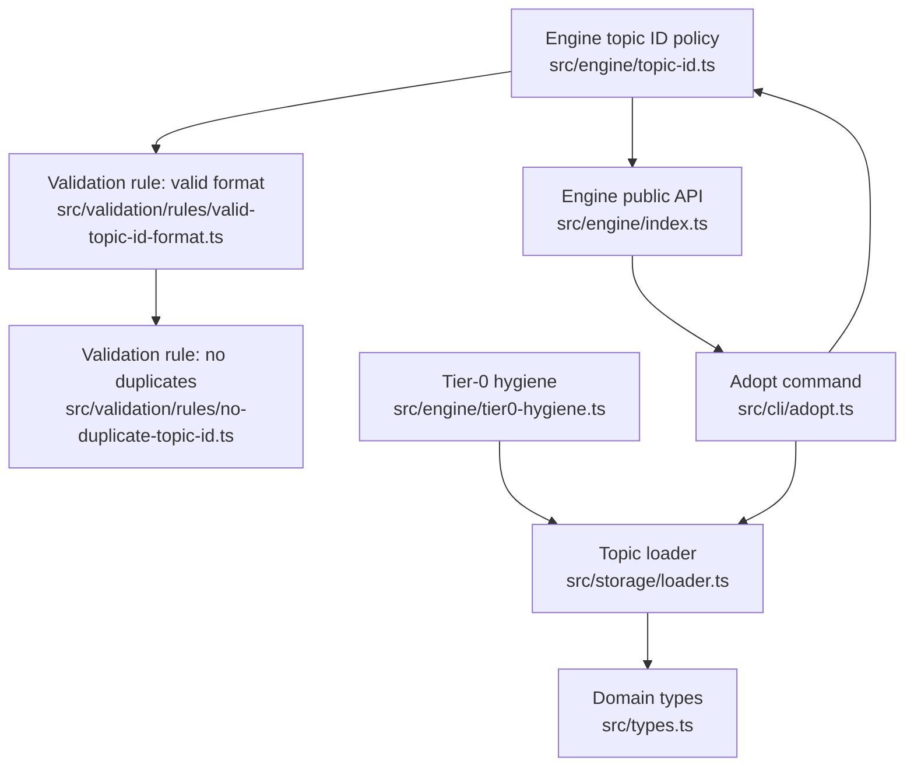
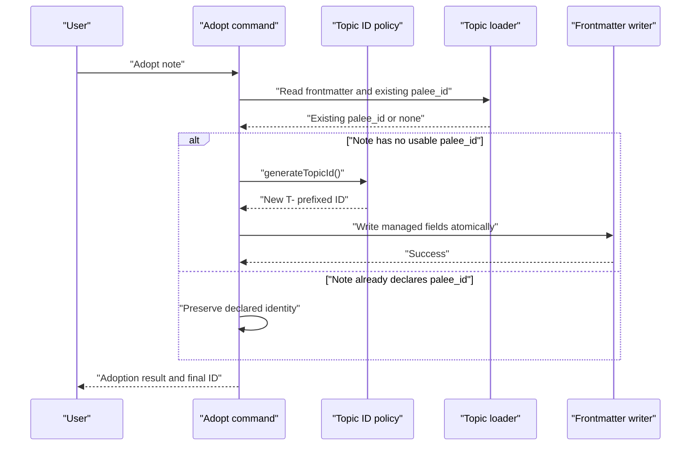
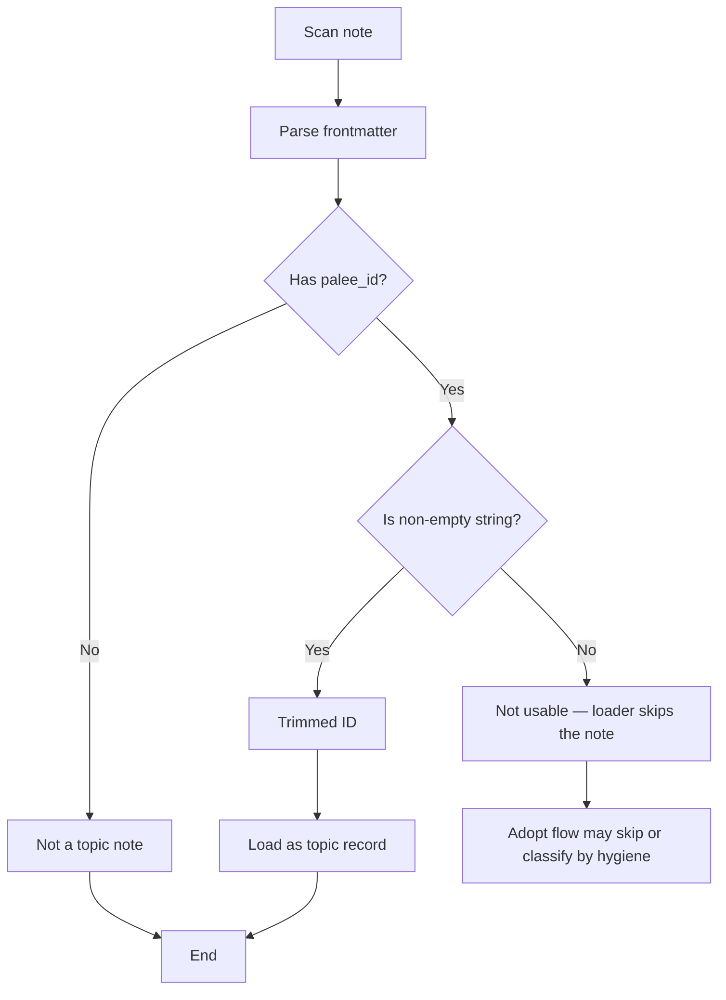
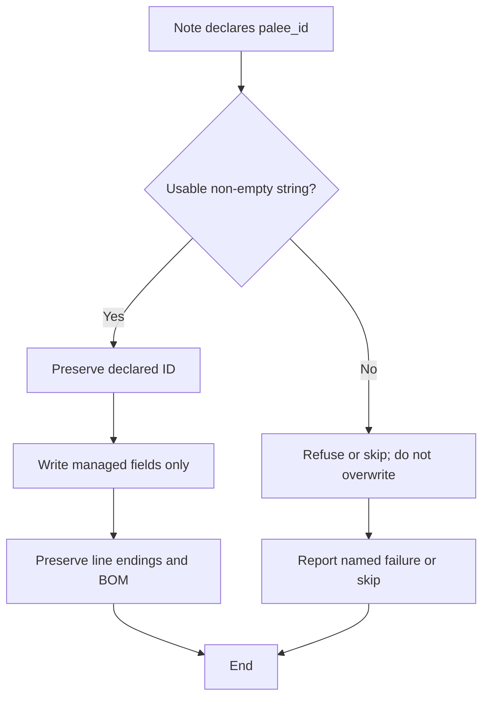
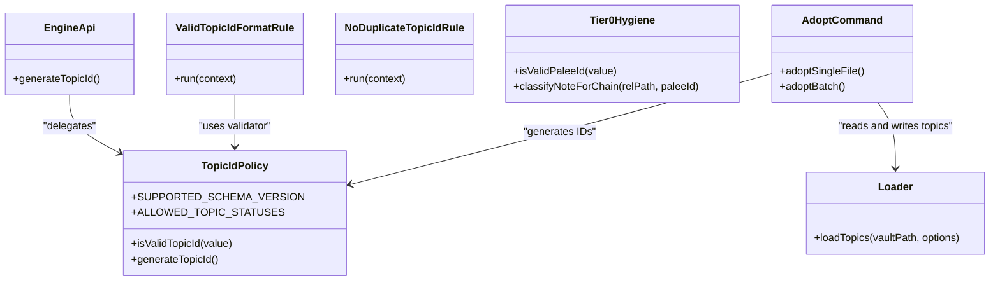
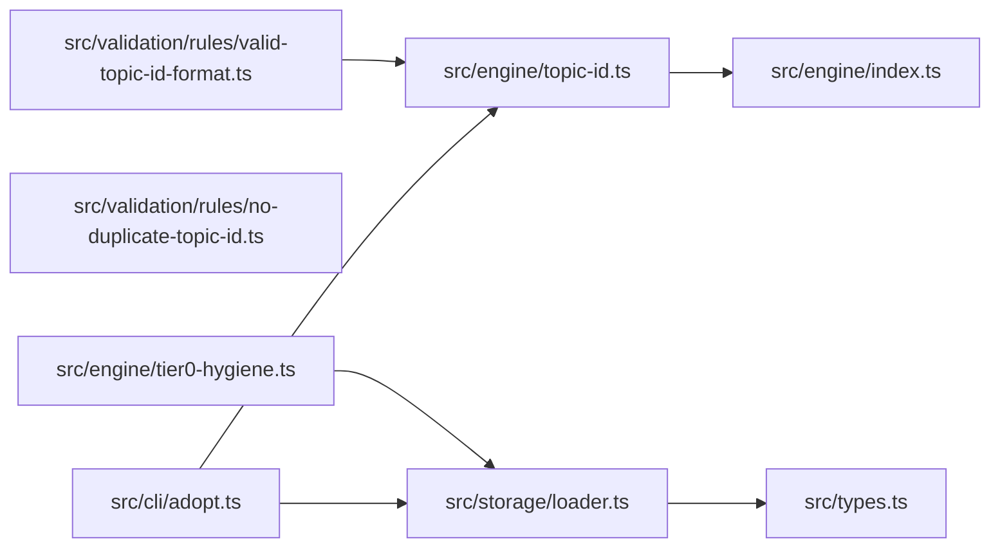

# Topic ID Management

::: details Referenced Files in This Document

- [topic-id.ts](https://github.com/Kuldeep2822k/cli/blob/main/src/engine/topic-id.ts)
- [engine/index.ts](https://github.com/Kuldeep2822k/cli/blob/main/src/engine/index.ts)
- [valid-topic-id-format.ts](https://github.com/Kuldeep2822k/cli/blob/main/src/validation/rules/valid-topic-id-format.ts)
- [no-duplicate-topic-id.ts](https://github.com/Kuldeep2822k/cli/blob/main/src/validation/rules/no-duplicate-topic-id.ts)
- [loader.ts](https://github.com/Kuldeep2822k/cli/blob/main/src/storage/loader.ts)
- [tier0-hygiene.ts](https://github.com/Kuldeep2822k/cli/blob/main/src/engine/tier0-hygiene.ts)
- [adopt.ts](https://github.com/Kuldeep2822k/cli/blob/main/src/cli/adopt.ts)
- [types.ts](https://github.com/Kuldeep2822k/cli/blob/main/src/types.ts)
- [engine-topic-id.test.ts](https://github.com/Kuldeep2822k/cli/blob/main/test/engine-topic-id.test.ts)
- [0015-identity-preservation.md](https://github.com/Kuldeep2822k/cli/blob/main/docs/adr/0015-identity-preservation.md)
- [0016-frontmatter-fidelity-and-unicode-fold.md](https://github.com/Kuldeep2822k/cli/blob/main/docs/adr/0016-frontmatter-fidelity-and-unicode-fold.md)

:::

## Table of Contents
1. [Introduction](#introduction)
2. [Project Structure](#project-structure)
3. [Core Components](#core-components)
4. [Architecture Overview](#architecture-overview)
5. [Detailed Component Analysis](#detailed-component-analysis)
6. [Dependency Analysis](#dependency-analysis)
7. [Performance Considerations](#performance-considerations)
8. [Troubleshooting Guide](#troubleshooting-guide)
9. [Conclusion](#conclusion)

## Introduction
This document explains how PALEE generates, validates, normalizes, migrates, and preserves topic IDs (`palee_id`). A topic ID is the stable identity that connects a Markdown note to validation results, dependency edges, sessions, roadmap planning, and storage records across its entire lifecycle.

The system separates three concerns:
- **Policy:** What a valid topic ID looks like and how new IDs are generated.
- **Validation:** How existing vault data is inspected for malformed or duplicate IDs without mutating it.
- **Identity preservation:** How adoption, scanning, and storage keep user-authored identities intact and avoid silent renames.

## Project Structure
Topic ID handling spans four layers:

| Layer | Responsibility | Representative files |
|---|---|---|
| Policy engine | Central ID format rules, legacy compatibility, and minting | `src/engine/topic-id.ts` |
| Public API surface | Exposes ID generation to callers outside the engine | `src/engine/index.ts` |
| Validation framework | Reports invalid and duplicate IDs from scanned vault data | `src/validation/rules/valid-topic-id-format.ts`, `src/validation/rules/no-duplicate-topic-id.ts` |
| Storage and CLI integration | Loads, adopts, classifies, and writes notes while preserving declared identities | `src/storage/loader.ts`, `src/engine/tier0-hygiene.ts`, `src/cli/adopt.ts` |

## Core Components

### Topic ID Policy
The central policy module defines:
- The supported schema version for Phase 1.
- The allowed topic lifecycle statuses.
- The canonical ID pattern.
- The legacy adopt ID pattern.
- The ID validator.
- The ID generator.

Key properties:
- Canonical format: `T-` followed by one or more lowercase alphanumeric kebab segments.
- Legacy format: an adopt-generated timestamp with an uppercase `T` inside the date-time segment, followed by an 8-character lowercase hexadecimal suffix.
- Validator rejects non-string inputs, empty slugs, uppercase letters, underscores, trailing hyphens, missing prefixes, and uppercase hex.
- Generator produces UTC-based `T-YYYYMMDD-HHMMSS-XXXXXXXX` identifiers using 32 bits of cryptographic randomness.

### Validation Rules
Two validation rules inspect vault content but do not mutate it.

| Rule | Purpose | Severity | Fixable |
|---|---|---|---|
| `valid-topic-id-format` | Checks whether eligible topic notes have a `palee_id` matching the centralized policy | Error | No |
| `no-duplicate-topic-id` | Detects multiple notes sharing the same normalized topic ID | Error | No |

Important behavior:
- Format checking runs over raw scanned notes rather than the loader’s normalized topic set because the loader drops missing, non-string, or blank IDs. Those cases must still be reported when the note is eligible as a topic note.
- Eligibility is determined by the shared managed-note predicate: a note declares the `palee_id` key and does not declare another managed kind such as session, hot memory, or session index.
- Duplicate detection groups loaded topics by their normalized ID and reports every file involved.

### Identity Preservation and Tier-0 Hygiene
Tier-0 hygiene defines what counts as a usable `palee_id` during batch adoption and chaining:
- Only a non-empty string is usable.
- Notes carrying truthy but unusable values (for example, YAML numbers) are skipped under auto-chain and classified with an explicit reason instead of being rewritten or treated as bridge nodes with no identity.
- The loader requires a non-empty string `palee_id`; otherwise, the note is not treated as a topic note.

This separation prevents two different failure modes:
- A number-like `palee_id` appearing adopted to the scanner but invisible to the loader.
- A command silently inventing an identity for a note that already declared one.

### Adoption and Minting
When adopting a note for the first time:
1. The command reads frontmatter and preserves author-declared prerequisites where appropriate.
2. It generates a fresh topic ID through the centralized policy.
3. It writes only managed keys into the frontmatter using atomic write semantics.
4. It refuses to write notes that would exceed the read capacity after update.
5. It reports the adopted topic ID to the user.

Adoption is intentionally non-destructive: it does not overwrite an existing usable `palee_id`.

## Architecture Overview

## Detailed Component Analysis

### ID Format Specification
A valid topic ID consists of:
- A literal `T-` prefix.
- One or more lowercase alphanumeric segments separated by hyphens.
- Optional legacy adopt-generated timestamps with an uppercase `T` embedded in the date-time portion, followed by exactly eight lowercase hexadecimal characters.

Constraints enforced by the policy validator include:
- Input must be a string.
- No underscores.
- No uppercase letters except in the explicitly allowed legacy timestamp form.
- No empty kebab segments, including trailing hyphens.
- No missing `T-` prefix.
- Legacy hex suffixes must be lowercase.

Valid examples from tests:
- `T-git-rebase`
- `T-20260830-120000-a1b2c3d4`
- `T-a`
- `T-topic-1`
- `T-20260830T120000-a1b2c3d4`

Invalid examples from tests:
- `git_rebase`
- `T-`
- `T-Git-Rebase`
- `T-git--rebase`
- `T-git-`
- `topic-1`
- `T-20260830T120000-A1B2C3D4`
- Empty string
- Non-string primitives

### ID Generation Algorithm
The generator creates stable-enough but unique-enough identifiers for newly adopted topics:
- Uses current UTC time.
- Encodes the date as `YYYYMMDD`.
- Encodes the time as `HHMMSS`.
- Appends 8 hexadecimal characters derived from 4 bytes of cryptographic random data.
- Returns a string matching the canonical policy pattern.

Uniqueness assumptions:
- Randomness comes from the platform’s secure random source.
- Collisions within small batches are effectively impossible due to 32-bit entropy.
- Stability across process restarts is not guaranteed because timestamps change; this is acceptable because minted IDs identify newly created topics, not preexisting user data.

Complexity:
- Time: constant per call.
- Space: constant per returned string.

Security considerations:
- Cryptographic randomness reduces predictability compared to purely deterministic counters.
- IDs are identifiers, not secrets; they should not be used as access tokens or authentication material.
- The 32-bit suffix is sufficient for uniqueness among generated IDs but should not be treated as collision-resistant beyond normal probabilistic guarantees.

### Normalization and Identity Handling
There are two distinct normalization responsibilities:

1. **Format validation:** Does the stored `palee_id` match the policy?
   - Implemented by the centralized validator.
   - Used by the format validation rule.
   - Does not rewrite vault files.

2. **Loader normalization:** Which notes become loadable topic records?
   - Requires a non-empty string `palee_id`.
   - Trims whitespace around the value.
   - Maps the raw `palee_id` to both `palee_id` and canonical `id` on the loaded topic.
   - Skips notes whose frontmatter cannot be parsed or whose `palee_id` is missing, non-string, or blank.

Normalization does not coerce bad IDs into good ones. A numeric YAML value remains unusable for loading and validation purposes.

### Collision Detection
Collision detection is split between generation and validation:

| Stage | Mechanism | Scope |
|---|---|---|
| Generation | Cryptographically random suffix | Newly minted IDs |
| Validation | Groups loaded topics by normalized `palee_id` | Entire vault scan |

The duplicate rule:
- Iterates collected topics.
- Builds a map from ID to file paths.
- Reports one error per duplicated ID, listing all affected files.
- Sorts output deterministically by ID and file path.

This catches accidental reuse of legacy or manually written IDs even if each individual ID is well-formed.

### Backward Compatibility and Migration Strategy
The system supports historical IDs produced by older adopt logic:
- The legacy adopt pattern accepts an ISO-style timestamp containing an uppercase `T`, followed by exactly eight lowercase hexadecimal characters.
- The policy module documents that tool-generated historical IDs remain valid so validation reports defects in user data rather than PALEE’s own past output.
- Migration can rewrite legacy IDs later without breaking read paths.

Migration strategy implications:
- Read paths accept legacy IDs.
- New mints use the canonical kebab-segment timestamp format.
- Existing legacy IDs stay readable until explicitly migrated.
- Validators report malformed user data rather than rewriting it.

### Storage Layer Identity Preservation
Identity preservation is a design boundary:
- An identity on disk is not a command’s to invent.
- If a note already declares a usable `palee_id`, adoption preserves it.
- A non-string or unusable declared identity is refused by import/chain logic and skipped rather than overwritten.
- Unterminated frontmatter openers are detected before adoption so a minted ID is not prepended over a hidden user-declared identity.
- Frontmatter writers preserve vault line endings and BOM fidelity so rewrites do not silently corrupt unrelated bytes.

### Integration Points
The topic ID system integrates with several subsystems:

| Consumer | Integration |
|---|---|
| Engine public API | Re-exports `generateTopicId` for CLI and application layers |
| Domain types | Defines `Topic.palee_id` and related lifecycle/status fields |
| Validation framework | Consumes centralized policy and scans raw notes |
| Loader | Normalizes loaded topics and enforces usable string identity |
| Tier-0 hygiene | Guards batch adoption and chaining against unusable IDs |
| Adopt command | Mints new IDs and writes managed frontmatter safely |

## Dependency Analysis

Coupling observations:
- The policy module is the single source of truth for ID shape and minting, reducing drift between validation and generation.
- Validation rules depend on the policy but not on storage, keeping them stateless and testable.
- Loader and hygiene operate on runtime identity contracts (`string palee_id`) rather than the full policy regex, which is intentional: loader normalization and format validation serve different purposes.
- The adopt command depends on both policy and loader, making it the primary mutation point for new IDs.

Potential risks:
- If policy patterns change, both validation and generation must remain consistent.
- Hygiene uses a weaker usability check (`non-empty string`) than the full policy, which is correct for adoption gating but should not be confused with format validity.

## Performance Considerations
- ID validation is a constant-time regular expression check per candidate.
- ID generation allocates a small fixed-size buffer and returns a short string.
- Duplicate detection uses a hash map over loaded topics; complexity is linear in the number of loaded topics.
- Loader negative caching avoids repeatedly parsing non-topic notes.
- Vault scans cap large files before reading, protecting ID-related workflows from oversized artifacts.

Recommendations:
- Keep policy regexes focused; adding optional branches can increase backtracking risk.
- Avoid generating IDs in tight loops unless necessary; cache generated IDs at command boundaries.
- Treat duplicate-ID resolution as a post-scan operation because it requires all topics to be collected.

## Troubleshooting Guide

### Common Invalid ID Patterns
| Symptom | Likely cause | Resolution |
|---|---|---|
| Validation reports invalid format | Missing `T-` prefix, underscores, uppercase letters, or empty kebab segments | Rewrite the ID to match the canonical policy |
| Legacy timestamp contains uppercase hex | Historical adopt output mixed with strict validation | Run migration to canonicalize, or fix the vault entry |
| Duplicate topic ID error | Two notes share the same `palee_id` | Rename one note’s ID and update references |
| Note disappears from scans | `palee_id` is missing, non-string, or blank | Add a usable string ID or remove the field |
| Auto-chain skips a note | `palee_id` is truthy but not a non-empty string | Convert YAML number or array to a string ID |
| Adoption refuses to overwrite | Note already declares a usable `palee_id` | Use the existing ID or move the note to a different path |

### Failure Modes and Safety Behavior
- **Malformed frontmatter:** The loader skips the note; validation owns parse errors separately.
- **Unterminated frontmatter opener:** Adoption detects it and skips the note to prevent stranding the user’s declared ID.
- **Non-string YAML identity:** Loader ignores it; hygiene marks it unusable; adopt does not silently mint over it.
- **Oversized notes:** Scans and adoption refuse to treat them as loadable topics, preventing hidden loss of state.

## Conclusion
PALEE’s topic ID system centers on a single policy module that defines format rules and minting behavior, while validation and storage layers enforce consistency without mutating user data unnecessarily. Legacy adopt-generated IDs remain readable, new IDs follow a canonical kebab-segment format, and identity preservation ensures commands do not silently rename or invent identities.

For safe operation:
- Treat `palee_id` as immutable once authored.
- Use the centralized policy for validation and generation.
- Rely on validation rules to detect malformed or duplicate IDs.
- Prefer migration tools to rewrite legacy or inconsistent IDs rather than ad hoc scripts.
- Remember that ID stability belongs to the author and storage layer; minting is only for newly created topics.
