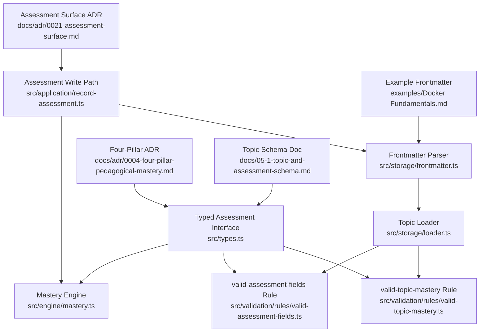
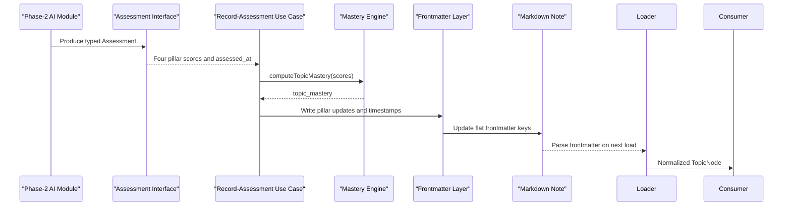
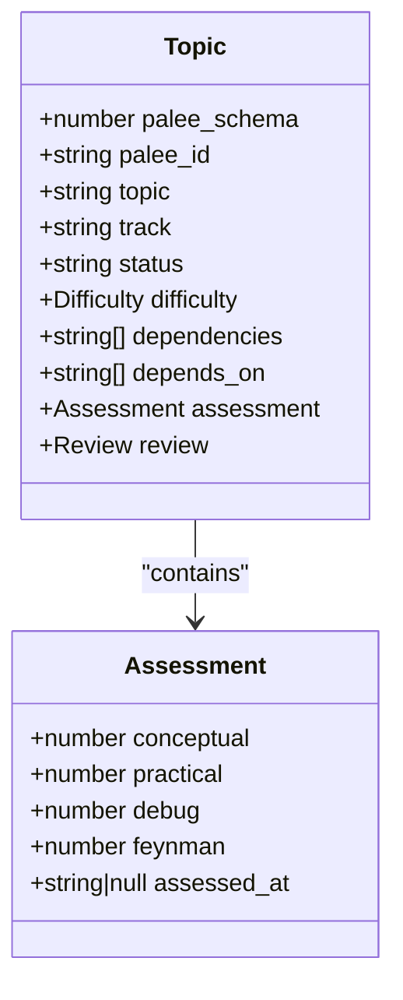
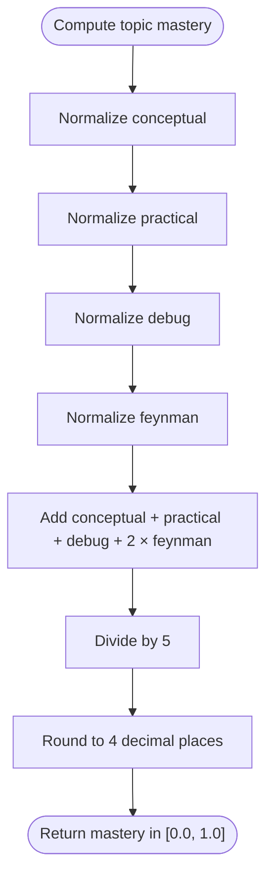
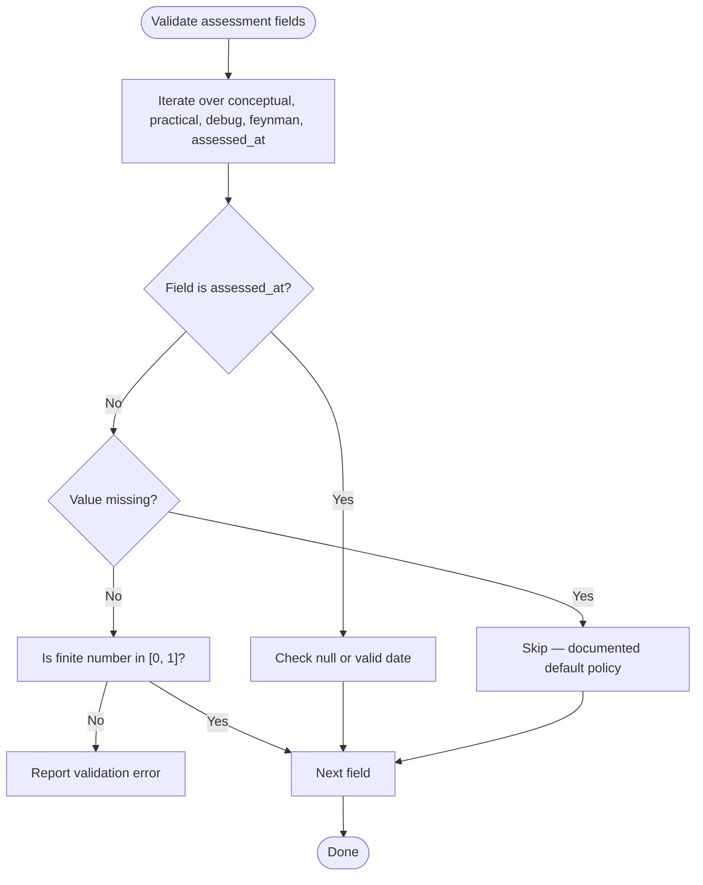
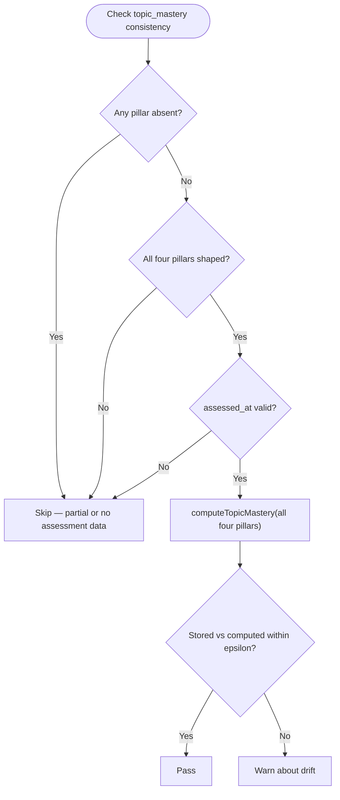
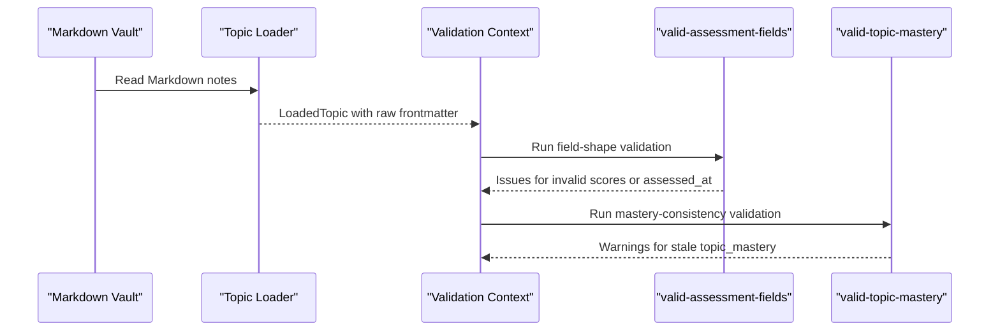
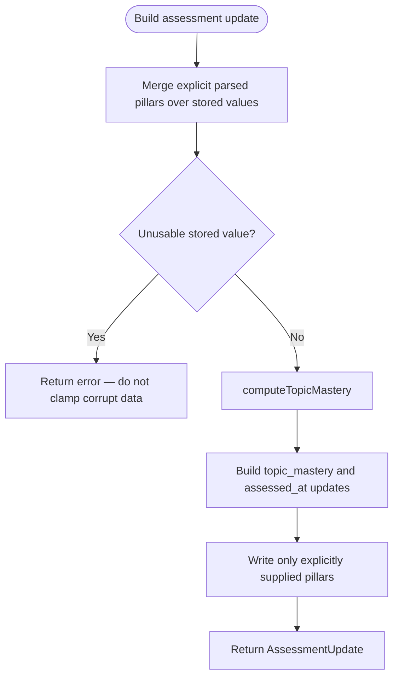
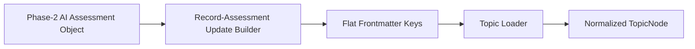
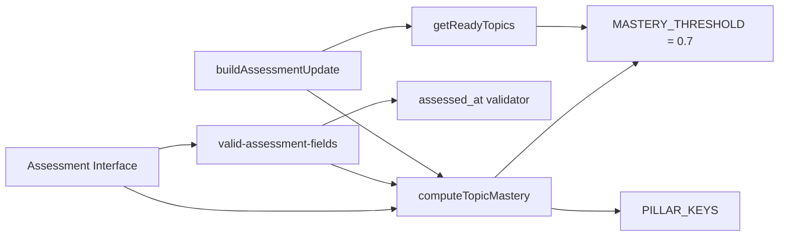

# Assessment Model

::: details Referenced Files in This Document

- [types.ts](https://github.com/Kuldeep2822k/cli/blob/main/src/types.ts)
- [mastery.ts](https://github.com/Kuldeep2822k/cli/blob/main/src/engine/mastery.ts)
- [frontmatter.ts](https://github.com/Kuldeep2822k/cli/blob/main/src/storage/frontmatter.ts)
- [loader.ts](https://github.com/Kuldeep2822k/cli/blob/main/src/storage/loader.ts)
- [valid-assessment-fields.ts](https://github.com/Kuldeep2822k/cli/blob/main/src/validation/rules/valid-assessment-fields.ts)
- [valid-topic-mastery.ts](https://github.com/Kuldeep2822k/cli/blob/main/src/validation/rules/valid-topic-mastery.ts)
- [record-assessment.ts](https://github.com/Kuldeep2822k/cli/blob/main/src/application/record-assessment.ts)
- [0004-four-pillar-pedagogical-mastery.md](https://github.com/Kuldeep2822k/cli/blob/main/docs/adr/0004-four-pillar-pedagogical-mastery.md)
- [0021-assessment-surface.md](https://github.com/Kuldeep2822k/cli/blob/main/docs/adr/0021-assessment-surface.md)
- [05-1-topic-and-assessment-schema.md](https://github.com/Kuldeep2822k/cli/blob/main/docs/05-1-topic-and-assessment-schema.md)
- [Docker Fundamentals.md](https://github.com/Kuldeep2822k/cli/blob/main/examples/Docker%20Fundamentals.md)

:::

## Table of Contents
1. [Introduction](#introduction)
2. [Project Structure](#project-structure)
3. [Core Components](#core-components)
4. [Architecture Overview](#architecture-overview)
5. [Detailed Component Analysis](#detailed-component-analysis)
6. [Dependency Analysis](#dependency-analysis)
7. [Performance Considerations](#performance-considerations)
8. [Troubleshooting Guide](#troubleshooting-guide)
9. [Conclusion](#conclusion)

## Introduction
The Assessment model is PALEE's four-pillar pedagogical evaluation contract for Phase 2 AI assessment. It represents how a topic should be scored across conceptual understanding, practical application, debugging skill, and Feynman articulation, and how those scores combine into an overall mastery value that gates prerequisite progression.

This document focuses on the typed `Assessment` interface as the Phase-2 AI schema contract. It explicitly distinguishes that contract from the runtime flat frontmatter keys stored in Markdown files and normalized by the loader. The scoring scale runs from 0.0 (uninitiated) to 1.0 (fully mastered). Conceptual, practical, and debug pillars each carry 20% weight; Feynman carries 40% through double weighting. The `assessed_at` timestamp records when an assessment was last updated and may be null to indicate an unassessed topic.

## Project Structure
The Assessment model is not implemented as one isolated class. It spans several layers:

- Type definition layer: the canonical `Assessment` interface.
- Engine layer: pillar weights, normalization, and mastery computation.
- Storage layer: flat YAML frontmatter parsing, CST-based rewriting, and loader normalization.
- Validation layer: field-shape rules and derived-data consistency checks.
- Application layer: the `palee assess` write path that merges user input with stored data and recomputes mastery.
- Documentation layer: ADRs and schema documentation describing design decisions.



## Core Components
The Assessment model has three core concerns:

| Concern | Representation | Responsibility |
|---|---|---|
| Typed schema contract | `Assessment` interface | Declares the four pillars, their score range, and `assessed_at`. |
| Weighted calculation | `computeTopicMastery`, `normalizeScore`, `PILLAR_KEYS` | Normalizes inputs, applies the `(conceptual + practical + debug + 2 × feynman) / 5` formula, and rounds to four decimal places. |
| Persistence boundary | Flat frontmatter fields | Stores `conceptual`, `practical`, `debug`, `feynman`, `assessed_at`, and `topic_mastery` as top-level keys rather than nested objects. |

The `Assessment` interface is reserved for the Phase-2 AI module assessment schema. Its JSDoc explicitly warns consumers that it is not the runtime shape: CLI and storage read/write flat frontmatter keys normalized by `loadTopics`. Consumers should treat it as a contract between Phase-2 modules, not as the in-memory representation of every loaded topic.

## Architecture Overview
The Assessment model participates in two distinct contracts:

1. **Phase-2 AI assessment schema contract**: the typed `Assessment` object consumed by future AI tools.
2. **Vault persistence contract**: the flat set of frontmatter keys written to and read from Markdown notes.



The critical architectural distinction is this: the AI module produces a structured `Assessment`; the vault stores flat keys; the loader normalizes them back into a usable runtime topic. The validation framework operates on both raw frontmatter values and computed mastery.

## Detailed Component Analysis

### Assessment Interface
The `Assessment` interface declares:

- `conceptual`: conceptual understanding, 0.0–1.0, 20% weight.
- `practical`: practical application, 0.0–1.0, 20% weight.
- `debug`: debugging/troubleshooting skill, 0.0–1.0, 20% weight.
- `feynman`: Feynman articulation, 0.0–1.0, 40% weight through double weighting.
- `assessed_at`: ISO 8601 timestamp or null.

It is explicitly documented as reserved for Phase 2 and not the runtime shape. This matters because many consumers interact with `Topic.topic_mastery` and flat frontmatter fields, not with a nested `assessment` object during normal loading.



### Pillars and Scoring Scale
Each pillar is evaluated on a scale from 0.0 to 1.0:

| Pillar | Meaning | Weight | Interpretation |
|---|---|---:|---|
| `conceptual` | Theoretical grasp of core principles | 20% | 0.0 means uninitiated; 1.0 means fully understood conceptually. |
| `practical` | Ability to apply knowledge in code or execution | 20% | 0.0 means no hands-on application; 1.0 means reliable practical use. |
| `debug` | Troubleshooting, root-cause identification, and repair | 20% | 0.0 means unable to diagnose failures; 1.0 means effective troubleshooting. |
| `feynman` | Articulating and explaining concepts simply without jargon | 40% | Double-weighted because clear explanation is treated as the strongest signal of genuine comprehension. |

The ADR explains why Feynman is double-weighted: traditional spaced repetition measures recall, while real engineering mastery requires theoretical comprehension, practical application, debugging ability, and communication ability. The design intentionally penalizes superficial rote memorization.

### Mastery Calculation
The engine computes overall mastery using the canonical formula:

`topic_mastery = round((conceptual + practical + debug + 2 × feynman) / 5, 4)`

Important behaviors:

- Each pillar is normalized before calculation.
- The result is clamped to `[0.0, 1.0]` and rounded to four decimal places.
- If all inputs are omitted or zero, mastery is `0.0`.
- The mastery threshold is `0.70`.
- Because only Feynman is double-weighted, the three ordinary pillars cap mastery at `0.60`; a topic cannot reach the `0.70` gate without a non-zero Feynman score.



### Assessed At Timestamp
`assessed_at` tracks when an assessment was last updated. It can be:

- An ISO 8601 string after a successful assessment recording.
- `null` to indicate an unassessed topic or a topic whose assessment state has not been recorded.

Validation treats invalid `assessed_at` values as errors: missing or null is allowed, but malformed strings and impossible calendar dates are rejected. The timestamp does not participate in mastery calculation; it is metadata about assessment recency.

### Valid Assessment Fields Rule
The `valid-assessment-fields` rule validates the raw on-disk assessment shape. It reads original frontmatter values so it exposes real vault corruption instead of silently blessing loader-normalized values.

Its behavior:

- Checks `conceptual`, `practical`, `debug`, `feynman`.
- Allows missing pillar fields; missing means “no data,” not automatically zero.
- Requires present numeric scores to be finite numbers in `[0.0, 1.0]`.
- Requires `assessed_at` to be `null` or a valid date.
- Reports errors, not warnings.
- Does not check whether `topic_mastery` matches the formula; that belongs to `valid-topic-mastery`.



### Relationship to Topic.topic_mastery
`topic_mastery` is the derived value used by prerequisite gating. The validation rule `valid-topic-mastery` compares the stored value against the canonical formula.

Key eligibility rules:

- All four pillars must be present and shaped.
- Missing pillars mean “no data,” not zero.
- Partial assessments are skipped by the mastery drift check.
- Invalid pillar shapes belong to `valid-assessment-fields`, not `valid-topic-mastery`.
- Archived topics are still checked for internal consistency.
- Stale `topic_mastery` is a warning because stale derived data makes recommendations and progress output lie.



### Data Flow Through the Validation Framework
Assessment data flows through validation in two stages:

1. Field-shape validation: `valid-assessment-fields` inspects raw frontmatter values.
2. Derived-data validation: `valid-topic-mastery` recomputes mastery and compares it to the stored value.



### Assessment Write Path
The `record-assessment` use case builds the frontmatter update for `palee assess`. It follows these rules:

- Explicitly supplied pillar scores replace stored values.
- A pillar not supplied is read from the note.
- An unusable stored value is surfaced as an error rather than guessed or clamped.
- Only supplied pillars are written back.
- `topic_mastery` is recomputed.
- `assessed_at` is stamped with the current assessment time.



### Transformation Patterns Between Interface and Storage
There are three important transformation patterns:

| Pattern | Input | Output | Purpose |
|---|---|---|---|
| Phase-2 AI contract | Structured `Assessment` object | Four pillar scores and `assessed_at` | Provides a typed schema for AI assessment tools. |
| Write path | User-supplied pillars and stored note | Flat frontmatter updates | Persists only changed pillars and recalculates `topic_mastery`. |
| Read path | Flat frontmatter keys | Normalized `LoadedTopic` and `TopicNode` | Supplies consistent defaults, clamps scores, and preserves absence semantics. |

The storage layer uses YAML CST manipulation to preserve comments, property ordering, unknown keys, and custom formatting. The loader normalizes scores to `[0.0, 1.0]` with four-decimal rounding. The key invariant is that absence and zero are different: absence means no data; zero means the learner gave a zero score.



### Examples of Assessment States

#### Complete Assessment Object
A complete assessment includes all four pillars and a non-null timestamp. In the typed interface, it looks like a structured object. In the vault, it appears as flat frontmatter keys plus `topic_mastery`.

Expected characteristics:

- All four pillar values are numbers in `[0.0, 1.0]`.
- `assessed_at` is an ISO timestamp.
- `topic_mastery` equals the canonical weighted formula rounded to four decimal places.
- Validation passes both field-shape and mastery-consistency checks.

#### Partial Assessment Where Some Pillars Are Omitted
A partial assessment has some pillars present and others absent. For example, `conceptual`, `practical`, and `debug` may exist while `feynman` is omitted.

Expected characteristics:

- Missing pillars are preserved as absent in frontmatter.
- They are not minted as zero.
- `valid-topic-mastery` skips the topic because partial data cannot be honestly compared to the four-pillar formula.
- `valid-assessment-fields` allows the omission.
- The absence-vs-zero distinction prevents false mastery inflation.

#### Null Assessment State Indicating Unassessed Topics
An unassessed topic may have no assessment fields, or fields that represent newly adopted defaults.

Expected characteristics:

- `assessed_at` is `null`.
- Pillars may be absent or initialized to zero depending on adoption and write history.
- Absent pillars mean “no data.”
- Mastery remains low until meaningful assessment data is provided.

#### Frontmatter Example Reference
The Docker Fundamentals example (`examples/Docker Fundamentals.md` in the CLI repository) shows the flat frontmatter keys `conceptual`, `practical`, `debug`, `feynman`, `assessed_at`, and `topic_mastery` at the note root. This is the actual storage representation, not the nested `Assessment` interface:

```yaml
---
palee_schema: 1
palee_id: T-docker-fundamentals
title: Docker Fundamentals
difficulty: beginner
depends_on: []
topic_mastery: 0
assessed_at: null
conceptual: 0
practical: 0
debug: 0
feynman: 0
ease_factor: 2.5
interval_days: 1
repetition: 1
lapses: 0
last_quality: 4
last_reviewed_at: 2026-08-09
due_at: 2026-08-10
---
```

### Distinction Between Typed Assessment Interface and Storage Representation
This distinction is central to understanding the model:

| Aspect | Typed Assessment Interface | Storage Representation |
|---|---|---|
| Shape | Nested `assessment` object in `Topic` | Flat frontmatter keys under the note root |
| Purpose | Phase-2 AI module schema contract | Persistent Markdown frontmatter |
| Normalization | Not applied at the interface level | Applied by the loader and writer |
| Presence semantics | TypeScript enforces required fields | Frontmatter may omit pillars intentionally |
| Mastered gate | Indirect through `Topic.topic_mastery` | Directly derived from stored pillars |
| Reader | Future Phase-2 AI consumers | Current CLI, validation, and storage layers |

The type definition explicitly warns consumers not to use it as the runtime contract. The runtime contract is the flat frontmatter shape normalized by `loadTopics`.

## Dependency Analysis
The Assessment model depends on multiple layers working together:



Key coupling observations:

- The assessment schema defines the domain vocabulary used by the mastery engine.
- The mastery engine owns the canonical formula and threshold.
- Validation splits responsibility: field shape versus derived-data consistency.
- The assessment write path depends on both mastery computation and dependency readiness.
- Storage preserves the flat representation while loaders normalize for consumption.

## Performance Considerations
- Normalization clamps and rounds to four decimal places, which avoids floating-point drift and keeps comparisons stable.
- The mastery formula is a constant-time arithmetic operation over four values.
- Validation avoids recomputing mastery when any pillar is absent or malformed, reducing unnecessary work.
- Frontmatter writes use YAML CST manipulation to minimize file diffs and preserve existing formatting.
- The loader caches topic loads, reducing repeated parsing cost across CLI commands.

## Troubleshooting Guide

### Symptom: Assessment Field Is Rejected as Not a Number
**Cause:** A pillar value is not a finite number.  
**Resolution:** Replace the value with a number in `[0.0, 1.0]`. If the stored value is corrupt, pass the pillar explicitly through `palee assess` or repair it manually.

### Symptom: assessed_at Fails Validation
**Cause:** The value is neither `null` nor a valid calendar date. Impossible dates such as February 30 are rejected.  
**Resolution:** Set `assessed_at` to a valid ISO timestamp or remove it if the topic should remain unassessed.

### Symptom: Mastery Is Below 0.70 Even With High Scores
**Cause:** The three ordinary pillars cap mastery at 0.60. Without a non-zero Feynman score, the 0.70 gate cannot be reached.  
**Resolution:** Provide a Feynman score. The command’s availability reporting names the missing pillar when the below-threshold assessment lacks it.

### Symptom: validate --fix Does Not Repair Mastery
**Cause:** The topic has missing assessment pillars. Partial assessments are skipped because they represent incomplete data, not a completed formula.  
**Resolution:** Supply all four pillars before expecting mastery repair.

### Symptom: Stored topic_mastery Differs From Computed Value
**Cause:** The stored derived value drifted from the canonical formula.  
**Resolution:** Run `palee validate --fix` when all four pillars are present and valid. The rule reports a warning, not an error, because the underlying assessment data may still be correct.

## Conclusion
The Assessment model is a deliberate bridge between pedagogical theory and machine-readable vault state. Its typed `Assessment` interface defines the Phase-2 AI assessment contract, while flat frontmatter keys and loader normalization form the persistent runtime contract. The four pillars capture conceptual, practical, debugging, and articulation skills, with Feynman double-weighted to emphasize true comprehension. Mastery is computed deterministically, gated at 0.70, and validated both at the field-shape level and at the derived-data level. Correct usage preserves the distinction between absent pillars and zero scores, refuses corrupt stored values, and keeps `assessed_at` as assessment metadata rather than a mastery driver.

## References

- [types.ts:1-40](https://github.com/Kuldeep2822k/cli/blob/main/src/types.ts#L1-L40)
- [mastery.ts:1-40](https://github.com/Kuldeep2822k/cli/blob/main/src/engine/mastery.ts#L1-L40)
- [frontmatter.ts:1-40](https://github.com/Kuldeep2822k/cli/blob/main/src/storage/frontmatter.ts#L1-L40)
- [loader.ts:1-40](https://github.com/Kuldeep2822k/cli/blob/main/src/storage/loader.ts#L1-L40)
- [valid-assessment-fields.ts:1-30](https://github.com/Kuldeep2822k/cli/blob/main/src/validation/rules/valid-assessment-fields.ts#L1-L30)
- [valid-topic-mastery.ts:1-30](https://github.com/Kuldeep2822k/cli/blob/main/src/validation/rules/valid-topic-mastery.ts#L1-L30)
- [record-assessment.ts:1-30](https://github.com/Kuldeep2822k/cli/blob/main/src/application/record-assessment.ts#L1-L30)
- [0004-four-pillar-pedagogical-mastery.md:1-20](https://github.com/Kuldeep2822k/cli/blob/main/docs/adr/0004-four-pillar-pedagogical-mastery.md#L1-L20)
- [0021-assessment-surface.md:1-20](https://github.com/Kuldeep2822k/cli/blob/main/docs/adr/0021-assessment-surface.md#L1-L20)
- [05-1-topic-and-assessment-schema.md:1-20](https://github.com/Kuldeep2822k/cli/blob/main/docs/05-1-topic-and-assessment-schema.md#L1-L20)
- [Docker Fundamentals.md:1-20](https://github.com/Kuldeep2822k/cli/blob/main/examples/Docker%20Fundamentals.md#L1-L20)
- [05-1-topic-and-assessment-schema.md:100-140](https://github.com/Kuldeep2822k/cli/blob/main/docs/05-1-topic-and-assessment-schema.md#L100-L140)
- [record-assessment.ts:1-60](https://github.com/Kuldeep2822k/cli/blob/main/src/application/record-assessment.ts#L1-L60)
- [mastery.ts:100-160](https://github.com/Kuldeep2822k/cli/blob/main/src/engine/mastery.ts#L100-L160)
- [frontmatter.ts:120-200](https://github.com/Kuldeep2822k/cli/blob/main/src/storage/frontmatter.ts#L120-L200)
- [0004-four-pillar-pedagogical-mastery.md:10-30](https://github.com/Kuldeep2822k/cli/blob/main/docs/adr/0004-four-pillar-pedagogical-mastery.md#L10-L30)
- [types.ts:120-170](https://github.com/Kuldeep2822k/cli/blob/main/src/types.ts#L120-L170)
- [0004-four-pillar-pedagogical-mastery.md:20-40](https://github.com/Kuldeep2822k/cli/blob/main/docs/adr/0004-four-pillar-pedagogical-mastery.md#L20-L40)
- [record-assessment.ts:80-110](https://github.com/Kuldeep2822k/cli/blob/main/src/application/record-assessment.ts#L80-L110)
- [valid-assessment-fields.ts:1-79](https://github.com/Kuldeep2822k/cli/blob/main/src/validation/rules/valid-assessment-fields.ts#L1-L79)
- [valid-topic-mastery.ts:1-183](https://github.com/Kuldeep2822k/cli/blob/main/src/validation/rules/valid-topic-mastery.ts#L1-L183)
- [record-assessment.ts:1-134](https://github.com/Kuldeep2822k/cli/blob/main/src/application/record-assessment.ts#L1-L134)
- [0021-assessment-surface.md:20-60](https://github.com/Kuldeep2822k/cli/blob/main/docs/adr/0021-assessment-surface.md#L20-L60)
- [record-assessment.ts:80-134](https://github.com/Kuldeep2822k/cli/blob/main/src/application/record-assessment.ts#L80-L134)
- [valid-assessment-fields.ts:30-79](https://github.com/Kuldeep2822k/cli/blob/main/src/validation/rules/valid-assessment-fields.ts#L30-L79)
- [valid-topic-mastery.ts:60-140](https://github.com/Kuldeep2822k/cli/blob/main/src/validation/rules/valid-topic-mastery.ts#L60-L140)
- [record-assessment.ts:20-50](https://github.com/Kuldeep2822k/cli/blob/main/src/application/record-assessment.ts#L20-L50)
- [0021-assessment-surface.md:40-80](https://github.com/Kuldeep2822k/cli/blob/main/docs/adr/0021-assessment-surface.md#L40-L80)
- [0035-validate-fix-partial-pillar-eligibility.md:1-53](https://github.com/Kuldeep2822k/cli/blob/main/docs/adr/0035-validate-fix-partial-pillar-eligibility.md#L1-L53)
