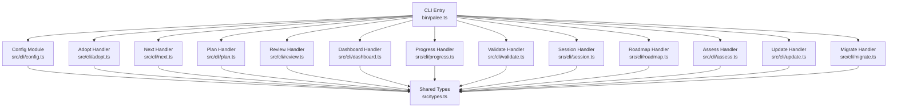
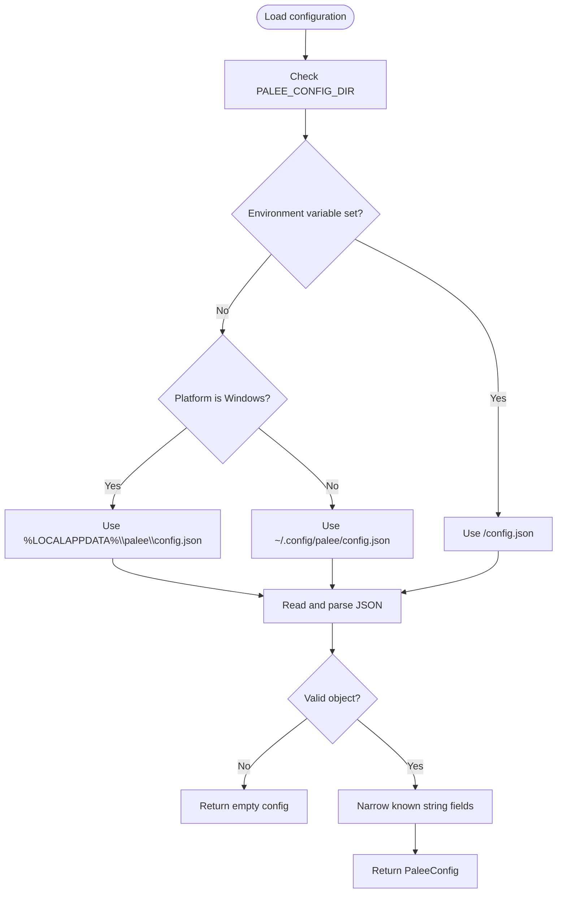
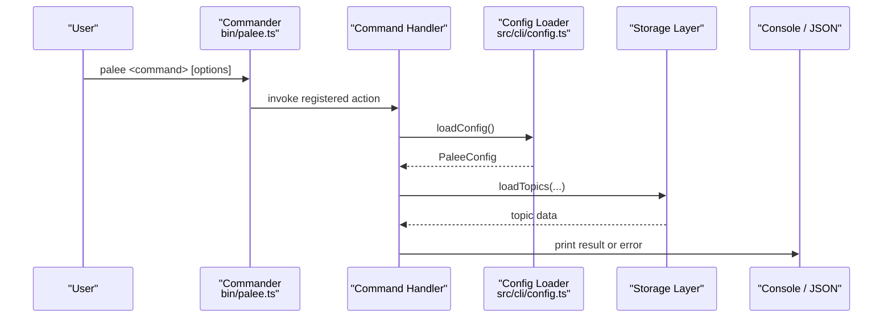
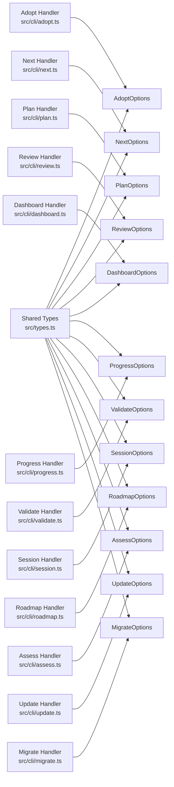

# Configuration and CLI Option Types

::: details Referenced Files in This Document

- [src/types.ts](https://github.com/Kuldeep2822k/cli/blob/main/src/types.ts)
- [bin/palee.ts](https://github.com/Kuldeep2822k/cli/blob/main/bin/palee.ts)
- [src/cli/config.ts](https://github.com/Kuldeep2822k/cli/blob/main/src/cli/config.ts)
- [src/cli/adopt.ts](https://github.com/Kuldeep2822k/cli/blob/main/src/cli/adopt.ts)
- [src/cli/next.ts](https://github.com/Kuldeep2822k/cli/blob/main/src/cli/next.ts)
- [src/cli/plan.ts](https://github.com/Kuldeep2822k/cli/blob/main/src/cli/plan.ts)
- [src/cli/review.ts](https://github.com/Kuldeep2822k/cli/blob/main/src/cli/review.ts)
- [src/cli/dashboard.ts](https://github.com/Kuldeep2822k/cli/blob/main/src/cli/dashboard.ts)
- [src/cli/progress.ts](https://github.com/Kuldeep2822k/cli/blob/main/src/cli/progress.ts)
- [src/cli/validate.ts](https://github.com/Kuldeep2822k/cli/blob/main/src/cli/validate.ts)
- [src/cli/session.ts](https://github.com/Kuldeep2822k/cli/blob/main/src/cli/session.ts)
- [src/cli/roadmap.ts](https://github.com/Kuldeep2822k/cli/blob/main/src/cli/roadmap.ts)
- [src/cli/assess.ts](https://github.com/Kuldeep2822k/cli/blob/main/src/cli/assess.ts)
- [src/cli/update.ts](https://github.com/Kuldeep2822k/cli/blob/main/src/cli/update.ts)
- [src/cli/migrate.ts](https://github.com/Kuldeep2822k/cli/blob/main/src/cli/migrate.ts)

:::

## Table of Contents
1. [Introduction](#introduction)
2. [Project Structure](#project-structure)
3. [Core Components](#core-components)
4. [Architecture Overview](#architecture-overview)
5. [Detailed Component Analysis](#detailed-component-analysis)
6. [Dependency Analysis](#dependency-analysis)
7. [Performance Considerations](#performance-considerations)
8. [Troubleshooting Guide](#troubleshooting-guide)
9. [Conclusion](#conclusion)

## Introduction
This document describes PALEE's user-facing configuration model and command-line option types. It focuses on:

- `PaleeConfig`, the primary per-user configuration interface used by most commands to locate an Obsidian vault and, when enabled, connect to an OpenAI-compatible AI backend.
- The platform-specific config file resolution path and its security properties.
- Every documented CLI option interface for `palee adopt`, `next`, `plan`, `review`, `dashboard`, `progress`, `validate`, `session`, `roadmap`, `assess`, `update`, and `migrate`.

The goal is to make it clear what each option means, what values are valid, which options interact or conflict, and how the CLI validates and acts on them.

## Project Structure
Configuration and CLI option types live in a small number of cohesive locations:

| Area | Responsibility | Key files |
|---|---|---|
| Shared types | All domain models, storage shapes, validation contracts, and CLI option interfaces | `src/types.ts` |
| CLI entry point | Commander wiring, argument parsing, help text, environment documentation | `bin/palee.ts` |
| Config loader and saver | Platform path resolution, JSON loading/saving, credential security | `src/cli/config.ts` |
| Command handlers | Each command parses options, loads config, reads/writes vault data, and reports results | `src/cli/*.ts` |



## Core Components
### PaleeConfig
`PaleeConfig` is the shared user configuration object loaded from disk and passed into most commands. It has five optional fields:

| Field | Type | Purpose | Valid values / constraints | Default behavior |
|---|---:|---|---|---|
| `vaultPath` | `string` | Absolute path to the active Obsidian vault used by commands that read or write topic notes. | Stored as an absolute path; `set-vault` resolves relative input before saving. Invalid paths cause usage errors. | If absent, many commands prompt or refuse until a vault is configured. |
| `aiProvider` | `string` | AI backend provider name. | Typically `'gemini'` or `'openai'`; other OpenAI-compatible providers may work through the base URL. | Absent unless set via `palee config set-provider`. |
| `model` | `string` | LLM model identifier sent to the configured provider. | Provider-specific model name. | Absent unless set via `palee config set-model`. |
| `baseUrl` | `string` | OpenAI-compatible endpoint URL for the configured provider. | A valid HTTP(S) endpoint. | Absent unless set via `palee config set-base-url`. |
| `apiKey` | `string` | Provider credential used for authentication. | Any non-empty string provided by the user. Stored as plaintext at rest. | Never printed by `palee config show`; only written through explicit setter actions. |

Important behavioral notes:

- The config file is **per-user**, not machine-wide. Two OS accounts on one machine get separate configurations because both default locations sit under the current user's profile.
- Unknown config keys are ignored by the loader; known keys are narrowed to strings before being placed into the runtime `PaleeConfig`.
- Malformed JSON is treated as missing config rather than crashing all commands; the loader logs a warning and returns an empty configuration.
- The `apiKey` is stored as plaintext but is protected by directory and file permissions:
  - The config directory is created with mode `0700`.
  - The config file is created with mode `0600`.
  - On Windows, POSIX mode bits are ignored, so the writer additionally checks whether the resolved config directory falls inside the current user's profile roots (`USERPROFILE`, `LOCALAPPDATA`). If the check cannot verify containment, it refuses to store the key.
  - `palee config show` never prints the API key value.

#### Config File Resolution
The resolver honors the `PALEE_CONFIG_DIR` environment variable first. If unset, it uses platform defaults:

| Platform | Default config directory | Full default path |
|---|---|---|
| Windows | `%LOCALAPPDATA%\palee` | `%LOCALAPPDATA%\palee\config.json` |
| macOS, Linux, other POSIX-like systems | `$HOME/.config/palee` | `~/.config/palee/config.json` |

When `PALEE_CONFIG_DIR` is set, the final path is `<PALEE_CONFIG_DIR>/config.json`.



## Architecture Overview
The CLI architecture is command-oriented: `bin/palee.ts` registers each subcommand with Commander, declares arguments and options, and delegates to a handler module. Handlers load `PaleeConfig` through `loadConfig()`, validate inputs, call storage/engine/application layers, and print human-readable or JSON output.



## Detailed Component Analysis

### PaleeConfig
`PaleeConfig` is intentionally minimal. It does not define validation rules for every field; instead, handlers typically validate derived values such as vault paths, pillar scores, quality ratings, or pattern syntax.

Key design points:

- `vaultPath` is the anchor for vault-scoped commands. Missing or invalid vault paths produce exit code `2` (usage).
- `aiProvider`, `model`, and `baseUrl` are consumed by the AI integration layer. They do not affect ordinary vault commands like `next`, `plan`, `dashboard`, or `progress`.
- `apiKey` is sensitive data. It is never printed, written atomically with restrictive permissions, and guarded on Windows by profile-root containment logic.

Typical configuration examples:

- Minimal vault-only configuration:
  ```json
  {
    "vaultPath": "/Users/alice/Documents/ObsidianVault"
  }
  ```
- OpenAI-compatible provider configuration:
  ```json
  {
    "vaultPath": "/Users/alice/Documents/ObsidianVault",
    "aiProvider": "openai",
    "model": "gpt-4o-mini",
    "baseUrl": "https://gateway.example.com/v1"
  }
  ```
- Gemini provider configuration:
  ```json
  {
    "vaultPath": "C:\\Users\\Bob\\ObsidianVault",
    "aiProvider": "gemini",
    "model": "gemini-pro"
  }
  ```

Security recommendations:

- Keep `config.json` readable only by the current user.
- Avoid placing the config directory in shared network drives, Dropbox-synced folders, or repository directories on Windows.
- Use `palee config set-api-key --from-env VARIABLE_NAME` in automation instead of writing secrets directly into source control.

### AdoptOptions
`AdoptOptions` controls `palee adopt`, which converts existing Markdown notes into PALEE topics.

| Option | Type | Purpose | Valid values | Default | Behavioral effect |
|---|---:|---|---|---|---|
| `difficulty` | `Difficulty` | Override difficulty assigned during adoption. | `'beginner'`, `'intermediate'`, `'advanced'`. Numeric and mixed-case inputs are normalized before use. | Not set; existing note difficulty is preserved if present. | Sets the adopted note's difficulty when a new value is supplied. |
| `dependsOn` | `string` | Comma-separated prerequisite topic IDs. | Comma-separated identifiers. | None. | Only valid in single-file mode. Declares prerequisites for the target note. |
| `all` | `boolean` | Adopt all discovered unmanaged Markdown notes. | Boolean flag. | `false` | Scans the vault according to Tier-0 hygiene and batch filters. |
| `include` | `string` | Glob inclusion patterns. | Comma-separated glob patterns; repeatable. | None. | Filters batch-mode candidates. |
| `exclude` | `string` | Glob exclusion patterns. | Comma-separated glob patterns; repeatable. | None. | Removes matched candidates from the adoption scope. |
| `tag` | `string` | Frontmatter tag filter. | Comma-separated Obsidian tags; repeatable. | None. | Matches notes whose frontmatter contains the requested tags. |
| `dryRun` | `boolean` | Preview changes without modifying files. | Boolean flag. | `false` | Reports what would change but performs no writes. |
| `verbose` | `boolean` | Show detailed inspection details. | Boolean flag. | `false` | Prints more diagnostics about scanned notes. |
| `yes` | `boolean` | Skip interactive confirmation prompts. | Boolean flag. | `false` | Proceeds without prompting when the operation requires confirmation. |
| `autoChain` | `boolean` | Auto-wire `depends_on` from numbered tree plus author enumeration. | Boolean flag. | `false` | Batch-mode only. Conflicts with `dependsOn`. |
| `chainTier` | `string` | Order signal consumed by `--auto-chain`. | `'strict'` (numbered tree only), `'full'` (numbered tree plus listing order). | `'strict'` when `autoChain` is set. | Controls which dependency signals are considered. |
| `undo` | `boolean` | Reverse an adoption instead of performing one. | Boolean flag. | `false` | Strips only PALEE-owned frontmatter keys from selected notes. |
| `dropTitle` | `boolean` | Remove the note's `title` key during undo. | Boolean flag. | `false` | Meaningless without `--undo`. Refused when `undo` is absent. |

Mutually exclusive combinations:

- `dependsOn` conflicts with `autoChain`.
- `dropTitle` requires `undo`; it is refused when `undo` is absent.
- `autoChain` and `chainTier` are batch-mode features; they describe what to write and do not apply to single-file adoption.
- Single-file adoption expects positional path input and should not be combined with batch-only filters such as `--all`, `--include`, `--exclude`, or `--tag`.

Validation rules enforced by the CLI:

- Invalid include/exclude/tag patterns are rejected.
- `--auto-chain` without a recognized `--chain-tier` value is a usage error.
- Undo mode selects notes using the same scanning logic as normal adoption, so `--all`, `--include`, `--exclude`, `--tag`, `--dry-run`, `--verbose`, and `--yes` carry over.
- Undo strips only PALEE-owned keys and preserves unknown keys, comments, key order, and body bytes.

Example invocations:

```text
palee adopt --all --include "*.md" --exclude "*template*" --tag "lesson"
palee adopt docs/Math/01-Calculus.md --difficulty beginner --depends-on topic-algebra-basics
palee adopt --all --auto-chain --chain-tier full
palee adopt --all --undo --dry-run
palee adopt --all --undo --drop-title
```

### NextOptions
`NextOptions` controls `palee next`, which shows the next topic due for review.

| Option | Type | Purpose | Valid values | Default | Behavioral effect |
|---|---:|---|---|---|---|
| `all` | `boolean` | List all ready topics instead of just the highest-priority due topic. | Boolean flag. | `false` | Returns multiple actionable topics when available. |
| `json` | `boolean` | Output machine-readable JSON. | Boolean flag. | `false` | Emits a structured payload including `next`, `due_count`, `total_topics`, `status`, and optionally `blocked`. |

Behavioral notes:

- Archived topics are excluded from the actionable set.
- When nothing is due, JSON output includes a `status` of `'ready'`, `'blocked'`, or `'nothing_due'`.
- Exit code `2` is used for missing or invalid vault paths; exit code `5` is used for unexpected exceptions.

Example invocations:

```text
palee next
palee next --all
palee next --json
```

### PlanOptions
`PlanOptions` controls `palee plan`, which shows today's learning plan.

| Option | Type | Purpose | Valid values | Default | Behavioral effect |
|---|---:|---|---|---|---|
| `json` | `boolean` | Output topological study plan as JSON. | Boolean flag. | `false` | Emits reviews due, ready-to-learn topics, quarantined cycles, blocked topics, and counts. |

Behavioral notes:

- Archived topics are excluded from derived plan figures but remain in the graph where needed for prerequisite satisfaction.
- Dependency cycles are quarantined before computing readiness.
- Blocked topics are reported once, consistently with `next` and `dashboard`.

Example invocation:

```text
palee plan --json
```

### ReviewOptions
`ReviewOptions` controls `palee review`, which records an SM-2 spaced repetition review for a topic.

| Option | Type | Purpose | Valid values | Default | Behavioral effect |
|---|---:|---|---|---|---|
| `force` | `boolean` | Record an early review without printing the early-review warning. | Boolean flag. | `false` | Does not prevent recording; only silences the notice. |

Validation rules:

- Quality must be an integer from `0` to `5`.
- Topic query must resolve to exactly one topic.
- Early reviews still update SM-2 state even when `due_at` is in the future.
- Without `--force`, early reviews print a warning explaining schedule impact.

Example invocations:

```text
palee review topic-calculus 4
palee review topic-linear-algebra 1
palee review topic-regex --force
```

### DashboardOptions
`DashboardOptions` controls `palee dashboard`, which shows a learning dashboard summary.

| Option | Type | Purpose | Valid values | Default | Behavioral effect |
|---|---:|---|---|---|---|
| `json` | `boolean` | Output dashboard metrics as JSON. | Boolean flag. | `false` | Emits totals, mastery percentages, difficulty breakdown, and next review suggestion. |

Behavioral notes:

- Archived topics are excluded from derived statistics.
- `next_review` mirrors the actionable set used by `palee next`.

Example invocation:

```text
palee dashboard --json
```

### ProgressOptions
`ProgressOptions` controls `palee progress`, which shows learning progress metrics and mastery.

| Option | Type | Purpose | Valid values | Default | Behavioral effect |
|---|---:|---|---|---|---|
| `topic` | `string` | Inspect progress for a specific topic. | Topic ID or unique substring. | None. | Resolves the topic; ambiguous matches are refused. |
| `json` | `boolean` | Output progress metrics as JSON. | Boolean flag. | `false` | Emits aggregate or per-topic progress data. |

Validation rules:

- A missing topic query exits with a usage error.
- An ambiguous topic query lists matching IDs and exits with a usage error.

Example invocations:

```text
palee progress
palee progress --topic topic-docker-networking
palee progress --topic topic-docker-networking --json
```

### ValidateOptions
`ValidateOptions` controls `palee validate`, which validates vault integrity and can attempt repairs.

| Option | Type | Purpose | Valid values | Default | Behavioral effect |
|---|---:|---|---|---|---|
| `fix` | `boolean` | Attempt automatic repairs where possible. | Boolean flag. | `false` | Repairs supported issues such as corrupted SM-2 fields and rebuilds derived views. |
| `json` | `boolean` | Output validation report as JSON. | Boolean flag. | `false` | Emits structured findings and repair results. |
| `strict` | `boolean` | Escalate warnings to a non-zero exit code. | Boolean flag. | `false` | With `--strict`, a warnings-only vault exits `3`, the same exit code used for errors. |

Repair policy:

- Repairs are driven by rule metadata. Safe, implemented repairs run automatically.
- Manual repairs are limited to an explicitly listed set.
- Some corruption, such as invalid SM-2 review fields, is repaired; other issues require manual attention.

Example invocations:

```text
palee validate
palee validate --fix
palee validate --json
palee validate --fix --strict
```

### SessionOptions
`SessionOptions` controls `palee session`, which manages learning sessions and session memory.

| Option | Type | Purpose | Valid values | Default | Behavioral effect |
|---|---:|---|---|---|---|
| `interactive` | `boolean` | Enable interactive prompt mode. | Boolean flag. | `false` | Runs the session workflow with prompts. |
| `topic` | `string` | Target topic ID for the session. | Topic ID or unique substring. | None. | Resolved against the vault; ambiguous or missing queries are refused. |
| `json` | `boolean` | Output session details as JSON. | Boolean flag. | `false` | Emits machine-readable session information. |

Validation rules:

- Explicit `--topic` values are resolved the same way as `review` and `assess`.
- If no explicit topic is given, the session falls back to hot memory's `active_topic`.
- Ambiguous or missing topic queries produce usage errors.

Example invocations:

```text
palee session start --topic T-docker-fundamentals
palee session start --interactive
palee session list --json
```

### RoadmapOptions
`RoadmapOptions` controls `palee roadmap`, which imports deterministic curriculum roadmaps.

| Option | Type | Purpose | Valid values | Default | Behavioral effect |
|---|---:|---|---|---|---|
| `from` | `string` | Path to external roadmap YAML or Markdown definition. | Vault-relative or absolute path resolving within the vault boundary. | None. | Imports topics defined in the roadmap. |
| `yes` | `boolean` | Automatically approve adoption without confirmation. | Boolean flag. | `false` | Skips interactive confirmation. |
| `autoChain` | `boolean` | Chain imported topics by their `order` field. | Boolean flag. | `false` | Each topic depends on the previous one unless it already has explicit `depends_on`. |
| `dryRun` | `boolean` | Print the full per-note import plan without writing anything. | Boolean flag. | `false` | Validates and reports ids, paths, resolved dependencies, and created/updated notes. |

Behavioral notes:

- Topics with `order` sort first; topics without `order` follow in file order.
- An explicit non-empty `depends_on` wins over synthesized chain edges.
- Cycle-closing synthesized edges are skipped with a warning.
- The import path enforces vault containment and validates topic identity.

Example invocations:

```text
palee roadmap --from docs/curriculum.yaml
palee roadmap --from docs/curriculum.yaml --auto-chain
palee roadmap --from docs/curriculum.yaml --dry-run
palee roadmap --from docs/curriculum.yaml --yes
```

### AssessOptions
`AssessOptions` controls `palee assess`, which records four-pillar assessment scores and recomputes topic mastery.

| Option | Type | Purpose | Valid values | Default | Behavioral effect |
|---|---:|---|---|---|---|
| `conceptual` | `string` | Conceptual understanding score. | Numeric string representing `0.0` to `1.0`. | Not set. | Contributes to computed mastery. |
| `practical` | `string` | Practical application score. | Numeric string representing `0.0` to `1.0`. | Not set. | Contributes to computed mastery. |
| `debug` | `string` | Debugging and troubleshooting score. | Numeric string representing `0.0` to `1.0`. | Not set. | Contributes to computed mastery. |
| `feynman` | `string` | Feynman articulation score. | Numeric string representing `0.0` to `1.0`. | Not set. | Double-weighted in mastery computation. |
| `force` | `boolean` | Suppress the lowering-assessment warning. | Boolean flag. | `false` | Records the assessment either way; only affects displayed warning. |
| `dryRun` | `boolean` | Preview assessment effects without writing. | Boolean flag. | `false` | Reports mastery transition and dependent-topic changes without acquiring locks or modifying files. |

Validation rules:

- At least one pillar score must be provided.
- Each pillar is range-checked as a finite number between `0` and `1`.
- Out-of-range or non-numeric values are rejected as usage errors.
- A recorded assessment that lowers mastery re-hides previously ready dependents.
- `--dry-run` runs the same checks as a real assessment but writes nothing.

Example invocations:

```text
palee assess topic-docker-volumes --conceptual 0.8 --feynman 0.9
palee assess topic-docker-volumes --conceptual 0.4 --practical 0.3 --debug 0.5 --feynman 0.2
palee assess topic-docker-volumes --feynman 0.1 --dry-run
palee assess topic-docker-volumes --conceptual 0.2 --force
```

### UpdateOptions
`UpdateOptions` controls `palee update`, which reports the current and latest published versions and upgrades the global install by delegating to npm.

| Option | Type | Purpose | Valid values | Default | Behavioral effect |
|---|---:|---|---|---|---|
| `dryRun` | `boolean` | Report versions and the exact npm command without installing. | Boolean flag. | `false` | Prints available version and `npm install -g @kuldeep2822k/palee@latest` without running it. |

Behavioral notes:

- This command does not load vault configuration because it operates at the machine level.
- There is no `--json` surface: npm owns stdout during installation.
- Network timeout, registry failure, or npm install failure produces a non-zero exit code.

Example invocations:

```text
palee update
palee update --dry-run
```

### MigrateOptions
`MigrateOptions` controls `palee migrate`, which evolves schema-less notes and prerequisite labels toward the current version.

| Option | Type | Purpose | Valid values | Default | Behavioral effect |
|---|---:|---|---|---|---|
| `fix` | `boolean` | Automatically migrate schema-less notes to schema v1. | Boolean flag. | `false` | Updates notes missing `palee_schema`. |
| `relabelTies` | `boolean` | Rewrite `depends_on_source: numbered` to `tie` for safe alphabetical ties. | Boolean flag. | `false` | Changes label only; never edits `depends_on`. |
| `includeUnlabeledTies` | `boolean` | Extend relabeling to notes with no `depends_on_source` key. | Boolean flag. | `false` | Opt-in because absent label is byte-identical to learner-authored data. |
| `dryRun` | `boolean` | Preview migration changes without writing. | Boolean flag. | `false` | Lists notes that would be updated or relabeled. |

Migration semantics:

- `--relabel-ties` targets notes whose stored label says `numbered` and whose edge could have been produced by the numbered planner.
- `--include-unlabeled-ties` extends this to notes adopted before the `depends_on_source` label existed.
- Migration is conservative: it never guesses learner-authored edges.
- `--dry-run` is especially important for `--include-unlabeled-ties` because that opt-in broadens the rewrite surface.

Example invocations:

```text
palee migrate --fix
palee migrate --relabel-ties
palee migrate --relabel-ties --include-unlabeled-ties
palee migrate --relabel-ties --include-unlabeled-ties --dry-run
```

## Dependency Analysis
The following diagram maps CLI option interfaces to the handlers that consume them and to shared type definitions.



## Performance Considerations
These configuration and option choices primarily affect correctness and safety rather than raw throughput, but a few interactions matter:

- Large vault scans are dominated by I/O and frontmatter parsing, not by option parsing.
- `--auto-chain` adds prerequisite extraction and dependency planning; it is heavier than plain adoption.
- `--include`, `--exclude`, and `--tag` reduce scan workload by filtering earlier, but repeated flags accumulate comma-separated patterns.
- `--dry-run` avoids writes but may still scan and validate the same scope as a real operation.
- `--fix` and `--relabel-ties` can perform many atomic writes across the vault; preview with `--dry-run` first.

## Troubleshooting Guide
Common validation and configuration problems:

| Symptom | Likely cause | Resolution |
|---|---|---|
| `LOCALAPPDATA environment variable not set` | Running on Windows without the required environment variable. | Ensure `LOCALAPPDATA` is set, or run from a proper Windows user shell. |
| Config directory not writable with credentials | Windows profile-root containment check failed. | Move the config directory inside `USERPROFILE` or `LOCALAPPDATA`. |
| `Error: Quality must be an integer from 0 to 5` | Invalid review quality argument. | Pass a value from `0` to `5`. |
| `No topic found matching ...` | Topic query resolves to nothing. | Use a topic ID or a more specific substring. |
| `Multiple topics match ...` | Topic query is ambiguous. | Narrow the query to a unique topic. |
| `Error: assess needs at least one pillar score` | No pillar flag was provided. | Add at least one of `--conceptual`, `--practical`, `--debug`, or `--feynman`. |
| Pillar score out of range | Non-finite or outside `0..1` value. | Pass a finite number between `0` and `1`. |
| `palee validate` exits non-zero with only warnings | Warnings were treated as failures because `--strict` is enabled. | Re-run without `--strict` if warnings should not fail the run, or fix the warnings. |
| Invalid SM-2 review state | Corrupted ease factor, interval, repetition, or lapse data. | Run `palee validate --fix`, then rerun affected commands. |
| Config shows old or missing vault path | `PALEE_CONFIG_DIR` changed or config is malformed. | Check the environment variable and inspect `~/.config/palee/config.json` or `%LOCALAPPDATA%\palee\config.json`. |

Exit codes commonly used by these commands:

| Code | Meaning |
|---:|---|
| `2` | Usage error: missing vault, invalid quality, invalid pillar score, ambiguous or missing topic, invalid pattern, or other caller-supplied argument problem. |
| `3` | Validation failure (errors, or warnings when `--strict` is enabled). |
| `4` | Lock conflict or concurrent modification, such as an OCC conflict during review or assessment. |
| `5` | Unexpected exception or infrastructure failure. |

## Conclusion
PALee's configuration and CLI option model separates three concerns cleanly:

1. **Per-user configuration**: `PaleeConfig` defines vault location and AI backend settings, resolved from a platform-default per-user path or `PALEE_CONFIG_DIR`.
2. **Option interfaces**: Each command has a focused TypeScript interface describing its flags, defaults, and intended behavior.
3. **Validation and side effects**: Commands enforce stricter runtime rules than the interfaces alone express, including mutually exclusive combinations, range checks, topic resolution, and vault mutation safeguards.

For safe operation:

- Store `config.json` under the current user's profile.
- Never commit `apiKey` into source control.
- Use `--dry-run` before destructive operations like `adopt --undo`, `roadmap --auto-chain`, `validate --fix`, or `migrate --relabel-ties`.
- Treat exit code `2` as a user-input problem and exit code `5` as an unexpected failure worth investigating.
