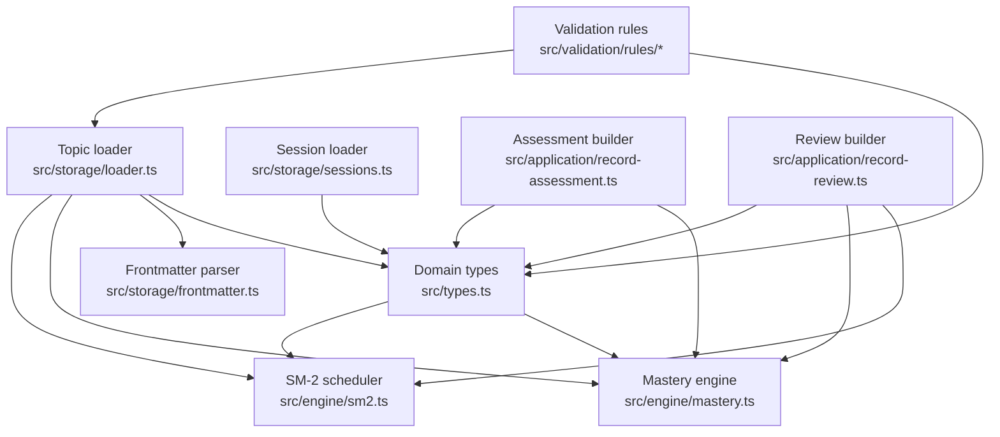
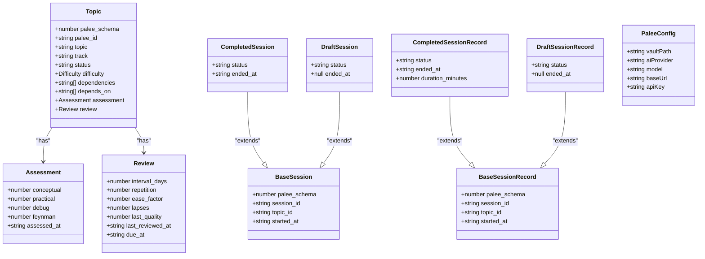
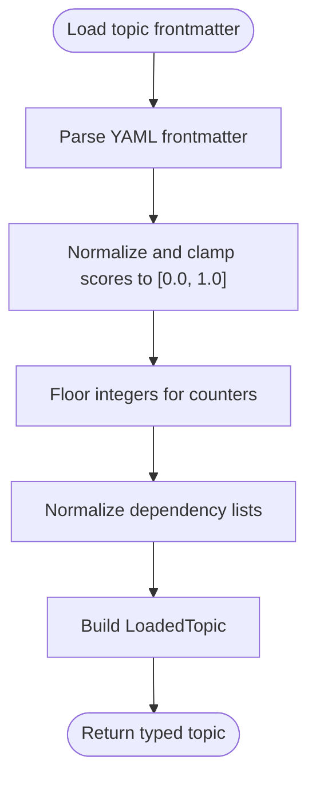
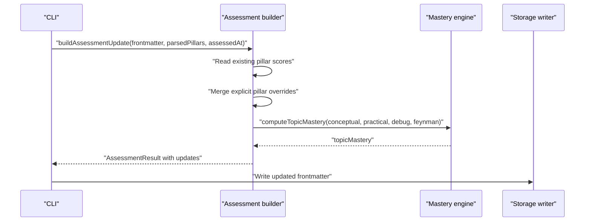
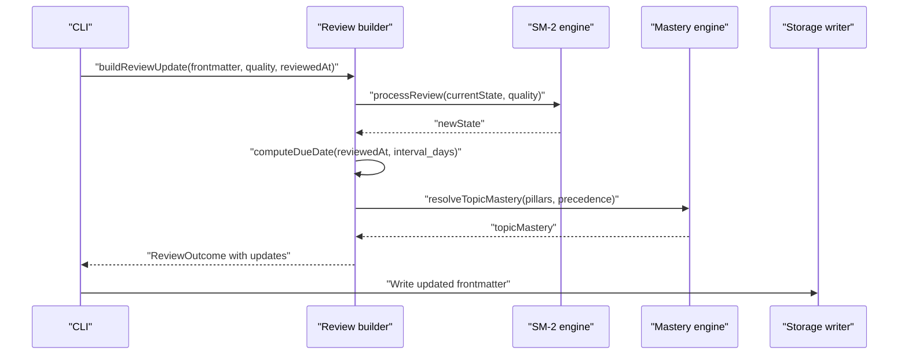
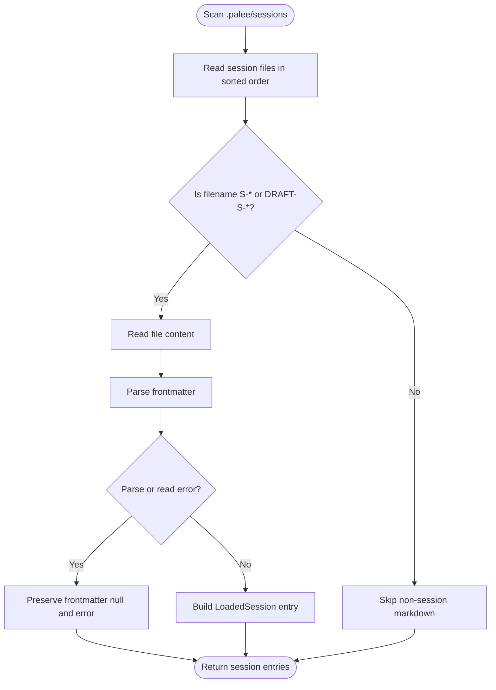
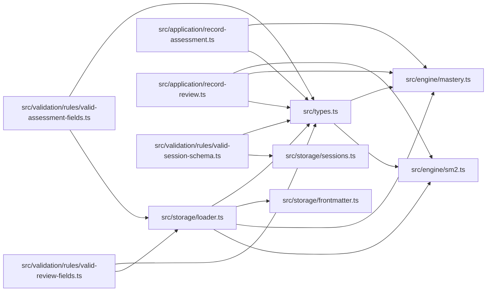

# Data Models and Types

::: details Referenced Files in This Document

- [src/types.ts](https://github.com/Kuldeep2822k/cli/blob/main/src/types.ts)
- [src/engine/mastery.ts](https://github.com/Kuldeep2822k/cli/blob/main/src/engine/mastery.ts)
- [src/engine/sm2.ts](https://github.com/Kuldeep2822k/cli/blob/main/src/engine/sm2.ts)
- [src/storage/loader.ts](https://github.com/Kuldeep2822k/cli/blob/main/src/storage/loader.ts)
- [src/storage/frontmatter.ts](https://github.com/Kuldeep2822k/cli/blob/main/src/storage/frontmatter.ts)
- [src/storage/sessions.ts](https://github.com/Kuldeep2822k/cli/blob/main/src/storage/sessions.ts)
- [src/application/record-assessment.ts](https://github.com/Kuldeep2822k/cli/blob/main/src/application/record-assessment.ts)
- [src/application/record-review.ts](https://github.com/Kuldeep2822k/cli/blob/main/src/application/record-review.ts)
- [src/validation/rules/valid-assessment-fields.ts](https://github.com/Kuldeep2822k/cli/blob/main/src/validation/rules/valid-assessment-fields.ts)
- [src/validation/rules/valid-review-fields.ts](https://github.com/Kuldeep2822k/cli/blob/main/src/validation/rules/valid-review-fields.ts)
- [src/validation/rules/valid-session-schema.ts](https://github.com/Kuldeep2822k/cli/blob/main/src/validation/rules/valid-session-schema.ts)

:::

## Table of Contents
1. [Introduction](#introduction)
2. [Project Structure](#project-structure)
3. [Core Components](#core-components)
4. [Architecture Overview](#architecture-overview)
5. [Detailed Component Analysis](#detailed-component-analysis)
6. [Dependency Analysis](#dependency-analysis)
7. [Performance Considerations](#performance-considerations)
8. [Troubleshooting Guide](#troubleshooting-guide)
9. [Conclusion](#conclusion)

## Introduction
This document describes PALEE’s data model and type system as implemented in the repository. It covers:

- The **Topic entity**, including its canonical schema, lifecycle states, difficulty levels, dependencies, assessment, and review state.
- The **Assessment model** representing the four pedagogical pillars: conceptual, practical, debug, and Feynman.
- The **Review model** representing SuperMemo-2 spaced repetition scheduling state.
- The **SessionRecord** family for session lifecycle management.
- The **Config** types used by the application.
- Type relationships, constraints, normalization rules, validation rules, schema evolution, migration procedures, runtime safety, and common manipulation patterns.

The models are defined at the top of the shared type module, then normalized during storage loading and enforced by validation rules and engine functions.

## Project Structure
The relevant data-model surface is split across a few layers:

| Layer | Responsibility | Representative files |
|---|---|---|
| Domain types | Canonical interfaces, enums, helpers, CLI options | `src/types.ts` |
| Mastery engine | Four-pillar weighted mastery computation | `src/engine/mastery.ts` |
| Scheduling engine | SM-2 interval/ease/lapse transitions | `src/engine/sm2.ts` |
| Storage loader | Frontmatter parsing, coercion, clamping, normalization | `src/storage/loader.ts`, `src/storage/frontmatter.ts` |
| Session storage | Canonical session notes and derived index | `src/storage/sessions.ts` |
| Application use cases | Assessment and review update builders | `src/application/record-assessment.ts`, `src/application/record-review.ts` |
| Validation rules | On-disk shape and range enforcement | `src/validation/rules/*` |



## Core Components

### Topic Entity
The domain-level topic model is represented by `Topic`. It is not the on-disk shape: disk frontmatter is flat, parsed into `Record<string, unknown>`, then normalized by the loader into richer in-memory structures such as `TopicNode` and `LoadedTopic`.

| Field | Type / Constraint | Meaning |
|---|---|---|
| `palee_schema` | number | Schema version for forward compatibility. |
| `palee_id` | string | Unique topic identifier within the vault. |
| `topic` | string | Human-readable title or subject name. |
| `track` | string, optional | Optional curriculum track or category grouping. |
| `status` | `'not_started' \| 'learning' \| 'paused' \| 'archived'` | Learning lifecycle state. |
| `difficulty` | `'beginner' \| 'intermediate' \| 'advanced'` | Normalized difficulty level. |
| `dependencies` | string array, optional | Legacy alias for prerequisites. |
| `depends_on` | string array, optional | Canonical prerequisite topic IDs. |
| `assessment` | `Assessment` | Four-pillar pedagogical breakdown. |
| `review` | `Review` | Spaced repetition scheduling metadata. |

#### Lifecycle States
The canonical `Topic.status` values are:

| State | Interpretation |
|---|---|
| `not_started` | Topic exists but has not been entered into active learning. |
| `learning` | Topic is actively being studied. |
| `paused` | Study was intentionally suspended. |
| `archived` | Topic is retired from normal planning. |

These values are part of the canonical `Topic` interface. Validation and planner logic elsewhere may treat additional legacy strings, but the canonical type constrains valid programmatic usage.

#### Difficulty Normalization
Difficulty is normalized through `normalizeDifficulty`:

| Input | Normalized Output |
|---|---|
| `'BEGINNER'` | `'beginner'` |
| `'intermediate'` | `'intermediate'` |
| `'advanced'` | `'advanced'` |
| `1` | `'beginner'` |
| `2` or `3` | `'intermediate'` |
| `4` or `5` | `'advanced'` |
| Invalid or missing | `'intermediate'` |

#### Dependencies
Prerequisites can be expressed as:

- `depends_on`: canonical prerequisite list.
- `dependencies`: legacy alias tolerated by storage-layer normalization but forbidden on the engine-facing `TopicNode`.
- `depends_on_source`: provenance label (`numbered`, `toc`, `declared`, `tie`) that determines whether edges gate readiness.

Advisory sources (`toc`, `tie`) participate in cycle detection and ranking but do not block readiness; `numbered` and `declared` gate.

#### Example Valid Topic
On disk a topic is flat YAML frontmatter; the loader normalizes it into the `Topic` / `TopicNode` shapes described above. The frontmatter below is verbatim from the shipped example note `examples/Docker Networking.md` in the CLI repository — a never-assessed, never-reviewed topic with one prerequisite:

```yaml
---
palee_schema: 1
palee_id: T-docker-networking
title: Docker Networking
difficulty: advanced
depends_on:
  - T-docker-fundamentals
topic_mastery: 0
assessed_at: null
conceptual: 0
practical: 0
debug: 0
feynman: 0
ease_factor: 2.5
interval_days: 1
repetition: 0
lapses: 0
last_quality: null
last_reviewed_at: null
due_at: null
---
```

A topic that has been studied carries the same keys with non-default values; `examples/Docker Fundamentals.md` shows one after its first review (`repetition: 1`, `last_quality: 4`, `due_at` set).

### Assessment Model
The `Assessment` model captures the four pedagogical pillars and the timestamp of the last assessment.

| Pillar | Weight | Allowed Range | Interpretation |
|---|---:|---:|---|
| `conceptual` | 20% | 0.0 to 1.0 | Conceptual understanding. |
| `practical` | 20% | 0.0 to 1.0 | Practical application ability. |
| `debug` | 20% | 0.0 to 1.0 | Debugging and troubleshooting skill. |
| `feynman` | 40% | 0.0 to 1.0 | Feynman articulation skill; double-weighted in mastery. |
| `assessed_at` | Timestamp | ISO 8601 string or null | Last assessment time; null means unassessed. |

#### Scoring Formula
Overall topic mastery is computed as:

```
topic_mastery = round((conceptual + practical + debug + 2 × feynman) / 5, 4)
```

Scores are normalized to `[0.0, 1.0]` with four decimal places before calculation. The mastered threshold is `0.7`.

#### Pillar Eligibility
The assessment use case exposes exactly four pillar flags:

| Flag | Description |
|---|---|
| `conceptual` | Conceptual understanding score. |
| `practical` | Practical application score. |
| `debug` | Debugging and troubleshooting score. |
| `feynman` | Feynman articulation score. |

At least one pillar must be supplied when recording an assessment. If a pillar is absent from the note, it defaults to zero unless explicitly provided.

#### Example Valid Assessment
Assessments are stored as flat frontmatter keys, not as a nested object. A real assessed topic (from the CLI end-to-end test fixtures) stores:

```yaml
conceptual: 0.80
practical: 0.70
debug: 0.90
feynman: 0.85
assessed_at: "2026-09-01"
topic_mastery: 0.82
```

The stored `topic_mastery` checks out against the scoring formula: (0.80 + 0.70 + 0.90 + 2 × 0.85) / 5 = 4.10 / 5 = 0.82, which is above the 0.7 mastered threshold. An unassessed topic instead has all pillar fields absent or zero and `assessed_at` equal to null, as in the Docker Networking example above.

### Review Model
The `Review` model represents SuperMemo-2 spaced repetition state.

| Field | Type / Constraint | Default Behavior | Meaning |
|---|---|---:|---|
| `interval_days` | number, finite, integer, ≥ 1 | 1 | Days until next review. |
| `repetition` | number, finite, integer, ≥ 0 | 0 | Consecutive successful repetitions. |
| `ease_factor` | number, finite, ≥ 1.3 | 2.5 | Easiness factor controlling interval scaling. |
| `lapses` | number, finite, integer, ≥ 0 | 0 | Cumulative count of failed reviews (quality 0–2). Increments only when the topic had prior repetitions (`repetition > 0`); a failure before the first successful repetition is not a lapse. |
| `last_quality` | integer 0–5 or null | null | Quality rating from the most recent review. |
| `last_reviewed_at` | ISO date string or null | null | Date of the last completed review. |
| `due_at` | ISO date string, date object, or null | null | Next due date for review. |

#### SM-2 Transition Rules
When a review quality is recorded:

| Quality | Outcome |
|---:|---|
| 0–2 | Repetition resets to 0; interval resets to 1; lapse count increments only if `repetition > 0` before the reset (the topic had prior repetitions). |
| 3–5 | Repetition increments; interval becomes 1 for repetition 1, 6 for repetition 2, otherwise rounded product of previous interval and ease factor; minimum interval is 1. |
| All | Ease factor increases by the SM-2 delta based on quality and is clamped to a minimum of 1.3. |

The maximum interval cap is 36,500 days (about 100 years). This prevents schedules from eventually producing invalid dates.

#### Example Valid Review
Review state is stored as seven flat frontmatter keys on the topic note. A never-reviewed topic carries the default scheduling state (shown here from `examples/Docker Networking.md`):

```yaml
ease_factor: 2.5
interval_days: 1
repetition: 0
lapses: 0
last_quality: null
last_reviewed_at: null
due_at: null
```

After one successful review with quality 4, the same keys look like this (from `examples/Docker Fundamentals.md`). Quality 4 has an ease-factor delta of 0, so the ease factor stays 2.5; repetition 1 schedules the next review 1 day out:

```yaml
ease_factor: 2.5
interval_days: 1
repetition: 1
lapses: 0
last_quality: 4
last_reviewed_at: 2026-08-09
due_at: 2026-08-10
```

A learned topic may have higher ease factors, larger intervals, non-zero repetition and possibly lapses.

### SessionRecord Family
Session records model the learner’s study sessions. There are two distinct concepts:

1. In-memory session union used by internal flows.
2. Persisted session frontmatter records stored under `.palee/sessions/`.

#### In-Memory Session Union
| Discriminant | Required Fields | Meaning |
|---|---|---|
| `CompletedSession` | `status: 'completed'`, `ended_at` | Finished session with end timestamp. |
| `DraftSession` | `status: 'draft'`, `ended_at: null` | In-progress checkpoint without completion. |

Both share:

| Field | Meaning |
|---|---|
| `palee_schema` | Schema version. |
| `session_id` | Unique session identifier. |
| `topic_id` | Studied topic identifier. |
| `started_at` | ISO 8601 start timestamp. |

#### Persisted Session Record
| Discriminant | Required Fields | Meaning |
|---|---|---|
| `CompletedSessionRecord` | `status: 'completed'`, `ended_at` | Completed session file record; may include `duration_minutes`. |
| `DraftSessionRecord` | `status: 'draft'`, `ended_at: null` | Draft checkpoint file record. |

Both share:

| Field | Meaning |
|---|---|
| `palee_schema` | Session schema version. |
| `session_id` | Unique session identifier. |
| `topic_id` | Studied topic identifier. |
| `started_at` | ISO 8601 start timestamp. |

#### Session Validation Contract
Canonical session notes must satisfy:

- Parseable YAML frontmatter.
- Required fields: `palee_schema`, `session_id`, `topic_id`, `started_at`.
- Completed sessions must also have `ended_at` and `status: 'completed'`.
- Draft sessions must have `status: 'draft'` and `ended_at: null`.
- `session_id` must match the filename stem (`S-*` or `DRAFT-S-*`).
- Status must match the filename convention.
- `started_at` and `ended_at` must be strict ISO 8601 timestamps with explicit timezone designators.
- For completed sessions, `ended_at` must not precede `started_at`.

#### Example Valid Session Records
Session records live as Markdown notes under `.palee/sessions/`, and the filename stem must equal the `session_id`. A completed session (`.palee/sessions/S-20260820T100000-aaaa.md`) has both start and end timestamps and status `completed`:

```yaml
---
palee_schema: 1
session_id: S-20260820T100000-aaaa
topic_id: T-valid
status: completed
started_at: "2026-08-20T10:00:00Z"
ended_at: "2026-08-20T10:30:00Z"
duration_minutes: 30
---
```

A draft session (`.palee/sessions/DRAFT-S-45min.md`) has a start timestamp, a null end timestamp, and status `draft`:

```yaml
---
palee_schema: 1
session_id: DRAFT-S-45min
topic_id: T-45min
started_at: "2026-08-20T10:00:00.000Z"
ended_at: null
status: draft
---
```

Both shapes are taken from the CLI test fixtures. A malformed session could have mismatched status, missing timestamps, or an invalid schema version.

### Config Types
The configuration model is represented by `PaleeConfig`. It is read from a platform-specific JSON config file and may contain:

| Field | Type | Meaning |
|---|---|---|
| `vaultPath` | string, optional | Absolute path to the active Obsidian vault. |
| `aiProvider` | string, optional | AI backend provider identifier. |
| `model` | string, optional | Specific LLM model identifier. |
| `baseUrl` | string, optional | OpenAI-compatible provider endpoint. |
| `apiKey` | string, optional | Provider credential, stored as plaintext at rest. |

Configuration loading is tolerant: missing files return empty defaults, and malformed JSON logs a warning and falls back to defaults. Only recognized string properties are retained.

The `apiKey` is stored as plaintext inside `config.json` — it is not encrypted — but the file itself is protected. The config file lives at `~/.config/palee/config.json` on POSIX or `%LOCALAPPDATA%/palee/config.json` on Windows (overridable with `PALEE_CONFIG_DIR`). On POSIX it is written `0600` inside a `0700` directory, the mode being set on a temporary file before the atomic rename into place. Windows ignores those file modes, so the `set-api-key` command instead refuses to store a key when the config directory resolves outside the user's profile roots (`%USERPROFILE%`, `%LOCALAPPDATA%`), where the inherited ACL cannot be trusted; `PALEE_ALLOW_INSECURE_CONFIG_DIR=1` overrides that refusal for a directory the user has secured by other means. The `PALEE_API_KEY` environment variable avoids storing the key at all, and `palee config show` never prints the stored value.

#### Example Valid Configuration
A minimal configuration may only set `vaultPath`:

```json
{
  "vaultPath": "/home/user/notes-vault"
}
```

A full configuration may additionally set provider, model, endpoint, and API key:

```json
{
  "vaultPath": "/home/user/notes-vault",
  "aiProvider": "anthropic",
  "baseUrl": "https://api.anthropic.com",
  "model": "<model-id>",
  "apiKey": "sk-..."
}
```

### Schema Evolution and Migration
Every managed note carries a `palee_schema` version field. The currently supported version is `1`, declared as `SUPPORTED_SCHEMA_VERSION` in `src/engine/topic-id.ts`. Schema evolution is deliberately conservative: there is only one live version, and the validation layer enforces it rather than silently coercing unknown shapes.

- The `valid-palee-schema` rule reports an error when a managed note is missing `palee_schema`, when the value is not an integer, or when it names an unsupported version. Session notes are held to the same version by the session schema rule.
- The `palee migrate` command (options typed as `MigrateOptions` in `src/types.ts`) scans the vault and reports schema problems. With `--fix` it upgrades schema-less notes in place by writing `palee_schema: 1`. A note carrying an *unrecognized* schema value is not fixable by `--fix` — it keeps failing validation until a human decides what it is.
- `migrate` also repairs dependency-label drift left by older versions: `--relabel-ties` rewrites `depends_on_source: numbered` to `tie` on notes whose only stored prerequisite is a same-rank sibling in the same directory (the label only — `depends_on` itself is never rewritten), and `--include-unlabeled-ties` extends that scan to notes that carry no `depends_on_source` key at all — the shape left behind before the label existed. `--dry-run` previews any of these passes without writing.

So a schema bump, when one eventually happens, has a defined path: raise `SUPPORTED_SCHEMA_VERSION`, teach `migrate --fix` the upgrade, and let validation flag every note that has not been migrated yet.

## Architecture Overview
All canonical data models are declared in a single module, `src/types.ts`. `Topic` is the aggregate: it composes one `Assessment` and one `Review`, and carries the topic's identity (`palee_schema`, `palee_id`), lifecycle state (`status`, `difficulty`), and prerequisite edges (`depends_on`, with `dependencies` as a legacy alias). Sessions exist in two parallel families with deliberately identical field shapes: the in-memory `Session` union (`CompletedSession` / `DraftSession`) used while a session is running, and the persisted `SessionRecord` union (`CompletedSessionRecord` / `DraftSessionRecord`) stored as frontmatter under `.palee/sessions/`. `PaleeConfig` stands apart from the vault models — it describes application settings, not learning data.

Nothing outside `src/types.ts` owns a model definition. The storage loader converts flat on-disk frontmatter into these shapes (see Detailed Component Analysis), the engines compute over them, and the validation rules inspect raw frontmatter against the same contracts. The class diagram below shows the field-level layout; the companion pages in this section (Topic Entity, Assessment Model, Review Model, Session Types and Lifecycle, Configuration and CLI Option Types) document each model individually.



Two structural points are worth noting. First, composition is shallow: `Topic` nests exactly two value objects (`Assessment`, `Review`) and everything else is scalar, so a topic serializes to one flat frontmatter block. Second, the session families are parallel rather than shared — the persisted records repeat the in-memory fields instead of extending them, because the on-disk contract (including the filename-to-`session_id` coherence rule) is owned by the storage layer, not by the runtime types.

## Detailed Component Analysis

### Topic Loading and Normalization Flow
The loader is the boundary between raw Markdown frontmatter and typed domain objects. It performs:

1. Vault scanning and frontmatter parsing.
2. Coercion of numeric scores to finite numbers.
3. Clamping scores to `[0.0, 1.0]` with four decimal precision.
4. Integer flooring for review counters.
5. Dependency normalization.
6. Construction of `LoadedTopic` and related in-memory representations.



### Assessment Recording Flow
Recording an assessment merges explicit pillar inputs over stored pillar values, recomputes mastery, updates `assessed_at`, and returns the frontmatter fields to write.



### Review Recording Flow
Recording a review computes new SM-2 state, derives the next due date, preserves existing pillar scores, and reports whether the review is early relative to the stored due date.



### Session Loading and Validation Flow
Session loading reads every session note, classifies it as draft or confirmed, parses frontmatter, and preserves parse/read errors so validation can report them without aborting the entire scan.



## Dependency Analysis
The dependency direction is one-way: every layer points at the type module, and `src/types.ts` imports nothing from the engine, storage, application, or validation layers. The mastery engine is self-contained arithmetic over the four pillar numbers — it has no imports at all. The SM-2 engine imports only the `Review` type (plus a shared diagnostic formatter from the validation rules). The storage loader builds on the type module — which also hosts the normalizer helpers (`normalizeDifficulty`, `normalizeAssessedAt`, `normalizeDependsOnSource`) — and on storage-internal helpers for frontmatter parsing, vault walking, and caching. The application builders sit on top: `record-review` calls the SM-2 and mastery engines, and `record-assessment` calls the mastery and dependency engines. The validation rules depend on the shared validation contracts (`src/validation/types.ts`) and inspect raw frontmatter and loader-produced shapes; they never write. Because no layer imports upward, a model can be changed in exactly one place.



## Performance Considerations
- Scores are clamped and rounded once during loader normalization, avoiding repeated floating-point drift.
- SM-2 scheduling caps intervals at 36,500 days to prevent extremely long schedules and invalid date arithmetic.
- Negative caching separates non-topic notes from real topics so large vaults do not degrade topic lookup performance.
- Session loading reads files in deterministic sorted order and preserves per-file parse/read errors instead of failing the entire scan.
- Frontmatter updates preserve comments, ordering, and line endings where possible, reducing unnecessary diff noise.

## Troubleshooting Guide

### Common Assessment Issues
- **Score out of range:** Pillar scores must be finite numbers between 0.0 and 1.0.
- **Invalid assessment timestamp:** `assessed_at` must be null or a valid calendar date.
- **Missing pillar handling:** Absent pillars default to zero unless explicitly provided by the assessment command.
- **Mastery drift:** Stored `topic_mastery` should match the formula result; mismatch is handled by mastery consistency rules rather than this rule.

### Common Review Issues
- **Ease factor below 1.3:** SM-2 requires a minimum ease factor of 1.3.
- **Non-integer interval or counters:** `interval_days`, `repetition`, and `lapses` must be finite integers with appropriate lower bounds.
- **Invalid quality rating:** `last_quality` must be null or an integer from 0 to 5.
- **Early review:** A review performed before the stored `due_at` is detected by the application layer and reported as early.

### Common Session Issues
- **Malformed frontmatter:** Session notes must have parseable YAML.
- **Mismatched session ID:** `session_id` must match the filename stem.
- **Status-filename mismatch:** `S-*` files must not say `draft`; `DRAFT-S-*` files must not say `completed`.
- **Invalid timestamps:** Timestamps must be strict ISO 8601 with explicit timezone designators and real calendar dates.
- **Ordering violation:** Completed session `ended_at` must not precede `started_at`.

## Conclusion
PALEE’s data model centers on three durable concerns:

1. **Learning content:** Topics carry identity, lifecycle state, difficulty, prerequisites, and four-pillar assessments.
2. **Spaced repetition:** Reviews encode SM-2 scheduling state with strict numeric and temporal invariants.
3. **Study history:** Session records capture canonical session lifecycles with strong filename-to-ID coherence.

The type system separates:

- Canonical domain types (`Topic`, `Assessment`, `Review`, `SessionRecord`, `PaleeConfig`).
- Storage-layer normalized shapes (`LoadedTopic`, `LoadedSession`).
- Validation rules that inspect raw on-disk frontmatter.
- Engine logic that computes mastery and scheduling transitions.

Schema evolution is signaled by `palee_schema`, while migration behavior is exposed through `MigrateOptions`. Runtime safety comes from loader coercion and clamping, while compile-time safety comes from TypeScript interfaces, discriminated unions, literal enum types, and narrow validation-rule contracts.

## References

- [src/types.ts:1-120](https://github.com/Kuldeep2822k/cli/blob/main/src/types.ts#L1-L120)
- [src/engine/mastery.ts:1-120](https://github.com/Kuldeep2822k/cli/blob/main/src/engine/mastery.ts#L1-L120)
- [src/engine/sm2.ts:1-80](https://github.com/Kuldeep2822k/cli/blob/main/src/engine/sm2.ts#L1-L80)
- [src/storage/loader.ts:1-120](https://github.com/Kuldeep2822k/cli/blob/main/src/storage/loader.ts#L1-L120)
- [src/storage/frontmatter.ts:1-60](https://github.com/Kuldeep2822k/cli/blob/main/src/storage/frontmatter.ts#L1-L60)
- [src/storage/sessions.ts:1-60](https://github.com/Kuldeep2822k/cli/blob/main/src/storage/sessions.ts#L1-L60)
- [src/application/record-assessment.ts:1-40](https://github.com/Kuldeep2822k/cli/blob/main/src/application/record-assessment.ts#L1-L40)
- [src/application/record-review.ts:1-40](https://github.com/Kuldeep2822k/cli/blob/main/src/application/record-review.ts#L1-L40)
- [src/validation/rules/valid-assessment-fields.ts:1-30](https://github.com/Kuldeep2822k/cli/blob/main/src/validation/rules/valid-assessment-fields.ts#L1-L30)
- [src/validation/rules/valid-review-fields.ts:1-40](https://github.com/Kuldeep2822k/cli/blob/main/src/validation/rules/valid-review-fields.ts#L1-L40)
- [src/types.ts:540-660](https://github.com/Kuldeep2822k/cli/blob/main/src/types.ts#L540-L660)
- [src/storage/loader.ts:120-200](https://github.com/Kuldeep2822k/cli/blob/main/src/storage/loader.ts#L120-L200)
- [src/types.ts:1-60](https://github.com/Kuldeep2822k/cli/blob/main/src/types.ts#L1-L60)
- [src/application/record-assessment.ts:1-134](https://github.com/Kuldeep2822k/cli/blob/main/src/application/record-assessment.ts#L1-L134)
- [src/validation/rules/valid-assessment-fields.ts:1-79](https://github.com/Kuldeep2822k/cli/blob/main/src/validation/rules/valid-assessment-fields.ts#L1-L79)
- [src/types.ts:30-60](https://github.com/Kuldeep2822k/cli/blob/main/src/types.ts#L30-L60)
- [src/engine/sm2.ts:1-200](https://github.com/Kuldeep2822k/cli/blob/main/src/engine/sm2.ts#L1-L200)
- [src/application/record-review.ts:1-116](https://github.com/Kuldeep2822k/cli/blob/main/src/application/record-review.ts#L1-L116)
- [src/validation/rules/valid-review-fields.ts:1-166](https://github.com/Kuldeep2822k/cli/blob/main/src/validation/rules/valid-review-fields.ts#L1-L166)
- [src/types.ts:120-280](https://github.com/Kuldeep2822k/cli/blob/main/src/types.ts#L120-L280)
- [src/storage/sessions.ts:1-200](https://github.com/Kuldeep2822k/cli/blob/main/src/storage/sessions.ts#L1-L200)
- [src/validation/rules/valid-session-schema.ts:1-200](https://github.com/Kuldeep2822k/cli/blob/main/src/validation/rules/valid-session-schema.ts#L1-L200)
- [src/types.ts:280-420](https://github.com/Kuldeep2822k/cli/blob/main/src/types.ts#L280-L420)
- [src/cli/config.ts:1-200](https://github.com/Kuldeep2822k/cli/blob/main/src/cli/config.ts#L1-L200)
- [src/storage/loader.ts:1-200](https://github.com/Kuldeep2822k/cli/blob/main/src/storage/loader.ts#L1-L200)
- [src/storage/frontmatter.ts:1-120](https://github.com/Kuldeep2822k/cli/blob/main/src/storage/frontmatter.ts#L1-L120)
- [src/engine/mastery.ts:120-229](https://github.com/Kuldeep2822k/cli/blob/main/src/engine/mastery.ts#L120-L229)
- [src/types.ts:1-420](https://github.com/Kuldeep2822k/cli/blob/main/src/types.ts#L1-L420)
- [src/engine/mastery.ts:1-229](https://github.com/Kuldeep2822k/cli/blob/main/src/engine/mastery.ts#L1-L229)
