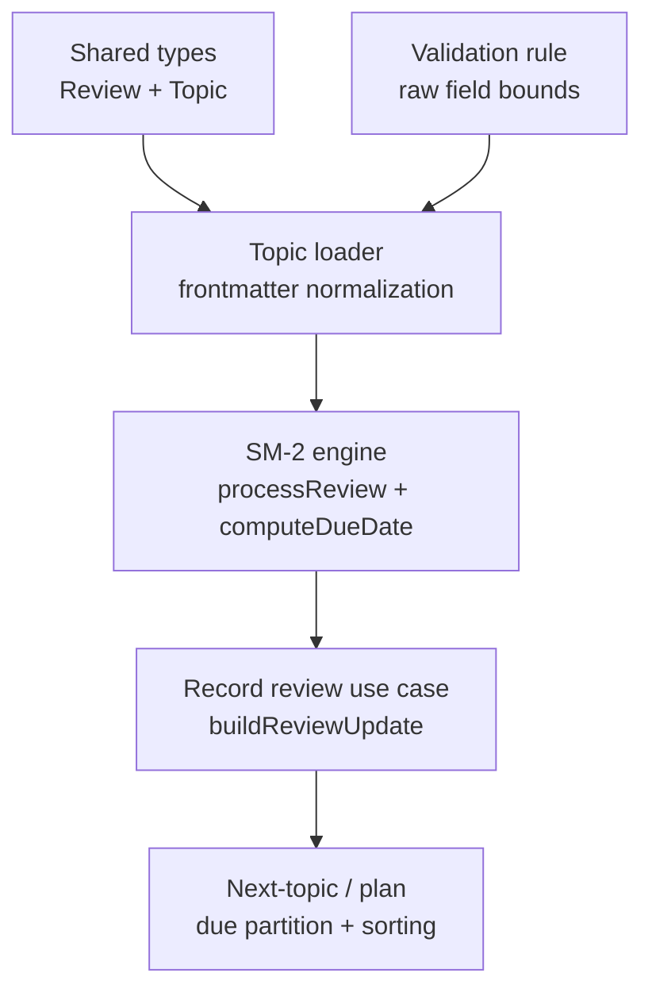
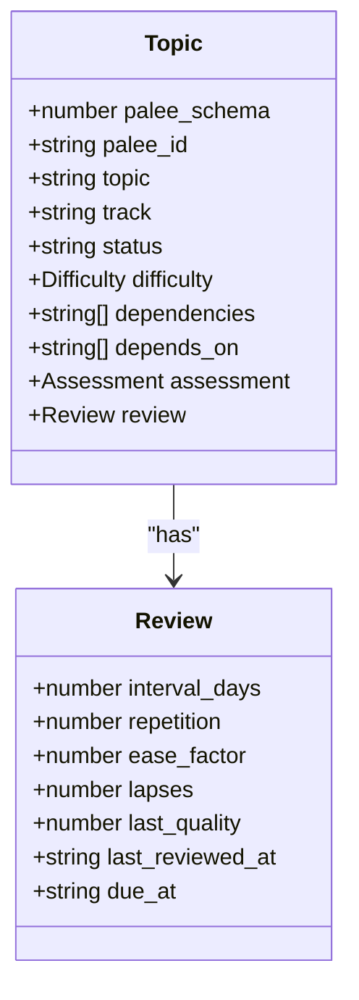
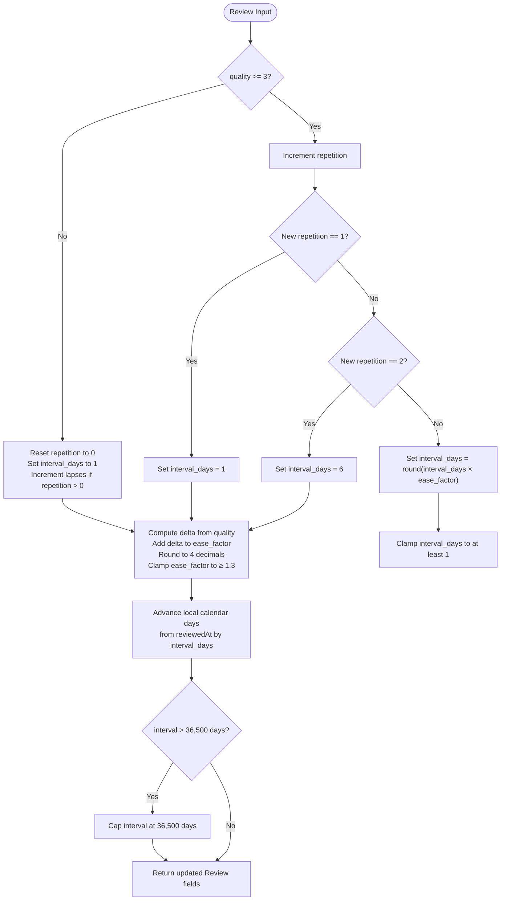
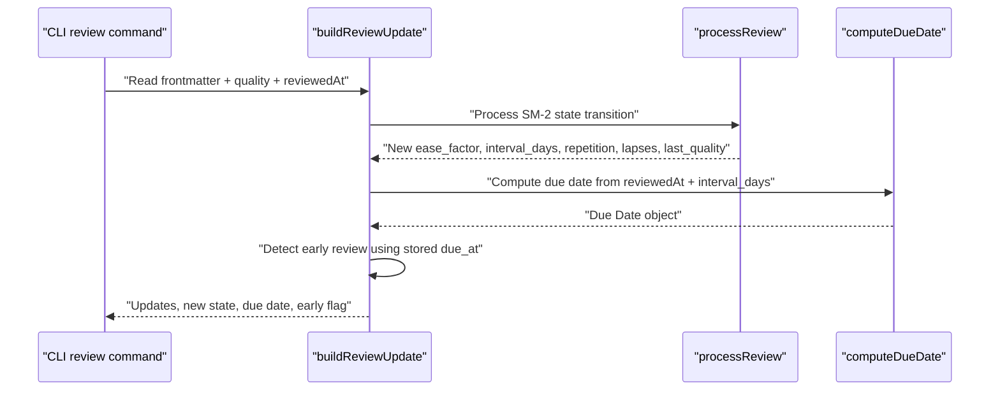
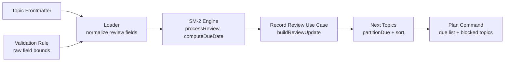
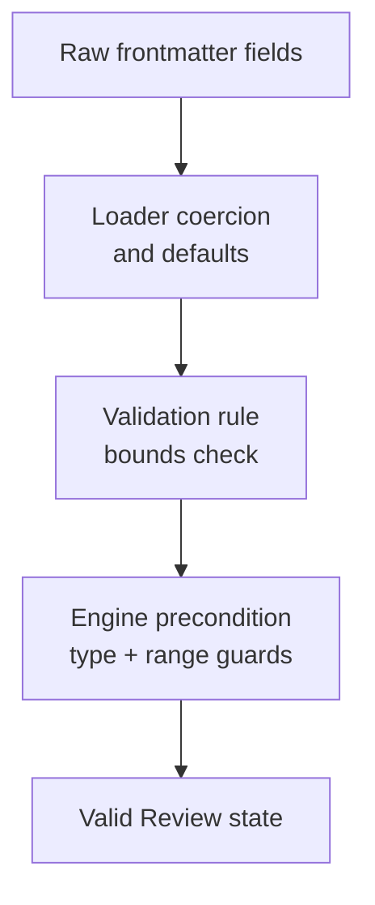
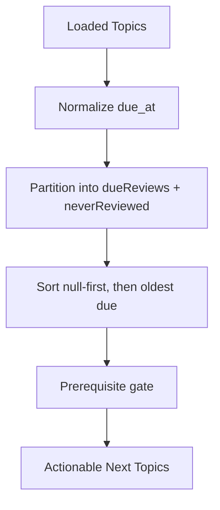
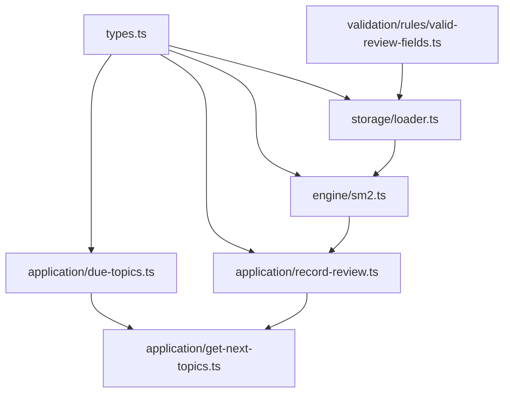

# Review Model (SM-2 Scheduling)

::: details Referenced Files in This Document

- [types.ts](https://github.com/Kuldeep2822k/cli/blob/main/src/types.ts)
- [sm2.ts](https://github.com/Kuldeep2822k/cli/blob/main/src/engine/sm2.ts)
- [record-review.ts](https://github.com/Kuldeep2822k/cli/blob/main/src/application/record-review.ts)
- [due-topics.ts](https://github.com/Kuldeep2822k/cli/blob/main/src/application/due-topics.ts)
- [get-next-topics.ts](https://github.com/Kuldeep2822k/cli/blob/main/src/application/get-next-topics.ts)
- [valid-review-fields.ts](https://github.com/Kuldeep2822k/cli/blob/main/src/validation/rules/valid-review-fields.ts)
- [loader.ts](https://github.com/Kuldeep2822k/cli/blob/main/src/storage/loader.ts)
- [engine-sm2.test.ts](https://github.com/Kuldeep2822k/cli/blob/main/test/engine-sm2.test.ts)

:::

## Table of Contents
1. [Introduction](#introduction)
2. [Project Structure](#project-structure)
3. [Core Components](#core-components)
4. [Architecture Overview](#architecture-overview)
5. [Detailed Component Analysis](#detailed-component-analysis)
6. [Dependency Analysis](#dependency-analysis)
7. [Performance Considerations](#performance-considerations)
8. [Troubleshooting Guide](#troubleshooting-guide)
9. [Conclusion](#conclusion)

## Introduction
This document describes the **Review** model that stores SuperMemo SM-2 spaced repetition scheduling state for a Topic. It explains every field, the SM-2 algorithm mechanics implemented by the engine, how quality ratings affect intervals and ease factors, lapse handling, timezone behavior, due-date scheduling, and how Review integrates with Topic loading, validation, review recording, progress reporting, and next-topic discovery.

The Review model is not just a data shape; it is the persistent memory of an item’s learning history. Its fields are read from topic frontmatter, validated against SM-2 invariants, transformed by the SM-2 scheduler, and written back as local date-only strings when scheduling completes.

## Project Structure
The Review model spans several layers:

- **Type definition**: `Review` is declared in the shared type layer.
- **Algorithm implementation**: SM-2 state transitions and due-date computation live in the engine.
- **Application use case**: Recording a review composes the algorithm with timestamping and mastery updates.
- **Storage loader**: Normalizes raw frontmatter values before they reach the engine.
- **Validation rules**: Inspect raw on-disk fields to detect vault corruption and offer repairs.
- **Scheduling consumers**: Next-topic and plan logic sort and filter topics by their due dates.

**Diagram sources**
- [types.ts:28-60](https://github.com/Kuldeep2822k/cli/blob/main/src/types.ts#L28-L60)
- [loader.ts:1-200](https://github.com/Kuldeep2822k/cli/blob/main/src/storage/loader.ts#L1-L200)
- [valid-review-fields.ts:1-166](https://github.com/Kuldeep2822k/cli/blob/main/src/validation/rules/valid-review-fields.ts#L1-L166)
- [sm2.ts:1-306](https://github.com/Kuldeep2822k/cli/blob/main/src/engine/sm2.ts#L1-L306)
- [record-review.ts:1-116](https://github.com/Kuldeep2822k/cli/blob/main/src/application/record-review.ts#L1-L116)
- [get-next-topics.ts:1-199](https://github.com/Kuldeep2822k/cli/blob/main/src/application/get-next-topics.ts#L1-L199)
- [due-topics.ts:1-58](https://github.com/Kuldeep2822k/cli/blob/main/src/application/due-topics.ts#L1-L58)

**Section sources**
- [types.ts:28-60](https://github.com/Kuldeep2822k/cli/blob/main/src/types.ts#L28-L60)
- [sm2.ts:1-306](https://github.com/Kuldeep2822k/cli/blob/main/src/engine/sm2.ts#L1-L306)
- [record-review.ts:1-116](https://github.com/Kuldeep2822k/cli/blob/main/src/application/record-review.ts#L1-L116)
- [due-topics.ts:1-58](https://github.com/Kuldeep2822k/cli/blob/main/src/application/due-topics.ts#L1-L58)
- [get-next-topics.ts:1-199](https://github.com/Kuldeep2822k/cli/blob/main/src/application/get-next-topics.ts#L1-L199)

## Core Components

### Review Type Definition
The `Review` interface defines the canonical SM-2 scheduling state attached to a Topic.

| Field | Type | Meaning | Invariant or Default Behavior |
|---|---|---|---|
| `interval_days` | `number` | Current scheduled interval in days until the next review. | Must be finite and at least 1. The engine caps computed intervals at 36,500 days (about 100 years). |
| `repetition` | `number` | Number of consecutive successful reviews since the last lapse. | Must be a non-negative integer. Resets to 0 after a failed review. |
| `ease_factor` | `number` | SM-2 easiness multiplier controlling future interval growth. | Minimum 1.3; initial default 2.5. Rounded to four decimal places. |
| `lapses` | `number` | Cumulative count of failed reviews after the item was previously learned. | Non-negative integer. Increments only when `repetition > 0`. |
| `last_quality` | `number \| null` | Quality rating submitted during the last review session. | Integer 0–5, or `null` when no review has been recorded. |
| `last_reviewed_at` | `string \| null` | Timestamp of the last completed review. | ISO 8601 string or `null`. Written as a local date-only string by the application layer. |
| `due_at` | `string \| null` | Next review due date. | ISO 8601 or date-only string, or `null`. Written as a local `YYYY-MM-DD` string. |

The `Topic` type includes a `review: Review` field, so each note carries its own SM-2 state alongside assessment scores, status, difficulty, and dependencies.

**Diagram sources**
- [types.ts:28-60](https://github.com/Kuldeep2822k/cli/blob/main/src/types.ts#L28-L60)
- [types.ts:120-170](https://github.com/Kuldeep2822k/cli/blob/main/src/types.ts#L120-L170)

**Section sources**
- [types.ts:28-60](https://github.com/Kuldeep2822k/cli/blob/main/src/types.ts#L28-L60)
- [types.ts:120-170](https://github.com/Kuldeep2822k/cli/blob/main/src/types.ts#L120-L170)

### SM-2 Algorithm Mechanics
The SM-2 engine implements the core state transition and scheduling logic.

#### Quality Rating Scale
Quality ratings map to specific easiness-factor deltas:

| Quality | Meaning | Ease Factor Delta | Interval Effect |
|---|---|---:|---|
| 5 | Perfect response | +0.10 | Successful path |
| 4 | Correct after hesitation | +0.00 | Successful path |
| 3 | Correct recalled with serious difficulty | −0.14 | Successful path |
| 2 | Incorrect, correct seemed easy | −0.32 | Failed path |
| 1 | Incorrect, correct remembered | −0.54 | Failed path |
| 0 | Complete blackout | −0.80 | Failed path |

#### Failed Review (`quality < 3`)
- `repetition` resets to 0.
- `interval_days` resets to 1.
- `lapses` increments only if `repetition > 0`, meaning the item had already passed the first successful repetitions.
- `ease_factor` decreases according to the quality delta and is clamped to a minimum of 1.3.

#### Successful Review (`quality >= 3`)
- `repetition` increments by 1.
- If new `repetition == 1`: `interval_days = 1`.
- If new `repetition == 2`: `interval_days = 6`.
- If new `repetition > 2`: `interval_days = round(interval_days × ease_factor)`.
- The resulting interval is clamped to at least 1.
- `ease_factor` is updated, rounded to four decimals, and clamped to 1.3.
- `lapses` is unchanged.

#### Interval Cap
Computed intervals larger than 36,500 days are capped. This prevents long-lived notes from producing invalid calendar dates such as `NaN-NaN-NaN`.

#### Due Date Computation
The next due date is calculated by advancing calendar days locally rather than adding milliseconds. This avoids daylight saving time shift issues. The baseline can be:
- A JavaScript `Date`.
- A date-only `YYYY-MM-DD` string interpreted as a local calendar day.

Other strings are parsed as full instants, which can shift the calendar day west of UTC, so callers should prefer local baselines.

**Diagram sources**
- [sm2.ts:25-199](https://github.com/Kuldeep2822k/cli/blob/main/src/engine/sm2.ts#L25-L199)
- [sm2.ts:201-306](https://github.com/Kuldeep2822k/cli/blob/main/src/engine/sm2.ts#L201-L306)

**Section sources**
- [sm2.ts:25-199](https://github.com/Kuldeep2822k/cli/blob/main/src/engine/sm2.ts#L25-L199)
- [sm2.ts:201-306](https://github.com/Kuldeep2822k/cli/blob/main/src/engine/sm2.ts#L201-L306)

### Record Review Use Case
The application layer bridges the CLI and the pure SM-2 engine.

It performs these steps:
1. Read current raw frontmatter values.
2. Apply defaults for missing numeric fields: `ease_factor = 2.5`, `interval_days = 1`, `repetition = 0`, `lapses = 0`.
3. Call `processReview` to compute new SM-2 state.
4. Compute the next due date using `computeDueDate(reviewedAt, new interval_days)`.
5. Compare the review instant against the carried due date to detect early reviews.
6. Update mastery based on pillar scores.
7. Write `last_reviewed_at` and `due_at` as local date-only strings.

**Diagram sources**
- [record-review.ts:26-116](https://github.com/Kuldeep2822k/cli/blob/main/src/application/record-review.ts#L26-L116)
- [sm2.ts:100-200](https://github.com/Kuldeep2822k/cli/blob/main/src/engine/sm2.ts#L100-L200)

**Section sources**
- [record-review.ts:26-116](https://github.com/Kuldeep2822k/cli/blob/main/src/application/record-review.ts#L26-L116)

### Relationship Between Review and Topic
A Topic owns a Review instance. During storage loading, the loader reads flat frontmatter keys and normalizes them into the runtime model. Review fields are part of the Topic’s domain state and participate in scheduling decisions independently from assessment scores, although both are updated during review recording.

Key relationships:
- `Topic.review.interval_days` determines how far ahead the next review is scheduled.
- `Topic.review.due_at` drives whether a topic appears in “Reviews Due” or is treated as never-reviewed.
- `Topic.review.repetition` indicates recent success streaks and affects lapse counting.
- `Topic.review.ease_factor` controls long-term interval growth.
- Assessment scores and `topic_mastery` influence prerequisite gating but do not directly change SM-2 math.

**Section sources**
- [types.ts:120-170](https://github.com/Kuldeep2822k/cli/blob/main/src/types.ts#L120-L170)
- [loader.ts:1-200](https://github.com/Kuldeep2822k/cli/blob/main/src/storage/loader.ts#L1-L200)

## Architecture Overview

**Diagram sources**
- [loader.ts:1-200](https://github.com/Kuldeep2822k/cli/blob/main/src/storage/loader.ts#L1-L200)
- [valid-review-fields.ts:1-166](https://github.com/Kuldeep2822k/cli/blob/main/src/validation/rules/valid-review-fields.ts#L1-L166)
- [sm2.ts:1-306](https://github.com/Kuldeep2822k/cli/blob/main/src/engine/sm2.ts#L1-L306)
- [record-review.ts:1-116](https://github.com/Kuldeep2822k/cli/blob/main/src/application/record-review.ts#L1-L116)
- [get-next-topics.ts:1-199](https://github.com/Kuldeep2822k/cli/blob/main/src/application/get-next-topics.ts#L1-L199)

## Detailed Component Analysis

### Field Semantics and Validation Contract

#### `interval_days`
- Represents the number of local calendar days between reviews.
- Must be a finite number and at least 1.
- Computed intervals are capped at 36,500 days.
- The validator enforces integer and range constraints on raw frontmatter.

#### `repetition`
- Counts consecutive successful reviews.
- Starts at 0.
- Resets to 0 after any failed review.
- Must be a non-negative integer.
- The engine rejects values at `Number.MAX_SAFE_INTEGER` because incrementing would silently no-op.

#### `ease_factor`
- Controls interval scaling through the SM-2 formula.
- Initial value is 2.5.
- Minimum is 1.3.
- Updated by a quality-dependent delta and rounded to four decimal places.
- Non-finite computed values are rejected rather than clamped.

#### `lapses`
- Counts failures after mastering.
- Only increments when `repetition > 0`.
- Must be a non-negative integer bounded by safe-integer limits.
- Does not reset on successful reviews.

#### `last_quality`
- Records the most recent recall quality.
- Allowed values are integers 0–5 or `null`.
- `null` means the item has never been reviewed.

#### `last_reviewed_at`
- Stores the last review timestamp.
- Written as a local date-only string by the application layer.
- Can be `null` before the first review.

#### `due_at`
- Stores the next scheduled review date.
- Written as a local `YYYY-MM-DD` string.
- Can be `null` for never-reviewed items.
- Consumers parse it through a tolerant normalization helper.

**Diagram sources**
- [valid-review-fields.ts:20-166](https://github.com/Kuldeep2822k/cli/blob/main/src/validation/rules/valid-review-fields.ts#L20-L166)
- [sm2.ts:90-199](https://github.com/Kuldeep2822k/cli/blob/main/src/engine/sm2.ts#L90-L199)
- [loader.ts:1-200](https://github.com/Kuldeep2822k/cli/blob/main/src/storage/loader.ts#L1-L200)

**Section sources**
- [valid-review-fields.ts:20-166](https://github.com/Kuldeep2822k/cli/blob/main/src/validation/rules/valid-review-fields.ts#L20-L166)
- [sm2.ts:90-199](https://github.com/Kuldeep2822k/cli/blob/main/src/engine/sm2.ts#L90-L199)
- [loader.ts:1-200](https://github.com/Kuldeep2822k/cli/blob/main/src/storage/loader.ts#L1-L200)

### SM-2 State Progression Examples

#### First Study Session
Initial state:
- `interval_days = 1`
- `repetition = 0`
- `ease_factor = 2.5`
- `lapses = 0`
- `last_quality = null`
- `due_at = null`

After a successful review with quality 4:
- `repetition = 1`
- `interval_days = 1`
- `ease_factor` increases slightly
- `lapses = 0`
- `last_quality = 4`
- `due_at = today + 1 local day`

#### Second Study Session
Before second review:
- `repetition = 1`
- `interval_days = 1`

After another successful review:
- `repetition = 2`
- `interval_days = 6`
- `ease_factor` updated
- `due_at = today + 6 local days`

#### Third+ Study Session
Before third review:
- `repetition = 2`
- `interval_days = 6`

After a successful review:
- `repetition = 3`
- `interval_days = round(6 × ease_factor)`
- `due_at = today + new interval`

#### Failure After Mastery
If `repetition > 0` and quality is below 3:
- `repetition = 0`
- `interval_days = 1`
- `lapses += 1`
- `ease_factor` decreases
- `due_at = today + 1 local day`

#### Early Review
An early review is one recorded before the stored `due_at`. The system still accepts it, but marks it as early because scheduling off-schedule compounds intervals earlier than intended.

#### Forced Review
Forcing a review is conceptually equivalent to reviewing an item regardless of whether it is due. The engine does not reject early reviews; it computes the next state and due date normally while the application layer reports that the review occurred before the scheduled due date.

**Section sources**
- [engine-sm2.test.ts:1-200](https://github.com/Kuldeep2822k/cli/blob/main/test/engine-sm2.test.ts#L1-L200)
- [engine-sm2.test.ts:201-400](https://github.com/Kuldeep2822k/cli/blob/main/test/engine-sm2.test.ts#L201-L400)
- [record-review.ts:26-116](https://github.com/Kuldeep2822k/cli/blob/main/src/application/record-review.ts#L26-L116)

### Timezone and Date Format Handling

#### Local Calendar Days
The SM-2 engine advances due dates using local calendar arithmetic. This avoids DST-related drift that could otherwise occur when adding fixed millisecond intervals across boundary shifts.

#### Date-Only Strings
`due_at` and `last_reviewed_at` are written as local `YYYY-MM-DD` strings. This makes the schedule depend on the local calendar day rather than UTC midnight semantics.

#### Full ISO 8601 Strings
Full timestamps may appear in input or diagnostic contexts, but scheduling prefers local baselines. When a full ISO string is used as a baseline, its local calendar day may differ from the stamped date west of UTC, which is why the scheduler distinguishes strict date-only parsing from general date parsing.

#### Epoch Numbers
Epoch numbers are intentionally excluded from the scheduler’s baseline signature because they represent UTC instants without a local calendar day.

**Section sources**
- [sm2.ts:220-306](https://github.com/Kuldeep2822k/cli/blob/main/src/engine/sm2.ts#L220-L306)
- [record-review.ts:26-116](https://github.com/Kuldeep2822k/cli/blob/main/src/application/record-review.ts#L26-L116)

### Integration with Progress and Next-Topic Discovery

#### Due Partition
The due-topic utilities split topics into:
- `dueReviews`: topics with a real due date that has elapsed.
- `neverReviewed`: topics with no usable due date.

Future-dated topics belong to neither bucket.

#### Sorting Priority
Topics are sorted with `null` due dates first, then by oldest due date. This ensures newly added or never-reviewed items are presented before older scheduled items, unless a more recent due date should take precedence.

#### Prerequisite Gating
Next-topic discovery filters actionable topics by prerequisites. A topic can be due but still withheld if its prerequisites are not satisfied. Blocked topics are reported separately.

**Diagram sources**
- [due-topics.ts:1-58](https://github.com/Kuldeep2822k/cli/blob/main/src/application/due-topics.ts#L1-L58)
- [get-next-topics.ts:100-199](https://github.com/Kuldeep2822k/cli/blob/main/src/application/get-next-topics.ts#L100-L199)

**Section sources**
- [due-topics.ts:1-58](https://github.com/Kuldeep2822k/cli/blob/main/src/application/due-topics.ts#L1-L58)
- [get-next-topics.ts:100-199](https://github.com/Kuldeep2822k/cli/blob/main/src/application/get-next-topics.ts#L100-L199)

## Dependency Analysis

**Diagram sources**
- [types.ts:28-60](https://github.com/Kuldeep2822k/cli/blob/main/src/types.ts#L28-L60)
- [loader.ts:1-200](https://github.com/Kuldeep2822k/cli/blob/main/src/storage/loader.ts#L1-L200)
- [valid-review-fields.ts:1-166](https://github.com/Kuldeep2822k/cli/blob/main/src/validation/rules/valid-review-fields.ts#L1-L166)
- [sm2.ts:1-306](https://github.com/Kuldeep2822k/cli/blob/main/src/engine/sm2.ts#L1-L306)
- [record-review.ts:1-116](https://github.com/Kuldeep2822k/cli/blob/main/src/application/record-review.ts#L1-L116)
- [due-topics.ts:1-58](https://github.com/Kuldeep2822k/cli/blob/main/src/application/due-topics.ts#L1-L58)
- [get-next-topics.ts:1-199](https://github.com/Kuldeep2822k/cli/blob/main/src/application/get-next-topics.ts#L1-L199)

**Section sources**
- [types.ts:28-60](https://github.com/Kuldeep2822k/cli/blob/main/src/types.ts#L28-L60)
- [sm2.ts:1-306](https://github.com/Kuldeep2822k/cli/blob/main/src/engine/sm2.ts#L1-L306)
- [record-review.ts:1-116](https://github.com/Kuldeep2822k/cli/blob/main/src/application/record-review.ts#L1-L116)
- [due-topics.ts:1-58](https://github.com/Kuldeep2822k/cli/blob/main/src/application/due-topics.ts#L1-L58)
- [get-next-topics.ts:1-199](https://github.com/Kuldeep2822k/cli/blob/main/src/application/get-next-topics.ts#L1-L199)

## Performance Considerations
- The SM-2 state transition is a constant-time calculation per review.
- Interval capping prevents pathological date generation at the cost of flattening extremely long schedules to the 100-year cap.
- Ease factor rounding uses a deterministic half-up helper to reduce floating-point drift.
- Due-date comparison and partitioning operate on normalized dates and are linear in the number of candidate topics.
- Validation inspects raw frontmatter fields once per topic to surface corruption without mutating it.

[No sources needed since this section provides general guidance]

## Troubleshooting Guide

### Corrupted Numeric Fields
Symptoms:
- Validation errors naming specific fields.
- Engine preconditions rejecting untrusted frontmatter values.

Common causes:
- `ease_factor` below 1.3.
- `interval_days` less than 1 or non-numeric.
- `repetition` negative or fractional.
- `lapses` negative, fractional, or beyond safe-integer limits.

Recovery:
- Run validation to identify offending fields.
- Use repair mappings where available to reset corrupted fields to adopt defaults.
- Do not manually patch arbitrary values; restore the SM-2 contract instead.

**Section sources**
- [valid-review-fields.ts:20-166](https://github.com/Kuldeep2822k/cli/blob/main/src/validation/rules/valid-review-fields.ts#L20-L166)
- [sm2.ts:90-199](https://github.com/Kuldeep2822k/cli/blob/main/src/engine/sm2.ts#L90-L199)

### Missing or Malformed Dates
Symptoms:
- `due_at` shows as `null`.
- Early-review detection behaves unexpectedly.
- Due dates appear shifted by one day in some timezones.

Guidance:
- Prefer storing date-only `YYYY-MM-DD` strings for `due_at` and `last_reviewed_at`.
- Avoid epoch-number baselines for scheduling calculations.
- Remember that full ISO timestamps are instants; local calendar day comparisons rely on local date formatting.

**Section sources**
- [sm2.ts:220-306](https://github.com/Kuldeep2822k/cli/blob/main/src/engine/sm2.ts#L220-L306)
- [record-review.ts:26-116](https://github.com/Kuldeep2822k/cli/blob/main/src/application/record-review.ts#L26-L116)

### Lapse Counter Anomalies
Symptoms:
- `lapses` does not increase after a failure.
- `lapses` reaches unexpected safe-integer boundaries.

Explanation:
- Lapses only increment when `repetition > 0`.
- The first failure after creating a new item does not count as a lapse.
- Safe-integer overflow protection rejects unsafe increments.

**Section sources**
- [sm2.ts:120-199](https://github.com/Kuldeep2822k/cli/blob/main/src/engine/sm2.ts#L120-L199)
- [engine-sm2.test.ts:1-200](https://github.com/Kuldeep2822k/cli/blob/main/test/engine-sm2.test.ts#L1-L200)

### Interval Explosion and Invalid Dates
Symptoms:
- Very large intervals.
- Corrupted due dates such as `NaN-NaN-NaN`.

Explanation:
- The SM-2 multiply is unbounded.
- The engine caps intervals at 36,500 days.
- Additional defense rejects advancing a date beyond the representable calendar range.

**Section sources**
- [sm2.ts:15-40](https://github.com/Kuldeep2822k/cli/blob/main/src/engine/sm2.ts#L15-L40)
- [sm2.ts:201-306](https://github.com/Kuldeep2822k/cli/blob/main/src/engine/sm2.ts#L201-L306)
- [engine-sm2.test.ts:201-400](https://github.com/Kuldeep2822k/cli/blob/main/test/engine-sm2.test.ts#L201-L400)

## Conclusion
The Review model is the persistent SM-2 memory behind PALEE’s spaced repetition system. Its seven fields capture interval progression, ease adaptation, success streaks, failure history, recall quality, and scheduling timestamps. The engine enforces SM-2 invariants defensively, treating raw frontmatter as untrusted and preferring explicit error messages over silent correction.

The practical implications are clear:
- New items start at minimal intervals and grow through the SM-2 pathway.
- High-quality reviews expand intervals predictably.
- Low-quality reviews reset progress and record lapses.
- Due dates are local calendar days, making scheduling robust around DST and user expectations.
- Next-topic discovery treats never-reviewed and overdue items as actionable, subject to prerequisite gates.
- Validation and recovery tools protect vault integrity when human-authored or legacy frontmatter deviates from the SM-2 contract.