# Session Types and Lifecycle

::: details Referenced Files in This Document

- [types.ts](https://github.com/Kuldeep2822k/cli/blob/main/src/types.ts)
- [memory.ts](https://github.com/Kuldeep2822k/cli/blob/main/src/storage/memory.ts)
- [sessions.ts](https://github.com/Kuldeep2822k/cli/blob/main/src/storage/sessions.ts)
- [session.ts](https://github.com/Kuldeep2822k/cli/blob/main/src/cli/session.ts)
- [0007-hot-memory-read-state-contract.md](https://github.com/Kuldeep2822k/cli/blob/main/docs/adr/0007-hot-memory-read-state-contract.md)
- [0014-atomic-write-durability-and-containment.md](https://github.com/Kuldeep2822k/cli/blob/main/docs/adr/0014-atomic-write-durability-and-containment.md)
- [0019-session-memory-lifecycle.md](https://github.com/Kuldeep2822k/cli/blob/main/docs/adr/0019-session-memory-lifecycle.md)
- [04-4-session-memory-storage.md](https://github.com/Kuldeep2822k/cli/blob/main/docs/04-4-session-memory-storage.md)
- [draft-recovery-transaction.test.ts](https://github.com/Kuldeep2822k/cli/blob/main/test/draft-recovery-transaction.test.ts)

:::

## Table of Contents
1. [Introduction](#introduction)
2. [Project Structure](#project-structure)
3. [Core Components](#core-components)
4. [Architecture Overview](#architecture-overview)
5. [Detailed Component Analysis](#detailed-component-analysis)
6. [Dependency Analysis](#dependency-analysis)
7. [Performance Considerations](#performance-considerations)
8. [Troubleshooting Guide](#troubleshooting-guide)
9. [Conclusion](#conclusion)

## Introduction
This document describes PALEE's session data model and lifecycle: the in-memory discriminated union types, the persisted session record schema, the hot memory subsystem, draft recovery actions, ID formats, timestamp rules, durability guarantees, concurrent access patterns, and per-vault isolation. It is intended for readers who need to understand how learning sessions are represented, created, checkpointed, completed, recovered, and related to the hot memory working state.

## Project Structure
Session-related data spans three layers:

- **Domain types**: The canonical runtime models for sessions, records, hot memory, active sessions, and recovery actions live in `src/types.ts`.
- **Storage implementation**: `.palee/hot.md`, `.palee/index.md`, `.palee/sessions/S-*.md`, and `.palee/sessions/DRAFT-S-*.md` are managed by `src/storage/memory.ts`, with tolerant loading and validation helpers in `src/storage/sessions.ts`.
- **CLI orchestration**: `src/cli/session.ts` resolves topics, creates sessions, checkpoints drafts, completes sessions, and drives recovery workflows.

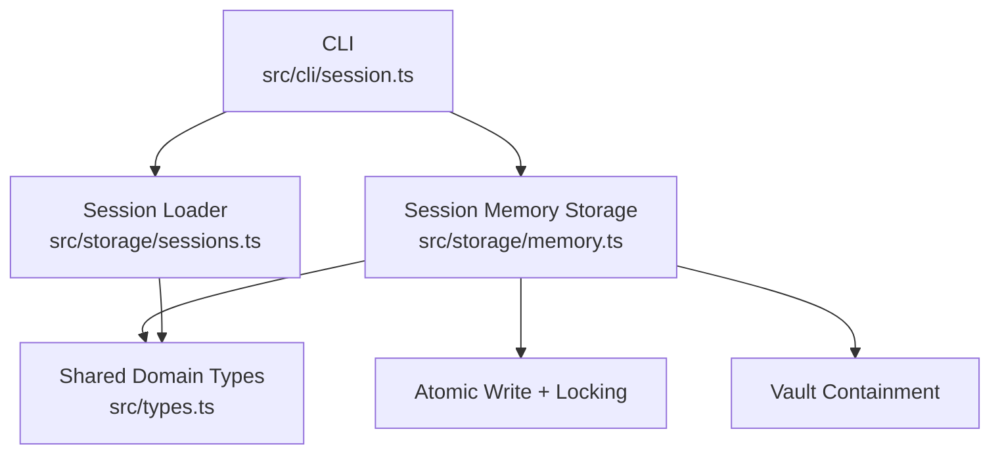

**Diagram sources**
- [session.ts:1-60](https://github.com/Kuldeep2822k/cli/blob/main/src/cli/session.ts#L1-L60)
- [memory.ts:1-40](https://github.com/Kuldeep2822k/cli/blob/main/src/storage/memory.ts#L1-L40)
- [sessions.ts:1-40](https://github.com/Kuldeep2822k/cli/blob/main/src/storage/sessions.ts#L1-L40)
- [types.ts:200-350](https://github.com/Kuldeep2822k/cli/blob/main/src/types.ts#L200-L350)

**Section sources**
- [types.ts:1-200](https://github.com/Kuldeep2822k/cli/blob/main/src/types.ts#L1-L200)
- [memory.ts:1-60](https://github.com/Kuldeep2822k/cli/blob/main/src/storage/memory.ts#L1-L60)
- [sessions.ts:1-40](https://github.com/Kuldeep2822k/cli/blob/main/src/storage/sessions.ts#L1-L40)
- [session.ts:1-60](https://github.com/Kuldeep2822k/cli/blob/main/src/cli/session.ts#L1-L60)

## Core Components
PALEE distinguishes between two closely related concepts:

| Concept | Purpose | Key fields | Persistence |
|---|---|---|---|
| `Session` | Runtime discriminated union describing an in-process session snapshot | `palee_schema`, `session_id`, `topic_id`, `started_at`, plus status-specific fields | Used by application logic; not itself a file format |
| `SessionRecord` | Frontmatter schema written into `.palee/sessions/*.md` files | Same core fields as `Session`, plus `status`, `ended_at`, optional `duration_minutes` | Durable Markdown note |

The most important distinction is that `Session` is a domain shape used while processing sessions, whereas `SessionRecord` is the on-disk contract for session notes. Drafts and completed sessions share the base fields but differ in `status` and `ended_at`.

**Section sources**
- [types.ts:120-220](https://github.com/Kuldeep2822k/cli/blob/main/src/types.ts#L120-L220)
- [types.ts:200-350](https://github.com/Kuldeep2822k/cli/blob/main/src/types.ts#L200-L350)

## Architecture Overview
The session architecture has four cooperating pieces:

1. **In-memory session types**: `BaseSession`, `CompletedSession`, `DraftSession`, and their union `Session`.
2. **Persisted session records**: `BaseSessionRecord`, `CompletedSessionRecord`, `DraftSessionRecord`, and their union `SessionRecord`.
3. **Hot memory**: `HotMemoryData` in `.palee/hot.md`, representing the current working context.
4. **Active session state**: `ActiveSessionData`, representing the process-local session currently being worked on.

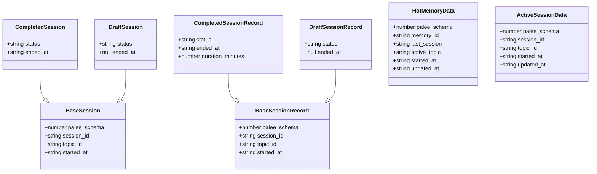

**Diagram sources**
- [types.ts:120-220](https://github.com/Kuldeep2822k/cli/blob/main/src/types.ts#L120-L220)
- [types.ts:200-350](https://github.com/Kuldeep2822k/cli/blob/main/src/types.ts#L200-L350)

## Detailed Component Analysis

### Discriminated Union Hierarchy: `BaseSession`, `CompletedSession`, `DraftSession`
`BaseSession` is the shared foundation for all session snapshots:

| Field | Meaning | Constraints |
|---|---|---|
| `palee_schema` | Schema version identifier | Must be compatible with the runtime; writers pin supported versions |
| `session_id` | Unique session identity | See ID format section below |
| `topic_id` | Topic studied in this session | Resolved through the vault's topic index or hot memory fallback |
| `started_at` | ISO 8601 start timestamp | Nullable only for legacy compatibility; current writers emit it |

`CompletedSession` adds:

| Field | Meaning |
|---|---|
| `status` | Fixed to `"completed"` |
| `ended_at` | ISO 8601 end timestamp |

`DraftSession` adds:

| Field | Meaning |
|---|---|
| `status` | Fixed to `"draft"` |
| `ended_at` | Always `null` during an in-progress checkpoint |

The union `Session = CompletedSession | DraftSession` allows callers to branch on `status` without inspecting string literals elsewhere.

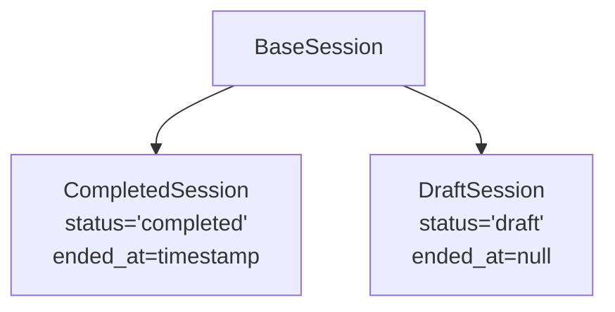

**Diagram sources**
- [types.ts:120-220](https://github.com/Kuldeep2822k/cli/blob/main/src/types.ts#L120-L220)

**Section sources**
- [types.ts:120-220](https://github.com/Kuldeep2822k/cli/blob/main/src/types.ts#L120-L220)

### Persisted File Schemas: `BaseSessionRecord`, `CompletedSessionRecord`, `DraftSessionRecord`
The persisted schema mirrors the in-memory hierarchy but is intentionally separate because frontmatter parsing and validation can tolerate missing or malformed values.

| Type | Status | `ended_at` | Additional fields |
|---|---|---|---|
| `BaseSessionRecord` | Not discriminative | ISO 8601 timestamp | Shared base fields |
| `CompletedSessionRecord` | `"completed"` | ISO 8601 timestamp | Optional `duration_minutes` |
| `DraftSessionRecord` | `"draft"` | `null` | None beyond the base |

`SessionRecord = CompletedSessionRecord | DraftSessionRecord` is the persisted union.

Important schema behaviors:

- Unknown additional keys are ignored, never rejected.
- `palee_schema` identifies the schema version; unsupported schemas are refused rather than coerced during rebuilds.
- `duration_minutes` is optional because draft checkpoints do not have an end time.
- `started_at` must normally be present; consumers treat it as nullable only for legacy compatibility.

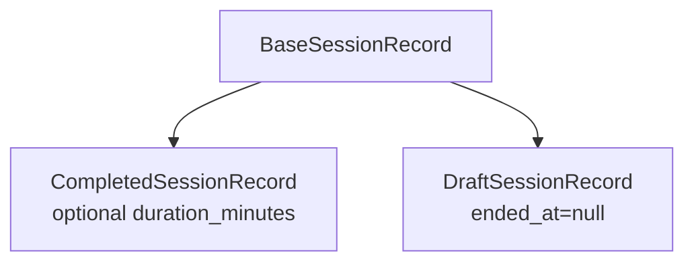

**Diagram sources**
- [types.ts:200-350](https://github.com/Kuldeep2822k/cli/blob/main/src/types.ts#L200-L350)

**Section sources**
- [types.ts:200-350](https://github.com/Kuldeep2822k/cli/blob/main/src/types.ts#L200-L350)
- [0019-session-memory-lifecycle.md:1-71](https://github.com/Kuldeep2822k/cli/blob/main/docs/adr/0019-session-memory-lifecycle.md#L1-L71)

### Hot Memory: `HotMemoryData`
`HotMemoryData` represents `.palee/hot.md`, the derived working-memory view. It is not canonical history; canonical history lives under `.palee/sessions/`.

| Field | Meaning | Notes |
|---|---|---|
| `palee_schema` | Schema version | Only value `1` is treated as supported by the read-side contract |
| `memory_id` | Fixed identifier | Always `"H-active"` |
| `last_session` | Most recent confirmed session ID | May be `null` when no confirmed session exists |
| `active_topic` | Current working-topic ID | May be `null`; resolved from hot memory when no explicit `--topic` is given |
| `started_at` | Start timestamp for the active session | Nullable for legacy compatibility |
| `updated_at` | Last regeneration date | Stored as `YYYY-MM-DD` |

The read accessor classifies `.palee/hot.md` into five states:

| State | Meaning |
|---|---|
| `ok` | Frontmatter parses and carries `palee_schema: 1` |
| `schema-invalid` | Frontmatter parses but schema is absent or not `1` |
| `no-frontmatter` | No parsable fences or empty fences |
| `corrupt` | Fences present but YAML failed to parse |
| `missing` | File does not exist |

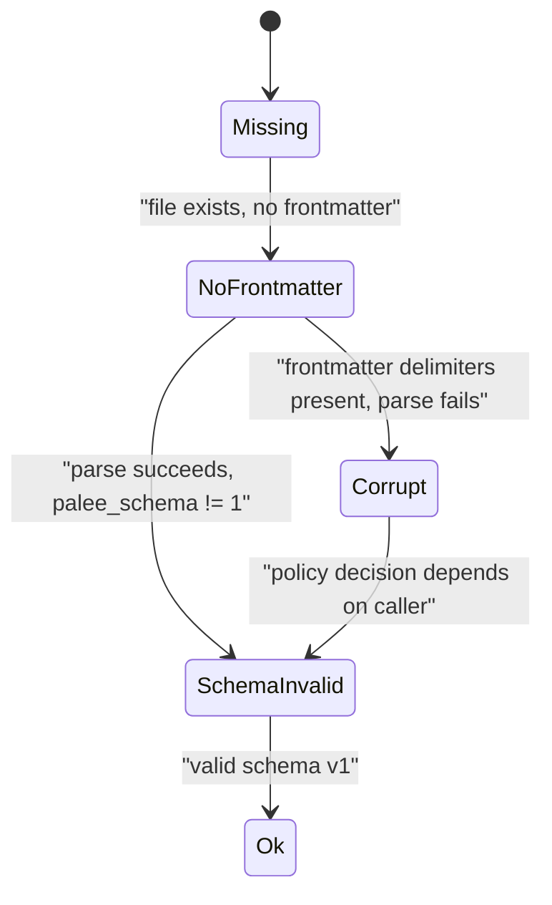

**Diagram sources**
- [memory.ts:40-120](https://github.com/Kuldeep2822k/cli/blob/main/src/storage/memory.ts#L40-L120)
- [0007-hot-memory-read-state-contract.md:1-54](https://github.com/Kuldeep2822k/cli/blob/main/docs/adr/0007-hot-memory-read-state-contract.md#L1-L54)

**Section sources**
- [types.ts:200-300](https://github.com/Kuldeep2822k/cli/blob/main/src/types.ts#L200-L300)
- [memory.ts:40-120](https://github.com/Kuldeep2822k/cli/blob/main/src/storage/memory.ts#L40-L120)
- [0007-hot-memory-read-state-contract.md:1-54](https://github.com/Kuldeep2822k/cli/blob/main/docs/adr/0007-hot-memory-read-state-contract.md#L1-L54)
- [04-4-session-memory-storage.md:1-146](https://github.com/Kuldeep2822k/cli/blob/main/docs/04-4-session-memory-storage.md#L1-L146)

### Active Session Data: `ActiveSessionData`
`ActiveSessionData` is distinct from `HotMemoryData`. It represents the process-local state for a session currently in progress, including its own `session_id`, `topic_id`, `started_at`, and `updated_at`. This separates the durable working-memory view from the transient in-memory session being edited.

| Field | Meaning |
|---|---|
| `palee_schema` | Schema version |
| `session_id` | In-progress session identity |
| `topic_id` | Topic associated with the active session |
| `started_at` | When the active session began |
| `updated_at` | When the active session metadata was last refreshed |

**Section sources**
- [types.ts:200-300](https://github.com/Kuldeep2822k/cli/blob/main/src/types.ts#L200-L300)

### Draft Recovery Actions: `DraftRecoveryAction`
When unfinished draft sessions are detected, PALEE supports four recovery choices:

| Action | Behavior |
|---|---|
| `resume` | Retains the draft checkpoint so study can continue against it |
| `save` | Converts the draft into a completed session, computes elapsed duration, deletes the draft, and rebuilds derived views |
| `discard` | Permanently deletes the draft checkpoint |
| `ignore` | Leaves the draft unchanged and proceeds without action |

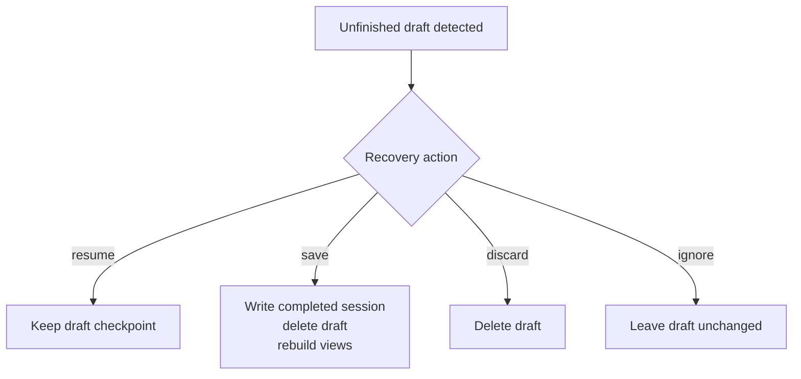

**Diagram sources**
- [types.ts:200-350](https://github.com/Kuldeep2822k/cli/blob/main/src/types.ts#L200-L350)
- [04-4-session-memory-storage.md:90-146](https://github.com/Kuldeep2822k/cli/blob/main/docs/04-4-session-memory-storage.md#L90-L146)

**Section sources**
- [types.ts:200-350](https://github.com/Kuldeep2822k/cli/blob/main/src/types.ts#L200-L350)
- [04-4-session-memory-storage.md:90-146](https://github.com/Kuldeep2822k/cli/blob/main/docs/04-4-session-memory-storage.md#L90-L146)

### Session ID Formats and Timestamp Rules
| Kind | Format | Example description |
|---|---|---|
| Completed session ID | `S-YYYYMMDDTHHMMSS-XXXX` | Date-time stem with a short random suffix |
| Draft session ID | `DRAFT-S-*` | Prefix distinguishing draft checkpoints from confirmed sessions |

Additional rules:

- Draft IDs use a hex random suffix generated separately from confirmed session IDs.
- Confirmed sessions are stored as `S-*.md`; drafts are stored as `DRAFT-S-*.md`.
- Filenames, not frontmatter, are the primary classification signal for whether a file is a draft or confirmed session.
- `started_at` is ISO 8601. Legacy files may omit it, so consumers must tolerate nullability even though current writers emit it.
- During recovery and session completion, timestamps older than 24 hours are clamped to a floor to avoid reporting phantom study duration. A clock-skew band accepts timestamps within 60 seconds of now; more than 60 seconds in the future is clamped to now.

**Section sources**
- [types.ts:120-220](https://github.com/Kuldeep2822k/cli/blob/main/src/types.ts#L120-L220)
- [types.ts:200-350](https://github.com/Kuldeep2822k/cli/blob/main/src/types.ts#L200-L350)
- [04-4-session-memory-storage.md:30-80](https://github.com/Kuldeep2822k/cli/blob/main/docs/04-4-session-memory-storage.md#L30-L80)
- [0019-session-memory-lifecycle.md:20-45](https://github.com/Kuldeep2822k/cli/blob/main/docs/adr/0019-session-memory-lifecycle.md#L20-L45)

### Session Creation Flow
A typical creation flow involves:

1. Resolving the target topic through an explicit `--topic` argument or the hot memory `active_topic`.
2. Generating a new session ID.
3. Writing the session note under `.palee/sessions/S-*.md`.
4. Rebuilding the derived index and hot memory.
5. Updating hot memory to reflect the new last session and active topic.

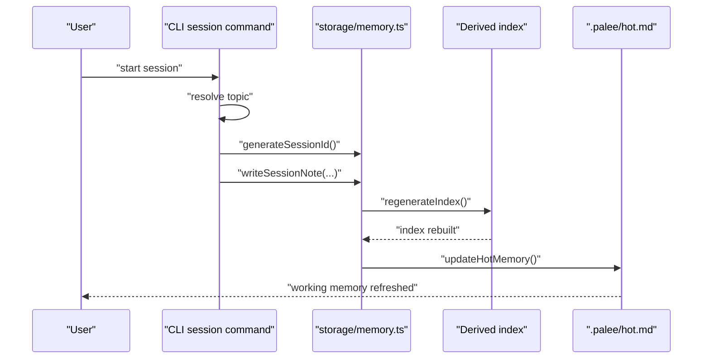

**Diagram sources**
- [session.ts:60-120](https://github.com/Kuldeep2822k/cli/blob/main/src/cli/session.ts#L60-L120)
- [memory.ts:1-60](https://github.com/Kuldeep2822k/cli/blob/main/src/storage/memory.ts#L1-L60)
- [04-4-session-memory-storage.md:60-120](https://github.com/Kuldeep2822k/cli/blob/main/docs/04-4-session-memory-storage.md#L60-L120)

**Section sources**
- [session.ts:60-120](https://github.com/Kuldeep2822k/cli/blob/main/src/cli/session.ts#L60-L120)
- [memory.ts:1-60](https://github.com/Kuldeep2822k/cli/blob/main/src/storage/memory.ts#L1-L60)
- [04-4-session-memory-storage.md:60-120](https://github.com/Kuldeep2822k/cli/blob/main/docs/04-4-session-memory-storage.md#L60-L120)

### Checkpointing During Long Sessions
For long sessions, drafts act as checkpoints:

1. The CLI calls `writeDraftCheckpoint` with a `DRAFT-S-*` ID, the topic, and the session's `started_at`.
2. The draft is stored under `.palee/sessions/DRAFT-S-*.md`.
3. Later, recovery converts the draft to a completed session, removes the draft, and rebuilds derived views.

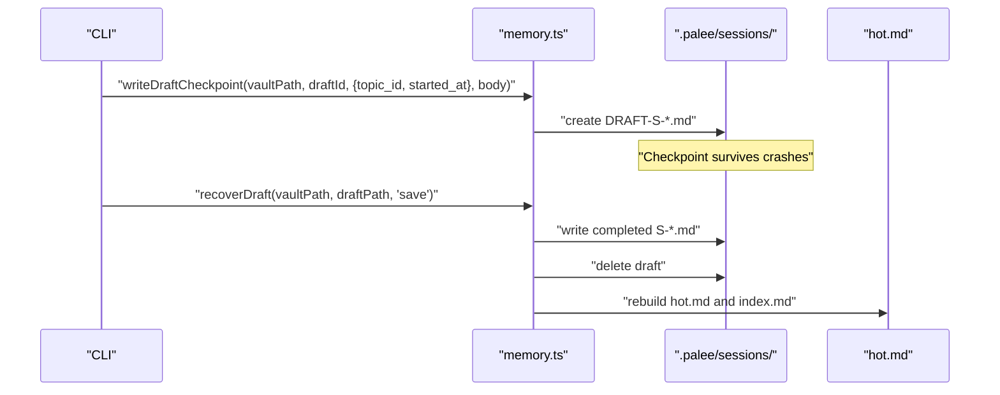

**Diagram sources**
- [memory.ts:1-60](https://github.com/Kuldeep2822k/cli/blob/main/src/storage/memory.ts#L1-L60)
- [04-4-session-memory-storage.md:90-146](https://github.com/Kuldeep2822k/cli/blob/main/docs/04-4-session-memory-storage.md#L90-L146)

**Section sources**
- [04-4-session-memory-storage.md:90-146](https://github.com/Kuldeep2822k/cli/blob/main/docs/04-4-session-memory-storage.md#L90-L146)
- [draft-recovery-transaction.test.ts:1-120](https://github.com/Kuldeep2822k/cli/blob/main/test/draft-recovery-transaction.test.ts#L1-L120)

### Completion Recording and Duration Handling
When a session ends:

1. The CLI writes a completed session note with `status: "completed"`, `ended_at`, and optionally `duration_minutes`.
2. Drafts belonging to the same topic are retired.
3. The index is regenerated.
4. Hot memory is updated with the new last session and active topic.

Duration handling follows the age clamp policy:

- Recovered starts older than 24 hours are clamped to a floor.
- Starts within 60 seconds of now are accepted as-is.
- More than 60 seconds in the future is clamped to now.
- The intent is to avoid fabricated learning signals caused by abandoned sessions.

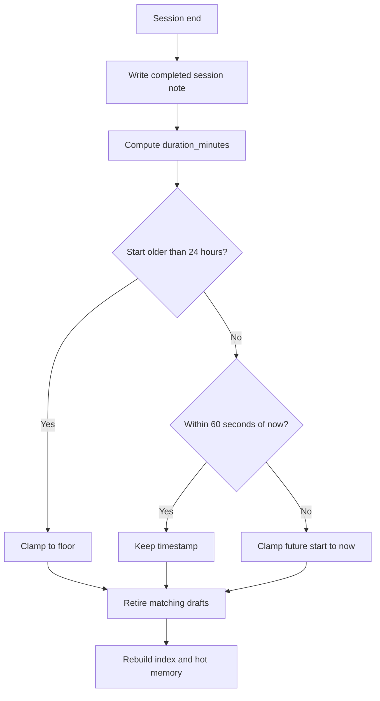

**Diagram sources**
- [0019-session-memory-lifecycle.md:20-45](https://github.com/Kuldeep2822k/cli/blob/main/docs/adr/0019-session-memory-lifecycle.md#L20-L45)
- [04-4-session-memory-storage.md:60-120](https://github.com/Kuldeep2822k/cli/blob/main/docs/04-4-session-memory-storage.md#L60-L120)

**Section sources**
- [0019-session-memory-lifecycle.md:20-45](https://github.com/Kuldeep2822k/cli/blob/main/docs/adr/0019-session-memory-lifecycle.md#L20-L45)
- [04-4-session-memory-storage.md:60-120](https://github.com/Kuldeep2822k/cli/blob/main/docs/04-4-session-memory-storage.md#L60-L120)

### Relationship Between Sessions and Hot Memory
Sessions and hot memory serve different purposes:

- `.palee/sessions/S-*.md` is canonical history.
- `.palee/hot.md` is derived working memory summarizing the latest active context.
- `.palee/index.md` is a derived list of session references.

Hot memory should not be interpreted as a transactional log. It is rebuilt from confirmed sessions when needed, especially when it is missing, corrupt, or carries an unsupported schema.

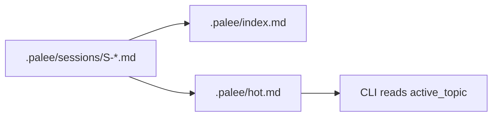

**Diagram sources**
- [memory.ts:1-60](https://github.com/Kuldeep2822k/cli/blob/main/src/storage/memory.ts#L1-L60)
- [sessions.ts:1-40](https://github.com/Kuldeep2822k/cli/blob/main/src/storage/sessions.ts#L1-L40)
- [04-4-session-memory-storage.md:1-60](https://github.com/Kuldeep2822k/cli/blob/main/docs/04-4-session-memory-storage.md#L1-L60)

**Section sources**
- [memory.ts:1-60](https://github.com/Kuldeep2822k/cli/blob/main/src/storage/memory.ts#L1-L60)
- [sessions.ts:1-40](https://github.com/Kuldeep2822k/cli/blob/main/src/storage/sessions.ts#L1-L40)
- [04-4-session-memory-storage.md:1-60](https://github.com/Kuldeep2822k/cli/blob/main/docs/04-4-session-memory-storage.md#L1-L60)

## Dependency Analysis
The session subsystem has clear layering:

- `src/cli/session.ts` owns user-facing flows and topic resolution.
- `src/storage/memory.ts` owns persistence, derivation, containment, and draft recovery.
- `src/storage/sessions.ts` owns tolerant loading and validation of session notes and the session index.
- `src/types.ts` owns the shared domain contracts.

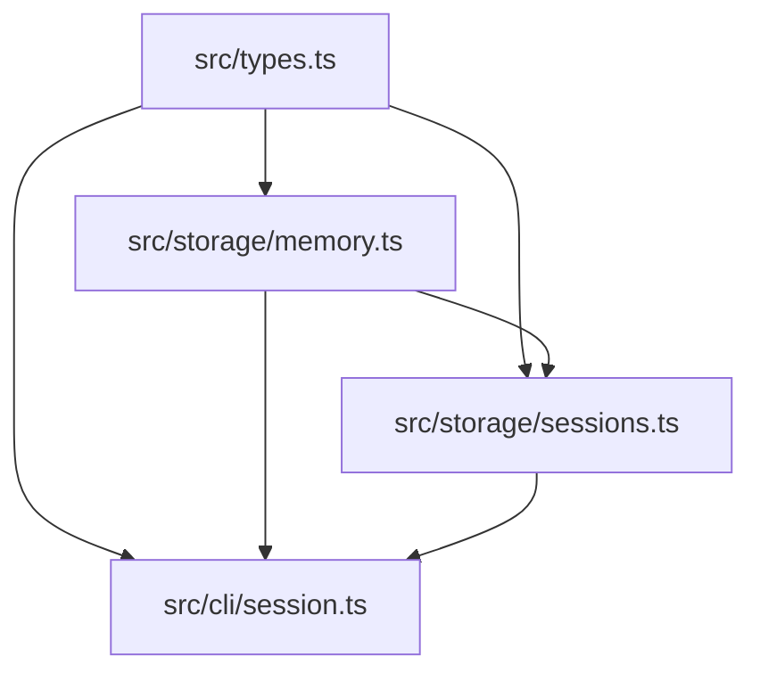

**Diagram sources**
- [types.ts:120-350](https://github.com/Kuldeep2822k/cli/blob/main/src/types.ts#L120-L350)
- [memory.ts:1-60](https://github.com/Kuldeep2822k/cli/blob/main/src/storage/memory.ts#L1-L60)
- [sessions.ts:1-40](https://github.com/Kuldeep2822k/cli/blob/main/src/storage/sessions.ts#L1-L40)
- [session.ts:1-60](https://github.com/Kuldeep2822k/cli/blob/main/src/cli/session.ts#L1-L60)

**Section sources**
- [types.ts:120-350](https://github.com/Kuldeep2822k/cli/blob/main/src/types.ts#L120-L350)
- [memory.ts:1-60](https://github.com/Kuldeep2822k/cli/blob/main/src/storage/memory.ts#L1-L60)
- [sessions.ts:1-40](https://github.com/Kuldeep2822k/cli/blob/main/src/storage/sessions.ts#L1-L40)
- [session.ts:1-60](https://github.com/Kuldeep2822k/cli/blob/main/src/cli/session.ts#L1-L60)

## Performance Considerations
- Hot memory body text is capped at 250 words to keep AI prompts efficient.
- Session scanning sorts filenames deterministically, making scans predictable regardless of OS readdir order.
- Tolerant loaders preserve malformed session entries instead of failing the entire vault scan, reducing validation cost when one note is corrupt.
- Derived views (`hot.md`, `index.md`) are rebuilt only when necessary, avoiding unnecessary filesystem mutations.

[No sources needed since this section provides general guidance]

## Troubleshooting Guide

### Unreadable or Corrupt Session Notes
- If a session note cannot be read (locked, deleted concurrently) or parsed, the loader retains the entry with a read or parse error rather than silently dropping it.
- Validation rules report the defect while allowing the rest of the vault to be scanned.
- Rebuilds count unreadable sessions rather than hiding them, so totals remain truthful.

**Section sources**
- [sessions.ts:40-120](https://github.com/Kuldeep2822k/cli/blob/main/src/storage/sessions.ts#L40-L120)
- [0019-session-memory-lifecycle.md:45-71](https://github.com/Kuldeep2822k/cli/blob/main/docs/adr/0019-session-memory-lifecycle.md#L45-L71)

### Draft Recovery Failures
Draft recovery is not a single atomic filesystem transaction. It consists of multiple locked operations: writing the canonical session, retiring the draft, and rebuilding derived views. If a step fails:

- A rebuild failure leaves the draft intact so the operation is retryable.
- A failed draft retire does not cause a duplicate session on the next pass.
- The write ordering ensures a later draft is not silently dropped by an earlier saved session of the same topic.

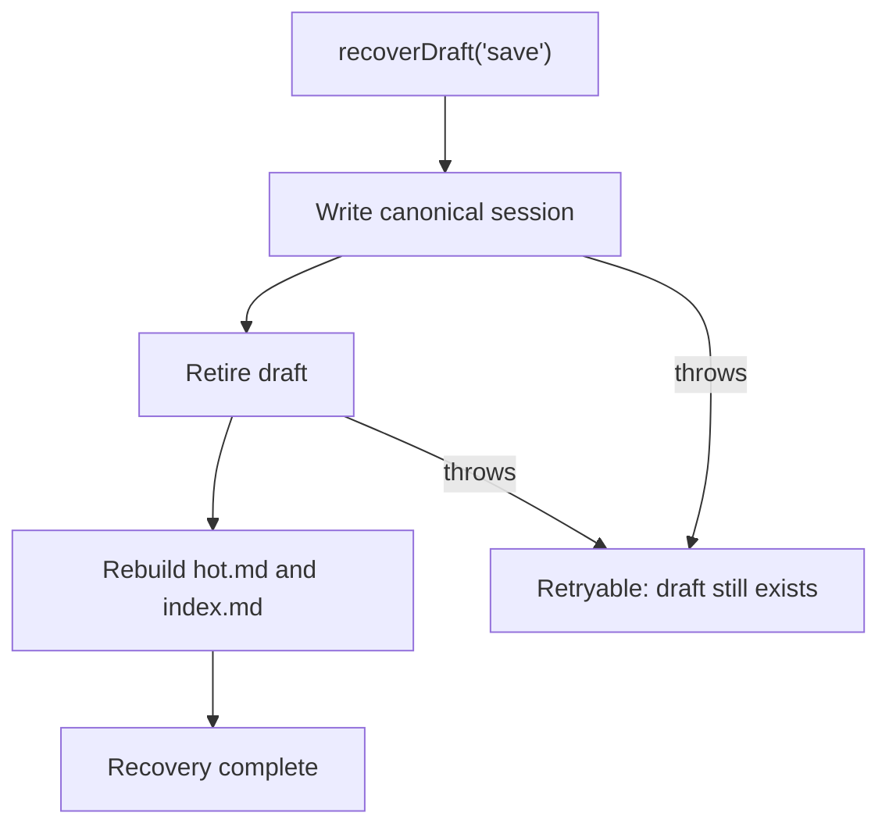

**Diagram sources**
- [draft-recovery-transaction.test.ts:1-120](https://github.com/Kuldeep2822k/cli/blob/main/test/draft-recovery-transaction.test.ts#L1-L120)
- [04-4-session-memory-storage.md:90-146](https://github.com/Kuldeep2822k/cli/blob/main/docs/04-4-session-memory-storage.md#L90-L146)

**Section sources**
- [draft-recovery-transaction.test.ts:1-120](https://github.com/Kuldeep2822k/cli/blob/main/test/draft-recovery-transaction.test.ts#L1-L120)

### Hot Memory Classification Issues
If `.palee/hot.md` is missing, corrupt, or carries an unsupported schema:

- `missing`: normal fresh-vault or deleted state.
- `corrupt`: YAML parse failed.
- `schema-invalid`: `palee_schema` is absent or not `1`.
- `no-frontmatter`: no usable frontmatter block.
- `session start` may rebuild invalid or missing hot memory from confirmed sessions.

**Section sources**
- [0007-hot-memory-read-state-contract.md:1-54](https://github.com/Kuldeep2822k/cli/blob/main/docs/adr/0007-hot-memory-read-state-contract.md#L1-L54)
- [memory.ts:40-120](https://github.com/Kuldeep2822k/cli/blob/main/src/storage/memory.ts#L40-L120)

## Conclusion
PALEE's session model separates in-memory domain state from durable frontmatter records. `BaseSession` extends into `CompletedSession` and `DraftSession`, while `BaseSessionRecord` extends into `CompletedSessionRecord` and `DraftSessionRecord`. Hot memory provides a fast, derived working view, while session files provide canonical history. Draft recovery supports resume, save, discard, and ignore, with strict timestamp clamping and robust error handling. Durability is provided by atomic writes, locking, containment checks, and deterministic rebuild policies, while isolation is enforced per vault path.

[No sources needed since this section summarizes without analyzing specific files]