# Supporting Data Models

::: details Referenced Files in This Document

- [types.ts](https://github.com/Kuldeep2822k/cli/blob/main/src/types.ts)
- [progress.ts](https://github.com/Kuldeep2822k/cli/blob/main/src/cli/progress.ts)
- [scanner.ts](https://github.com/Kuldeep2822k/cli/blob/main/src/storage/scanner.ts)
- [cache.ts](https://github.com/Kuldeep2822k/cli/blob/main/src/storage/cache.ts)
- [lock.ts](https://github.com/Kuldeep2822k/cli/blob/main/src/storage/lock.ts)
- [vault-walker.ts](https://github.com/Kuldeep2822k/cli/blob/main/src/storage/vault-walker.ts)
- [dependency.ts](https://github.com/Kuldeep2822k/cli/blob/main/src/engine/dependency.ts)
- [roadmap-parser.ts](https://github.com/Kuldeep2822k/cli/blob/main/src/storage/roadmap-parser.ts)

:::

## Table of Contents
1. [Introduction](#introduction)
2. [Project Structure](#project-structure)
3. [Core Components](#core-components)
4. [Architecture Overview](#architecture-overview)
5. [Detailed Component Analysis](#detailed-component-analysis)
6. [Dependency Analysis](#dependency-analysis)
7. [Performance Considerations](#performance-considerations)
8. [Troubleshooting Guide](#troubleshooting-guide)
9. [Conclusion](#conclusion)

## Introduction
This document describes the supporting data models that underpin PALEE's core functionality: progress reporting, vault scanning, filesystem caching, cross-process locking, dependency graph validation, and roadmap import. These types live primarily in `src/types.ts`, but are consumed by CLI commands, storage modules, engine logic, and validation rules. The goal is to make each model's fields, invariants, failure modes, and usage context clear without reproducing source code.

## Project Structure
The supporting models cluster around these responsibilities:

- Domain and utility models: `Progress`, `NodeError`, `FrontmatterResult`, `WalkOptions`, `DependsOnSource` utilities, `RoadmapTopic`, `RoadmapFile`, `ResolvedTopicUpdates`, `normalizeAssessedAt`.
- Storage-scanning model: `ScannedNote`.
- Filesystem cache model: `CacheEntry<T>`.
- Cross-process lock model: `LockData`.
- Validation result models: `ValidationError`, `MissingDependencyValidationError`, `CycleValidationError`, `ValidationResult`.

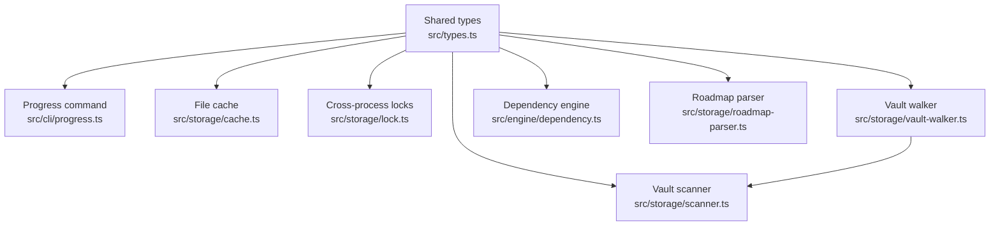

**Diagram sources**
- [types.ts:59-80](https://github.com/Kuldeep2822k/cli/blob/main/src/types.ts#L59-L80)
- [types.ts:438-500](https://github.com/Kuldeep2822k/cli/blob/main/src/types.ts#L438-L500)
- [types.ts:515-635](https://github.com/Kuldeep2822k/cli/blob/main/src/types.ts#L515-L635)
- [types.ts:908-985](https://github.com/Kuldeep2822k/cli/blob/main/src/types.ts#L908-L985)
- [progress.ts:1-60](https://github.com/Kuldeep2822k/cli/blob/main/src/cli/progress.ts#L1-L60)
- [scanner.ts:1-40](https://github.com/Kuldeep2822k/cli/blob/main/src/storage/scanner.ts#L1-L40)
- [cache.ts:1-40](https://github.com/Kuldeep2822k/cli/blob/main/src/storage/cache.ts#L1-L40)
- [lock.ts:1-40](https://github.com/Kuldeep2822k/cli/blob/main/src/storage/lock.ts#L1-L40)
- [vault-walker.ts:1-35](https://github.com/Kuldeep2822k/cli/blob/main/src/storage/vault-walker.ts#L1-L35)
- [dependency.ts:1-20](https://github.com/Kuldeep2822k/cli/blob/main/src/engine/dependency.ts#L1-L20)
- [roadmap-parser.ts:1-30](https://github.com/Kuldeep2822k/cli/blob/main/src/storage/roadmap-parser.ts#L1-L30)

**Section sources**
- [types.ts:59-80](https://github.com/Kuldeep2822k/cli/blob/main/src/types.ts#L59-L80)
- [types.ts:438-500](https://github.com/Kuldeep2822k/cli/blob/main/src/types.ts#L438-L500)
- [types.ts:515-635](https://github.com/Kuldeep2822k/cli/blob/main/src/types.ts#L515-L635)
- [types.ts:908-985](https://github.com/Kuldeep2822k/cli/blob/main/src/types.ts#L908-L985)
- [progress.ts:1-60](https://github.com/Kuldeep2822k/cli/blob/main/src/cli/progress.ts#L1-L60)
- [scanner.ts:1-40](https://github.com/Kuldeep2822k/cli/blob/main/src/storage/scanner.ts#L1-L40)
- [cache.ts:1-40](https://github.com/Kuldeep2822k/cli/blob/main/src/storage/cache.ts#L1-L40)
- [lock.ts:1-40](https://github.com/Kuldeep2822k/cli/blob/main/src/storage/lock.ts#L1-L40)
- [vault-walker.ts:1-35](https://github.com/Kuldeep2822k/cli/blob/main/src/storage/vault-walker.ts#L1-L35)
- [dependency.ts:1-20](https://github.com/Kuldeep2822k/cli/blob/main/src/engine/dependency.ts#L1-L20)
- [roadmap-parser.ts:1-30](https://github.com/Kuldeep2822k/cli/blob/main/src/storage/roadmap-parser.ts#L1-L30)

## Core Components
The most important supporting models for this document are:

| Model | Purpose | Key Fields / Behavior | Primary Consumers |
|---|---|---|---|
| `Progress` | Aggregate learning statistics | `active_topic_count`, optional `archived_topic_count`, nullable `global_mastery`, `mastery_status` (`no_data` / `learning` / `mastered`) | Progress CLI output |
| `NodeError` | Standard `Error` with an optional system error code | Optional `code` such as `ENOENT` or `ECONFLICT` | Locking, filesystem, and CLI error paths |
| `FrontmatterResult` | YAML frontmatter parsing outcome | `frontmatter`, `body`, `raw`, optional `doc`, optional `error` | Scanner, roadmap parser, TOC readers |
| `ScannedNote` | Per-file scan result for validation | `absolutePath`, `relativePath`, optional `frontmatter`, optional `parseError`, optional `readError`, optional `content` | Validation framework collectors |
| `CacheEntry<T>` | In-memory filesystem cache entry | `mtime`, `size`, SHA-256 `fingerprint`, payload `data`, `lastVerified` | `FileCache` |
| `LockData` | Cross-process lock record | `lock_id`, `target`, `pid`, `hostname`, `created_at` | Lock manager |
| `WalkOptions` | Vault traversal configuration | Optional `followSymlinks`, optional `excludeDirs` | Vault walker |
| `ValidationError` | Discriminated union of dependency graph errors | `missing_dependency` or `cycle` variants | Dependency engine |
| `ValidationResult` | Graph validation outcome | `valid`, `errors` | Dependency engine callers |
| `DependsOnSource` | Provenance label for prerequisite edges | `'numbered'`, `'toc'`, `'declared'`, `'tie'` | Engine, migration, roadmap, planner |
| `RoadmapTopic` | External curriculum topic definition | `id`, `title`, `path`, optional difficulty, dependencies, ordering, chaining flag | Roadmap parser |
| `RoadmapFile` | Curriculum file wrapper | `topics` array | Roadmap parser |
| `ResolvedTopicUpdates` | Single source of truth for roadmap import writes | Preserved and computed frontmatter fields per target topic | Roadmap import passes |

**Section sources**
- [types.ts:59-80](https://github.com/Kuldeep2822k/cli/blob/main/src/types.ts#L59-L80)
- [types.ts:438-500](https://github.com/Kuldeep2822k/cli/blob/main/src/types.ts#L438-L500)
- [types.ts:515-635](https://github.com/Kuldeep2822k/cli/blob/main/src/types.ts#L515-L635)
- [types.ts:908-985](https://github.com/Kuldeep2822k/cli/blob/main/src/types.ts#L908-L985)

## Architecture Overview
These models form a pipeline from vault discovery through parsing, validation, scheduling, and external curriculum import:

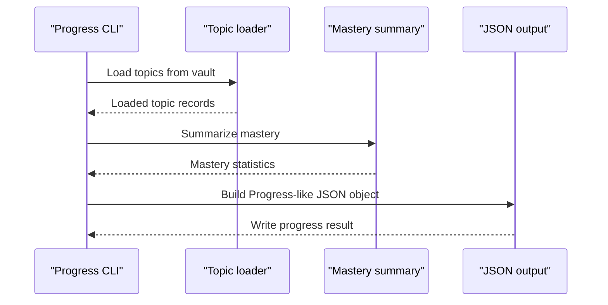

**Diagram sources**
- [progress.ts:1-120](https://github.com/Kuldeep2822k/cli/blob/main/src/cli/progress.ts#L1-L120)
- [types.ts:59-80](https://github.com/Kuldeep2822k/cli/blob/main/src/types.ts#L59-L80)

## Detailed Component Analysis

### Progress
`Progress` is the machine-readable aggregate contract for vault-wide learning statistics. It reports:

- `active_topic_count`: count of non-archived active topics.
- `archived_topic_count`: optional archived topic count.
- `global_mastery`: weighted mastery percentage across topics, represented as a number between 0.0 and 1.0, or null when no usable mastery data exists.
- `mastery_status`: one of `no_data`, `learning`, or `mastered`.

In the progress command, an empty vault produces `no_data` status with zero counts and null global mastery. When a specific topic is requested, the command still uses the same modeling ideas but emits a per-topic projection rather than the aggregate shape.

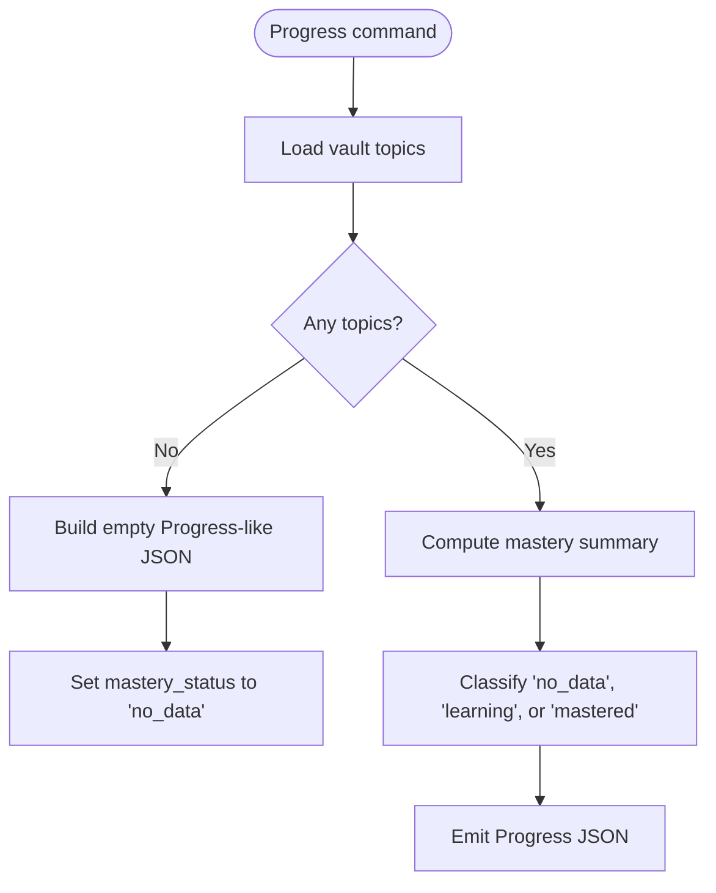

**Diagram sources**
- [progress.ts:1-120](https://github.com/Kuldeep2822k/cli/blob/main/src/cli/progress.ts#L1-L120)
- [types.ts:59-80](https://github.com/Kuldeep2822k/cli/blob/main/src/types.ts#L59-L80)

Usage example (conceptual):
- A dashboard reads `global_mastery` to show a percentage and `mastery_status` to color-code learner health.
- An automation script checks whether `mastery_status` is not `no_data` before proceeding with advanced planning.

Error handling pattern:
- Null `global_mastery` means there is insufficient mastery data; it does not necessarily mean the vault is invalid.
- `mastery_status = 'no_data'` is a distinct signal from `learning` and `mastered`.

**Section sources**
- [types.ts:59-80](https://github.com/Kuldeep2822k/cli/blob/main/src/types.ts#L59-L80)
- [progress.ts:1-120](https://github.com/Kuldeep2822k/cli/blob/main/src/cli/progress.ts#L1-L120)

### NodeError
`NodeError` extends JavaScript's standard `Error` and adds an optional `code` property. It represents system-level errors where the underlying operating system or runtime supplies a short string code. Examples referenced in the codebase include:

- `ENOENT`: file or directory not found.
- `ECONFLICT`: lock contention or conflicting acquisition.

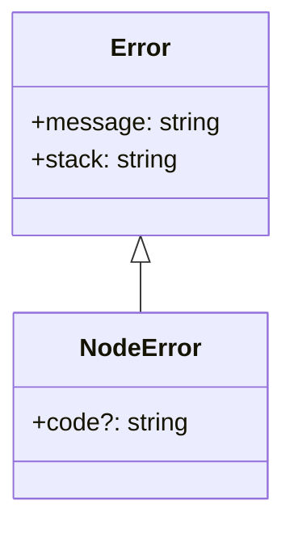

**Diagram sources**
- [types.ts:987-1001](https://github.com/Kuldeep2822k/cli/blob/main/src/types.ts#L987-L1001)
- [lock.ts:320-360](https://github.com/Kuldeep2822k/cli/blob/main/src/storage/lock.ts#L320-L360)

Usage example (conceptual):
- A lock conflict throws a `NodeError` whose `code` is `ECONFLICT`; the CLI can map this to exit code 4 instead of treating it as a generic failure.
- A missing file path may surface as `ENOENT`; consumers can distinguish I/O absence from business-rule failures.

Error handling pattern:
- Catch blocks should inspect `error.code` only after confirming the caught value is a `NodeError`.
- Do not treat `undefined` `code` as a success condition; always check the broader error message and stack when diagnosing unexpected failures.

**Section sources**
- [types.ts:987-1001](https://github.com/Kuldeep2822k/cli/blob/main/src/types.ts#L987-L1001)
- [lock.ts:320-360](https://github.com/Kuldeep2822k/cli/blob/main/src/storage/lock.ts#L320-L360)

### FrontmatterResult
`FrontmatterResult` captures everything relevant about YAML frontmatter parsing for a Markdown document:

- `frontmatter`: parsed dictionary, or null if absent or malformed.
- `body`: Markdown body text after frontmatter removal.
- `raw`: raw YAML string between delimiters, or null.
- `doc`: optional parsed YAML concrete syntax tree document.
- `error`: optional human-readable parse error.

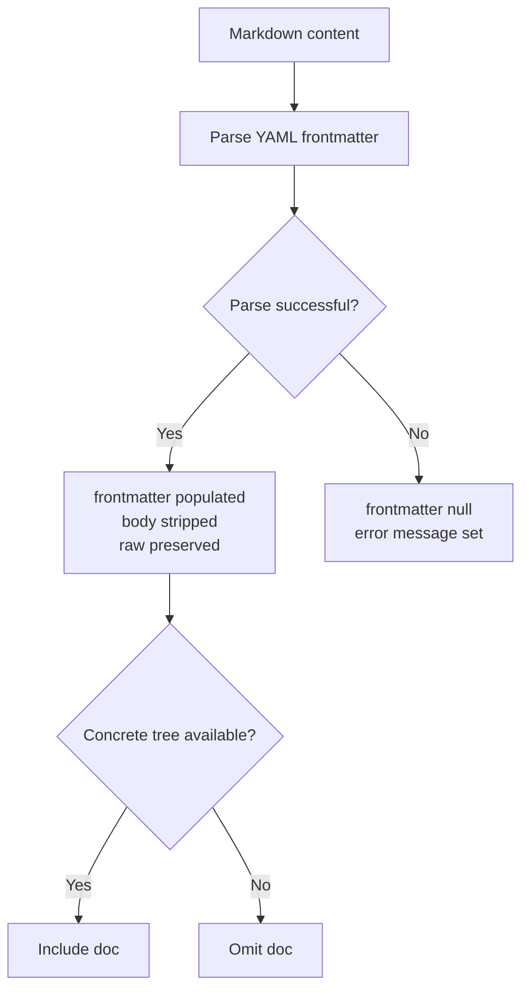

**Diagram sources**
- [types.ts:438-500](https://github.com/Kuldeep2822k/cli/blob/main/src/types.ts#L438-L500)
- [scanner.ts:250-327](https://github.com/Kuldeep2822k/cli/blob/main/src/storage/scanner.ts#L250-L327)
- [roadmap-parser.ts:140-210](https://github.com/Kuldeep2822k/cli/blob/main/src/storage/roadmap-parser.ts#L140-L210)

Usage examples (conceptual):
- The scanner uses `frontmatter` and `error` to build a `ScannedNote`.
- The roadmap parser first tries frontmatter, then embedded YAML code blocks, then pure YAML, using `FrontmatterResult` outcomes to choose formats.

Error handling pattern:
- A `null` `frontmatter` is normal for notes without frontmatter; only a non-empty `error` indicates a parse problem.
- Callers must not assume `frontmatter` is a plain object even when it is non-null; YAML can parse to scalars or arrays.

**Section sources**
- [types.ts:438-500](https://github.com/Kuldeep2822k/cli/blob/main/src/types.ts#L438-L500)
- [scanner.ts:250-327](https://github.com/Kuldeep2822k/cli/blob/main/src/storage/scanner.ts#L250-L327)
- [roadmap-parser.ts:140-210](https://github.com/Kuldeep2822k/cli/blob/main/src/storage/roadmap-parser.ts#L140-L210)

### ScannedNote
`ScannedNote` is the validation framework's per-file scanning contract. It carries:

- `absolutePath`: filesystem location of the scanned Markdown file.
- `relativePath`: POSIX-style path relative to the vault root.
- `frontmatter`: parsed dictionary or null.
- `parseError`: present when YAML could not be parsed.
- `readError`: present when the file could not be read at all.
- `content`: optional raw file content, included only when requested by the caller.

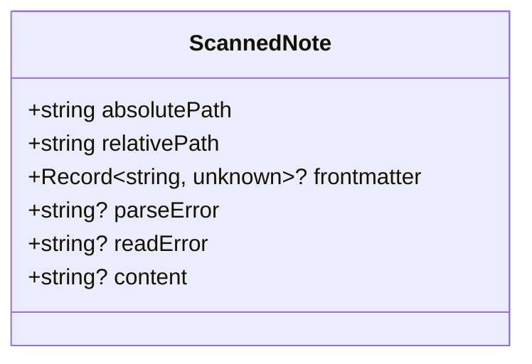

**Diagram sources**
- [types.ts:465-500](https://github.com/Kuldeep2822k/cli/blob/main/src/types.ts#L465-L500)
- [scanner.ts:250-327](https://github.com/Kuldeep2822k/cli/blob/main/src/storage/scanner.ts#L250-L327)

Usage example (conceptual):
- A validation rule receives an array of `ScannedNote` values and filters on `parseError` to report malformed frontmatter.
- A collector builds a single-read snapshot by passing `includeContent: true` so parse outcomes and derived topic loading share one byte snapshot per file.

Error handling pattern:
- `parseError` means the file was readable but its YAML was malformed.
- `readError` means the file could not be read; the note is retained so validation runs on a complete-enough snapshot and can warn that results may be provisional.
- `frontmatter: null` can mean either no frontmatter or a malformed/non-object parse result; callers must inspect `parseError` and treat `frontmatter` as `unknown`.

**Section sources**
- [types.ts:465-500](https://github.com/Kuldeep2822k/cli/blob/main/src/types.ts#L465-L500)
- [scanner.ts:250-327](https://github.com/Kuldeep2822k/cli/blob/main/src/storage/scanner.ts#L250-L327)

### `CacheEntry<T>`
`CacheEntry<T>` is the internal representation of a cached filesystem resource. Its fields provide deterministic invalidation:

- `mtime`: modification time in epoch milliseconds.
- `size`: file size in bytes.
- `fingerprint`: SHA-256 content digest.
- `data`: the cached payload, typed by the generic parameter `T`.
- `lastVerified`: epoch timestamp when the entry's freshness was last verified.

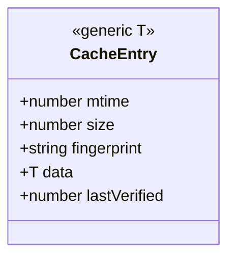

**Diagram sources**
- [types.ts:412-437](https://github.com/Kuldeep2822k/cli/blob/main/src/types.ts#L412-L437)
- [cache.ts:1-40](https://github.com/Kuldeep2822k/cli/blob/main/src/storage/cache.ts#L1-L40)

Usage example (conceptual):
- `FileCache.set` stores parsed topic data along with current file stats and a content fingerprint.
- `FileCache.get` returns cached data only when the file has not changed in a way that invalidates the entry.

Invalidation behavior:
- If the file size changes, the entry is evicted.
- Within a 2-second unsettled horizon, the cache recomputes the SHA-256 fingerprint on read.
- Outside the unsettled horizon, it trusts `mtime`; when filesystem timestamps have whole-second resolution, it falls back to fingerprint verification.
- On filesystem errors such as a deleted file, the entry is removed and the call returns null.

**Section sources**
- [types.ts:412-437](https://github.com/Kuldeep2822k/cli/blob/main/src/types.ts#L412-L437)
- [cache.ts:1-120](https://github.com/Kuldeep2822k/cli/blob/main/src/storage/cache.ts#L1-L120)
- [cache.ts:201-273](https://github.com/Kuldeep2822k/cli/blob/main/src/storage/cache.ts#L201-L273)

### LockData
`LockData` is the serialized cross-process synchronization record stored inside a lock directory:

- `lock_id`: unique acquisition identifier.
- `target`: absolute target path being protected.
- `pid`: process ID holding the lock.
- `hostname`: machine hostname.
- `created_at`: ISO 8601 acquisition timestamp.

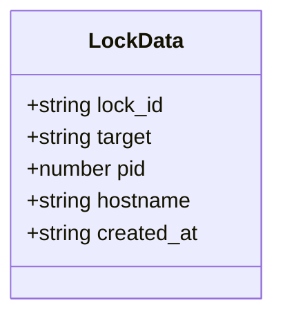

**Diagram sources**
- [types.ts:355-385](https://github.com/Kuldeep2822k/cli/blob/main/src/types.ts#L355-L385)
- [lock.ts:201-360](https://github.com/Kuldeep2822k/cli/blob/main/src/storage/lock.ts#L201-L360)

Usage example (conceptual):
- When acquiring a lock, PALEE creates a lock directory under `.palee/locks`, writes a JSON descriptor containing `LockData`, and updates a heartbeat while the lock is held.
- On stale-lock recovery, the system compares the lock's `mtime` and, when possible, probes the recorded `pid` on the same host.

Error handling pattern:
- A lock conflict surfaces as a `NodeError` with `code = 'ECONFLICT'`.
- Staleness detection combines same-host liveness probing with timeout-based fallbacks, making it resilient to crashed processes and cross-host uncertainty.

**Section sources**
- [types.ts:355-385](https://github.com/Kuldeep2822k/cli/blob/main/src/types.ts#L355-L385)
- [lock.ts:201-400](https://github.com/Kuldeep2822k/cli/blob/main/src/storage/lock.ts#L201-L400)

### WalkOptions
`WalkOptions` configures how PALEE traverses the vault filesystem:

- `followSymlinks`: whether symbolic links are followed during traversal. Default is false.
- `excludeDirs`: additional directory names to exclude beyond built-in exclusions like `node_modules`.

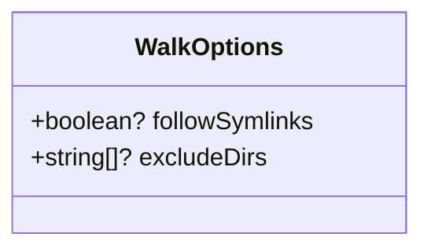

**Diagram sources**
- [types.ts:478-486](https://github.com/Kuldeep2822k/cli/blob/main/src/types.ts#L478-L486)
- [vault-walker.ts:60-140](https://github.com/Kuldeep2822k/cli/blob/main/src/storage/vault-walker.ts#L60-L140)

Usage example (conceptual):
- A normal vault scan leaves `followSymlinks` unset so hidden directories, dotfiles, and symlinks are ignored.
- A special-purpose scan may enable symlink following but should validate resolved targets remain inside the vault.

Security and traversal behavior:
- Dot-directories and dot-files are skipped.
- Non-Markdown files are skipped.
- Symlink targets outside the vault are excluded even when `followSymlinks` is enabled.
- Custom `excludeDirs` extend the built-in exclusion set.

**Section sources**
- [types.ts:478-486](https://github.com/Kuldeep2822k/cli/blob/main/src/types.ts#L478-L486)
- [vault-walker.ts:60-220](https://github.com/Kuldeep2822k/cli/blob/main/src/storage/vault-walker.ts#L60-L220)

### ValidationResult and ValidationError
`ValidationError` is a discriminated union representing two kinds of dependency graph problems:

- `missing_dependency`: a topic references another topic ID that is not present in the vault.
- `cycle`: a circular dependency sequence among topics.

`ValidationResult` wraps the outcome of validating the complete graph:

- `valid`: true when no errors were detected.
- `errors`: list of `ValidationError` instances.

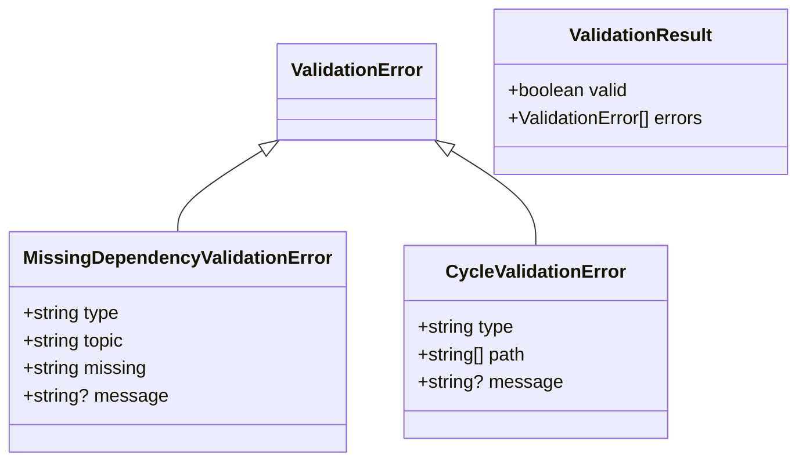

**Diagram sources**
- [types.ts:515-565](https://github.com/Kuldeep2822k/cli/blob/main/src/types.ts#L515-L565)
- [dependency.ts:1-20](https://github.com/Kuldeep2822k/cli/blob/main/src/engine/dependency.ts#L1-L20)

Usage example (conceptual):
- A plan command asks the dependency engine to detect cycles and missing prerequisites.
- If `valid` is false, the CLI reports each error and chooses an appropriate exit code.

Error handling pattern:
- Consumers should switch on the `type` field rather than relying on field presence.
- `missing_dependency` identifies both the referencing topic and the absent prerequisite.
- `cycle` provides a canonicalized path sequence, including repeated start/end nodes.

**Section sources**
- [types.ts:515-565](https://github.com/Kuldeep2822k/cli/blob/main/src/types.ts#L515-L565)
- [dependency.ts:1-20](https://github.com/Kuldeep2822k/cli/blob/main/src/engine/dependency.ts#L1-L20)

### DependsOnSource, isAdvisoryDependsOnSource, and normalizeDependsOnSource
`DependsOnSource` labels which tier authored a note's prerequisite edge:

- `'numbered'`: derived from the note's numeric prefix.
- `'toc'`: derived from a listing document's enumeration order.
- `'declared'`: derived from explicit prerequisite links in the note itself.
- `'tie'`: used when two notes carry the same rank and filename collation decided the order.

Advisory vs gating behavior:
- `'toc'` and `'tie'` are advisory: they participate in cycle detection and ranking but never gate readiness.
- `'numbered'` and `'declared'` gate: they represent intentional ordering decisions that should block readiness until satisfied.

Utilities:
- `isAdvisoryDependsOnSource(source)` returns true only for recognized advisory sources.
- `normalizeDependsOnSource(raw)` converts a raw frontmatter value into a recognized source or `undefined`.

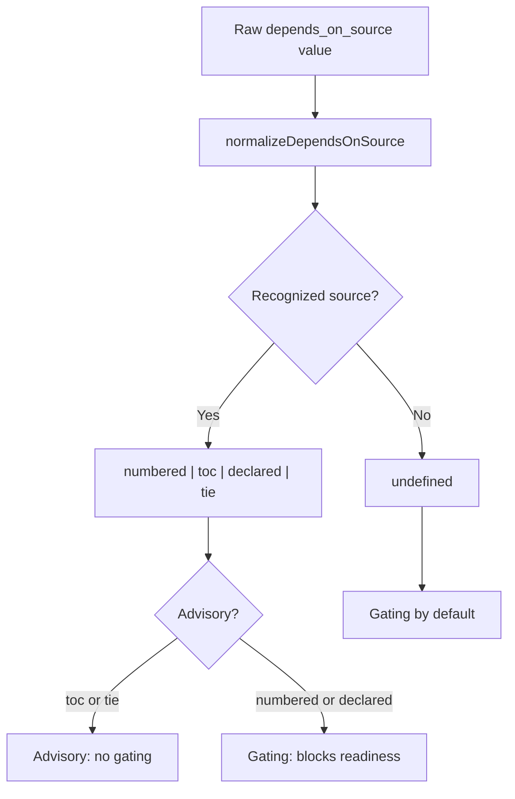

**Diagram sources**
- [types.ts:584-635](https://github.com/Kuldeep2822k/cli/blob/main/src/types.ts#L584-L635)

Usage example (conceptual):
- During adoption or roadmap import, a newly discovered edge may be labeled based on how it was constructed.
- Migration logic can relabel legacy edges, especially those created before the `tie` label existed.

Fail-closed design:
- `undefined` and unrecognized labels gate by default.
- A typo cannot accidentally turn a hand-written prerequisite into advisory advice.

**Section sources**
- [types.ts:584-635](https://github.com/Kuldeep2822k/cli/blob/main/src/types.ts#L584-L635)

### RoadmapTopic, RoadmapFile, and ResolvedTopicUpdates
External curriculum definitions use:

- `RoadmapTopic`: a single curriculum topic with `id`, `title`, `path`, optional difficulty, prerequisites, chaining flag, and ordering.
- `RoadmapFile`: a collection of `RoadmapTopic` entries.
- `ResolvedTopicUpdates`: the single source of truth for what a roadmap import writes for one target topic.

`ResolvedTopicUpdates` preserves existing topic state while applying roadmap-driven changes:

- It includes effective title, difficulty, and prerequisites.
- It preserves schema version, mastery, assessment timestamps, four-pillar scores, and SM-2 review fields.
- Optional pillar scores are omitted when the note has no assessment data, preserving the distinction between absent and zero-valued fields.

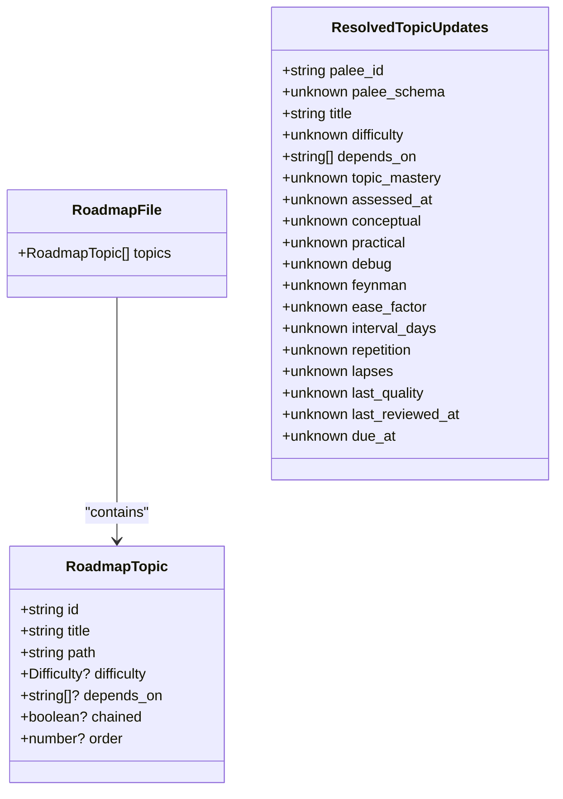

**Diagram sources**
- [types.ts:908-985](https://github.com/Kuldeep2822k/cli/blob/main/src/types.ts#L908-L985)
- [roadmap-parser.ts:1-40](https://github.com/Kuldeep2822k/cli/blob/main/src/storage/roadmap-parser.ts#L1-L40)

Usage example (conceptual):
- The roadmap parser normalizes YAML input into `RoadmapFile`.
- The roadmap import resolves each topic into `ResolvedTopicUpdates`, then validates and writes the resulting frontmatter.

Error handling pattern:
- Roadmap parsing returns structured errors when YAML is invalid, the expected `topics` array is missing, or wikilink sections are present but empty.
- Import validation runs before writeback so malformed fields do not silently corrupt existing notes.

**Section sources**
- [types.ts:908-985](https://github.com/Kuldeep2822k/cli/blob/main/src/types.ts#L908-L985)
- [roadmap-parser.ts:1-40](https://github.com/Kuldeep2822k/cli/blob/main/src/storage/roadmap-parser.ts#L1-L40)
- [roadmap-parser.ts:201-270](https://github.com/Kuldeep2822k/cli/blob/main/src/storage/roadmap-parser.ts#L201-L270)

### normalizeAssessedAt
`normalizeAssessedAt` converts a raw `assessed_at` value into a canonical ISO 8601 string or null:

- Non-empty strings are returned verbatim.
- Finite numeric values are treated as epoch milliseconds and converted to ISO 8601.
- Empty strings, non-finite numbers, and other types become null.

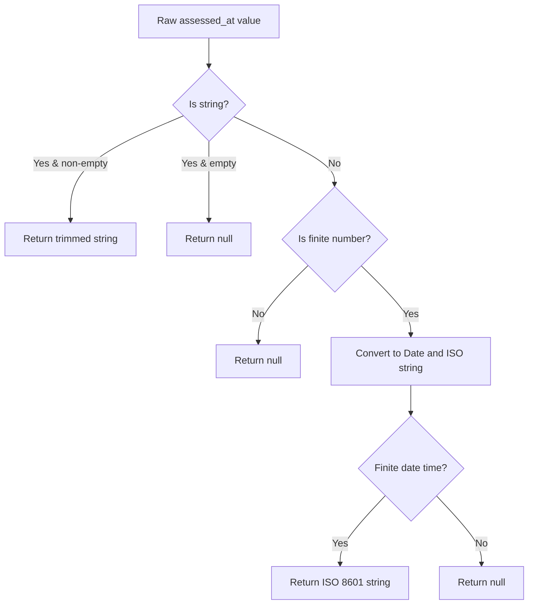

**Diagram sources**
- [types.ts:260-340](https://github.com/Kuldeep2822k/cli/blob/main/src/types.ts#L260-L340)

Usage example (conceptual):
- Assessment and review commands normalize user-provided or imported timestamps before persisting them.
- Downstream consumers, including progress formatting and validation rules, receive consistent ISO 8601 strings or null.

**Section sources**
- [types.ts:260-340](https://github.com/Kuldeep2822k/cli/blob/main/src/types.ts#L260-L340)

## Dependency Analysis
The supporting models connect several subsystems:

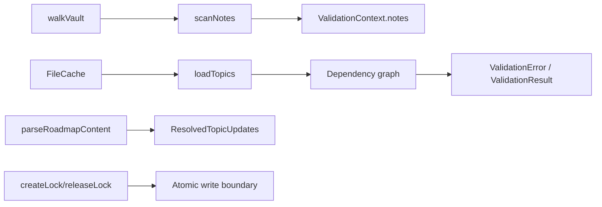

**Diagram sources**
- [vault-walker.ts:60-220](https://github.com/Kuldeep2822k/cli/blob/main/src/storage/vault-walker.ts#L60-L220)
- [scanner.ts:250-327](https://github.com/Kuldeep2822k/cli/blob/main/src/storage/scanner.ts#L250-L327)
- [dependency.ts:1-20](https://github.com/Kuldeep2822k/cli/blob/main/src/engine/dependency.ts#L1-L20)
- [roadmap-parser.ts:140-210](https://github.com/Kuldeep2822k/cli/blob/main/src/storage/roadmap-parser.ts#L140-L210)
- [cache.ts:1-120](https://github.com/Kuldeep2822k/cli/blob/main/src/storage/cache.ts#L1-L120)
- [lock.ts:201-360](https://github.com/Kuldeep2822k/cli/blob/main/src/storage/lock.ts#L201-L360)

Key relationships:

- `ScannedNote` feeds validation rules and the collected vault snapshot.
- `FrontmatterResult` is reused by both scanner logic and roadmap parsing.
- `CacheEntry<T>` supports efficient, deterministic reads of parsed topic data.
- `LockData` protects concurrent writers and exposes system error codes through `NodeError`.
- `DependsOnSource` controls whether prerequisite edges gate readiness.
- `RoadmapTopic` and `RoadmapFile` describe external curriculum input; `ResolvedTopicUpdates` describes the authoritative write target.

**Section sources**
- [vault-walker.ts:60-220](https://github.com/Kuldeep2822k/cli/blob/main/src/storage/vault-walker.ts#L60-L220)
- [scanner.ts:250-327](https://github.com/Kuldeep2822k/cli/blob/main/src/storage/scanner.ts#L250-L327)
- [dependency.ts:1-20](https://github.com/Kuldeep2822k/cli/blob/main/src/engine/dependency.ts#L1-L20)
- [roadmap-parser.ts:140-210](https://github.com/Kuldeep2822k/cli/blob/main/src/storage/roadmap-parser.ts#L140-L210)
- [cache.ts:1-120](https://github.com/Kuldeep2822k/cli/blob/main/src/storage/cache.ts#L1-L120)
- [lock.ts:201-360](https://github.com/Kuldeep2822k/cli/blob/main/src/storage/lock.ts#L201-L360)

## Performance Considerations
- `CacheEntry<T>` avoids unnecessary re-parsing by combining `mtime`, `size`, and SHA-256 fingerprints. It also limits memory growth with least-recently-verified eviction.
- `ScanNotes` bounds large documents by checking file size before reading, preventing oversized notes from dominating memory.
- `WalkOptions` keeps vault traversal predictable and safe by excluding hidden directories, dotfiles, and symlink escapes by default.
- `DependsOnSource` reduces gating overhead by marking purely advisory edges as non-blocking.
- Roadmap parsing returns early once a supported format succeeds, avoiding unnecessary downstream work.

## Troubleshooting Guide
Common issues and their model-based signals:

| Symptom | Relevant Model | Likely Meaning | Recommended Action |
|---|---|---|---|
| Progress shows no useful mastery data | `Progress.global_mastery` is null and `mastery_status` is `no_data` | Topics exist but lack usable mastery information | Record assessments or reviews before expecting meaningful percentages. |
| Malformed YAML warning on a note | `ScannedNote.parseError` | Frontmatter could not be parsed | Inspect the note's frontmatter fence and YAML structure. |
| Note missing from validation results | `ScannedNote.readError` | File could not be read during scan | Check permissions, concurrent writers, or transient deletions. |
| Cached topic data appears stale | `CacheEntry.mtime` / `fingerprint` mismatch | File changed on disk | Allow cache invalidation or invalidate explicitly. |
| Lock acquisition fails | `NodeError.code === 'ECONFLICT'` | Another process holds the lock | Wait, release stale locks, or investigate the holder PID and hostname. |
| Missing prerequisite error | `ValidationError.type === 'missing_dependency'` | Referenced topic ID is absent | Add the missing topic or remove the dangling reference. |
| Circular dependency error | `ValidationError.type === 'cycle'` | Prerequisite loop exists | Break the cycle using the reported path. |
| Advisory edge unexpectedly gates | `DependsOnSource` is `undefined` or unrecognized | Treats edge as learner-authored | Label the edge explicitly if it should be advisory. |
| Roadmap import fails | `ParsedRoadmapResult.error` | Invalid format, missing `topics`, or empty wikilink section | Fix YAML structure, add a `topics` array, or add ordered wikilink bullets. |

**Section sources**
- [progress.ts:1-120](https://github.com/Kuldeep2822k/cli/blob/main/src/cli/progress.ts#L1-L120)
- [scanner.ts:250-327](https://github.com/Kuldeep2822k/cli/blob/main/src/storage/scanner.ts#L250-L327)
- [cache.ts:1-120](https://github.com/Kuldeep2822k/cli/blob/main/src/storage/cache.ts#L1-L120)
- [lock.ts:320-400](https://github.com/Kuldeep2822k/cli/blob/main/src/storage/lock.ts#L320-L400)
- [types.ts:515-565](https://github.com/Kuldeep2822k/cli/blob/main/src/types.ts#L515-L565)
- [types.ts:584-635](https://github.com/Kuldeep2822k/cli/blob/main/src/types.ts#L584-L635)
- [roadmap-parser.ts:201-270](https://github.com/Kuldeep2822k/cli/blob/main/src/storage/roadmap-parser.ts#L201-L270)

## Conclusion
PALEE's supporting data models separate concerns cleanly: domain aggregates like `Progress`, low-level I/O contracts like `FrontmatterResult` and `CacheEntry<T>`, scanning diagnostics via `ScannedNote`, concurrency metadata through `LockData` and `NodeError`, traversal configuration via `WalkOptions`, dependency validation through `ValidationError` and `ValidationResult`, provenance control through `DependsOnSource`, and external curriculum ingestion through `RoadmapTopic`, `RoadmapFile`, and `ResolvedTopicUpdates`. Together, they allow PALEE to scan vaults safely, validate graphs deterministically, schedule learning reliably, and import curriculum without mutating existing topic state unintentionally.

