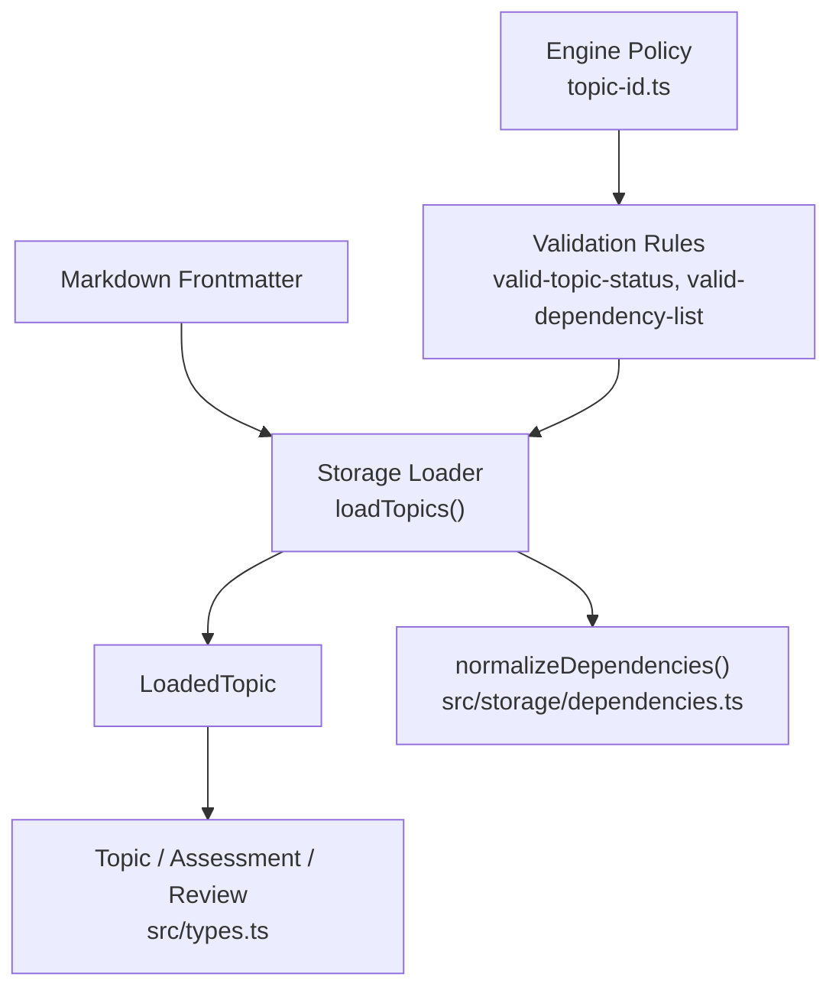
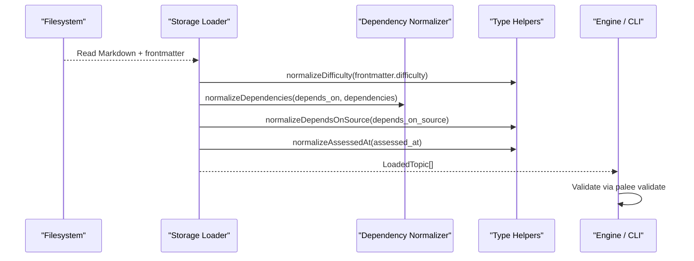
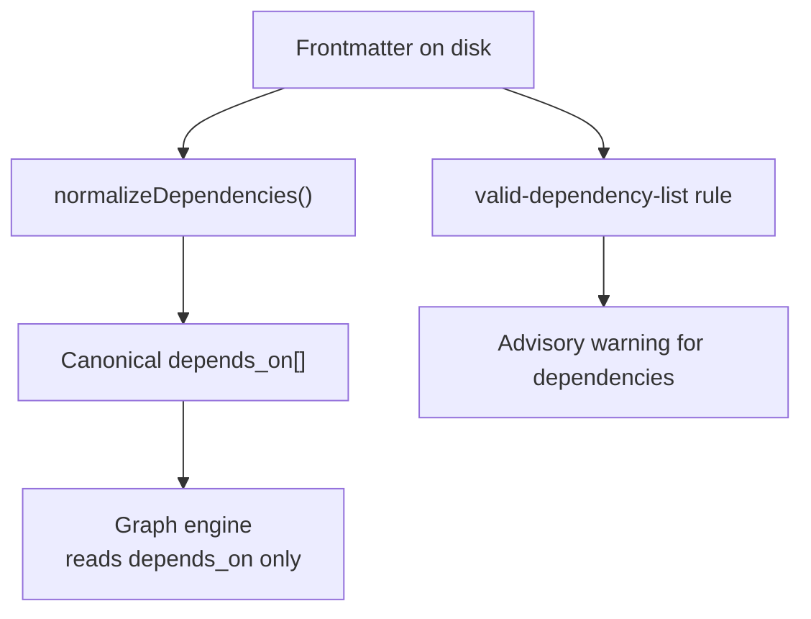
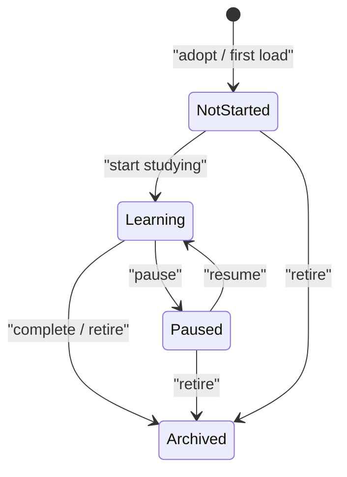
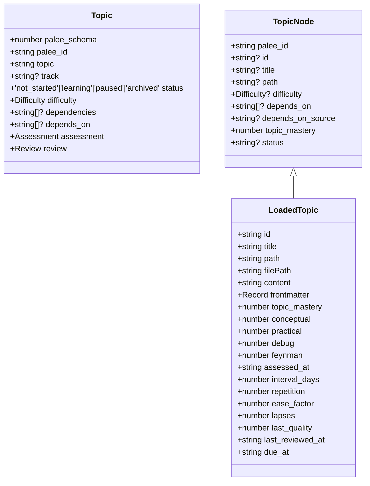
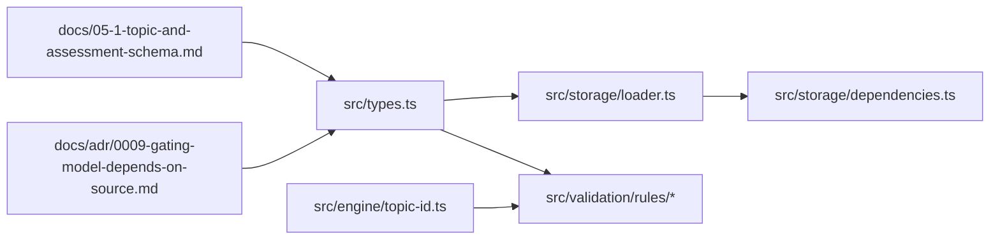

# Topic Entity

::: details Referenced Files in This Document

- [src/types.ts](https://github.com/Kuldeep2822k/cli/blob/main/src/types.ts)
- [src/engine/topic-id.ts](https://github.com/Kuldeep2822k/cli/blob/main/src/engine/topic-id.ts)
- [src/storage/loader.ts](https://github.com/Kuldeep2822k/cli/blob/main/src/storage/loader.ts)
- [src/storage/dependencies.ts](https://github.com/Kuldeep2822k/cli/blob/main/src/storage/dependencies.ts)
- [src/validation/rules/valid-topic-status.ts](https://github.com/Kuldeep2822k/cli/blob/main/src/validation/rules/valid-topic-status.ts)
- [src/validation/rules/valid-dependency-list.ts](https://github.com/Kuldeep2822k/cli/blob/main/src/validation/rules/valid-dependency-list.ts)
- [docs/05-1-topic-and-assessment-schema.md](https://github.com/Kuldeep2822k/cli/blob/main/docs/05-1-topic-and-assessment-schema.md)
- [docs/adr/0009-gating-model-depends-on-source.md](https://github.com/Kuldeep2822k/cli/blob/main/docs/adr/0009-gating-model-depends-on-source.md)

:::

## Table of Contents
1. [Introduction](#introduction)
2. [Project Structure](#project-structure)
3. [Core Components](#core-components)
4. [Architecture Overview](#architecture-overview)
5. [Detailed Component Analysis](#detailed-component-analysis)
6. [Dependency Analysis](#dependency-analysis)
7. [Performance Considerations](#performance-considerations)
8. [Troubleshooting Guide](#troubleshooting-guide)
9. [Conclusion](#conclusion)

## Introduction
The Topic entity is PALEE’s core domain object: a learnable note represented by YAML frontmatter inside a Markdown file and materialized as an in-memory object after parsing. Its Phase-2-reserved schema shape is defined by the `Topic` interface, while the storage layer normalizes raw frontmatter into a richer `LoadedTopic`, which extends the graph-oriented `TopicNode`.

> **Phase-2 reservation — read this first:** In `src/types.ts`, the JSDoc on `Topic`, `Assessment`, and `Review` reserves those interfaces for the Phase-2 AI module assessment schema and states explicitly that they are *not* the runtime shape. On disk, a topic note carries **flat** frontmatter keys — `palee_schema`, `palee_id`, `title`, `track`, `status`, `difficulty`, `depends_on` / `dependencies`, `depends_on_source`, `topic_mastery`, `conceptual`, `practical`, `debug`, `feynman`, `assessed_at`, `ease_factor`, `interval_days`, `repetition`, `lapses`, `last_quality`, `last_reviewed_at`, `due_at` — with no nested `assessment` or `review` objects. That flat layout is the real persistence format; the loader normalizes it into `LoadedTopic` (extending `TopicNode`), which is the runtime shape consumers actually receive.

At a high level, a Topic captures:
- Identity and schema version (`palee_schema`, `palee_id`).
- Human-facing metadata (`topic`, optional `track`).
- Lifecycle state (`status`) and difficulty classification (`difficulty`).
- Prerequisites (`depends_on`, with legacy alias support for `dependencies`).
- Pedagogical mastery (`assessment`).
- Spaced-repetition scheduling (`review`).

This document explains every field, its constraints, defaults, transformation rules, validation behavior, migration implications, and how Topic relates to `TopicNode` for dependency graph analysis.

## Project Structure
The Topic data model spans three layers:

| Layer | Responsibility | Relevant files |
|---|---|---|
| Domain types | Canonical interfaces, enum values, normalization helpers | `src/types.ts` |
| Storage | File scanning, frontmatter parsing, normalization, defaults | `src/storage/loader.ts`, `src/storage/dependencies.ts` |
| Validation | Raw-frontmatter integrity checks and diagnostic reporting | `src/validation/rules/valid-topic-status.ts`, `src/validation/rules/valid-dependency-list.ts` |
| Engine policy | Topic ID policy, supported schema version, lifecycle constants | `src/engine/topic-id.ts` |
| Documentation | User-facing schema documentation and ADRs | `docs/05-1-topic-and-assessment-schema.md`, `docs/adr/0009-gating-model-depends-on-source.md` |

## Core Components
The canonical domain model centers on three related shapes:

| Shape | Purpose | Key fields |
|---|---|---|
| `Assessment` | Four-pillar pedagogical mastery breakdown | `conceptual`, `practical`, `debug`, `feynman`, `assessed_at` |
| `Review` | SM-2 spaced repetition state | `interval_days`, `repetition`, `ease_factor`, `lapses`, `last_quality`, `last_reviewed_at`, `due_at` |
| `Topic` | Full frontmatter-backed topic schema | `palee_schema`, `palee_id`, `topic`, `track?`, `status`, `difficulty`, `dependencies?`, `depends_on?`, `assessment`, `review` |
| `TopicNode` | Graph-oriented base used by the engine | `palee_id`, required `topic_mastery`, optional `id`, `title`, `path`, `difficulty`, `status`, `depends_on`, `depends_on_source`, forbidden `dependencies`, plus the flat optional pillar fields (`conceptual`, `practical`, `debug`, `feynman`, `assessed_at`) and SM-2 fields (`ease_factor`, `interval_days`, `repetition`, `lapses`, `last_quality`, `last_reviewed_at`, `due_at`) |
| `LoadedTopic` | Storage-layer normalized runtime representation | Extends `TopicNode` plus `id`, `title`, `path`, `filePath`, `content`, `frontmatter`, plus assessment/review fields |

Important distinction: `Topic` is a Phase-2-reserved schema, not the persisted contract — persistence is the flat frontmatter layout described in the note above — while `LoadedTopic` is what `loadTopics` returns after coercion, clamping, defaults, and alias resolution, and is the runtime shape. Consumers that need filesystem paths, raw content, or normalized graph edges should use `LoadedTopic`; consumers that reason about the on-disk format should reference the flat frontmatter keys, not the nested `Topic` / `Assessment` / `Review` interfaces.

## Architecture Overview
The Topic lifecycle across persistence and memory looks like this:

## Detailed Component Analysis

### Field Reference: Topic
| Field | Type | Required | Default | Constraints & Notes |
|---|---|---:|---|---|
| `palee_schema` | number | Yes | None (required by schema rule) | Current supported value is `1`; unsupported versions are reported as errors by the schema validation rule. |
| `palee_id` | string | Yes | None (required) | Must be a non-empty trimmed string; engine-level format is validated against the centralized policy (`T-` prefix followed by lowercase kebab-case segments). Legacy adopt-generated timestamps remain accepted for backward compatibility. |
| `topic` (frontmatter key: `title`) | string | Yes | None | Human-readable title, stored on disk under the `title` frontmatter key — the loader reads `frontmatter.title`. The loader falls back to the note stem when no explicit title is present in frontmatter. |
| `track` | string | No | Not set | Optional curriculum grouping. |
| `status` | `'not_started' \| 'learning' \| 'paused' \| 'archived'` | Yes | Loader coerces missing status to `'not_started'`. | Only these four lifecycle values are allowed. Missing keys are not reported as defects because the loader supplies the adopt default. Explicitly wrong values, `null`, or non-string types are errors. |
| `difficulty` | `'beginner' \| 'intermediate' \| 'advanced'` | Yes | Loader calls `normalizeDifficulty`, which defaults unknown input to `'intermediate'`. | See normalization table below. |
| `dependencies` | string[] | No | Not set | Legacy alias. Accepted by storage parsing but rejected at programmatic construction time through `TopicNode.dependencies?: never`. On disk, it is tolerated and unioned with `depends_on`. Validation emits an advisory warning guiding migration to `depends_on`. |
| `depends_on` | string[] | No | Empty list if absent or null. | Canonical prerequisite field. Must be an array of non-empty string IDs without self-references; duplicates are warnings. |
| `assessment` | `Assessment` | Yes | Loader constructs assessment fields from frontmatter scores. | See Assessment section. |
| `review` | `Review` | Yes | Loader constructs review fields from frontmatter SM-2 state. | See Review section. |

#### Difficulty Normalization
`normalizeDifficulty` converts arbitrary inputs into one of the three canonical strings:

| Input category | Examples | Result |
|---|---|---|
| Exact string | `'beginner'`, `'BEGINNER'`, `'  intermediate  '` | Lowercased, trimmed canonical string |
| Numeric string | `'1'`, `'2'`, `'3'`, `'4'`, `'5'` | Mapped by numeric range |
| Number | `0`, `1`, `2`, `3`, `4`, `5`, `NaN`, `Infinity` | Numeric mapping; `Infinity` returns `'advanced'`, and only `NaN` falls through to the fallback |
| Other type | `undefined`, `null`, objects, arrays | Fallback `'intermediate'` |

Mapping ranges:
- `<= 1`: `'beginner'`
- `2..3`: `'intermediate'`
- `>= 4`: `'advanced'`

### Assessment Model
The `Assessment` model represents pedagogical mastery using four pillars:

| Field | Meaning | Scale | Loader behavior |
|---|---|---:|---|
| `conceptual` | Conceptual understanding | `0.0`–`1.0` | Parsed, clamped to `[0.0, 1.0]`, rounded to 4 decimal places; fallback `0.0` |
| `practical` | Practical application | `0.0`–`1.0` | Same clamping and rounding |
| `debug` | Debugging/troubleshooting skill | `0.0`–`1.0` | Same clamping and rounding |
| `feynman` | Feynman articulation | `0.0`–`1.0` | Same clamping and rounding |
| `assessed_at` | Last assessment timestamp | ISO 8601 string or `null` | Normalized through `normalizeAssessedAt`; epoch milliseconds are converted to ISO 8601 |

The documentation defines the overall mastery formula as a weighted average where the Feynman pillar carries double weight. However, the canonical `Topic` interface stores the four individual pillar scores and their assessment timestamp rather than a precomputed aggregate. Consumers should compute derived mastery from the stored pillars according to the documented invariant.

### Review Model
The `Review` model implements SM-2 scheduling state:

| Field | Meaning | Type | Default behavior in loader |
|---|---|---|---|
| `interval_days` | Days until next review | number | Parsed integer; fallback `1` |
| `repetition` | Consecutive successful repetitions | number | Parsed integer; fallback `0` |
| `ease_factor` | Interval scaling multiplier | number | Parsed float; fallback `2.5` |
| `lapses` | Cumulative failed reviews (quality 0-2); increments only if repetition > 0 before the reset | number | Parsed integer; fallback `0` |
| `last_quality` | Recall quality rating from last review | number or `null` | Parsed optional integer; `null` means no review yet |
| `last_reviewed_at` | When last review completed | string or `null` | Stringified if present; otherwise `null` |
| `due_at` | Next due date | string or `null` | Stringified if present; otherwise `null` |

Constraints:
- `interval_days` must be at least `1`.
- `ease_factor` has a minimum of `1.3` and an initial value of `2.5`.
- `last_quality` is `0`–`5` when present.
- Timestamp fields are expected as ISO 8601 strings.

The loader does not clamp every SM-2 field directly; instead, it coerces types and supplies sensible defaults. Additional constraints such as date validity and SM-2 bounds are enforced by dedicated validation rules rather than by `parseNumber`/`parseInteger`.

### Dependencies, Depends-On Alias, and Provenance

#### Canonical vs Legacy Field
- `depends_on` is the canonical prerequisite field.
- `dependencies` is a legacy alias preserved for backward compatibility.
- `TopicNode` explicitly forbids `dependencies` at the TypeScript construction boundary (`dependencies?: never`), so programmatic callers cannot accidentally construct a `TopicNode` with the old key.
- Storage parsing tolerates both fields on disk and unions them through `normalizeDependencies`.

#### Why Engine Rejects the Alias While Storage Tolerates It
The separation exists for safety and clarity:
- Storage parsing must read existing vaults written by older tools or hand authors, so it accepts `dependencies`.
- The engine and graph consumers operate only on `depends_on`, reducing ambiguity and preventing accidental mixing of legacy and canonical lists.
- Validation still inspects the raw `dependencies` field to warn users to migrate and to diagnose malformed legacy values before they are silently normalized.

#### Dependency Validation Rules
The `valid-dependency-list` rule validates raw frontmatter values before normalization:

| Condition | Severity | Behavior |
|---|---|---|
| `depends_on` missing or null | None | Treated as empty list (adopt-default policy) |
| Not an array | Error | Prevents ambiguous comma-split coercion |
| Non-string item | Error | Prevents silent ID minting from numbers/booleans |
| Empty-string item | Error | Prevents meaningless slots surviving normalization |
| Self-reference | Error | Structural defect equivalent to a one-node cycle |
| Duplicate entry | Warning | Loader deduplicates; the note is redundant but not broken |
| Legacy `dependencies` present | Advisory warning | Guides migration to `depends_on` |
| Malformed legacy `dependencies` | Error | Diagnoses real defects rather than silently ingesting them |
| Unrecognized `depends_on_source` label | Error | An unrecognized label maps to absent provenance, which gates the note fail-closed |

#### Gating Behavior
Not all prerequisites lock a learner out. Gating is controlled by `depends_on_source`:

| Source | Gates? | Meaning |
|---|---:|---|
| Absent | Yes | Learner-authored or pre-label vault; fail-closed |
| `numbered` | Yes | Numeric path prefix justifies the edge |
| `declared` | Yes | Note’s own text or frontmatter declaration |
| `toc` | No | Listing document enumeration order |
| `tie` | No | Filename collation between same-rank notes |

Unknown labels map to absent provenance, keeping the gate in place rather than relaxing it. This is intentional: demoting a hand-written prerequisite to advisory would be a silent, permanent loss of gating.

### Status and Lifecycle Transitions
Allowed lifecycle states:
- `not_started`
- `learning`
- `paused`
- `archived`

Rules:
- Missing status is tolerated by the loader and normalized to `not_started`.
- Present-but-invalid status values are errors.
- Explicit `null` or non-string values are errors.
- Derived pseudo-states such as `completed` or `done` are not stored; mastery is computed, not represented as a status.

Lifecycle transitions are governed by application commands rather than being encoded in the `Topic` type itself. In practice:
- New adopted topics begin as `not_started`.
- Active study typically moves toward `learning`.
- Interruptions may pause progress via `paused`.
- Finished or retired notes move to `archived`.

Status affects visibility and planning more than storage shape. Archived topics are generally excluded from active learning workflows, while `not_started`, `learning`, and `paused` participate in readiness and dependency gating.

### Topic vs TopicNode
`TopicNode` is the graph-oriented abstraction consumed by the dependency engine and scheduling components. It is intentionally narrower than `Topic`:

| Aspect | `Topic` | `TopicNode` |
|---|---|---|
| Scope | Persistence schema | Runtime graph node |
| Identity | `palee_id` | `palee_id`, optional `id` |
| Metadata | `topic`, optional `track` | Optional `title`, `path`, `difficulty`, `status`; optional `depends_on_source` |
| Dependencies | Both `dependencies` and `depends_on` allowed in schema | Only canonical `depends_on`; `dependencies` is forbidden |
| Mastery state | Nested `assessment` and `review` | Required `topic_mastery` on the node itself, plus the flat optional pillar fields (`conceptual`, `practical`, `debug`, `feynman`, `assessed_at`) and SM-2 fields (`ease_factor`, `interval_days`, `repetition`, `lapses`, `last_quality`, `last_reviewed_at`, `due_at`); `LoadedTopic` extends it with filesystem identity |
| Primary consumer | Schema documentation, persistence contracts | Dependency graph, readiness checks, planning |

`LoadedTopic` bridges the two: it extends `TopicNode` and adds filesystem identity (`id`, `title`, `path`, `filePath`, `content`, `frontmatter`) plus fully normalized assessment and review fields.

## Dependency Analysis
The Topic entity participates in several important dependency relationships:

Key coupling observations:
- `Topic` is a Phase-2-reserved schema, not the source of truth: the flat on-disk frontmatter is the persistence format, and `LoadedTopic` is the practical runtime contract.
- Storage normalization is central: `loadTopics` applies difficulty normalization, score clamping, timestamp conversion, and dependency alias resolution.
- Validation reads raw frontmatter to detect corruption before normalization hides it.
- Engine policy modules (`topic-id.ts`) define shared constants and policies reused by validation and storage.
- `TopicNode` decouples graph consumers from persistence details.

## Performance Considerations
`loadTopics` includes several performance safeguards relevant to Topic loading:
- Module-level topic cache keyed by absolute file path.
- Negative cache for files known not to be PALEE topics, bounded by `MAX_NON_TOPIC_CACHE_ENTRIES`.
- Stat-first check against `MAX_NOTE_SOURCE_BYTES` so oversized files are not read.
- Snapshot injection seam for tests and concurrent-read scenarios.
- Deduplication of dependency IDs during normalization.

These mechanisms mean Topic loading cost tracks the number of real topics rather than the total vault size, and repeated scans avoid redundant YAML parsing.

## Troubleshooting Guide

### Common Field Problems
| Symptom | Likely Cause | Resolution |
|---|---|---|
| Vault fails validation because of `status` | Stored value is not one of the four lifecycle strings | Correct the frontmatter to `not_started`, `learning`, `paused`, or `archived` |
| `difficulty` becomes `'intermediate'` unexpectedly | Input was not a recognized string or numeric range | Use `'beginner'`, `'intermediate'`, `'advanced'`, or a number in the mapped range |
| `palee_id` reports invalid format | Does not match the `T-` kebab policy or is empty | Regenerate or edit to follow the centralized ID policy |
| `depends_on` produces duplicate warnings | Manual frontmatter contains repeated IDs | Remove duplicates; loader deduplicates automatically |
| `dependencies` generates an advisory warning | Legacy alias is still present | Replace with `depends_on` |
| Topic is gated behind a prerequisite with no visible label | `depends_on_source` is absent or unrecognized | Confirm whether the prerequisite is intended; adjust label or remove unintended edge |
| `assessed_at` causes validation issues | Old epoch-millisecond value stored as a plain number or digit string | Let loader normalize to ISO 8601 or update to a valid ISO timestamp |

### Migration Considerations
Schema evolution touches several parts of the Topic model:
- `palee_schema` is the version marker. Currently only `1` is supported.
- `dependencies` remains readable on disk but is deprecated in favor of `depends_on`.
- `depends_on_source` controls gating; unrecognized labels keep notes gated.
- `migrate --relabel-ties` can relabel historical `numbered` ties to `tie`, stopping filename collation from gating learners.
- The migration option supports dry-run preview and opt-in handling of unlabeled ties.

When evolving the schema:
- Preserve backward-compatible parsing in storage.
- Normalize to canonical in-memory forms.
- Add validation rules for new required or constrained fields.
- Provide migration tooling when stored data can become semantically incorrect without repair.

## Conclusion
The Topic entity is the anchor of PALEE’s learning model. Its persistence format is the flat frontmatter layout (the `Topic` interface is the Phase-2-reserved schema), its runtime representation is `LoadedTopic`, and its graph usage is `TopicNode`. The storage layer is the primary transformation boundary: it normalizes difficulty, clamps assessment scores, converts timestamps, resolves the legacy `dependencies` alias into canonical `depends_on`, and supplies safe defaults. Validation complements this by inspecting raw frontmatter to expose corruption, malformed aliases, self-references, duplicates, and invalid lifecycle states.

For reliable Topic manipulation:
- Prefer `loadTopics` for reading vault data.
- Treat `TopicNode.depends_on` as the canonical prerequisite field.
- Avoid constructing `TopicNode` with the legacy `dependencies` alias.
- Use `normalizeDifficulty` for any external difficulty input.
- Respect `depends_on_source` when diagnosing why a topic is gated.
- Run `palee validate` to surface pre-normalization defects before assuming normalization has fixed the vault.
