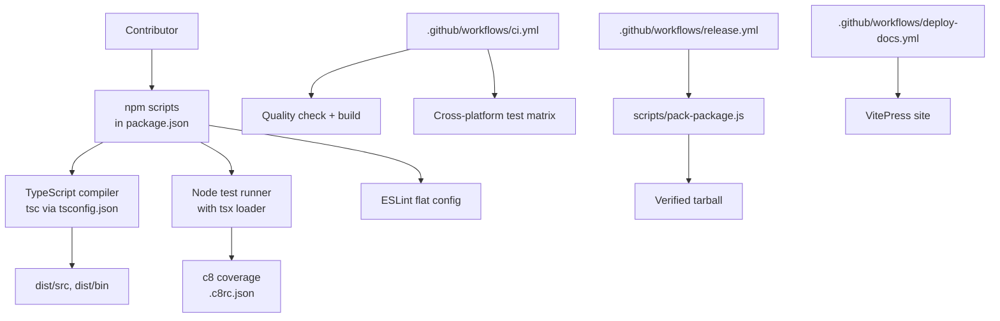
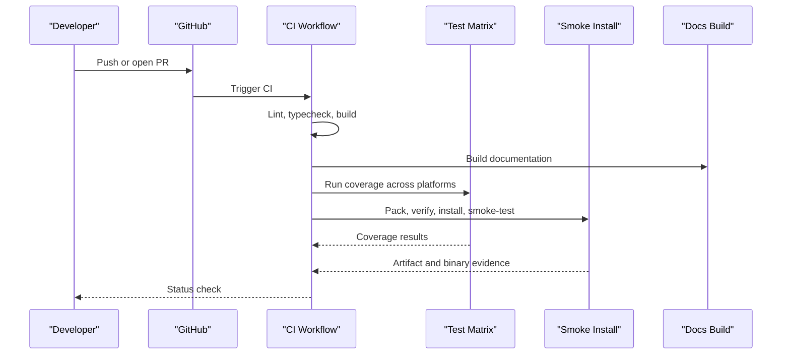
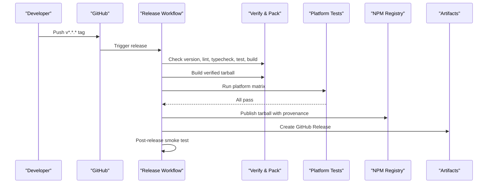
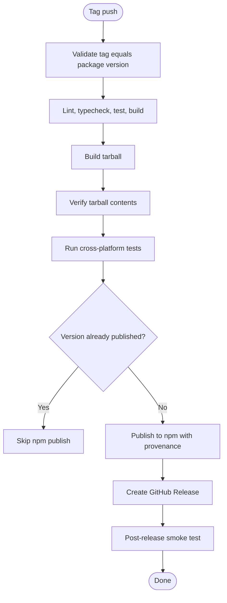
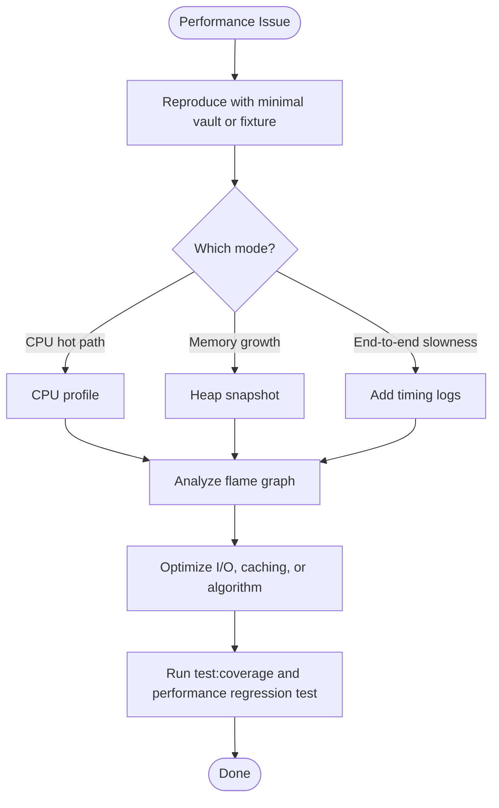
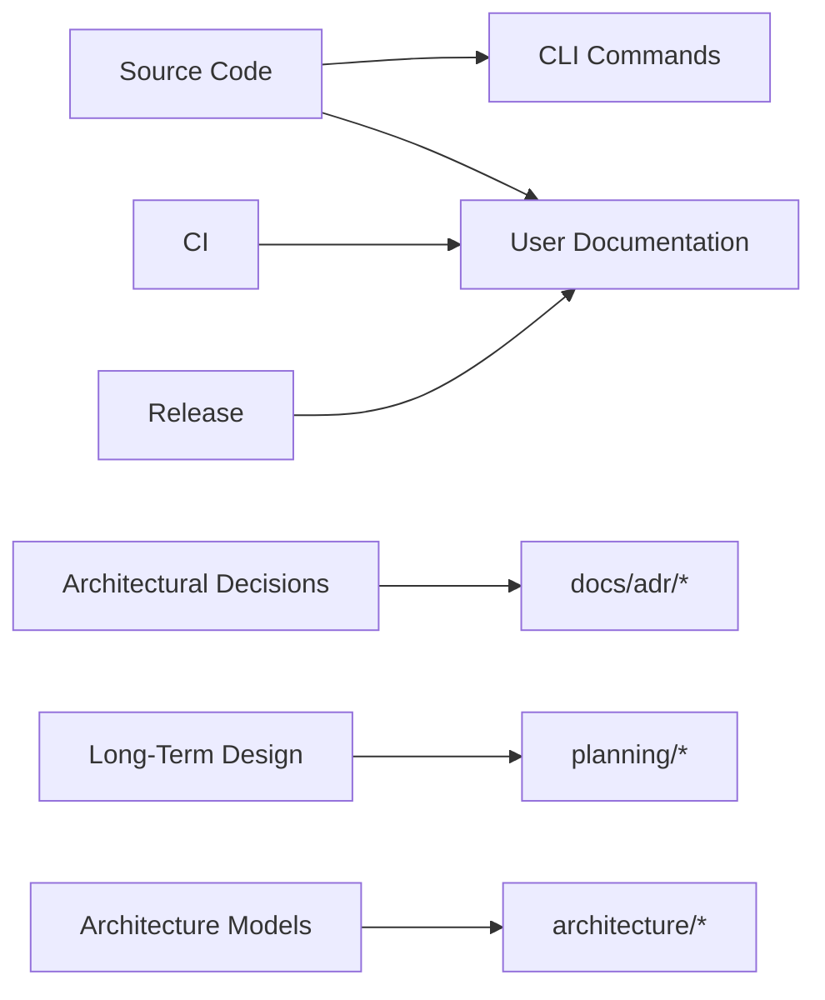

# Development Workflow

::: details Referenced Files in This Document

- [package.json](https://github.com/Kuldeep2822k/cli/blob/main/package.json)
- [tsconfig.json](https://github.com/Kuldeep2822k/cli/blob/main/tsconfig.json)
- [eslint.config.mjs](https://github.com/Kuldeep2822k/cli/blob/main/eslint.config.mjs)
- [.c8rc.json](https://github.com/Kuldeep2822k/cli/blob/main/.c8rc.json)
- [agent.md](https://github.com/Kuldeep2822k/cli/blob/main/agent.md)
- [README.md](https://github.com/Kuldeep2822k/cli/blob/main/README.md)
- [bin/palee.ts](https://github.com/Kuldeep2822k/cli/blob/main/bin/palee.ts)
- [scripts/pack-package.js](https://github.com/Kuldeep2822k/cli/blob/main/scripts/pack-package.js)
- [scripts/verify-tarball.js](https://github.com/Kuldeep2822k/cli/blob/main/scripts/verify-tarball.js)
- [scripts/smoke-installed.js](https://github.com/Kuldeep2822k/cli/blob/main/scripts/smoke-installed.js)
- [.github/workflows/ci.yml](https://github.com/Kuldeep2822k/cli/blob/main/.github/workflows/ci.yml)
- [.github/workflows/release.yml](https://github.com/Kuldeep2822k/cli/blob/main/.github/workflows/release.yml)
- [.github/workflows/deploy-docs.yml](https://github.com/Kuldeep2822k/cli/blob/main/.github/workflows/deploy-docs.yml)
- [.github/workflows/skylos.yml](https://github.com/Kuldeep2822k/cli/blob/main/.github/workflows/skylos.yml)
- [docs/adr/README.md](https://github.com/Kuldeep2822k/cli/blob/main/docs/adr/README.md)

:::

## Table of Contents
1. [Introduction](#introduction)
2. [Project Structure](#project-structure)
3. [Development Environment Setup](#development-environment-setup)
4. [Build and Test Workflow](#build-and-test-workflow)
5. [Coding Standards and Quality Gates](#coding-standards-and-quality-gates)
6. [Commit, Branch, and Pull Request Workflow](#commit-branch-and-pull-request-workflow)
7. [Continuous Integration Pipeline](#continuous-integration-pipeline)
8. [Release Process](#release-process)
9. [Debugging and Performance Analysis](#debugging-and-performance-analysis)
10. [Documentation, ADRs, and Planning Documents](#documentation-adrs-and-planning-documents)
11. [Troubleshooting Guide](#troubleshooting-guide)
12. [Conclusion](#conclusion)

## Introduction
This document explains how to develop, test, review, and release PALEE (`@kuldeep2822k/palee`). It is aimed at contributors who need a reliable local workflow and want to understand the project’s TypeScript tooling, ESLint rules, CI pipeline, release automation, and documentation conventions.

PALEE is a Node.js CLI that implements spaced repetition, dependency-aware recommendations, vault scanning, atomic file writes, validation, and session management. The repository uses TypeScript compiled to CommonJS, npm workspaces for documentation, GitHub Actions for CI and releases, and structured Architectural Decision Records (ADRs).

## Project Structure
The development-relevant layout can be understood as layers around the CLI:

Key areas:
- `src/` — application source code organized by layer: types, engine, storage, application, validation, AI, and CLI handlers.
- `bin/palee.ts` — CLI entry point registered with Commander.
- `test/` — unit, integration, end-to-end, property-based, and smoke tests.
- `scripts/` — packaging, verification, and smoke-testing helpers used by CI and release workflows.
- `docs/` — VitePress documentation workspace.
- `.github/workflows/` — CI, release, documentation deployment, labeling, and static analysis pipelines.
- `planning/` and `architecture/` — design artifacts; ADRs live under `docs/adr/`.

## Development Environment Setup

### Node.js Requirements
- Minimum supported runtime: **Node.js ≥ 22.12.0**.
- The package declares this through the `engines.node` field.
- CI installs and tests against Node 22.x and 24.x on Ubuntu, Windows, and macOS, plus Node 26.x on Ubuntu only.

Use your preferred Node version manager and install a version satisfying the requirement before installing dependencies.

### Dependency Installation
From the repository root:

- Install production and development dependencies without running workspace-only scripts:
  - `npm ci --ignore-scripts --no-workspaces`
- If you also need the documentation workspace:
  - `npm ci --ignore-scripts`

The CI quality job skips the docs workspace because linting, typechecking, and building the CLI do not require VitePress or Mermaid dependencies.

### Local Build
Run:
- `npm run build`

This compiles TypeScript into `dist/`, copies `package.json` into `dist/package.json`, and makes the CLI binary executable. The published package exposes:
- Main entry: `dist/src/index.js`
- Types: `dist/src/index.d.ts`
- CLI binary: `./dist/bin/palee.js`

### Verification Before Committing
The repository’s agent guide recommends a five-step verification loop:

1. Typecheck: `npm run typecheck`
2. Lint: `npm run lint`
3. Tests: `npm test`
4. Build: `npm run build`
5. Packaged artifact verification: `npm pack && node scripts/verify-tarball.js`

This loop ensures the change passes strict TypeScript, ESLint, the full test suite, and the expected published artifact contents.

## Build and Test Workflow

### Scripts Overview

| Script | Purpose | Notes |
|---|---|---|
| `typecheck` | Runs `tsc --noEmit` | Strict compile-time gate |
| `lint` | Runs ESLint | Use `lint:fix` for automatic fixes |
| `check` | Runs typecheck then lint | Preferred combined quality gate |
| `build` | Compiles TypeScript and prepares `dist/` | Copies manifest and sets binary mode |
| `prepublishOnly` | Builds before publishing | Ensures distribution matches source |
| `test` | Runs all tests with concurrency 4 | Uses Node’s built-in test runner with `tsx` |
| `test:unit` | Runs core unit-style suites | Storage, engine, types, smoke |
| `test:fast` | Faster subset of CLI, engine, fault injection, fuzz, session, storage, stress, timezone, and type tests | Useful during iteration |
| `test:e2e` | Runs end-to-end tests under `test/e2e/` | Full feature scenarios |
| `test:fuzz` | Runs property fuzzing and stress tests | Includes challenger and concurrency suites |
| `test:coverage` | Runs full test suite under c8 | Applies coverage thresholds |

### Running Tests Locally
- Full suite: `npm test`
- Fast subset: `npm run test:fast`
- End-to-end only: `npm run test:e2e`
- Fuzz and stress: `npm run test:fuzz`
- Coverage report: `npm run test:coverage`

The test command runs Node with the `tsx` loader so tests execute directly from TypeScript. Concurrency is capped at four workers to avoid memory pressure on high-core machines.

### Test Organization
Tests cover:
- CLI commands and exit codes.
- Engine behavior including SM-2 scheduling, dependency cycles, readiness, and mastery.
- Storage behaviors including atomic writes, locking, frontmatter preservation, vault walking, sessions, and containment.
- Validation rule collection, formatting, and individual rules.
- AI provider boundaries and network constraints.
- Application use cases such as due topics, next-topic selection, mastery summaries, assessment recording, and review recording.
- Cross-platform and time-zone behavior.
- CI configuration consistency and installed-artifact evidence.

## Coding Standards and Quality Gates

### TypeScript Configuration
`tsconfig.json` enforces a strict type-checking baseline:

- Target: ES2022
- Module system: CommonJS
- Output directory: `dist`
- Declaration files enabled
- Strict mode on
- No unused locals or parameters
- No implicit returns
- No fallthrough cases in switch statements
- No implicit overrides
- No unchecked indexed access
- Exact optional property types
- Skip library checks
- JSON module resolution
- Included directories: `src/**/*`, `test/**/*`, `bin/**/*`

These settings make many bugs compile-time failures rather than runtime surprises.

### ESLint Rules
`eslint.config.mjs` uses the modern flat config format and combines:
- Recommended rules from ESLint and TypeScript ESLint.
- Repo-wide hygiene rules.
- Stricter shipped-code rules scoped to `src/**/*.ts` and `bin/**/*.ts`.
- A no-console rule for non-CLI source.

Important enforced standards include:

| Rule or Area | Enforcement |
|---|---|
| Unused disable directives | Error |
| Empty blocks | Allowed only for empty `catch`; intentional emptiness must be documented |
| Array callback return | Error |
| Prefer const | Error |
| Explicit `any` in `src/` and `bin/` | Error |
| Floating promises | Error in shipped code |
| Misused promises | Error in shipped code |
| Misused spread | Error in shipped code |
| Only throw `Error` | Error in shipped code |
| Promise rejection errors | Error in shipped code |
| Switch exhaustiveness | Error in shipped code |
| Unbound methods | Error in shipped code |
| Promise executor return | Error |
| Numeric `process.exitCode` literals | Forbidden by restricted syntax |
| Console output in library source | Forbidden outside `src/cli/` |

The exit-code guard prevents numeric literals in `process.exitCode` assignments. Contributors should import the `ExitCode` symbol or route values through `exitCodeFor()` instead of writing raw numbers.

### Code Style Summary
- Shared types are defined once in `src/types.ts` and re-exported from `src/index.ts`.
- Internal modules (`ai/`, `application/`) are reached via relative imports.
- There are no path aliases; imports are plain relative paths.
- Data-model fields are snake_case.
- Code identifiers are camelCase.
- Runtime dependencies are limited to `commander` and `yaml`.

## Commit, Branch, and Pull Request Workflow

### Commit Messages
Commit messages are one line, two at most — a subject that says plainly what the commit did, with no paragraph bodies (reasoning belongs in the PR description or an ADR, not the commit log). Conventional Commits applies to PR titles and to commit subjects. Recent commits in this repository demonstrate patterns such as:
- `fix(engine): ...`
- `docs(agent): ...`
- `fix(storage): ...`
- `chore(deps): ...`
- `ci(release): ...`

This convention helps automated tools generate changelogs and communicate intent clearly.

### Branch Naming
There is no explicit branch naming schema defined in the reviewed files. The main branch is `main`, and CI triggers on pushes and pull requests targeting `main`. For internal team consistency, prefer short descriptive names such as:
- `feature/session-command`
- `fix/storage-lock-stale`
- `docs/adrs-update`
- `ci/node-matrix-fix`

### Pull Requests
A PR should:
1. Start from a focused branch.
2. Pass `npm run check` locally.
3. Pass the full test suite relevant to the change.
4. Include tests when changing behavior.
5. Avoid `any` casts in `src/`.
6. Use typed exit codes instead of numeric `process.exitCode` literals.
7. Keep console output out of library layers.
8. Update documentation and ADRs if the change affects architecture, CLI contracts, or user-visible behavior.
9. Be ready for CI checks covering lint, typecheck, build, cross-platform tests, coverage thresholds, and documentation builds.

## Continuous Integration Pipeline

### CI Workflow
`.github/workflows/ci.yml` runs on push to `main`, matching tags, and pull requests to `main`.

It includes:

| Job | Responsibility |
|---|---|
| `quality-check` | Installs dependencies without workspaces, runs `npm run check`, and builds |
| `docs-check` | Installs the docs workspace and builds VitePress documentation |
| `test-matrix` | Runs coverage tests across Node 22.x and 24.x on Ubuntu, Windows, and macOS, plus Node 26.x on Ubuntu only |
| `engines-floor-smoke` (Built Artifact on the Declared Node Floor) | Runs the built bundle on the `engines.node` floor version read from `package.json` |
| `smoke-install` | Packs the package, verifies tarball contents, installs globally, checks version, runs `--help`, and executes an isolated smoke test |
| Changed-code coverage check | On pull requests, requires at least 50% changed-file coverage using diff-cover |

Concurrency groups prevent duplicate CI runs from overlapping, and non-main branches cancel in-progress duplicates.

### Documentation Deployment
`.github/workflows/deploy-docs.yml` builds and deploys VitePress documentation to GitHub Pages when files under `docs/` or the workflow itself change. It:
- Checks out with a full history.
- Uses Node 22.23.4.
- Installs dependencies with `--ignore-scripts` for security.
- Configures GitHub Pages.
- Builds the VitePress site.
- Uploads the Pages artifact.
- Deploys through the `github-pages` environment.

### Skylos Static Analysis
`.github/workflows/skylos.yml` runs dead-code detection, security scanning, quality analysis, and AI-defect analysis on push to `main` and pull requests. It currently runs in advisory mode and does not block merges while its false-positive rate is being evaluated.

## Release Process

### Version Management
The package version is declared in `package.json`. The release workflow validates that the Git tag version matches the package version:
- Tag format: `v*.*.*`
- Example: `v1.1.0`
- The workflow extracts the tag without the leading `v` and compares it to `require('./package.json').version`.

Do not publish manually unless you have direct registry credentials. The intended path is a tagged release triggered by GitHub Actions.

### Release Workflow
`.github/workflows/release.yml` runs on matching tags or manual dispatch.

Its flow:

Key steps:
1. Checkout code without persisting credentials.
2. Validate tag-to-version equality.
3. Install dependencies.
4. Run strict typecheck and lint.
5. Run unit and invariant tests with coverage.
6. Build the production bundle.
7. Build the verified tarball with `scripts/pack-package.js`.
8. Assert tarball contents with `scripts/verify-tarball.js`.
9. Upload the tarball as a GitHub artifact.
10. Run the same cross-platform test matrix as CI.
11. Publish the tarball to npm using OIDC and a public access token secret.
12. Create a GitHub Release with generated notes and the attached artifact.
13. Run a post-release smoke test on Windows.

### Tarball Contents
The tarball verification script asserts that the published package contains the required distribution files and excludes development-only directories. Contributors can validate locally with:
- `npm pack`
- `node scripts/verify-tarball.js`

### Publishing Details
- The publish step uses `npm publish` with `--access public` and `--provenance`.
- Authentication uses `NODE_AUTH_TOKEN`.
- The workflow avoids publishing if the version already exists on npm.
- Provenance is included to improve supply-chain transparency.

## Debugging and Performance Analysis

### Debugging the CLI
Recommended approaches:

1. **Inspect exit codes**:
   - Success: `0`
   - Partial failure: `1`
   - Usage or configuration error: `2`
   - Validation failures: `3`
   - OCC lock conflict: `4`
   - Unexpected exception: `5`

2. **Use structured machine output**:
   - Add `--json` or set `PALEE_JSON=1` where supported.
   - Errors are emitted to stderr in JSON form for machine consumers.

3. **Enable debug stack traces**:
   - Set `PALEE_DEBUG=1` to allow raw stack traces from the fatal handler.

4. **Launch tests with explicit argv and config directory**:
   - Tests use `process.execPath` and resolve CLI arguments through `PALEE_ARGV`.
   - They point the config directory at a temporary location via `PALEE_CONFIG_DIR`.

5. **Attach a debugger**:
   - Run the built CLI directly: `node ./dist/bin/palee.js <command>`
   - Or run the TypeScript source through the test harness when investigating test-specific behavior.

### Profiling and Performance Analysis
- Use Node’s built-in profiler:
  - `node --prof ./dist/bin/palee.js <command>`
  - Analyze the generated profile log with `node --prof-process`.
- Use heap snapshots:
  - `node --inspect ./dist/bin/palee.js <command>`
  - Connect Chrome DevTools or VS Code.
- Use CPU profiling:
  - `node --cpu-prof ./dist/bin/palee.js <command>`
  - Analyze the resulting profile file.
- Measure test performance:
  - Run targeted subsets such as `npm run test:fast` or specific test globs.
- Identify slow paths:
  - Focus on storage scanning, frontmatter parsing, session handling, and validation rule execution.
- Compare versions:
  - Build two distributions and compare execution time or memory usage for large vaults.

### Coverage Analysis
Coverage thresholds are configured in `.c8rc.json`:
- Lines: ≥ 96%
- Statements: ≥ 96%
- Functions: ≥ 93%
- Branches: ≥ 88%

On pull requests, CI additionally requires at least 50% changed-file coverage.

## Documentation, ADRs, and Planning Documents

### Documentation Site
The documentation is built with VitePress and lives under `docs/`. Relevant scripts:
- `npm run docs:dev`
- `npm run docs:build`
- `npm run docs:preview`

The workspace is declared under `workspaces` in `package.json`. CI builds the documentation separately from the CLI to avoid unnecessary dev dependencies in quality jobs.

### Architectural Decision Records
ADRs live under `docs/adr/`. The index documents status vocabulary, title conventions, section headings, and amendment practices. When making an architectural or design decision:
1. Create a new ADR file with a unique sequential number.
2. Use Title Case in page titles and headings.
3. Follow the standard sections: Status, Context, Decision, Consequences.
4. Mark status as `Proposed`, `Accepted`, or `Superseded by ADR-nnnn`.
5. If only part changes, add an `Amended by ADR-nnnn` line.

Recent ADRs cover topics such as SM-2, atomic locking, frontmatter fidelity, validation framework, exit codes, application layer, AI provider boundary, testing policy, and release evidence.

### Planning and Architecture Directories
- `planning/` holds design specifications, roadmap design, storage design, memory design, invariants, example workflows, and future-phase planning.
- `architecture/` holds architecture models, dependency graphs, boundary diagrams, and evidence.

When contributing:
- Update user-facing documentation under `docs/` when CLI behavior changes.
- Update ADRs when architectural decisions change.
- Update planning documents when long-term design scope changes.
- Keep README guidance consistent with current implementation.

## Troubleshooting Guide

### Node Version Errors
Symptoms:
- `engines.node` warning or installation failure.
- ESM/CommonJS compatibility issues with newer Node versions.

Resolution:
- Install Node ≥ 22.12.0.
- Use `nvm`, `fnm`, or another version manager.
- Confirm with `node --version`.

### TypeScript Compilation Errors
Symptoms:
- Unused variables, missing return paths, unhandled promises, or indexed access warnings.

Resolution:
- Run `npm run typecheck`.
- Fix strict-mode violations rather than suppressing them.
- Respect `noUncheckedIndexedAccess` and `exactOptionalPropertyTypes`.

### ESLint Failures
Symptoms:
- `any` cast in source.
- Numeric `process.exitCode` literal.
- Console logging in non-CLI source.
- Missing exhaustiveness checks.

Resolution:
- Run `npm run lint` for diagnostics.
- Run `npm run lint:fix` for mechanical fixes.
- Replace `any` with proper types.
- Import `ExitCode` or use `exitCodeFor()`.
- Move console output to `src/cli/` only.

### Test Failures
Symptoms:
- Exit code mismatches.
- Machine output parsing failures.
- Timezone or platform differences.

Resolution:
- Run the failing test directly.
- Inspect stdout/stderr and exit codes.
- Use `PALEE_JSON=1` where applicable.
- Check platform guards and timezone-sensitive logic.

### Coverage Threshold Failures
Symptoms:
- Local or CI coverage fails even though tests pass.

Resolution:
- Run `npm run test:coverage`.
- Review `.c8rc.json` thresholds.
- Add tests for newly touched code.
- Avoid reducing thresholds to silence failures.

### Release Version Mismatch
Symptoms:
- CI rejects the tag because the tag version differs from `package.json`.

Resolution:
- Bump `version` in `package.json`.
- Commit the version bump.
- Tag with `v<version>`.
- Push the tag.

### Documentation Build Failures
Symptoms:
- VitePress build fails in CI.

Resolution:
- Run `npm run docs:build`.
- Ensure the docs workspace dependencies are installed.
- Check for markdown, Mermaid, or theme configuration issues.

## Conclusion
PALEE’s development workflow centers on strict TypeScript compilation, comprehensive ESLint rules, broad cross-platform testing, and deterministic release automation. Contributors should treat `npm run check`, the full test suite, and the packaged artifact verification as mandatory pre-commit gates. Changes that affect architecture, CLI contracts, or user-facing behavior should be accompanied by documentation updates and, where appropriate, ADRs. Releases are driven by versioned tags and validated by CI and release workflows before publication to npm and attachment to GitHub Releases.

## References

- [package.json:15-61](https://github.com/Kuldeep2822k/cli/blob/main/package.json#L15-L61)
- [tsconfig.json:1-24](https://github.com/Kuldeep2822k/cli/blob/main/tsconfig.json#L1-L24)
- [.github/workflows/ci.yml:1-120](https://github.com/Kuldeep2822k/cli/blob/main/.github/workflows/ci.yml#L1-L120)
- [.github/workflows/release.yml:1-80](https://github.com/Kuldeep2822k/cli/blob/main/.github/workflows/release.yml#L1-L80)
- [.github/workflows/deploy-docs.yml:1-71](https://github.com/Kuldeep2822k/cli/blob/main/.github/workflows/deploy-docs.yml#L1-L71)
- [package.json:1-85](https://github.com/Kuldeep2822k/cli/blob/main/package.json#L1-L85)
- [agent.md:1-75](https://github.com/Kuldeep2822k/cli/blob/main/agent.md#L1-L75)
- [package.json:29-61](https://github.com/Kuldeep2822k/cli/blob/main/package.json#L29-L61)
- [package.json:63-85](https://github.com/Kuldeep2822k/cli/blob/main/package.json#L63-L85)
- [agent.md:76-92](https://github.com/Kuldeep2822k/cli/blob/main/agent.md#L76-L92)
- [eslint.config.mjs:1-127](https://github.com/Kuldeep2822k/cli/blob/main/eslint.config.mjs#L1-L127)
- [.github/workflows/ci.yml:1-200](https://github.com/Kuldeep2822k/cli/blob/main/.github/workflows/ci.yml#L1-L200)
- [.github/workflows/skylos.yml:1-42](https://github.com/Kuldeep2822k/cli/blob/main/.github/workflows/skylos.yml#L1-L42)
- [.github/workflows/release.yml:1-251](https://github.com/Kuldeep2822k/cli/blob/main/.github/workflows/release.yml#L1-L251)
- [scripts/pack-package.js](https://github.com/Kuldeep2822k/cli/blob/main/scripts/pack-package.js)
- [scripts/verify-tarball.js](https://github.com/Kuldeep2822k/cli/blob/main/scripts/verify-tarball.js)
- [package.json:1-28](https://github.com/Kuldeep2822k/cli/blob/main/package.json#L1-L28)
- [agent.md:30-75](https://github.com/Kuldeep2822k/cli/blob/main/agent.md#L30-L75)
- [.c8rc.json:1-12](https://github.com/Kuldeep2822k/cli/blob/main/.c8rc.json#L1-L12)
- [package.json:45-61](https://github.com/Kuldeep2822k/cli/blob/main/package.json#L45-L61)
- [docs/adr/README.md:1-62](https://github.com/Kuldeep2822k/cli/blob/main/docs/adr/README.md#L1-L62)
