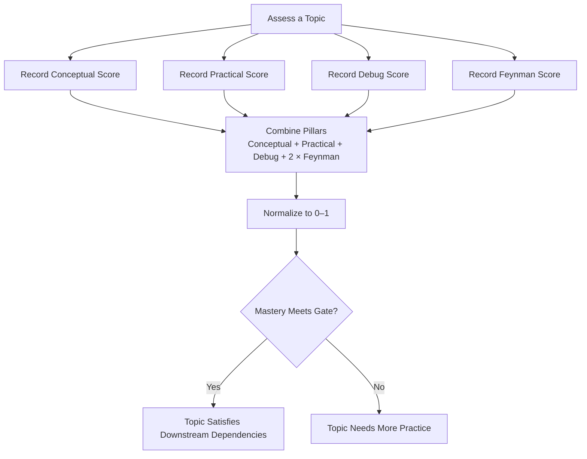
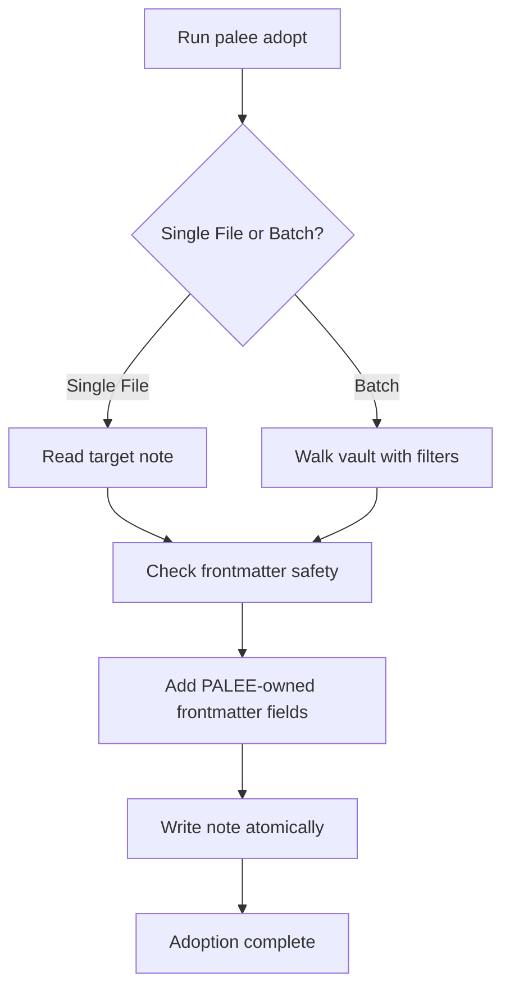
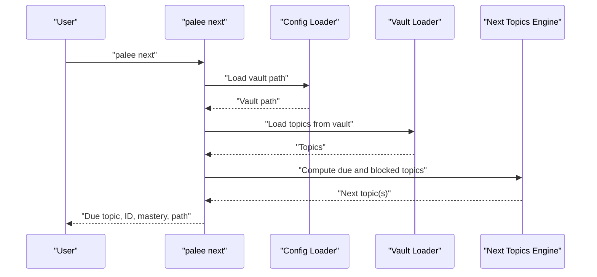
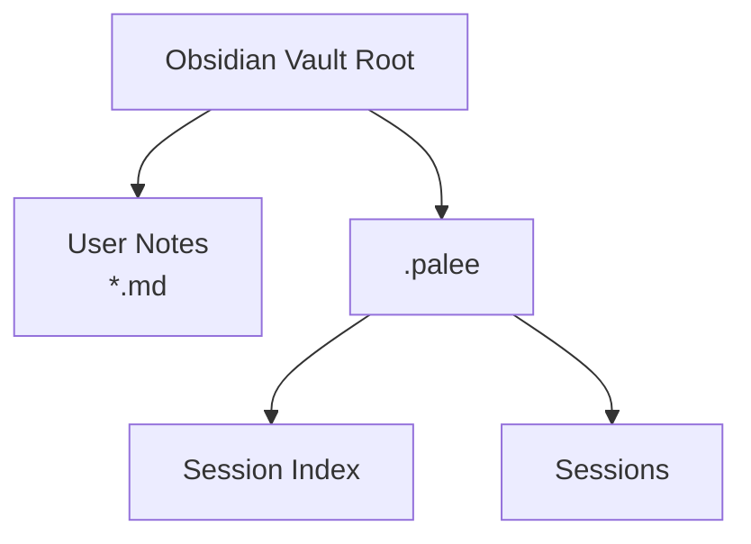
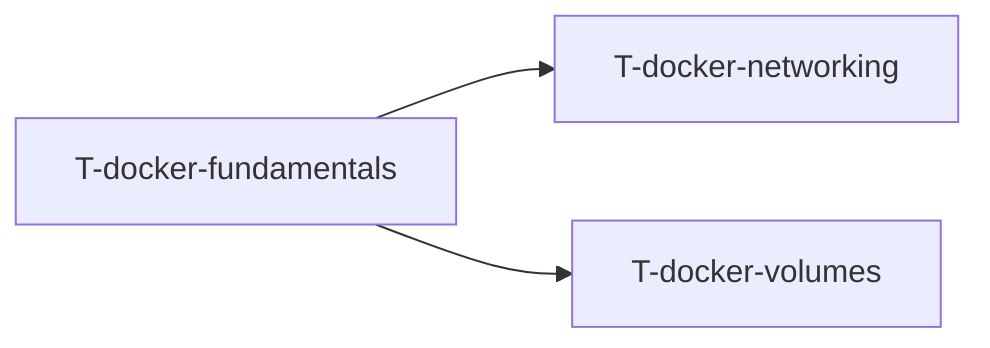

# Getting Started

::: details Referenced Files in This Document

- [README.md](https://github.com/Kuldeep2822k/cli/blob/main/README.md)
- [package.json](https://github.com/Kuldeep2822k/cli/blob/main/package.json)
- [bin/palee.ts](https://github.com/Kuldeep2822k/cli/blob/main/bin/palee.ts)
- [src/cli/config.ts](https://github.com/Kuldeep2822k/cli/blob/main/src/cli/config.ts)
- [src/cli/adopt.ts](https://github.com/Kuldeep2822k/cli/blob/main/src/cli/adopt.ts)
- [src/cli/next.ts](https://github.com/Kuldeep2822k/cli/blob/main/src/cli/next.ts)
- [src/cli/review.ts](https://github.com/Kuldeep2822k/cli/blob/main/src/cli/review.ts)
- [docs/adr/0004-four-pillar-pedagogical-mastery.md](https://github.com/Kuldeep2822k/cli/blob/main/docs/adr/0004-four-pillar-pedagogical-mastery.md)
- [examples/Docker Fundamentals.md](https://github.com/Kuldeep2822k/cli/blob/main/examples/Docker%20Fundamentals.md)
- [examples/Docker Networking.md](https://github.com/Kuldeep2822k/cli/blob/main/examples/Docker%20Networking.md)
- [examples/Docker Volumes.md](https://github.com/Kuldeep2822k/cli/blob/main/examples/Docker%20Volumes.md)
- [examples/.palee/index.md](https://github.com/Kuldeep2822k/cli/blob/main/examples/.palee/index.md)

:::

## Table of Contents
1. [Introduction](#introduction)
2. [What PALEE Is](#what-palee-is)
3. [Installation](#installation)
4. [Vault-Based Learning Model](#vault-based-learning-model)
5. [The Four-Pillar Pedagogical Approach](#the-four-pillar-pedagogical-approach)
6. [Initial Setup](#initial-setup)
7. [Creating Your First Topic](#creating-your-first-topic)
8. [Adopting Existing Notes](#adopting-existing-notes)
9. [Running Your First Review Session](#running-your-first-review-session)
10. [Expected Directory Structure](#expected-directory-structure)
11. [Topics and Prerequisite Chains](#topics-and-prerequisite-chains)
12. [Common First-Time Issues](#common-first-time-issues)
13. [Troubleshooting Guide](#troubleshooting-guide)
14. [Next Steps](#next-steps)

## Introduction
This guide helps you install PALEE, connect it to an Obsidian vault, create or adopt your first topic, and run a spaced-repetition review session. It explains the vault model, YAML frontmatter metadata, prerequisite chains, and the four pedagogical pillars that shape mastery tracking.

## What PALEE Is
PALEE is the Personal Active Learning & Evaluation Engine. It is a deterministic study tool built on top of Obsidian markdown notes. Instead of creating its own database, PALEE reads and writes learning metadata directly into note frontmatter inside your existing vault.

Key ideas:
- Your vault is the data store.
- Topics are ordinary Markdown notes with a small YAML frontmatter block.
- Reviews are scheduled using the SM-2 spaced repetition algorithm.
- Recommendations respect prerequisite dependencies so you do not study advanced topics before their foundations.
- Mastery can be recorded across four dimensions: conceptual, practical, debug, and Feynman.

PALEE also maintains internal state such as session logs and hot memory under a `.palee` directory inside your vault, while keeping user-authored notes readable and editable by Obsidian and other tools.

**Section sources**
- [README.md:1-20](https://github.com/Kuldeep2822k/cli/blob/main/README.md#L1-L20)
- [README.md:21-60](https://github.com/Kuldeep2822k/cli/blob/main/README.md#L21-L60)
- [README.md:61-120](https://github.com/Kuldeep2822k/cli/blob/main/README.md#L61-L120)

## Installation
Install PALEE globally with npm:

```bash
npm install -g @kuldeep2822k/palee
```

After installation, the `palee` command should be available in your terminal. You can verify it by running `palee --version`.

### Node.js Requirement
PALEE requires Node.js version 22.12.0 or newer. If installation fails because of the Node version, upgrade Node before continuing.

### Upgrading
Later upgrades use:

```bash
palee update
```

The update command delegates to your installed `npm`, uses your normal global registry configuration, and does not open a network connection itself. When running interactively, PALEE may print at most one update notice per day; set `PALEE_NO_UPDATE_CHECK=1` to silence it.

**Section sources**
- [README.md:61-90](https://github.com/Kuldeep2822k/cli/blob/main/README.md#L61-L90)
- [package.json:1-20](https://github.com/Kuldeep2822k/cli/blob/main/package.json#L1-L20)
- [package.json:60-75](https://github.com/Kuldeep2822k/cli/blob/main/package.json#L60-L75)

## Vault-Based Learning Model
PALEE treats your Obsidian vault as the source of truth for learning content. A topic is:
- A Markdown file.
- A note whose title is stored in YAML frontmatter.
- A record carrying PALEE-specific metadata such as mastery scores, review dates, prerequisites, and assessment values.

This design has several benefits:
- Zero duplication between your notes and PALEE’s schedule.
- Full compatibility with Obsidian editing, linking, and search.
- Transparent, human-readable learning state in YAML frontmatter.
- Ability to keep personal fields alongside PALEE-managed fields.

When you adopt a note, PALEE adds only the fields it owns while preserving your original content. When you undo an adoption, PALEE strips those owned keys rather than deleting the entire file.

**Section sources**
- [README.md:120-180](https://github.com/Kuldeep2822k/cli/blob/main/README.md#L120-L180)
- [src/cli/adopt.ts:1-40](https://github.com/Kuldeep2822k/cli/blob/main/src/cli/adopt.ts#L1-L40)

## The Four-Pillar Pedagogical Approach
Traditional spaced repetition often reduces recall to a single score. PALEE models technical mastery more holistically through four pillars:

| Pillar | Meaning | Weight in Mastery Formula |
|--------|---------|---------------------------|
| Conceptual | Understanding core principles and theory | 20% |
| Practical | Applying concepts in code, commands, or exercises | 20% |
| Debug | Troubleshooting, diagnosing root causes, and fixing failures | 20% |
| Feynman | Explaining the concept clearly without jargon | 40% |

Feynman is double-weighted. This means a topic cannot reach the standard mastery threshold without some articulation ability. The goal is not rote memorization but real understanding: knowing what something means, being able to use it, recover from mistakes, and explain it simply.

Mastery is clamped to a range between 0 and 1, and downstream dependencies consider a topic satisfied when its computed mastery reaches the required threshold.



**Diagram sources**
- [docs/adr/0004-four-pillar-pedagogical-mastery.md:1-59](https://github.com/Kuldeep2822k/cli/blob/main/docs/adr/0004-four-pillar-pedagogical-mastery.md#L1-L59)

**Section sources**
- [docs/adr/0004-four-pillar-pedagogical-mastery.md:1-59](https://github.com/Kuldeep2822k/cli/blob/main/docs/adr/0004-four-pillar-pedagogical-mastery.md#L1-L59)

## Initial Setup
The first step after installing PALEE is to tell it where your Obsidian vault lives.

### Set Your Vault Path
Run:

```bash
palee config set-vault ~/Documents/Obsidian/Learning
```

Replace the path with the actual location of your vault. If you omit this step, commands like `palee next` will report that no vault is configured.

### Optional: Configure AI Provider
PALEE supports optional AI-powered workflows. If you want to test AI connectivity later, configure provider settings separately:

```bash
palee config set-provider opencode
palee config set-base-url https://opencode.ai/zen/v1
printf '%s' "$OPENCODE_API_KEY" | palee config set-api-key
palee config set-model nemotron-3-ultra-free
palee config test-connection
```

Important security notes:
- Never pass API keys as CLI arguments.
- Use stdin, `--from-env <VAR>`, or interactive prompting.
- The stored key is never printed by `palee config show`.
- On POSIX systems, the config file is created with restrictive permissions.
- Environment variables can override the stored key for a run.

If you do not need AI features right away, skip these steps and begin with vault configuration and topic adoption.

**Section sources**
- [README.md:90-120](https://github.com/Kuldeep2822k/cli/blob/main/README.md#L90-L120)
- [src/cli/config.ts:1-40](https://github.com/Kuldeep2822k/cli/blob/main/src/cli/config.ts#L1-L40)
- [src/cli/config.ts:41-120](https://github.com/Kuldeep2822k/cli/blob/main/src/cli/config.ts#L41-L120)
- [src/cli/config.ts:121-200](https://github.com/Kuldeep2822k/cli/blob/main/src/cli/config.ts#L121-L200)

## Creating Your First Topic
You can create a topic manually by adding a Markdown file to your vault with YAML frontmatter. At minimum, include:
- `palee_schema`
- `palee_id`
- `title`
- `difficulty`
- `depends_on`

A minimal example would contain:
- A schema version.
- A stable topic identifier.
- A human-readable title.
- A difficulty level.
- An empty dependency list if the topic has no prerequisites.

You can see a complete example in the repository’s Docker fundamentals note. It shows how PALEE-managed fields coexist with regular Markdown content.

When you write your own topics:
- Keep IDs stable; they identify topics across sessions.
- Start simple: a single concept per note works better than a large monolithic document.
- Use Obsidian wikilinks for cross-references.
- Leave `assessed_at` null until you have performed a four-pillar assessment.
- Let PALEE manage scheduling fields such as `due_at`, `ease_factor`, `interval_days`, `repetition`, and `lapses`.

**Section sources**
- [examples/Docker Fundamentals.md:1-26](https://github.com/Kuldeep2822k/cli/blob/main/examples/Docker%20Fundamentals.md#L1-L26)

## Adopting Existing Notes
Adoption converts existing Markdown notes into PALEE topics. This is useful when you already have documentation, tutorials, or study notes.

### Basic Adoption
Adopt a single file relative to your vault root:

```bash
palee adopt "Docker Fundamentals.md"
```

### Batch Adoption
Adopt all markdown files in your vault:

```bash
palee adopt --all
```

### Useful Options
| Option | Purpose |
|--------|---------|
| `--all` | Scan every markdown file instead of adopting a single path. |
| `--include <patterns>` | Filter batch scans by filename or vault-relative path patterns. |
| `--exclude <patterns>` | Skip matching files during batch scanning. |
| `--tag <tags>` | Filter by Obsidian frontmatter tags. |
| `--difficulty <level>` | Assign beginner, intermediate, or advanced difficulty. |
| `--depends-on <ids>` | Declare prerequisites for a single-file adoption. |
| `--auto-chain` | Wire `depends_on` from declared prerequisites or numbered structure. |
| `--dry-run` | Preview changes without writing files. |
| `--undo` | Reverse an adoption by stripping PALEE-owned frontmatter keys. |

### Auto-Chaining Prerequisites
When using `--auto-chain`, PALEE looks for a recognized prerequisites heading and extracts references from list items. Supported trigger phrases include “Prerequisites”, “Prerequisite”, “Requires”, “Required knowledge”, and variants such as “Depends on” or “Dependency on”. Only explicit list items count; prose sentences are intentionally ignored.

### Undoing an Adoption
To reverse an adoption without losing your original note text:

```bash
palee adopt "Docker Fundamentals.md" --undo
```

With `--undo --drop-title`, PALEE also removes the `title` field if you want full reversal.



**Diagram sources**
- [src/cli/adopt.ts:1-40](https://github.com/Kuldeep2822k/cli/blob/main/src/cli/adopt.ts#L1-L40)
- [src/cli/adopt.ts:41-120](https://github.com/Kuldeep2822k/cli/blob/main/src/cli/adopt.ts#L41-L120)
- [bin/palee.ts:80-170](https://github.com/Kuldeep2822k/cli/blob/main/bin/palee.ts#L80-L170)

**Section sources**
- [bin/palee.ts:80-170](https://github.com/Kuldeep2822k/cli/blob/main/bin/palee.ts#L80-L170)
- [src/cli/adopt.ts:1-40](https://github.com/Kuldeep2822k/cli/blob/main/src/cli/adopt.ts#L1-L40)

## Running Your First Review Session
Once your vault contains at least one adopted or manually created topic, start reviewing.

### See What to Study Next
```bash
palee next
```

This command loads topics from your vault, computes due topics using SM-2 scheduling, respects prerequisites, and excludes archived topics. If nothing is due, it reports whether you are blocked by unmet prerequisites or simply have no work yet.

### Record a Review
After studying a topic, record your recall quality:

```bash
palee review T-docker-fundamentals 4
```

Quality must be an integer from 0 to 5. A rating below 3 resets the interval back to one day. Reviews recorded before a topic is due are still accepted but warn about compounding the schedule early unless you pass `--force`.

### Example Workflow
```bash
palee adopt "Docker Fundamentals.md"
palee next
palee review T-docker-fundamentals 4
palee progress
```



**Diagram sources**
- [src/cli/next.ts:1-40](https://github.com/Kuldeep2822k/cli/blob/main/src/cli/next.ts#L1-L40)
- [src/cli/next.ts:41-120](https://github.com/Kuldeep2822k/cli/blob/main/src/cli/next.ts#L41-L120)
- [src/cli/next.ts:121-200](https://github.com/Kuldeep2822k/cli/blob/main/src/cli/next.ts#L121-L200)

**Section sources**
- [README.md:120-180](https://github.com/Kuldeep2822k/cli/blob/main/README.md#L120-L180)
- [bin/palee.ts:170-220](https://github.com/Kuldeep2822k/cli/blob/main/bin/palee.ts#L170-L220)
- [src/cli/next.ts:1-40](https://github.com/Kuldeep2822k/cli/blob/main/src/cli/next.ts#L1-L40)
- [src/cli/review.ts:1-40](https://github.com/Kuldeep2822k/cli/blob/main/src/cli/review.ts#L1-L40)

## Expected Directory Structure
Your vault contains two kinds of directories:

| Path | Purpose |
|------|---------|
| `your-vault/*.md` | Your user-authored notes and topics. |
| `your-vault/.palee/` | Internal PALEE state, including sessions and index files. |

Inside `.palee`, you may find:
- `index.md`: Session index.
- `sessions/`: Durable session logs.
- Other internal state managed by PALEE.

You should treat `.palee` as internal state. Do not edit it manually unless you understand PALEE’s contracts. Your notes outside `.palee` remain fully compatible with Obsidian.



**Diagram sources**
- [examples/.palee/index.md:1-10](https://github.com/Kuldeep2822k/cli/blob/main/examples/.palee/index.md#L1-L10)

**Section sources**
- [examples/.palee/index.md:1-10](https://github.com/Kuldeep2822k/cli/blob/main/examples/.palee/index.md#L1-L10)

## Topics and Prerequisite Chains
Topics form a directed graph. A dependent topic should normally wait until its prerequisites satisfy the mastery gate. In the examples:
- `Docker Fundamentals` has no prerequisites.
- `Docker Networking` depends on `T-docker-fundamentals`.
- `Docker Volumes` also depends on `T-docker-fundamentals`.

This means networking and volumes should not appear as actionable next topics until the fundamentals topic satisfies the required mastery threshold.



**Diagram sources**
- [examples/Docker Fundamentals.md:1-26](https://github.com/Kuldeep2822k/cli/blob/main/examples/Docker%20Fundamentals.md#L1-L26)
- [examples/Docker Networking.md:1-30](https://github.com/Kuldeep2822k/cli/blob/main/examples/Docker%20Networking.md#L1-L30)
- [examples/Docker Volumes.md:1-27](https://github.com/Kuldeep2822k/cli/blob/main/examples/Docker%20Volumes.md#L1-L27)

**Section sources**
- [examples/Docker Fundamentals.md:1-26](https://github.com/Kuldeep2822k/cli/blob/main/examples/Docker%20Fundamentals.md#L1-L26)
- [examples/Docker Networking.md:1-30](https://github.com/Kuldeep2822k/cli/blob/main/examples/Docker%20Networking.md#L1-L30)
- [examples/Docker Volumes.md:1-27](https://github.com/Kuldeep2822k/cli/blob/main/examples/Docker%20Volumes.md#L1-L27)

## Common First-Time Issues

### No vault path configured
**Symptom:** Commands fail because PALEE cannot locate your vault.  
**Fix:** Run `palee config set-vault /path/to/your/vault`.

### Nothing is due
**Symptom:** `palee next` reports no topics due.  
**Likely causes:**
- The vault is empty or contains no adopted topics.
- All topics are scheduled for the future.
- Every candidate is blocked by unmet prerequisites.

**Fix:**
- Confirm topics exist with `palee dashboard` or `palee validate`.
- Check prerequisite chains.
- Record an initial review or assessment for new topics.

### Topic not found by `palee review`
**Symptom:** Review fails with a missing or ambiguous topic error.  
**Fix:**
- Use the exact `palee_id`.
- Provide a unique fragment if searching by name.
- Avoid generic terms that match multiple topics.

### Invalid quality value
**Symptom:** Review exits with a usage error.  
**Fix:** Pass an integer from 0 to 5.

### Early review warning
**Symptom:** Review warns that the topic was reviewed before it was due.  
**Explanation:** Recording an early review compounds the interval off-schedule.  
**Fix:** Ignore the warning, or pass `--force` when automation needs silent behavior.

**Section sources**
- [src/cli/next.ts:41-120](https://github.com/Kuldeep2822k/cli/blob/main/src/cli/next.ts#L41-L120)
- [src/cli/review.ts:41-141](https://github.com/Kuldeep2822k/cli/blob/main/src/cli/review.ts#L41-L141)

## Troubleshooting Guide

| Problem | Likely Cause | Resolution |
|---------|--------------|------------|
| `palee` command not found | npm global install failed or PATH is misconfigured | Reinstall with `npm install -g @kuldeep2822k/palee` and verify Node meets the requirement. |
| Wrong Node version | Node is older than 22.12.0 | Upgrade Node.js. |
| Missing vault path | Vault was never configured | Run `palee config set-vault`. |
| Corrupted SM-2 state | Note has invalid ease factor, interval, repetition, or lapse values | Run `palee validate --fix`. |
| Concurrent write conflict | Another process modified the same note | Retry after the other process finishes; PALEE detects concurrent edits. |
| Bad endpoint or network failure | AI provider configuration or firewall issue | Use `palee config test-connection`; check base URL, credentials, and network access. |
| Stuck in prerequisites | A prerequisite topic has not reached mastery | Improve mastery through review or four-pillar assessment. |
| Accidental adoption metadata | Frontmatter was added unintentionally | Run `palee adopt --undo` on the affected file. |

### Validation and Repair
Use validation to inspect vault integrity and repair safe issues automatically:

```bash
palee validate
palee validate --fix
```

Validation can repair derived views, topic mastery, and invalid SM-2 review fields when possible.

### Configuration Diagnostics
Show current configuration (with the API key hidden):

```bash
palee config show
```

Environment isolation is available through `PALEE_CONFIG_DIR`. Setting this environment variable makes PALEE read and write a separate `config.json`, which is useful for testing or isolated runs.

**Section sources**
- [src/cli/config.ts:1-40](https://github.com/Kuldeep2822k/cli/blob/main/src/cli/config.ts#L1-L40)
- [src/cli/config.ts:41-120](https://github.com/Kuldeep2822k/cli/blob/main/src/cli/config.ts#L41-L120)
- [src/cli/review.ts:120-141](https://github.com/Kuldeep2822k/cli/blob/main/src/cli/review.ts#L120-L141)
- [bin/palee.ts:20-60](https://github.com/Kuldeep2822k/cli/blob/main/bin/palee.ts#L20-L60)

## Next Steps
After completing this guide, you can continue building your learning system:

- Create additional topics with clear titles, stable IDs, and meaningful prerequisites.
- Record reviews after each study session.
- Use four-pillar assessments to capture deeper understanding.
- Explore `palee plan`, `palee progress`, and `palee dashboard` for planning and visibility.
- Adopt larger collections of notes with `--all`, filtering by tags, inclusion patterns, or exclusion patterns.
- Use `palee roadmap --from <file>` to import structured roadmaps when needed.

For a complete command reference, architecture explanation, and advanced configuration, consult the project’s documentation site referenced in the repository README.

**Section sources**
- [README.md:120-220](https://github.com/Kuldeep2822k/cli/blob/main/README.md#L120-L220)
- [bin/palee.ts:170-389](https://github.com/Kuldeep2822k/cli/blob/main/bin/palee.ts#L170-L389)