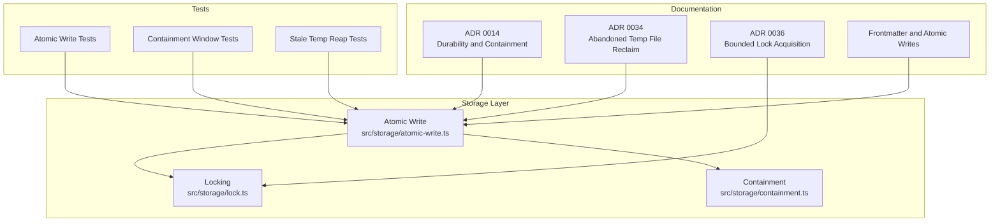
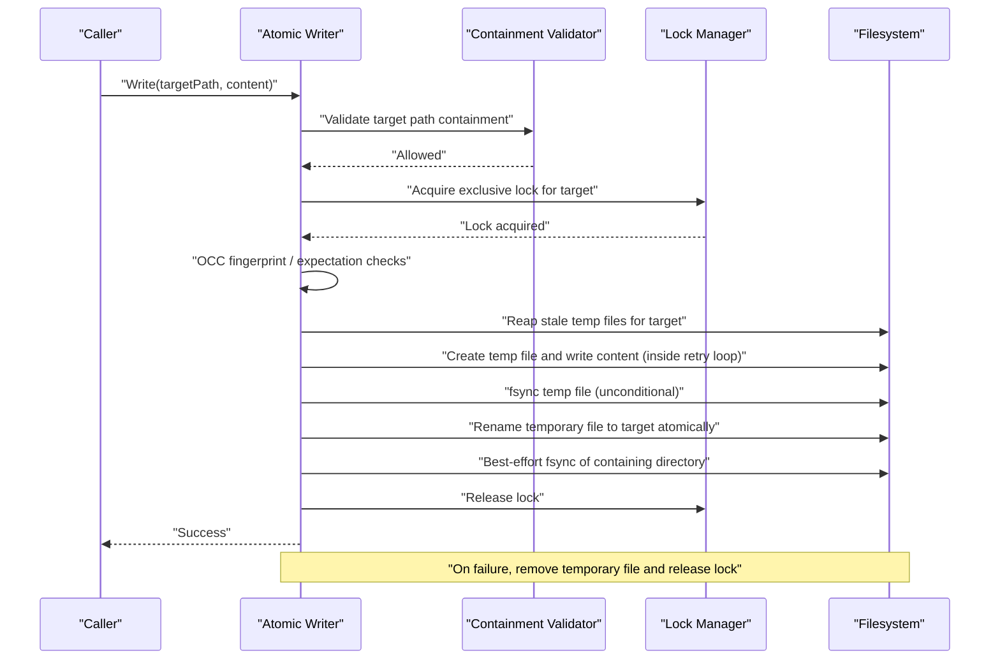
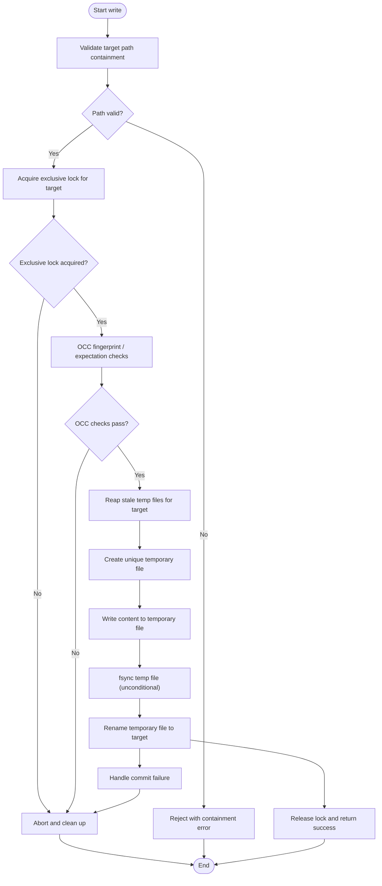
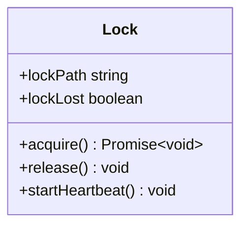
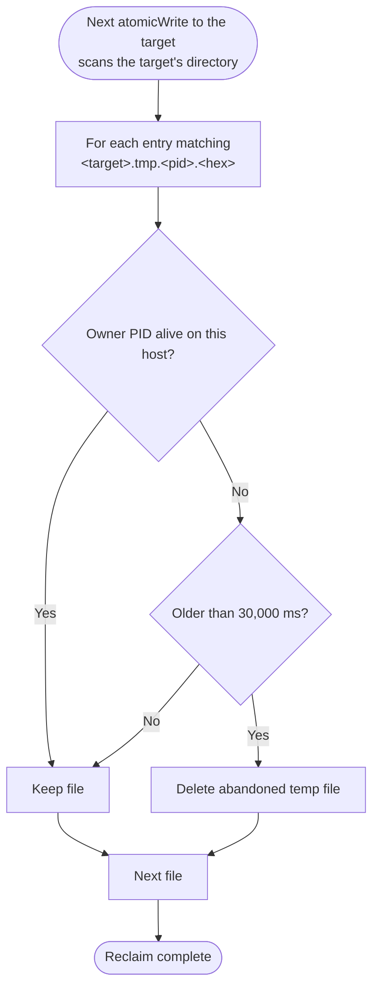
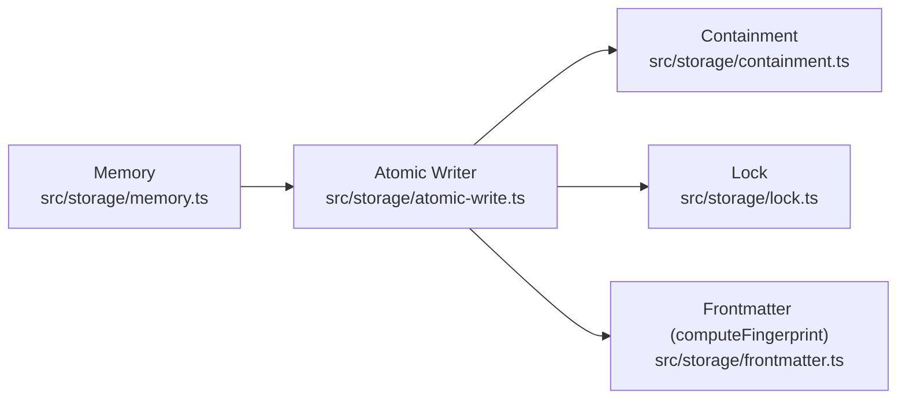

# Atomic Write System

## Table of Contents
1. [Introduction](#introduction)
2. [Project Structure](#project-structure)
3. [Core Components](#core-components)
4. [Architecture Overview](#architecture-overview)
5. [Detailed Component Analysis](#detailed-component-analysis)
6. [Dependency Analysis](#dependency-analysis)
7. [Performance Considerations](#performance-considerations)
8. [Troubleshooting Guide](#troubleshooting-guide)
9. [Conclusion](#conclusion)
10. [References](#references)

## Introduction
This document explains the atomic write system that protects vault data from partial writes, crashes, and concurrent access. It focuses on durability and crash safety through:

- Temporary files written alongside the target, inside the vault’s containment boundary, under names no reader will mistake for a note.
- Unique identifiers for temporary files to avoid collisions.
- Transaction-like semantics where a successful write is committed by an atomic rename.
- Cleanup of abandoned temporary files and stale locks after failures or process termination.
- Security checks preventing path traversal and enforcing containment.
- Integration patterns with locking, frontmatter writing, sessions, adoption, roadmap, and other storage components.

The design decisions are documented in architectural decision records (ADRs), and the runtime behavior is exercised by unit and integration tests.

## Project Structure
The atomic write subsystem lives under `src/storage` and is complemented by documentation and tests:

## Core Components
The atomic write system has three primary responsibilities:

| Component | Responsibility | Key Behaviors |
|---|---|---|
| Atomic writer | Performs durable, transactional writes | Creates unique temporary files, validates containment, writes content, commits via rename, handles errors |
| Containment validator | Ensures paths stay within allowed directories | Rejects traversal attempts, verifies both source and destination paths |
| Lock manager | Coordinates exclusive access | Acquires bounded locks, supports heartbeats and cleanup, prevents deadlocks |

These components collaborate so that readers see either the old complete file or the new complete file, never a partially written one.

## Architecture Overview
At a high level, a write operation follows this sequence:

### Transaction-Like Semantics
A write behaves like a small transaction:

1. **Prepare**: Validate containment, acquire the lock, run the OCC fingerprint/expectation checks, and reap stale temp files.
2. **Write**: Create the temporary file inside the retry loop, write the content, and fsync the temp file unconditionally.
3. **Commit**: Rename the temporary file to the target path, then best-effort fsync the containing directory and release the lock.
4. **Abort**: On any error, clean up the temporary file and release the lock.

Because rename is typically atomic on POSIX and most modern filesystems, readers cannot observe an intermediate state.

## Detailed Component Analysis

### Atomic Writer
The atomic writer coordinates the full write lifecycle. Its main concerns are:

- Generating unique temporary filenames to avoid collisions across processes and retries.
- Writing content to a temporary location before committing.
- Using a filesystem rename to commit the change atomically.
- Cleaning up temporary files when the write fails.
- Enforcing containment so the target and temporary locations remain safe.

#### Write Flow

#### Temporary File Strategy
The temp file is created in the target's own directory — rename is only atomic within one filesystem, so a separate temp directory is not an option — under a name no reader will mistake for a note:

- The name is `<target>.tmp.<pid>.<entropy>`, for example `note.md.tmp.4213.9f2ac41b`. The `<pid>` is the writing process's ID; the entropy is 8 hexadecimal characters (32 bits) from `crypto.randomBytes(4)`. The pair makes the name unique per process and per write, so concurrent writers to the same target never collide on a temp name, and a leftover temp identifies the process that created it. No timestamps or counters are involved.
- Because the name ends in `.<hex>` rather than `.md`, vault enumeration never treats an in-flight temp as a note.
- The destination is containment-validated before the temp is created, and re-validated immediately before the rename; the temp inherits the validated location because it is derived from the resolved target path.

This prevents partial writes from corrupting active notes, indexes, or metadata.

#### Atomic Commit
The commit step replaces the target file with the completed temporary file. The important property is that rename should be:

- Fast because it updates directory entries rather than copying data.
- Atomic on compatible filesystems, ensuring readers see either the old or new version.
- Safe against race conditions because exclusive locking is used around the critical section.

#### Error Recovery
If any step fails, the writer must ensure no dangling temporary file remains. Typical recovery includes:

- Catching write, flush, rename, or lock errors.
- Deleting the temporary file.
- Releasing the lock.
- Propagating a meaningful error to the caller.

#### Security and Containment
Before creating or moving files, the writer relies on containment validation to prevent path traversal. This ensures attackers cannot escape the intended vault or configuration directories by crafting malicious targets.

### Containment Validator
The containment module (containment.ts) is a set of functions, not a class. The main entry point is `assertContainedInVault(vaultPath, targetPath)`, which returns the canonical resolved target path or throws an error with code `ECONTAINMENT` (CLI exit code 3); `isContainmentError(e)` classifies that refusal. Its responsibilities include:

- Resolving the real path of the destination (following symlinks and junctions in every component, not just the last one) and verifying the result lies inside the vault — so a planted link such as `vault/.palee/sessions` pointing outside is refused, not followed.
- Accepting absolute paths (every in-repo caller passes them) and resolving relative ones against the vault root, so the path that is certified is the path that is written.
- Being re-run immediately before the temp file is opened and renamed, narrowing the window in which a path component could be swapped for a link after the first check.

### Lock Manager
The lock manager is the `Lock` class in lock.ts, constructed per target file as `new Lock(vaultPath, targetPath)`. `atomicWrite` acquires it before the OCC check and releases it in a `finally` block, so the rename always happens while holding the lock. It is designed to be bounded and resilient:

- Bounded acquisition: the acquisition loop is capped at 20 rounds (`MAX_ACQUISITION_ITERATIONS`); contention surfaces as an `ECONFLICT` error instead of indefinite blocking.
- Heartbeat support: a 15,000 ms heartbeat keeps long-running writers' leases alive; if the holder's own record disappears (a stale takeover), the `lockLost` getter reports it and `atomicWrite` aborts rather than renaming over the new owner's bytes.
- Cleanup of stale locks when a process exits without releasing them (60 s staleness timeout on Windows, 120 s elsewhere; immediate when the recorded PID is dead on this host).
- Coordination with the atomic writer to ensure rename happens while holding the lock.

### Abandoned Temporary File Reclaim
A process killed by a signal between the temp write and the rename never runs its cleanup handler, so its temp file stays behind. The reclaim mechanism (`reapStaleTempsForTarget` in atomic-write.ts) runs inside `atomicWrite` itself — inside the lock, after the OCC check has passed, just before the new temp is written. There is no background sweeper and no separate temp directory to scan: only the current target's own directory is examined, and only temps belonging to that target.

A leftover is deleted only when all of these hold:

- Its name matches the anchored pattern `<target>.tmp.<pid>.<8+ hex>` exactly. A name that merely contains `.tmp.` (such as `note.md.tmp.1234.abcd1234.md`, which is a real note name) is never touched — the mechanism deletes only what it can prove `atomicWrite` wrote.
- The PID in the name no longer exists in this host's process table (`process.kill(pid, 0)`; `EPERM` counts as alive).
- The file is older than 30,000 ms (`STALE_TEMP_MIN_AGE_MS`). The age floor protects a live writer on another host sharing the vault over a network filesystem, whose PID this host cannot probe.

Reclaim is best-effort: a file it cannot inspect or delete is skipped, never raised — litter must not fail an otherwise valid write.

## Dependency Analysis
The atomic write system depends on containment and locking, and it is consumed by higher-level storage operations.

Edges point from a module to the modules it imports; consumers of `atomicWrite` are shown on the left.

### Coupling and Cohesion
- **Coupling**: The atomic writer couples filesystem operations, path validation, and locking into one durable write primitive.
- **Cohesion**: Containment and locking are separated into focused modules, which improves testability and reuse.
- **Risk**: If containment logic changes, all write paths depend on its correctness. Tests should cover traversal and boundary cases.

### External Dependencies
- Filesystem rename semantics.
- Directory listing and deletion APIs.
- Process exit behavior and lock cleanup.
- File fsync (`fs.fsyncSync`) on the temp file runs unconditionally on every write on every platform; only the post-rename directory fsync is best-effort and silently skipped where refused (Windows `EPERM`/`EISDIR`).

## Performance Considerations
Atomic writes trade some performance for durability:

| Aspect | Impact | Guidance |
|---|---|---|
| Extra disk I/O | Writing twice: once to temporary file, then renaming | Prefer efficient buffering; avoid unnecessary copies |
| Disk space | Temporary files temporarily double usage per write | Monitor vault growth; reclaim abandoned temp files |
| Lock overhead | Exclusive locks block concurrent writers | Batch related writes when possible; respect bounded acquisition |
| Rename cost | Usually low but filesystem-dependent | Avoid excessive micro-writes; group updates |
| Sync and flush | File fsync can increase latency but runs unconditionally on every write | File fsync is mandatory; only the post-rename directory fsync is best-effort and skipped where the platform refuses it |
| Containment checks | Small CPU cost | Keep path normalization simple and cached where appropriate |

### Storage Requirements
- Allow enough free space for the largest expected note plus metadata.
- Plan for peak usage when multiple concurrent writers exist.
- Ensure temporary storage is on the same filesystem as the target when relying on atomic rename.

### Filesystem Compatibility
- Atomic rename is widely supported but may behave differently on network mounts, FUSE filesystems, or older systems.
- If rename is not atomic, add additional safeguards such as copy-then-swap with strict ordering and verification.
- Test behavior on Windows, macOS, Linux, and common containerized environments.

## Troubleshooting Guide

### Common Symptoms and Fixes

| Symptom | Likely Cause | Resolution |
|---|---|---|
| Write refused with `ECONTAINMENT` (exit 3) | The resolved target path escapes the vault, usually because a path component is a symlink/junction pointing outside | Replace the link with a real in-vault directory; retrying never succeeds while it stands |
| Write fails with `OCC conflict: ... was modified by another process` (`ECONFLICT`, exit 4) | The file changed between the caller's read and the write | Re-read the file and retry; check for an editor or second PALEE process writing the same note |
| Write fails with `Lock conflict: ... is locked by PID <pid>` (`ECONFLICT`, exit 4) | Another live process holds the target's lock | Wait for that PID, or close it; see the File Locking page for the lock directory layout under `.palee/locks/` |
| Stale temporary files (`<note>.tmp.<pid>.<hex>`) accumulate | A process was killed between temp write and rename | Nothing to run: the next write to the same note reaps them automatically once they are over 30 s old and the owner PID is gone. Safe to delete by hand when no PALEE process is running |
| Rename keeps failing on Windows with `EPERM`/`EBUSY` | An antivirus or indexer briefly holds a handle on the file | The writer already attempts the rename up to 5 times (50 ms doubling, ±25% jitter, 300 ms cap); if it still fails, exclude the vault from the scanner or close the holding process |
| File content is the old version after a crash mid-write | The crash happened before the rename | Expected behavior, not corruption: readers see either the complete old file or the complete new one, never a partial write |

### Error Recovery Procedures
1. **Catch write errors** and inspect whether a temporary file was created.
2. **Attempt cleanup** of the temporary file if it still exists.
3. **Release locks** even if cleanup fails, to avoid blocking other writers.
4. **Log diagnostic information**, including target path, temporary file path, error code, and ownership details.
5. **Retry cautiously** only when the error is transient and idempotent.

### Security Checklist
- Always validate target paths through containment before writing.
- Never trust user-supplied paths directly.
- Verify that temporary files are also contained.
- Audit lock files and temporary files periodically.
- Restrict vault permissions so only trusted processes can modify managed data.
- The destination's existing permission mode is restored onto the temp file before rename; a new file keeps the platform default — this primitive preserves, it never tightens.

## Conclusion
The atomic write system provides durability and crash safety by isolating partial writes behind unique temporary files and committing changes through atomic renames. Containment validation prevents path traversal, while locking ensures exclusive access during the critical commit phase. Abandoned temporary file reclaim and bounded lock acquisition improve resilience after crashes and reduce resource leaks. Together, these mechanisms make the storage layer safer for concurrent, crash-prone environments while keeping integration points clear for frontmatter, adoption, roadmap, and session writers.

## References

- [atomic-write.ts](https://github.com/Kuldeep2822k/cli/blob/main/src/storage/atomic-write.ts)
- [containment.ts](https://github.com/Kuldeep2822k/cli/blob/main/src/storage/containment.ts)
- [lock.ts](https://github.com/Kuldeep2822k/cli/blob/main/src/storage/lock.ts)
- [0014-atomic-write-durability-and-containment.md](https://github.com/Kuldeep2822k/cli/blob/main/docs/adr/0014-atomic-write-durability-and-containment.md)
- [0034-abandoned-temp-file-reclaim.md](https://github.com/Kuldeep2822k/cli/blob/main/docs/adr/0034-abandoned-temp-file-reclaim.md)
- [0036-bounded-lock-acquisition.md](https://github.com/Kuldeep2822k/cli/blob/main/docs/adr/0036-bounded-lock-acquisition.md)
- [04-1-frontmatter-parser-and-atomic-writes.md](https://github.com/Kuldeep2822k/cli/blob/main/docs/04-1-frontmatter-parser-and-atomic-writes.md)
- [storage-atomic-write.test.ts](https://github.com/Kuldeep2822k/cli/blob/main/test/storage-atomic-write.test.ts)
- [storage-atomic-write-containment-window.test.ts](https://github.com/Kuldeep2822k/cli/blob/main/test/storage-atomic-write-containment-window.test.ts)
- [storage-atomic-write-stale-temp-reap.test.ts](https://github.com/Kuldeep2822k/cli/blob/main/test/storage-atomic-write-stale-temp-reap.test.ts)
