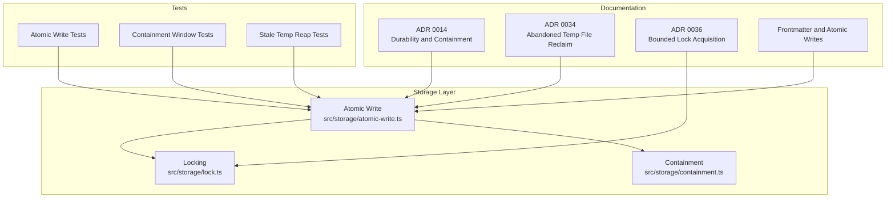
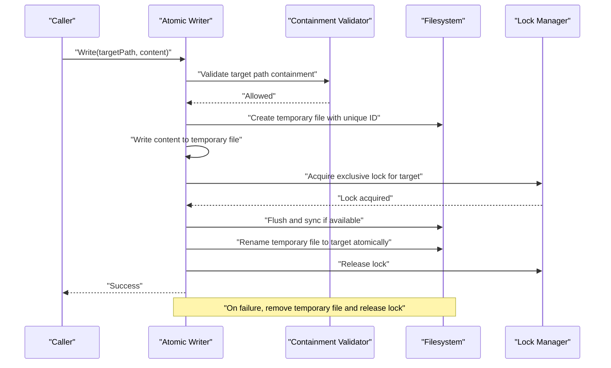
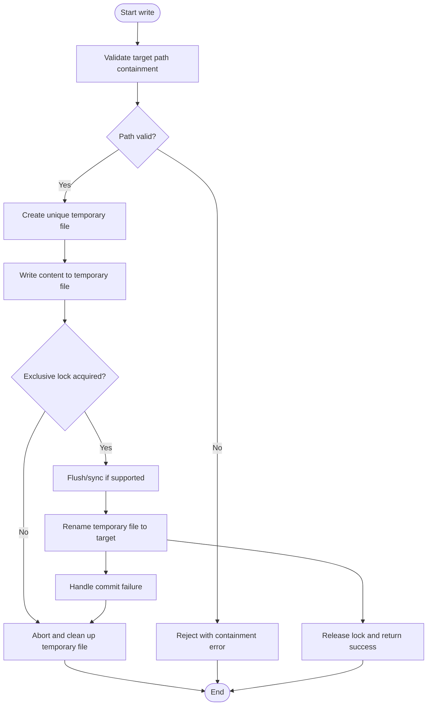
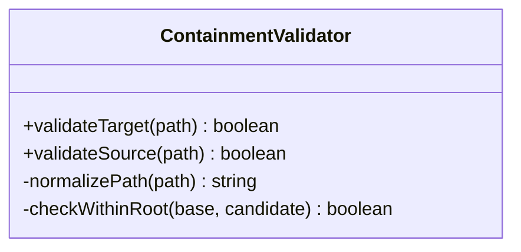
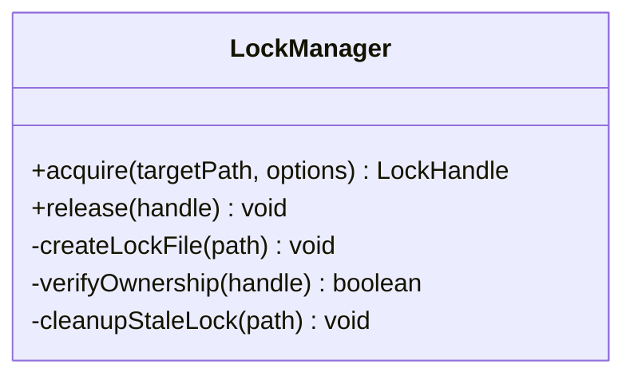
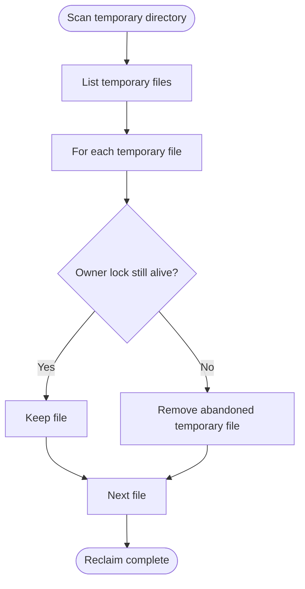
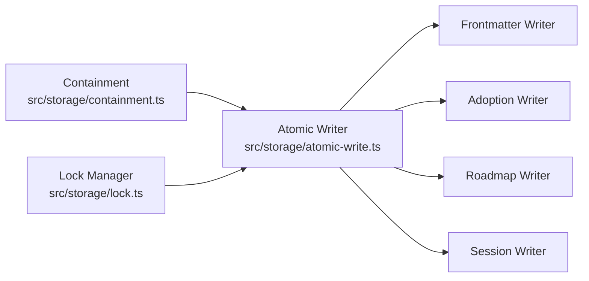

# Atomic Write System

<cite>
**Referenced Files in This Document**
- [atomic-write.ts](https://github.com/Kuldeep2822k/cli/blob/main/src/storage/atomic-write.ts)
- [containment.ts](https://github.com/Kuldeep2822k/cli/blob/main/src/storage/containment.ts)
- [lock.ts](https://github.com/Kuldeep2822k/cli/blob/main/src/storage/lock.ts)
- [0014-atomic-write-durability-and-containment.md](https://github.com/Kuldeep2822k/cli/blob/main/docs/adr/0014-atomic-write-durability-and-containment.md)
- [0034-abandoned-temp-file-reclaim.md](https://github.com/Kuldeep2822k/cli/blob/main/docs/adr/0034-abandoned-temp-file-reclaim.md)
- [0036-bounded-lock-acquisition.md](https://github.com/Kuldeep2822k/cli/blob/main/docs/adr/0036-bounded-lock-acquisition.md)
- [04-1-frontmatter-parser-and-atomic-writes.md](https://github.com/Kuldeep2822k/cli/blob/main/docs/04-1-frontmatter-parser-and-atomic-writes.md)
- [storage-atomic-write.test.ts](https://github.com/Kuldeep2822k/cli/blob/main/test/storage-atomic-write.test.ts)
- [storage-atomic-write-containment-window.test.ts](https://github.com/Kuldeep2822k/cli/blob/main/test/storage-atomic-write-containment-window.test.ts)
- [storage-atomic-write-stale-temp-reap.test.ts](https://github.com/Kuldeep2822k/cli/blob/main/test/storage-atomic-write-stale-temp-reap.test.ts)
</cite>

## Table of Contents
1. [Introduction](#introduction)
2. [Project Structure](#project-structure)
3. [Core Components](#core-components)
4. [Architecture Overview](#architecture-overview)
5. [Detailed Component Analysis](#detailed-component-analysis)
6. [Dependency Analysis](#dependency-analysis)
7. [Performance Considerations](#performance-considerations)
8. [Troubleshooting Guide](#troubleshooting-guide)
9. [Conclusion](#conclusion)

## Introduction
This document explains the atomic write system that protects vault data from partial writes, crashes, and concurrent access. It focuses on durability and crash safety through:

- Temporary files written outside the target’s containment window.
- Unique identifiers for temporary files to avoid collisions.
- Transaction-like semantics where a successful write is committed by an atomic rename.
- Cleanup of abandoned temporary files and stale locks after failures or process termination.
- Security checks preventing path traversal and enforcing containment.
- Integration patterns with locking, frontmatter writing, sessions, adoption, roadmap, and other storage components.

The design decisions are documented in architectural decision records (ADRs), and the runtime behavior is exercised by unit and integration tests.

## Project Structure
The atomic write subsystem lives under `src/storage` and is complemented by documentation and tests:

**Diagram sources**
- [atomic-write.ts](https://github.com/Kuldeep2822k/cli/blob/main/src/storage/atomic-write.ts)
- [containment.ts](https://github.com/Kuldeep2822k/cli/blob/main/src/storage/containment.ts)
- [lock.ts](https://github.com/Kuldeep2822k/cli/blob/main/src/storage/lock.ts)
- [0014-atomic-write-durability-and-containment.md](https://github.com/Kuldeep2822k/cli/blob/main/docs/adr/0014-atomic-write-durability-and-containment.md)
- [0034-abandoned-temp-file-reclaim.md](https://github.com/Kuldeep2822k/cli/blob/main/docs/adr/0034-abandoned-temp-file-reclaim.md)
- [0036-bounded-lock-acquisition.md](https://github.com/Kuldeep2822k/cli/blob/main/docs/adr/0036-bounded-lock-acquisition.md)
- [04-1-frontmatter-parser-and-atomic-writes.md](https://github.com/Kuldeep2822k/cli/blob/main/docs/04-1-frontmatter-parser-and-atomic-writes.md)
- [storage-atomic-write.test.ts](https://github.com/Kuldeep2822k/cli/blob/main/test/storage-atomic-write.test.ts)
- [storage-atomic-write-containment-window.test.ts](https://github.com/Kuldeep2822k/cli/blob/main/test/storage-atomic-write-containment-window.test.ts)
- [storage-atomic-write-stale-temp-reap.test.ts](https://github.com/Kuldeep2822k/cli/blob/main/test/storage-atomic-write-stale-temp-reap.test.ts)

**Section sources**
- [atomic-write.ts](https://github.com/Kuldeep2822k/cli/blob/main/src/storage/atomic-write.ts)
- [containment.ts](https://github.com/Kuldeep2822k/cli/blob/main/src/storage/containment.ts)
- [lock.ts](https://github.com/Kuldeep2822k/cli/blob/main/src/storage/lock.ts)
- [0014-atomic-write-durability-and-containment.md](https://github.com/Kuldeep2822k/cli/blob/main/docs/adr/0014-atomic-write-durability-and-containment.md)
- [0034-abandoned-temp-file-reclaim.md](https://github.com/Kuldeep2822k/cli/blob/main/docs/adr/0034-abandoned-temp-file-reclaim.md)
- [0036-bounded-lock-acquisition.md](https://github.com/Kuldeep2822k/cli/blob/main/docs/adr/0036-bounded-lock-acquisition.md)
- [04-1-frontmatter-parser-and-atomic-writes.md](https://github.com/Kuldeep2822k/cli/blob/main/docs/04-1-frontmatter-parser-and-atomic-writes.md)
- [storage-atomic-write.test.ts](https://github.com/Kuldeep2822k/cli/blob/main/test/storage-atomic-write.test.ts)
- [storage-atomic-write-containment-window.test.ts](https://github.com/Kuldeep2822k/cli/blob/main/test/storage-atomic-write-containment-window.test.ts)
- [storage-atomic-write-stale-temp-reap.test.ts](https://github.com/Kuldeep2822k/cli/blob/main/test/storage-atomic-write-stale-temp-reap.test.ts)

## Core Components
The atomic write system has three primary responsibilities:

| Component | Responsibility | Key Behaviors |
|---|---|---|
| Atomic writer | Performs durable, transactional writes | Creates unique temporary files, validates containment, writes content, commits via rename, handles errors |
| Containment validator | Ensures paths stay within allowed directories | Rejects traversal attempts, verifies both source and destination paths |
| Lock manager | Coordinates exclusive access | Acquires bounded locks, supports heartbeats and cleanup, prevents deadlocks |

These components collaborate so that readers see either the old complete file or the new complete file, never a partially written one.

**Section sources**
- [atomic-write.ts](https://github.com/Kuldeep2822k/cli/blob/main/src/storage/atomic-write.ts)
- [containment.ts](https://github.com/Kuldeep2822k/cli/blob/main/src/storage/containment.ts)
- [lock.ts](https://github.com/Kuldeep2822k/cli/blob/main/src/storage/lock.ts)

## Architecture Overview
At a high level, a write operation follows this sequence:

**Diagram sources**
- [atomic-write.ts](https://github.com/Kuldeep2822k/cli/blob/main/src/storage/atomic-write.ts)
- [containment.ts](https://github.com/Kuldeep2822k/cli/blob/main/src/storage/containment.ts)
- [lock.ts](https://github.com/Kuldeep2822k/cli/blob/main/src/storage/lock.ts)

### Transaction-Like Semantics
A write behaves like a small transaction:

1. **Prepare**: Validate containment and create a temporary file.
2. **Commit**: Rename the temporary file to the target path.
3. **Abort**: On any error, clean up the temporary file and released locks.

Because rename is typically atomic on POSIX and most modern filesystems, readers cannot observe an intermediate state.

**Section sources**
- [0014-atomic-write-durability-and-containment.md](https://github.com/Kuldeep2822k/cli/blob/main/docs/adr/0014-atomic-write-durability-and-containment.md)
- [atomic-write.ts](https://github.com/Kuldeep2822k/cli/blob/main/src/storage/atomic-write.ts)

## Detailed Component Analysis

### Atomic Writer
The atomic writer coordinates the full write lifecycle. Its main concerns are:

- Generating unique temporary filenames to avoid collisions across processes and retries.
- Writing content to a temporary location before committing.
- Using a filesystem rename to commit the change atomically.
- Cleaning up temporary files when the write fails.
- Enforcing containment so the target and temporary locations remain safe.

#### Write Flow

**Diagram sources**
- [atomic-write.ts](https://github.com/Kuldeep2822k/cli/blob/main/src/storage/atomic-write.ts)
- [containment.ts](https://github.com/Kuldeep2822k/cli/blob/main/src/storage/containment.ts)
- [lock.ts](https://github.com/Kuldeep2822k/cli/blob/main/src/storage/lock.ts)

#### Temporary File Strategy
Temporary files must not be visible to normal readers until they are fully written and renamed. The implementation uses:

- Unique identifiers derived from process context, timestamps, counters, or random values.
- A temporary directory or naming scheme that keeps temporary files separate from live data.
- Containment validation for both the target path and the temporary location.

This prevents partial writes from corrupting active notes, indexes, or metadata.

#### Atomic Commit
The commit step replaces the target file with the completed temporary file. The important property is that rename should be:

- Fast because it updates directory entries rather than copying data.
- Atomic on compatible filesystems, ensuring readers see either the old or new version.
- Safe against race conditions because exclusive locking is used around the critical section.

#### Error Recovery
If any step fails, the writer must ensure no dangling temporary file remains. Typical recovery includes:

- Catching write, flush, rename, or lock errors.
- Deleting the temporary file.
- Releasing the lock.
- Propagating a meaningful error to the caller.

#### Security and Containment
Before creating or moving files, the writer relies on containment validation to prevent path traversal. This ensures attackers cannot escape the intended vault or configuration directories by crafting malicious targets.

**Section sources**
- [atomic-write.ts](https://github.com/Kuldeep2822k/cli/blob/main/src/storage/atomic-write.ts)
- [containment.ts](https://github.com/Kuldeep2822k/cli/blob/main/src/storage/containment.ts)
- [0014-atomic-write-durability-and-containment.md](https://github.com/Kuldeep2822k/cli/blob/main/docs/adr/0014-atomic-write-durability-and-containment.md)

### Containment Validator
The containment module enforces that paths remain inside allowed roots such as the vault, configuration, session, lock, or output directories. Its responsibilities include:

- Normalizing paths before comparison.
- Detecting traversal sequences such as parent-directory references.
- Rejecting absolute paths when only relative vault paths are allowed.
- Verifying both read and write destinations.

**Diagram sources**
- [containment.ts](https://github.com/Kuldeep2822k/cli/blob/main/src/storage/containment.ts)

**Section sources**
- [containment.ts](https://github.com/Kuldeep2822k/cli/blob/main/src/storage/containment.ts)

### Lock Manager
The lock manager provides exclusive access during the commit phase. It is designed to be bounded and resilient:

- Bounded acquisition time to avoid indefinite blocking.
- Heartbeat support so long-running writers can keep ownership alive.
- Cleanup of stale locks when a process exits without releasing them.
- Coordination with the atomic writer to ensure rename happens while holding the lock.

**Diagram sources**
- [lock.ts](https://github.com/Kuldeep2822k/cli/blob/main/src/storage/lock.ts)
- [0036-bounded-lock-acquisition.md](https://github.com/Kuldeep2822k/cli/blob/main/docs/adr/0036-bounded-lock-acquisition.md)

**Section sources**
- [lock.ts](https://github.com/Kuldeep2822k/cli/blob/main/src/storage/lock.ts)
- [0036-bounded-lock-acquisition.md](https://github.com/Kuldeep2822k/cli/blob/main/docs/adr/0036-bounded-lock-acquisition.md)

### Abandoned Temporary File Reclaim
When a process crashes or is killed, temporary files may remain. The reclaim mechanism scans known temporary locations and removes orphaned files that do not belong to a running writer.

Key ideas:

- Identify temporary files using their naming convention and unique identifiers.
- Check whether a corresponding lock or writer still exists.
- Delete temporary files whose owners are absent.
- Run reclaim proactively or periodically.

**Diagram sources**
- [atomic-write.ts](https://github.com/Kuldeep2822k/cli/blob/main/src/storage/atomic-write.ts)
- [0034-abandoned-temp-file-reclaim.md](https://github.com/Kuldeep2822k/cli/blob/main/docs/adr/0034-abandoned-temp-file-reclaim.md)

**Section sources**
- [0034-abandoned-temp-file-reclaim.md](https://github.com/Kuldeep2822k/cli/blob/main/docs/adr/0034-abandoned-temp-file-reclaim.md)
- [storage-atomic-write-stale-temp-reap.test.ts](https://github.com/Kuldeep2822k/cli/blob/main/test/storage-atomic-write-stale-temp-reap.test.ts)

## Dependency Analysis
The atomic write system depends on containment and locking, and it is consumed by higher-level storage operations.

**Diagram sources**
- [atomic-write.ts](https://github.com/Kuldeep2822k/cli/blob/main/src/storage/atomic-write.ts)
- [containment.ts](https://github.com/Kuldeep2822k/cli/blob/main/src/storage/containment.ts)
- [lock.ts](https://github.com/Kuldeep2822k/cli/blob/main/src/storage/lock.ts)

### Coupling and Cohesion
- **Coupling**: The atomic writer couples filesystem operations, path validation, and locking into one durable write primitive.
- **Cohesion**: Containment and locking are separated into focused modules, which improves testability and reuse.
- **Risk**: If containment logic changes, all write paths depend on its correctness. Tests should cover traversal and boundary cases.

### External Dependencies
- Filesystem rename semantics.
- Directory listing and deletion APIs.
- Process exit behavior and lock cleanup.
- Optional sync or flush calls depending on platform support.

**Section sources**
- [atomic-write.ts](https://github.com/Kuldeep2822k/cli/blob/main/src/storage/atomic-write.ts)
- [containment.ts](https://github.com/Kuldeep2822k/cli/blob/main/src/storage/containment.ts)
- [lock.ts](https://github.com/Kuldeep2822k/cli/blob/main/src/storage/lock.ts)

## Performance Considerations
Atomic writes trade some performance for durability:

| Aspect | Impact | Guidance |
|---|---|---|
| Extra disk I/O | Writing twice: once to temporary file, then renaming | Prefer efficient buffering; avoid unnecessary copies |
| Disk space | Temporary files temporarily double usage per write | Monitor vault growth; reclaim abandoned temp files |
| Lock overhead | Exclusive locks block concurrent writers | Batch related writes when possible; respect bounded acquisition |
| Rename cost | Usually low but filesystem-dependent | Avoid excessive micro-writes; group updates |
| Sync and flush | Can increase latency | Use only when durability guarantees require it |
| Containment checks | Small CPU cost | Keep path normalization simple and cached where appropriate |

### Storage Requirements
- Allow enough free space for the largest expected note plus metadata.
- Plan for peak usage when multiple concurrent writers exist.
- Ensure temporary storage is on the same filesystem as the target when relying on atomic rename.

### Filesystem Compatibility
- Atomic rename is widely supported but may behave differently on network mounts, FUSE filesystems, or older systems.
- If rename is not atomic, add additional safeguards such as copy-then-swap with strict ordering and verification.
- Test behavior on Windows, macOS, Linux, and common containerized environments.

[No sources needed since this section provides general guidance]

## Troubleshooting Guide

### Common Symptoms and Fixes

| Symptom | Likely Cause | Resolution |
|---|---|---|
| Write fails with path traversal error | Target path escapes containment root | Fix caller input; reject unsafe paths early |
| Stale temporary files accumulate | Process crashed during write | Run abandoned temp file reclaim |
| Writers deadlock or timeout | Lock acquisition exceeded bounds | Investigate long-running writers; increase diagnostics |
| Data appears incomplete after crash | Temporary file was not cleaned up | Reclaim abandoned temporary files |
| Rename fails on network filesystem | Platform does not support atomic rename | Add compatibility fallback and verify consistency |
| Concurrent writers interfere | Lock not held around rename | Ensure exclusive lock covers commit |

### Error Recovery Procedures
1. **Catch write errors** and inspect whether a temporary file was created.
2. **Attempt cleanup** of the temporary file if it still exists.
3. **Release locks** even if cleanup fails, to avoid blocking other writers.
4. **Log diagnostic information**, including target path, temporary file path, error code, and ownership details.
5. **Retry cautiously** only when the error is transient and idempotent.

### Security Checklist
- Always validate target paths through containment before writing.
- Never trust user-supplied paths directly.
- Verify that temporary files are also contained.
- Audit lock files and temporary files periodically.
- Restrict vault permissions so only trusted processes can modify managed data.

**Section sources**
- [storage-atomic-write.test.ts](https://github.com/Kuldeep2822k/cli/blob/main/test/storage-atomic-write.test.ts)
- [storage-atomic-write-containment-window.test.ts](https://github.com/Kuldeep2822k/cli/blob/main/test/storage-atomic-write-containment-window.test.ts)
- [storage-atomic-write-stale-temp-reap.test.ts](https://github.com/Kuldeep2822k/cli/blob/main/test/storage-atomic-write-stale-temp-reap.test.ts)

## Conclusion
The atomic write system provides durability and crash safety by isolating partial writes behind unique temporary files and committing changes through atomic renames. Containment validation prevents path traversal, while locking ensures exclusive access during the critical commit phase. Abandoned temporary file reclaim and bounded lock acquisition improve resilience after crashes and reduce resource leaks. Together, these mechanisms make the storage layer safer for concurrent, crash-prone environments while keeping integration points clear for frontmatter, adoption, roadmap, and session writers.

[No sources needed since this section summarizes without analyzing specific files]