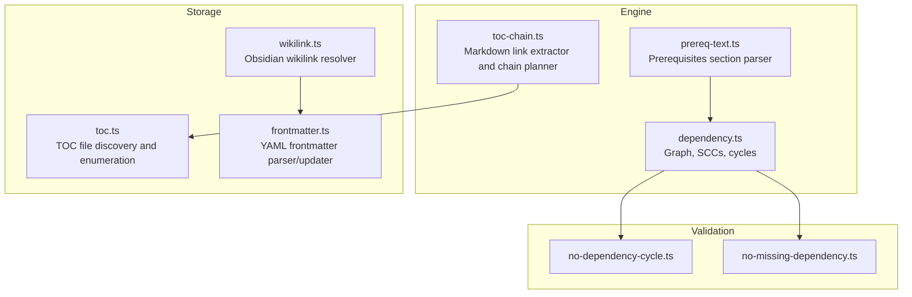
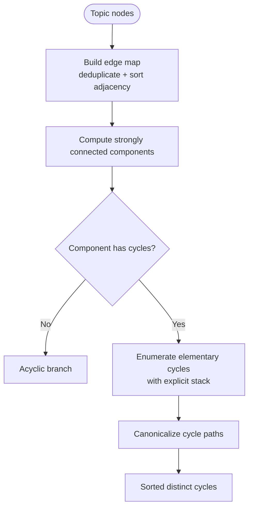
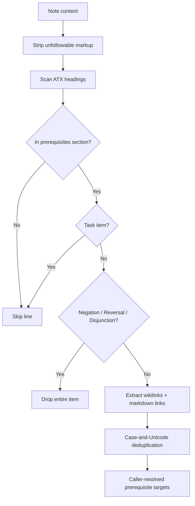
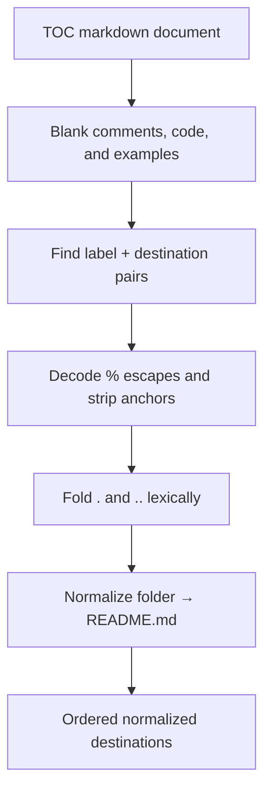
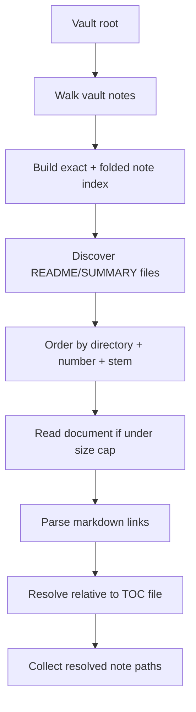
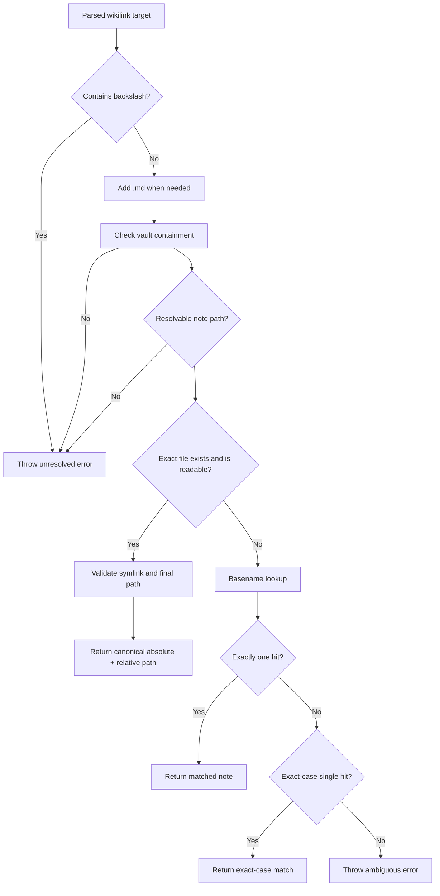
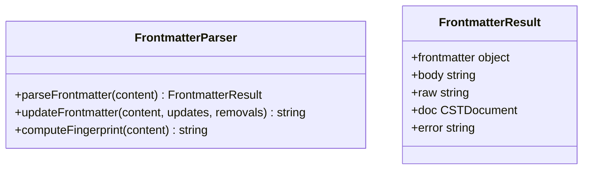
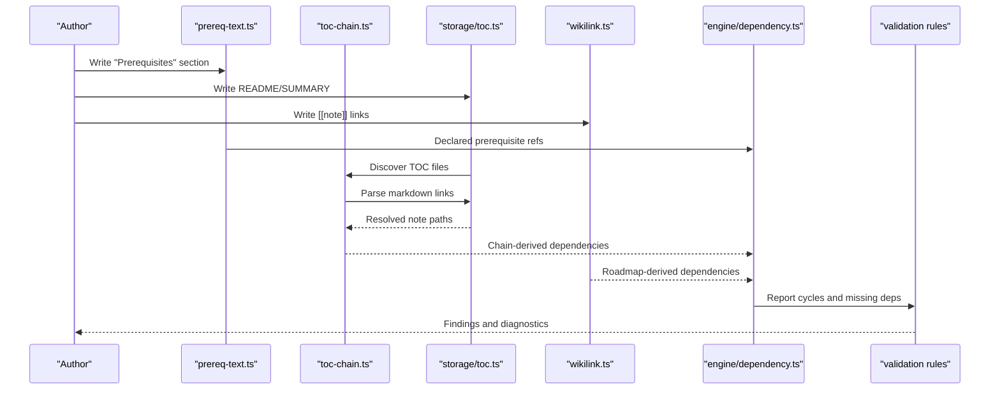
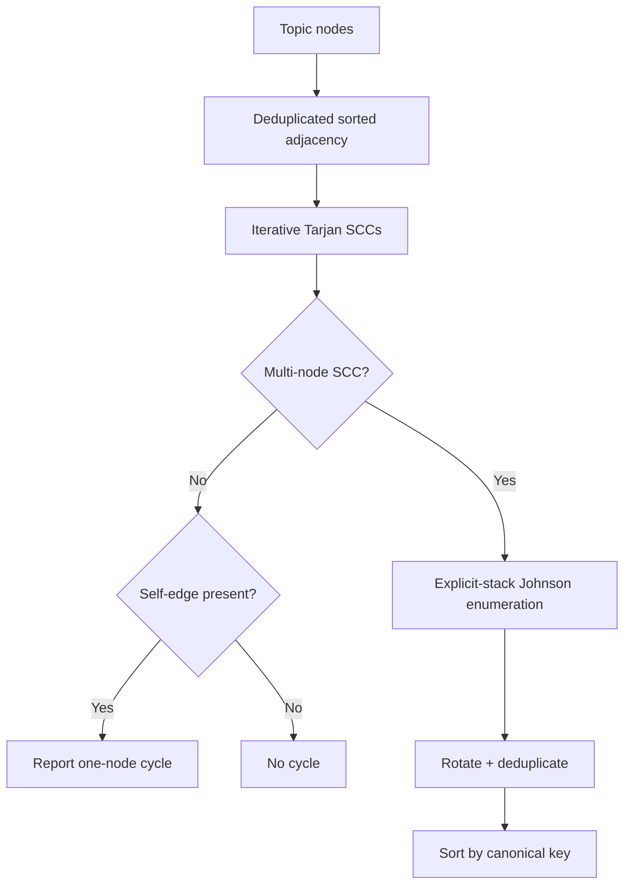
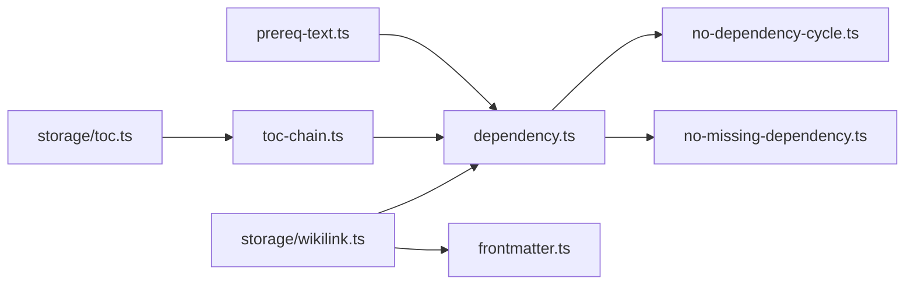

# Dependency and TOC Management

::: details Referenced Files in This Document

- [dependency.ts](https://github.com/Kuldeep2822k/cli/blob/main/src/engine/dependency.ts)
- [prereq-text.ts](https://github.com/Kuldeep2822k/cli/blob/main/src/engine/prereq-text.ts)
- [toc-chain.ts](https://github.com/Kuldeep2822k/cli/blob/main/src/engine/toc-chain.ts)
- [wikilink.ts](https://github.com/Kuldeep2822k/cli/blob/main/src/storage/wikilink.ts)
- [toc.ts](https://github.com/Kuldeep2822k/cli/blob/main/src/storage/toc.ts)
- [frontmatter.ts](https://github.com/Kuldeep2822k/cli/blob/main/src/storage/frontmatter.ts)
- [no-dependency-cycle.ts](https://github.com/Kuldeep2822k/cli/blob/main/src/validation/rules/no-dependency-cycle.ts)
- [no-missing-dependency.ts](https://github.com/Kuldeep2822k/cli/blob/main/src/validation/rules/no-missing-dependency.ts)

:::

## Table of Contents
1. [Introduction](#introduction)
2. [Project Structure](#project-structure)
3. [Core Components](#core-components)
4. [Architecture Overview](#architecture-overview)
5. [Detailed Component Analysis](#detailed-component-analysis)
6. [Dependency Analysis](#dependency-analysis)
7. [Performance Considerations](#performance-considerations)
8. [Troubleshooting Guide](#troubleshooting-guide)
9. [Conclusion](#conclusion)

## Introduction
This document explains how the project models, validates, and navigates topic relationships across three related systems:

- **Dependency tracking:** Converts declared prerequisites into a directed graph, detects cycles, identifies missing dependencies, and isolates cyclic topics.
- **Table of contents management:** Reads repository-level enumeration documents (such as README or SUMMARY files), extracts markdown links, normalizes targets, and merges them with numbered-module ordering to build a stable chain.
- **Wikilink processing:** Parses and resolves Obsidian-style wikilinks between notes, enforcing vault containment, case and Unicode normalization, and strict error handling for ambiguous or missing references.

These systems together define which topics gate others, how they are ordered for study or planning, and how cross-references remain consistent across a vault.

## Project Structure
The relevant code is split by responsibility:

| Area | Responsibility | Key Files |
|---|---|---|
| Engine | Graph construction, cycle detection, prerequisite text parsing, and TOC link extraction | `src/engine/dependency.ts`, `src/engine/prereq-text.ts`, `src/engine/toc-chain.ts` |
| Storage | Vault-aware TOC discovery, wikilink resolution, and frontmatter persistence | `src/storage/toc.ts`, `src/storage/wikilink.ts`, `src/storage/frontmatter.ts` |
| Validation | Rule-based checks over loaded topics | `src/validation/rules/no-dependency-cycle.ts`, `src/validation/rules/no-missing-dependency.ts` |

**Diagram sources**
- [dependency.ts:1-100](https://github.com/Kuldeep2822k/cli/blob/main/src/engine/dependency.ts#L1-L100)
- [prereq-text.ts:1-100](https://github.com/Kuldeep2822k/cli/blob/main/src/engine/prereq-text.ts#L1-L100)
- [toc-chain.ts:1-100](https://github.com/Kuldeep2822k/cli/blob/main/src/engine/toc-chain.ts#L1-L100)
- [toc.ts:1-100](https://github.com/Kuldeep2822k/cli/blob/main/src/storage/toc.ts#L1-L100)
- [wikilink.ts:1-100](https://github.com/Kuldeep2822k/cli/blob/main/src/storage/wikilink.ts#L1-L100)
- [frontmatter.ts:1-50](https://github.com/Kuldeep2822k/cli/blob/main/src/storage/frontmatter.ts#L1-L50)
- [no-dependency-cycle.ts:1-74](https://github.com/Kuldeep2822k/cli/blob/main/src/validation/rules/no-dependency-cycle.ts#L1-L74)
- [no-missing-dependency.ts:1-77](https://github.com/Kuldeep2822k/cli/blob/main/src/validation/rules/no-missing-dependency.ts#L1-L77)

**Section sources**
- [dependency.ts:1-100](https://github.com/Kuldeep2822k/cli/blob/main/src/engine/dependency.ts#L1-L100)
- [prereq-text.ts:1-100](https://github.com/Kuldeep2822k/cli/blob/main/src/engine/prereq-text.ts#L1-L100)
- [toc-chain.ts:1-100](https://github.com/Kuldeep2822k/cli/blob/main/src/engine/toc-chain.ts#L1-L100)
- [toc.ts:1-100](https://github.com/Kuldeep2822k/cli/blob/main/src/storage/toc.ts#L1-L100)
- [wikilink.ts:1-100](https://github.com/Kuldeep2822k/cli/blob/main/src/storage/wikilink.ts#L1-L100)
- [frontmatter.ts:1-50](https://github.com/Kuldeep2822k/cli/blob/main/src/storage/frontmatter.ts#L1-L50)
- [no-dependency-cycle.ts:1-74](https://github.com/Kuldeep2822k/cli/blob/main/src/validation/rules/no-dependency-cycle.ts#L1-L74)
- [no-missing-dependency.ts:1-77](https://github.com/Kuldeep2822k/cli/blob/main/src/validation/rules/no-missing-dependency.ts#L1-L77)

## Core Components

### Dependency Graph Engine
The dependency engine treats each topic as a node and its canonical `depends_on` field as outgoing edges. It builds an adjacency map, filters out unknown targets, deduplicates edges, and sorts adjacency lists so traversal order does not depend on author list order.

Key responsibilities:
- Read only the canonical prerequisite field.
- Build a deterministic edge map from topic IDs.
- Compute strongly connected components.
- Enumerate elementary cycles within each component.
- Detect missing dependencies.

**Diagram sources**
- [dependency.ts:1-100](https://github.com/Kuldeep2822k/cli/blob/main/src/engine/dependency.ts#L1-L100)
- [dependency.ts:201-500](https://github.com/Kuldeep2822k/cli/blob/main/src/engine/dependency.ts#L201-L500)

**Section sources**
- [dependency.ts:1-100](https://github.com/Kuldeep2822k/cli/blob/main/src/engine/dependency.ts#L1-L100)
- [dependency.ts:201-500](https://github.com/Kuldeep2822k/cli/blob/main/src/engine/dependency.ts#L201-L500)

### Prerequisite Text Parser
A note can declare its own prerequisites under a dedicated heading such as “Prerequisites.” The parser scans that section, ignores fenced code, HTML comments, inline code, task items, and hedged prose, and collects wikilink and markdown-link references as candidate edges.

Key behaviors:
- Only ATX headings close a prerequisites section.
- A section must match one of the recognized prerequisite-heading patterns exactly.
- Negation, reversal, and disjunction cues drop a bullet item.
- Links are extracted before resolution; the module itself stays filesystem-free.
- Resolution is fail-closed: missing or ambiguous names are counted but do not make the scan fatal.

**Diagram sources**
- [prereq-text.ts:1-100](https://github.com/Kuldeep2822k/cli/blob/main/src/engine/prereq-text.ts#L1-L100)
- [prereq-text.ts:201-317](https://github.com/Kuldeep2822k/cli/blob/main/src/engine/prereq-text.ts#L201-L317)

**Section sources**
- [prereq-text.ts:1-100](https://github.com/Kuldeep2822k/cli/blob/main/src/engine/prereq-text.ts#L1-L100)
- [prereq-text.ts:201-317](https://github.com/Kuldeep2822k/cli/blob/main/src/engine/prereq-text.ts#L201-L317)

### TOC Link Extraction and Chain Planning
The TOC subsystem reads repository-level enumeration documents and converts their markdown links into a planned chain. It supports angle-bracket destinations, percent encoding, anchors, trailing slashes, folder-to-README conversion, and lexical path folding. Backslashes are treated as literal characters rather than directory separators.

Key responsibilities:
- Scan inline markdown links while ignoring examples and comments.
- Normalize destinations without changing backslash semantics.
- Produce ordered link candidates.
- Merge with numbered-module chains so numbering dominates TOC ordering.

**Diagram sources**
- [toc-chain.ts:1-100](https://github.com/Kuldeep2822k/cli/blob/main/src/engine/toc-chain.ts#L1-L100)
- [toc-chain.ts:201-565](https://github.com/Kuldeep2822k/cli/blob/main/src/engine/toc-chain.ts#L201-L565)

**Section sources**
- [toc-chain.ts:1-100](https://github.com/Kuldeep2822k/cli/blob/main/src/engine/toc-chain.ts#L1-L100)
- [toc-chain.ts:201-565](https://github.com/Kuldeep2822k/cli/blob/main/src/engine/toc-chain.ts#L201-L565)

### TOC Discovery
The storage layer finds which README or SUMMARY files should contribute ordering information. It walks the vault, excludes phase subtrees and excluded hygiene notes, and orders root-level enumeration before module-level enumeration. Each discovered document is read up to a size cap and scanned through the same link rules as the engine.

Key behaviors:
- Case-insensitive README/SUMMARY discovery.
- Per-link skip reasons: escaped vault, missing, ambiguous, outside scope, oversized.
- Folder fallback to README when only a directory exists.
- Scope filtering so only adopted topics participate.

**Diagram sources**
- [toc.ts:1-100](https://github.com/Kuldeep2822k/cli/blob/main/src/storage/toc.ts#L1-L100)
- [toc.ts:201-262](https://github.com/Kuldeep2822k/cli/blob/main/src/storage/toc.ts#L201-L262)

**Section sources**
- [toc.ts:1-100](https://github.com/Kuldeep2822k/cli/blob/main/src/storage/toc.ts#L1-L100)
- [toc.ts:201-262](https://github.com/Kuldeep2822k/cli/blob/main/src/storage/toc.ts#L201-L262)

### Wikilink Resolution
Wikilinks are Obsidian-style `[[target]]` references used by roadmap and import workflows. Resolution enforces vault containment, rejects backslashes, strips anchors and `.md` suffixes, prefers exact vault-relative paths, falls back to basename matching, and throws explicit errors for ambiguous or missing targets.

Key guarantees:
- Fail-closed: unsafe, invisible, or malformed paths never resolve silently.
- Case- and Unicode-normalized basename lookup.
- Exact-case tiebreak among case-insensitive matches.
- Path casing restored from the vault walker to avoid duplicate topic identity.

**Diagram sources**
- [wikilink.ts:1-100](https://github.com/Kuldeep2822k/cli/blob/main/src/storage/wikilink.ts#L1-L100)
- [wikilink.ts:201-510](https://github.com/Kuldeep2822k/cli/blob/main/src/storage/wikilink.ts#L201-L510)

**Section sources**
- [wikilink.ts:1-100](https://github.com/Kuldeep2822k/cli/blob/main/src/storage/wikilink.ts#L1-L100)
- [wikilink.ts:201-510](https://github.com/Kuldeep2822k/cli/blob/main/src/storage/wikilink.ts#L201-L510)

### Frontmatter Parsing and Persistence
Frontmatter is YAML stored between `---` fences at the top of Markdown notes. The parser uses a concrete syntax tree so existing comments, property order, custom formatting, and block scalars are preserved. It also updates keys non-destructively and preserves original line endings.

Relevance to dependency and TOC systems:
- Topic identifiers and titles come from frontmatter.
- Roadmap resolution reads or minting logic depends on valid frontmatter.
- Fingerprinting helps detect out-of-band changes.

**Diagram sources**
- [frontmatter.ts:1-50](https://github.com/Kuldeep2822k/cli/blob/main/src/storage/frontmatter.ts#L1-L50)
- [frontmatter.ts:201-220](https://github.com/Kuldeep2822k/cli/blob/main/src/storage/frontmatter.ts#L201-L220)

**Section sources**
- [frontmatter.ts:1-50](https://github.com/Kuldeep2822k/cli/blob/main/src/storage/frontmatter.ts#L1-L50)
- [frontmatter.ts:201-220](https://github.com/Kuldeep2822k/cli/blob/main/src/storage/frontmatter.ts#L201-L220)

## Architecture Overview
The three subsystems interact around a shared contract: notes declare relationships, tools parse those declarations, and validation ensures the resulting graph is sound.

**Diagram sources**
- [prereq-text.ts:1-100](https://github.com/Kuldeep2822k/cli/blob/main/src/engine/prereq-text.ts#L1-L100)
- [toc-chain.ts:1-100](https://github.com/Kuldeep2822k/cli/blob/main/src/engine/toc-chain.ts#L1-L100)
- [toc.ts:1-100](https://github.com/Kuldeep2822k/cli/blob/main/src/storage/toc.ts#L1-L100)
- [wikilink.ts:1-100](https://github.com/Kuldeep2822k/cli/blob/main/src/storage/wikilink.ts#L1-L100)
- [dependency.ts:1-100](https://github.com/Kuldeep2822k/cli/blob/main/src/engine/dependency.ts#L1-L100)
- [no-dependency-cycle.ts:1-74](https://github.com/Kuldeep2822k/cli/blob/main/src/validation/rules/no-dependency-cycle.ts#L1-L74)
- [no-missing-dependency.ts:1-77](https://github.com/Kuldeep2822k/cli/blob/main/src/validation/rules/no-missing-dependency.ts#L1-L77)

## Detailed Component Analysis

### Dependency Graph Construction and Cycle Detection
The dependency graph is built from topic IDs and canonical `depends_on` arrays. Unknown dependencies are ignored during edge-map construction; self-edges are retained because they represent one-node cycles.

Algorithm stages:
1. **Edge map construction:** Filter known IDs, deduplicate, and sort adjacency lists.
2. **Strongly connected components:** Iterative Tarjan implementation avoids call-stack exhaustion.
3. **Cycle enumeration:** Johnson-style algorithm enumerates elementary cycles per SCC using explicit stacks and deferred unblocking.
4. **Canonicalization:** Every cycle is rotated so its lexicographically smallest ID leads, then deduplicated.
5. **Sorting:** Final cycles are sorted by canonical key for deterministic output.

Complexity highlights:
- SCC detection is linear in vertices and edges.
- Cycle enumeration is proportional to the number of reported elementary cycles within each SCC.
- Bounded enumeration protects interactive commands from exponential cycle graphs.

**Diagram sources**
- [dependency.ts:1-100](https://github.com/Kuldeep2822k/cli/blob/main/src/engine/dependency.ts#L1-L100)
- [dependency.ts:201-500](https://github.com/Kuldeep2822k/cli/blob/main/src/engine/dependency.ts#L201-L500)

**Section sources**
- [dependency.ts:1-100](https://github.com/Kuldeep2822k/cli/blob/main/src/engine/dependency.ts#L1-L100)
- [dependency.ts:201-500](https://github.com/Kuldeep2822k/cli/blob/main/src/engine/dependency.ts#L201-L500)

### Prerequisite Section Processing
The prerequisite section parser is deliberately conservative. It does not infer edges from prose sentences because false positives permanently gate learners. Instead, it focuses on explicit links under recognized headings and drops hedged bullets.

Important details:
- Recognized headings include variations such as prerequisites, requirements, requires, required knowledge, and depends on.
- A task item is skipped entirely because an unchecked intention should not become a gating edge.
- Negation cues include words like “not,” “never,” “without,” and negative subjects.
- Reversal cues recognize phrases where the current note is the prerequisite for another note.
- Disjunction cues recognize choices such as “or” or “either/or,” which cannot be modeled as a simple AND dependency.

Resolution contract:
- `extractDeclaredPrerequisites` returns raw references.
- `resolveDeclaredPrerequisites` maps references to targets through a caller-provided lookup.
- Missing or ambiguous references are recorded separately.

**Section sources**
- [prereq-text.ts:1-100](https://github.com/Kuldeep2822k/cli/blob/main/src/engine/prereq-text.ts#L1-L100)
- [prereq-text.ts:201-317](https://github.com/Kuldeep2822k/cli/blob/main/src/engine/prereq-text.ts#L201-L317)

### TOC Link Parsing and Destination Normalization
TOC parsing is optimized for large documentation files. It avoids quadratic behavior by caching bracket-balance and closer tables after the first failure, counting probe steps, and rejecting pathological inputs early.

Parsing pipeline:
1. Blank fenced code, HTML comments, and inline code spans.
2. Scan for `[label](...)` forms while skipping images.
3. Handle angle-bracket and bare destinations separately.
4. Decode percent escapes and strip anchors.
5. Fold lexical `.` and `..`.
6. Convert folder destinations to README.
7. Preserve backslashes as literal characters.

Performance safeguards:
- `TOC_MAX_SOURCE_BYTES` declines extremely large documents.
- Bracket-balance tables answer whether a label or destination can close without walking to end-of-text repeatedly.
- Angle-closer tables handle `<...>` forms that do not follow paren depth rules.

**Section sources**
- [toc-chain.ts:1-100](https://github.com/Kuldeep2822k/cli/blob/main/src/engine/toc-chain.ts#L1-L100)
- [toc-chain.ts:201-565](https://github.com/Kuldeep2822k/cli/blob/main/src/engine/toc-chain.ts#L201-L565)

### TOC File Discovery and Enumeration
Discovery determines which repository documents count as ordering signals. Root README or SUMMARY comes first; module-level ones follow directory order. Phase subtrees and excluded hygiene notes are ignored.

Enumeration rules:
- A destination escaping the vault is skipped.
- Invisible namespaces and non-Markdown files are skipped.
- Case-insensitive matching restores real casing.
- Ambiguous matches are skipped.
- Folder links without trailing slashes can resolve to README when no matching file exists.
- Scoped adoption limits exclude targets outside the selected set.

**Section sources**
- [toc.ts:1-100](https://github.com/Kuldeep2822k/cli/blob/main/src/storage/toc.ts#L1-L100)
- [toc.ts:201-262](https://github.com/Kuldeep2822k/cli/blob/main/src/storage/toc.ts#L201-L262)

### Wikilink Resolution Pipeline
Wikilink resolution is the most security-sensitive part of the reference system because resolved targets may be read or written by roadmap workflows.

Resolution phases:
1. Reject targets containing backslashes.
2. Try exact vault-relative path match, adding `.md` when absent.
3. Validate vault containment before any filesystem access.
4. Validate that the path names a visible Markdown note.
5. If the exact candidate exists, validate symlinks and re-check containment on the canonical path.
6. If the exact candidate fails, reject non-Markdown files and invalid ancestors before falling back.
7. Fall back to basename lookup with case- and Unicode folding.
8. Prefer exact-case match when multiple candidates exist.
9. Throw `AmbiguousWikilinkError` or `UnresolvedWikilinkError` instead of guessing.

Roadmap chaining:
- Ordered sections become chained topics where each topic depends on the previous one.
- Existing notes reuse their persisted identifiers.
- New notes get minted identifiers unless frontmatter declares one.
- Duplicate targets in a roadmap throw an error.

**Section sources**
- [wikilink.ts:1-100](https://github.com/Kuldeep2822k/cli/blob/main/src/storage/wikilink.ts#L1-L100)
- [wikilink.ts:201-510](https://github.com/Kuldeep2822k/cli/blob/main/src/storage/wikilink.ts#L201-L510)

## Dependency Analysis

### Component Relationships

**Diagram sources**
- [prereq-text.ts:1-100](https://github.com/Kuldeep2822k/cli/blob/main/src/engine/prereq-text.ts#L1-L100)
- [toc-chain.ts:1-100](https://github.com/Kuldeep2822k/cli/blob/main/src/engine/toc-chain.ts#L1-L100)
- [toc.ts:1-100](https://github.com/Kuldeep2822k/cli/blob/main/src/storage/toc.ts#L1-L100)
- [wikilink.ts:1-100](https://github.com/Kuldeep2822k/cli/blob/main/src/storage/wikilink.ts#L1-L100)
- [dependency.ts:1-100](https://github.com/Kuldeep2822k/cli/blob/main/src/engine/dependency.ts#L1-L100)
- [frontmatter.ts:1-50](https://github.com/Kuldeep2822k/cli/blob/main/src/storage/frontmatter.ts#L1-L50)
- [no-dependency-cycle.ts:1-74](https://github.com/Kuldeep2822k/cli/blob/main/src/validation/rules/no-dependency-cycle.ts#L1-L74)
- [no-missing-dependency.ts:1-77](https://github.com/Kuldeep2822k/cli/blob/main/src/validation/rules/no-missing-dependency.ts#L1-L77)

### Coupling and Cohesion
- The engine modules are largely filesystem-free and operate on in-memory topic maps. This keeps graph algorithms testable and reusable.
- Storage modules encapsulate vault I/O, path safety, and note discovery.
- Validation rules wrap engine results into structured findings, preserving separation between computation and reporting.
- Wikilink resolution is tightly coupled to vault layout and frontmatter identity, making it the primary integration point between user-authored links and persisted topic data.

### External Dependencies
- YAML parsing is delegated to a CST-based library so frontmatter edits preserve formatting.
- Node.js filesystem APIs are used only in storage and wikilink resolution layers.
- Cryptographic hashing is used for content fingerprinting.

**Section sources**
- [dependency.ts:1-100](https://github.com/Kuldeep2822k/cli/blob/main/src/engine/dependency.ts#L1-L100)
- [wikilink.ts:1-100](https://github.com/Kuldeep2822k/cli/blob/main/src/storage/wikilink.ts#L1-L100)
- [frontmatter.ts:1-50](https://github.com/Kuldeep2822k/cli/blob/main/src/storage/frontmatter.ts#L1-L50)

## Performance Considerations

### Large Dependency Graphs
- Strongly connected components isolate work to cyclic regions. Acyclic parts are processed once and never enumerated.
- Cycle enumeration is bounded by default for user-facing operations. When the bound is exceeded, a truncation flag indicates additional cycles may exist.
- Sorting adjacency lists makes traversal deterministic and prevents input-order-dependent outputs.

Recommendations:
- Use bounded cycle enumeration for interactive commands.
- Treat truncation as a signal to reduce graph density or split large SCCs.
- Avoid creating dense mutual-prerequisite clusters when possible.

### TOC Parsing
- Large TOC files are rejected by a size cap to prevent pathological documents from dominating scan time.
- Bracket-balance and angle-closer tables amortize repeated scanning costs.
- Skipped links are counted rather than aborting the whole scan.

Recommendations:
- Keep table-of-contents documents reasonably sized.
- Prefer explicit links over generated indexes inside README/SUMMARY files.
- Use scoped adoption to limit enumeration to relevant vault areas.

### Wikilink Resolution
- Canonicalizing the vault root once per batch avoids repeated system calls.
- Indexing vault basenames reduces repeated lookups.
- Fail-closed design prevents silent misresolution, even though it may throw more often for malformed references.

Recommendations:
- Resolve many wikilinks with a precomputed vault root.
- Maintain unique, descriptive filenames to minimize ambiguity.
- Prefer exact vault-relative wikilinks when targeting folders.

[No sources needed since this section provides general guidance]

## Troubleshooting Guide

### Dependency Cycles
Symptoms:
- Validation reports one or more cycles.
- A topic is quarantined because it belongs to a cyclic component.

Diagnosis steps:
1. Run the cycle rule to obtain canonicalized cycle paths.
2. Inspect the `details.path` for each finding.
3. Break the cycle by removing or reversing one dependency.
4. Rerun validation to confirm the graph is acyclic.

Common causes:
- Circular prerequisites between two lessons.
- Self-dependencies.
- Indirect loops through intermediate topics.

**Section sources**
- [no-dependency-cycle.ts:1-74](https://github.com/Kuldeep2822k/cli/blob/main/src/validation/rules/no-dependency-cycle.ts#L1-L74)
- [dependency.ts:201-500](https://github.com/Kuldeep2822k/cli/blob/main/src/engine/dependency.ts#L201-L500)

### Missing Dependencies
Symptoms:
- A topic depends on a topic ID that does not exist.
- Validation emits a warning about a missing dependency.

Diagnosis steps:
1. Check the `missing` detail for the referenced ID.
2. Confirm whether the intended topic was renamed, moved, or not yet adopted.
3. Update the `depends_on` field or adopt the missing topic.

Behavior:
- Missing dependencies are warnings in vault scans.
- The engine treats a missing prerequisite as having no mastery, which quarantines dependent topics without corrupting data.

**Section sources**
- [no-missing-dependency.ts:1-77](https://github.com/Kuldeep2822k/cli/blob/main/src/validation/rules/no-missing-dependency.ts#L1-L77)
- [dependency.ts:1-100](https://github.com/Kuldeep2822k/cli/blob/main/src/engine/dependency.ts#L1-L100)

### Ambiguous Wikilinks
Symptoms:
- An operation fails with an ambiguous wikilink error listing multiple candidate notes.

Diagnosis steps:
1. Identify all matching vault notes.
2. Rename or move notes so the target basename is unique.
3. Prefer exact vault-relative wikilinks when necessary.
4. Ensure case and Unicode spelling match the intended note.

**Section sources**
- [wikilink.ts:1-100](https://github.com/Kuldeep2822k/cli/blob/main/src/storage/wikilink.ts#L1-L100)
- [wikilink.ts:201-510](https://github.com/Kuldeep2822k/cli/blob/main/src/storage/wikilink.ts#L201-L510)

### Unresolved Wikilinks
Symptoms:
- An operation fails because a wikilink points to no matching note.

Diagnosis steps:
1. Check for typos, wrong directories, or missing `.md` suffix.
2. Confirm the note is visible to the vault walker.
3. Verify the link does not escape the vault or name an invisible namespace.
4. Remove anchors or `.md` suffixes if they interfere with resolution.

**Section sources**
- [wikilink.ts:201-510](https://github.com/Kuldeep2822k/cli/blob/main/src/storage/wikilink.ts#L201-L510)

### TOC Links Not Becoming Edges
Symptoms:
- A link in README or SUMMARY does not create a dependency.

Diagnosis steps:
1. Confirm the document is named README or SUMMARY and is not in a phase subtree.
2. Check the skip reason: escaped vault, missing, ambiguous, outside scope, or oversized.
3. Verify the destination resolves to an existing Markdown note.
4. Ensure the target is within the adoption scope when scoping is enabled.

**Section sources**
- [toc.ts:1-100](https://github.com/Kuldeep2822k/cli/blob/main/src/storage/toc.ts#L1-L100)
- [toc.ts:201-262](https://github.com/Kuldeep2822k/cli/blob/main/src/storage/toc.ts#L201-L262)

### Prerequisite Section Ignored
Symptoms:
- A “Prerequisites” section does not produce dependencies.

Diagnosis steps:
1. Confirm the heading matches one of the recognized patterns exactly.
2. Make sure the section is not inside fenced code, HTML comments, or inline code.
3. Check whether the bullet contains negation, reversal, or disjunction cues.
4. Verify the linked target can be resolved by the caller’s lookup.

**Section sources**
- [prereq-text.ts:1-100](https://github.com/Kuldeep2822k/cli/blob/main/src/engine/prereq-text.ts#L1-L100)
- [prereq-text.ts:201-317](https://github.com/Kuldeep2822k/cli/blob/main/src/engine/prereq-text.ts#L201-L317)

## Conclusion
The dependency, TOC, and wikilink systems form a layered reference model:

- **Declared dependencies** provide explicit gating relationships.
- **Prerequisite sections** let authors state intent directly in note prose.
- **Repository TOCs** supply secondary ordering signals when numbered structure is incomplete.
- **Wikilinks** connect roadmap workflows to vault content safely.
- **Validation rules** enforce graph integrity by detecting cycles and missing targets.

For consistency at scale, prefer explicit canonical dependencies, keep filenames unique, use scoped adoption, and treat validation findings as authoritative contracts rather than optional hints. This keeps the dependency graph predictable, the TOC navigation reliable, and cross-reference resolution safe.

[No sources needed since this section summarizes without analyzing specific files]