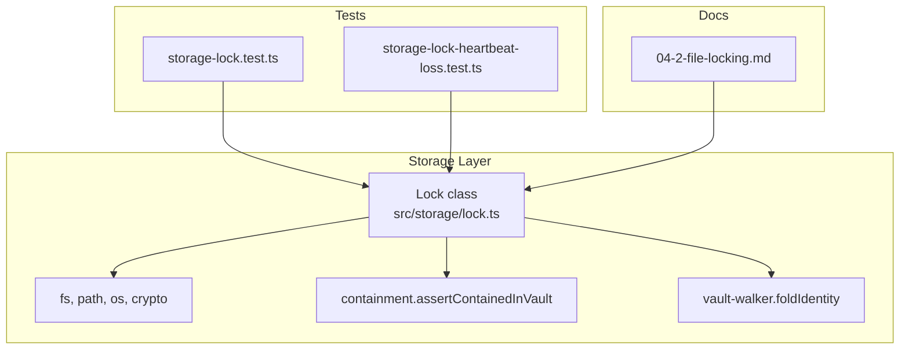
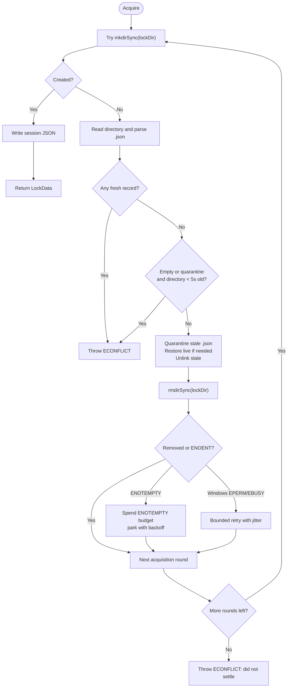
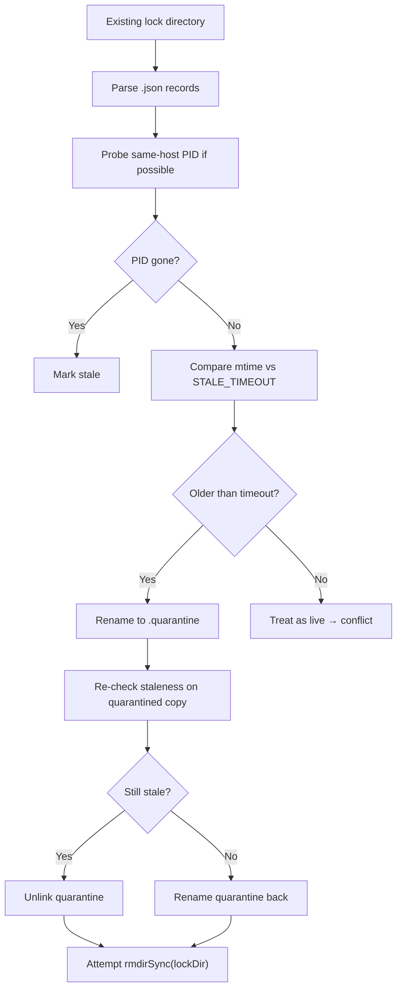
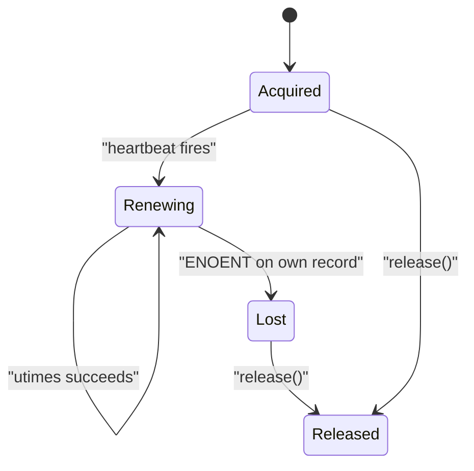
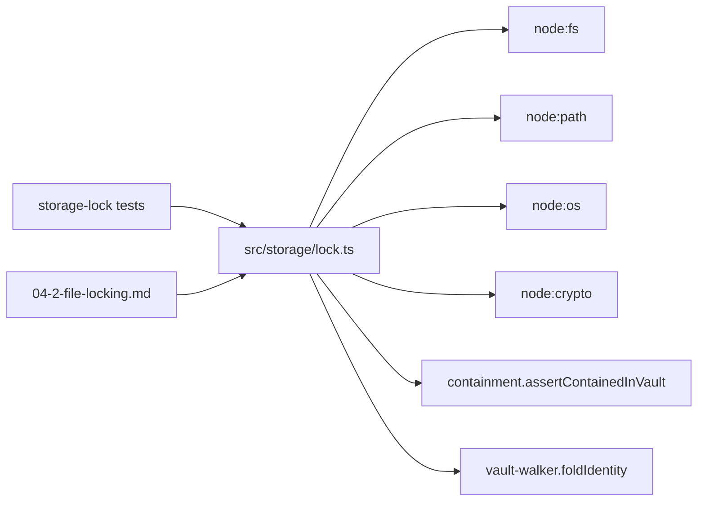

# File Locking and Concurrency Control

## Table of Contents
1. [Introduction](#introduction)
2. [Project Structure](#project-structure)
3. [Core Components](#core-components)
4. [Architecture Overview](#architecture-overview)
5. [Detailed Component Analysis](#detailed-component-analysis)
6. [Dependency Analysis](#dependency-analysis)
7. [Performance Considerations](#performance-considerations)
8. [Troubleshooting Guide](#troubleshooting-guide)
9. [Conclusion](#conclusion)
10. [References](#references)

## Introduction
This document explains the file locking mechanism used by the project to provide cross-process concurrency control for vault resources. The implementation avoids race conditions through atomic directory creation, session-specific lock records, a periodic heartbeat, and stale-lock recovery with quarantine semantics. It also documents lock acquisition bounds, contention handling, timeout behavior, platform differences, retry strategies, debugging techniques, and practical usage patterns.

## Project Structure
The locking logic lives in a single storage module, with extensive tests covering acquisition, stale recovery, bounded retries, heartbeat loss detection, and platform-specific transient errors. User-facing documentation is maintained alongside the code.



## Core Components
- `Lock`: Public API for acquiring, maintaining, and releasing a process-wide lock on a vault target.
- `createLock`: Synchronous acquisition loop using atomic `mkdirSync`, stale inspection, quarantine-based cleanup, and bounded retries.
- `updateHeartbeat` / `startHeartbeat`: Periodic timestamp renewal that detects takeover via `ENOENT`.
- `releaseLock`: Safe release that unlinks only the holder’s session file and attempts to remove an empty lock directory.
- Path helpers: `getLockDir`, `foldLockKey`, and identity folding ensure deterministic, canonical lock directories per note.
- Staleness and conflict utilities: `isLockStale`, `isTransientHandleCode`, `spendEnotemptyBudget`, and `lockConflict`.

Key responsibilities:
- Provide mutual exclusion across processes.
- Recover from crashed or suspended holders.
- Bound all non-forward-progress loops.
- Surface contention as a recognizable conflict error.
- Expose ownership loss to long-running holders.

## Architecture Overview
The lock system maps one logical resource (a vault-relative note path) to exactly one filesystem lock directory under `.palee/locks/`. Each successful acquisition writes one session JSON record containing the lock identifier, process ID, hostname, target path, and creation time. A background timer periodically touches that record so rival processes can detect liveness.

```mermaid
sequenceDiagram
  participant App as "Caller"
  participant Lock as "Lock.acquire()"
  participant Create as "createLock()"
  participant FS as "Filesystem"
  participant HB as "Heartbeat interval"

  App->>Lock: new Lock(vault, target)
  App->>Lock: acquire()
  Lock->>Create: createLock(lockPath, targetPath)
  Create->>FS: mkdirSync(lockDir)
  alt Success
    Create->>FS: writeFileSync(session.json)
    Create-->>Lock: LockData
    Lock->>HB: startHeartbeat()
    HB-->>Lock: updateHeartbeat every HEARTBEAT_INTERVAL
    Lock-->>App: acquired
  else EEXIST
    Create->>FS: readdirSync + inspect .json records
    alt Live record found
      Create-->>Lock: throw ECONFLICT
      Lock-->>App: throws ECONFLICT
    else All stale or incoming
      Create->>FS: quarantine + unlink stale entries
      Create->>FS: rmdirSync(lockDir)
      Create->>Create: retry bounded loop
    end
  end
```

## Detailed Component Analysis

### Lock Identity and Lock Directory Layout
- Locks are not stored next to the target files. They live under `<vault>/.palee/locks/<sha256>.lockdir`.
- Inside the directory, the holder writes one record file named `<lockId>.json`, where the lock ID has the form `L-YYYYMMDDTHHMMSS-<8 hex chars>` (the hex suffix is 4 bytes of random entropy). The record is JSON with the fields `lock_id`, `target`, `pid`, `hostname`, and `created_at` — the PID and hostname are what stale detection and conflict messages report.
- The lock key is derived from the vault-relative path after resolving real paths and applying case folding on platforms where default volumes treat different casings as the same file.
- The resulting SHA-256 hash ensures deterministic mapping from a note to a lock directory while avoiding collisions from symlinked or differently spelled paths.
- Before creating the locks directory, the implementation asserts that it remains contained within the vault root to prevent accidental placement outside the vault.

Practical implications:
- Two callers locking the same logical note converge on the same lock directory.
- Case-insensitive platforms fold names so `Notes/foo.md` and `notes/foo.md` share one lock.
- Linux remains case-sensitive by design; this avoids treating distinct files as one.

### Lock Acquisition Protocol
Acquisition is synchronous at the storage layer and uses OS-level atomicity:

1. Attempt to create the lock directory.
2. On success, write the session JSON file and return `LockData`.
3. On `EEXIST`, read the directory contents and parse `.json` records.
4. If any record is fresh, throw a lock conflict.
5. If the directory appears newly created and empty or contains a quarantine, reject as an incoming process.
6. Otherwise, quarantine each stale record, restore any that turned out live, unlink stale ones, and attempt to remove the directory.
7. Retry bounded rounds when removal cannot proceed immediately.



Key guarantees:
- Every branch either acquires the lock, throws, or makes forward progress observable to the next round.
- The loop is capped at `MAX_ACQUISITION_ITERATIONS` (20 rounds) to avoid unbounded spinning.
- `ENOTEMPTY` is treated as a retryable condition only up to a fixed budget (`ENOTEMPTY_RETRY_ATTEMPTS`: 5 retries after the first attempt, parking with backoff between attempts); beyond that it becomes a conflict error describing residual entries.
- Windows `EPERM`/`EBUSY` handle contention is retried up to 5 times (`WINDOWS_RETRY_ATTEMPTS`) with exponential backoff: 50 ms initial delay, doubling, ±25% jitter, capped at 300 ms per wait. Persistent handles surface as a raw error rather than hanging the CLI.

### Lease-Based Expiration and Stale Recovery
A lock lease expires when its owner stops renewing the record. Staleness detection combines two signals:

- Same-host dead-process reclaim: if the recorded hostname matches the current host and the recorded PID does not exist, the lock is immediately eligible for recovery.
- Timeout fallback: otherwise, compare the current time with the record’s modification time against a platform-specific threshold.

Platform thresholds:
- Windows: 60 seconds.
- Other platforms: 120 seconds.

Recovery uses a quarantine pattern:
1. Rename the `.json` record to `.json.quarantine`.
2. Re-check staleness against the quarantined copy.
3. If still stale, delete the quarantine entry.
4. If live, rename it back; failure to restore is surfaced as a conflict because silently continuing would risk corruption.
5. After sweeping stale entries, remove the lock directory.



### Heartbeat Mechanism and Ownership Loss
Once acquired, the `Lock` instance starts an unreferenced interval that calls `updateHeartbeat` every `HEARTBEAT_INTERVAL` (15,000 ms). The heartbeat touches the access and modification times of the session file without rewriting its content.

Ownership loss detection:
- If `updateHeartbeat` cannot find the expected session file (`ENOENT`), the holder interprets this as a takeover.
- On loss, the holder clears its internal record, stops the interval, sets `lockLost = true`, and leaves the directory alone so it cannot accidentally delete the new holder’s state.

Legitimate health checks:
- A healthy holder continues renewing its record.
- Transient failures such as brief antivirus or indexer handle contention do not cause self-eviction.



### Error Model and Contention Resolution
All contention paths throw a structured Node error carrying `code = 'ECONFLICT'`. The message begins with a stable prefix so upstream consumers can recognize it as a retryable lock conflict. Typical outcomes include:

- Another active holder: `"locked by PID ..."`
- An incoming process recovering the directory: `"locked by an incoming process"`
- Unremovable foreign residue: `"has a lock directory holding an unremovable entry: ..."`
- Directory refusing to empty: `"would not empty after N retries; still present: ..."`
- Exhausted acquisition rounds: `"did not settle after N acquisition attempts"`

CLI integration:
- Command handlers catch `ECONFLICT` and map it to exit code 4 to signal concurrency contention.

### Platform-Specific Considerations
- **Case-folding**: Lock keys are folded on Windows and macOS default volumes to avoid separate locks for different spellings of the same note. Linux remains case-sensitive.
- **Stale thresholds**: Windows uses a shorter timeout due to filesystem latency and clock skew characteristics.
- **Transient directory handles**: Windows reports briefly held directories as `EPERM`/`EBUSY`; these are retried with exponential backoff and jitter. POSIX `EPERM`/`EBUSY` are not considered transient here.
- **Entry name safety**: Residual entry names are escaped before being included in human-readable conflict messages to avoid terminal control character injection.

### Practical Usage Patterns

#### Acquiring a Read Lock
Use the same `Lock` API for reads and writes. The implementation provides exclusive access, so readers must wait for writers unless they use a separate read-write abstraction built on top of this primitive.

Recommended pattern:
1. Construct a `Lock` with the vault path and target note path.
2. Call `acquire()` inside a try block.
3. Perform the read operation.
4. Call `release()` in a `finally` block.

If another process holds the lock, `acquire()` throws a conflict error.

#### Acquiring a Write Lock
Same as reading, but ensure the entire mutation pipeline is wrapped by the lock. Atomic writes should be performed while the lock is held to avoid partial updates visible to other processes.

#### Handling Lock Failures
- Catch the thrown error and inspect its `code`.
- Treat `ECONFLICT` as contention and decide whether to fail fast, log diagnostic information, or propagate it to the CLI handler.
- Do not retry indefinitely; rely on the bounded acquisition loop and caller-level retry policy.

#### Implementing Retry Logic
At the caller level:
- Use exponential backoff with jitter.
- Limit maximum retries.
- Distinguish transient I/O errors from permanent conflicts.
- Reload state after a successful retry because a takeover may have changed the underlying file.

The storage layer already bounds internal retries; external callers should add their own bounded retry strategy around the whole operation.

## Dependency Analysis
The locking module depends on standard Node.js APIs and a small set of internal storage utilities.



Coupling and cohesion:
- Cohesion is high: all locking state, acquisition, heartbeat, and release logic is concentrated in one module.
- Coupling is moderate: it imports containment and vault-walker identity folding to ensure canonical paths, and exports a small public surface for tests.
- There is no circular dependency between the lock module and higher-level CLI commands; CLI handlers consume the exported `Lock` class and interpret `ECONFLICT`.

## Performance Considerations
- **Blocking acquisition**: `createLock` is synchronous and uses `Atomics.wait` for parking instead of CPU-spinning. This prevents event-loop starvation while waiting for transient handles or retry budgets.
- **Backoff policy**: Both `ENOTEMPTY` retries and Windows transient handle retries share the same delay model: doubling base delays, ±25% jitter, and a 300 ms ceiling.
- **Bounded loops**:
  - `ENOTEMPTY_RETRY_ATTEMPTS` limits repeated directory removal attempts.
  - `MAX_ACQUISITION_ITERATIONS` caps the outer acquisition loop.
- **Heartbeat cost**: Touching timestamps is inexpensive compared to rewriting files, reducing disk churn.
- **Contention profile**: Under heavy contention, the system favors predictable termination over aggressive spinning, surfacing conflicts once budgets are exhausted.

## Troubleshooting Guide

### Common Symptoms and Causes
| Symptom | Likely Cause | What to Check |
|---|---|---|
| Immediate `ECONFLICT` | Another process holds a fresh lock | Inspect the lock directory and recorded PID |
| Slow acquisition with pauses | Bounded retry and parking under transient handles | Look for Windows `EPERM`/`EBUSY` or `ENOTEMPTY` scenarios |
| Process keeps writing after losing the lock | Not checking `lock.lockLost` | Add ownership checks between long operations |
| Lock never released after crash | Stale timeout expired and another process took over | Verify stale recovery and heartbeat behavior |
| Failure to remove lock directory | Foreign subdirectory or open handle | Inspect residual entries and antivirus/indexer activity |

### Debugging Techniques
- Inspect `<vault>/.palee/locks/` for `.lockdir` directories and their `.json` records.
- Record lock directory mtime and session file mtime to determine staleness.
- Use test-style spies to observe `fs.utimesSync` calls and confirm heartbeat timing.
- Monitor `Atomics.wait` park durations to verify backoff schedules.
- Capture full error messages from `ECONFLICT` to identify which contention branch triggered.

### Recovery Steps
1. Stop competing processes attempting to mutate the same note.
2. Verify whether the lock is stale using the appropriate timeout.
3. If stale, allow quarantine-based recovery or manually remove orphaned records only after confirming no live holder exists.
4. Restart the affected process and retry with bounded retries.
5. For persistent `ENOTEMPTY`, investigate foreign subdirectories or open handles such as antivirus scans.

## Conclusion
The file locking subsystem provides robust cross-process mutual exclusion for vault notes through atomic directory creation, deterministic path hashing, quarantine-based stale recovery, and a heartbeat-driven lease model. Its design emphasizes bounded execution, clear conflict signaling, platform-aware behavior, and observability of ownership loss. Callers should treat `ECONFLICT` as contention, implement bounded retries with jitter, reload state after retries, and check `lock.lockLost` during long-held operations to avoid writing under a reclaimed lease.

## References

- [src/storage/lock.ts](https://github.com/Kuldeep2822k/cli/blob/main/src/storage/lock.ts)
- [test/storage-lock.test.ts](https://github.com/Kuldeep2822k/cli/blob/main/test/storage-lock.test.ts)
- [test/storage-lock-heartbeat-loss.test.ts](https://github.com/Kuldeep2822k/cli/blob/main/test/storage-lock-heartbeat-loss.test.ts)
- [docs/04-2-file-locking.md](https://github.com/Kuldeep2822k/cli/blob/main/docs/04-2-file-locking.md)
- [src/storage/lock.ts:1-40](https://github.com/Kuldeep2822k/cli/blob/main/src/storage/lock.ts#L1-L40)
- [src/storage/lock.ts:201-260](https://github.com/Kuldeep2822k/cli/blob/main/src/storage/lock.ts#L201-L260)
- [test/storage-lock.test.ts:1-40](https://github.com/Kuldeep2822k/cli/blob/main/test/storage-lock.test.ts#L1-L40)
- [test/storage-lock-heartbeat-loss.test.ts:1-30](https://github.com/Kuldeep2822k/cli/blob/main/test/storage-lock-heartbeat-loss.test.ts#L1-L30)
- [docs/04-2-file-locking.md:1-25](https://github.com/Kuldeep2822k/cli/blob/main/docs/04-2-file-locking.md#L1-L25)
- [src/storage/lock.ts:41-120](https://github.com/Kuldeep2822k/cli/blob/main/src/storage/lock.ts#L41-L120)
- [src/storage/lock.ts:501-865](https://github.com/Kuldeep2822k/cli/blob/main/src/storage/lock.ts#L501-L865)
- [src/storage/lock.ts:866-956](https://github.com/Kuldeep2822k/cli/blob/main/src/storage/lock.ts#L866-L956)
- [docs/04-2-file-locking.md:15-40](https://github.com/Kuldeep2822k/cli/blob/main/docs/04-2-file-locking.md#L15-L40)
- [docs/04-2-file-locking.md:42-140](https://github.com/Kuldeep2822k/cli/blob/main/docs/04-2-file-locking.md#L42-L140)
- [src/storage/lock.ts:261-340](https://github.com/Kuldeep2822k/cli/blob/main/src/storage/lock.ts#L261-L340)
- [docs/04-2-file-locking.md:108-140](https://github.com/Kuldeep2822k/cli/blob/main/docs/04-2-file-locking.md#L108-L140)
- [src/storage/lock.ts:740-780](https://github.com/Kuldeep2822k/cli/blob/main/src/storage/lock.ts#L740-L780)
- [test/storage-lock-heartbeat-loss.test.ts:1-120](https://github.com/Kuldeep2822k/cli/blob/main/test/storage-lock-heartbeat-loss.test.ts#L1-L120)
- [src/storage/lock.ts:341-420](https://github.com/Kuldeep2822k/cli/blob/main/src/storage/lock.ts#L341-L420)
- [docs/04-2-file-locking.md:68-76](https://github.com/Kuldeep2822k/cli/blob/main/docs/04-2-file-locking.md#L68-L76)
- [src/storage/lock.ts:121-200](https://github.com/Kuldeep2822k/cli/blob/main/src/storage/lock.ts#L121-L200)
- [src/storage/lock.ts:261-420](https://github.com/Kuldeep2822k/cli/blob/main/src/storage/lock.ts#L261-L420)
- [src/storage/lock.ts:421-500](https://github.com/Kuldeep2822k/cli/blob/main/src/storage/lock.ts#L421-L500)
- [docs/04-2-file-locking.md:42-107](https://github.com/Kuldeep2822k/cli/blob/main/docs/04-2-file-locking.md#L42-L107)
- [test/storage-lock.test.ts:520-600](https://github.com/Kuldeep2822k/cli/blob/main/test/storage-lock.test.ts#L520-L600)
- [test/storage-lock.test.ts:201-590](https://github.com/Kuldeep2822k/cli/blob/main/test/storage-lock.test.ts#L201-L590)
- [test/storage-lock-heartbeat-loss.test.ts:120-300](https://github.com/Kuldeep2822k/cli/blob/main/test/storage-lock-heartbeat-loss.test.ts#L120-L300)
- [docs/04-2-file-locking.md:141-206](https://github.com/Kuldeep2822k/cli/blob/main/docs/04-2-file-locking.md#L141-L206)
